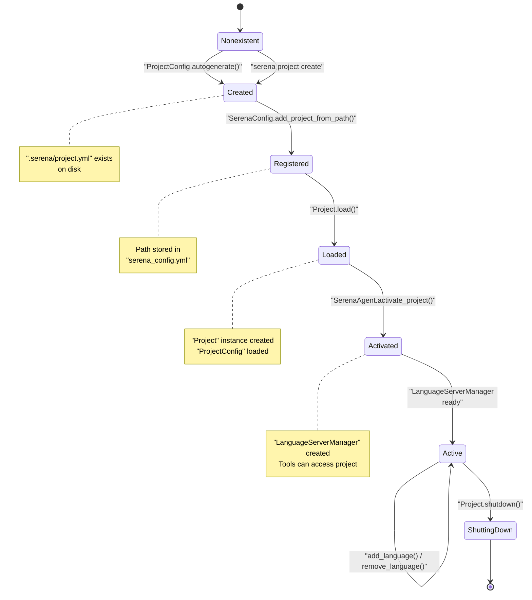
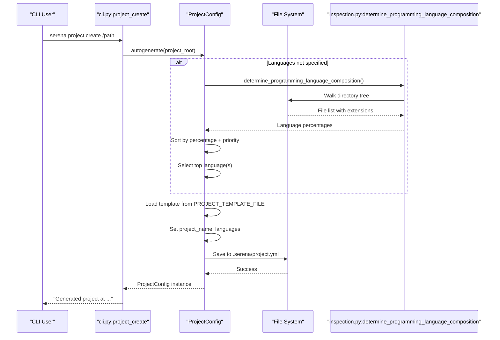
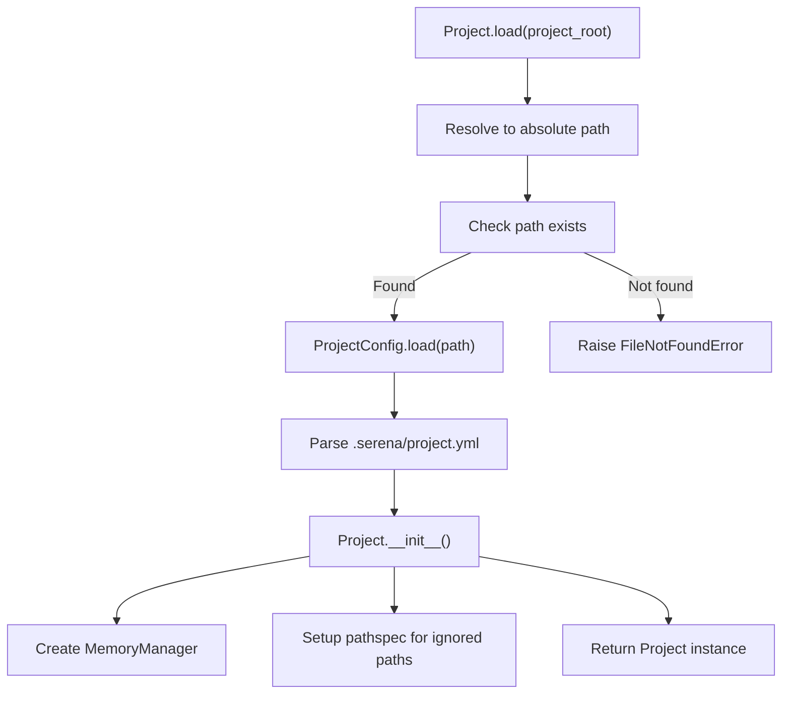
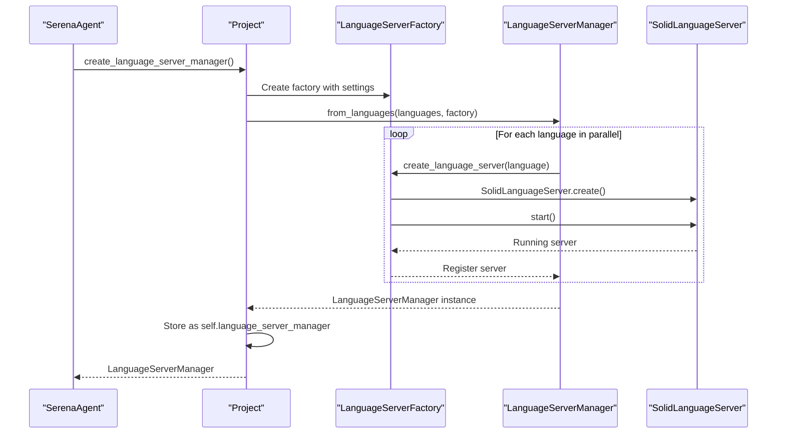
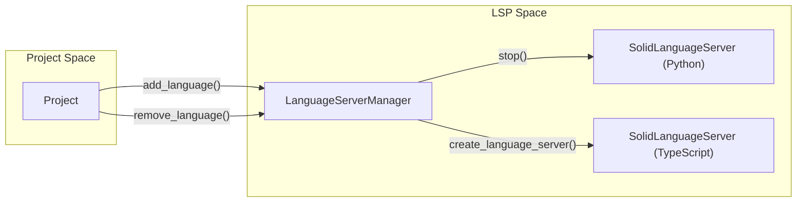
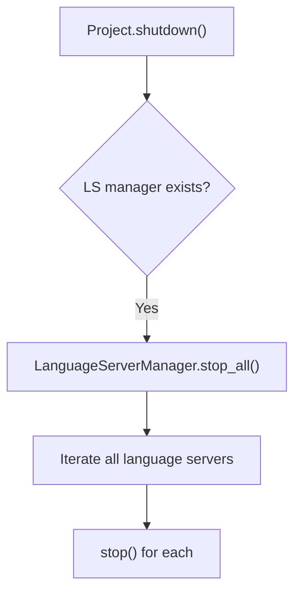

<!-- source: DeepWiki mcp.deepwiki.com · repo oraios/serena · page 5.1 Project Lifecycle · fetched 2026-10-29 -->

# Project Lifecycle

Relevant source files

The following files were used as context for generating this wiki page:

- [.serena/project.yml](.serena/project.yml)
- [src/serena/agent.py](src/serena/agent.py)
- [src/serena/code_editor.py](src/serena/code_editor.py)
- [src/serena/config/serena_config.py](src/serena/config/serena_config.py)
- [src/serena/ls_manager.py](src/serena/ls_manager.py)
- [src/serena/project.py](src/serena/project.py)
- [src/serena/resources/project.template.yml](src/serena/resources/project.template.yml)
- [src/serena/resources/serena_config.template.yml](src/serena/resources/serena_config.template.yml)
- [src/serena/symbol.py](src/serena/symbol.py)
- [src/serena/tools/__init__.py](src/serena/tools/__init__.py)
- [src/serena/tools/cmd_tools.py](src/serena/tools/cmd_tools.py)
- [src/serena/tools/jetbrains_tools.py](src/serena/tools/jetbrains_tools.py)
- [src/serena/tools/symbol_tools.py](src/serena/tools/symbol_tools.py)
- [src/serena/tools/tools_base.py](src/serena/tools/tools_base.py)
- [test/serena/config/test_serena_config.py](test/serena/config/test_serena_config.py)
- [test/serena/test_activation_command.py](test/serena/test_activation_command.py)
- [test/serena/test_ls_file_sync.py](test/serena/test_ls_file_sync.py)
- [test/serena/test_symbol.py](test/serena/test_symbol.py)

## Purpose and Scope

This document describes the complete lifecycle of a Serena project, from initial creation through activation, runtime modifications, and shutdown. A project in Serena represents a codebase directory with associated configuration, language servers, and metadata. It acts as the central coordinator between the `SerenaAgent`, the `LanguageServerManager`, and the `MemoryManager`.

For information about project-specific memory management, see [Memory Management](#5.2). For details on file operations and path validation, see [File Operations and Ignore Patterns](#5.3).

---

## Project States and Transitions

A Serena project progresses through distinct states during its lifetime:

Title: Project State Machine

Sources: [src/serena/project.py:137-148](), [src/serena/config/serena_config.py:1016-1044](), [src/serena/agent.py:734-776]()

---

## Project Creation

### Creation Workflow

Project creation generates a `project.yml` configuration file in the `.serena` directory within the project root. This can happen through CLI commands or programmatically via `ProjectConfig.autogenerate`.

Title: Project Creation Sequence

Sources: [src/serena/config/serena_config.py:594-650](), [src/serena/util/inspection.py:1-100]()

### ProjectConfig Generation

The `ProjectConfig.autogenerate()` method is the primary entry point for creating new project configurations:

| Step | Action | Code Reference |
|------|--------|----------------|
| 1. Resolve path | Convert to absolute path, verify exists | [src/serena/config/serena_config.py:594-596]() |
| 2. Determine name | Use provided name or directory name | [src/serena/config/serena_config.py:599]() |
| 3. Detect languages | Call `determine_programming_language_composition()` | [src/serena/config/serena_config.py:601-615]() |
| 4. Sort languages | By file count percentage and priority | [src/serena/config/serena_config.py:617-619]() |
| 5. Load template | Read `PROJECT_TEMPLATE_FILE` | [src/serena/config/serena_config.py:643]() |
| 6. Populate fields | Set `project_name` and `languages` | [src/serena/config/serena_config.py:644-645]() |
| 7. Save to disk | Write `.serena/project.yml` | [src/serena/config/serena_config.py:647-649]() |

Sources: [src/serena/config/serena_config.py:574-650]()

---

## Project Loading

### Loading Process

Loading a project creates a `Project` instance from an existing configuration on disk via `Project.load()`.

Title: Project Loading Flow

Sources: [src/serena/project.py:137-148](), [src/serena/project.py:33-78]()

### Project Initialization

The `Project.__init__` method performs several critical setup tasks:

| Task | Purpose | Code Reference |
|------|---------|----------------|
| Store config | Save `project_root` and `project_config` | [src/serena/project.py:42-44]() |
| Create MemoryManager | Initialize project memories in `.serena/` folder | [src/serena/project.py:50-54]() |
| Line Ending | Resolve line endings from project or global config | [src/serena/project.py:57]() |
| Async Ignore Spec | Gathers ignore patterns in a background thread `gather-ignorespec` | [src/serena/project.py:74-77]() |
| Gitignore Generation | Creates `.gitignore` in `.serena/` to hide caches | [src/serena/project.py:65-71]() |

Sources: [src/serena/project.py:33-78]()

---

## Project Activation

### Activation via SerenaAgent

Activation occurs when a `SerenaAgent` targets a project. This triggers the initialization of the `LanguageServerManager` and the startup of relevant language servers.

Title: Project Activation Sequence

Sources: [src/serena/project.py:221-254](), [src/serena/ls_manager.py:91-147]()

### Activation Message

The `get_activation_message()` method provides the agent with an initial overview of the project, including:
- Project name and root path.
- Active language servers.
- Summary of available memories (project-local and global).
- Composition of programming languages in the codebase.

Sources: [src/serena/project.py:161-185]()

---

## Runtime Language Management

### Adding and Removing Languages

Languages can be added or removed dynamically via the `Project` instance. This updates the underlying `LanguageServerManager` and persists the changes to the `project.yml` configuration.

| Method | Action | Implementation Detail |
|--------|--------|-----------------------|
| `add_language(language)` | Starts a new LS and adds to config | [src/serena/project.py:256-277]() |
| `remove_language(language)` | Stops the LS and removes from config | [src/serena/project.py:279-299]() |

Title: Language Server Manager Control

Sources: [src/serena/project.py:256-299](), [src/serena/ls_manager.py:162-183]()

---

## Project Shutdown

Proper shutdown ensures that all running language servers are terminated cleanly.

Title: Project Shutdown Flow

Sources: [src/serena/project.py:301-304](), [src/serena/ls_manager.py:197-205]()

---

## Key Classes and Functions

| Entity | Role | Source |
|--------|------|--------|
| `Project.load()` | Factory method to instantiate a Project from a path. | [src/serena/project.py:137-148]() |
| `LanguageServerManager` | Orchestrates the lifecycle of multiple `SolidLanguageServer` instances. | [src/serena/ls_manager.py:64-147]() |
| `LanguageServerFactory` | Encapsulates the configuration logic for creating new language servers. | [src/serena/ls_manager.py:21-61]() |
| `MemoryManager` | Handles persistent Markdown-based project memories. | [src/serena/memories/memory_manager.py:25-236]() |
| `SerenaAgent.activate_project()` | High-level agent entry point to switch the active project context. | [src/serena/agent.py:734-776]() |

Sources: [src/serena/project.py](), [src/serena/ls_manager.py](), [src/serena/agent.py]()

---

