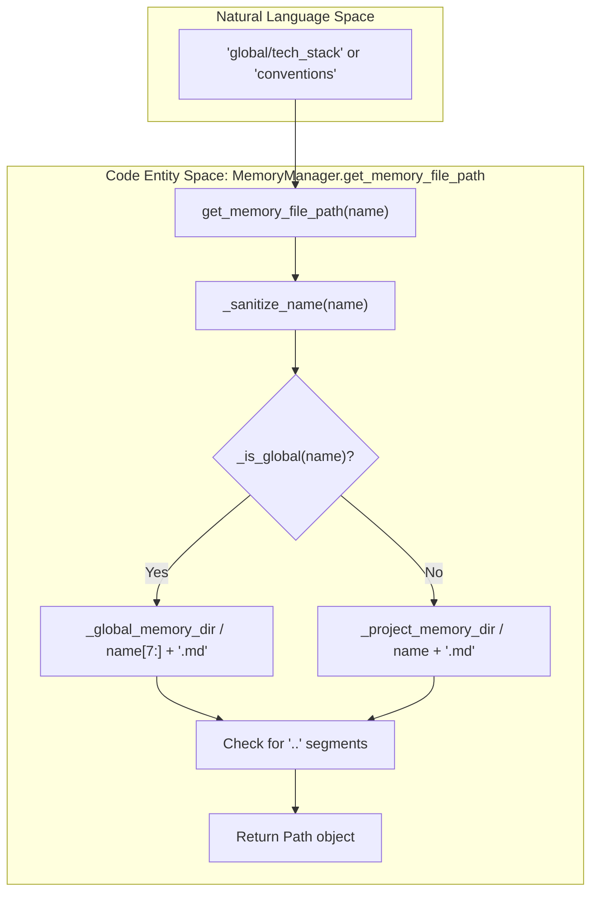
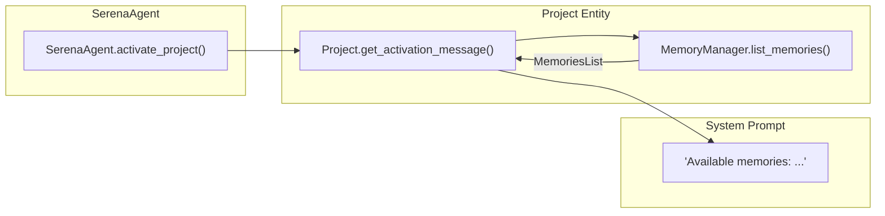

<!-- source: DeepWiki mcp.deepwiki.com · repo oraios/serena · page 5.2 Memory Management · fetched 2026-10-29 -->

# Memory Management

Relevant source files

The following files were used as context for generating this wiki page:

- [.serena/.gitignore](.serena/.gitignore)
- [.serena/memories/conventions.md](.serena/memories/conventions.md)
- [.serena/memories/core.md](.serena/memories/core.md)
- [.serena/memories/memory_maintenance.md](.serena/memories/memory_maintenance.md)
- [.serena/memories/serena_repository_structure.md](.serena/memories/serena_repository_structure.md)
- [.serena/memories/suggested_commands.md](.serena/memories/suggested_commands.md)
- [.serena/memories/task_completion.md](.serena/memories/task_completion.md)
- [.serena/memories/tech_stack.md](.serena/memories/tech_stack.md)
- [docs/02-usage/045_memories.md](docs/02-usage/045_memories.md)
- [src/serena/memories/memory_manager.py](src/serena/memories/memory_manager.py)
- [src/serena/memories/memory_reference_analysis.py](src/serena/memories/memory_reference_analysis.py)
- [src/serena/resources/config/prompt_templates/simple_tool_outputs.yml](src/serena/resources/config/prompt_templates/simple_tool_outputs.yml)
- [src/serena/resources/memory_maintenance.md](src/serena/resources/memory_maintenance.md)
- [src/serena/tools/memory_tools.py](src/serena/tools/memory_tools.py)
- [src/serena/util/dataclass.py](src/serena/util/dataclass.py)
- [src/serena/util/yaml.py](src/serena/util/yaml.py)
- [test/serena/test_memories_manager.py](test/serena/test_memories_manager.py)
- [test/serena/util/test_yaml.py](test/serena/util/test_yaml.py)

This page covers Serena's persistent named-memory system for projects: the `MemoryManager` class, its file storage model, the MCP tools that expose it to the agent, and its integration with the project activation message and dashboard.

---

## Overview

Serena provides a persistent, project-scoped and global key-value store for the LLM agent to save and retrieve notes across conversations. Each unit of stored information is called a **memory**. Memories are stored as Markdown files on disk inside the project's `.serena/memories/` directory or a global directory and survive between agent sessions. [src/serena/memories/memory_manager.py:44-46](), [src/serena/config/serena_config.py:111-113]().

The primary use case is **onboarding**: during a first conversation, the agent explores the codebase and writes memories describing its structure. Subsequent conversations can retrieve these memories instead of re-analyzing the code. [src/serena/resources/config/prompt_templates/simple_tool_outputs.yml:5-15]().

---

## Storage Layout

Memories are stored as `.md` files. Project-local memories reside under `{project_root}/.serena/memories/`, while global memories are stored in the user's Serena home directory (default `~/.serena/memories/global/`). [src/serena/memories/memory_manager.py:27-27](), [src/serena/memories/memory_manager.py:44-47]().

The memory name maps directly to a path:

| Memory Name | Scope | File Path |
|---|---|---|
| `core` | Project | `.serena/memories/core.md` |
| `modules/frontend` | Project | `.serena/memories/modules/frontend.md` |
| `global/common_patterns` | Global | `~/.serena/memories/global/common_patterns.md` |

Key storage facts:
- The directory is created on first use (`mkdir(parents=True, exist_ok=True)`). [src/serena/memories/memory_manager.py:46-46]().
- All memory files are encoded using `SERENA_FILE_ENCODING` (UTF-8). [src/serena/memories/memory_manager.py:12-12](), [src/serena/memories/memory_manager.py:47-47]().
- If a name is passed with a `.md` suffix or `mem:` prefix, it is sanitized before path resolution. [src/serena/memories/memory_manager.py:74-80]().
- Subdirectories (topics) are created automatically when saving to a nested path. [src/serena/memories/memory_manager.py:150-167]().

Sources: [src/serena/memories/memory_manager.py:25-50](), [src/serena/memories/memory_manager.py:74-80](), [src/serena/memories/memory_manager.py:150-167](), [src/serena/config/serena_config.py:111-113]()

---

## MemoryManager Class

`MemoryManager` (defined in `src/serena/memories/memory_manager.py`) is the interface for all memory I/O. It handles both project-specific and global memories. Global memories are identified by the `global` topic prefix. [src/serena/memories/memory_manager.py:25-26](), [src/serena/memories/memory_manager.py:70-71]().

**Memory Name → File Path Resolution**

Sources: [src/serena/memories/memory_manager.py:70-80](), [src/serena/memories/memory_manager.py:150-167]()

### Read-Only and Ignored Memories
Memories can be restricted via regex patterns defined in the configuration. [src/serena/memories/memory_manager.py:33-35]().
- **Read-Only**: Prevents the agent from modifying memories (e.g., `global/.*`). [src/serena/memories/memory_manager.py:51-55]().
- **Ignored**: Completely excludes memories from listing or access via memory tools. These must be accessed via raw file tools like `read_file`. [src/serena/memories/memory_manager.py:57-68]().

### Method Reference

| Method | Signature | Behaviour |
|---|---|---|
| `load_memory` | `(name: str) -> str` | Returns file contents, or a "not found" hint string if absent. [src/serena/memories/memory_manager.py:195-201]() |
| `save_memory` | `(name, content, is_tool_context)` | Checks write access, ensures parent directories, then writes. [src/serena/memories/memory_manager.py:220-230]() |
| `list_memories` | `(topic: str = "") -> MemoriesList` | Recursively finds `.md` files in both global and project dirs. [src/serena/memories/memory_manager.py:232-254]() |
| `delete_memory` | `(name, is_tool_context)` | Removes the file if not read-only. [src/serena/memories/memory_manager.py:256-267]() |
| `edit_memory` | `(name, needle, repl, ...)` | Performs regex or literal replacement within memory content. [src/serena/memories/memory_manager.py:313-333]() |
| `rename_memory_and_propagate_references` | `(old_name, new_name, ...)` | Renames file and updates `mem:name` references in all other memories. [src/serena/memories/memory_manager.py:269-299]() |

Sources: [src/serena/memories/memory_manager.py:195-333]()

---

## Integration with the Project Class

`MemoryManager` is typically instantiated during project setup or agent initialization. [src/serena/memories/memory_manager.py:30-49]().

**Activation Message**: When a project is activated, the agent is provided with the list of available memories. This is crucial for the agent to know which context is already captured.

Sources: [src/serena/memories/memory_manager.py:232-254](), [src/serena/resources/config/prompt_templates/simple_tool_outputs.yml:19-20]()

---

## MCP Tool Layer

Memory operations are exposed via tools in `src/serena/tools/memory_tools.py`. These tools utilize the `MemoryManager` instance.

### Tool Details

| Tool Class | Tool Name | Description |
|---|---|---|
| `WriteMemoryTool` | `write_memory` | Writes/overwrites a memory. Enforces `default_max_tool_answer_chars`. [src/serena/tools/memory_tools.py:9-35]() |
| `ReadMemoryTool` | `read_memory` | Reads a memory by name using `load_memory`. [src/serena/tools/memory_tools.py:38-47]() |
| `ListMemoriesTool` | `list_memories` | Lists available memories, optionally filtered by topic. [src/serena/tools/memory_tools.py:50-59]() |
| `DeleteMemoryTool` | `delete_memory` | Deletes a memory (requires explicit user instruction). [src/serena/tools/memory_tools.py:62-71]() |
| `RenameMemoryTool` | `rename_memory` | Renames a memory and propagates `mem:` reference updates. [src/serena/tools/memory_tools.py:74-91]() |
| `EditMemoryTool` | `edit_memory` | Performs regex/literal replacement within a memory. [src/serena/tools/memory_tools.py:94-123]() |

Sources: [src/serena/tools/memory_tools.py:1-123]()

---

## Onboarding Workflow and Maintenance

The memory system is the backbone of the **onboarding** process.

1.  **Onboarding Tool**: Instructs the agent to create a target memory layout: `mem:core`, `mem:tech_stack`, `mem:suggested_commands`, `mem:conventions`, and `mem:task_completion`. [src/serena/resources/config/prompt_templates/simple_tool_outputs.yml:15-28]().
2.  **Memory Maintenance**: Every onboarded project contains a `memory_maintenance` memory (seeded from a template) that defines style, naming, and reference conventions. [src/serena/memories/memory_manager.py:89-121](), [src/serena/resources/memory_maintenance.md:1-20]().
3.  **Reference Integrity**: Serena supports a `mem:name` reference convention. `MemoryReferenceAnalyzer` can check for stale references (pointing to non-existent memories) and suggest fixes based on name similarity. [src/serena/memories/memory_reference_analysis.py:1-20](), [src/serena/memories/memory_manager.py:123-148]().
4.  **CLI Check**: Users can run `serena memories check` to generate a referential integrity report. [src/serena/resources/memory_maintenance.md:33-33]().

Sources: [src/serena/resources/config/prompt_templates/simple_tool_outputs.yml:5-42](), [src/serena/memories/memory_manager.py:89-148](), [src/serena/memories/memory_reference_analysis.py:1-20]()

---

