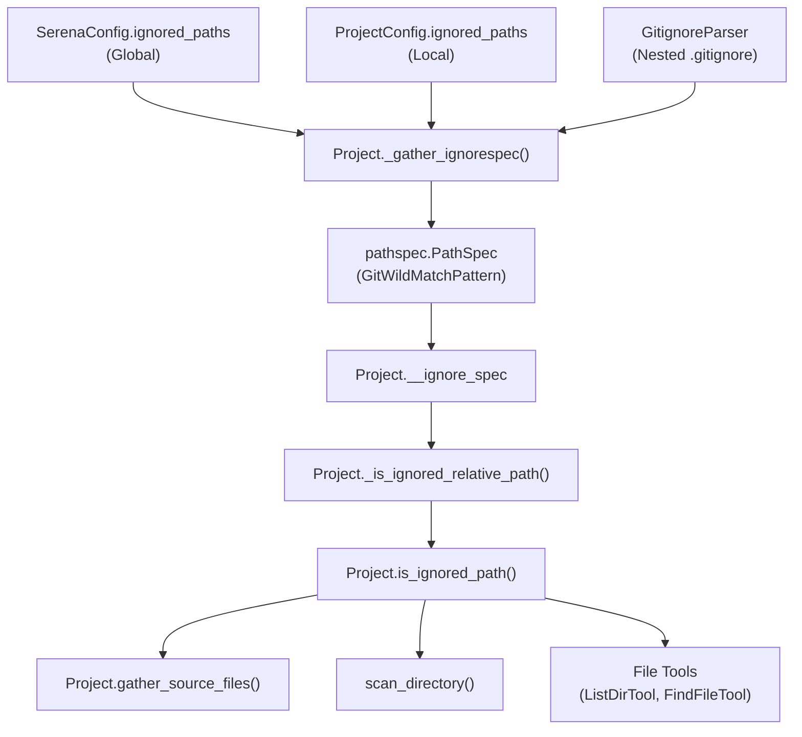
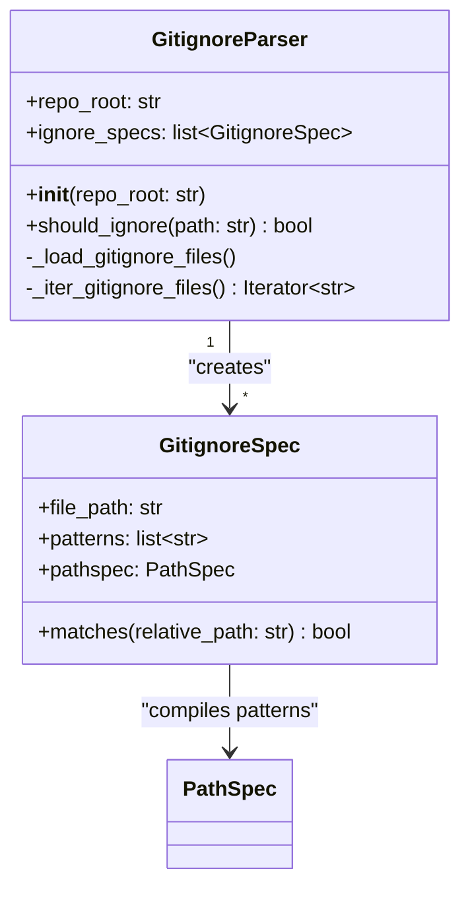

<!-- source: DeepWiki mcp.deepwiki.com · repo oraios/serena · page 5.3 File Operations and Ignore Patterns · fetched 2026-10-29 -->

# File Operations and Ignore Patterns

<details>
<summary>Relevant source files</summary>

The following files were used as context for generating this wiki page:

- [.serena/project.yml](.serena/project.yml)
- [src/serena/agent.py](src/serena/agent.py)
- [src/serena/config/serena_config.py](src/serena/config/serena_config.py)
- [src/serena/project.py](src/serena/project.py)
- [src/serena/resources/project.template.yml](src/serena/resources/project.template.yml)
- [src/serena/resources/serena_config.template.yml](src/serena/resources/serena_config.template.yml)
- [src/serena/tools/file_tools.py](src/serena/tools/file_tools.py)
- [src/serena/util/file_proxy.py](src/serena/util/file_proxy.py)
- [src/serena/util/file_system.py](src/serena/util/file_system.py)
- [src/serena/util/inspection.py](src/serena/util/inspection.py)
- [src/serena/util/text_utils.py](src/serena/util/text_utils.py)
- [test/serena/config/test_serena_config.py](test/serena/config/test_serena_config.py)
- [test/serena/test_text_utils.py](test/serena/test_text_utils.py)
- [test/serena/util/test_file_system.py](test/serena/util/test_file_system.py)
- [test/serena/util/test_inspection.py](test/serena/util/test_inspection.py)

</details>


This page covers how Serena scans project directories, discovers files, and determines whether paths should be excluded from processing. The core mechanisms live in `src/serena/util/file_system.py` and are integrated into the `Project` class in `src/serena/project.py`.

---

## Overview

Serena must enumerate files for directory listing, source code searching, language server synchronization, and project language detection. A consistent ignore-filtering layer ensures that build artifacts, generated files, and `.git` internals are excluded from all operations.

The system consists of two layers:

| Layer | Location | Responsibility |
|---|---|---|
| Low-level utilities | [src/serena/util/file_system.py:1-12]() | `scan_directory`, `GitignoreParser`, `match_path` |
| Project integration | [src/serena/project.py:1-25]() | Combine global + project + gitignore patterns; manage `MemoryManager` |

**System Data Flow Diagram:**

Title: "File Discovery and Ignore Pattern Resolution"

Sources: [src/serena/project.py:79-107](), [src/serena/config/serena_config.py:57-125](), [src/serena/util/file_system.py:130-147]()

---

## Low-Level File System Utilities

### `scan_directory`
[src/serena/util/file_system.py:22-88]()

`scan_directory` is the foundation for all directory traversal. It returns a `ScanResult` named tuple containing `directories` and `files` [src/serena/util/file_system.py:15-19]().

**Signature:**
```python
def scan_directory(
    path: str,
    recursive: bool = False,
    relative_to: str | None = None,
    is_ignored_dir: Callable[[str], bool] | None = None,
    is_ignored_file: Callable[[str], bool] | None = None,
) -> ScanResult:
```

Key behaviors:
- Uses `os.scandir` for efficient iteration [src/serena/util/file_system.py:49]().
- If `recursive=True`, it descends into subdirectories not excluded by `is_ignored_dir` [src/serena/util/file_system.py:69-78]().
- Both `is_ignored_dir` and `is_ignored_file` receive absolute paths for evaluation [src/serena/util/file_system.py:64-67]().
- `PermissionError` on any entry is caught and logged as a debug message, skipping the entry [src/serena/util/file_system.py:79-86]().

Sources: [src/serena/util/file_system.py:22-88]()

### `find_all_non_ignored_files`
[src/serena/util/file_system.py:91-102]()

A convenience wrapper that scans a repo root respecting only `.gitignore` files. It is primarily used by `compute_language_server_support_composition` to analyze project structure without counting ignored artifacts [src/serena/util/inspection.py:35-36]().

Sources: [src/serena/util/file_system.py:91-102](), [src/serena/util/inspection.py:35-36]()

---

## Gitignore Handling

### `GitignoreParser` and `GitignoreSpec`
[src/serena/util/file_system.py:105-182]()

Serena implements a custom parser to handle nested `.gitignore` files, mirroring standard Git behavior.

**Class Relationship Diagram:**

Title: "Gitignore Abstraction Layer"

Sources: [src/serena/util/file_system.py:105-156]()

#### Discovery and Scoping
The parser performs a top-down traversal starting from the repository root [src/serena/util/file_system.py:157-164](). It discovers `.gitignore` files iteratively [src/serena/util/file_system.py:165-182]().
- **Path Matching**: Patterns are compiled into a `PathSpec` object for pattern matching [src/serena/util/file_system.py:113-118]().
- **PathSpec Integration**: It uses the `pathspec` library with `GitWildMatchPattern` to compile and evaluate ignore rules [src/serena/util/file_system.py:118]().

#### `should_ignore`
[src/serena/util/file_system.py:277-314]()
Checks a path against all loaded `GitignoreSpec` objects.
- It iterates through all discovered `ignore_specs` [src/serena/util/file_system.py:290-291]().
- It handles both file and directory paths, ensuring trailing slashes are considered for directory-only patterns [src/serena/util/file_system.py:302-306]().

Sources: [src/serena/util/file_system.py:277-314]()

---

## Project Integration

### Building the Combined Ignore Spec
The `Project` class combines patterns from multiple sources to create a unified ignore specification in `_gather_ignorespec` [src/serena/project.py:79-111](). This process runs in a daemon thread upon project initialization to ensure immediate activation [src/serena/project.py:77](). The spec includes:
1. **Global Ignores**: Defined in `SerenaConfig.ignored_paths` [src/serena/project.py:83]().
2. **Project Ignores**: Defined in `ProjectConfig.ignored_paths` [src/serena/project.py:84]().
3. **Gitignore Support**: Controlled by `ignore_all_files_in_gitignore` in the project configuration [src/serena/project.py:92]().

### Memory Management and Ignore Patterns
[src/serena/memories/memory_manager.py:25-50]()

The `MemoryManager` class handles project-specific and global memories, applying its own set of ignore and read-only patterns.
- `ignored_memory_patterns`: Patterns for memories to completely exclude from listing and reading [src/serena/project.py:49]().
- `read_only_memory_patterns`: Patterns marking memories as immutable [src/serena/project.py:48]().
- **Initialization**: Patterns are passed from `Project` to `MemoryManager` during project instantiation [src/serena/project.py:50-54]().

Sources: [src/serena/project.py:48-54](), [src/serena/memories/memory_manager.py:25-50]()

---

## Language Composition Detection

### `compute_language_server_support_composition`
[src/serena/util/inspection.py:30-66]()

This utility is used during project initialization (specifically in `ProjectConfig.autogenerate`) to analyze code distribution and select the dominant language server.

1. It retrieves all non-ignored files using `find_all_non_ignored_files` [src/serena/util/inspection.py:35-36]().
2. It iterates through all registered `LanguageServerId` members [src/serena/util/inspection.py:43]().
3. It uses the language server's `get_source_fn_matcher()` to count files matching specific extensions for each language [src/serena/util/inspection.py:44-51]().
4. It returns a dictionary mapping `LanguageServerId` to their percentage of the codebase (e.g., `{LanguageServerId.PYTHON: 85.0, LanguageServerId.TYPESCRIPT: 15.0}`) [src/serena/util/inspection.py:59-66]().

Sources: [src/serena/util/inspection.py:30-66](), [src/serena/config/serena_config.py:35]()

---

## Path Validation and Safety

Serena enforces path boundaries to prevent the agent from accessing files outside the project root or those explicitly ignored.

| Component | Role |
|---|---|
| `ProjectConfig` | Stores `ignored_paths` and `ignore_all_files_in_gitignore` settings [src/serena/project.py:88-96](). |
| `GitignoreParser` | Recursively loads all `.gitignore` files within the project root [src/serena/util/file_system.py:144-156](). |
| `ListDirTool` | Uses `project.get_is_ignored_path_fn` to filter directory listings [src/serena/tools/file_tools.py:122-129](). |
| `FindFileTool` | Filters results by applying ignore logic during recursive search [src/serena/tools/file_tools.py:151-167](). |

Sources: [src/serena/project.py:88-96](), [src/serena/util/file_system.py:144-156](), [src/serena/tools/file_tools.py:122-167]()

---

