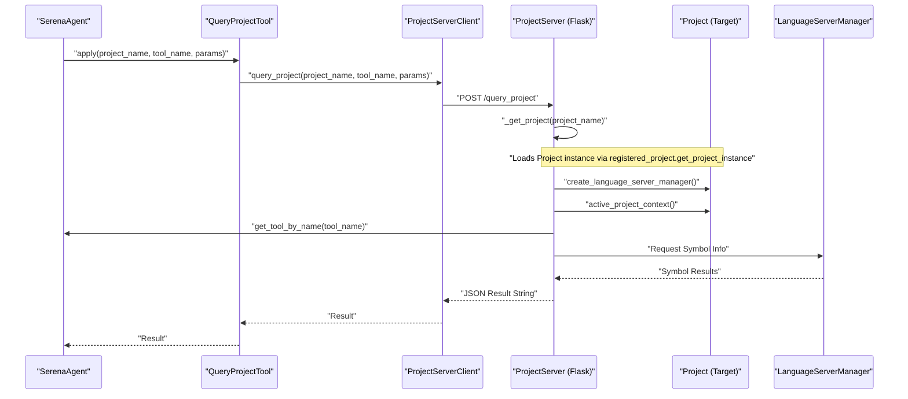
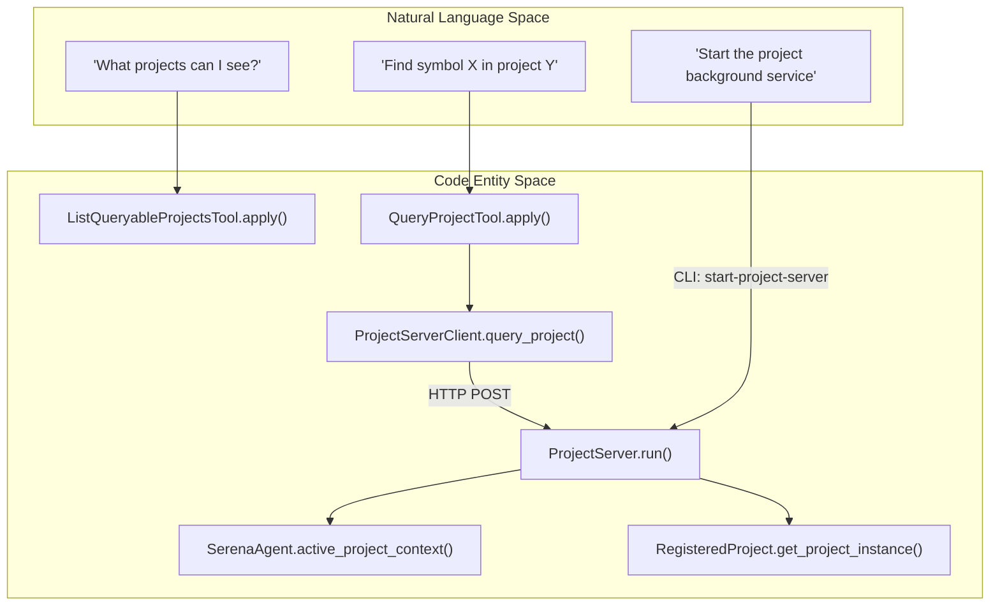

<!-- source: DeepWiki mcp.deepwiki.com · repo oraios/serena · page 5.4 Cross-Project Querying · fetched 2026-10-29 -->

# Cross-Project Querying

<details>
<summary>Relevant source files</summary>

The following files were used as context for generating this wiki page:

- [scripts/print_tool_overview.py](scripts/print_tool_overview.py)
- [src/serena/cli.py](src/serena/cli.py)
- [src/serena/jetbrains/jetbrains_plugin_client.py](src/serena/jetbrains/jetbrains_plugin_client.py)
- [src/serena/jetbrains/jetbrains_types.py](src/serena/jetbrains/jetbrains_types.py)
- [src/serena/mcp.py](src/serena/mcp.py)
- [src/serena/project_server.py](src/serena/project_server.py)
- [src/serena/resources/config/internal_modes/jetbrains.yml](src/serena/resources/config/internal_modes/jetbrains.yml)
- [src/serena/resources/config/modes/query-projects.yml](src/serena/resources/config/modes/query-projects.yml)
- [src/serena/tools/query_project_tools.py](src/serena/tools/query_project_tools.py)
- [test/serena/config/test_global_ignored_paths.py](test/serena/config/test_global_ignored_paths.py)
- [test/serena/test_cli_project_commands.py](test/serena/test_cli_project_commands.py)
- [test/serena/test_edit_marker.py](test/serena/test_edit_marker.py)
- [test/serena/test_mcp.py](test/serena/test_mcp.py)

</details>


Serena provides a specialized infrastructure for querying code entities, symbols, and files from projects that are not currently active in the agent's primary session. This capability is essential for multi-repo architectures where an agent needs to reference external definitions, understand cross-project dependencies, or locate similar implementation patterns in other registered repositories.

## Architecture and Data Flow

Cross-project querying is facilitated by the `ProjectServer` [src/serena/project_server.py:33-43](), a lightweight Flask service that allows the agent to execute read-only tools within the context of any registered project.

The system distinguishes between two primary backends for cross-project symbol retrieval:
1.  **LSP (Language Server Protocol):** Requires a running `ProjectServer` instance to manage on-demand loading of language servers for the target project [src/serena/tools/query_project_tools.py:71-76]().
2.  **JetBrains:** Communicates directly with open IDE instances via the `JetBrainsPluginClientManager`, bypassing the need for a separate `ProjectServer` [src/serena/tools/query_project_tools.py:25-28]().

### Data Flow: Querying via ProjectServer (LSP)

The following diagram illustrates the flow when an agent queries a non-active project using the LSP backend.

**Diagram: Cross-Project Tool Execution Flow**

Sources: [src/serena/project_server.py:67-71](), [src/serena/project_server.py:90-98](), [src/serena/tools/query_project_tools.py:58-60](), [src/serena/project_server.py:84-87]()

## The ProjectServer

The `ProjectServer` is a dedicated service that exposes a `SerenaAgent`'s querying capabilities via an HTTP interface.

### Key Components
*   **`ProjectServer` Class:** Initializes a `SerenaAgent` with `web_dashboard` and `gui_log_window` disabled, forcing the `LanguageBackend.LSP` [src/serena/project_server.py:47-53]().
*   **Project Caching:** Loaded projects are stored in `_loaded_projects_by_root` to ensure subsequent queries to the same project do not re-initialize language servers [src/serena/project_server.py:56-87]().
*   **`ProjectServerClient`:** A utility used by tools to communicate with the server. It performs a heartbeat check on initialization to ensure the server is reachable at `SerenaPorts.PROJECT_SERVER_PORT` (24283) [src/serena/project_server.py:116-140](), [src/serena/constants.py:11-11]().

### REST Endpoints
| Endpoint | Method | Description |
| :--- | :--- | :--- |
| `/heartbeat` | GET | Returns `{"status": "alive"}` to verify server health [src/serena/project_server.py:63-65](). |
| `/query_project` | POST | Accepts a `QueryProjectRequest` containing `project_name`, `tool_name`, and `tool_params_json` [src/serena/project_server.py:22-31](). |

Sources: [src/serena/project_server.py:45-45](), [src/serena/project_server.py:67-70]()

## Cross-Project Tools

Two primary tools are exposed to the agent when the `query-projects` mode is active [src/serena/resources/config/modes/query-projects.yml:1-9]().

### ListQueryableProjectsTool
This tool allows the agent to discover which projects are available for querying [src/serena/tools/query_project_tools.py:9-12]().
*   **LSP Backend:** Returns all projects registered in `serena_config.yml` [src/serena/tools/query_project_tools.py:30-31]().
*   **JetBrains Backend:** Only returns projects that currently have an active IDE instance connected via the plugin, matched using `JetBrainsPluginClientManager().match_clients()` [src/serena/tools/query_project_tools.py:25-28]().

### QueryProjectTool
This tool executes a specific read-only tool in the context of a target project [src/serena/tools/query_project_tools.py:40-44]().
*   **Validation:** It strictly enforces that the requested tool is `read-only` via `tool.is_readonly()` [src/serena/tools/query_project_tools.py:56-56]().
*   **Execution Logic:** 
    *   If using LSP and the tool is symbolic (e.g., `find_symbol`), it routes the request through `ProjectServerClient` [src/serena/tools/query_project_tools.py:71-76]().
    *   If using JetBrains or the tool is non-symbolic, it instantiates the project locally via `registered_project.get_project_instance` and uses `active_project_context` to execute the tool [src/serena/tools/query_project_tools.py:61-66]().

Sources: [src/serena/tools/query_project_tools.py:9-12](), [src/serena/tools/query_project_tools.py:40-44]()

## Natural Language to Code Entity Mapping

The following diagram bridges the agent's intent (Natural Language Space) to the specific code entities that handle cross-project logic (Code Entity Space).

**Diagram: Cross-Project Entity Mapping**

Sources: [src/serena/tools/query_project_tools.py:14-20](), [src/serena/tools/query_project_tools.py:46-54](), [src/serena/project_server.py:100-113](), [src/serena/project_server.py:85-85]()

## CLI Usage

To enable cross-project querying for agents using the LSP backend, the project server must be started. This is typically done via the `serena` CLI entry point.

```bash
# Start the project server on the default port (24283)
serena start-project-server
```

When the server is running, the agent can use the `query_project` tool to interact with any project defined in the `SerenaConfig` [src/serena/project_server.py:74-77]().

Sources: [src/serena/project_server.py:45-45](), [src/serena/project_server.py:112-113](), [src/serena/cli.py:140-149]()

---

