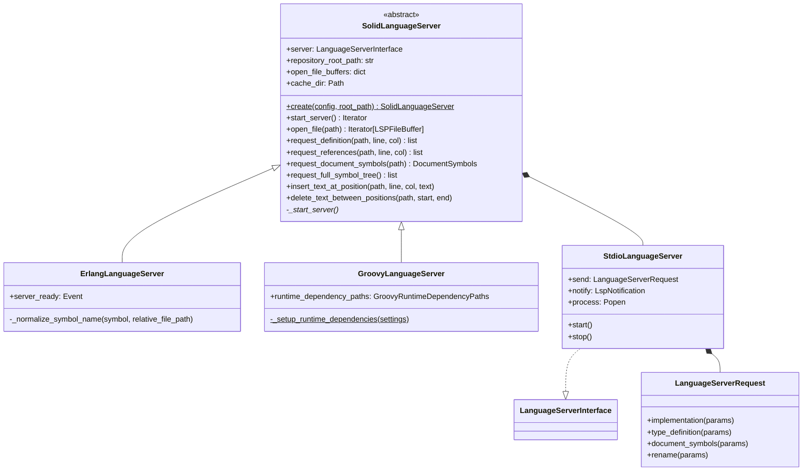
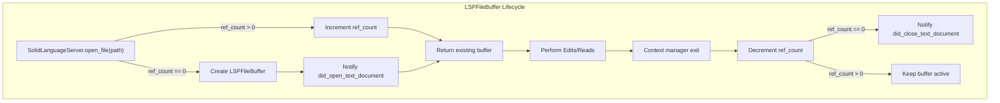
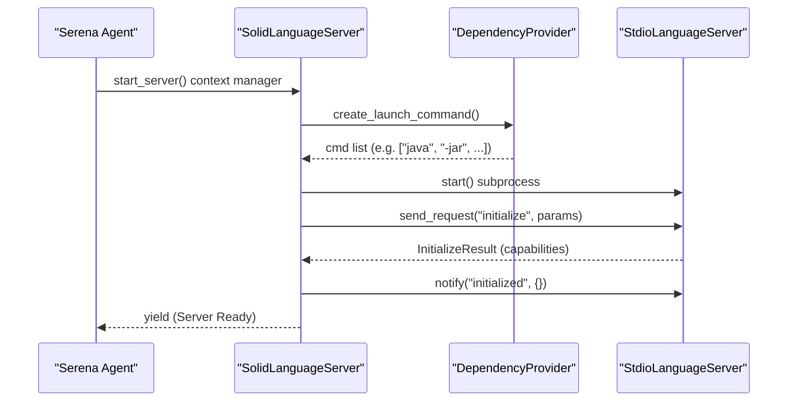

<!-- source: DeepWiki mcp.deepwiki.com · repo oraios/serena · page 6.1 SolidLanguageServer Framework · fetched 2026-10-29 -->

# SolidLanguageServer Framework

Relevant source files

The following files were used as context for generating this wiki page:

- [.serena/memories/adding_new_language_support_guide.md](.serena/memories/adding_new_language_support_guide.md)
- [scripts/update_downloaded_dependency_hashes.py](scripts/update_downloaded_dependency_hashes.py)
- [src/solidlsp/dependency_provider.py](src/solidlsp/dependency_provider.py)
- [src/solidlsp/initialize_params.py](src/solidlsp/initialize_params.py)
- [src/solidlsp/language_servers/common.py](src/solidlsp/language_servers/common.py)
- [src/solidlsp/language_servers/erlang_language_server.py](src/solidlsp/language_servers/erlang_language_server.py)
- [src/solidlsp/language_servers/groovy_language_server.py](src/solidlsp/language_servers/groovy_language_server.py)
- [src/solidlsp/ls.py](src/solidlsp/ls.py)
- [src/solidlsp/ls_types.py](src/solidlsp/ls_types.py)
- [src/solidlsp/ls_utils.py](src/solidlsp/ls_utils.py)
- [src/solidlsp/lsp_protocol_handler/lsp_constants.py](src/solidlsp/lsp_protocol_handler/lsp_constants.py)
- [src/solidlsp/lsp_protocol_handler/lsp_types.py](src/solidlsp/lsp_protocol_handler/lsp_types.py)
- [src/solidlsp/resources/downloaded_dependency_hashes.json](src/solidlsp/resources/downloaded_dependency_hashes.json)
- [src/solidlsp/settings.py](src/solidlsp/settings.py)
- [src/solidlsp/util/cache.py](src/solidlsp/util/cache.py)
- [test/solidlsp/erlang/test_erlang_symbol_names.py](test/solidlsp/erlang/test_erlang_symbol_names.py)
- [test/solidlsp/test_text_utils.py](test/solidlsp/test_text_utils.py)

**Purpose**: This document covers the `SolidLanguageServer` abstract base class and the framework for integrating Language Server Protocol (LSP) implementations into Serena. This includes the lifecycle management, file buffer handling, request/response patterns, caching architecture, and dependency provisioning that enables consistent interaction with 30+ language servers.

**Scope**: This page focuses on the framework layer that abstracts LSP communication. For information about managing multiple language servers simultaneously, see [Language Server Manager](6.2). For specific language server implementations, see [Language Server Implementations](6.3). For runtime dependency installation, see [Runtime Dependencies](6.4).

---

## Architecture Overview

The SolidLanguageServer framework provides a unified interface for interacting with diverse language servers while handling the complexities of LSP communication, process management, and caching. Each language-specific implementation extends the base class and provides configuration for its particular LSP implementation.

### Class Hierarchy

**Sources**: [src/solidlsp/ls.py:327-433](), [src/solidlsp/language_servers/erlang_language_server.py:31-52](), [src/solidlsp/language_servers/groovy_language_server.py:62-105](), [src/solidlsp/ls_process.py:27-165]()

---

## Core Components

### SolidLanguageServer Base Class

The `SolidLanguageServer` abstract base class provides the foundation for all language server integrations. It manages the LSP process lifecycle, file buffers, and provides a consistent API for code intelligence operations.

**Key Responsibilities**:
- **Process Management**: Wraps a `LanguageServerInterface` (typically `StdioLanguageServer`) for JSON-RPC communication [src/solidlsp/ls.py:328]().
- **File Buffer Management**: Maintains `open_file_buffers` dict with reference-counted `LSPFileBuffer` instances [src/solidlsp/ls.py:348]().
- **Caching**: Manages persistent symbol caches to avoid redundant LSP requests [src/solidlsp/ls.py:351-353]().
- **Path Filtering**: Uses `pathspec.PathSpec` for ignore patterns to prevent indexing build artifacts [src/solidlsp/ls.py:354]().
- **Request/Response**: Provides high-level methods for LSP requests like `request_definition` and `request_references` [src/solidlsp/ls.py:848-965]().

**Factory Method**:
`SolidLanguageServer.create()` accepts a `LanguageServerConfig`, the `repository_root_path`, and optional `SolidLSPSettings`. Internally it resolves the concrete subclass via the provided configuration and instantiates it [src/solidlsp/ls.py:400-433]().

**Sources**: [src/solidlsp/ls.py:327-433]()

---

### LSPFileBuffer: File Management and Version Tracking

The `LSPFileBuffer` class manages in-memory file contents with reference counting and automatic synchronization with the language server via `didOpen` and `didClose` notifications.

**Key Features**:
- **Reference Counting**: Multiple concurrent users can open the same file via `open_file` context manager [src/solidlsp/ls.py:763-780]().
- **Lazy Loading**: File contents are read from disk on first access and cached in `_contents` [src/solidlsp/ls.py:135-149]().
- **Staleness Detection**: Automatically invalidates the in-memory buffer if the file's `st_mtime` on disk is newer than `_read_file_modified_date` [src/solidlsp/ls.py:137-143]().
- **LSP Sync**: Ensures the server has the current document state via `ensure_open_in_ls()` [src/solidlsp/ls.py:130-132]().

**Text Modification**:
The framework provides utilities in `TextUtils` for calculating indices and performing deletions/insertions [src/solidlsp/ls_utils.py:181-220](). Methods like `insert_text_at_position` in `SolidLanguageServer` update the in-memory buffer and send `textDocument/didChange` notifications [src/solidlsp/ls.py:694-716]().

**Sources**: [src/solidlsp/ls.py:90-171](), [src/solidlsp/ls.py:763-780](), [src/solidlsp/ls_utils.py:181-220]()

---

### Symbol Representation

The framework uses a layered approach to symbol representation, converting from raw LSP types to unified structures.

**SymbolBody Class**:
`SymbolBody` represents the textual content of a symbol using four integer offsets (start/end line and character) plus a reference to a shared lines buffer [src/solidlsp/ls.py:174-189](). This allows memory-efficient extraction of symbol text via `get_text()` by slicing the shared buffer [src/solidlsp/ls.py:194-207]().

**UnifiedSymbolInformation**:
A `TypedDict` that unifies `DocumentSymbol` and `SymbolInformation` from the LSP spec, providing a consistent schema for Serena regardless of whether the server uses the modern hierarchical or legacy flat symbol format [src/solidlsp/ls_types.py:165-225]().

**Sources**: [src/solidlsp/ls.py:174-207](), [src/solidlsp/ls_types.py:165-225]()

---

### Runtime Dependency Management

The framework automates the installation of language server binaries through the `DependencyProvider` pattern and `RuntimeDependencyCollection`.

**Dependency Providers**:
Subclasses of `LanguageServerDependencyProvider` handle specific installation methods:
*   `LanguageServerDependencyProviderUvx`: For PyPI packages run via `uvx` [src/solidlsp/dependency_provider.py:31]().
*   `LanguageServerDependencyProviderBaseCommand`: For servers where the launch command is a base command with optional arguments [src/solidlsp/dependency_provider.py:53]().
*   `LanguageServerDependencyProviderSinglePath`: For servers relying on a single executable or JAR [src/solidlsp/dependency_provider.py:122]().

**RuntimeDependencyCollection**:
`RuntimeDependencyCollection` manages the platform-specific resolution of binaries [src/solidlsp/language_servers/common.py:36-60](). It supports downloading verified archives via `FileUtils.download_and_extract_archive_verified` and running shell commands for installation [src/solidlsp/language_servers/common.py:84-100]().

**Sources**: [src/solidlsp/dependency_provider.py:18-165](), [src/solidlsp/language_servers/common.py:18-102](), [.serena/memories/adding_new_language_support_guide.md:21-61]()

---

## Initialization Flow

The language server initialization process involves dependency setup, process launch, and the LSP handshake.

**Initialize Params**:
`DefaultInitializeParamsBuilder` constructs the standard `InitializeParams` object, injecting `processId`, `rootPath`, `rootUri`, and `workspaceFolders` [src/solidlsp/initialize_params.py:40-70](). Implementations can provide server-specific options by overriding `_create_base_initialize_params` [src/solidlsp/ls.py:515-520]().

**Sources**: [src/solidlsp/ls.py:438-551](), [src/solidlsp/initialize_params.py:40-83]()

---

## Caching System

The framework implements a persistent caching system to minimize LSP requests across sessions. Caches are stored under `.solidlsp/` or a project-specific path defined in `SolidLSPSettings`.

| Cache Component | Implementation | Purpose |
|-------------|-----------|---------|
| Version Check | `load_cache` | Validates `__cache_version` against current code version [src/solidlsp/util/cache.py:11-17]() |
| Storage | `save_cache` | Serializes symbol data using `dump_pickle` [src/solidlsp/util/cache.py:21-24]() |
| Symbols | `SolidLanguageServer` | Caches `DocumentSymbols` and `UnifiedSymbolInformation` [src/solidlsp/ls.py:352-353]() |

**Invalidation**:
If the cache fingerprint (defined by `_document_symbols_cache_fingerprint`) changes, the cache is invalidated [src/solidlsp/ls.py:1366-1370](). For example, `ErlangLanguageServer` uses a versioned integer as a fingerprint [src/solidlsp/language_servers/erlang_language_server.py:61-63]().

**Sources**: [src/solidlsp/util/cache.py:1-24](), [src/solidlsp/ls.py:351-353](), [src/solidlsp/language_servers/erlang_language_server.py:61-63]()

---

## LSP Request Methods

The `SolidLanguageServer` class provides high-level APIs that wrap the low-level JSON-RPC requests:

*   **Definitions**: `request_definition(path, line, col)` sends a `textDocument/definition` request and returns a list of locations [src/solidlsp/ls.py:848-897]().
*   **References**: `request_references(path, line, col)` sends a `textDocument/references` request, filtering results to return `ReferenceInSymbol` objects [src/solidlsp/ls.py:899-965]().
*   **Symbols**: `request_document_symbols(path)` retrieves all symbols defined in a specific file, utilizing the cache where possible [src/solidlsp/ls.py:1331-1431]().
*   **Renaming**: `request_rename(path, line, col, new_name)` triggers a workspace-wide symbol rename via `textDocument/rename` [src/solidlsp/ls.py:1146-1175]().

**Sources**: [src/solidlsp/ls.py:848-1175](), [src/solidlsp/ls.py:1331-1431]()

---

## Shutdown and Cleanup

The framework ensures clean termination of language server processes:
1.  **LSP Shutdown**: Sends the `shutdown` request and waits for acknowledgment [src/solidlsp/ls.py:633-644]().
2.  **LSP Exit**: Sends the `exit` notification [src/solidlsp/ls.py:646]().
3.  **Process Termination**: Closes standard I/O streams and calls `terminate()` on the subprocess [src/solidlsp/ls.py:648-656]().
4.  **Cleanup**: Clears all open `LSPFileBuffer` instances [src/solidlsp/ls.py:613-631]().

**Sources**: [src/solidlsp/ls.py:613-671]()

---

