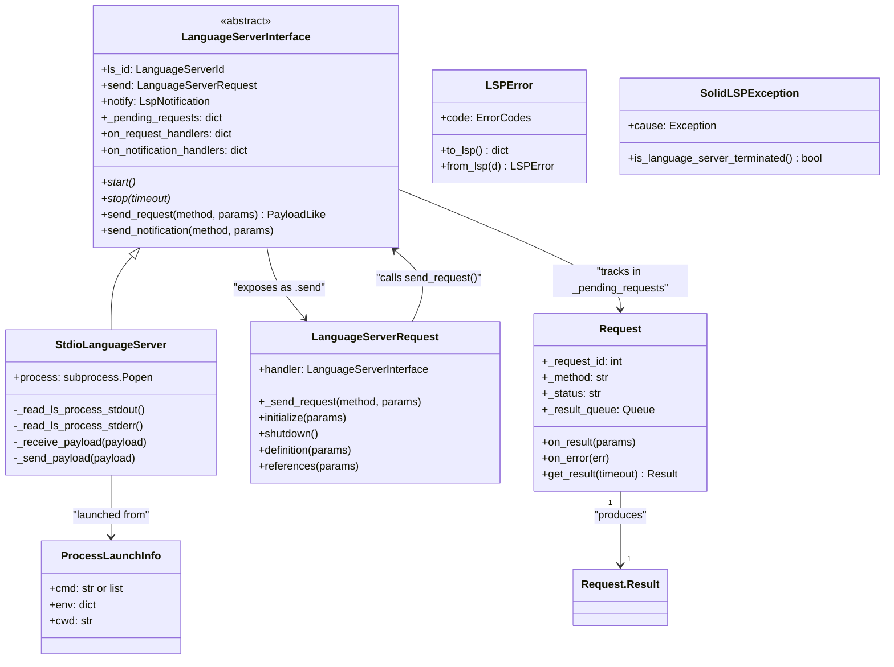
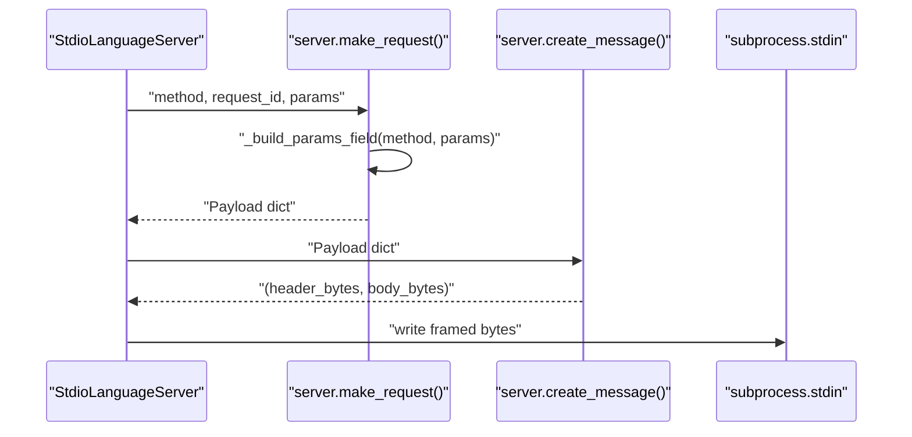
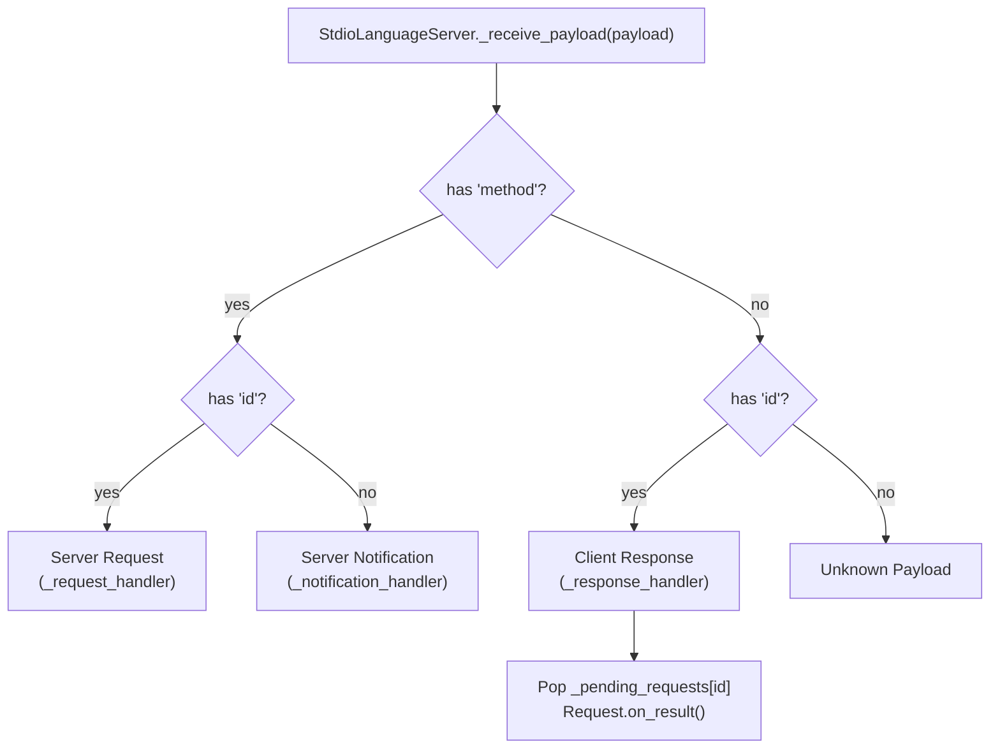

<!-- source: DeepWiki mcp.deepwiki.com · repo oraios/serena · page 6.10 LSP Protocol Handler · fetched 2026-10-29 -->

# LSP Protocol Handler

Relevant source files

The following files were used as context for generating this wiki page:

- [docs/03-special-guides/godot_gdscript_setup_guide_for_serena.md](docs/03-special-guides/godot_gdscript_setup_guide_for_serena.md)
- [src/solidlsp/language_servers/godot_language_server.py](src/solidlsp/language_servers/godot_language_server.py)
- [src/solidlsp/ls_exceptions.py](src/solidlsp/ls_exceptions.py)
- [src/solidlsp/ls_process.py](src/solidlsp/ls_process.py)
- [src/solidlsp/ls_request.py](src/solidlsp/ls_request.py)
- [src/solidlsp/lsp_protocol_handler/server.py](src/solidlsp/lsp_protocol_handler/server.py)
- [src/solidlsp/util/subprocess_util.py](src/solidlsp/util/subprocess_util.py)
- [test/solidlsp/test_content_modified_retry.py](test/solidlsp/test_content_modified_retry.py)
- [test/solidlsp/test_lsp_protocol_handler_server.py](test/solidlsp/test_lsp_protocol_handler_server.py)
- [test/solidlsp/test_pdeathsig.py](test/solidlsp/test_pdeathsig.py)
- [test/solidlsp/test_symbol_body.py](test/solidlsp/test_symbol_body.py)

This page covers the low-level JSON-RPC 2.0 communication layer between Serena and external language server processes. It describes how messages are serialized and sent, how responses and notifications are dispatched, how pending requests are tracked, and how process lifecycle is managed.

For the higher-level abstractions built on top of this layer — such as the `SolidLanguageServer` base class and the language-specific server implementations — see [6.1 SolidLanguageServer Framework]() and [6.3 Language Server Implementations](). For how multiple language server processes are managed together per project, see [6.2 Language Server Manager]().

---

## Component Overview

The LSP protocol handler spans several key source files that manage different aspects of the communication stack:

| File | Responsibility |
|---|---|
| `src/solidlsp/lsp_protocol_handler/server.py` | Message construction, `ProcessLaunchInfo`, `LSPError`, and `_NO_PARAMS_METHODS` definition. |
| `src/solidlsp/ls_process.py` | `LanguageServerInterface` (and its implementation `StdioLanguageServer`), `Request` tracking, I/O threads, and subprocess lifecycle. |
| `src/solidlsp/ls_request.py` | `LanguageServerRequest` typed method interface for standard LSP requests. |
| `src/solidlsp/ls_exceptions.py` | `SolidLSPException` and logic for handling server termination. |
| `src/solidlsp/util/subprocess_util.py` | Cross-platform process tree termination and `LanguageServerSubprocessLauncher` for lifecycle protection. |

Sources: [src/solidlsp/lsp_protocol_handler/server.py:1-162](), [src/solidlsp/ls_process.py:1-165](), [src/solidlsp/ls_request.py:1-384](), [src/solidlsp/ls_exceptions.py:1-75](), [src/solidlsp/util/subprocess_util.py:1-97]()

---

## Architecture

The following diagram illustrates the relationships between the core classes involved in protocol handling.

**Diagram: Class relationships in the LSP protocol handler**

Sources: [src/solidlsp/ls_process.py:56-165](), [src/solidlsp/ls_request.py:9-15](), [src/solidlsp/lsp_protocol_handler/server.py:46-83](), [src/solidlsp/ls_exceptions.py:8-39]()

---

## ProcessLaunchInfo

`ProcessLaunchInfo` is a dataclass capturing the parameters required to spawn a language server subprocess.

| Field | Type | Description |
|---|---|---|
| `cmd` | `str \| list[str]` | The command to execute. List form is preferred for robustness [src/solidlsp/lsp_protocol_handler/server.py:52-57](). |
| `env` | `dict[str, str]` | Environment variables for the process [src/solidlsp/lsp_protocol_handler/server.py:59-62](). |
| `cwd` | `str` | Working directory, defaults to current directory [src/solidlsp/lsp_protocol_handler/server.py:64-67](). |

Sources: [src/solidlsp/lsp_protocol_handler/server.py:46-68]()

---

## Message Construction

Outbound messages are assembled in `server.py`. The `create_message` function performs the final serialization and framing.

**Diagram: Message framing for LSP over stdio**

Sources: [src/solidlsp/lsp_protocol_handler/server.py:103-143](), [src/solidlsp/ls_process.py:482-499]()

### `make_request` and `make_notification`
`make_request` creates a JSON-RPC 2.0 request dict with an `id` [src/solidlsp/lsp_protocol_handler/server.py:125-127](). `make_notification` creates a message without an `id` [src/solidlsp/lsp_protocol_handler/server.py:120-122]().

### `create_message`
This function encodes the payload to UTF-8 and returns a 2-tuple containing the `Content-Length` header bytes and the JSON body bytes [src/solidlsp/lsp_protocol_handler/server.py:134-143]().

---

## `_NO_PARAMS_METHODS` and the `params` Field

LSP implementations vary in how they handle empty parameter fields. Serena manages this through `_build_params_field`:

- **Void Methods**: Methods in `_NO_PARAMS_METHODS` (`shutdown`, `exit`) omit the `params` field entirely [src/solidlsp/lsp_protocol_handler/server.py:100-113](). This prevents parse errors in servers like `rust-analyzer` or `Haskell Language Server (HLS)` which expect `Void` or unit types [src/solidlsp/lsp_protocol_handler/server.py:94-99]().
- **Compatibility**: For other methods where `params` is `None`, Serena sends `params: {}` to maintain compatibility with Delphi/FPC LSP servers [src/solidlsp/lsp_protocol_handler/server.py:114-117]().

Sources: [src/solidlsp/lsp_protocol_handler/server.py:94-117](), [test/solidlsp/test_lsp_protocol_handler_server.py:1-11]()

---

## `StdioLanguageServer` and `LanguageServerSubprocessLauncher`

`StdioLanguageServer` (implementing `LanguageServerInterface`) is the primary actor for stdio-based process management.

### Lifecycle Management
- **Startup**: `start()` launches the process via `LanguageServerSubprocessLauncher` and spawns daemon threads for `stdout` and `stderr` [src/solidlsp/ls_process.py:170-224]().
- **Subprocess Protection**: On Linux, `LanguageServerSubprocessLauncher` uses `prctl(PR_SET_PDEATHSIG)` to ensure that language server processes do not outlive Serena if Serena is killed (e.g., via SIGKILL) [src/solidlsp/util/subprocess_util.py:73-83](), [src/solidlsp/util/subprocess_util.py:124-132]().
- **Shutdown**: `shutdown()` sends the standard LSP `shutdown` request and `exit` notification [src/solidlsp/ls_process.py:297-307]().
- **Termination**: `stop()` uses `psutil` via `terminate_process_tree_with_kill_fallback` to terminate the entire process tree [src/solidlsp/ls_process.py:226-295]().

### Request Tracking and Retries
Each outbound request creates a `Request` object stored in `_pending_requests` [src/solidlsp/ls_process.py:456-469]().
- **Blocking I/O**: The `Request` object uses a `Queue` to block the caller until a response is received or a timeout occurs [src/solidlsp/ls_process.py:86-92]().
- **ContentModified Retries**: If a server returns `ContentModified` (-32801), `send_request` will automatically retry the request up to 3 times for methods registered via `set_content_modified_retry_methods` [src/solidlsp/ls_process.py:38-47](), [src/solidlsp/ls_process.py:615-635]().

### Inbound Message Dispatch
The `_read_ls_process_stdout` thread parses incoming JSON-RPC messages using `content_length` detection and routes them through `_receive_payload()` [src/solidlsp/ls_process.py:321-407](), [src/solidlsp/lsp_protocol_handler/server.py:153-161]().

**Diagram: Inbound payload dispatch in `_receive_payload()`**

Sources: [src/solidlsp/ls_process.py:409-425](), [src/solidlsp/ls_process.py:513-574]()

---

## `LanguageServerRequest`

`LanguageServerRequest` provides a typed interface for standard LSP methods. It wraps `LanguageServerInterface.send_request()` [src/solidlsp/ls_request.py:13-14]().

| Method | LSP Method String |
|---|---|
| `initialize` | `initialize` |
| `definition` | `textDocument/definition` |
| `references` | `textDocument/references` |
| `hover` | `textDocument/hover` |
| `document_symbol` | `textDocument/documentSymbol` |
| `implementation` | `textDocument/implementation` |
| `type_definition` | `textDocument/typeDefinition` |

Sources: [src/solidlsp/ls_request.py:9-384]()

---

## Error Handling

- **`LSPError`**: Represents a standard JSON-RPC error with a code and message [src/solidlsp/lsp_protocol_handler/server.py:70-83]().
- **`LanguageServerTerminatedException`**: Raised when the server process crashes or exits unexpectedly [src/solidlsp/ls_process.py:50-62]().
- **`SolidLSPException`**: A high-level wrapper that captures the cause of an LSP failure, allowing callers to check if the server has terminated via `is_language_server_terminated()` [src/solidlsp/ls_exceptions.py:8-39]().

Sources: [src/solidlsp/lsp_protocol_handler/server.py:70-83](), [src/solidlsp/ls_process.py:50-62](), [src/solidlsp/ls_exceptions.py:8-39]()

---

## Thread Safety

`LanguageServerInterface` utilizes several locks to ensure safe concurrent access:
- `_request_id_lock`: Ensures atomic incrementing of request IDs [src/solidlsp/ls_process.py:164]().
- `_response_handlers_lock`: Synchronizes access to the `_pending_requests` map [src/solidlsp/ls_process.py:165]().
- `_tasks_lock`: Protects internal task counters [src/solidlsp/ls_process.py:166]().
- `_stdin_lock`: (In `StdioLanguageServer`) Protects writes to the process input stream [src/solidlsp/ls_process.py:211]().

Sources: [src/solidlsp/ls_process.py:163-167](), [src/solidlsp/ls_process.py:210-212]()

---

