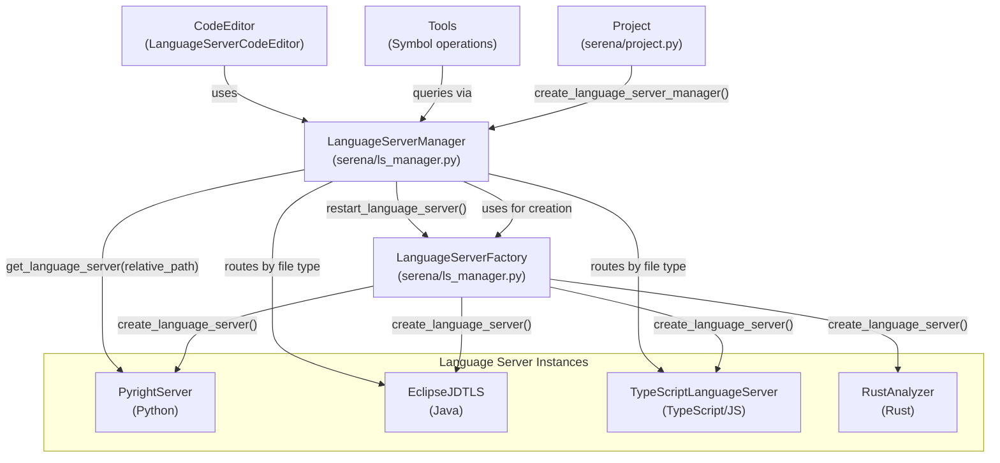
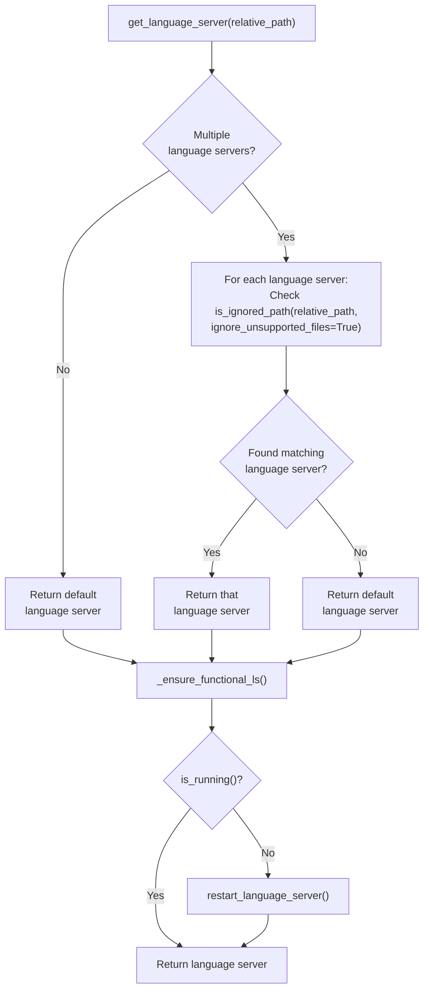
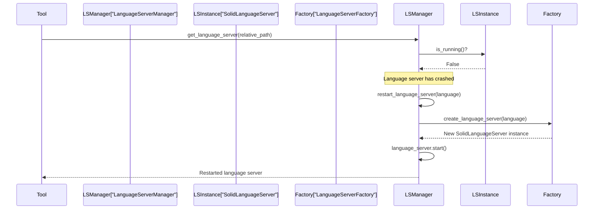
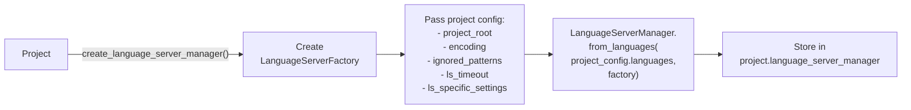

<!-- source: DeepWiki mcp.deepwiki.com · repo oraios/serena · page 6.2 Language Server Manager · fetched 2026-10-29 -->

# Language Server Manager

<details>
<summary>Relevant source files</summary>

The following files were used as context for generating this wiki page:

- [src/serena/code_editor.py](src/serena/code_editor.py)
- [src/serena/ls_manager.py](src/serena/ls_manager.py)
- [src/serena/symbol.py](src/serena/symbol.py)
- [src/serena/tools/__init__.py](src/serena/tools/__init__.py)
- [src/serena/tools/cmd_tools.py](src/serena/tools/cmd_tools.py)
- [src/serena/tools/jetbrains_tools.py](src/serena/tools/jetbrains_tools.py)
- [src/serena/tools/symbol_tools.py](src/serena/tools/symbol_tools.py)
- [src/serena/tools/tools_base.py](src/serena/tools/tools_base.py)
- [src/solidlsp/ls.py](src/solidlsp/ls.py)
- [src/solidlsp/ls_types.py](src/solidlsp/ls_types.py)
- [src/solidlsp/lsp_protocol_handler/lsp_constants.py](src/solidlsp/lsp_protocol_handler/lsp_constants.py)
- [src/solidlsp/lsp_protocol_handler/lsp_types.py](src/solidlsp/lsp_protocol_handler/lsp_types.py)
- [src/solidlsp/util/cache.py](src/solidlsp/util/cache.py)
- [test/serena/test_ls_file_sync.py](test/serena/test_ls_file_sync.py)
- [test/serena/test_symbol.py](test/serena/test_symbol.py)

</details>


## Purpose and Scope

The `LanguageServerManager` provides lifecycle management for one or more language server instances within a project. It handles parallel initialization, automatic selection of the appropriate language server based on file type, self-healing restarts when processes crash, and dynamic addition/removal of languages during runtime. This system enables Serena to support multi-language projects efficiently by routing requests to the correct language-specific backend. [src/serena/ls_manager.py:71-74](), [src/serena/ls_manager.py:100-109]()

For information about the underlying language server abstraction and protocol handling, see **6.1 SolidLanguageServer Framework**. For information about how language server instances are used by tools, see **6.8 Code Editor Operations**.

---

## System Architecture

The `LanguageServerManager` operates as an intermediary layer between the `Project` and individual `SolidLanguageServer` instances. It abstracts away the complexity of managing multiple servers for different programming languages. [src/serena/ls_manager.py:71-74]()

**Architecture Diagram: Language Server Manager Context**



Sources: [src/serena/ls_manager.py:27-46](), [src/serena/ls_manager.py:71-157](), [src/serena/symbol.py:22-23](), [src/serena/code_editor.py:10-15]()

---

## LanguageServerFactory

The `LanguageServerFactory` class encapsulates the configuration and creation logic for language server instances. It stores common parameters that apply to all language servers in a project. [src/serena/ls_manager.py:27-38]()

### Factory Configuration

| Parameter | Type | Description |
|-----------|------|-------------|
| `project_root` | `str` | Absolute path to the project root directory [src/serena/ls_manager.py:39]() |
| `project_config` | `ProjectConfig` | The project configuration object [src/serena/ls_manager.py:40]() |
| `project_data_path` | `str` | Path to the project's `.serena` directory [src/serena/ls_manager.py:41]() |
| `encoding` | `str` | File encoding (e.g., `"utf-8"`) [src/serena/ls_manager.py:42]() |
| `ignored_patterns` | `list[str]` | Patterns for files to ignore [src/serena/ls_manager.py:43]() |
| `ls_timeout` | `float \| None` | Timeout in seconds for LSP requests [src/serena/ls_manager.py:44]() |
| `ls_specific_settings` | `dict \| None` | Language-specific configuration overrides [src/serena/ls_manager.py:45]() |
| `trace_lsp_communication` | `bool` | Whether to log LSP protocol messages [src/serena/ls_manager.py:46]() |

### Language Server Creation

The factory's `create_language_server()` method performs the following steps:

1. Creates a `LanguageServerConfig` with workspace folders, ignored paths, and encoding [src/serena/ls_manager.py:49-56]().
2. Calls `SolidLanguageServer.create()` to instantiate the appropriate language-specific subclass [src/serena/ls_manager.py:59-68]().
3. Configures `SolidLSPSettings` with the `SerenaPaths().serena_user_home_dir` for resource storage and `project_data_path` for project-specific persistence [src/serena/ls_manager.py:63-67]().
4. Returns the created but not yet started language server instance.

Sources: [src/serena/ls_manager.py:48-68](), [src/solidlsp/ls.py:57-58]()

---

## LanguageServerManager

The `LanguageServerManager` class manages the lifecycle of multiple `SolidLanguageServer` instances for a single project. [src/serena/ls_manager.py:71-74]()

### Initialization and Parallel Startup

**Parallel Initialization Process**

```mermaid
sequenceDiagram
    participant Project
    participant LSManager["LanguageServerManager"]
    participant Factory["LanguageServerFactory"]
    participant Thread1["StartLS:python"]
    participant Thread2["StartLS:java"]
    
    Project->>+LSManager: from_languages([Python, Java], factory)
    
    LSManager->>Thread1: start()
    LSManager->>Thread2: start()
    
    par Parallel Startup
        Thread1->>Factory: create_language_server(Python)
        Factory-->>Thread1: PyrightServer
        Thread1->>Thread1: language_server.start()
        
        Thread2->>Factory: create_language_server(Java)
        Factory-->>Thread2: EclipseJDTLS
        Thread2->>Thread2: language_server.start()
    end
    
    Thread1-->>LSManager: join()
    Thread2-->>LSManager: join()
    
    LSManager-->>-Project: LanguageServerManager instance
    
    Note over LSManager: If any server fails to start,<br/>all started servers are stopped<br/>and an exception is raised
```

The `from_languages()` static method creates a manager by starting multiple language servers in parallel using `StartLSThread` [src/serena/ls_manager.py:100-134]().

**Error Handling During Startup**: If any language server fails to start, all successfully started servers are immediately stopped via `ls.stop()` and a `LanguageServerManagerInitialisationError` is raised [src/serena/ls_manager.py:151-155]().

Sources: [src/serena/ls_manager.py:100-157]()

### Language Server Selection

The manager automatically routes requests to the appropriate language server based on file extension and ignore patterns. [src/serena/ls_manager.py:171-185]()

**Language Server Selection Algorithm**



The selection process uses `ls.is_ignored_path(relative_path, ignore_unsupported_files=True)` to determine which server should handle a given file [src/serena/ls_manager.py:176-178](). If no server explicitly supports the file, the default server (the first one in the dictionary iteration order) is used [src/serena/ls_manager.py:94-97]().

Sources: [src/serena/ls_manager.py:159-185]()

### Self-Healing Restart Mechanism

When a language server terminates unexpectedly, the manager can automatically recreate and restart it. [src/serena/ls_manager.py:159-163]()

**Automatic Restart Flow**



The restart mechanism is triggered in `_ensure_functional_ls()`, which checks `ls.is_running()` and calls `restart_language_server()` if necessary [src/serena/ls_manager.py:159-163](). Additionally, the `RestartLanguageServerTool` allows agents to manually trigger a reset of the manager via `self.agent.reset_language_server_manager()` [src/serena/tools/symbol_tools.py:25-33]().

Sources: [src/serena/ls_manager.py:159-163](), [src/serena/ls_manager.py:187-200](), [src/serena/tools/symbol_tools.py:25-33]()

### Lifecycle and Cache Management

The manager provides comprehensive control for all managed language servers.

| Method | Purpose |
|--------|---------|
| `stop_all(save_cache, timeout)` | Gracefully stops all language servers [src/serena/ls_manager.py:215-218](). |
| `save_all_caches()` | Persists symbol caches for all running servers to the project data directory [src/serena/ls_manager.py:229-233](). |
| `iter_language_servers()` | Yields all language servers, ensuring they're running [src/serena/ls_manager.py:202-206](). |

The manager provides centralized cache persistence:
```python
def save_all_caches(self) -> None:
    for ls in self.iter_language_servers():
        if ls.is_running():
            ls.save_cache()
```
[src/serena/ls_manager.py:229-233]()

---

## Integration with Project

The `Project` class (not shown in full but referenced) creates and manages a `LanguageServerManager` instance. [src/serena/symbol.py:22-23]()

**Project Integration Flow**



The manager is used by tools such as `FindSymbolTool` and `GetSymbolsOverviewTool` which retrieve the retriever via `create_language_server_symbol_retriever()` which in turn uses the project's manager [src/serena/tools/symbol_tools.py:99](), [src/serena/tools/tools_base.py:53-57]().

Sources: [src/serena/ls_manager.py:71-157](), [src/serena/tools/tools_base.py:53-57](), [src/serena/tools/symbol_tools.py:93-100]()

---

