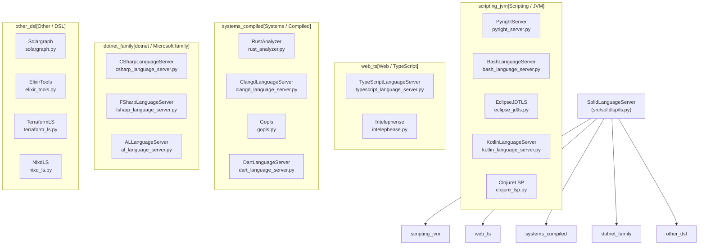
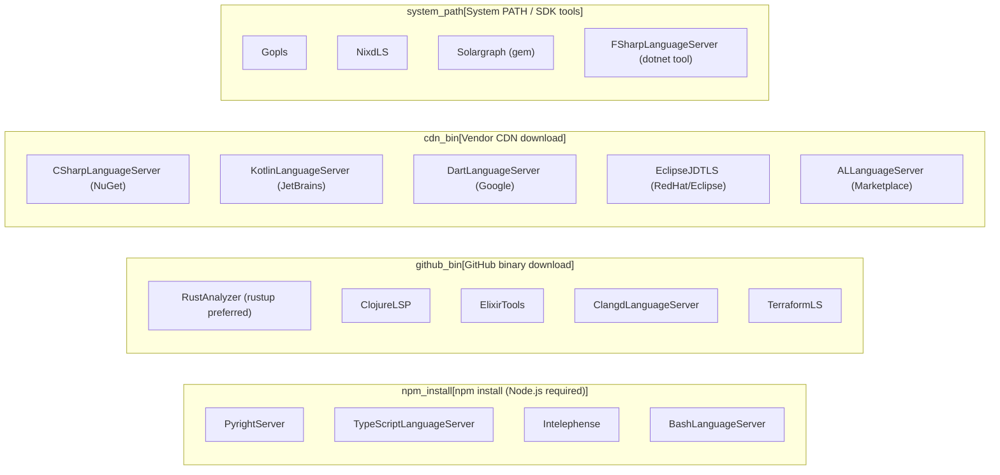
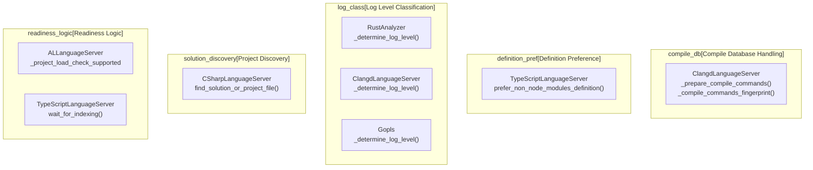

<!-- source: DeepWiki mcp.deepwiki.com · repo oraios/serena · page 6.3 Language Server Implementations · fetched 2026-10-29 -->

# Language Server Implementations

Relevant source files

The following files were used as context for generating this wiki page:

- [docs/03-special-guides/unreal_engine_setup_guide_for_serena.md](docs/03-special-guides/unreal_engine_setup_guide_for_serena.md)
- [src/README.md](src/README.md)
- [src/serena/util/dotnet.py](src/serena/util/dotnet.py)
- [src/serena/util/version.py](src/serena/util/version.py)
- [src/solidlsp/language_servers/al_language_server.py](src/solidlsp/language_servers/al_language_server.py)
- [src/solidlsp/language_servers/angular_language_server.py](src/solidlsp/language_servers/angular_language_server.py)
- [src/solidlsp/language_servers/ansible_language_server.py](src/solidlsp/language_servers/ansible_language_server.py)
- [src/solidlsp/language_servers/bash_language_server.py](src/solidlsp/language_servers/bash_language_server.py)
- [src/solidlsp/language_servers/ccls_language_server.py](src/solidlsp/language_servers/ccls_language_server.py)
- [src/solidlsp/language_servers/clangd_language_server.py](src/solidlsp/language_servers/clangd_language_server.py)
- [src/solidlsp/language_servers/clojure_lsp.py](src/solidlsp/language_servers/clojure_lsp.py)
- [src/solidlsp/language_servers/csharp_language_server.py](src/solidlsp/language_servers/csharp_language_server.py)
- [src/solidlsp/language_servers/dart_language_server.py](src/solidlsp/language_servers/dart_language_server.py)
- [src/solidlsp/language_servers/eclipse_jdtls.py](src/solidlsp/language_servers/eclipse_jdtls.py)
- [src/solidlsp/language_servers/elixir_tools/README.md](src/solidlsp/language_servers/elixir_tools/README.md)
- [src/solidlsp/language_servers/elixir_tools/__init__.py](src/solidlsp/language_servers/elixir_tools/__init__.py)
- [src/solidlsp/language_servers/elixir_tools/elixir_tools.py](src/solidlsp/language_servers/elixir_tools/elixir_tools.py)
- [src/solidlsp/language_servers/elm_language_server.py](src/solidlsp/language_servers/elm_language_server.py)
- [src/solidlsp/language_servers/fortran_language_server.py](src/solidlsp/language_servers/fortran_language_server.py)
- [src/solidlsp/language_servers/fsharp_language_server.py](src/solidlsp/language_servers/fsharp_language_server.py)
- [src/solidlsp/language_servers/gopls.py](src/solidlsp/language_servers/gopls.py)
- [src/solidlsp/language_servers/haskell_language_server.py](src/solidlsp/language_servers/haskell_language_server.py)
- [src/solidlsp/language_servers/haxe_language_server.py](src/solidlsp/language_servers/haxe_language_server.py)
- [src/solidlsp/language_servers/hlsl_language_server.py](src/solidlsp/language_servers/hlsl_language_server.py)
- [src/solidlsp/language_servers/intelephense.py](src/solidlsp/language_servers/intelephense.py)
- [src/solidlsp/language_servers/julia_server.py](src/solidlsp/language_servers/julia_server.py)
- [src/solidlsp/language_servers/kotlin_language_server.py](src/solidlsp/language_servers/kotlin_language_server.py)
- [src/solidlsp/language_servers/lua_ls.py](src/solidlsp/language_servers/lua_ls.py)
- [src/solidlsp/language_servers/luau_lsp.py](src/solidlsp/language_servers/luau_lsp.py)
- [src/solidlsp/language_servers/marksman.py](src/solidlsp/language_servers/marksman.py)
- [src/solidlsp/language_servers/matlab_language_server.py](src/solidlsp/language_servers/matlab_language_server.py)
- [src/solidlsp/language_servers/nixd_ls.py](src/solidlsp/language_servers/nixd_ls.py)
- [src/solidlsp/language_servers/ocaml_lsp_server.py](src/solidlsp/language_servers/ocaml_lsp_server.py)
- [src/solidlsp/language_servers/omnisharp.py](src/solidlsp/language_servers/omnisharp.py)
- [src/solidlsp/language_servers/pascal_server.py](src/solidlsp/language_servers/pascal_server.py)
- [src/solidlsp/language_servers/perl_language_server.py](src/solidlsp/language_servers/perl_language_server.py)
- [src/solidlsp/language_servers/phpactor.py](src/solidlsp/language_servers/phpactor.py)
- [src/solidlsp/language_servers/phpantom.py](src/solidlsp/language_servers/phpantom.py)
- [src/solidlsp/language_servers/powershell_language_server.py](src/solidlsp/language_servers/powershell_language_server.py)
- [src/solidlsp/language_servers/pyright_server.py](src/solidlsp/language_servers/pyright_server.py)
- [src/solidlsp/language_servers/qml_language_server.py](src/solidlsp/language_servers/qml_language_server.py)
- [src/solidlsp/language_servers/r_language_server.py](src/solidlsp/language_servers/r_language_server.py)
- [src/solidlsp/language_servers/ruby_lsp.py](src/solidlsp/language_servers/ruby_lsp.py)
- [src/solidlsp/language_servers/rust_analyzer.py](src/solidlsp/language_servers/rust_analyzer.py)
- [src/solidlsp/language_servers/scala_language_server.py](src/solidlsp/language_servers/scala_language_server.py)
- [src/solidlsp/language_servers/solargraph.py](src/solidlsp/language_servers/solargraph.py)
- [src/solidlsp/language_servers/solidity_language_server.py](src/solidlsp/language_servers/solidity_language_server.py)
- [src/solidlsp/language_servers/sourcekit_lsp.py](src/solidlsp/language_servers/sourcekit_lsp.py)
- [src/solidlsp/language_servers/svelte_language_server.py](src/solidlsp/language_servers/svelte_language_server.py)
- [src/solidlsp/language_servers/systemverilog_server.py](src/solidlsp/language_servers/systemverilog_server.py)
- [src/solidlsp/language_servers/taplo_server.py](src/solidlsp/language_servers/taplo_server.py)
- [src/solidlsp/language_servers/terraform_ls.py](src/solidlsp/language_servers/terraform_ls.py)
- [src/solidlsp/language_servers/texlab_language_server.py](src/solidlsp/language_servers/texlab_language_server.py)
- [src/solidlsp/language_servers/typescript_language_server.py](src/solidlsp/language_servers/typescript_language_server.py)
- [src/solidlsp/language_servers/vts_language_server.py](src/solidlsp/language_servers/vts_language_server.py)
- [src/solidlsp/language_servers/vue_language_server.py](src/solidlsp/language_servers/vue_language_server.py)
- [src/solidlsp/language_servers/yaml_language_server.py](src/solidlsp/language_servers/yaml_language_server.py)
- [src/solidlsp/language_servers/zls.py](src/solidlsp/language_servers/zls.py)
- [test/resources/repos/ansible/test_repo/inventory/hosts.yml](test/resources/repos/ansible/test_repo/inventory/hosts.yml)
- [test/resources/repos/ansible/test_repo/playbook.yml](test/resources/repos/ansible/test_repo/playbook.yml)
- [test/resources/repos/ansible/test_repo/roles/common/defaults/main.yml](test/resources/repos/ansible/test_repo/roles/common/defaults/main.yml)
- [test/resources/repos/ansible/test_repo/roles/common/handlers/main.yml](test/resources/repos/ansible/test_repo/roles/common/handlers/main.yml)
- [test/resources/repos/cpp/test_repo/compile_commands.json](test/resources/repos/cpp/test_repo/compile_commands.json)
- [test/resources/repos/cpp/ue_test_repo/Intermediate/TestGame/UHT/AbilityActor.generated.h](test/resources/repos/cpp/ue_test_repo/Intermediate/TestGame/UHT/AbilityActor.generated.h)
- [test/resources/repos/cpp/ue_test_repo/Intermediate/TestGame/UHT/AbilityComponent.gen.cpp](test/resources/repos/cpp/ue_test_repo/Intermediate/TestGame/UHT/AbilityComponent.gen.cpp)
- [test/resources/repos/cpp/ue_test_repo/Intermediate/TestGame/UHT/AbilityComponent.generated.h](test/resources/repos/cpp/ue_test_repo/Intermediate/TestGame/UHT/AbilityComponent.generated.h)
- [test/resources/repos/csharp/test_repo/Models/Person.cs](test/resources/repos/csharp/test_repo/Models/Person.cs)
- [test/resources/repos/csharp/test_repo/TestProject.csproj](test/resources/repos/csharp/test_repo/TestProject.csproj)
- [test/resources/repos/csharp/test_repo/serena.sln](test/resources/repos/csharp/test_repo/serena.sln)
- [test/resources/repos/go/test_repo/symbol_body.go](test/resources/repos/go/test_repo/symbol_body.go)
- [test/resources/repos/haskell/test_repo/app/Main.hs](test/resources/repos/haskell/test_repo/app/Main.hs)
- [test/resources/repos/haskell/test_repo/haskell-test-repo.cabal](test/resources/repos/haskell/test_repo/haskell-test-repo.cabal)
- [test/resources/repos/haskell/test_repo/package.yaml](test/resources/repos/haskell/test_repo/package.yaml)
- [test/resources/repos/haskell/test_repo/src/Calculator.hs](test/resources/repos/haskell/test_repo/src/Calculator.hs)
- [test/resources/repos/hlsl/test_repo/common.hlsl](test/resources/repos/hlsl/test_repo/common.hlsl)
- [test/resources/repos/hlsl/test_repo/compute_test.hlsl](test/resources/repos/hlsl/test_repo/compute_test.hlsl)
- [test/resources/repos/hlsl/test_repo/lighting.hlsl](test/resources/repos/hlsl/test_repo/lighting.hlsl)
- [test/resources/repos/hlsl/test_repo/terrain/terrain_sdf.hlsl](test/resources/repos/hlsl/test_repo/terrain/terrain_sdf.hlsl)
- [test/resources/repos/java/test_repo/src/main/java/test_repo/ModelUser.java](test/resources/repos/java/test_repo/src/main/java/test_repo/ModelUser.java)
- [test/resources/repos/kotlin/test_repo/build.gradle.kts](test/resources/repos/kotlin/test_repo/build.gradle.kts)
- [test/resources/repos/kotlin/test_repo/src/main/kotlin/test_repo/Main.kt](test/resources/repos/kotlin/test_repo/src/main/kotlin/test_repo/Main.kt)
- [test/resources/repos/kotlin/test_repo/src/main/kotlin/test_repo/Model.kt](test/resources/repos/kotlin/test_repo/src/main/kotlin/test_repo/Model.kt)
- [test/resources/repos/kotlin/test_repo/src/main/kotlin/test_repo/ModelUser.kt](test/resources/repos/kotlin/test_repo/src/main/kotlin/test_repo/ModelUser.kt)
- [test/resources/repos/kotlin/test_repo/src/main/kotlin/test_repo/Utils.kt](test/resources/repos/kotlin/test_repo/src/main/kotlin/test_repo/Utils.kt)
- [test/resources/repos/latex/test_repo/.gitignore](test/resources/repos/latex/test_repo/.gitignore)
- [test/resources/repos/latex/test_repo/main.tex](test/resources/repos/latex/test_repo/main.tex)
- [test/resources/repos/latex/test_repo/references.bib](test/resources/repos/latex/test_repo/references.bib)
- [test/resources/repos/latex/test_repo/sections/background.tex](test/resources/repos/latex/test_repo/sections/background.tex)
- [test/resources/repos/luau/test_repo/.luaurc](test/resources/repos/luau/test_repo/.luaurc)
- [test/resources/repos/luau/test_repo/src/init.luau](test/resources/repos/luau/test_repo/src/init.luau)
- [test/resources/repos/luau/test_repo/src/module.luau](test/resources/repos/luau/test_repo/src/module.luau)
- [test/resources/repos/matlab/test_repo/Calculator.m](test/resources/repos/matlab/test_repo/Calculator.m)
- [test/resources/repos/matlab/test_repo/main.m](test/resources/repos/matlab/test_repo/main.m)
- [test/resources/repos/nix/test_repo/default.nix](test/resources/repos/nix/test_repo/default.nix)
- [test/resources/repos/pascal/test_repo/.gitignore](test/resources/repos/pascal/test_repo/.gitignore)
- [test/resources/repos/pascal/test_repo/lib/helper.pas](test/resources/repos/pascal/test_repo/lib/helper.pas)
- [test/resources/repos/pascal/test_repo/main.pas](test/resources/repos/pascal/test_repo/main.pas)
- [test/resources/repos/perl/test_repo/helper.t](test/resources/repos/perl/test_repo/helper.t)
- [test/resources/repos/qml/test_repo/src/CustomComponent.qml](test/resources/repos/qml/test_repo/src/CustomComponent.qml)
- [test/resources/repos/qml/test_repo/src/UserComponent.qml](test/resources/repos/qml/test_repo/src/UserComponent.qml)
- [test/resources/repos/qml/test_repo/src/diagnostics_sample.qml](test/resources/repos/qml/test_repo/src/diagnostics_sample.qml)
- [test/resources/repos/qml/test_repo/src/main.qml](test/resources/repos/qml/test_repo/src/main.qml)
- [test/resources/repos/rego/test_repo/policies/authz.rego](test/resources/repos/rego/test_repo/policies/authz.rego)
- [test/resources/repos/rego/test_repo/policies/validation.rego](test/resources/repos/rego/test_repo/policies/validation.rego)
- [test/resources/repos/rego/test_repo/utils/helpers.rego](test/resources/repos/rego/test_repo/utils/helpers.rego)
- [test/resources/repos/ruby/test_repo/.solargraph.yml](test/resources/repos/ruby/test_repo/.solargraph.yml)
- [test/resources/repos/ruby/test_repo/lib.rb](test/resources/repos/ruby/test_repo/lib.rb)
- [test/resources/repos/ruby/test_repo/main.rb](test/resources/repos/ruby/test_repo/main.rb)
- [test/resources/repos/scala/build.sbt](test/resources/repos/scala/build.sbt)
- [test/resources/repos/scala/project/build.properties](test/resources/repos/scala/project/build.properties)
- [test/resources/repos/scala/project/metals.sbt](test/resources/repos/scala/project/metals.sbt)
- [test/resources/repos/scala/project/plugins.sbt](test/resources/repos/scala/project/plugins.sbt)
- [test/resources/repos/scala/src/main/scala/com/example/Main.scala](test/resources/repos/scala/src/main/scala/com/example/Main.scala)
- [test/resources/repos/scala/src/main/scala/com/example/Utils.scala](test/resources/repos/scala/src/main/scala/com/example/Utils.scala)
- [test/resources/repos/svelte/test_repo/.gitignore](test/resources/repos/svelte/test_repo/.gitignore)
- [test/resources/repos/svelte/test_repo/package-lock.json](test/resources/repos/svelte/test_repo/package-lock.json)
- [test/resources/repos/typescript/test_repo/jsx_component.tsx](test/resources/repos/typescript/test_repo/jsx_component.tsx)
- [test/resources/repos/typescript/test_repo/tsconfig.json](test/resources/repos/typescript/test_repo/tsconfig.json)
- [test/resources/repos/typescript/test_repo/use_helper.ts](test/resources/repos/typescript/test_repo/use_helper.ts)
- [test/solidlsp/al/test_al_basic.py](test/solidlsp/al/test_al_basic.py)
- [test/solidlsp/angular/test_angular_error_cases.py](test/solidlsp/angular/test_angular_error_cases.py)
- [test/solidlsp/ansible/test_ansible_basic.py](test/solidlsp/ansible/test_ansible_basic.py)
- [test/solidlsp/bash/test_bash_basic.py](test/solidlsp/bash/test_bash_basic.py)
- [test/solidlsp/bsl/test_bsl_basic.py](test/solidlsp/bsl/test_bsl_basic.py)
- [test/solidlsp/bsl/test_bsl_diagnostics.py](test/solidlsp/bsl/test_bsl_diagnostics.py)
- [test/solidlsp/clojure/__init__.py](test/solidlsp/clojure/__init__.py)
- [test/solidlsp/clojure/test_clojure_basic.py](test/solidlsp/clojure/test_clojure_basic.py)
- [test/solidlsp/cpp/test_cpp_basic.py](test/solidlsp/cpp/test_cpp_basic.py)
- [test/solidlsp/cpp/test_cpp_unreal_unit.py](test/solidlsp/cpp/test_cpp_unreal_unit.py)
- [test/solidlsp/csharp/test_csharp_basic.py](test/solidlsp/csharp/test_csharp_basic.py)
- [test/solidlsp/csharp/test_csharp_nuget_download.py](test/solidlsp/csharp/test_csharp_nuget_download.py)
- [test/solidlsp/dart/test_dart_basic.py](test/solidlsp/dart/test_dart_basic.py)
- [test/solidlsp/elixir/__init__.py](test/solidlsp/elixir/__init__.py)
- [test/solidlsp/elixir/conftest.py](test/solidlsp/elixir/conftest.py)
- [test/solidlsp/elixir/test_elixir_basic.py](test/solidlsp/elixir/test_elixir_basic.py)
- [test/solidlsp/elixir/test_elixir_ignored_dirs.py](test/solidlsp/elixir/test_elixir_ignored_dirs.py)
- [test/solidlsp/elixir/test_elixir_integration.py](test/solidlsp/elixir/test_elixir_integration.py)
- [test/solidlsp/elixir/test_elixir_symbol_retrieval.py](test/solidlsp/elixir/test_elixir_symbol_retrieval.py)
- [test/solidlsp/erlang/test_erlang_basic.py](test/solidlsp/erlang/test_erlang_basic.py)
- [test/solidlsp/erlang/test_erlang_ignored_dirs.py](test/solidlsp/erlang/test_erlang_ignored_dirs.py)
- [test/solidlsp/erlang/test_erlang_symbol_retrieval.py](test/solidlsp/erlang/test_erlang_symbol_retrieval.py)
- [test/solidlsp/fsharp/test_fsharp_basic.py](test/solidlsp/fsharp/test_fsharp_basic.py)
- [test/solidlsp/fsharp/test_fsharp_module_selection_range.py](test/solidlsp/fsharp/test_fsharp_module_selection_range.py)
- [test/solidlsp/go/test_go_basic.py](test/solidlsp/go/test_go_basic.py)
- [test/solidlsp/groovy/test_groovy_basic.py](test/solidlsp/groovy/test_groovy_basic.py)
- [test/solidlsp/haskell/test_haskell_basic.py](test/solidlsp/haskell/test_haskell_basic.py)
- [test/solidlsp/haxe/test_haxe_basic.py](test/solidlsp/haxe/test_haxe_basic.py)
- [test/solidlsp/hlsl/__init__.py](test/solidlsp/hlsl/__init__.py)
- [test/solidlsp/hlsl/test_hlsl_basic.py](test/solidlsp/hlsl/test_hlsl_basic.py)
- [test/solidlsp/java/test_java_basic.py](test/solidlsp/java/test_java_basic.py)
- [test/solidlsp/java/test_jdtls_path_resolution.py](test/solidlsp/java/test_jdtls_path_resolution.py)
- [test/solidlsp/julia/test_julia_basic.py](test/solidlsp/julia/test_julia_basic.py)
- [test/solidlsp/kotlin/test_kotlin_basic.py](test/solidlsp/kotlin/test_kotlin_basic.py)
- [test/solidlsp/lean4/test_lean4_basic.py](test/solidlsp/lean4/test_lean4_basic.py)
- [test/solidlsp/lua/test_lua_basic.py](test/solidlsp/lua/test_lua_basic.py)
- [test/solidlsp/luau/__init__.py](test/solidlsp/luau/__init__.py)
- [test/solidlsp/luau/test_luau_dependency_provider.py](test/solidlsp/luau/test_luau_dependency_provider.py)
- [test/solidlsp/markdown/test_markdown_basic.py](test/solidlsp/markdown/test_markdown_basic.py)
- [test/solidlsp/matlab/__init__.py](test/solidlsp/matlab/__init__.py)
- [test/solidlsp/matlab/test_matlab_basic.py](test/solidlsp/matlab/test_matlab_basic.py)
- [test/solidlsp/nix/test_nix_basic.py](test/solidlsp/nix/test_nix_basic.py)
- [test/solidlsp/nix/test_nix_server.py](test/solidlsp/nix/test_nix_server.py)
- [test/solidlsp/ocaml/test_cross_file_refs.py](test/solidlsp/ocaml/test_cross_file_refs.py)
- [test/solidlsp/ocaml/test_ocaml_basic.py](test/solidlsp/ocaml/test_ocaml_basic.py)
- [test/solidlsp/ocaml/test_ocaml_diagnostics.py](test/solidlsp/ocaml/test_ocaml_diagnostics.py)
- [test/solidlsp/pascal/__init__.py](test/solidlsp/pascal/__init__.py)
- [test/solidlsp/pascal/test_pascal_auto_update.py](test/solidlsp/pascal/test_pascal_auto_update.py)
- [test/solidlsp/pascal/test_pascal_basic.py](test/solidlsp/pascal/test_pascal_basic.py)
- [test/solidlsp/perl/__init__.py](test/solidlsp/perl/__init__.py)
- [test/solidlsp/perl/test_perl_basic.py](test/solidlsp/perl/test_perl_basic.py)
- [test/solidlsp/perl/test_perl_config.py](test/solidlsp/perl/test_perl_config.py)
- [test/solidlsp/php/test_php_basic.py](test/solidlsp/php/test_php_basic.py)
- [test/solidlsp/php/test_php_diagnostics.py](test/solidlsp/php/test_php_diagnostics.py)
- [test/solidlsp/php/test_phpantom.py](test/solidlsp/php/test_phpantom.py)
- [test/solidlsp/python/test_python_basic.py](test/solidlsp/python/test_python_basic.py)
- [test/solidlsp/python/test_retrieval_with_ignored_dirs.py](test/solidlsp/python/test_retrieval_with_ignored_dirs.py)
- [test/solidlsp/r/test_r_basic.py](test/solidlsp/r/test_r_basic.py)
- [test/solidlsp/rego/test_rego_basic.py](test/solidlsp/rego/test_rego_basic.py)
- [test/solidlsp/ruby/test_ruby_basic.py](test/solidlsp/ruby/test_ruby_basic.py)
- [test/solidlsp/ruby/test_ruby_symbol_retrieval.py](test/solidlsp/ruby/test_ruby_symbol_retrieval.py)
- [test/solidlsp/rust/test_rust_analyzer_detection.py](test/solidlsp/rust/test_rust_analyzer_detection.py)
- [test/solidlsp/rust/test_rust_analyzer_settings.py](test/solidlsp/rust/test_rust_analyzer_settings.py)
- [test/solidlsp/rust/test_rust_basic.py](test/solidlsp/rust/test_rust_basic.py)
- [test/solidlsp/scala/test_scala_language_server.py](test/solidlsp/scala/test_scala_language_server.py)
- [test/solidlsp/solidity/test_solidity_diagnostics.py](test/solidlsp/solidity/test_solidity_diagnostics.py)
- [test/solidlsp/svelte/conftest.py](test/solidlsp/svelte/conftest.py)
- [test/solidlsp/svelte/test_svelte_basic.py](test/solidlsp/svelte/test_svelte_basic.py)
- [test/solidlsp/svelte/test_svelte_references.py](test/solidlsp/svelte/test_svelte_references.py)
- [test/solidlsp/svelte/test_svelte_symbols.py](test/solidlsp/svelte/test_svelte_symbols.py)
- [test/solidlsp/swift/test_swift_basic.py](test/solidlsp/swift/test_swift_basic.py)
- [test/solidlsp/test_ls_common.py](test/solidlsp/test_ls_common.py)
- [test/solidlsp/test_typescript_timeout_policy.py](test/solidlsp/test_typescript_timeout_policy.py)
- [test/solidlsp/toml/test_toml_basic.py](test/solidlsp/toml/test_toml_basic.py)
- [test/solidlsp/typescript/test_typescript_basic.py](test/solidlsp/typescript/test_typescript_basic.py)
- [test/solidlsp/typescript/test_typescript_ignored_dirs.py](test/solidlsp/typescript/test_typescript_ignored_dirs.py)
- [test/solidlsp/vue/test_vue_symbol_retrieval.py](test/solidlsp/vue/test_vue_symbol_retrieval.py)
- [test/solidlsp/yaml_ls/test_yaml_basic.py](test/solidlsp/yaml_ls/test_yaml_basic.py)
- [test/solidlsp/zig/test_zig_basic.py](test/solidlsp/zig/test_zig_basic.py)

This page surveys all concrete `SolidLanguageServer` subclasses in the `solidlsp` library. Each implementation wraps a specific language server binary, handles its installation via `RuntimeDependency` providers, defines language-specific ignored directories, and may override base class behavior for protocol quirks.

For the base class API and how implementations plug into the framework, see [6.1 SolidLanguageServer Framework](). For the dependency download and extraction system, see [6.4 Runtime Dependencies](). For how the `LanguageServerManager` instantiates and manages these per project, see [6.2 Language Server Manager]().

---

## Implementation Directory

| Language | Class | Source File | Backend Binary | Installation Method |
|---|---|---|---|---|
| Python | `PyrightServer` | `pyright_server.py` | pyright-langserver | npm / uvx |
| TypeScript/JS | `TypeScriptLanguageServer` | `typescript_language_server.py` | typescript-language-server | npm |
| Rust | `RustAnalyzer` | `rust_analyzer.py` | rust-analyzer | rustup (auto-install) |
| C# (Roslyn) | `CSharpLanguageServer` | `csharp_language_server.py` | Microsoft.CodeAnalysis.LanguageServer.dll | NuGet download |
| Java | `EclipseJDTLS` | `eclipse_jdtls.py` | Eclipse JDTLS | Download / VSIX |
| Go | `Gopls` | `gopls.py` | gopls | System PATH (required) |
| Kotlin | `KotlinLanguageServer` | `kotlin_language_server.py` | kotlin-lsp | JetBrains CDN download |
| PHP | `Intelephense` | `intelephense.py` | intelephense | npm |
| Ruby | `Solargraph` | `solargraph.py` | solargraph | gem / Bundler |
| C/C++ | `ClangdLanguageServer` | `clangd_language_server.py` | clangd | GitHub binary download |
| Dart | `DartLanguageServer` | `dart_language_server.py` | dart (SDK) | Google CDN download |
| Clojure | `ClojureLSP` | `clojure_lsp.py` | clojure-lsp | GitHub binary download |
| Elixir | `ElixirTools` | `elixir_tools/elixir_tools.py` | expert | GitHub binary download |
| Bash | `BashLanguageServer` | `bash_language_server.py` | bash-language-server | npm |
| Nix | `NixdLS` | `nixd_ls.py` | nixd | System PATH (required) |
| Terraform | `TerraformLS` | `terraform_ls.py` | terraform-ls | HashiCorp CDN download |
| AL | `ALLanguageServer` | `al_language_server.py` | Microsoft.Dynamics.Nav.EditorServices.Host.exe | VS Code Marketplace |
| F# | `FSharpLanguageServer` | `fsharp_language_server.py` | fsautocomplete | dotnet tool install |

Sources: [src/solidlsp/language_servers/typescript_language_server.py:68-79](), [src/solidlsp/language_servers/rust_analyzer.py:29-32](), [src/solidlsp/language_servers/csharp_language_server.py:41-120](), [src/solidlsp/language_servers/eclipse_jdtls.py:109-155](), [src/solidlsp/language_servers/intelephense.py:30-43](), [src/solidlsp/language_servers/clangd_language_server.py:24-35](), [src/solidlsp/language_servers/elixir_tools/elixir_tools.py:30-37](), [src/solidlsp/language_servers/al_language_server.py:55-69](), [src/solidlsp/language_servers/fsharp_language_server.py:39-47]()

---

## Class Hierarchy

All implementations inherit from `SolidLanguageServer` defined in `src/solidlsp/ls.py`.

**Diagram: SolidLanguageServer subclass hierarchy grouped by language family**

Sources: [src/solidlsp/language_servers/typescript_language_server.py:68-68](), [src/solidlsp/language_servers/rust_analyzer.py:29-29](), [src/solidlsp/language_servers/csharp_language_server.py:23-23](), [src/solidlsp/language_servers/eclipse_jdtls.py:109-109](), [src/solidlsp/language_servers/intelephense.py:30-30](), [src/solidlsp/language_servers/clangd_language_server.py:24-24](), [src/solidlsp/language_servers/elixir_tools/elixir_tools.py:30-30](), [src/solidlsp/language_servers/al_language_server.py:55-55](), [src/solidlsp/language_servers/fsharp_language_server.py:39-39]()

---

## Installation Methods

Implementations typically use an inner `DependencyProvider` class extending `LanguageServerDependencyProviderSinglePath` or `LanguageServerDependencyProvider`.

**Diagram: Installation method by class**

Sources: [src/solidlsp/language_servers/typescript_language_server.py:173-180](), [src/solidlsp/language_servers/clangd_language_server.py:21-21](), [src/solidlsp/language_servers/intelephense.py:79-90](), [src/solidlsp/language_servers/rust_analyzer.py:91-159](), [src/solidlsp/language_servers/csharp_language_server.py:41-120](), [src/solidlsp/language_servers/al_language_server.py:150-165](), [src/solidlsp/language_servers/fsharp_language_server.py:132-149]()

---

## TypeScript and JavaScript — `TypeScriptLanguageServer`

- **File:** `src/solidlsp/language_servers/typescript_language_server.py`
- **Language ID:** `"typescript"`
- **Backend:** `typescript-language-server` (npm) + `typescript` (npm) [src/solidlsp/language_servers/typescript_language_server.py:171-180]().
- **Ignored dirs:** `node_modules`, `dist`, `build`, `coverage` [src/solidlsp/language_servers/typescript_language_server.py:165-171]().
- **Indexing tracking:** Uses `$/progress` tokens to track project indexing. `wait_for_indexing()` blocks until tokens complete or `INDEXING_PROGRESS_TIMEOUT` (30s) is reached [src/solidlsp/language_servers/typescript_language_server.py:118-125]().
- **Definition preference:** `prefer_non_node_modules_definition()` filters out `.d.ts` files from `node_modules` when multiple definitions are returned, preferring source files [src/solidlsp/language_servers/typescript_language_server.py:49-66]().

Sources: [src/solidlsp/language_servers/typescript_language_server.py:49-180]()

---

## Rust — `RustAnalyzer`

- **File:** `src/solidlsp/language_servers/rust_analyzer.py`
- **Language ID:** `"rust"`
- **Backend:** `rust-analyzer` executable.
- **Installation priority:**
  1. `rustup which rust-analyzer` (preferred — matches active toolchain) [src/solidlsp/language_servers/rust_analyzer.py:67-75]().
  2. `rustup component add rust-analyzer` if rustup is present [src/solidlsp/language_servers/rust_analyzer.py:110-116]().
  3. Common file paths (`~/.cargo/bin/rust-analyzer`, Homebrew, Scoop, etc.) [src/solidlsp/language_servers/rust_analyzer.py:130-155]().
- **Log classification:** Overrides `_determine_log_level` to suppress `fetchworkspaceerror` and "failed to find any projects" as debug-level [src/solidlsp/language_servers/rust_analyzer.py:39-52]().

Sources: [src/solidlsp/language_servers/rust_analyzer.py:34-167]()

---

## C# — `CSharpLanguageServer` (Roslyn)

- **File:** `src/solidlsp/language_servers/csharp_language_server.py`
- **Language ID:** `"csharp"`
- **Backend:** `Microsoft.CodeAnalysis.LanguageServer.dll` (official Roslyn LSP server from NuGet) [src/solidlsp/language_servers/csharp_language_server.py:41-120]().
- **Runtime requirement:** .NET 10+.
- **Solution discovery:** `find_solution_or_project_file()` does a breadth-first scan for `.sln`, `.slnx`, or `.csproj` files [src/solidlsp/language_servers/csharp_language_server.py:163-172]().
- **Platform support:** NuGet packages for `win-x64`, `win-arm64`, `osx-x64`, `osx-arm64`, `linux-x64`, `linux-arm64` [src/solidlsp/language_servers/csharp_language_server.py:41-120]().

Sources: [src/solidlsp/language_servers/csharp_language_server.py:1-172]()

---

## Java — `EclipseJDTLS`

- **File:** `src/solidlsp/language_servers/eclipse_jdtls.py`
- **Language ID:** `"java"`
- **Backend:** Eclipse JDTLS (via RedHat's VS Code extension components) [src/solidlsp/language_servers/eclipse_jdtls.py:113-118]().
- **Ignored dirs:** `target`, `build`, `bin`, `out`, `classes`, `dist`, `lib` (via base class logic and Java-specific common patterns).
- **Dependencies:** Manages paths for Gradle, Lombok JAR, JRE, and IntelliCode components [src/solidlsp/language_servers/eclipse_jdtls.py:76-94]().
- **Version Pinning:** Uses `VsixResourcePaths` to manage versioned filenames inside the VSIX archive [src/solidlsp/language_servers/eclipse_jdtls.py:46-59]().

Sources: [src/solidlsp/language_servers/eclipse_jdtls.py:46-155]()

---

## PHP — `Intelephense`

- **File:** `src/solidlsp/language_servers/intelephense.py`
- **Language ID:** `"php"`
- **Backend:** `intelephense` npm package [src/solidlsp/language_servers/intelephense.py:79-90]().
- **Ignored dirs:** `node_modules`, `cache`, and optionally `vendor` (default: ignored) [src/solidlsp/language_servers/intelephense.py:105-112]().
- **License key:** `INTELEPHENSE_LICENSE_KEY` environment variable is forwarded as `licenceKey` in `initializationOptions` [src/solidlsp/language_servers/intelephense.py:148-152]().

Sources: [src/solidlsp/language_servers/intelephense.py:30-152]()

---

## C and C++ — `ClangdLanguageServer`

- **File:** `src/solidlsp/language_servers/clangd_language_server.py`
- **Language ID:** `"cpp"`
- **Backend:** `clangd`, typically downloaded from GitHub releases.
- **Log classification:** Uses `_determine_log_level` with clangd-specific indicator characters (`I`, `D`, `E`, `F`) to accurately map logs to Python levels [src/solidlsp/language_servers/clangd_language_server.py:37-68]().
- **Compile commands preprocessing:** `_prepare_compile_commands()` reads `compile_commands.json`, converts relative `directory` entries to absolute paths, and writes the result to `.serena/serena_compile_commands.json`. This ensures clangd can resolve cross-file references correctly [src/solidlsp/language_servers/clangd_language_server.py:133-162]().

Sources: [src/solidlsp/language_servers/clangd_language_server.py:37-162]()

---

## Elixir — `ElixirTools`

- **File:** `src/solidlsp/language_servers/elixir_tools/elixir_tools.py`
- **Language ID:** `"elixir"`
- **Backend:** `Expert` (official Elixir language server), downloaded as a platform-specific binary [src/solidlsp/language_servers/elixir_tools/elixir_tools.py:113-162]().
- **Ignored dirs:** `_build`, `deps`, `node_modules`, `.elixir_ls`, `.expert`, `cover` [src/solidlsp/language_servers/elixir_tools/elixir_tools.py:44-52]().
- **Ignored paths:** `mix.exs` is excluded from symbol indexing as it is configuration [src/solidlsp/language_servers/elixir_tools/elixir_tools.py:55-59]().
- **Cross-file wait:** Overrides `_get_wait_time_for_cross_file_referencing` to 10.0 seconds to allow for project compilation [src/solidlsp/language_servers/elixir_tools/elixir_tools.py:39-41]().

Sources: [src/solidlsp/language_servers/elixir_tools/elixir_tools.py:22-162]()

---

## Clojure — `ClojureLSP`

- **File:** `src/solidlsp/language_servers/clojure_lsp.py`
- **Language ID:** `"clojure"`
- **Backend:** `clojure-lsp` downloaded from GitHub releases.
- **Ignored dirs:** `.clj-kondo`, `.lsp`, `.cpcache`, `node_modules`, `target`, `out`, `dist`.

Sources: [src/solidlsp/language_servers/clojure_lsp.py:1-154]()

---

## AL (Business Central) — `ALLanguageServer`

- **File:** `src/solidlsp/language_servers/al_language_server.py`
- **Language ID:** `"al"`
- **Backend:** AL Language Server from the VS Code extension (ms-dynamics-smb.al) [src/solidlsp/language_servers/al_language_server.py:59-61]().
- **Object Name Normalization:** `_extract_al_display_name()` uses regex `_AL_OBJECT_NAME_PATTERN` to extract the logical object name (e.g., "CustomerMgt") from the server's full string representation (e.g., "Codeunit 50000 CustomerMgt") [src/solidlsp/language_servers/al_language_server.py:77-108]().
- **Project Readiness:** Implements logic to check if the project has fully loaded before proceeding with symbol requests via `al/hasProjectClosureLoadedRequest` [src/solidlsp/language_servers/al_language_server.py:131-137]().

Sources: [src/solidlsp/language_servers/al_language_server.py:55-140]()

---

## F# — `FSharpLanguageServer`

- **File:** `src/solidlsp/language_servers/fsharp_language_server.py`
- **Language ID:** `"fsharp"`
- **Backend:** `FsAutoComplete` (Ionide LSP).
- **Installation:** Uses `dotnet tool install --tool-path` to install `fsautocomplete` locally within the resources directory [src/solidlsp/language_servers/fsharp_language_server.py:132-149]().
- **Ignored dirs:** `bin`, `obj`, `packages`, `.paket`, `paket-files`, `.fake`, `.ionide` [src/solidlsp/language_servers/fsharp_language_server.py:65-75]().
- **Protocol Fix:** `_fix_module_selection_range` corrects FsAutoComplete's behavior of pointing module selection ranges at the `module` keyword instead of the identifier [src/solidlsp/language_servers/fsharp_language_server.py:77-110]().

Sources: [src/solidlsp/language_servers/fsharp_language_server.py:39-149]()

---

## Go — `Gopls`

- **File:** `src/solidlsp/language_servers/gopls.py`
- **Language ID:** `"go"`
- **Backend:** `gopls` (required in system PATH) [src/solidlsp/language_servers/gopls.py:96-102]().
- **Ignored dirs:** `vendor`, `node_modules`, `dist`, `build` [src/solidlsp/language_servers/gopls.py:37-42]().
- **Caching:** Overrides `_document_symbols_cache_fingerprint` to include Go environment variables (`GOFLAGS`, `GOOS`, etc.) that influence build context [src/solidlsp/language_servers/gopls.py:168-175]().

Sources: [src/solidlsp/language_servers/gopls.py:21-175]()

---

## Ignored Directories Summary

Each implementation overrides `is_ignored_dirname()` to exclude build artifacts and dependency directories from symbol indexing.

| Language | Additional Ignored Directories |
|---|---|
| TypeScript | `node_modules`, `dist`, `build`, `coverage` |
| PHP | `node_modules`, `cache`, `vendor` (configurable) |
| Elixir | `_build`, `deps`, `node_modules`, `.elixir_ls`, `.expert`, `cover` |
| F# | `bin`, `obj`, `packages`, `.paket`, `paket-files`, `.fake`, `.ionide` |
| Go | `vendor`, `node_modules`, `dist`, `build` |
| C/C++ | `.ccls-cache`, Unreal Engine ignored dirs (if applicable) |

Sources: [src/solidlsp/language_servers/typescript_language_server.py:165-171](), [src/solidlsp/language_servers/intelephense.py:105-112](), [src/solidlsp/language_servers/elixir_tools/elixir_tools.py:44-52](), [src/solidlsp/language_servers/fsharp_language_server.py:65-75](), [src/solidlsp/language_servers/gopls.py:37-42](), [src/solidlsp/language_servers/clangd_language_server.py:105-110]()

---

## Notable Behavioral Overrides

**Diagram: Language-specific method overrides on SolidLanguageServer**

Sources: [src/solidlsp/language_servers/clangd_language_server.py:81-162](), [src/solidlsp/language_servers/typescript_language_server.py:49-66](), [src/solidlsp/language_servers/rust_analyzer.py:39-52](), [src/solidlsp/language_servers/clangd_language_server.py:37-68](), [src/solidlsp/language_servers/gopls.py:45-60](), [src/solidlsp/language_servers/csharp_language_server.py:163-172](), [src/solidlsp/language_servers/al_language_server.py:131-137](), [src/solidlsp/language_servers/typescript_language_server.py:118-125]()

---

