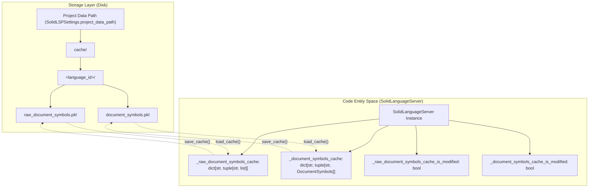
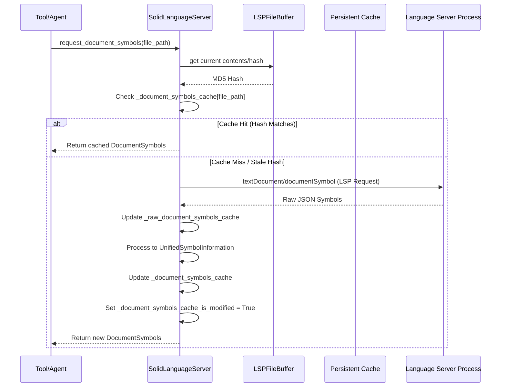

<!-- source: DeepWiki mcp.deepwiki.com · repo oraios/serena · page 6.5 Caching System · fetched 2026-10-29 -->

# Caching System

Relevant source files

The following files were used as context for generating this wiki page:

- [.serena/memories/adding_new_language_support_guide.md](.serena/memories/adding_new_language_support_guide.md)
- [scripts/update_downloaded_dependency_hashes.py](scripts/update_downloaded_dependency_hashes.py)
- [src/solidlsp/dependency_provider.py](src/solidlsp/dependency_provider.py)
- [src/solidlsp/language_servers/common.py](src/solidlsp/language_servers/common.py)
- [src/solidlsp/language_servers/erlang_language_server.py](src/solidlsp/language_servers/erlang_language_server.py)
- [src/solidlsp/language_servers/groovy_language_server.py](src/solidlsp/language_servers/groovy_language_server.py)
- [src/solidlsp/ls.py](src/solidlsp/ls.py)
- [src/solidlsp/ls_types.py](src/solidlsp/ls_types.py)
- [src/solidlsp/ls_utils.py](src/solidlsp/ls_utils.py)
- [src/solidlsp/lsp_protocol_handler/lsp_constants.py](src/solidlsp/lsp_protocol_handler/lsp_constants.py)
- [src/solidlsp/lsp_protocol_handler/lsp_types.py](src/solidlsp/lsp_protocol_handler/lsp_types.py)
- [src/solidlsp/resources/downloaded_dependency_hashes.json](src/solidlsp/resources/downloaded_dependency_hashes.json)
- [src/solidlsp/settings.py](src/solidlsp/settings.py)
- [src/solidlsp/util/cache.py](src/solidlsp/util/cache.py)
- [test/solidlsp/erlang/test_erlang_symbol_names.py](test/solidlsp/erlang/test_erlang_symbol_names.py)
- [test/solidlsp/test_text_utils.py](test/solidlsp/test_text_utils.py)

## Purpose and Scope

This document describes the symbol caching system within the `SolidLanguageServer` framework. The system is designed to minimize redundant Language Server Protocol (LSP) requests and improve performance by storing and retrieving document symbols across sessions. It handles cache fingerprinting via content hashing, automatic invalidation on file changes, and persistent storage using versioned pickles.

For information about the broader language server architecture, see [6.1 SolidLanguageServer Framework](). For details on language server lifecycle management, see [6.2 Language Server Manager]().

## Overview

The caching system implements a two-tier architecture that separates raw LSP responses from processed symbol data. This design enables fast cache invalidation while preserving expensive raw symbol retrieval results when possible.

**Key characteristics:**
- **Two-tier design**: Raw LSP symbols cache (`raw_document_symbols.pkl`) + processed `UnifiedSymbolInformation` cache (`document_symbols.pkl`). [src/solidlsp/ls.py:284-294]()
- **Content-based invalidation**: MD5 hash comparison of file contents via `LSPFileBuffer` detects changes. [src/solidlsp/ls.py:116-117](), [src/solidlsp/ls.py:163-167]()
- **Versioned persistence**: Caches survive sessions but are invalidated if the system version increments. [src/solidlsp/util/cache.py:9-18]()
- **Custom Fingerprinting**: Specialized handling for servers like `ErlangLanguageServer` and `Gopls` that incorporate build settings or normalization logic into the cache key. [src/solidlsp/language_servers/erlang_language_server.py:60-63](), [src/solidlsp/language_servers/gopls.py:171-180]()

Sources: [src/solidlsp/ls.py:90-150](), [src/solidlsp/util/cache.py:1-24](), [src/solidlsp/ls_types.py:165-172]()

## Cache Architecture

The following diagram illustrates how the `SolidLanguageServer` manages its internal cache dictionaries and persists them to the project's data directory.

**System Entity Mapping**

Sources: [src/solidlsp/ls.py:284-294](), [src/solidlsp/util/cache.py:9-24](), [src/solidlsp/settings.py:34-39]()

## Cache Types

### 1. Raw Document Symbols Cache
This tier stores the exact JSON-RPC response from the language server for a `textDocument/documentSymbol` request. This preserves the original `DocumentSymbol` or `SymbolInformation` structures returned by the server. [src/solidlsp/ls.py:60-65](), [src/solidlsp/ls.py:284-289]()

| Property | Details |
| :--- | :--- |
| **File** | `raw_document_symbols.pkl` |
| **Data Type** | `list[RawDocumentSymbol]` |
| **Key** | Relative file path |
| **Value** | `tuple(content_hash, raw_lsp_data)` |
| **Version** | `RAW_DOCUMENT_SYMBOLS_CACHE_VERSION` |

### 2. High-Level Document Symbols Cache
This tier stores processed `DocumentSymbols` objects containing `UnifiedSymbolInformation`. This avoids the overhead of re-parsing LSP structures into the internal Serena format, which includes extra fields for symbol hierarchy and navigation. [src/solidlsp/ls.py:291-294](), [src/solidlsp/ls_types.py:165-172]()

| Property | Details |
| :--- | :--- |
| **File** | `document_symbols.pkl` |
| **Data Type** | `DocumentSymbols` instance |
| **Key** | Relative file path |
| **Value** | `tuple(content_hash, DocumentSymbols)` |
| **Version** | `DOCUMENT_SYMBOL_CACHE_VERSION` |

Sources: [src/solidlsp/ls.py:284-294](), [src/solidlsp/ls_types.py:165-172]()

## Fingerprinting and Invalidation

The system uses `LSPFileBuffer` to manage in-memory file states and compute fingerprints.

### Content Fingerprinting
The primary invalidation trigger is the MD5 hash of the file content.
- `LSPFileBuffer._content_hash` stores the MD5 hex digest of the file contents. [src/solidlsp/ls.py:116-117]()
- When a symbol request is made, the system compares the current hash with the hash stored in the cache entry. [src/solidlsp/ls.py:141-144]()
- If the hashes do not match (e.g., the file was modified on disk), the cache entry is considered stale and a new LSP request is dispatched. [src/solidlsp/ls.py:141-144]()

### Advanced Fingerprinting
Some language servers require more complex fingerprints that include project-level configuration or build context.

- **`ErlangLanguageServer`**: Overrides `_document_symbols_cache_fingerprint` to include a version number for its `_normalize_symbol_name` logic (which replaces `/` with `#` to avoid path collisions). [src/solidlsp/language_servers/erlang_language_server.py:60-63](), [src/solidlsp/language_servers/erlang_language_server.py:66-78]()
- **`Gopls`**: Computes a deterministic hash of the Go build context, including environment variables like `GOFLAGS`, `GOOS`, `GOARCH`, and `CGO_ENABLED`. [src/solidlsp/language_servers/gopls.py:171-180]()
- **`ClangdLanguageServer`**: Includes the `clangd_version` and a hash of the `compile_commands.json` file in its fingerprint. [src/solidlsp/language_servers/clangd_language_server.py:82-92]()

**Data Flow for Symbol Retrieval**

Sources: [src/solidlsp/ls.py:90-150](), [src/solidlsp/ls.py:163-167](), [src/solidlsp/ls.py:284-294]()

## Persistent Cache Management

Caches are persisted to disk using the `load_cache` and `save_cache` utilities found in `solidlsp.util.cache`.

### Versioning Logic
To prevent loading incompatible data after code updates, every cache file is saved with a `__cache_version`. [src/solidlsp/util/cache.py:21-24]()
- **`load_cache(path, version)`**: Loads the pickle. If `__cache_version` in the file does not match the `version` passed as an argument, it logs an "outdated" message and returns `None`, effectively ignoring the stale cache. [src/solidlsp/util/cache.py:9-18]()
- **`save_cache(path, version, obj)`**: Wraps the object in a dictionary with the version and dumps it to a pickle file using `sensai.util.pickle.dump_pickle`. [src/solidlsp/util/cache.py:21-24]()

### File Buffer Integration
The `LSPFileBuffer` class tracks the contents of an open LSP file and handles synchronization. [src/solidlsp/ls.py:90-116]()
- `_open_in_ls`: Notifies the server via `did_open_text_document` when a file is first accessed or changed. [src/solidlsp/ls.py:121-139]()
- `contents`: Property that handles lazy loading from disk and automatic invalidation if the `st_mtime` (modification date) on disk is newer than the `_read_file_modified_date`. [src/solidlsp/ls.py:141-150]()

Sources: [src/solidlsp/ls.py:90-150](), [src/solidlsp/util/cache.py:1-24]()

## Key Classes and Functions

| Entity | Location | Role |
| :--- | :--- | :--- |
| `LSPFileBuffer` | [src/solidlsp/ls.py:90]() | Manages in-memory content and tracks file version/hashes. |
| `UnifiedSymbolInformation` | [src/solidlsp/ls_types.py:165]() | Standardized symbol format stored in high-level cache. |
| `load_cache` | [src/solidlsp/util/cache.py:9]() | Deserializes pickle files with version checking. |
| `save_cache` | [src/solidlsp/util/cache.py:21]() | Serializes objects with a version header. |
| `ErlangLanguageServer` | [src/solidlsp/language_servers/erlang_language_server.py:31]() | Implements cache fingerprinting for symbol normalization. |
| `Gopls` | [src/solidlsp/language_servers/gopls.py:21]() | Implements custom fingerprinting for Go build contexts. |

Sources: [src/solidlsp/ls.py:90-172](), [src/solidlsp/util/cache.py:9-24](), [src/solidlsp/language_servers/gopls.py:171-180](), [src/solidlsp/language_servers/erlang_language_server.py:60-63]()

---

