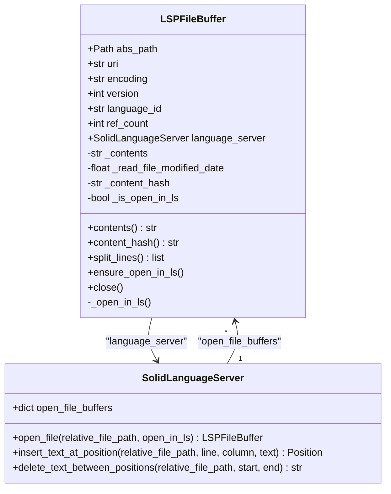
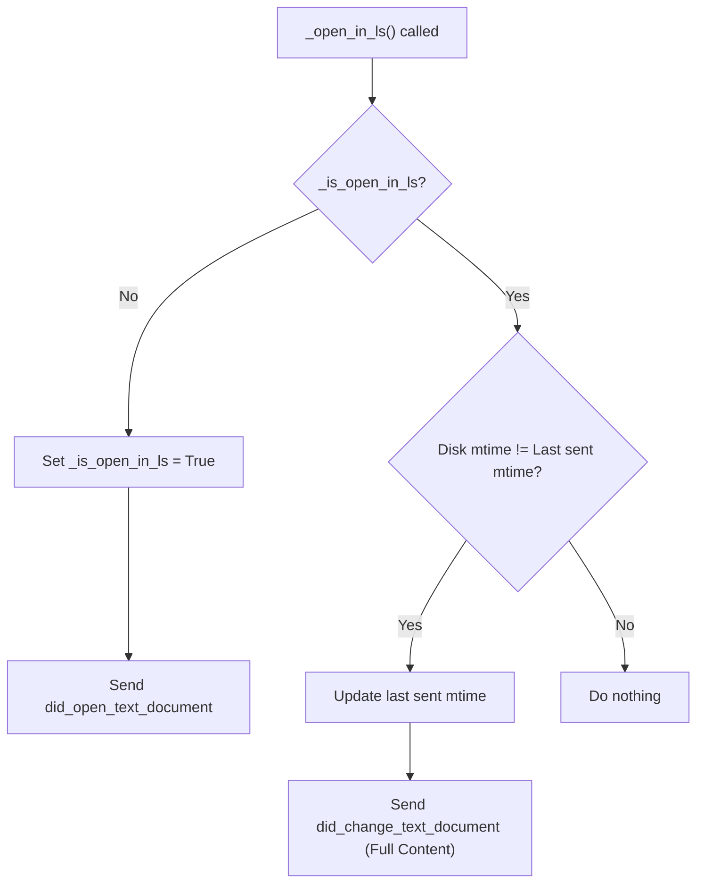
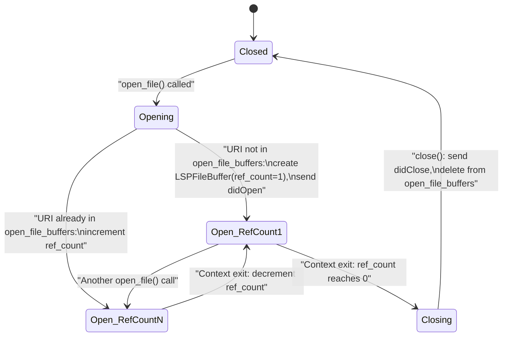
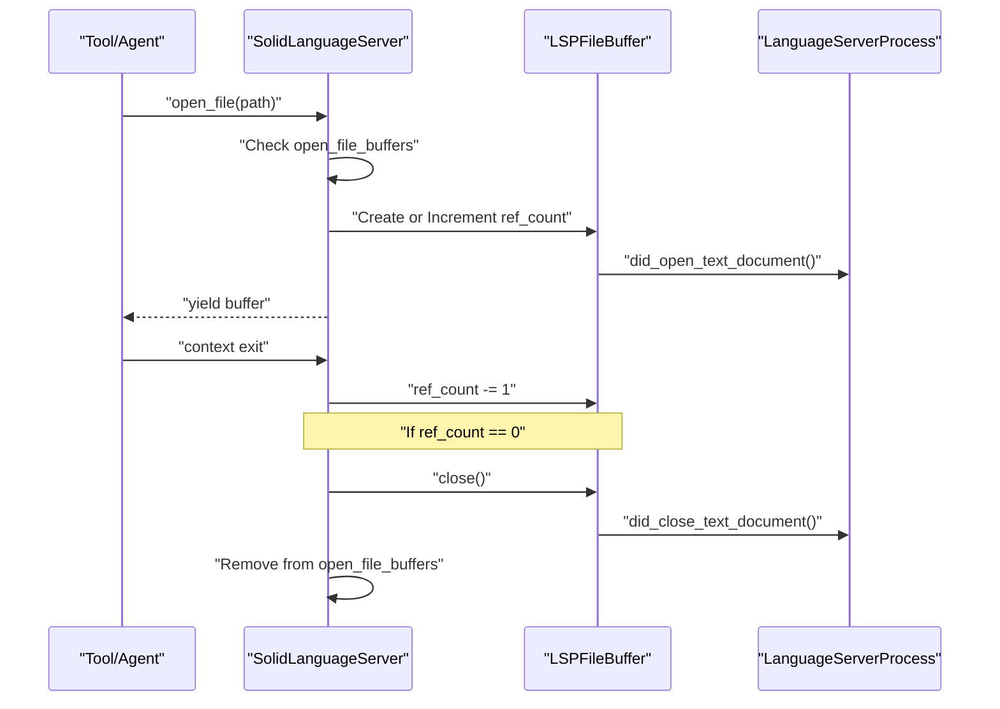
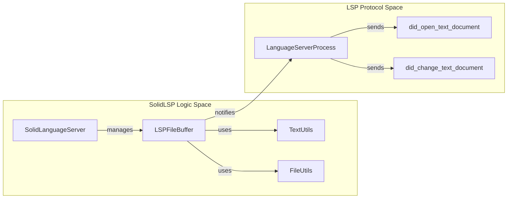
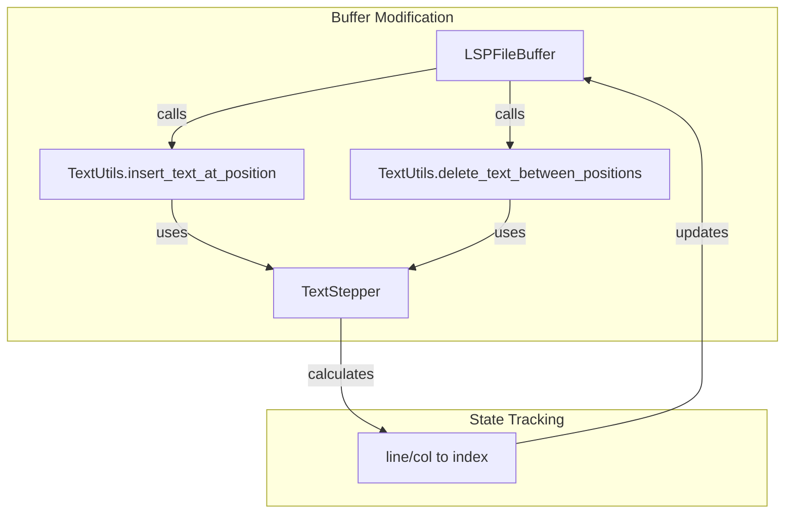

<!-- source: DeepWiki mcp.deepwiki.com · repo oraios/serena · page 6.6 File Buffer Management · fetched 2026-10-29 -->

# File Buffer Management

Relevant source files

The following files were used as context for generating this wiki page:

- [.serena/memories/adding_new_language_support_guide.md](.serena/memories/adding_new_language_support_guide.md)
- [scripts/update_downloaded_dependency_hashes.py](scripts/update_downloaded_dependency_hashes.py)
- [src/solidlsp/dependency_provider.py](src/solidlsp/dependency_provider.py)
- [src/solidlsp/language_servers/common.py](src/solidlsp/language_servers/common.py)
- [src/solidlsp/language_servers/erlang_language_server.py](src/solidlsp/language_servers/erlang_language_server.py)
- [src/solidlsp/language_servers/groovy_language_server.py](src/solidlsp/language_servers/groovy_language_server.py)
- [src/solidlsp/ls.py](src/solidlsp/ls.py)
- [src/solidlsp/ls_types.py](src/solidlsp/ls_types.py)
- [src/solidlsp/ls_utils.py](src/solidlsp/ls_utils.py)
- [src/solidlsp/lsp_protocol_handler/lsp_constants.py](src/solidlsp/lsp_protocol_handler/lsp_constants.py)
- [src/solidlsp/lsp_protocol_handler/lsp_types.py](src/solidlsp/lsp_protocol_handler/lsp_types.py)
- [src/solidlsp/resources/downloaded_dependency_hashes.json](src/solidlsp/resources/downloaded_dependency_hashes.json)
- [src/solidlsp/settings.py](src/solidlsp/settings.py)
- [src/solidlsp/util/cache.py](src/solidlsp/util/cache.py)
- [test/solidlsp/erlang/test_erlang_symbol_names.py](test/solidlsp/erlang/test_erlang_symbol_names.py)
- [test/solidlsp/test_text_utils.py](test/solidlsp/test_text_utils.py)

## Purpose and Scope

This document describes the file buffer management system within `SolidLanguageServer`, which provides in-memory tracking and synchronization of file contents with language server processes. The file buffer system implements reference counting, version tracking, and LSP lifecycle management (`didOpen`/`didChange`/`didClose`) to ensure that language servers maintain accurate views of files being analyzed or edited.

The `LSPFileBuffer` class acts as the central synchronization point between the local file system and the remote Language Server process, supporting both full content reloads and incremental text edits.

Sources: [src/solidlsp/ls.py:90-172](), [src/solidlsp/ls.py:1001-1015]()

---

## LSPFileBuffer Data Structure

`LSPFileBuffer` is a class representing an open LSP file in memory [src/solidlsp/ls.py:90-93](). It tracks all state needed to synchronize file contents with a language server process.

**Class and key entity relationship:**

Sources: [src/solidlsp/ls.py:90-117](), [src/solidlsp/ls.py:1001-1015]()

### Field Definitions

| Field | Type | Description |
|-------|------|-------------|
| `abs_path` | `Path` | Absolute path to the file on disk [src/solidlsp/ls.py:106](). |
| `uri` | `str` | LSP file URI (e.g., `file:///path/to/file.py`) [src/solidlsp/ls.py:108](). |
| `encoding` | `str` | File encoding used when reading from disk [src/solidlsp/ls.py:115](). |
| `version` | `int` | LSP document version, incremented on each modification [src/solidlsp/ls.py:112](). |
| `language_id` | `str` | Language identifier (e.g., `"java"`, `"python"`) [src/solidlsp/ls.py:113](). |
| `ref_count` | `int` | Number of active references holding this buffer open [src/solidlsp/ls.py:114](). |
| `language_server` | `SolidLanguageServer` | Reference to the owning language server instance [src/solidlsp/ls.py:107](). |
| `_contents` | `str \| None` | Lazily loaded and cached file contents [src/solidlsp/ls.py:111](). |
| `_read_file_modified_date` | `float \| None` | `st_mtime` timestamp at the time of the last disk read [src/solidlsp/ls.py:109](). |
| `_content_hash` | `str \| None` | Lazily computed hash of `_contents` [src/solidlsp/ls.py:116](). |

Sources: [src/solidlsp/ls.py:106-117]()

### Automatic Disk Reload and Synchronization

The `LSPFileBuffer` manages synchronization through `_open_in_ls`. If a file is already open, it checks if the disk modification date has changed compared to what was last passed to the LS [src/solidlsp/ls.py:143-145](). If stale, it sends a `did_change_text_document` notification with the updated content [src/solidlsp/ls.py:145-157]().

Sources: [src/solidlsp/ls.py:121-157]()

The `_invalidate_cached_data` method is used to clear `_contents` and `_content_hash` if the file was modified since it was last read [src/solidlsp/ls.py:177-183]().

---

## File Buffer Lifecycle

File buffers follow a strict lifecycle managed through the `open_file()` context manager on `SolidLanguageServer`. The lifecycle ensures proper LSP protocol compliance and automatic cleanup.

**`open_file()` lifecycle state diagram:**

Sources: [src/solidlsp/ls.py:118-120](), [src/solidlsp/ls.py:159-167]()

### Reference Counting Mechanism

Each call to `open_file()` increments `ref_count`; each context exit decrements it. The buffer is only closed and removed from the server's tracking when `ref_count` reaches zero.

**`open_file()` reference counting sequence:**

Sources: [src/solidlsp/ls.py:118-120](), [src/solidlsp/ls.py:159-167]()

---

## LSP Protocol Integration

The file buffer system implements the LSP text document synchronization protocol, sending notifications to keep the language server process synchronized.

### Protocol Messages

1.  **`didOpen`**: Sent in `_open_in_ls()` when a file is first registered or forced open [src/solidlsp/ls.py:130-139](). It includes the `uri`, `language_id`, `version`, and full `text` [src/solidlsp/ls.py:133-137]().
2.  **`didChange`**: Sent when contents are updated. `LSPFileBuffer` supports sending full content updates in `_open_in_ls` if disk changes are detected [src/solidlsp/ls.py:145-157]().
3.  **`didClose`**: Sent in `close()` when the buffer is no longer needed [src/solidlsp/ls.py:159-167]().

The system uses `LSPConstants` for key mapping (e.g., `TEXT_DOCUMENT`, `URI`, `VERSION`) to ensure protocol compliance [src/solidlsp/ls.py:130-138]().

Sources: [src/solidlsp/ls.py:121-167](), [src/solidlsp/lsp_protocol_handler/lsp_constants.py:12-41]()

---

## Content Modification Operations

While `LSPFileBuffer` tracks state, `SolidLanguageServer` provides higher-level methods to modify content and notify the server.

### `insert_text_at_position()`

This operation leverages `TextUtils.insert_text_at_position` to update the string content [src/solidlsp/ls_utils.py:188-192]().
1.  Locates the index in the buffer.
2.  Inserts the text.
3.  Increments the `version` in `LSPFileBuffer`.
4.  Sends `did_change_text_document` with the specific range.

### `delete_text_between_positions()`

This operation leverages `TextUtils.delete_text_between_positions` [src/solidlsp/ls_utils.py:188-192]().
1.  Calculates start and end indices.
2.  Removes the text segment.
3.  Updates the buffer version and notifies the LS.

Sources: [src/solidlsp/ls.py:90-117](), [src/solidlsp/ls_utils.py:181-192]()

---

## Integration with Code Entities

The following diagrams bridge the gap between high-level file management concepts and the specific code entities in the Serena repository.

**Code Entity Relationship: Buffer to Server**

Sources: [src/solidlsp/ls.py:90](), [src/solidlsp/ls_process.py:36](), [src/solidlsp/ls_utils.py:38]()

**Code Entity Relationship: Text Processing**

Sources: [src/solidlsp/ls_utils.py:41](), [src/solidlsp/ls_utils.py:181]()

---

## Text Stepper and Utilities

The `TextStepper` class is the underlying utility used for line-by-line processing of buffer contents [src/solidlsp/ls_utils.py:41-47](). It handles different newline sequences (`\n`, `\r\n`, `\r`) as defined by the LSP specification [src/solidlsp/ls_utils.py:101-104]().

- **`step_line()`**: Advances the stepper to the next line [src/solidlsp/ls_utils.py:90]().
- **`step_to(line, col)`**: Advances to a specific coordinate [src/solidlsp/ls_utils.py:132]().
- **`process_all_gather_lines()`**: Converts the buffer into a list of strings [src/solidlsp/ls_utils.py:162]().

Sources: [src/solidlsp/ls_utils.py:41-178]()

---

