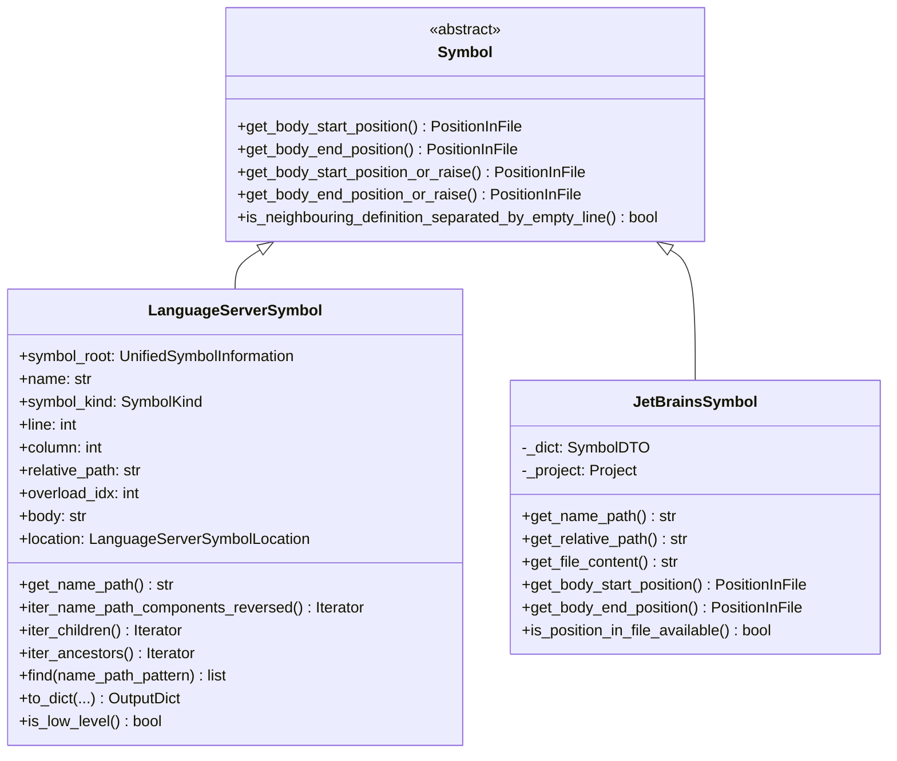
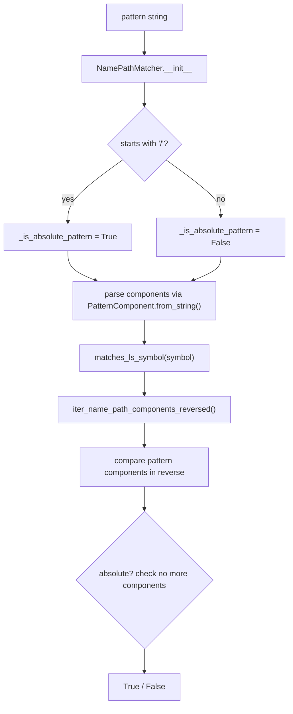
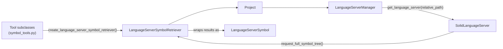
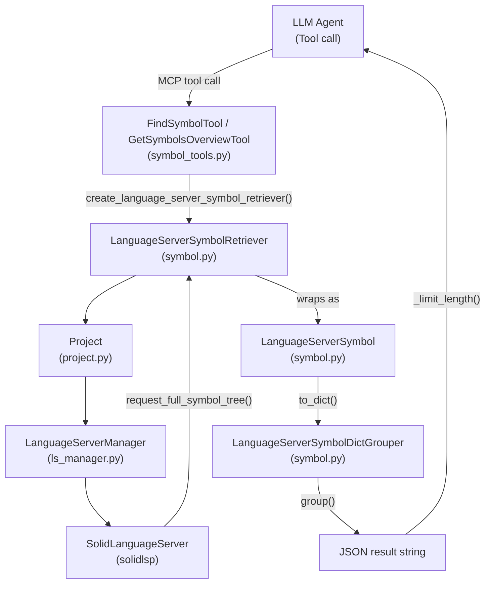
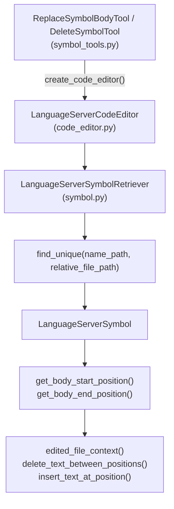

<!-- source: DeepWiki mcp.deepwiki.com · repo oraios/serena · page 6.7 Symbol Abstraction · fetched 2026-10-29 -->

# Symbol Abstraction

<details>
<summary>Relevant source files</summary>

The following files were used as context for generating this wiki page:

- [src/serena/code_editor.py](src/serena/code_editor.py)
- [src/serena/ls_manager.py](src/serena/ls_manager.py)
- [src/serena/symbol.py](src/serena/symbol.py)
- [src/serena/tools/__init__.py](src/serena/tools/__init__.py)
- [src/serena/tools/cmd_tools.py](src/serena/tools/cmd_tools.py)
- [src/serena/tools/jetbrains_tools.py](src/serena/tools/jetbrains_tools.py)
- [src/serena/tools/symbol_tools.py](src/serena/tools/symbol_tools.py)
- [src/serena/tools/tools_base.py](src/serena/tools/tools_base.py)
- [test/resources/repos/python/test_repo/test_repo/variables.py](test/resources/repos/python/test_repo/test_repo/variables.py)
- [test/serena/__snapshots__/test_symbol_editing.ambr](test/serena/__snapshots__/test_symbol_editing.ambr)
- [test/serena/test_ls_file_sync.py](test/serena/test_ls_file_sync.py)
- [test/serena/test_symbol.py](test/serena/test_symbol.py)
- [test/serena/test_symbol_editing.py](test/serena/test_symbol_editing.py)
- [test/solidlsp/python/test_symbol_retrieval.py](test/solidlsp/python/test_symbol_retrieval.py)

</details>


This page covers the symbol model used throughout Serena: the class hierarchy, location types, name path system, and the `LanguageServerSymbolRetriever` that queries language servers for symbols. All relevant code lives in [`src/serena/symbol.py`](). For the code editing operations that *act on* these symbols, see [Code Editor Operations (6.8)](). For the tools that expose symbols to the LLM agent, see [Symbolic Code Tools (7.3)]().

---

## Class Hierarchy

Serena models a code symbol (class, function, method, variable, etc.) through an abstract `Symbol` base class with two concrete implementations: one backed by the LSP layer (`LanguageServerSymbol`) and one backed by the JetBrains plugin (`JetBrainsSymbol`).

**Symbol Abstraction Class Hierarchy**



Sources: [`src/serena/symbol.py:86-128`](), [`src/serena/symbol.py:211-507`](), [`src/serena/symbol.py:855-958`]()

---

## Location and Position Types

Two small dataclasses represent positions within the file system.

| Class | Fields | Purpose |
|---|---|---|
| `LanguageServerSymbolLocation` | `relative_path`, `line`, `column` | Uniquely identifies a symbol's identifier position within the project |
| `PositionInFile` | `line` (0-based), `col` (0-based) | Character position for editor operations; converts to LSP `Position` via `to_lsp_position()` |

`LanguageServerSymbolLocation` is the canonical key for identifying a symbol. If `relative_path` is `None`, the symbol is defined outside the project scope (e.g., in a library) [`src/serena/symbol.py:35-37`](). Its `has_position_in_file()` method checks that all three fields are non-`None`, which is required before performing operations like rename or reference lookup [`src/serena/symbol.py:60-61`]().

`PositionInFile` is used by `CodeEditor` for insert/delete operations and converts to the LSP `Position` type via `to_lsp_position()` [`src/serena/symbol.py:79-83`]() using the `solidlsp.ls_types.Position` definition.

Sources: [`src/serena/symbol.py:29-84`](), [`src/serena/code_editor.py:61-75`]()

---

## LanguageServerSymbol

`LanguageServerSymbol` wraps a `UnifiedSymbolInformation` dict (from the `solidlsp` layer) and exposes it through typed properties and methods.

**Key properties:**

| Property | Description |
|---|---|
| `name` | Symbol identifier (e.g., `"MyClass"`) |
| `symbol_kind` | `SymbolKind` enum value (Class, Method, Function, Variable, etc.) |
| `symbol_kind_name` | String name of the kind |
| `line` / `column` | Position of the identifier, from `selectionRange.start` |
| `relative_path` | File-relative path from the location dict |
| `location` | Returns a `LanguageServerSymbolLocation` |
| `body_start_position` / `body_end_position` | Full range of the symbol's body, from `location.range` |
| `body` | Source text of the symbol, if populated |
| `overload_idx` | 0-based index for overloaded symbols (e.g., Java methods) |

**Tree navigation:**

- `iter_children()` — yields direct child `LanguageServerSymbol` instances [`src/serena/symbol.py:350-352`]()
- `iter_ancestors(up_to_symbol_kind)` — walks up the parent chain, stopping before the given kind (commonly `SymbolKind.File`) [`src/serena/symbol.py:354-365`]()
- `get_parent()` — returns the immediate parent symbol or `None` [`src/serena/symbol.py:367-369`]()
- `find(name_path_pattern, ...)` — traverses the subtree, returning all matching symbols [`src/serena/symbol.py:379-388`]()

**Serialization:**

`to_dict()` converts a symbol (and optionally its children up to a configurable `depth`) to a plain dict. The `OutputDict` TypedDict defines the possible keys: `name`, `name_path`, `kind`, `location`, `body_location`, `body`, `children`, `relative_path` [`src/serena/symbol.py:434-500`]().

`is_low_level()` returns `True` for kinds at or above `SymbolKind.Variable` (variables, constants, etc.), used by `GetSymbolsOverviewTool` to filter out noise [`src/serena/symbol.py:502-507`]().

Sources: [`src/serena/symbol.py:211-507`]()

---

## Name Paths and NamePathMatcher

### Name Paths

A *name path* is a `/`-separated string representing a symbol's position within the symbol tree of a source file. It does not include the file path.

Examples:
- `"MyClass"` — top-level class
- `"MyClass/my_method"` — method inside a class
- `"MyClass/my_method[1]"` — second overload (0-based) of an overloaded method

The separator is the constant `NAME_PATH_SEP = "/"` ([`src/serena/symbol.py:26`]()).

`LanguageServerSymbol.get_name_path()` builds the path by calling `iter_name_path_components_reversed()`, which yields `NamePathComponent` instances for the symbol itself followed by each ancestor up to (but not including) `SymbolKind.File` [`src/serena/symbol.py:332-339`]().

### NamePathComponent

`NamePathComponent` holds a single segment: a `name` string and an optional `overload_idx` [`src/serena/symbol.py:131-134`](). Its `__repr__` produces `"name"` or `"name[idx]"` [`src/serena/symbol.py:136-140`]().

### NamePathMatcher

`NamePathMatcher` compiles a pattern string and matches it against a symbol's name path. Pattern syntax:

| Pattern form | Example | Behavior |
|---|---|---|
| Simple name | `"my_method"` | Matches any symbol named `my_method` at any nesting level |
| Relative path | `"MyClass/my_method"` | Matches any symbol whose name path ends with `MyClass/my_method` |
| Absolute path | `"/MyClass/my_method"` | Exact full match; no ancestor segments allowed |
| With overload | `"MyClass/my_method[1]"` | Matches only the second overload |

Substring matching (controlled by the `substring_matching` flag) applies only to the **last** path component, enabling queries like `"get"` matching `"getName"` [`src/serena/symbol.py:160-180`]().

**NamePathMatcher Resolution Flow**



Sources: [`src/serena/symbol.py:143-208`](), [`test/serena/test_symbol.py:11-140`]()

---

## LanguageServerSymbolRetriever

`LanguageServerSymbolRetriever` is the main entry point for querying the language server(s) for symbols. It accepts a `Project` instance and routes requests based on file extension using the `LanguageServerManager`.

**Component relationships:**



### Core Methods

| Method | Description |
|---|---|
| `find(name_path_pattern, ...)` | Queries the full symbol tree across all language servers, applies `NamePathMatcher`, returns `list[LanguageServerSymbol]` [`src/serena/symbol.py:736-773`]() |
| `find_unique(name_path_pattern, ...)` | Like `find`, but raises `ValueError` if not exactly one match [`src/serena/symbol.py:775-800`]() |
| `find_by_location(location)` | Locates a symbol by its `LanguageServerSymbolLocation` [`src/serena/symbol.py:718-734`]() |
| `find_referencing_symbols(name_path, relative_file_path, ...)` | Finds all symbols referencing the named symbol (uses `find_unique` then `find_referencing_symbols_by_location`) [`src/serena/symbol.py:823-833`]() |
| `find_referencing_symbols_by_location(symbol_location, ...)` | Calls `request_referencing_symbols` on the appropriate language server [`src/serena/symbol.py:835-853`]() |
| `get_symbol_overview(relative_path)` | Returns a `dict[str, list[LanguageServerSymbol]]` mapping file paths to top-level symbols [`src/serena/symbol.py:802-821`]() |
| `request_info_for_symbol(symbol)` | Issues a hover request for a single symbol, returning the hover text [`src/serena/symbol.py:701-707`]() |
| `request_info_for_symbol_batch(symbols)` | Batch hover requests, grouped by file and bounded by a time budget (`symbol_info_budget`) [`src/serena/symbol.py:593-699`]() |

### find_unique Disambiguation Logic

When multiple symbols match a pattern, `find_unique` attempts a secondary disambiguation: if exactly one candidate has the pattern as its exact `get_name_path()` result, that one is returned [`src/serena/symbol.py:790-795`](). Otherwise, a `ValueError` is raised listing all candidates.

Sources: [`src/serena/symbol.py:540-853`]()

---

## ReferenceInLanguageServerSymbol

`ReferenceInLanguageServerSymbol` is a dataclass returned by reference-finding operations. It records:

- `symbol: LanguageServerSymbol` — the symbol *containing* the reference (not the referenced symbol)
- `line: int` — 0-based line of the reference within that symbol
- `character: int` — 0-based column of the reference

It is constructed from `LSPReferenceInSymbol` via `from_lsp_reference()` [`src/serena/symbol.py:523-537`].

Sources: [`src/serena/symbol.py:510-537`]()

---

## Hover Info and the Symbol Info Budget

`request_info_for_symbol_batch()` groups symbols by file to minimize language server overhead, then issues hover requests. A configurable time budget (`symbol_info_budget`, in seconds) caps total hover time:

- Budget is read from `ProjectConfig.symbol_info_budget`, falling back to `SerenaConfig.symbol_info_budget`, then a default of 10 seconds [`src/serena/symbol.py:608-613`]().
- When the budget is exceeded, remaining symbols receive `info=None` and the batch terminates early [`src/serena/symbol.py:643-645`]().
- Setting `symbol_info_budget=0` disables the cap entirely [`src/serena/symbol.py:616`]().

Sources: [`src/serena/symbol.py:593-699`]()

---

## JetBrainsSymbol

`JetBrainsSymbol` implements the `Symbol` interface over a `SymbolDTO` dict returned by the JetBrains plugin. Unlike `LanguageServerSymbol`, it does not carry the full symbol tree in memory; instead, it reads file content on demand via `get_file_content()` (with caching) [`src/serena/symbol.py:878-887`]().

Body positions are computed by scanning the raw file text for the `text_range` offsets provided in the `SymbolDTO` [`src/serena/symbol.py:900-922`](). The `is_position_in_file_available()` method checks whether `text_range` is present before attempting position computation [`src/serena/symbol.py:894-895`]().

Sources: [`src/serena/symbol.py:855-958`]()

---

## SymbolDictGrouper Classes

Both `LanguageServerSymbolDictGrouper` and `JetBrainsSymbolDictGrouper` organize flat lists of symbol dicts into nested structures grouped by specified keys. They are used by the tool layer to produce compact, LLM-friendly JSON output.

Example usage in `GetSymbolsOverviewTool`:
```python
# Group by kind, collapse if only one symbol of that kind exists
symbol_dict_grouper = LanguageServerSymbolDictGrouper(["kind"], ["kind"], collapse_singleton=True)
```
([`src/serena/tools/symbol_tools.py:41`]())

Sources: [`src/serena/tools/symbol_tools.py:36-83`](), [`src/serena/symbol.py:961-1057`]()

---

## Integration with Tools and CodeEditor

**Data flow from language server to LLM tool result:**



**Data flow from tool to editor:**



Sources: [`src/serena/tools/symbol_tools.py:134-156`](), [`src/serena/symbol.py:540-853`](), [`src/serena/code_editor.py:78-125`]()

---

## Summary Table

| Class / Type | File | Role |
|---|---|---|
| `Symbol` | [`src/serena/symbol.py:86`]() | Abstract base; body position interface |
| `LanguageServerSymbol` | [`src/serena/symbol.py:211`]() | LSP-backed symbol; wraps `UnifiedSymbolInformation` |
| `JetBrainsSymbol` | [`src/serena/symbol.py:855`]() | JetBrains-backed symbol; wraps `SymbolDTO` |
| `LanguageServerSymbolLocation` | [`src/serena/symbol.py:29`]() | Unique identifier for a symbol's position |
| `PositionInFile` | [`src/serena/symbol.py:65`]() | Character position for editor operations |
| `NamePathComponent` | [`src/serena/symbol.py:131`]() | Single segment of a name path |
| `NamePathMatcher` | [`src/serena/symbol.py:143`]() | Pattern matching logic for name paths |
| `LanguageServerSymbolRetriever` | [`src/serena/symbol.py:540`]() | Query interface to LSP symbol data |
| `ReferenceInLanguageServerSymbol` | [`src/serena/symbol.py:510`]() | Reference location within a containing symbol |
| `LanguageServerSymbolDictGrouper` | [`src/serena/symbol.py:961`]() | Groups symbol dicts for compact JSON output |
| `JetBrainsSymbolDictGrouper` | [`src/serena/symbol.py:1027`]() | Same, for JetBrains symbol dicts |

Sources: [`src/serena/symbol.py:1-1057`]()

---

