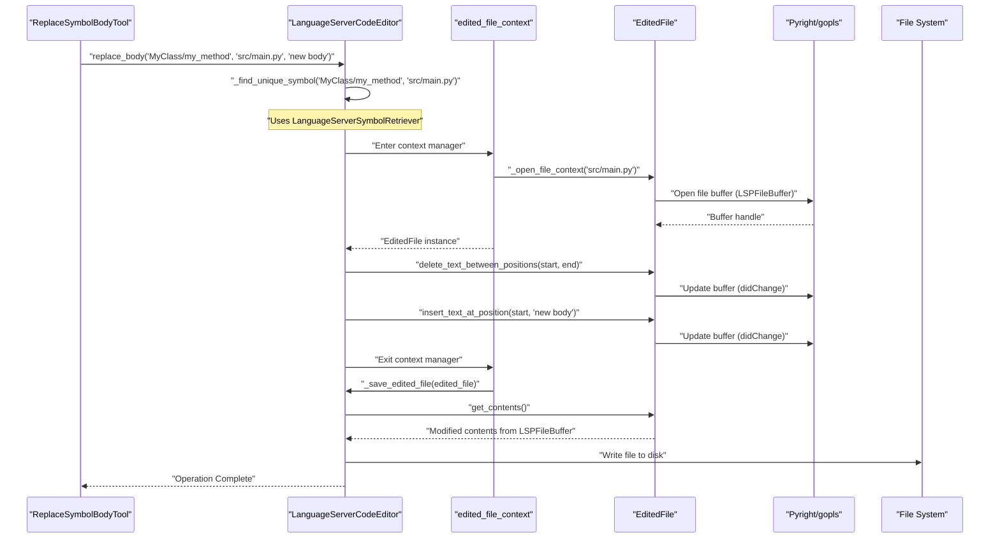
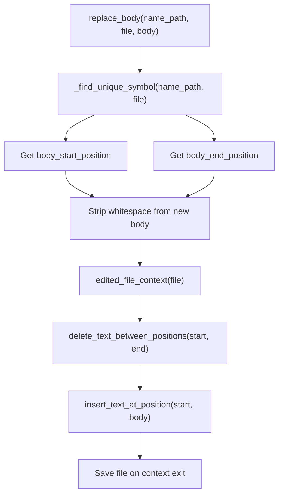
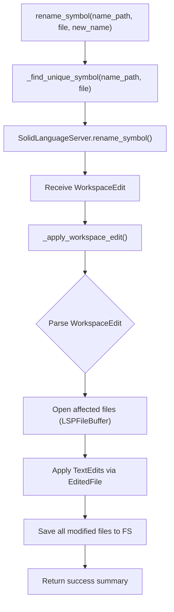

<!-- source: DeepWiki mcp.deepwiki.com · repo oraios/serena · page 6.8 Code Editor Operations · fetched 2026-10-29 -->

# Code Editor Operations

<details>
<summary>Relevant source files</summary>

The following files were used as context for generating this wiki page:

- [src/serena/code_editor.py](src/serena/code_editor.py)
- [src/serena/ls_manager.py](src/serena/ls_manager.py)
- [src/serena/symbol.py](src/serena/symbol.py)
- [src/serena/tools/__init__.py](src/serena/tools/__init__.py)
- [src/serena/tools/cmd_tools.py](src/serena/tools/cmd_tools.py)
- [src/serena/tools/file_tools.py](src/serena/tools/file_tools.py)
- [src/serena/tools/jetbrains_tools.py](src/serena/tools/jetbrains_tools.py)
- [src/serena/tools/symbol_tools.py](src/serena/tools/symbol_tools.py)
- [src/serena/tools/tools_base.py](src/serena/tools/tools_base.py)
- [src/serena/util/file_proxy.py](src/serena/util/file_proxy.py)
- [src/serena/util/text_utils.py](src/serena/util/text_utils.py)
- [test/resources/repos/python/test_repo/test_repo/variables.py](test/resources/repos/python/test_repo/test_repo/variables.py)
- [test/serena/__snapshots__/test_symbol_editing.ambr](test/serena/__snapshots__/test_symbol_editing.ambr)
- [test/serena/test_ls_file_sync.py](test/serena/test_ls_file_sync.py)
- [test/serena/test_symbol.py](test/serena/test_symbol.py)
- [test/serena/test_symbol_editing.py](test/serena/test_symbol_editing.py)
- [test/serena/test_text_utils.py](test/serena/test_text_utils.py)
- [test/solidlsp/python/test_symbol_retrieval.py](test/solidlsp/python/test_symbol_retrieval.py)

</details>


This page documents the `CodeEditor` abstraction and its implementations, which provide atomic file editing operations for source code. The code editor operates on `Symbol` objects to perform precise edits based on symbol locations retrieved from language servers or JetBrains plugins. For information about symbol retrieval and querying, see [6.7 Symbol Abstraction](). For tools that use the code editor, see [7.3 Tool Reference]().

---

## Code Editor Architecture

The `CodeEditor` is an abstract base class that defines a unified interface for editing source code files. It is implemented by two concrete backends that differ in how they interact with the underlying code intelligence systems.

### Class Hierarchy

Title: Code Editor Class Hierarchy
```mermaid
classDiagram
    class CodeEditor~TSymbol~ {
        <<abstract>>
        +str project_root
        +str encoding
        +str newline
        +edited_file_context(relative_path) Iterator[EditedFile]
        +replace_body(name_path, relative_file_path, body)
        +insert_after_symbol(name_path, relative_file_path, body)
        +insert_before_symbol(name_path, relative_file_path, body)
        +delete_symbol(name_path, relative_file_path)
        +rename_symbol(name_path, relative_file_path, new_name)* str
        +insert_at_line(relative_path, line, content)
        +delete_lines(relative_path, start_line, end_line)
        -_find_unique_symbol(name_path, relative_file_path)* TSymbol
        -_open_file_context(relative_path)* Iterator[EditedFile]
        -_save_edited_file(edited_file)
    }
    
    class LanguageServerCodeEditor {
        -LanguageServerSymbolRetriever _symbol_retriever
        +_find_unique_symbol(name_path, relative_file_path) LanguageServerSymbol
        +rename_symbol(name_path, relative_file_path, new_name) str
        -_get_language_server(relative_path) SolidLanguageServer
        -_apply_workspace_edit(workspace_edit) int
    }
    
    class JetBrainsCodeEditor {
        -Project _project
        +_find_unique_symbol(name_path, relative_file_path) JetBrainsSymbol
        +rename_symbol(name_path, relative_file_path, new_name) str
    }
    
    class EditedFile {
        <<abstract>>
        +str relative_path
        +get_contents()* str
        +set_contents(contents)*
        +delete_text_between_positions(start_pos, end_pos)*
        +insert_text_at_position(pos, text)*
    }
    
    CodeEditor <|-- LanguageServerCodeEditor
    CodeEditor <|-- JetBrainsCodeEditor
    CodeEditor +-- EditedFile
    CodeEditor ..> Symbol : uses
    LanguageServerCodeEditor ..> LanguageServerSymbol : finds
    JetBrainsCodeEditor ..> JetBrainsSymbol : finds
```

**Sources:** [src/serena/code_editor.py:22-41](), [src/serena/code_editor.py:246-252](), [src/serena/code_editor.py:381-386]()

---

## EditedFile Context Manager Pattern

All file editing operations use a context manager pattern that ensures atomic file modifications. The `EditedFile` abstraction provides low-level text manipulation operations.

### EditedFile Interface

| Method | Description | Parameters | Returns |
|--------|-------------|------------|---------|
| `get_contents()` | Retrieve current file contents | None | `str` |
| `set_contents(contents)` | Replace entire file contents | `contents: str` | `None` |
| `delete_text_between_positions(start_pos, end_pos)` | Delete text range | `start_pos: PositionInFile`<br>`end_pos: PositionInFile` | `None` |
| `insert_text_at_position(pos, text)` | Insert text at position | `pos: PositionInFile`<br>`text: str` | `None` |

### Position Representation

The `PositionInFile` dataclass represents a character position within a file using 0-based line and column indices [src/serena/symbol.py:65-77](). This structure is used to interface with the `LSPFileBuffer` and language server `Position` types via `to_lsp_position()` [src/serena/symbol.py:79-83]().

```python
@dataclass
class PositionInFile:
    line: int      # 0-based line number
    col: int       # 0-based column number
```

**Sources:** [src/serena/symbol.py:65-83](), [src/serena/code_editor.py:28-52]()

---

## File Editing Workflow

The context manager pattern ensures that file edits are atomic: the file is opened, modified in memory (or via an LSP buffer), and saved only when the context exits successfully.

Title: File Editing Data Flow (Natural Language Space to Code Entity Space)


**Sources:** [src/serena/code_editor.py:78-87](), [src/serena/code_editor.py:106-125](), [src/serena/code_editor.py:276-287](), [src/serena/tools/tools_base.py:63-80]()

---

## Symbol-Based Edit Operations

The `CodeEditor` provides high-level operations that work with symbols rather than raw positions. These operations automatically handle whitespace normalization and proper formatting.

### Replace Symbol Body

The `replace_body` method replaces the entire definition of a symbol with new content. It uses the symbol's start and end positions to determine the exact range to overwrite.

Title: Symbol Body Replacement Logic


**Key behavior:**
- Strips all leading and trailing whitespace from the replacement body using `body.strip()` [src/serena/code_editor.py:121]().
- Preserves existing whitespace before and after the symbol by targeting the precise body range retrieved via `get_body_start_position_or_raise()` [src/serena/code_editor.py:115-116]().

**Sources:** [src/serena/code_editor.py:106-125]()

### Insert After Symbol

The `insert_after_symbol` method adds content immediately after a symbol's definition. It calculates the correct insertion line (typically `pos.line + 1`) and ensures proper vertical spacing [src/serena/code_editor.py:159-164]().

**Automatic whitespace handling:**
The logic uses `is_neighbouring_definition_separated_by_empty_line()` on the symbol to determine if a blank line is required between the existing symbol and the new content [src/serena/code_editor.py:170-171](). It also preserves leading newlines requested by the caller while enforcing the minimum spacing [src/serena/code_editor.py:172-174]().

**Sources:** [src/serena/code_editor.py:142-178](), [src/serena/symbol.py:124-129]()

### Insert Before Symbol

The `insert_before_symbol` method adds content before a symbol's definition. Similar to `insert_after_symbol`, it enforces spacing rules based on the symbol type, ensuring that definitions are separated by empty lines where appropriate [src/serena/code_editor.py:186-191]().

**Sources:** [src/serena/code_editor.py:179-196]()

### Delete Symbol

The `delete_symbol` method removes an entire symbol definition. It retrieves the symbol's body range and deletes the text between those positions within an `edited_file_context` [src/serena/code_editor.py:224-232]().

**Sources:** [src/serena/code_editor.py:224-232]()

---

## LanguageServerCodeEditor Implementation

The `LanguageServerCodeEditor` uses `LanguageServerSymbolRetriever` to locate symbols and `SolidLanguageServer` to apply edits.

### Implementation Details

Changes are tracked in an `LSPFileBuffer`, which maintains an in-memory version of the file and notifies the language server of changes via `didOpen` and `didChange` [src/serena/code_editor.py:276-287](). The `_open_file_context` method uses `lang_server.open_file(relative_path)` to get a managed buffer that synchronizes with the language server process [src/serena/code_editor.py:277-278]().

**Sources:** [src/serena/code_editor.py:246-287]()

### Rename Symbol with Workspace Edits

The `LanguageServerCodeEditor` implements `rename_symbol` using LSP's `rename` request. This returns a `WorkspaceEdit` which may involve changes across multiple files.

Title: LSP Rename Symbol Workflow (Natural Language Space to Code Entity Space)


**Sources:** [src/serena/code_editor.py:292-350](), [src/serena/code_editor.py:352-378]()

---

## JetBrainsCodeEditor Implementation

The `JetBrainsCodeEditor` delegates operations to the JetBrains plugin via the `JetBrainsPluginClient`.

### Implementation Details

File content is managed as a local string within the `EditedFile` instance [src/serena/code_editor.py:401](). Text operations use `TextUtils` from `solidlsp.ls_utils` for position-based modifications like `delete_text_between_positions` [src/serena/code_editor.py:407-410](). After saving to disk, it calls `client.refresh_file()` to ensure the JetBrains IDE synchronizes with the external changes [src/serena/code_editor.py:393]().

**Sources:** [src/serena/code_editor.py:381-416]()

### Symbol Finding and Rename

The `JetBrainsCodeEditor` communicates with the JetBrains plugin to find symbols and perform renames:

- **Symbol finding**: Uses `client.find_symbol` with the provided `name_path` and `relative_path` to retrieve a `JetBrainsSymbol` [src/serena/code_editor.py:421-430]().
- **Rename operation**: Uses `client.rename_symbol` which triggers the IDE's internal refactoring engine, handling cross-file references automatically [src/serena/code_editor.py:435-439]().

**Sources:** [src/serena/code_editor.py:417-439]()

---

## Whitespace and Line Handling

The `CodeEditor` implements internal utilities to maintain consistent formatting during insertions.

| Operation | Whitespace Behavior |
|-----------|-------------------|
| `replace_body` | Strips all leading/trailing whitespace from the replacement `body` string using `strip()` [src/serena/code_editor.py:121](). |
| `insert_after_symbol` | Ensures at least `min_empty_lines` exist between the symbol and the new content by calculating `num_leading_empty_lines` [src/serena/code_editor.py:169-174](). |
| `insert_before_symbol` | Ensures the new content ends with a newline and respects `min_trailing_empty_lines` based on `is_neighbouring_definition_separated_by_empty_line()` [src/serena/code_editor.py:186-191](). |

**Sources:** [src/serena/code_editor.py:106-125](), [src/serena/code_editor.py:142-178](), [src/serena/code_editor.py:179-196]()

### Position-Based Operations

In addition to symbol-based operations, the `CodeEditor` provides direct line-based methods for general text manipulation when symbol-level precision is not required.

| Method | Description |
|--------|-------------|
| `insert_at_line(path, line, content)` | Inserts text at the start of a specific 0-based line [src/serena/code_editor.py:197-208](). |
| `delete_lines(path, start, end)` | Deletes a range of lines inclusive [src/serena/code_editor.py:210-222](). |

**Sources:** [src/serena/code_editor.py:197-222]()

---

