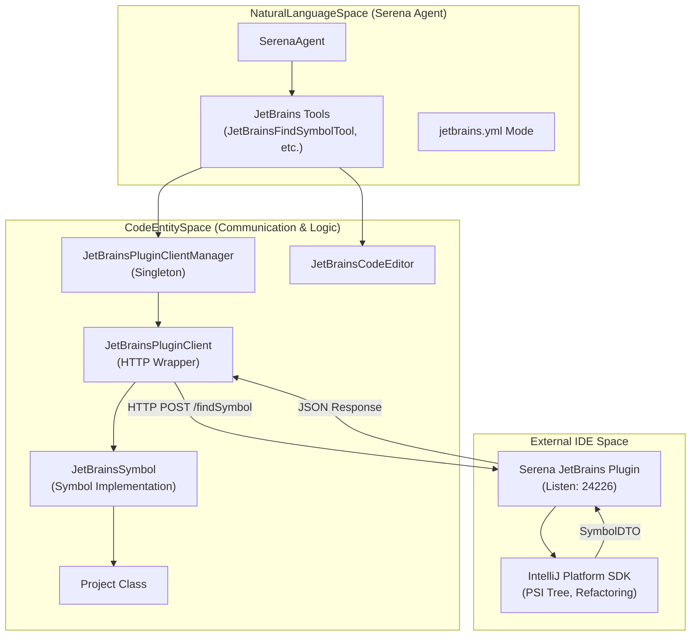
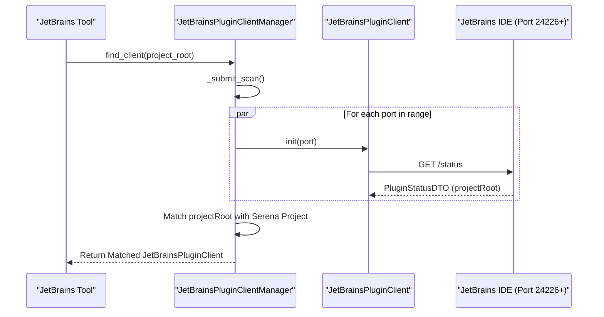
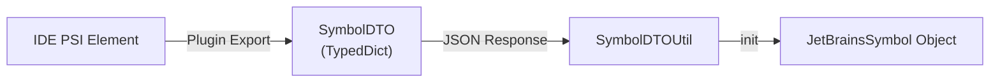

<!-- source: DeepWiki mcp.deepwiki.com · repo oraios/serena · page 6.9 JetBrains Integration · fetched 2026-10-29 -->

# JetBrains Integration

Relevant source files

The following files were used as context for generating this wiki page:

- [docs/01-about/050_acknowledgements.md](docs/01-about/050_acknowledgements.md)
- [docs/02-usage/020_running.md](docs/02-usage/020_running.md)
- [docs/02-usage/025_jetbrains_plugin.md](docs/02-usage/025_jetbrains_plugin.md)
- [docs/02-usage/030_clients.md](docs/02-usage/030_clients.md)
- [docs/02-usage/040_workflow.md](docs/02-usage/040_workflow.md)
- [docs/02-usage/050_configuration.md](docs/02-usage/050_configuration.md)
- [docs/02-usage/999_additional-usage.md](docs/02-usage/999_additional-usage.md)
- [src/serena/code_editor.py](src/serena/code_editor.py)
- [src/serena/jetbrains/jetbrains_plugin_client.py](src/serena/jetbrains/jetbrains_plugin_client.py)
- [src/serena/jetbrains/jetbrains_types.py](src/serena/jetbrains/jetbrains_types.py)
- [src/serena/ls_manager.py](src/serena/ls_manager.py)
- [src/serena/project_server.py](src/serena/project_server.py)
- [src/serena/resources/config/internal_modes/jetbrains.yml](src/serena/resources/config/internal_modes/jetbrains.yml)
- [src/serena/resources/config/modes/query-projects.yml](src/serena/resources/config/modes/query-projects.yml)
- [src/serena/symbol.py](src/serena/symbol.py)
- [src/serena/tools/__init__.py](src/serena/tools/__init__.py)
- [src/serena/tools/cmd_tools.py](src/serena/tools/cmd_tools.py)
- [src/serena/tools/jetbrains_tools.py](src/serena/tools/jetbrains_tools.py)
- [src/serena/tools/query_project_tools.py](src/serena/tools/query_project_tools.py)
- [src/serena/tools/symbol_tools.py](src/serena/tools/symbol_tools.py)
- [src/serena/tools/tools_base.py](src/serena/tools/tools_base.py)
- [test/serena/test_ls_file_sync.py](test/serena/test_ls_file_sync.py)
- [test/serena/test_symbol.py](test/serena/test_symbol.py)

## Purpose and Scope

This document covers Serena's alternative backend for semantic code operations that integrates with JetBrains IDEs (IntelliJ IDEA, PyCharm, WebStorm, etc.) through a dedicated plugin. Instead of using the standard Language Server Protocol (LSP) implementations, this backend communicates directly with a JetBrains IDE instance via HTTP to perform symbol queries, code navigation, and refactoring operations.

The integration is managed by the `JetBrainsPluginClient` for low-level communication and `JetBrainsPluginClientManager` for discovering active IDE instances. It provides a specialized set of tools that replace or augment standard LSP-based symbolic tools when the `JetBrains` language backend is active.

Sources: [src/serena/jetbrains/jetbrains_plugin_client.py:1-27](), [src/serena/resources/config/internal_modes/jetbrains.yml:1-29](), [docs/02-usage/025_jetbrains_plugin.md:1-16]()

---

## Architecture Overview

The JetBrains integration bridges the "Natural Language Space" (where the LLM operates) to the "Code Entity Space" by mapping tool calls to specific IDE actions via a local HTTP server hosted by the Serena JetBrains plugin.

### System Component Diagram

**Diagram: JetBrains Integration Architecture**

Sources: [src/serena/tools/jetbrains_tools.py:16-107](), [src/serena/jetbrains/jetbrains_plugin_client.py:75-175](), [src/serena/code_editor.py:6-6]()

---

## JetBrains Plugin Client & Manager

The `JetBrainsPluginClientManager` is a singleton responsible for scanning local ports to find available plugin instances. It ensures that Serena connects to the specific IDE instance that has the matching project root open.

### Port Discovery and Matching

The manager scans a range of 20 ports starting from `BASE_PORT` (24226), defined in `SerenaPorts.JETBRAINS_PLUGIN_SERVER_BASE_PORT`.

**Diagram: IDE Instance Discovery Sequence**

Sources: [src/serena/jetbrains/jetbrains_plugin_client.py:75-126](), [src/serena/jetbrains/jetbrains_plugin_client.py:177-185](), [src/serena/constants.py:21-21]()

### Key Client Methods

The `JetBrainsPluginClient` wraps the HTTP API provided by the plugin:

- `find_symbol`: Queries the IDE for symbols matching a `name_path`. Supports `search_deps=True` to include library code [src/serena/jetbrains/jetbrains_plugin_client.py:228-249]().
- `find_references`: Locates all usages of a specific symbol [src/serena/jetbrains/jetbrains_plugin_client.py:251-263]().
- `get_symbols_overview`: Retrieves top-level symbols for a specific file [src/serena/jetbrains/jetbrains_plugin_client.py:265-274]().
- `rename_symbol`: Triggers the IDE's "Rename" refactoring, updating all occurrences globally [src/serena/jetbrains/jetbrains_plugin_client.py:285-300]().
- `get_type_hierarchy`: Retrieves supertypes and subtypes for a class or interface [src/serena/jetbrains/jetbrains_plugin_client.py:276-283]().
- `move_symbol`: Triggers the IDE's "Move" refactoring for symbols or files [src/serena/jetbrains/jetbrains_plugin_client.py:311-325]().

---

## Symbol Representation and Data Flow

The integration uses `SymbolDTO` (Data Transfer Object) to pass information between the Java/Kotlin plugin and the Python client.

### Data Flow: IDE to Serena Symbol

**Diagram: Symbol Data Transformation**

Sources: [src/serena/jetbrains/jetbrains_types.py:24-65](), [src/serena/jetbrains/jetbrains_plugin_client.py:228-249]()

### Symbol Features

- **External Symbols**: Identifiable by the `<ext:` prefix in `relative_path`. `SymbolDTOUtil.is_external_symbol` checks for this [src/serena/jetbrains/jetbrains_types.py:3-6](), [src/serena/jetbrains/jetbrains_types.py:65-71]().
- **Position Tracking**: Uses `TextRangeDTO` (start/end pos with line/col) provided by the IDE [src/serena/jetbrains/jetbrains_types.py:14-22]().
- **Rich Metadata**: Includes `quick_info` (type signatures) and `documentation` (docstrings) as HTML strings, which are rendered for the agent using `render_html` [src/serena/jetbrains/jetbrains_types.py:29-32](), [src/serena/jetbrains/jetbrains_plugin_client.py:18-18]().

---

## JetBrains Tools

Serena provides a specialized toolset that leverages the JetBrains backend. These tools are marked as `ToolMarkerOptional` and are enabled via the `jetbrains` mode.

| Tool Class | MCP Name | Description |
| :--- | :--- | :--- |
| `JetBrainsFindSymbolTool` | `jet_brains_find_symbol` | Global/local search. Can search in libraries via `search_deps`. [src/serena/tools/jetbrains_tools.py:16-124]() |
| `JetBrainsFindReferencingSymbolsTool` | `jet_brains_find_referencing_symbols` | Finds all usages of a symbol across the project. [src/serena/tools/jetbrains_tools.py:186-221]() |
| `JetBrainsGetSymbolsOverviewTool` | `jet_brains_get_symbols_overview` | Returns a compact overview of a file's structure. [src/serena/tools/jetbrains_tools.py:224-253]() |
| `JetBrainsTypeHierarchyTool` | `jet_brains_type_hierarchy` | Navigates class hierarchies (supertypes/subtypes). [src/serena/tools/jetbrains_tools.py:256-285]() |
| `JetBrainsMoveTool` | `jet_brains_move` | Moves symbols or files, updating all references. [src/serena/tools/jetbrains_tools.py:130-158]() |
| `JetBrainsRenameSymbolTool` | `jet_brains_rename` | Global rename refactoring via the IDE. [src/serena/tools/jetbrains_tools.py:161-183]() |

Sources: [src/serena/tools/jetbrains_tools.py:1-285]()

---

## Configuration and Mode

The JetBrains integration is activated by the internal `jetbrains.yml` mode, which replaces standard LSP tools with their JetBrains equivalents.

### The `jetbrains.yml` Mode

When active, this mode excludes standard tools like `find_symbol` and `rename_symbol` in favor of `jet_brains_find_symbol` and `jet_brains_rename`.

**Key Differences from LSP:**
- **Symbolic Operations**: Uses `jet_brains_inline_symbol`, `jet_brains_safe_delete`, and `jet_brains_move` which are not available in standard LSP [src/serena/resources/config/internal_modes/jetbrains.yml:20-24]().
- **Analysis & Debugging**: Includes `jet_brains_run_inspections` for IDE-grade static analysis and `jet_brains_debug` [src/serena/resources/config/internal_modes/jetbrains.yml:25-28]().
- **Dependency Search**: `JetBrainsFindSymbolTool` allows searching in project dependencies (libraries) using `search_deps=True`, which is often more accurate than web search [src/serena/tools/jetbrains_tools.py:41-42]().

### Configuration Setup
The backend can be configured globally in `~/.serena/serena_config.yml` or per-project in `.serena/project.yml` by setting `language_backend: JetBrains` [docs/02-usage/025_jetbrains_plugin.md:78-99]().

Sources: [src/serena/resources/config/internal_modes/jetbrains.yml:1-29](), [src/serena/tools/jetbrains_tools.py:41-42](), [docs/02-usage/025_jetbrains_plugin.md:63-103]()

---

## Workflow Requirements

To use the JetBrains integration effectively:
1. **IDE Instance**: A JetBrains IDE must be running with the Serena plugin installed [docs/02-usage/025_jetbrains_plugin.md:1-8]().
2. **Matching Project**: The project root in Serena must match the project root open in the IDE [src/serena/jetbrains/jetbrains_plugin_client.py:123-127]().
3. **Port Availability**: The plugin server must be able to bind to a port in the range starting at 24226 [src/serena/jetbrains/jetbrains_plugin_client.py:184-184]().

Sources: [src/serena/jetbrains/jetbrains_plugin_client.py:108-128](), [docs/02-usage/025_jetbrains_plugin.md:120-134]()

---

