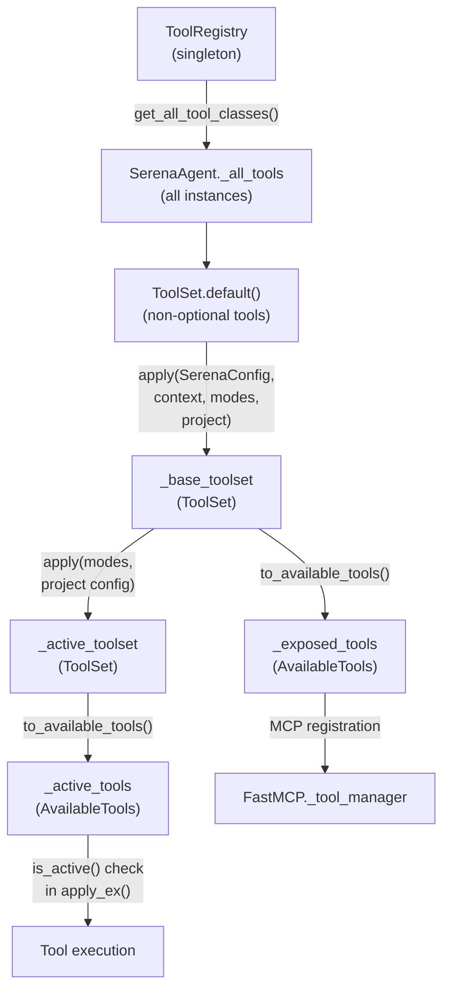
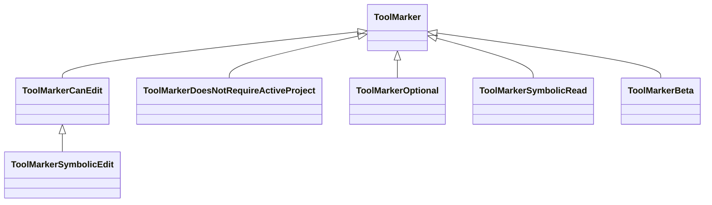
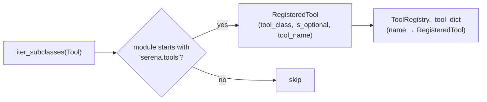
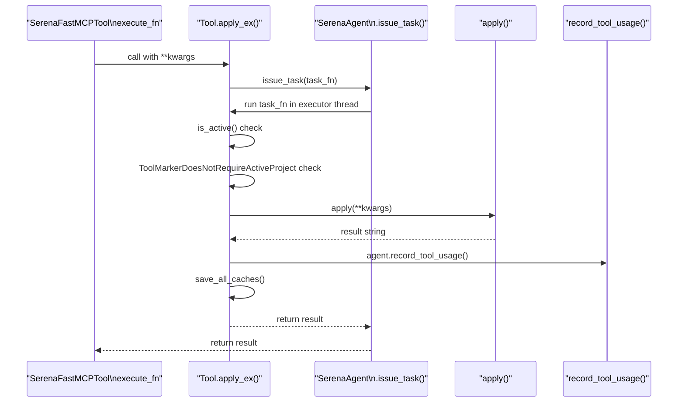

<!-- source: DeepWiki mcp.deepwiki.com · repo oraios/serena · page 7 Tool System · fetched 2026-10-29 -->

# Tool System

Relevant source files

The following files were used as context for generating this wiki page:

- [docs/02-usage/060_dashboard.md](docs/02-usage/060_dashboard.md)
- [flake.lock](flake.lock)
- [flake.nix](flake.nix)
- [src/serena/code_editor.py](src/serena/code_editor.py)
- [src/serena/ls_manager.py](src/serena/ls_manager.py)
- [src/serena/symbol.py](src/serena/symbol.py)
- [src/serena/tools/__init__.py](src/serena/tools/__init__.py)
- [src/serena/tools/cmd_tools.py](src/serena/tools/cmd_tools.py)
- [src/serena/tools/config_tools.py](src/serena/tools/config_tools.py)
- [src/serena/tools/file_tools.py](src/serena/tools/file_tools.py)
- [src/serena/tools/jetbrains_tools.py](src/serena/tools/jetbrains_tools.py)
- [src/serena/tools/symbol_tools.py](src/serena/tools/symbol_tools.py)
- [src/serena/tools/tools_base.py](src/serena/tools/tools_base.py)
- [src/serena/tools/workflow_tools.py](src/serena/tools/workflow_tools.py)
- [src/serena/util/file_proxy.py](src/serena/util/file_proxy.py)
- [src/serena/util/text_utils.py](src/serena/util/text_utils.py)
- [test/serena/test_ls_file_sync.py](test/serena/test_ls_file_sync.py)
- [test/serena/test_symbol.py](test/serena/test_symbol.py)
- [test/serena/test_text_utils.py](test/serena/test_text_utils.py)

This page describes the architecture of Serena's tool system: how tools are defined, registered, filtered by configuration, and executed. It covers the `Tool` base class, the `ToolMarker` taxonomy, the `ToolRegistry` singleton, and the `ToolSet`/`AvailableTools` pipeline that determines which tools are visible and active at runtime.

For details on how specific categories of tools work, see the child pages:
- [Tool Architecture and Registry](#7.1) — Deep dive into the `Tool` base class, `ToolMarker` hierarchy, and the registration/discovery process.
- [Tool Execution Pipeline](#7.2) — How tool calls flow from MCP through the `TaskExecutor` to `apply_ex()`, including timeouts and error handling.
- [Tool Reference](#7.3) — Comprehensive reference for all built-in tools (File, Symbol, Memory, Shell, Workflow).

---

## Overview

Serena exposes its capabilities to LLM clients as a flat list of named tools. Each tool maps to a Python class. The system is responsible for:

1.  **Discovery** – finding all `Tool` subclasses at startup via `ToolRegistry` [src/serena/tools/tools_base.py:381-453]().
2.  **Filtering** – computing which tools to expose (the *exposed* set) and which are currently active (the *active* set) based on configuration, context, modes, and the active project [src/serena/agent.py:384-450]().
3.  **Execution** – routing a tool call through `apply_ex()`, which enforces timeouts, checks activation, handles exceptions, and records usage statistics [src/serena/tools/tools_base.py:237-322]().

**Tool System Data Flow**

Sources: [src/serena/agent.py:75-183](), [src/serena/tools/tools_base.py:381-453]()

---

## Tool Definition

### `Component` and `Tool` Base Classes

All tools extend `Component`, which provides access to the agent and its associated resources. `Tool` extends `Component` [src/serena/tools/tools_base.py:142-327]().

| Method / attribute | Purpose |
|---|---|
| `agent` | The owning `SerenaAgent` instance [src/serena/tools/tools_base.py:36-37]() |
| `get_project_root()` | Returns the root directory of the active project [src/serena/tools/tools_base.py:39-43]() |
| `project` | Property returning the active `Project` [src/serena/tools/tools_base.py:60-61]() |
| `memory_manager` | Property returning `MemoryManager` from the active project [src/serena/tools/tools_base.py:50-51]() |
| `create_language_server_symbol_retriever()` | Creates a `LanguageServerSymbolRetriever` (LSP mode only) [src/serena/tools/tools_base.py:53-57]() |
| `create_code_editor()` | Creates a `LanguageServerCodeEditor` or `JetBrainsCodeEditor` [src/serena/tools/tools_base.py:63-72]() |

`Tool` itself adds:

| Method / attribute | Purpose |
|---|---|
| `get_name_from_cls()` | Converts `FooBarTool` → `foo_bar` (snake_case) [src/serena/tools/tools_base.py:193-199]() |
| `get_name()` | Instance-level name lookup [src/serena/tools/tools_base.py:201-202]() |
| `can_edit()` | Returns `True` if class is a subclass of `ToolMarkerCanEdit` [src/serena/tools/tools_base.py:211-218]() |
| `apply_ex()` | The execution entry point; see [Tool Execution Pipeline](#7.2) [src/serena/tools/tools_base.py:238-322]() |
| `is_active()` | Delegates to `agent.tool_is_active(self.get_name())` [src/serena/tools/tools_base.py:232-236]() |
| `_limit_length()` | Truncates output if it exceeds `max_answer_chars` [src/serena/tools/tools_base.py:329-348]() |

Each tool must implement an `apply()` method. The signature and docstring of `apply()` are used by `SerenaFastMCPTool` to generate the tool's JSON schema and description for the LLM [src/serena/mcp.py:53-130]().

Sources: [src/serena/tools/tools_base.py:35-327](), [src/serena/mcp.py:53-130]()

---

## Tool Markers

Tool markers are mixin classes that tag tools with behavioral metadata. They control default inclusion, capability flags, and are inspected by `ToolRegistry` and `apply_ex()`.

**ToolMarker Hierarchy**

| Marker | Meaning |
|---|---|
| `ToolMarkerCanEdit` | Tool may modify files; gates `can_edit()` [src/serena/tools/tools_base.py:88-91]() |
| `ToolMarkerDoesNotRequireActiveProject` | Tool can run without an activated project [src/serena/tools/tools_base.py:94-95]() |
| `ToolMarkerOptional` | Tool is disabled by default; must be explicitly included [src/serena/tools/tools_base.py:98-101]() |
| `ToolMarkerSymbolicRead` | Tool performs symbol-level read operations via language backend [src/serena/tools/tools_base.py:104-107]() |
| `ToolMarkerSymbolicEdit` | Extends `ToolMarkerCanEdit`; tool performs symbol-level edits [src/serena/tools/tools_base.py:110-113]() |
| `ToolMarkerBeta` | Marker for experimental or non-robust features [src/serena/tools/tools_base.py:116-119]() |

Sources: [src/serena/tools/tools_base.py:82-121]()

---

## Tool Registration

### `ToolRegistry`

`ToolRegistry` is a `@singleton` class [src/serena/tools/tools_base.py:381-453](). On first instantiation, it walks all subclasses of `Tool` using `iter_subclasses()`, filters to those whose `__module__` starts with `"serena.tools"`, and registers each one.

`RegisteredTool` is a dataclass [src/serena/tools/tools_base.py:371-376]() holding `tool_class`, `is_optional`, and `tool_name`.

Key `ToolRegistry` methods:

| Method | Returns |
|---|---|
| `get_all_tool_classes()` | All registered `Tool` subclasses [src/serena/tools/tools_base.py:408-410]() |
| `get_tool_names_default_enabled()` | Names of non-optional tools [src/serena/tools/tools_base.py:420-422]() |
| `get_tool_class_by_name(name)` | Look up class by snake_case name [src/serena/tools/tools_base.py:431-433]() |

Sources: [src/serena/tools/tools_base.py:371-453]()

---

## Tool Sets and Filtering

Three classes in `src/serena/agent.py` manage which tools are visible and active:

### `ToolSet`

`ToolSet` holds a `set[str]` of tool names. It is the primary data structure used during the computation pipeline [src/serena/agent.py:111-195]().

| Method | Effect |
|---|---|
| `ToolSet.default()` | Starts from all `get_tool_names_default_enabled()` [src/serena/agent.py:128-134]() |
| `apply(*ToolInclusionDefinition)` | Applies include/exclude deltas or a fixed replacement set [src/serena/agent.py:136-182]() |
| `without_editing_tools()` | Removes all tools where `can_edit()` is `True` [src/serena/agent.py:184-195]() |

Legacy name mappings (e.g., `replace_regex` → `replace_content`) are applied transparently during `apply()` [src/serena/agent.py:116-119]().

### `AvailableTools`

`AvailableTools` wraps a `list[Tool]` and provides sorted tool names and marker metadata for the agent [src/serena/agent.py:80-110]().

Sources: [src/serena/agent.py:80-195]()

---

## Tool Execution Pipeline

Every MCP tool call is routed through `Tool.apply_ex()` [src/serena/tools/tools_base.py:238-322]().

**apply_ex() execution sequence:**

Key behaviors in `apply_ex()`:

- **Activity check**: If `is_active()` returns `False`, returns an error string listing the active tools [src/serena/tools/tools_base.py:258-261]().
- **Project requirement check**: If the tool is not `ToolMarkerDoesNotRequireActiveProject` and no project is active, returns an error [src/serena/tools/tools_base.py:267-272]().
- **Timeout**: The task runs in `SerenaAgent._task_executor` with the configured timeout [src/serena/tools/tools_base.py:316-318]().

For details on error handling and statistics, see [Tool Execution Pipeline](#7.2).

Sources: [src/serena/tools/tools_base.py:238-322]()

---

## Tool Reference Overview

Tools are organized across several modules:

| Module | Canonical tools |
|---|---|
| `file_tools.py` | `ReadFileTool`, `CreateTextFileTool`, `ListDirTool`, `FindFileTool`, `ReplaceContentTool` [src/serena/tools/file_tools.py:26-163]() |
| `symbol_tools.py` | `GetSymbolsOverviewTool`, `FindSymbolTool`, `RestartLanguageServerTool` [src/serena/tools/symbol_tools.py:25-156]() |
| `memory_tools.py` | `WriteMemoryTool`, `ReadMemoryTool`, `ListMemoriesTool`, `DeleteMemoryTool` [src/serena/tools/memory_tools.py:6-89]() |
| `cmd_tools.py` | `ExecuteShellCommandTool` [src/serena/tools/cmd_tools.py:11-53]() |
| `config_tools.py` | `ActivateProjectTool`, `GetCurrentConfigTool`, `OpenDashboardTool` [src/serena/tools/config_tools.py:6-67]() |
| `workflow_tools.py` | `OnboardingTool`, `InitialInstructionsTool`, `SerenaInfoTool` [src/serena/tools/workflow_tools.py:10-64]() |

For a full reference, see [Tool Reference](#7.3).

Sources: [src/serena/tools/file_tools.py](), [src/serena/tools/symbol_tools.py](), [src/serena/tools/memory_tools.py](), [src/serena/tools/cmd_tools.py](), [src/serena/tools/config_tools.py](), [src/serena/tools/workflow_tools.py]()

---

