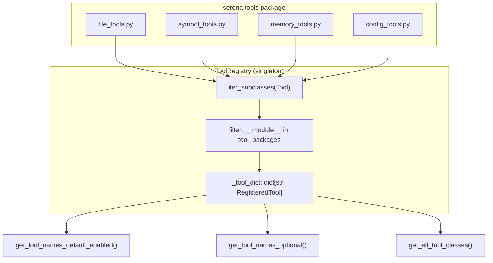
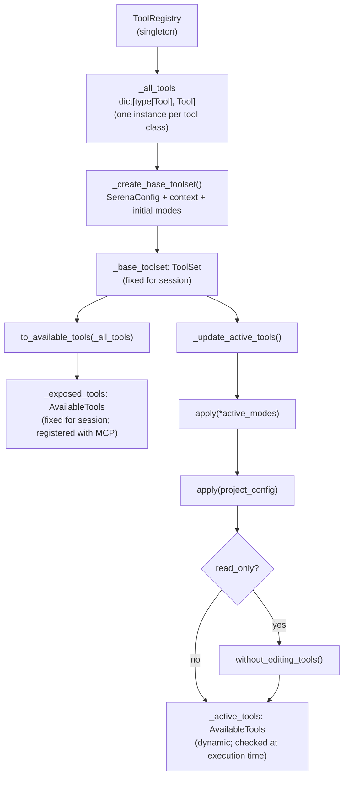

<!-- source: DeepWiki mcp.deepwiki.com · repo oraios/serena · page 7.1 Tool Architecture and Registry · fetched 2026-10-29 -->

# Tool Architecture and Registry

<details>
<summary>Relevant source files</summary>

The following files were used as context for generating this wiki page:

- [.serena/project.yml](.serena/project.yml)
- [src/serena/agent.py](src/serena/agent.py)
- [src/serena/code_editor.py](src/serena/code_editor.py)
- [src/serena/config/serena_config.py](src/serena/config/serena_config.py)
- [src/serena/ls_manager.py](src/serena/ls_manager.py)
- [src/serena/project.py](src/serena/project.py)
- [src/serena/resources/project.template.yml](src/serena/resources/project.template.yml)
- [src/serena/resources/serena_config.template.yml](src/serena/resources/serena_config.template.yml)
- [src/serena/symbol.py](src/serena/symbol.py)
- [src/serena/tools/__init__.py](src/serena/tools/__init__.py)
- [src/serena/tools/cmd_tools.py](src/serena/tools/cmd_tools.py)
- [src/serena/tools/jetbrains_tools.py](src/serena/tools/jetbrains_tools.py)
- [src/serena/tools/symbol_tools.py](src/serena/tools/symbol_tools.py)
- [src/serena/tools/tools_base.py](src/serena/tools/tools_base.py)
- [test/serena/config/test_serena_config.py](test/serena/config/test_serena_config.py)
- [test/serena/test_ls_file_sync.py](test/serena/test_ls_file_sync.py)
- [test/serena/test_symbol.py](test/serena/test_symbol.py)
- [test/serena/test_tool_parameter_types.py](test/serena/test_tool_parameter_types.py)

</details>


## Purpose and Scope

This page covers the internal architecture of Serena's tool system: the `Tool` base class, the `ToolMarker` mixin hierarchy, the `ToolRegistry` singleton, and the `ToolSet`/`AvailableTools`/`ActiveModes` classes that `SerenaAgent` uses to manage which tools are visible and executable at any given time.

For how MCP tool calls are routed through to `Tool.apply_ex()` and how timeouts are enforced, see [Tool Execution Pipeline](#7.2). For documentation on specific tool implementations, see [Tool Reference](#7.3).

---

## Core Class Structure

The tool system is built on two base classes and a set of marker mixins, all defined in `src/serena/tools/tools_base.py`.

**Tool Architecture — Code Entities**

```mermaid
classDiagram
    class Component {
        "+agent: SerenaAgent"
        "+project: Project"
        "+memory_manager: MemoryManager"
        "+prompt_factory: PromptFactory"
        "+create_code_editor() CodeEditor"
        "+create_language_server_symbol_retriever()"
    }
    class Tool {
        "+get_name_from_cls() str"
        "+get_name() str"
        "+can_edit() bool"
        "+is_active() bool"
        "+get_apply_docstring() str"
        "+get_apply_fn_metadata() FuncMetadata"
        "+apply_ex(**kwargs) str"
        "+apply(...) str"
    }
    class ToolMarker {
        "Base marker mixin"
    }
    class ToolMarkerCanEdit {
        "Tool edits files"
    }
    class ToolMarkerOptional {
        "Disabled by default"
    }
    class ToolMarkerDoesNotRequireActiveProject {
        "No project required"
    }
    class ToolMarkerSymbolicRead {
        "LSP read operations"
    }
    class ToolMarkerSymbolicEdit {
        "LSP edit operations"
    }

    Component <|-- Tool
    ToolMarker <|-- ToolMarkerCanEdit
    ToolMarker <|-- ToolMarkerOptional
    ToolMarker <|-- ToolMarkerDoesNotRequireActiveProject
    ToolMarker <|-- ToolMarkerSymbolicRead
    ToolMarkerCanEdit <|-- ToolMarkerSymbolicEdit
    Tool <|-- "ReadFileTool"
    Tool <|-- "CreateFileTool"
    "CreateFileTool" ..|> ToolMarkerCanEdit
```

Sources: [src/serena/tools/tools_base.py:35-129](), [src/serena/tools/__init__.py:1-50]()

---

## Component Base Class

`Component` is the root base class for all objects that need access to the running agent. It stores a reference to the `SerenaAgent` instance and exposes convenience properties.

| Property / Method | Returns |
|---|---|
| `agent` | The `SerenaAgent` instance [src/serena/tools/tools_base.py:37]() |
| `project` | Active `Project` (raises if none active) [src/serena/tools/tools_base.py:60-61]() |
| `memory_manager` | `MemoryManager` from the active project [src/serena/tools/tools_base.py:50-51]() |
| `prompt_factory` | The agent's `PromptFactory` [src/serena/tools/tools_base.py:46-47]() |
| `get_project_root()` | Root path of the active project [src/serena/tools/tools_base.py:39-43]() |
| `create_code_editor()` | `LanguageServerCodeEditor` or `JetBrainsCodeEditor` [src/serena/tools/tools_base.py:63-72]() |
| `create_language_server_symbol_retriever()` | `LanguageServerSymbolRetriever` [src/serena/tools/tools_base.py:53-57]() |

Sources: [src/serena/tools/tools_base.py:35-80]()

---

## Tool Base Class

`Tool` extends `Component`. Every concrete tool must implement an `apply(...)` method with its specific parameter signature. The base class provides the supporting infrastructure.

### Tool Naming

`get_name_from_cls()` derives a snake_case name from the class name by stripping a trailing `Tool` suffix and converting CamelCase:

| Class Name | Tool Name |
|---|---|
| `ReadFileTool` | `read_file` |
| `CreateFileTool` | `create_file` |
| `GetCurrentConfigTool` | `get_current_config` |
| `ReplaceContentTool` | `replace_content` |

Sources: [src/serena/tools/tools_base.py:193-200]()

### Key Class Methods

| Method | Purpose |
|---|---|
| `get_name_from_cls()` | Derives snake_case name from class name [src/serena/tools/tools_base.py:193]() |
| `can_edit()` | `True` if class inherits `ToolMarkerCanEdit` [src/serena/tools/tools_base.py:211]() |
| `get_tool_description()` | Returns class docstring [src/serena/tools/tools_base.py:220]() |
| `get_apply_docstring()` | Returns `apply` method docstring [src/serena/tools/tools_base.py:227]() |
| `get_apply_fn_metadata()` | Returns `FuncMetadata` for `apply` (used for MCP schema generation) [src/serena/tools/tools_base.py:254]() |

Sources: [src/serena/tools/tools_base.py:142-265]()

---

## ToolMarker Hierarchy

Markers are empty mixin classes that classify tools. They are inspected using `isinstance` and `issubclass` checks throughout the system.

| Marker | Effect |
|---|---|
| `ToolMarkerCanEdit` | `can_edit()` returns `True`; tool is removed by `ToolSet.without_editing_tools()` in read-only mode [src/serena/tools/tools_base.py:88-91]() |
| `ToolMarkerOptional` | Tool excluded from the default tool set; must be explicitly added via configuration [src/serena/tools/tools_base.py:98-101]() |
| `ToolMarkerDoesNotRequireActiveProject` | `apply_ex` skips the active-project guard check [src/serena/tools/tools_base.py:94-95]() |
| `ToolMarkerSymbolicRead` | Labels tools that use LSP for symbol look-ups [src/serena/tools/tools_base.py:104-107]() |
| `ToolMarkerSymbolicEdit` | Extends `ToolMarkerCanEdit`; labels tools that use LSP for editing [src/serena/tools/tools_base.py:110-113]() |
| `ToolMarkerBeta` | Labels experimental or non-robust tools [src/serena/tools/tools_base.py:116-119]() |

In `AvailableTools`, all marker class names present in the active tool set are collected into `tool_marker_names`. This set is passed to the Jinja template engine during system prompt generation.

Sources: [src/serena/tools/tools_base.py:82-119](), [src/serena/agent.py:95-100]()

---

## ToolRegistry

`ToolRegistry` is a **singleton** (decorated with `@singleton`) that discovers and catalogs all `Tool` subclasses belonging to the `serena.tools` package.

### Discovery

At construction, `ToolRegistry.__init__` calls `iter_subclasses(Tool)`, which recursively traverses `__subclasses__`. Each subclass is included only if its `__module__` starts with a string in `tool_packages = ["serena.tools"]`.

For each qualifying class the registry:
1. Checks `issubclass(cls, ToolMarkerOptional)` to determine if it is optional [src/serena/tools/tools_base.py:454]().
2. Calls `cls.get_name_from_cls()` to derive the tool name [src/serena/tools/tools_base.py:455]().
3. Raises `ValueError` on duplicate names [src/serena/tools/tools_base.py:457]().
4. Stores a `RegisteredTool` dataclass entry [src/serena/tools/tools_base.py:459]().

```python
# RegisteredTool dataclass (tools_base.py:438-443)
@dataclass(kw_only=True)
class RegisteredTool:
    tool_class: type[Tool]
    is_optional: bool
    tool_name: str
```

Sources: [src/serena/tools/tools_base.py:438-460]()

### ToolRegistry Methods

| Method | Returns |
|---|---|
| `get_all_tool_classes()` | All registered `Tool` subclasses [src/serena/tools/tools_base.py:461]() |
| `get_tool_classes_default_enabled()` | Non-optional tool classes [src/serena/tools/tools_base.py:464]() |
| `get_tool_classes_optional()` | Optional tool classes [src/serena/tools/tools_base.py:468]() |
| `get_tool_names_default_enabled()` | Names of non-optional tools [src/serena/tools/tools_base.py:472]() |
| `get_tool_names_optional()` | Names of optional tools [src/serena/tools/tools_base.py:475]() |
| `get_tool_class_by_name(name)` | Look up class by snake_case name [src/serena/tools/tools_base.py:478]() |
| `is_valid_tool_name(name)` | `True` if name is registered [src/serena/tools/tools_base.py:484]() |

Sources: [src/serena/tools/tools_base.py:461-485]()

### ToolRegistry and Tool Discovery Flow



Sources: [src/serena/tools/tools_base.py:445-460]()

---

## ToolSet

`ToolSet` represents a set of tool names (strings). It is the primary working data structure for building, modifying, and filtering the set of tools the agent should offer.

### Key Methods

| Method | Description |
|---|---|
| `ToolSet.default()` | Factory: starts from `ToolRegistry().get_tool_names_default_enabled()` [src/serena/agent.py:128-135]() |
| `apply(*tool_inclusion_definitions)` | Returns a new `ToolSet` after applying each `ToolInclusionDefinition` [src/serena/agent.py:137-183]() |
| `without_editing_tools()` | Returns a new `ToolSet` with all `can_edit()` tools removed [src/serena/agent.py:185-195]() |
| `to_available_tools(all_tools)` | Converts to `AvailableTools` by filtering the agent's full instance dict [src/serena/agent.py:206-212]() |

### ToolInclusionDefinition Protocol

`ToolSet.apply()` accepts any object implementing `ToolInclusionDefinition`.

Each definition either:
- Defines a **fixed tool set** (`is_fixed_tool_set()` → `True`), replacing the current set entirely with `fixed_tools` [src/serena/agent.py:158-164](), or
- Specifies **incremental changes** via `included_optional_tools` and `excluded_tools` lists [src/serena/agent.py:168-182]().

`ToolSet.LEGACY_TOOL_NAME_MAPPING` maps old names (e.g., `replace_regex`) to current equivalents (e.g., `ReplaceContentTool`) with a deprecation warning [src/serena/agent.py:117]().

Sources: [src/serena/agent.py:112-212](), [src/serena/config/serena_config.py:143-170]()

---

## AvailableTools

`AvailableTools` is an instantiated, read-only snapshot of a resolved tool set. It is produced by `ToolSet.to_available_tools(all_tools)`.

Fields:

| Field | Type | Description |
|---|---|---|
| `tools` | `list[Tool]` | Tool instances in the set [src/serena/agent.py:90]() |
| `tool_names` | `list[str]` | Alphabetically sorted names [src/serena/agent.py:91]() |
| `tool_marker_names` | `set[str]` | Names of all `ToolMarker` subclasses satisfied by at least one tool [src/serena/agent.py:96-100]() |

Sources: [src/serena/agent.py:81-110]()

---

## How SerenaAgent Computes Tool Sets

`SerenaAgent` maintains three distinct tool set states:

**Tool Set States and Computation**



Sources: [src/serena/agent.py:384-449](), [src/serena/agent.py:641-657]()

### Phase 1 — All Tools

At startup, `SerenaAgent` instantiates every registered tool class:

```python
self._all_tools = {
    tool_class: tool_class(self)
    for tool_class in ToolRegistry().get_all_tool_classes()
}
```

Sources: [src/serena/agent.py:302-305]()

### Phase 2 — Base Toolset and Exposed Tools

`_create_base_toolset()` stacks `ToolInclusionDefinition` objects from global config, active context, and base modes. This set is **fixed for the session** because MCP clients typically do not support dynamic tool list changes.

Sources: [src/serena/agent.py:384-449]()

### Phase 3 — Active Tools

`_update_active_tools()` starts from `_base_toolset` and applies runtime-variable filters:

1. `_base_toolset.apply(*active_modes.get_modes())` [src/serena/agent.py:647]()
2. `.apply(project_config)` [src/serena/agent.py:650]()
3. `.without_editing_tools()` — if `project_config.read_only` is `True` [src/serena/agent.py:653]().

Sources: [src/serena/agent.py:641-657]()

---

## Tool Execution: apply_ex

`apply_ex` is the single execution entry point. All MCP calls route through it.

Key behaviors:
- The entire task runs inside `self.agent.issue_task(task)`, enforcing `SerenaConfig.tool_timeout` [src/serena/tools/tools_base.py:306-309]().
- If `tool_is_active` is `False`, a formatted error is returned [src/serena/tools/tools_base.py:317-325]().
- If `ToolMarkerDoesNotRequireActiveProject` is missing and no project is active, an error is returned [src/serena/tools/tools_base.py:327-330]().
- Language server termination triggers one automatic restart and retry via `reset_language_server_manager` [src/serena/tools/tools_base.py:355-363]().

Sources: [src/serena/tools/tools_base.py:289-374]()

---

