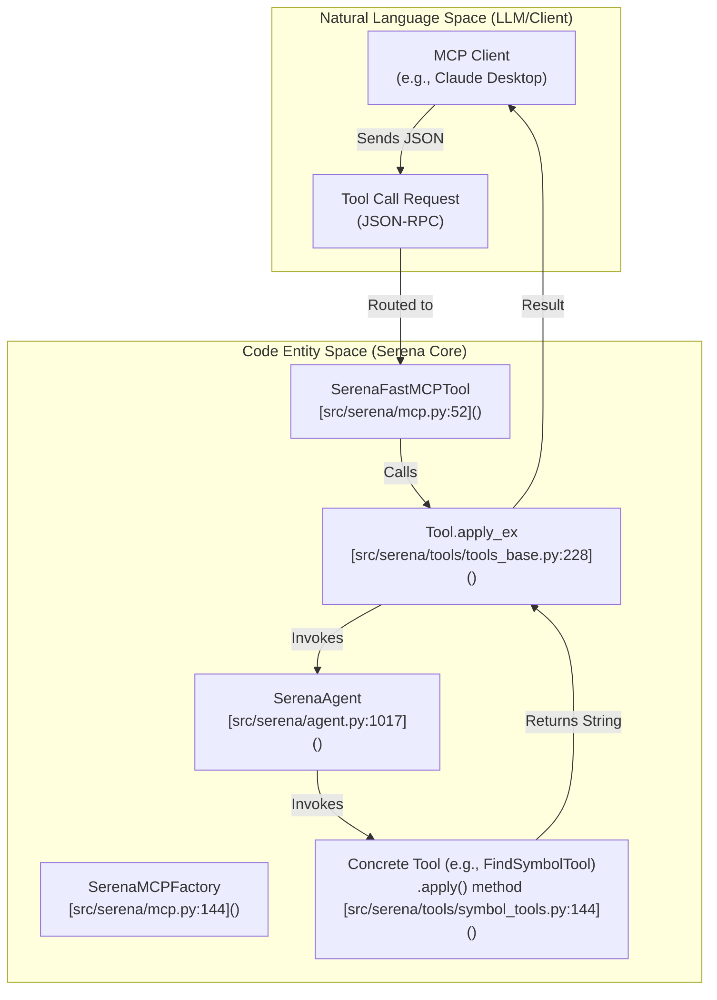
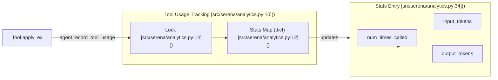

<!-- source: DeepWiki mcp.deepwiki.com · repo oraios/serena · page 7.2 Tool Execution Pipeline · fetched 2026-10-29 -->

# Tool Execution Pipeline

Relevant source files

The following files were used as context for generating this wiki page:

- [scripts/demo_run_tools.py](scripts/demo_run_tools.py)
- [scripts/print_tool_overview.py](scripts/print_tool_overview.py)
- [src/serena/analytics.py](src/serena/analytics.py)
- [src/serena/cli.py](src/serena/cli.py)
- [src/serena/code_editor.py](src/serena/code_editor.py)
- [src/serena/dashboard.py](src/serena/dashboard.py)
- [src/serena/ls_manager.py](src/serena/ls_manager.py)
- [src/serena/mcp.py](src/serena/mcp.py)
- [src/serena/resources/dashboard/dashboard.css](src/serena/resources/dashboard/dashboard.css)
- [src/serena/resources/dashboard/dashboard.js](src/serena/resources/dashboard/dashboard.js)
- [src/serena/resources/dashboard/index.html](src/serena/resources/dashboard/index.html)
- [src/serena/symbol.py](src/serena/symbol.py)
- [src/serena/tools/__init__.py](src/serena/tools/__init__.py)
- [src/serena/tools/cmd_tools.py](src/serena/tools/cmd_tools.py)
- [src/serena/tools/jetbrains_tools.py](src/serena/tools/jetbrains_tools.py)
- [src/serena/tools/symbol_tools.py](src/serena/tools/symbol_tools.py)
- [src/serena/tools/tools_base.py](src/serena/tools/tools_base.py)
- [src/serena/util/pypi.py](src/serena/util/pypi.py)
- [test/serena/config/test_global_ignored_paths.py](test/serena/config/test_global_ignored_paths.py)
- [test/serena/test_cli_project_commands.py](test/serena/test_cli_project_commands.py)
- [test/serena/test_dashboard.py](test/serena/test_dashboard.py)
- [test/serena/test_edit_marker.py](test/serena/test_edit_marker.py)
- [test/serena/test_ls_file_sync.py](test/serena/test_ls_file_sync.py)
- [test/serena/test_mcp.py](test/serena/test_mcp.py)
- [test/serena/test_symbol.py](test/serena/test_symbol.py)

## Purpose and Scope

This document details the tool execution pipeline that processes every tool invocation in Serena. The pipeline wraps tool application logic with validation, logging, exception handling, and resource management. This page focuses specifically on the `apply_ex` wrapper method and its integration with the `SerenaMCPFactory`, `TaskExecutor`, and `ToolUsageStats`.

## Architecture Overview

The tool execution pipeline follows a wrapper pattern where every tool invocation flows through a standardized `apply_ex` method that adds cross-cutting concerns around the tool-specific `apply` method.

### Data Flow: From MCP to Tool Execution

This diagram associates the natural language request flow with the specific code entities in `serena.mcp`, `serena.agent`, and `serena.tools`.

**Sources:** [src/serena/mcp.py:52-142](), [src/serena/mcp.py:144-169](), [src/serena/tools/tools_base.py:228-312](), [src/serena/tools/symbol_tools.py:134-156]()

## Entry Points and Schema Sanitization

Tool invocations originate from MCP clients and are handled by `SerenaFastMCPTool` which is constructed via the `SerenaMCPFactory`. A critical step before execution is ensuring the tool schema is compatible with the target LLM.

### OpenAI Compatibility
The `SerenaMCPFactory._sanitize_for_openai_tools` method transforms standard Pydantic/JSON schemas into OpenAI-compatible formats [src/serena/mcp.py:171](). This allows Serena to work effectively within clients like Codex that have strict schema requirements.

### The Execution Wrapper
The MCP tool's execution function is defined within `SerenaFastMCPTool.__init__` [src/serena/mcp.py:97](). This function wraps the tool call in `apply_ex` [src/serena/mcp.py:99](). Any `ToolCallError` [src/serena/tools/tools_base.py:129]() raised during the pipeline is converted into an MCP `ToolError` [src/serena/mcp.py:101]().

**Sources:** [src/serena/mcp.py:52-126](), [src/serena/mcp.py:144-171](), [src/serena/tools/tools_base.py:129-140]()

## The apply_ex Pipeline

The `apply_ex` method in the `Tool` base class [src/serena/tools/tools_base.py:228]() implements the complete execution pipeline.

### Pipeline Stages

| Stage | Implementation | Description |
|-------|----------------|-------------|
| **Active Check** | `tool_is_active` | Verifies the tool is enabled in the current context/mode via `agent.is_tool_active()` [src/serena/tools/tools_base.py:246-249](). |
| **Project Check** | `ToolMarker` | Ensures an active project exists [src/serena/tools/tools_base.py:254-258]() unless the tool is marked with `ToolMarkerDoesNotRequireActiveProject` [src/serena/tools/tools_base.py:94](). |
| **Input Sanitization** | `_sanitize_input_param` | Counteracts HTML escaping of `<` and `>` characters performed by some clients [src/serena/tools/tools_base.py:180-182](). |
| **Execution** | `apply()` | The core tool logic is executed via the function retrieved by `get_apply_fn()` [src/serena/tools/tools_base.py:263](). |
| **Recovery** | `SolidLSPException` | Automatically restarts the language server if it crashed during execution [src/serena/tools/tools_base.py:265-280](). |
| **Analytics** | `record_tool_usage` | Updates usage statistics with input/output token estimates via [src/serena/tools/tools_base.py:283](). |

**Sources:** [src/serena/tools/tools_base.py:228-312](), [src/serena/tools/tools_base.py:82-116](), [src/serena/agent.py:1492-1500]()

## Error Handling and Recovery

Serena employs a robust exception handling strategy to ensure the LLM receives actionable feedback rather than internal stack traces.

### Automatic LSP Restart
If a tool call fails due to a terminated language server (detected via `SolidLSPException` from the `solidlsp` library), the pipeline attempts recovery:
1. It identifies the affected language server ID [src/serena/tools/tools_base.py:269]().
2. It triggers `agent.restart_language_server(ls_id)` [src/serena/tools/tools_base.py:271]().
3. It retries the `apply()` call [src/serena/tools/tools_base.py:273]().

### Exception Catching
When `catch_exceptions=True` (the default for the agent), the pipeline catches generic `Exception` types, logs the error, and returns a string message to the LLM [src/serena/tools/tools_base.py:285-290](). If a `ToolCallError` occurs, the specific error message is extracted [src/serena/tools/tools_base.py:287]().

**Sources:** [src/serena/tools/tools_base.py:265-290](), [src/serena/tools/tools_base.py:129-140]()

## Tool Usage Tracking and Analytics

Serena tracks usage metrics via a tool usage recording system to monitor cost and performance.

### Token Estimation
Usage statistics include token counts for both tool inputs and outputs. Serena calculates these during the final stage of `apply_ex` using the agent's `RegisteredTokenCountEstimator` [src/serena/tools/tools_base.py:283]().

### ToolUsageStats
The `record_tool_usage` method in `SerenaAgent` [src/serena/agent.py:1363]() updates the `ToolUsageStats` [src/serena/analytics.py:10](). This tracking is thread-safe using a lock [src/serena/analytics.py:14]().

**Sources:** [src/serena/tools/tools_base.py:283](), [src/serena/agent.py:1363-1371](), [src/serena/analytics.py:10-45]()

## Dashboard Integration

The execution pipeline's metadata and results are exposed via the `SerenaDashboardAPI` [src/serena/dashboard.py:192]().

- **Logs**: The `MemoryLogHandler` captures all logs generated during `apply_ex` [src/serena/dashboard.py:199](), which are then retrieved by the dashboard frontend [src/serena/resources/dashboard/dashboard.js:1-7]().
- **Stats**: Serialized `ToolUsageStats` summaries are calculated and provided via the `/get_config_overview` endpoint [src/serena/dashboard.py:403]().
- **Queueing**: The `TaskExecutor` [src/serena/task_executor.py:12]() manages the status of tasks issuing tool calls, allowing the dashboard to show running vs. finished executions [src/serena/dashboard.py:441-450]().

**Sources:** [src/serena/dashboard.py:192-229](), [src/serena/dashboard.py:403-410](), [src/serena/dashboard.py:441-450](), [src/serena/resources/dashboard/dashboard.js:1-7]()

---

