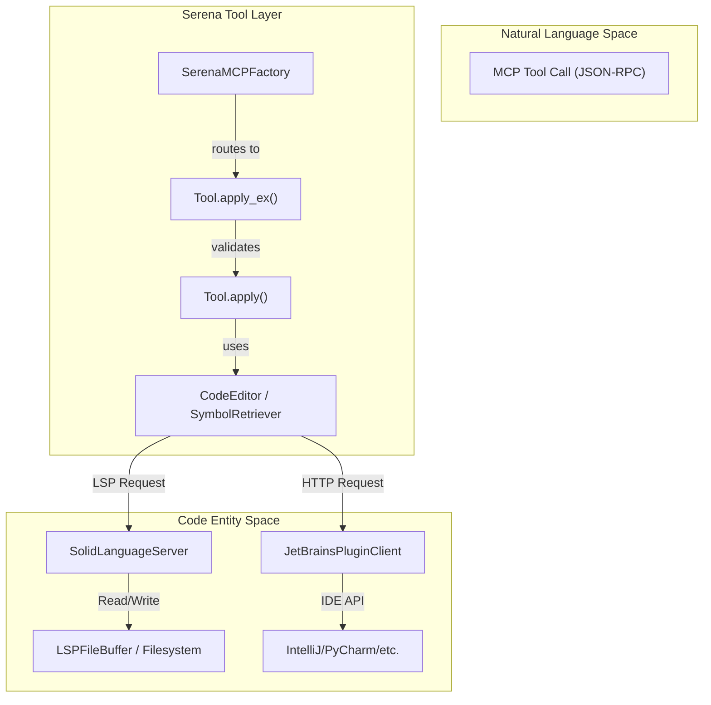
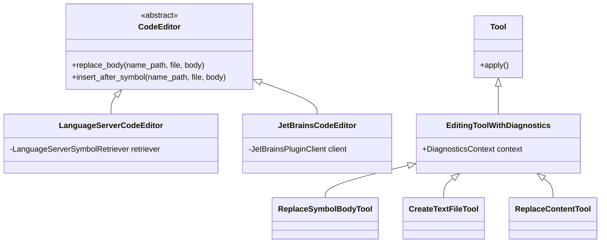

<!-- source: DeepWiki mcp.deepwiki.com · repo oraios/serena · page 7.3 Tool Reference · fetched 2026-10-29 -->

# Tool Reference

Relevant source files

The following files were used as context for generating this wiki page:

- [.serena/.gitignore](.serena/.gitignore)
- [docs/02-usage/045_memories.md](docs/02-usage/045_memories.md)
- [docs/02-usage/060_dashboard.md](docs/02-usage/060_dashboard.md)
- [flake.lock](flake.lock)
- [flake.nix](flake.nix)
- [scripts/demo_diagnostics.py](scripts/demo_diagnostics.py)
- [scripts/demo_find_defining_symbol.py](scripts/demo_find_defining_symbol.py)
- [scripts/demo_find_implementing_symbol.py](scripts/demo_find_implementing_symbol.py)
- [src/serena/code_editor.py](src/serena/code_editor.py)
- [src/serena/jetbrains/jetbrains_plugin_client.py](src/serena/jetbrains/jetbrains_plugin_client.py)
- [src/serena/jetbrains/jetbrains_types.py](src/serena/jetbrains/jetbrains_types.py)
- [src/serena/ls_manager.py](src/serena/ls_manager.py)
- [src/serena/memories/memory_manager.py](src/serena/memories/memory_manager.py)
- [src/serena/memories/memory_reference_analysis.py](src/serena/memories/memory_reference_analysis.py)
- [src/serena/project_server.py](src/serena/project_server.py)
- [src/serena/resources/config/internal_modes/jetbrains.yml](src/serena/resources/config/internal_modes/jetbrains.yml)
- [src/serena/resources/config/modes/query-projects.yml](src/serena/resources/config/modes/query-projects.yml)
- [src/serena/symbol.py](src/serena/symbol.py)
- [src/serena/tools/__init__.py](src/serena/tools/__init__.py)
- [src/serena/tools/cmd_tools.py](src/serena/tools/cmd_tools.py)
- [src/serena/tools/config_tools.py](src/serena/tools/config_tools.py)
- [src/serena/tools/file_tools.py](src/serena/tools/file_tools.py)
- [src/serena/tools/jetbrains_tools.py](src/serena/tools/jetbrains_tools.py)
- [src/serena/tools/memory_tools.py](src/serena/tools/memory_tools.py)
- [src/serena/tools/query_project_tools.py](src/serena/tools/query_project_tools.py)
- [src/serena/tools/symbol_tools.py](src/serena/tools/symbol_tools.py)
- [src/serena/tools/tools_base.py](src/serena/tools/tools_base.py)
- [src/serena/tools/workflow_tools.py](src/serena/tools/workflow_tools.py)
- [src/serena/util/dataclass.py](src/serena/util/dataclass.py)
- [src/serena/util/file_proxy.py](src/serena/util/file_proxy.py)
- [src/serena/util/text_utils.py](src/serena/util/text_utils.py)
- [src/serena/util/yaml.py](src/serena/util/yaml.py)
- [test/serena/test_file_tools.py](test/serena/test_file_tools.py)
- [test/serena/test_ls_file_sync.py](test/serena/test_ls_file_sync.py)
- [test/serena/test_memories_manager.py](test/serena/test_memories_manager.py)
- [test/serena/test_symbol.py](test/serena/test_symbol.py)
- [test/serena/test_text_utils.py](test/serena/test_text_utils.py)
- [test/serena/util/test_yaml.py](test/serena/util/test_yaml.py)

This page provides a comprehensive technical reference for the built-in tools available in Serena. Serena tools are specialized components that bridge the gap between Large Language Model (LLM) requests and the underlying codebase, utilizing either Language Server Protocol (LSP) or JetBrains-based backends for semantic precision.

## Tool Architecture

All Serena tools inherit from the `Tool` base class [src/serena/tools/tools_base.py:142](), which provides access to the active project, agent state, and utility methods for formatting output. Tools are categorized by `ToolMarker` classes (e.g., `ToolMarkerSymbolicRead`, `ToolMarkerCanEdit`) which the `ToolRegistry` uses to filter tools based on the current `SerenaAgentMode` [src/serena/tools/tools_base.py:82-121]().

### Tool Execution Flow
The following diagram illustrates how a tool call is processed from the Model/MCP layer down to the Code Entity Space.

**Tool Execution Pipeline**

**Sources:** [src/serena/tools/tools_base.py:142-206](), [src/serena/code_editor.py:21-58](), [src/serena/tools/tools_base.py:82-121]()

---

## Symbolic Read Tools

These tools allow the agent to perform semantic queries against the codebase. Unlike grep-based searches, these tools understand the structure of the code (classes, methods, variables) by leveraging the `LanguageServerSymbolRetriever` [src/serena/symbol.py:465]().

| Tool | Backend | Description |
| :--- | :--- | :--- |
| `FindSymbolTool` | LSP | Global/local search for symbols by name path pattern. Supports `depth` and `substring_matching`. [src/serena/tools/symbol_tools.py:134-156]() |
| `GetSymbolsOverviewTool` | LSP | Provides a high-level summary of symbols within a specific file, grouped by `SymbolKind`. [src/serena/tools/symbol_tools.py:36-56]() |
| `FindReferencingSymbolsTool`| LSP | Finds all usages/references of a specific symbol across the project. [src/serena/tools/symbol_tools.py:302-315]() |
| `FindDeclarationTool` | LSP | Locates the definition/declaration of a symbol using LSP `textDocument/definition`. [src/serena/tools/symbol_tools.py:260-272]() |
| `FindImplementationsTool` | LSP | Locates implementations of interfaces or abstract methods. [src/serena/tools/symbol_tools.py:281-293]() |

### Name Path Matching
Serena uses "Name Paths" to uniquely identify symbols within a file (e.g., `MyClass/my_method`). The `NamePathMatcher` class [src/serena/symbol.py:143]() handles matching patterns against these paths, supporting absolute matches (starting with `/`) and handling overloaded symbols via indices (e.g., `method[1]`) [src/serena/symbol.py:152-160]().

**Sources:** [src/serena/symbol.py:143-193](), [src/serena/tools/symbol_tools.py:154-170]()

---

## Editing Tools

Editing tools perform structured modifications. Many inherit from `EditingToolWithDiagnostics`, which utilizes a `DiagnosticsContext` to check for syntax errors or linter warnings immediately after an edit is applied [src/serena/tools/__init__.py:22]().

### Symbolic vs. Content Editing
1.  **Symbolic Edits**: Use `ReplaceSymbolBodyTool`, `InsertAfterSymbolTool`, or `RenameSymbolTool`. These utilize the `CodeEditor` [src/serena/code_editor.py:22]() to locate symbol boundaries accurately using `PositionInFile` [src/serena/symbol.py:65]() data from the language server.
2.  **Content Edits**: `ReplaceContentTool` performs regex or literal string replacements at the file level using `ContentReplacer` [src/serena/tools/file_tools.py:176]().
3.  **Safe Deletion**: `SafeDeleteSymbol` attempts to remove a symbol only if the language server confirms it is not in use [src/serena/tools/symbol_tools.py:438]().

**Code Editing Class Hierarchy**

**Sources:** [src/serena/code_editor.py:22-142](), [src/serena/tools/tools_base.py:63-80](), [src/serena/tools/file_tools.py:58-91]()

---

## File Tools

File tools handle raw filesystem operations. They respect `.gitignore` and Serena-specific ignore patterns via the `Project.validate_relative_path` method [src/serena/project.py:350]().

*   **`ReadFileTool`**: Reads file content with `start_line` and `end_line` windowing to conserve context window [src/serena/tools/file_tools.py:31-55]().
*   **`ListDirTool`**: Lists directory contents using `scan_directory` [src/serena/util/file_system.py:16](). It can be recursive and skip ignored files [src/serena/tools/file_tools.py:99-132]().
*   **`FindFileTool`**: Finds non-gitignored files matching a specific mask (wildcards `*` or `?`) [src/serena/tools/file_tools.py:140-170]().
*   **`CreateTextFileTool`**: Creates new files or overwrites existing ones, ensuring parent directories exist [src/serena/tools/file_tools.py:63-91]().

---

## Memory Tools

The memory system allows Serena to persist project-specific knowledge in `.serena/` using the `MemoryManager` [src/serena/memories/memory_manager.py:22]().

*   **`WriteMemoryTool`**: Saves information in Markdown format. Supports "global/" prefix for cross-project knowledge [src/serena/tools/memory_tools.py:15-35]().
*   **`ReadMemoryTool`**: Retrieves saved knowledge [src/serena/tools/memory_tools.py:43-47]().
*   **`ListMemoriesTool`**: Lists available memory files, optionally filtered by topic [src/serena/tools/memory_tools.py:55-59]().
*   **`RenameMemoryTool`**: Renames a memory and updates `mem:` prefixed references in other memories [src/serena/tools/memory_tools.py:79-91]().
*   **`EditMemoryTool`**: Performs regex or literal replacements specifically within memory files [src/serena/tools/memory_tools.py:99-122]().

---

## Workflow and Config Tools

These tools manage the agent's lifecycle and its project context.

### Project Activation
*   **`ActivateProjectTool`**: Switches the agent's focus to a specific project path or registered name, triggering `Project.load()` [src/serena/tools/config_tools.py:22-39]().
*   **`GetCurrentConfigTool`**: Returns the active project root, available tools, and current mode [src/serena/tools/config_tools.py:57-66]().

### Onboarding
*   **`OnboardingTool`**: Triggers the onboarding prompt logic. It ensures the `memory-maintenance` memory exists and provides instructions for identifying project structure [src/serena/tools/workflow_tools.py:10-29]().
*   **`CheckOnboardingPerformedTool`**: Checks if the onboarding process has already been completed for the current project [src/serena/tools/workflow_tools.py:45-52]().
*   **`InitialInstructionsTool`**: Provides the "Serena Instructions Manual" (the system prompt) for clients that don't support initial context [src/serena/tools/workflow_tools.py:32-42]().

---

## Shell Tools

*   **`ExecuteShellCommandTool`**: Allows the agent to run arbitrary shell commands (e.g., `pytest`, `npm build`). 
    *   **Implementation**: Uses `subprocess` to execute commands in the project root, capturing stdout/stderr.
    *   **Security**: This tool is marked as potentially dangerous and often requires manual approval in client integrations.
**Sources:** [src/serena/tools/cmd_tools.py:14-38]()

---

## JetBrains Specific Tools

When `LanguageBackend.JETBRAINS` [src/serena/config/serena_config.py:16]() is active, Serena uses tools that communicate with the `JetBrainsPluginClient` [src/serena/jetbrains/jetbrains_plugin_client.py:177]() instead of an LSP server.

| JetBrains Tool | Replaces | Unique Capability |
| :--- | :--- | :--- |
| `JetBrainsFindSymbolTool` | `FindSymbolTool` | Can search through external library dependencies using `search_deps=True` [src/serena/tools/jetbrains_tools.py:16-42](). |
| `JetBrainsGetSymbolsOverviewTool` | `GetSymbolsOverviewTool` | Retrieves top-level symbols using IDE native indexing [src/serena/tools/jetbrains_tools.py:155](). |
| `JetBrainsCodeEditor` | `LanguageServerCodeEditor` | Uses IDE-native refactoring APIs for safer edits [src/serena/code_editor.py:69-70](). |

**Sources:** [src/serena/tools/jetbrains_tools.py:16-155](), [src/serena/tools/tools_base.py:64-72](), [src/serena/code_editor.py:9-10]()

---

