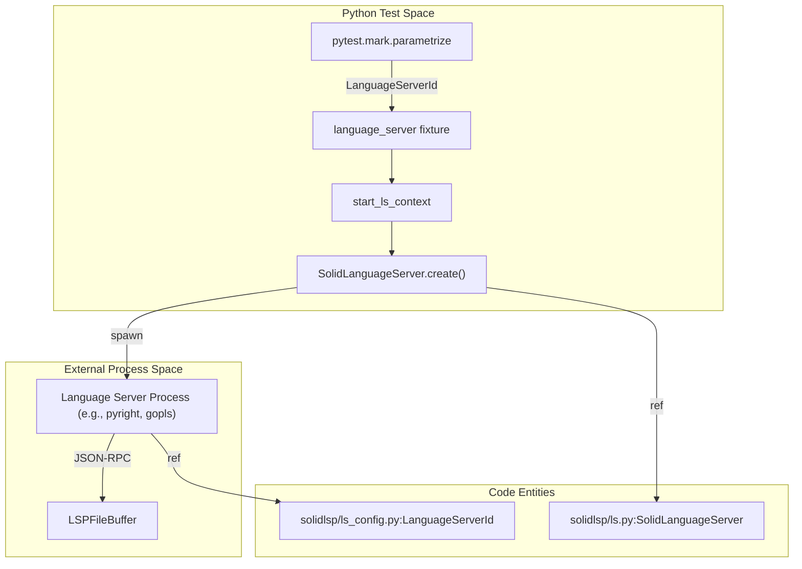
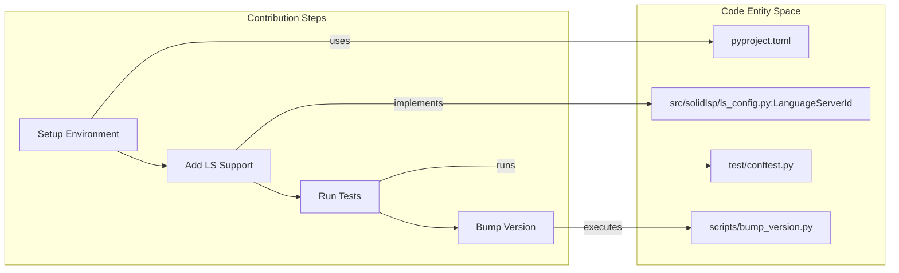

<!-- source: DeepWiki mcp.deepwiki.com · repo oraios/serena · page 8 Infrastructure and Development · fetched 2026-10-29 -->

# Infrastructure and Development

Relevant source files

The following files were used as context for generating this wiki page:

- [.github/pull_request_template.md](.github/pull_request_template.md)
- [.github/workflows/codespell.yml](.github/workflows/codespell.yml)
- [.github/workflows/create-release.yml](.github/workflows/create-release.yml)
- [.github/workflows/docker.yml](.github/workflows/docker.yml)
- [.github/workflows/docs.yaml](.github/workflows/docs.yaml)
- [.github/workflows/publish.yml](.github/workflows/publish.yml)
- [.github/workflows/pytest.yml](.github/workflows/pytest.yml)
- [.gitignore](.gitignore)
- [.serena/memories/creating_pull_requests.md](.serena/memories/creating_pull_requests.md)
- [CONTRIBUTING.md](CONTRIBUTING.md)
- [DOCKER.md](DOCKER.md)
- [Dockerfile](Dockerfile)
- [README-dev.md](README-dev.md)
- [README.md](README.md)
- [compose.yaml](compose.yaml)
- [docs/01-about/020_programming-languages.md](docs/01-about/020_programming-languages.md)
- [scripts/bump_version.py](scripts/bump_version.py)
- [src/solidlsp/ls_config.py](src/solidlsp/ls_config.py)
- [test/conftest.py](test/conftest.py)
- [test/serena/test_serena_agent.py](test/serena/test_serena_agent.py)

This page provides a high-level overview of Serena's development lifecycle, including the testing framework, containerization strategies, security model, and contribution workflows. Serena is built with a focus on cross-platform reliability and support for a vast array of programming languages, necessitating a robust infrastructure.

## Testing Infrastructure

Serena employs a comprehensive testing suite powered by `pytest` to ensure the reliability of its semantic tools across different languages and operating systems. The infrastructure is designed to handle the complexity of starting and managing real language server processes.

*   **LSP Fixtures**: The test suite uses specialized fixtures like `language_server` and `project_context` (defined in `test/conftest.py`) to manage the lifecycle of `SolidLanguageServer` instances. These fixtures often use `module` scope to minimize the overhead of restarting language servers between individual tests [[test/conftest.py:165-195]]().
*   **Test Resource Repos**: For each supported language, Serena maintains a "test_repo" containing sample code with known semantic structures [[test/conftest.py:61-64]](). These are used to verify tools like `FindSymbolTool`, `FindReferencingSymbolsTool`, and `ReplaceSymbolBodyTool` [[test/serena/test_serena_agent.py:18-32]]().
*   **CI Workflow**: The GitHub Actions `pytest.yml` workflow executes the test suite on Ubuntu, Windows, and macOS [[.github/workflows/pytest.yml:80-81]](). It handles the installation of various language runtimes, including Go, Node.js, and Rust, ensuring every test lands in a specific marker-based batch (e.g., `jvm`, `native`, `niche`) to prevent race conditions during parallel execution [[.github/workflows/pytest.yml:4-12]]().

For details, see [Testing Infrastructure](#8.1).

### Language Server Test Lifecycle
The following diagram illustrates how the testing infrastructure bridges the gap between Python test code and the external Language Server processes.

Sources: [test/conftest.py:165-195](), [src/solidlsp/ls_config.py:90-181](), [.github/workflows/pytest.yml:4-86]()

## Docker Deployment

Serena provides a Docker-based deployment option to simplify environment management and enhance security through isolation.

*   **Containerization**: The `Dockerfile` is based on `python:3.11-slim` and pre-installs essential runtimes like Node.js 22 and Rust with `rust-analyzer` [[Dockerfile:2-52]](). It also includes `uv` for fast Python package management [[Dockerfile:42]]().
*   **Configuration**: When running in Docker, certain settings are automatically adjusted via `sed` during image build, such as disabling the `gui_log_window` and setting the `web_dashboard_listen_address` to `0.0.0.0` to allow external access [[Dockerfile:66-68]]().
*   **Volume Mounting**: Users must mount their projects and configuration directories as volumes (e.g., to `/workspaces/serena/config`) to persist data and project settings across container restarts [[DOCKER.md:127-136]]().

For details, see [Docker Deployment](#8.2).

Sources: [Dockerfile:1-78](), [DOCKER.md:1-40](), [compose.yaml:1-20]()

## Security Considerations

Serena's security model is built around trust boundaries between the local environment, the LLM agent, and the codebase being analyzed.

*   **Trust Assumptions**: Serena assumes a "local-first" trust model. However, risks arise when agents use tools like `ExecuteShellCommandTool` or modify files.
*   **Sandboxing**: Docker is the recommended method for sandboxing Serena to mitigate risks from arbitrary code execution or unauthorized file modifications by providing an isolated container environment [[DOCKER.md:7-13]]().
*   **Path Validation**: Tools that interact with the file system are designed to respect project boundaries and ignore patterns defined in `.gitignore` or `project.yml` via the `FilenameMatcher` and `GitignoreParser` [[src/solidlsp/ls_config.py:21-89]](), [[test/conftest.py:79-81]]().

For details, see [Security Considerations](#8.3).

Sources: [DOCKER.md:7-13](), [README.md:17-25](), [src/solidlsp/ls_config.py:21-89]()

## Contributing Guide

Serena welcomes contributions ranging from new language server integrations to documentation improvements.

*   **Development Setup**: The project uses `uv` for dependency management. Contributors can set up their environment using `uv venv -p 3.13` and `uv sync --extra dev` [[CONTRIBUTING.md:29-35]]().
*   **Poe Tasks**: Common tasks like formatting (`poe format`) and type-checking (`poe type-check`) are managed via `poe` tasks defined in the environment [[CONTRIBUTING.md:47-50]]().
*   **Version Management**: A custom script `scripts/bump_version.py` automates the process of updating versions across `pyproject.toml`, `src/serena/__init__.py`, and the `CHANGELOG.md` [[scripts/bump_version.py:111-152]]().

For details, see [Contributing Guide](#8.4).

### Contribution Flow to Code Entity Mapping
This diagram maps the natural language contribution steps to the specific files and tools used in the Serena repository.

Sources: [CONTRIBUTING.md:29-50](), [scripts/bump_version.py:111-120](), [src/solidlsp/ls_config.py:90-181]()

---

