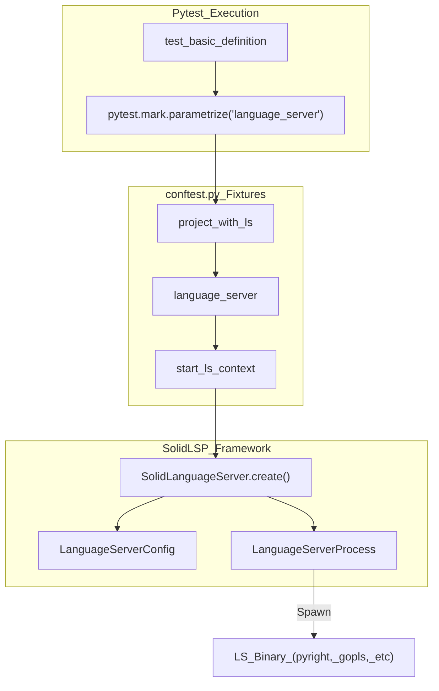
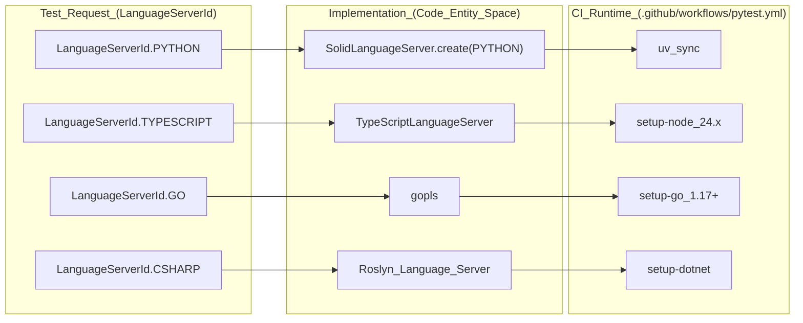

<!-- source: DeepWiki mcp.deepwiki.com · repo oraios/serena · page 8.1 Testing Infrastructure · fetched 2026-10-29 -->

# Testing Infrastructure

Relevant source files

The following files were used as context for generating this wiki page:

- [.github/workflows/pytest.yml](.github/workflows/pytest.yml)
- [.gitignore](.gitignore)
- [README.md](README.md)
- [docs/01-about/020_programming-languages.md](docs/01-about/020_programming-languages.md)
- [scripts/profile_tool_call.py](scripts/profile_tool_call.py)
- [src/solidlsp/language_servers/sourcekit_lsp.py](src/solidlsp/language_servers/sourcekit_lsp.py)
- [src/solidlsp/ls_config.py](src/solidlsp/ls_config.py)
- [test/conftest.py](test/conftest.py)
- [test/resources/repos/python/test_repo/test_repo/variables.py](test/resources/repos/python/test_repo/test_repo/variables.py)
- [test/resources/repos/svelte/test_repo/.gitignore](test/resources/repos/svelte/test_repo/.gitignore)
- [test/resources/repos/svelte/test_repo/package-lock.json](test/resources/repos/svelte/test_repo/package-lock.json)
- [test/serena/__snapshots__/test_symbol_editing.ambr](test/serena/__snapshots__/test_symbol_editing.ambr)
- [test/serena/test_serena_agent.py](test/serena/test_serena_agent.py)
- [test/serena/test_symbol_editing.py](test/serena/test_symbol_editing.py)
- [test/solidlsp/clojure/__init__.py](test/solidlsp/clojure/__init__.py)
- [test/solidlsp/clojure/test_clojure_basic.py](test/solidlsp/clojure/test_clojure_basic.py)
- [test/solidlsp/python/test_python_basic.py](test/solidlsp/python/test_python_basic.py)
- [test/solidlsp/python/test_symbol_retrieval.py](test/solidlsp/python/test_symbol_retrieval.py)
- [test/solidlsp/svelte/conftest.py](test/solidlsp/svelte/conftest.py)
- [test/solidlsp/svelte/test_svelte_basic.py](test/solidlsp/svelte/test_svelte_basic.py)
- [test/solidlsp/svelte/test_svelte_references.py](test/solidlsp/svelte/test_svelte_references.py)
- [test/solidlsp/svelte/test_svelte_symbols.py](test/solidlsp/svelte/test_svelte_symbols.py)
- [test/solidlsp/swift/test_swift_basic.py](test/solidlsp/swift/test_swift_basic.py)
- [test/solidlsp/test_ls_common.py](test/solidlsp/test_ls_common.py)
- [test/solidlsp/test_typescript_timeout_policy.py](test/solidlsp/test_typescript_timeout_policy.py)

The Serena testing infrastructure is designed to provide robust, cross-platform, and multi-language verification of semantic code tools. It leverages `pytest` as the primary test runner and utilizes a comprehensive suite of fixtures to manage the lifecycle of language servers and project environments.

## Core Fixtures and Patterns

Serena uses `test/conftest.py` to define shared fixtures that abstract away the complexity of starting and stopping Language Servers (LS) during test execution.

### Language Server Management
The infrastructure provides fixtures to handle the `SolidLanguageServer` lifecycle. To avoid the overhead of restarting servers for every individual test case, fixtures are often scoped to the `module` or `session` level [test/conftest.py:164-166]().

*   **`language_server`**: A module-scoped fixture that creates and starts a `SolidLanguageServer` for a specified language [test/conftest.py:165-194]().
*   **`project_with_ls`**: A high-level fixture that provides a fully initialized `Project` object with an active language server already attached [test/conftest.py:228-243]().
*   **`start_ls_context`**: A context manager used by fixtures to initialize the LS via `SolidLanguageServer.create()`, configure ignore paths via `GitignoreParser`, and manage the server process [test/conftest.py:91-126]().
*   **`resources_dir`**: Provides the path to `test/resources`, the root for all test assets [test/conftest.py:35-39]().

### Resource Repositories
For each supported language, Serena maintains a dedicated "test repo" located in `test/resources/repos/<language>/test_repo/` [test/conftest.py:61-63](). These repositories contain standard code structures and specific files like `diagnostics_sample.py` (Python) or `diagnostics_sample.go` (Go) to verify tool behavior against real-world language semantics [test/serena/test_serena_agent.py:188-226]().

### Data Flow: Fixture to Test
The following diagram illustrates how a test case requests a language-specific environment and how the infrastructure fulfills it.

**Test Environment Initialization**

Sources: [test/conftest.py:91-126](), [test/conftest.py:165-180](), [test/conftest.py:228-243](), [test/solidlsp/clojure/test_clojure_basic.py:16-17]().

## Utility Functions

### `find_identifier_pos`
A critical utility for testing semantic queries is `find_identifier_pos`. Since LSP operates on line and character offsets, this function allows tests to locate an identifier's position in a source file dynamically rather than hardcoding line numbers, which are fragile [test/serena/test_serena_agent.py:36-38]().

### Snapshot Testing for Symbol Editing
For complex code transformations (e.g., `ReplaceSymbolBodyTool`), Serena uses snapshot testing patterns via the `syrupy` plugin to ensure regression-free edits [test/serena/test_symbol_editing.py:2-4]().
*   **`CodeDiff`**: A utility class used in editing tests to compute differences between original and modified code using `difflib.SequenceMatcher`, providing object-oriented access to line-level changes [test/serena/test_symbol_editing.py:47-105]().
*   **`EditingTest`**: An abstract base class that sets up a temporary directory for editing tests to avoid polluting the actual test repositories during modification [test/serena/test_symbol_editing.py:179-192]().
*   **Snapshots**: Serialized versions of expected file contents are stored in `.ambr` files, allowing for easy verification of multi-line structural edits [test/serena/__snapshots__/test_symbol_editing.ambr:1-60]().

## Multi-Language Test Suite

The `test/serena/test_serena_agent.py` file contains a massive, data-driven test suite that verifies Serena's core tools across different languages using `BaseCase` dataclasses [test/serena/test_serena_agent.py:46-52]().

| Case Class | Purpose |
| :--- | :--- |
| `FindSymbolCase` | Verifies symbol search by name, kind, and file [test/serena/test_serena_agent.py:55-59](). |
| `FindDefiningSymbolCase` | Tests go-to-definition at specific identifier offsets [test/serena/test_serena_agent.py:69-77](). |
| `DiagnosticCase` | Validates that `GetDiagnosticsForFileTool` correctly captures LS-reported errors [test/serena/test_serena_agent.py:141-146](). |
| `SafeDeleteCase` | Verifies that `SafeDeleteSymbol` can remove entities cleanly [test/serena/test_serena_agent.py:131-135](). |

Sources: [test/serena/test_serena_agent.py:46-146]().

## Pytest CI Workflow

The CI environment defined in `.github/workflows/pytest.yml` handles the complexity of testing 40+ languages across Ubuntu, Windows, and macOS [github/workflows/pytest.yml:81-86]().

### Parallel Batching
To optimize execution, tests are partitioned into batches based on `pytest` markers [github/workflows/pytest.yml:4-8]():
*   **`jvm`**: Java, C#, Kotlin, Scala, Groovy, Clojure [github/workflows/pytest.yml:69]().
*   **`native`**: C++, Rust, Go, Zig, Pascal, Swift [github/workflows/pytest.yml:70]().
*   **`other-langs`**: Scripting languages (Python, Ruby, PHP) and specialist tools (Terraform, Ansible) [github/workflows/pytest.yml:74]().
*   **`niche`**: Heavy/slow toolchains (OCaml, Nix, Julia, R) run only on Ubuntu [github/workflows/pytest.yml:77, 93-97]().
*   **`catch-all`**: Web technologies and core framework tests [github/workflows/pytest.yml:85-86]().

### Runtime Dependency Mapping
The following diagram bridges the "Natural Language Space" (Requested Language) to the "Code Entity Space" (Specific LS Implementation and Runtime).

**Language to Runtime Mapping**

Sources: [src/solidlsp/ls_config.py:90-182](), [github/workflows/pytest.yml:68-77, 100-145](), [test/conftest.py:90-99]().

### Caching Strategy
The workflow aggressively caches resources to maintain performance [github/workflows/pytest.yml:28-33]():
*   **`uv` virtualenv**: Keyed on `uv.lock` [github/workflows/pytest.yml:124-129]().
*   **Language Servers**: Persistent storage in `~/.serena/language_servers/static` [github/workflows/pytest.yml:113-116]().
*   **Go Build Cache**: `go-build` and `go/bin` directories [github/workflows/pytest.yml:117-118]().

Sources: [.github/workflows/pytest.yml:1-120](), [test/conftest.py:1-250](), [test/serena/test_serena_agent.py:46-225](), [test/serena/test_symbol_editing.py:1-176]().

---

