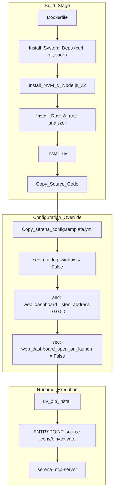
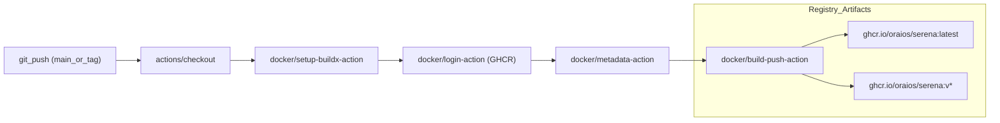

<!-- source: DeepWiki mcp.deepwiki.com · repo oraios/serena · page 8.2 Docker Deployment · fetched 2026-10-29 -->

# Docker Deployment

<details>
<summary>Relevant source files</summary>

The following files were used as context for generating this wiki page:

- [.github/workflows/codespell.yml](.github/workflows/codespell.yml)
- [.github/workflows/docker.yml](.github/workflows/docker.yml)
- [.github/workflows/docs.yaml](.github/workflows/docs.yaml)
- [DOCKER.md](DOCKER.md)
- [Dockerfile](Dockerfile)
- [compose.yaml](compose.yaml)

</details>


Running Serena within a Docker container provides a sandboxed environment that isolates shell command execution and ensures consistent language server dependencies across different host operating systems [DOCKER.md:7-14](). This deployment strategy is particularly recommended for security-conscious users to mitigate risks associated with the agent's file modification and shell tools [DOCKER.md:11]().

## Docker Architecture

The Serena Docker environment is built on a `python:3.11-slim` base and includes pre-installed runtimes for Node.js and Rust to support various Language Servers [Dockerfile:2-52]().

### Image Composition and Layers

| Component | Version / Source | Purpose |
| :--- | :--- | :--- |
| **Base OS** | `python:3.11-slim` | Minimal Python environment [Dockerfile:2]() |
| **Node.js** | `v22.18.0` | Runtime for TypeScript/Vue/JS language servers [Dockerfile:29-36]() |
| **Rust** | `stable` | Support for `rust-analyzer` [Dockerfile:48-51]() |
| **Package Manager** | `uv` | Fast Python dependency management and venv handling [Dockerfile:42]() |
| **App Path** | `/workspaces/serena` | Primary working directory [Dockerfile:54]() |
| **Config Path** | `/workspaces/serena/config` | Configuration and log storage [Dockerfile:63]() |

**Sources:** [Dockerfile:2-63]()

### Container Initialization Flow

The following diagram illustrates how the `Dockerfile` prepares the environment and overrides default settings for containerized use.

**Serena Docker Build & Startup Flow**

**Sources:** [Dockerfile:9-78](), [DOCKER.md:25-34]()

## Configuration for Containerized Use

When running in Docker, certain default behaviors of Serena are modified via `sed` commands during the build process to ensure compatibility with headless environments [Dockerfile:65-68]().

### Key Configuration Overrides
*   **`gui_log_window: False`**: Disables the Tkinter-based log window which would fail in a container without an X server [Dockerfile:66]().
*   **`web_dashboard_listen_address: 0.0.0.0`**: Ensures the dashboard server binds to all interfaces, allowing it to be reached from the host machine [Dockerfile:67]().
*   **`web_dashboard_open_on_launch: False`**: Prevents the container from attempting to open a web browser locally [Dockerfile:68]().

**Sources:** [Dockerfile:65-68](), [DOCKER.md:28-34]()

### Volume Mounting
To persist settings and project data, users should mount local directories to the container.

*   **Configuration**: Mount a local directory to `/workspaces/serena/config` to persist `serena_config.yml`, project registrations, and session logs [DOCKER.md:19-24]().
*   **Projects**: Projects must be mounted into the container to be accessible. It is recommended to mount them under `/workspace/` or as defined in `compose.yaml` [DOCKER.md:129-136](), [compose.yaml:4-7]().

## Deployment via Docker Compose

The `compose.yaml` file defines the primary `serena` service, allowing for easy orchestration of the MCP server and dashboard [compose.yaml:1-21]().

### Service Definition
The default command starts the MCP server using the SSE transport, which is suitable for web-based clients or remote connections [compose.yaml:17-18]().

```yaml
services:
  serena:
    image: serena:latest
    ports:
      - "127.0.0.1:${SERENA_PORT:-9121}:9121"          # MCP Server
      - "127.0.0.1:${SERENA_DASHBOARD_PORT:-24282}:24282" # Dashboard
    environment:
      - SERENA_DOCKER=1
    command:
      - "uv run --directory . serena-mcp-server --transport sse --port 9121 --host 0.0.0.0"
```
**Sources:** [compose.yaml:2-21](), [DOCKER.md:138-143]()

## Limitations and Considerations

### Project Activation
Because the container has its own isolated file system, projects outside of the defined volume mounts cannot be accessed [DOCKER.md:39-40](). When using the `ActivateProjectTool`, the full path relative to the container (e.g., `/workspace/my-project`) must be used [DOCKER.md:41-43]().

### Language Support
The default image includes Node.js and Rust [Dockerfile:27-52](). Other languages (like Java or .NET) may require the container to download dependencies on the fly. Language servers that require explicit system-level global installations not covered by Serena's internal dependency management may not work without a custom Dockerfile [DOCKER.md:44-49]().

### Windows Line Endings
Files edited by Serena inside the container will use Unix line endings (LF). Windows users should ensure `git config core.autocrlf true` is set on the host to prevent mismatch issues [DOCKER.md:64-70]().

## CI/CD: GitHub Actions Workflow

The `docker.yml` workflow automates the building and publishing of images to the GitHub Container Registry (`ghcr.io`) [.github/workflows/docker.yml:1-10]().

**Docker Image Publishing Pipeline**

**Sources:** [.github/workflows/docker.yml:21-59]()

The workflow supports multi-platform builds for `linux/amd64` and `linux/arm64`, ensuring compatibility across Intel/AMD and Apple Silicon/ARM hardware [.github/workflows/docker.yml:53](). It utilizes GitHub Actions caching (`type=gha`) to speed up subsequent builds [.github/workflows/docker.yml:57-58]().

---

