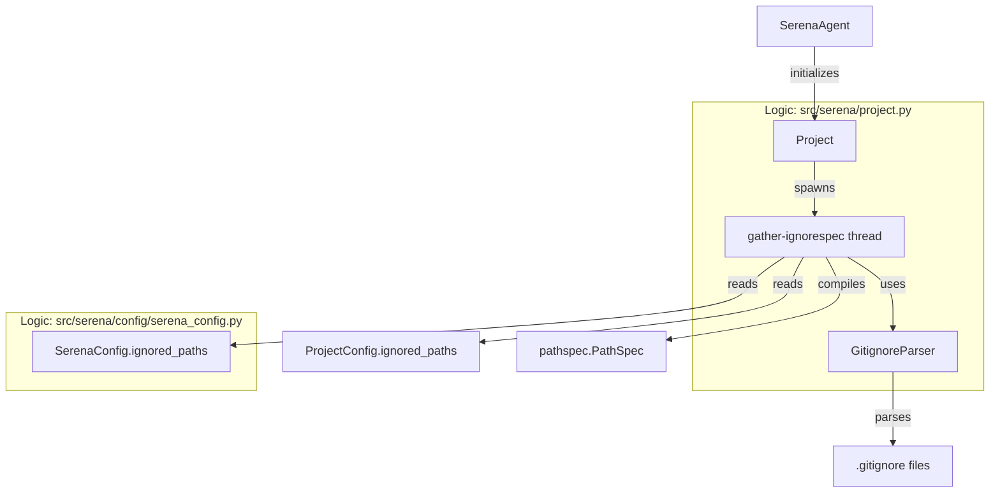
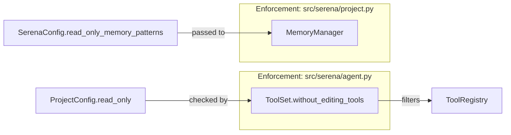

<!-- source: DeepWiki mcp.deepwiki.com · repo oraios/serena · page 8.3 Security Considerations · fetched 2026-10-29 -->

# Security Considerations

Relevant source files

The following files were used as context for generating this wiki page:

- [.serena/project.yml](.serena/project.yml)
- [docs/02-usage/070_security.md](docs/02-usage/070_security.md)
- [src/serena/agent.py](src/serena/agent.py)
- [src/serena/config/serena_config.py](src/serena/config/serena_config.py)
- [src/serena/project.py](src/serena/project.py)
- [src/serena/resources/project.template.yml](src/serena/resources/project.template.yml)
- [src/serena/resources/serena_config.template.yml](src/serena/resources/serena_config.template.yml)
- [src/solidlsp/language_servers/basedpyright_server.py](src/solidlsp/language_servers/basedpyright_server.py)
- [src/solidlsp/language_servers/pyrefly_server.py](src/solidlsp/language_servers/pyrefly_server.py)
- [test/resources/repos/python/test_repo/pyrefly.toml](test/resources/repos/python/test_repo/pyrefly.toml)
- [test/serena/config/test_serena_config.py](test/serena/config/test_serena_config.py)
- [test/solidlsp/conftest.py](test/solidlsp/conftest.py)
- [test/solidlsp/python/test_basedpyright.py](test/solidlsp/python/test_basedpyright.py)
- [test/solidlsp/python/test_basedpyright_server.py](test/solidlsp/python/test_basedpyright_server.py)

Serena is a powerful coding agent toolkit capable of autonomous file modification and shell command execution. This page outlines the security model, trust assumptions, and recommended practices for safe deployment, including implementation details for path validation, project trust gating, and read-only enforcement.

## Trust Model and Assumptions

Serena's security model is based on a "Trusted Environment" paradigm [docs/02-usage/070_security.md:7-14](). The system assumes the following components are inherently trusted:
*   **Local Machine:** The host operating system and environment variables (e.g., `SERENA_HOME`) [src/serena/config/serena_config.py:63-65]().
*   **MCP Client:** The LLM or interface (e.g., Claude Desktop, Cursor) sending instructions.
*   **Repository:** The source code being analyzed or modified.
*   **User Configuration:** Global and project-level YAML files (`serena_config.yml`, `project.yml`).
*   **Package Managers:** Configuration for `npm`, `pip`, and `uv` used to acquire language server dependencies [docs/02-usage/070_security.md:13-14]().

### Risk Vectors: Shell and Editing Tools
The primary security risks arise from `ExecuteShellCommandTool` and file-modification tools such as `ReplaceContentTool`, `InsertAfterSymbolTool`, and `RenameSymbolTool`. These allow an LLM to execute arbitrary code or modify project logic [docs/02-usage/070_security.md:15-17](). Serena relies on sandboxing rather than tool-level constraints to mitigate these risks [docs/02-usage/070_security.md:25-27]().

Sources: [docs/02-usage/070_security.md:7-27](), [src/serena/config/serena_config.py:63-76]()

## Sandboxing and Path Validation

To mitigate risks, it is highly recommended to run Serena within a sandboxed environment like Docker [docs/02-usage/070_security.md:40-46](). Serena implements validation layers to ensure the agent remains within the project boundary.

### Trusted Project Path Patterns
Introduced in v1.6.0, the concept of **Trusted Projects** gates features that honor repository-supplied input that could have effects beyond code analysis [docs/02-usage/070_security.md:48-60](). Trust is decided by matching the project's root path against `trusted_project_path_patterns` in the global `SerenaConfig` [src/serena/config/serena_config.py:321-325]().

**Trust-Gated Features:**
*   **Activation Commands:** Shell commands defined in `project.yml` that run during project startup [src/serena/resources/project.template.yml:42-49]().
*   **LS Specific Settings:** Repository-supplied overrides for language server acquisition (e.g., custom package registries) [src/serena/resources/project.template.yml:70-74]().

### Filesystem Security and Ignore Logic
Serena prevents access to sensitive files by merging global and project-specific ignore patterns. The `Project` class gathers these patterns asynchronously using `GitignoreParser` and `pathspec` to validate file operations [src/serena/project.py:79-107]().

**Code Entity Mapping: Filesystem Protection**

Sources: [src/serena/project.py:79-112](), [src/serena/config/serena_config.py:103-106](), [src/serena/resources/project.template.yml:98-108]()

## Network Security

Serena exposes several network services, which bind to `127.0.0.1` (localhost) by default [src/serena/resources/serena_config.template.yml:69-70]().

| Service | Protocol | Default Port | Description |
| :--- | :--- | :--- | :--- |
| **MCP Server** | SSE / HTTP | `9121` | Transport for LLM clients via `Streamable HTTP` [docs/02-usage/070_security.md:104]() |
| **Dashboard** | HTTP | `24282` | Web UI for monitoring; restricted via `web_dashboard_trusted_hosts` [src/serena/resources/serena_config.template.yml:76-79]() |
| **Project Server** | HTTP | Variable | Service for cross-project symbol querying [src/serena/project.py:54-56]() |
| **JetBrains Plugin**| HTTP | Variable | Communication with IDE via `jetbrains_plugin_server_address` [src/serena/resources/serena_config.template.yml:80-81]() |

**Security Controls:**
*   **Host Validation:** The dashboard uses `web_dashboard_trusted_hosts` to filter incoming requests [src/serena/resources/serena_config.template.yml:76-79]().
*   **Listen Address:** Configurable via `web_dashboard_listen_address` [src/serena/resources/serena_config.template.yml:69-70]().

Sources: [src/serena/resources/serena_config.template.yml:69-81](), [docs/02-usage/070_security.md:101-115]()

## Read-Only Enforcement

Serena provides granular controls to prevent the LLM from modifying state.

### Project-Level Read-Only Mode
The `ProjectConfig` contains a `read_only` flag [src/serena/resources/project.template.yml:110-113](). When enabled, the `ToolSet` can be modified to exclude all editing tools using `ToolSet.without_editing_tools()` [src/serena/agent.py:185-190]().

### Memory Sandboxing
The `MemoryManager` (initialized in `Project`) enforces memory protection using regex patterns [src/serena/project.py:48-54]():
*   **Read-Only Memories:** `read_only_memory_patterns` mark specific memory entries as immutable [src/serena/config/serena_config.py:311-315]().
*   **Ignored Memories:** `ignored_memory_patterns` hide memory files from the agent [src/serena/resources/serena_config.template.yml:113-120]().

**Code Entity Mapping: Tool and Memory Restriction**

Sources: [src/serena/agent.py:185-195](), [src/serena/project.py:48-54](), [src/serena/config/serena_config.py:311-319]()

## Supply Chain Security

Serena supports over 30 language servers, which can be acquired automatically [src/serena/resources/project.template.yml:4-18]().
*   **LSP Backend:** Uses `LanguageServerDependencyProvider` (e.g., `LanguageServerDependencyProviderUvx`) to download binaries [src/solidlsp/language_servers/basedpyright_server.py:42-51]().
*   **JetBrains Backend:** Relies on a pre-installed IDE, assuming the user trusts their IDE installation [docs/02-usage/070_security.md:123-125]().
*   **Version Pinning:** Language servers like `BasedPyright` pin specific versions (e.g., `1.39.9`) to ensure consistent and reviewed dependencies [src/solidlsp/language_servers/basedpyright_server.py:18]().

Sources: [src/solidlsp/language_servers/basedpyright_server.py:18-51](), [docs/02-usage/070_security.md:116-130]()

---

