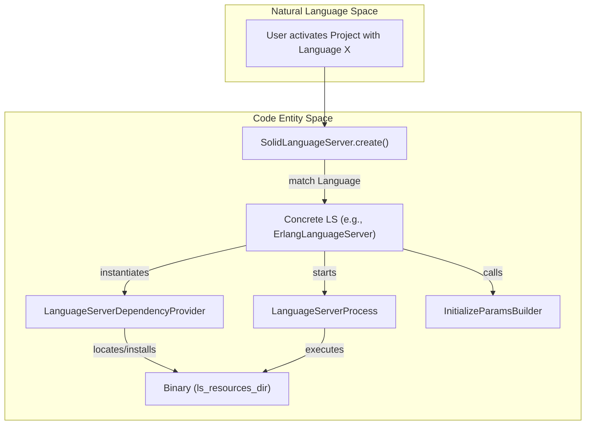
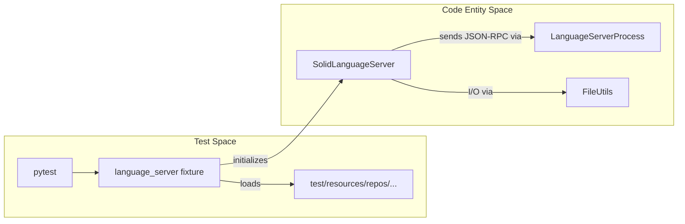

<!-- source: DeepWiki mcp.deepwiki.com · repo oraios/serena · page 8.4 Contributing Guide · fetched 2026-10-29 -->

# Contributing Guide

Relevant source files

The following files were used as context for generating this wiki page:

- [.github/pull_request_template.md](.github/pull_request_template.md)
- [.github/workflows/create-release.yml](.github/workflows/create-release.yml)
- [.github/workflows/publish.yml](.github/workflows/publish.yml)
- [.serena/memories/adding_new_language_support_guide.md](.serena/memories/adding_new_language_support_guide.md)
- [.serena/memories/conventions.md](.serena/memories/conventions.md)
- [.serena/memories/core.md](.serena/memories/core.md)
- [.serena/memories/creating_pull_requests.md](.serena/memories/creating_pull_requests.md)
- [.serena/memories/serena_repository_structure.md](.serena/memories/serena_repository_structure.md)
- [.serena/memories/suggested_commands.md](.serena/memories/suggested_commands.md)
- [.serena/memories/task_completion.md](.serena/memories/task_completion.md)
- [.serena/memories/tech_stack.md](.serena/memories/tech_stack.md)
- [CONTRIBUTING.md](CONTRIBUTING.md)
- [README-dev.md](README-dev.md)
- [docs/.gitignore](docs/.gitignore)
- [docs/01-about/.gitignore](docs/01-about/.gitignore)
- [docs/01-about/030_serena-in-action.md](docs/01-about/030_serena-in-action.md)
- [docs/_config.yml](docs/_config.yml)
- [docs/autogen_docs.py](docs/autogen_docs.py)
- [docs/create_toc.py](docs/create_toc.py)
- [docs/index.md](docs/index.md)
- [scripts/bump_version.py](scripts/bump_version.py)
- [scripts/update_downloaded_dependency_hashes.py](scripts/update_downloaded_dependency_hashes.py)
- [src/solidlsp/dependency_provider.py](src/solidlsp/dependency_provider.py)
- [src/solidlsp/language_servers/common.py](src/solidlsp/language_servers/common.py)
- [src/solidlsp/language_servers/erlang_language_server.py](src/solidlsp/language_servers/erlang_language_server.py)
- [src/solidlsp/language_servers/groovy_language_server.py](src/solidlsp/language_servers/groovy_language_server.py)
- [src/solidlsp/ls_utils.py](src/solidlsp/ls_utils.py)
- [src/solidlsp/resources/downloaded_dependency_hashes.json](src/solidlsp/resources/downloaded_dependency_hashes.json)
- [src/solidlsp/settings.py](src/solidlsp/settings.py)
- [test/solidlsp/erlang/test_erlang_symbol_names.py](test/solidlsp/erlang/test_erlang_symbol_names.py)
- [test/solidlsp/test_text_utils.py](test/solidlsp/test_text_utils.py)

This guide outlines the technical requirements and workflows for contributing to Serena. Contributions are welcomed in the form of new language server integrations, bug fixes, and documentation improvements [CONTRIBUTING.md:5-10]().

## Python Environment Setup

Serena uses `uv` for dependency management and environment isolation.

1.  **Virtual Environment**: Create a Python 3.13 environment: `uv venv -p 3.13` [CONTRIBUTING.md:31-31]().
2.  **Activation**:
    *   Linux/macOS/Git Bash: `source .venv/bin/activate` [CONTRIBUTING.md:33-33]().
    *   Windows (CMD): `.venv\Scripts\activate.bat` [CONTRIBUTING.md:34-34]().
3.  **Installation**: Install the package with development extras: `uv sync --extra dev` [CONTRIBUTING.md:35-35]().
4.  **Local Tool**: To install Serena as a local tool for testing: `uv tool install --reinstall -p 3.13 .` [CONTRIBUTING.md:42-42]().

### Development Tasks
Development tasks are managed via `poe` (Poe the Poet):
*   `poe format`: Runs code auto-formatters [CONTRIBUTING.md:49-49]().
*   `poe type-check`: Runs static type analysis [CONTRIBUTING.md:50-50]().

**Sources:** [CONTRIBUTING.md:27-52]().

## Adding Language Server Support

Adding a new language involves extending the `solidlsp` library to interface with a specific Language Server Protocol (LSP) implementation.

### 1. DependencyProvider Pattern
Every `SolidLanguageServer` subclass handles its own binary lifecycle via the `DependencyProvider` pattern, which abstracts runtime installation and launch command generation [.serena/memories/adding_new_language_support_guide.md:21-25]().

#### Provider Types
| Class | Usage | Implementation Pointer |
| :--- | :--- | :--- |
| `LanguageServerDependencyProviderUvx` | For servers on PyPI. | Simply pass package name and entrypoint [.serena/memories/adding_new_language_support_guide.md:39-43](). |
| `LanguageServerDependencyProviderBaseCommand` | For standard executables with argument overrides. | Implement `_create_default_base_command` [.serena/memories/adding_new_language_support_guide.md:45-50](). |
| `LanguageServerDependencyProviderSinglePath` | For servers with one core dependency (e.g., JAR). | Implement `_get_or_install_core_dependency` [.serena/memories/adding_new_language_support_guide.md:52-57](). |
| `LanguageServerDependencyProvider` | Root base class for complex setups. | Implement `create_launch_command` directly [.serena/memories/adding_new_language_support_guide.md:59-61](). |

### 2. Implementation Steps
1.  **Define the Server**: Create a subclass of `SolidLanguageServer` in `src/solidlsp/language_servers/` [.serena/memories/adding_new_language_support_guide.md:19-19]().
2.  **Implement Provider**: Implement `_create_dependency_provider()` to return an instance that handles binary discovery in the `ls_resources_dir` [src/solidlsp/settings.py:51-53](), [.serena/memories/adding_new_language_support_guide.md:32-35]().
3.  **Handle Hashes**: If downloading binaries, update `src/solidlsp/resources/downloaded_dependency_hashes.json` using `DownloadedDependencyHashDatabase` [.serena/memories/adding_new_language_support_guide.md:83-96]().
4.  **LSP Initialization**: Override `_create_base_initialize_params` to provide server-specific capabilities [.serena/memories/adding_new_language_support_guide.md:122-129]().

### Language Server Initialization Diagram
The following diagram illustrates how a language server is instantiated and how it resolves its runtime dependencies.

**Title: Language Server Initialization and Dependency Resolution**

**Sources:** [.serena/memories/adding_new_language_support_guide.md:21-84](), [src/solidlsp/language_servers/erlang_language_server.py:31-52](), [src/solidlsp/dependency_provider.py:18-34]().

## Testing Infrastructure

Contributions must include comprehensive tests. Serena uses `pytest` with specialized fixtures for LSP interaction.

### Test Structure
1.  **Test Repository**: Create a minimal project in `test/resources/repos/<language>/test_repo/` [.serena/memories/adding_new_language_support_guide.md:11-12]().
2.  **Utility Usage**: Use `TextStepper` and `TextUtils` to verify position-based logic in tests [src/solidlsp/ls_utils.py:41-47](), [test/solidlsp/test_text_utils.py:6-8]().
3.  **Erlang Example**: See `test/solidlsp/erlang/test_erlang_symbol_names.py` for how to test symbol normalization logic [src/solidlsp/language_servers/erlang_language_server.py:66-78]().

### LSP Test Data Flow
**Title: LSP Tool Execution and Testing Flow**

**Sources:** [.serena/memories/adding_new_language_support_guide.md:118-186](), [src/solidlsp/ls_utils.py:181-184](), [src/solidlsp/language_servers/common.py:12-13]().

## Versioning and Release

Serena uses a specific workflow for version bumping and publishing.

### Version Bumping
The `scripts/bump_version.py` utility automates the following [scripts/bump_version.py:26-32]():
1.  **Release Bump**: Increments the version in `pyproject.toml` and `src/serena/__init__.py` [scripts/bump_version.py:141-142]().
2.  **Changelog**: Updates `CHANGELOG.md` [scripts/bump_version.py:151-152]().
3.  **Git Ops**: Creates a Git commit and tag (e.g., `v1.2.3`) [scripts/bump_version.py:59-60]().
4.  **Dev Bump**: Sets the next development version (e.g., `v1.2.4.dev0`) to ensure the main branch always has a `.dev` suffix [scripts/bump_version.py:63-70]().

### Release Workflows
*   **Publishing**: Publishing a release triggers the `publish` workflow [.github/workflows/publish.yml:4-6]().
*   **PyPI**: The job uses `uv build` and `uv publish` to distribute the `serena-agent` package [.github/workflows/publish.yml:27-30]().

**Sources:** [scripts/bump_version.py:1-166](), [.github/workflows/publish.yml:1-31]().

---

