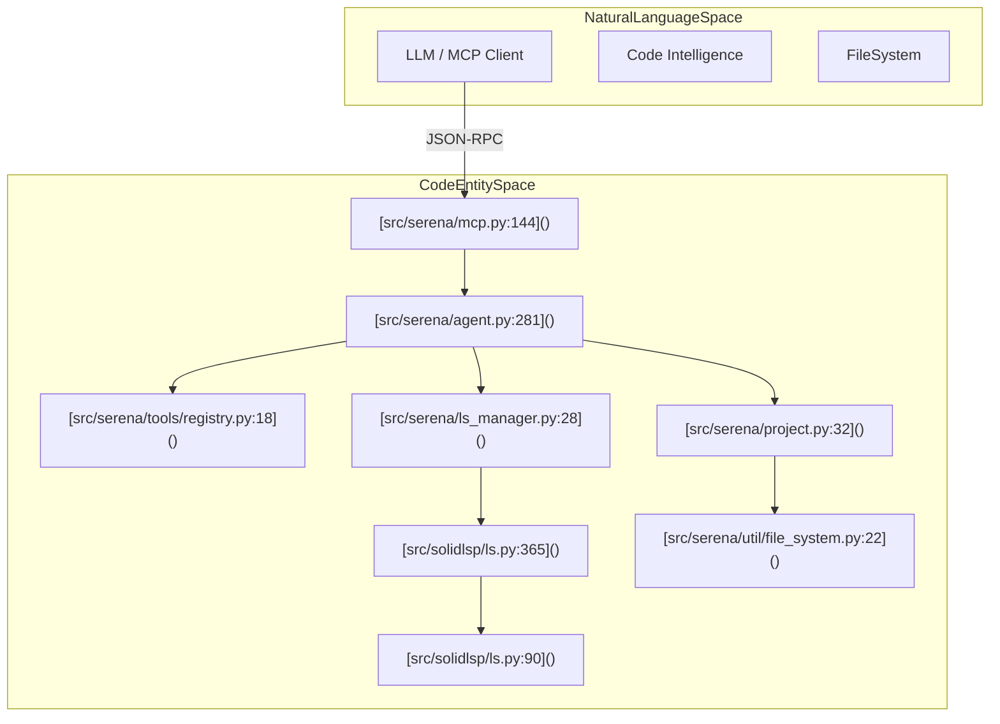
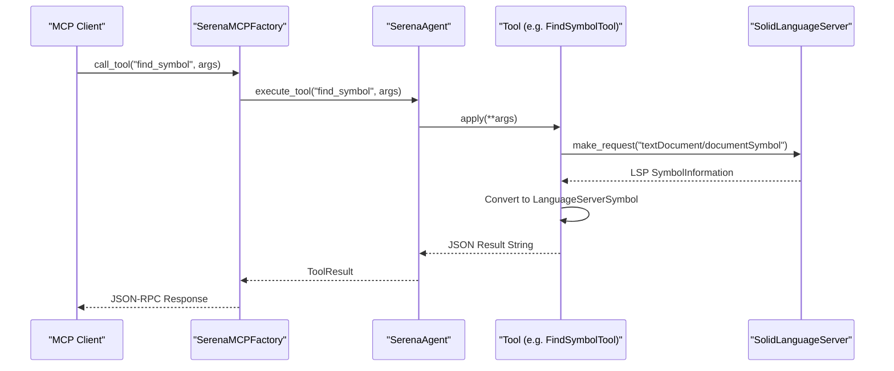

<!-- source: DeepWiki mcp.deepwiki.com · repo oraios/serena · page 9 Glossary · fetched 2026-10-29 -->

# Glossary

Relevant source files

The following files were used as context for generating this wiki page:

- [.serena/.gitignore](.serena/.gitignore)
- [.serena/memories/adding_new_language_support_guide.md](.serena/memories/adding_new_language_support_guide.md)
- [.serena/project.yml](.serena/project.yml)
- [CHANGELOG.md](CHANGELOG.md)
- [docs/02-usage/045_memories.md](docs/02-usage/045_memories.md)
- [pyproject.toml](pyproject.toml)
- [scripts/gen_prompt_factory.py](scripts/gen_prompt_factory.py)
- [scripts/print_tool_overview.py](scripts/print_tool_overview.py)
- [scripts/update_downloaded_dependency_hashes.py](scripts/update_downloaded_dependency_hashes.py)
- [src/serena/__init__.py](src/serena/__init__.py)
- [src/serena/agent.py](src/serena/agent.py)
- [src/serena/cli.py](src/serena/cli.py)
- [src/serena/code_editor.py](src/serena/code_editor.py)
- [src/serena/config/context_mode.py](src/serena/config/context_mode.py)
- [src/serena/config/serena_config.py](src/serena/config/serena_config.py)
- [src/serena/constants.py](src/serena/constants.py)
- [src/serena/ls_manager.py](src/serena/ls_manager.py)
- [src/serena/mcp.py](src/serena/mcp.py)
- [src/serena/memories/memory_manager.py](src/serena/memories/memory_manager.py)
- [src/serena/memories/memory_reference_analysis.py](src/serena/memories/memory_reference_analysis.py)
- [src/serena/project.py](src/serena/project.py)
- [src/serena/prompt_factory.py](src/serena/prompt_factory.py)
- [src/serena/resources/config/contexts/agent.yml](src/serena/resources/config/contexts/agent.yml)
- [src/serena/resources/config/contexts/context.template.yml](src/serena/resources/config/contexts/context.template.yml)
- [src/serena/resources/config/contexts/desktop-app.yml](src/serena/resources/config/contexts/desktop-app.yml)
- [src/serena/resources/config/modes/mode.template.yml](src/serena/resources/config/modes/mode.template.yml)
- [src/serena/resources/project.template.yml](src/serena/resources/project.template.yml)
- [src/serena/resources/serena_config.template.yml](src/serena/resources/serena_config.template.yml)
- [src/serena/symbol.py](src/serena/symbol.py)
- [src/serena/tools/__init__.py](src/serena/tools/__init__.py)
- [src/serena/tools/cmd_tools.py](src/serena/tools/cmd_tools.py)
- [src/serena/tools/file_tools.py](src/serena/tools/file_tools.py)
- [src/serena/tools/jetbrains_tools.py](src/serena/tools/jetbrains_tools.py)
- [src/serena/tools/memory_tools.py](src/serena/tools/memory_tools.py)
- [src/serena/tools/symbol_tools.py](src/serena/tools/symbol_tools.py)
- [src/serena/tools/tools_base.py](src/serena/tools/tools_base.py)
- [src/serena/util/dataclass.py](src/serena/util/dataclass.py)
- [src/serena/util/file_proxy.py](src/serena/util/file_proxy.py)
- [src/serena/util/git.py](src/serena/util/git.py)
- [src/serena/util/shell.py](src/serena/util/shell.py)
- [src/serena/util/text_utils.py](src/serena/util/text_utils.py)
- [src/serena/util/yaml.py](src/serena/util/yaml.py)
- [src/solidlsp/dependency_provider.py](src/solidlsp/dependency_provider.py)
- [src/solidlsp/language_servers/common.py](src/solidlsp/language_servers/common.py)
- [src/solidlsp/language_servers/erlang_language_server.py](src/solidlsp/language_servers/erlang_language_server.py)
- [src/solidlsp/language_servers/groovy_language_server.py](src/solidlsp/language_servers/groovy_language_server.py)
- [src/solidlsp/ls.py](src/solidlsp/ls.py)
- [src/solidlsp/ls_types.py](src/solidlsp/ls_types.py)
- [src/solidlsp/ls_utils.py](src/solidlsp/ls_utils.py)
- [src/solidlsp/lsp_protocol_handler/lsp_constants.py](src/solidlsp/lsp_protocol_handler/lsp_constants.py)
- [src/solidlsp/lsp_protocol_handler/lsp_types.py](src/solidlsp/lsp_protocol_handler/lsp_types.py)
- [src/solidlsp/resources/downloaded_dependency_hashes.json](src/solidlsp/resources/downloaded_dependency_hashes.json)
- [src/solidlsp/settings.py](src/solidlsp/settings.py)
- [src/solidlsp/util/cache.py](src/solidlsp/util/cache.py)
- [test/serena/config/test_global_ignored_paths.py](test/serena/config/test_global_ignored_paths.py)
- [test/serena/config/test_serena_config.py](test/serena/config/test_serena_config.py)
- [test/serena/test_cli_project_commands.py](test/serena/test_cli_project_commands.py)
- [test/serena/test_edit_marker.py](test/serena/test_edit_marker.py)
- [test/serena/test_ls_file_sync.py](test/serena/test_ls_file_sync.py)
- [test/serena/test_mcp.py](test/serena/test_mcp.py)
- [test/serena/test_memories_manager.py](test/serena/test_memories_manager.py)
- [test/serena/test_symbol.py](test/serena/test_symbol.py)
- [test/serena/test_text_utils.py](test/serena/test_text_utils.py)
- [test/serena/util/test_yaml.py](test/serena/util/test_yaml.py)
- [test/solidlsp/erlang/test_erlang_symbol_names.py](test/solidlsp/erlang/test_erlang_symbol_names.py)
- [test/solidlsp/test_text_utils.py](test/solidlsp/test_text_utils.py)
- [uv.lock](uv.lock)

This page provides definitions for codebase-specific terms, jargon, and domain concepts used throughout Serena. It serves as a technical reference for engineers to understand the mapping between natural language concepts and their implementation in code.

## Core Concepts

### SerenaAgent
The central coordinator of the system. It manages the lifecycle of the active project, maintains the `ToolRegistry`, and generates the system prompt for the LLM. It acts as the bridge between the MCP Server and the underlying code intelligence engines.
*   **Implementation**: `SerenaAgent` class in [src/serena/agent.py:281-282]().
*   **Key Methods**:
    *   `activate_project(project_name_or_path)`: Loads and sets the active project [src/serena/agent.py:476-477]().
    *   `get_system_prompt()`: Generates the full prompt for the LLM [src/serena/agent.py:381-382]().

### Project
A logical grouping of source code, configuration, and state. A project is defined by a `project.yml` file (usually in a `.serena/` directory) and contains language-specific settings, ignore patterns, and persistent memory.
*   **Implementation**: `Project` class in [src/serena/project.py:32-33]().
*   **Configuration**: `ProjectConfig` dataclass in [src/serena/config/serena_config.py:382-383]().

### ToolRegistry
A singleton registry that manages all available `Tool` classes. It handles tool discovery via subclass iteration and provides metadata about which tools are enabled by default or require an active project.
*   **Implementation**: `ToolRegistry` class in [src/serena/tools/registry.py:18-19]().
*   **Logic**: Uses `iter_subclasses(Tool)` to find all implemented tools [src/serena/agent.py:62-62]().

### Context and Mode
Hierarchical configuration layers that determine the agent's behavior and toolset.
*   **Context**: High-level environment definition (e.g., `ide`, `claude-code`, `chatgpt`). Defined in [src/serena/config/context_mode.py:21-22]().
*   **Mode**: Specific behavioral constraints (e.g., `planning`, `editing`, `onboarding`). Defined in [src/serena/config/context_mode.py:84-85]().

---

## Technical Mapping: Architecture to Code

The following diagram bridges the high-level system components to their specific code entities.

**Serena Component Mapping**

Sources: [src/serena/agent.py:281-282](), [src/serena/mcp.py:144-145](), [src/solidlsp/ls.py:90-91](), [src/serena/project.py:32-33]()

---

## Domain Terms & Jargon

| Term | Definition | Code Pointer |
| :--- | :--- | :--- |
| **Name Path** | A hierarchical path representing a symbol's location within a file (e.g., `MyClass/my_method[0]`). | [src/serena/symbol.py:143-144]() |
| **Symbolic Read** | Tools that retrieve structured information about code entities rather than raw text. | [src/serena/tools/tools_base.py:104-105]() |
| **Symbolic Edit** | Operations that modify code based on symbol boundaries (e.g., `ReplaceSymbolBodyTool`). | [src/serena/tools/tools_base.py:110-111]() |
| **LSP** | Language Server Protocol. The primary backend for code intelligence. | [src/solidlsp/ls.py:1-2]() |
| **JetBrains Backend** | An alternative code intelligence engine that communicates with a JetBrains IDE plugin. | [src/serena/jetbrains/jetbrains_plugin_client.py:23-24]() |
| **Onboarding** | A workflow where the agent analyzes a project to create an initial summary/memory. | [src/serena/tools/workflow_tools.py:16-17]() |
| **Diagnostic** | Compiler/Linter errors or warnings provided by a Language Server. | [src/serena/util/ls_diagnostics.py:27-28]() |
| **Memory** | Persistent, project-specific knowledge stored as markdown files in `.serena/memories`. | [src/serena/memories/memory_manager.py:36-37]() |

---

## Data Flow: Tool Execution

This diagram illustrates how a request from an LLM (via MCP) is transformed into a code operation.

**Tool Execution Pipeline**

Sources: [src/serena/mcp.py:144-150](), [src/serena/agent.py:644-650](), [src/serena/tools/symbol_tools.py:144-145](), [src/solidlsp/ls.py:557-560]()

---

## Specialized Implementation Terms

### LSPFileBuffer
An in-memory representation of a file's content used to track changes before they are saved to disk. It handles `didOpen` and `didChange` notifications for the Language Server.
*   **Implementation**: `LSPFileBuffer` in [src/solidlsp/ls.py:90-91]().
*   **Logic**: Maintains a `ref_count` to manage the lifecycle of open files in the LS [src/solidlsp/ls.py:102-102](). It also caches the `_content_hash` to detect changes [src/solidlsp/ls.py:116-116]().

### NamePathMatcher
A utility for matching symbol name paths against patterns. It supports simple names, relative suffixes, and absolute paths (starting with `/`).
*   **Implementation**: `NamePathMatcher` in [src/serena/symbol.py:143-144]().
*   **Logic**: Parses patterns into `PatternComponent` objects to handle overloads like `[0]` [src/serena/symbol.py:159-160]().

### ToolMarker
Marker classes used for categorization and filtering of tools within the `ToolRegistry`.
*   **ToolMarkerCanEdit**: Identifies tools that modify the filesystem [src/serena/tools/tools_base.py:88-89]().
*   **ToolMarkerOptional**: Identifies tools that must be explicitly enabled in a mode or context [src/serena/tools/tools_base.py:98-99]().
*   **ToolMarkerSymbolicRead**: Identifies tools that perform read-only symbolic analysis [src/serena/tools/tools_base.py:104-105]().

### PromptFactory
The engine responsible for assembling the system prompt from various templates and dynamic fragments (e.g., active tools, project info, memories).
*   **Implementation**: `SerenaPromptFactory` in [src/serena/prompt_factory.py:19-20]().
*   **Logic**: Uses `interprompt` library to render Jinja2 templates [src/serena/prompt_factory.py:11-12](). It manages both internal and user-defined templates [src/serena/config/serena_config.py:77-81]().

### LanguageServerManager
Manages multiple `SolidLanguageServer` instances for a project, typically one per programming language.
*   **Implementation**: `LanguageServerManager` in [src/serena/ls_manager.py:28-29]().
*   **Logic**: Handles the lifecycle (startup/shutdown) of language servers and routes requests based on file extensions [src/serena/ls_manager.py:118-120]().

### TaskExecutor
Manages the execution of tasks, providing mechanisms for queuing, cancellation, and tracking status.
*   **Implementation**: `TaskExecutor` in [src/serena/task_executor.py:20-21]().
*   **Logic**: Uses `TaskInfo` to maintain the state of individual tasks, including whether they are running or finished [src/serena/task_executor.py:23-24]().

### SerenaDashboardAPI
A Flask-based web application that provides a visual interface for monitoring the agent, viewing logs, and managing configuration.
*   **Implementation**: `SerenaDashboardAPI` in [src/serena/dashboard.py:189-190]().
*   **Endpoints**: Includes routes for retrieving logs [src/serena/dashboard.py:245](), configuration overview [src/serena/dashboard.py:283](), and managing project memories [src/serena/dashboard.py:346]().

Sources: [src/solidlsp/ls.py:90-91](), [src/serena/symbol.py:143-144](), [src/serena/tools/tools_base.py:81-120](), [src/serena/prompt_factory.py:19-20](), [src/serena/ls_manager.py:28-29](), [src/serena/task_executor.py:20-21](), [src/serena/dashboard.py:189-190]()