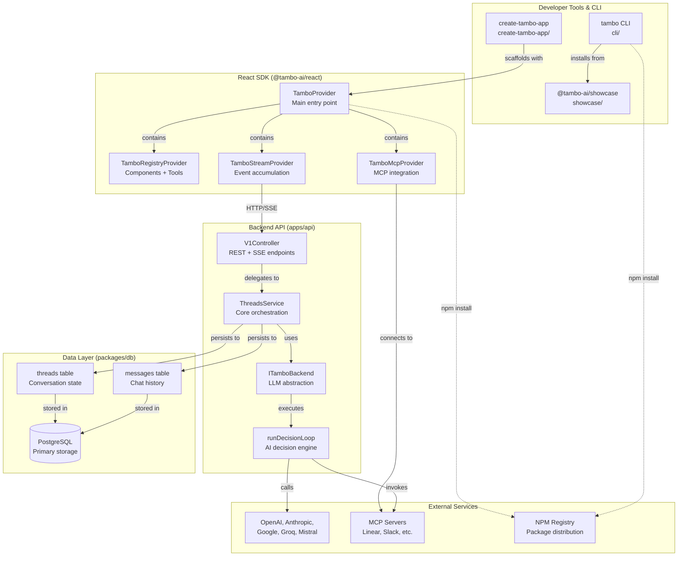
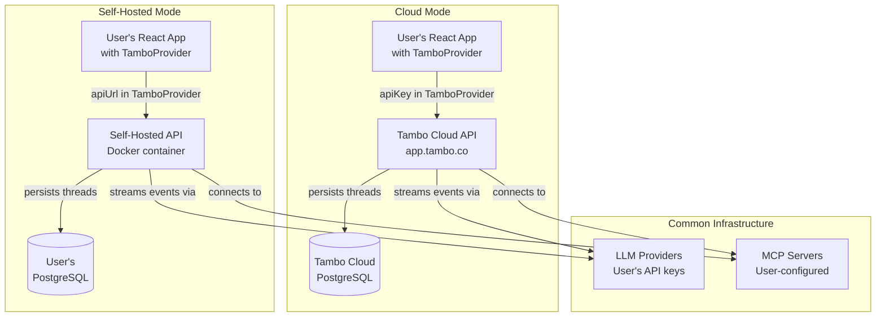
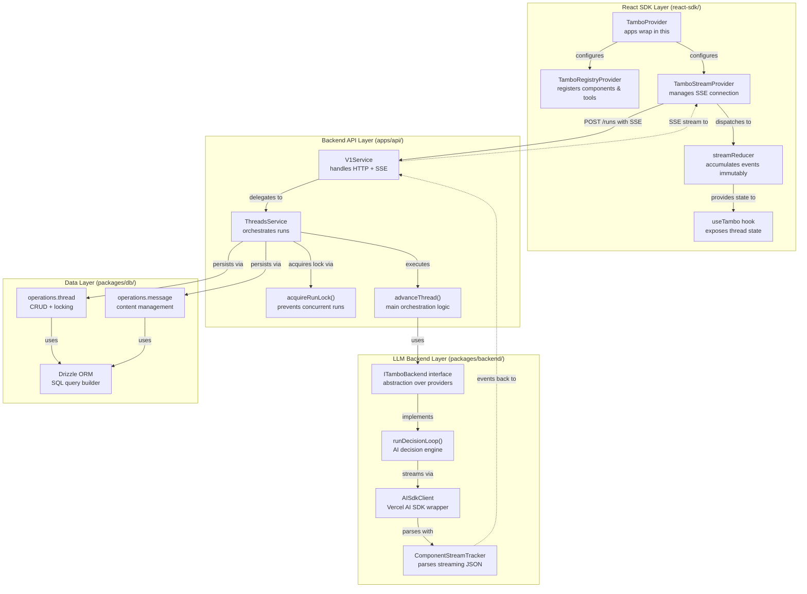
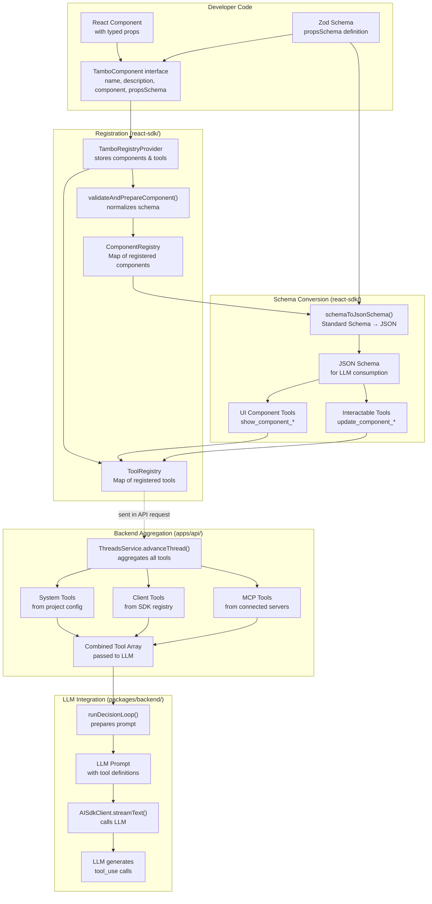
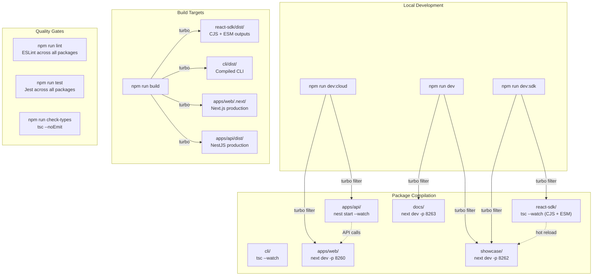
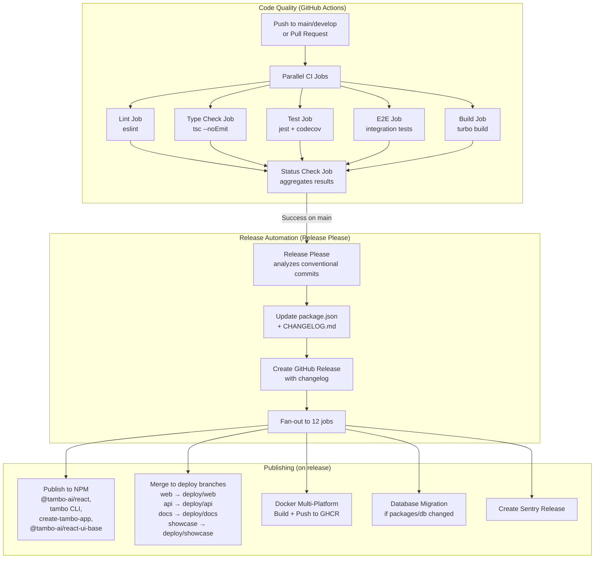

<!-- source: DeepWiki mcp.deepwiki.com · repo tambo-ai/tambo · page 1 Overview · fetched 2026-10-29 -->

# Overview

<details>
<summary>Relevant source files</summary>

The following files were used as context for generating this wiki page:

- [.config/release-please/.release-please-manifest.json](.config/release-please/.release-please-manifest.json)
- [README.md](README.md)
- [apps/api/CHANGELOG.md](apps/api/CHANGELOG.md)
- [apps/api/package.json](apps/api/package.json)
- [apps/docs-mcp/package.json](apps/docs-mcp/package.json)
- [apps/test-mcp-server/package.json](apps/test-mcp-server/package.json)
- [apps/web/CHANGELOG.md](apps/web/CHANGELOG.md)
- [apps/web/package.json](apps/web/package.json)
- [cli/CHANGELOG.md](cli/CHANGELOG.md)
- [cli/README.md](cli/README.md)
- [cli/package.json](cli/package.json)
- [cli/src/templates/tambo-template.ts](cli/src/templates/tambo-template.ts)
- [create-tambo-app/CHANGELOG.md](create-tambo-app/CHANGELOG.md)
- [create-tambo-app/README.md](create-tambo-app/README.md)
- [create-tambo-app/package.json](create-tambo-app/package.json)
- [docs/CHANGELOG.md](docs/CHANGELOG.md)
- [docs/package.json](docs/package.json)
- [package-lock.json](package-lock.json)
- [package.json](package.json)
- [packages/backend/package.json](packages/backend/package.json)
- [packages/core/package.json](packages/core/package.json)
- [packages/eslint-config/package.json](packages/eslint-config/package.json)
- [packages/react-ui-base/CHANGELOG.md](packages/react-ui-base/CHANGELOG.md)
- [packages/react-ui-base/package.json](packages/react-ui-base/package.json)
- [packages/testing/package.json](packages/testing/package.json)
- [packages/ui-registry/package.json](packages/ui-registry/package.json)
- [react-sdk/AGENTS.md](react-sdk/AGENTS.md)
- [react-sdk/CHANGELOG.md](react-sdk/CHANGELOG.md)
- [react-sdk/README.md](react-sdk/README.md)
- [react-sdk/package.json](react-sdk/package.json)
- [showcase/CHANGELOG.md](showcase/CHANGELOG.md)
- [showcase/README.md](showcase/README.md)
- [showcase/package.json](showcase/package.json)

</details>


Tambo AI is an open-source generative UI toolkit for React that enables AI agents to dynamically render UI components based on natural language conversations. The system consists of a React SDK, backend API infrastructure, and tooling for component management.

This page introduces the high-level architecture and main components. For detailed information about specific subsystems, see:
- [Key Concepts](#1.1) - Core abstractions (generative UI, components, tools, threads)
- [Repository Structure](#1.2) - Monorepo layout and package organization
- [Architecture Overview](#1.3) - System-wide data flow and component interactions

## What is Tambo?

Tambo is a generative UI framework where React components are registered as tools that an AI agent can invoke. Developers define components with Zod schemas using the `TamboComponent` interface, and the AI orchestrates rendering by calling `show_component_*` tools during conversations.

**Core Flow:**
1. Developer wraps app with `TamboProvider` from `@tambo-ai/react`, passing `components` array
2. User sends message via `useTamboThreadInput` hook
3. Backend calls LLM with component schemas as tool definitions
4. LLM invokes tools like `show_component_Graph(data: [...], type: "bar")`
5. React SDK receives streamed events and renders `<Graph>` with props
6. Component state persists in thread history for context

Sources: [README.md:38-60](), [react-sdk/README.md:20-70]()

## Repository Scope

This monorepo contains both **public packages** (published to npm) and **private cloud infrastructure** (Tambo Cloud platform). The repository is organized using npm workspaces with Turbo for build orchestration.

**Public Packages:**
- `@tambo-ai/react` - React SDK at [react-sdk/]()
- `tambo` - CLI tool at [cli/]()
- `create-tambo-app` - Project scaffolder at [create-tambo-app/]()
- `@tambo-ai/ui-registry` - Pre-built component library at [packages/ui-registry/]()

**Cloud Platform (Private):**
- `@tambo-ai-cloud/web` - Next.js dashboard at [apps/web/]()
- `@tambo-ai-cloud/api` - NestJS API at [apps/api/]()
- `@tambo-ai-cloud/backend` - LLM integration layer at [packages/backend/]()
- `@tambo-ai-cloud/db` - Database schema and operations at [packages/db/]()
- `@tambo-ai-cloud/core` - Shared types at [packages/core/]()

Sources: [package.json:40-48](), [.release-please-manifest.json:1-1]()

## System Architecture Overview

**Tambo System Architecture**



The system consists of three main layers:

1. **Developer Interface** - `tambo` CLI for component management, `create-tambo-app` for project scaffolding, and `@tambo-ai/showcase` demonstrating pre-built components
2. **React SDK** - Nested provider architecture in `@tambo-ai/react` handling component registry, event streaming, and MCP integration
3. **Backend Infrastructure** - NestJS API with `ThreadsService` orchestrating LLM calls through `ITamboBackend` abstraction layer, persisting state to PostgreSQL

Sources: [package-lock.json:1-50](), [react-sdk/src/providers/tambothreadprovider.tsx](), [apps/api/src/v1/v1.service.ts](), [apps/api/src/threads/threads.service.ts]()

## Deployment Modes

Tambo supports two deployment architectures:

**Deployment Architecture Comparison**



**Cloud Mode** (Default):
- User sets `apiKey` prop in `TamboProvider` from [react-sdk/src/providers/tamboprovider.tsx:1-100]()
- SDK connects to `https://api.tambo.co` via `@tambo-ai/typescript-sdk`
- Backend managed by Tambo Cloud at [apps/api/]()
- User provides LLM API keys via dashboard at [apps/web/]()

**Self-Hosted Mode**:
- User sets `apiUrl` prop in `TamboProvider` to custom backend
- Backend runs via Docker using [apps/api/]() and [packages/backend/]()
- User manages PostgreSQL database using schema from [packages/db/]()
- User provides LLM API keys via environment variables

Both modes use the same React SDK (`@tambo-ai/react`) and backend code (`@tambo-ai-cloud/backend`). The key difference is who manages the infrastructure.

Sources: [README.md:52-70](), [react-sdk/package.json:1-127](), [apps/api/package.json:1-99]()

## Main Components

**Component Interaction Flow**



### React SDK (`@tambo-ai/react`)

Entry point is `TamboProvider` at [react-sdk/src/providers/tamboprovider.tsx]() which nests multiple context providers:

- `TamboClientProvider` - Manages API client and authentication
- `TamboRegistryProvider` - Stores registered `components` and `tools` arrays
- `TamboStreamProvider` - Maintains `streamReducer` for event accumulation
- `TamboMcpProvider` - Handles MCP server connections
- `TamboThreadInputProvider` - Manages shared input state

Core hook is `useTambo()` from [react-sdk/src/hooks/usetambo.ts]() which aggregates state from all providers.

### Backend API (`apps/api`)

Entry point is `V1Controller` at [apps/api/src/v1/v1.controller.ts]() exposing REST and SSE endpoints:

- `POST /v1/threads/:id/runs` - Starts a new run with SSE streaming
- `V1Service.advanceThreadStreaming()` - Delegates to `ThreadsService`
- `ThreadsService.executeRun()` at [apps/api/src/threads/threads.service.ts]() - Core orchestration
- Uses optimistic locking via `acquireRunLock()` to prevent concurrent runs
- Streams events through `AsyncQueue<StreamQueueItem>` back to client

### LLM Backend (`packages/backend`)

Abstraction layer over LLM providers:

- `ITamboBackend` interface at [packages/backend/src/services/backend.ts]() - Provider abstraction
- `runDecisionLoop()` at [packages/backend/src/services/decision-loop.ts]() - AI decision engine
- `AISdkClient` at [packages/backend/src/services/llm/ai-sdk-client.ts]() - Multi-provider client using Vercel AI SDK
- `ComponentStreamTracker` at [packages/backend/src/services/llm/component-stream-tracker.ts]() - Incremental JSON parsing
- Supports OpenAI, Anthropic, Google, Groq, Mistral via provider adapters

### Data Layer (`packages/db`)

Database schema and operations using Drizzle ORM:

- `threads` table at [packages/db/src/schema/threads.ts]() - Conversation state
- `messages` table at [packages/db/src/schema/messages.ts]() - Chat history
- `operations.thread` at [packages/db/src/operations/thread.ts]() - Thread CRUD with locking
- `operations.message` at [packages/db/src/operations/message.ts]() - Message persistence
- Uses PostgreSQL with optimistic locking to prevent race conditions

Sources: [react-sdk/src/providers/tambothreadprovider.tsx](), [apps/api/src/v1/v1.service.ts](), [apps/api/src/threads/threads.service.ts](), [packages/backend/src/services/decision-loop.ts](), [packages/db/src/operations/]()

## Technology Stack

| Layer | Technology | Key Packages | Purpose |
|-------|-----------|--------------|---------|
| **React SDK** | React 18 | `@tambo-ai/react` at [react-sdk/]() | Component registration and streaming |
| **State Management** | React Context + Reducers | `streamReducer` at [react-sdk/src/v1/utils/eventaccumulator.ts]() | Immutable event accumulation |
| **API Client** | TanStack Query 5 | Used in [react-sdk/src/hooks/]() | HTTP calls and caching |
| **Backend Framework** | NestJS 11 | `@tambo-ai-cloud/api` at [apps/api/]() | API server with dependency injection |
| **LLM SDK** | Vercel AI SDK 5 | `AISdkClient` at [packages/backend/src/services/llm/ai-sdk-client.ts]() | Multi-provider streaming |
| **Database ORM** | Drizzle ORM 0.45 | Schema at [packages/db/src/schema/]() | Type-safe PostgreSQL queries |
| **Database** | PostgreSQL | Tables: `threads`, `messages`, `runs` | Conversation state persistence |
| **Schema Validation** | Zod 3/4 | Component `propsSchema` definitions | Runtime type validation |
| **Build Tool** | Turbo 2.8 | Config at [turbo.json]() | Monorepo task orchestration |
| **Package Manager** | npm 11 | Workspaces at [package.json:40-48]() | Dependency management |
| **Type Safety** | TypeScript 5.9 | Configs in `packages/typescript-config` | Static type checking |
| **MCP Integration** | MCP SDK 1.26 | `TamboMcpProvider` at [react-sdk/src/mcp/tambomcpprovider.tsx]() | External tool integration |

Sources: [package.json:28-43](), [react-sdk/package.json:78-93](), [apps/api/package.json:27-76](), [packages/backend/package.json:26-56]()

## End-to-End Message Flow

**Complete Roundtrip: User Input → AI → UI Update**

```mermaid
sequenceDiagram
    participant User
    participant useTamboThreadInput["useTamboThreadInput<br/>react-sdk/"]
    participant streamReducer["streamReducer<br/>Event Accumulator"]
    participant V1Service["V1Service<br/>apps/api/"]
    participant ThreadsService["ThreadsService<br/>apps/api/"]
    participant runDecisionLoop["runDecisionLoop<br/>packages/backend/"]
    participant AISdkClient["AISdkClient<br/>packages/backend/"]
    participant LLM["LLM Provider"]
    participant ComponentTracker["ComponentStreamTracker<br/>packages/backend/"]
    
    User->>useTamboThreadInput: Type message + submit
    useTamboThreadInput->>streamReducer: Dispatch synthetic user message
    streamReducer->>useTamboThreadInput: Update thread state (optimistic)
    
    useTamboThreadInput->>V1Service: POST /threads/:id/runs (SSE)
    V1Service->>ThreadsService: advanceThreadStreaming()
    ThreadsService->>ThreadsService: acquireRunLock(IDLE → WAITING)
    ThreadsService->>runDecisionLoop: advanceThread(messages, tools)
    
    runDecisionLoop->>AISdkClient: streamText(prompt, tools)
    AISdkClient->>LLM: Stream completion request
    
    loop Streaming Events
        LLM-->>AISdkClient: Content delta / Tool call
        AISdkClient->>ComponentTracker: Parse JSON incrementally
        ComponentTracker->>runDecisionLoop: DecisionStreamItem event
        runDecisionLoop->>ThreadsService: Yield event
        ThreadsService->>V1Service: Push to AsyncQueue
        V1Service-->>streamReducer: SSE event
        streamReducer->>streamReducer: Accumulate in thread state
        streamReducer->>User: Re-render with partial data
    end
    
    alt Tool Call Required
        LLM-->>runDecisionLoop: TOOL_CALL_START event
        runDecisionLoop->>ThreadsService: awaiting_input status
        ThreadsService->>V1Service: Set status = "waiting"
        V1Service-->>useTamboThreadInput: awaiting_input SSE
        useTamboThreadInput->>useTamboThreadInput: Execute client-side tool
        useTamboThreadInput->>V1Service: POST with tool_result
        V1Service->>ThreadsService: Continue run
        ThreadsService->>runDecisionLoop: Resume with results
        runDecisionLoop->>AISdkClient: Continue stream
    end
    
    LLM-->>runDecisionLoop: RUN_FINISHED
    runDecisionLoop->>ThreadsService: Complete
    ThreadsService->>ThreadsService: releaseRunLock(STREAMING → IDLE)
    ThreadsService->>V1Service: Final events
    V1Service-->>streamReducer: RUN_FINISHED SSE
    streamReducer->>User: Set status = "idle"
```

Key steps in the flow:

1. **Optimistic UI Update** - `streamReducer` at [react-sdk/src/v1/utils/eventaccumulator.ts]() dispatches synthetic event before API responds
2. **Run Lock Acquisition** - `acquireRunLock()` in [apps/api/src/threads/threads.service.ts]() prevents concurrent runs per thread
3. **LLM Streaming** - `AISdkClient` at [packages/backend/src/services/llm/ai-sdk-client.ts]() streams via Vercel AI SDK
4. **Incremental Parsing** - `ComponentStreamTracker` at [packages/backend/src/services/llm/component-stream-tracker.ts]() parses partial JSON for component props
5. **Event Accumulation** - `streamReducer` accumulates events immutably, updating UI progressively
6. **Tool Execution** - For tool calls, stream pauses with `awaiting_input`, client executes tool, then resumes
7. **Lock Release** - `releaseRunLock()` ensures only one run active per thread

Sources: [react-sdk/src/v1/utils/eventaccumulator.ts](), [apps/api/src/v1/v1.service.ts](), [apps/api/src/threads/threads.service.ts](), [packages/backend/src/services/decision-loop.ts]()

## Component & Tool Registration

**Registration and Execution Pipeline**



Registration follows a multi-stage pipeline:

1. **Component Definition** - Developer creates component with `TamboComponent` interface at [react-sdk/src/types/component.ts]()
   - `name` - Unique identifier
   - `description` - What the component does
   - `component` - React component function
   - `propsSchema` - Zod/Valibot/ArkType schema

2. **Validation** - `validateAndPrepareComponent()` at [react-sdk/src/providers/tambothreadprovider.tsx]() normalizes schemas to Standard Schema format

3. **Schema Conversion** - `schemaToJsonSchema()` at [react-sdk/src/utils/schema-to-json-schema.ts]() converts to JSON Schema for LLM consumption

4. **Tool Generation** - Components become `show_component_*` tools automatically. Interactable components (wrapped with `withTamboInteractable`) get `update_component_*` tools at [react-sdk/src/providers/tambointeractableprovider.tsx]()

5. **Backend Aggregation** - `ThreadsService.advanceThread()` at [apps/api/src/threads/threads.service.ts]() combines:
   - System tools from project config
   - Client tools from SDK registry (sent with request)
   - MCP tools from connected servers
   - UI component tools (show/update)

6. **LLM Invocation** - `runDecisionLoop()` at [packages/backend/src/services/decision-loop.ts]() includes all tools in the prompt, and LLM generates `tool_use` calls

Sources: [react-sdk/src/providers/tambothreadprovider.tsx](), [react-sdk/src/utils/schema-to-json-schema.ts](), [apps/api/src/threads/threads.service.ts](), [packages/backend/src/services/decision-loop.ts]()

## Development Workflow

**Build and Development Pipeline**



**Common Commands:**

| Command | Purpose | Turbo Filters |
|---------|---------|---------------|
| `npm run dev` | Start showcase + docs | `--filter=@tambo-ai/showcase --filter=@tambo-ai/docs` |
| `npm run dev:sdk` | React SDK development | `--filter=@tambo-ai/react --filter=@tambo-ai/showcase` |
| `npm run dev:cloud` | Cloud platform development | `--filter=@tambo-ai-cloud/web --filter=@tambo-ai-cloud/api` |
| `npm run build` | Build all packages | Runs `turbo build` with dependency graph |
| `npm run test` | Run all tests | `turbo test` |
| `npm run lint` | Lint all packages | `turbo lint` |

The React SDK compiles to both CommonJS (`dist/`) and ESM (`esm/`) at [react-sdk/package.json:32-43]() for maximum compatibility.

Sources: [package.json:5-29](), [react-sdk/package.json:32-51](), [apps/web/package.json:7-18](), [apps/api/package.json:8-26]()

## CI/CD and Release Process

**Release Automation Pipeline**



**Version Management:**

| Package | Current Version | Published | Changelog |
|---------|----------------|-----------|-----------|
| `@tambo-ai/react` | 1.0.0 | npm | [react-sdk/CHANGELOG.md]() |
| `tambo` | 0.51.0 | npm | [cli/CHANGELOG.md]() |
| `create-tambo-app` | 0.2.3 | npm | [create-tambo-app/CHANGELOG.md]() |
| `@tambo-ai/react-ui-base` | 0.1.0-alpha.3 | npm | [packages/react-ui-base/CHANGELOG.md]() |
| `@tambo-ai/showcase` | 0.37.0 | Private | [showcase/CHANGELOG.md]() |
| `@tambo-ai/docs` | 1.26.1 | Private | [docs/CHANGELOG.md]() |
| `@tambo-ai-cloud/web` | 0.132.1 | Private | [apps/web/CHANGELOG.md]() |
| `@tambo-ai-cloud/api` | 0.143.0 | Private | [apps/api/CHANGELOG.md]() |

Release process:
1. Conventional commits trigger Release Please (e.g., `feat:`, `fix:`, `chore:`)
2. Release Please creates PR with version bumps and changelogs
3. On merge to `main`, GitHub Actions publishes packages
4. Database migrations run automatically if schema changes detected at [packages/db/]()
5. Deploy branches trigger Vercel/container deployments

Sources: [.release-please-manifest.json:1-1](), [.github/workflows/releaseplease.yml](), [react-sdk/CHANGELOG.md:1-10](), [cli/CHANGELOG.md:1-10]()

## Getting Started

New users typically interact with Tambo through:

1. **`npx create-tambo-app`** - Creates a new project from templates
2. **`npx tambo init`** - Initializes Tambo in an existing project (creates `tambo.ts`, sets up env vars)
3. **`npx tambo add <component>`** - Installs pre-built components from the CLI registry

Developers building with Tambo should read:
- [Getting Started](#2) - Initial setup and authentication
- [React SDK](#3) - Provider setup and hooks API
- [UI Components](#4) - Pre-built chat components
- [MCP Integration](#6) - Connecting external data sources

Sources: [README.md:50-70](), [create-tambo-app/](), [cli/]()

---

