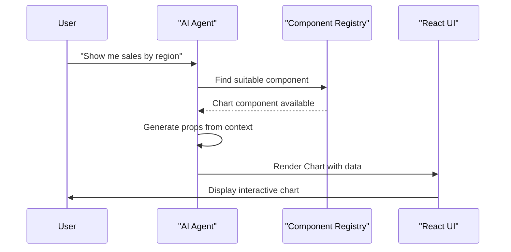
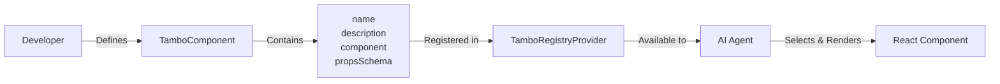
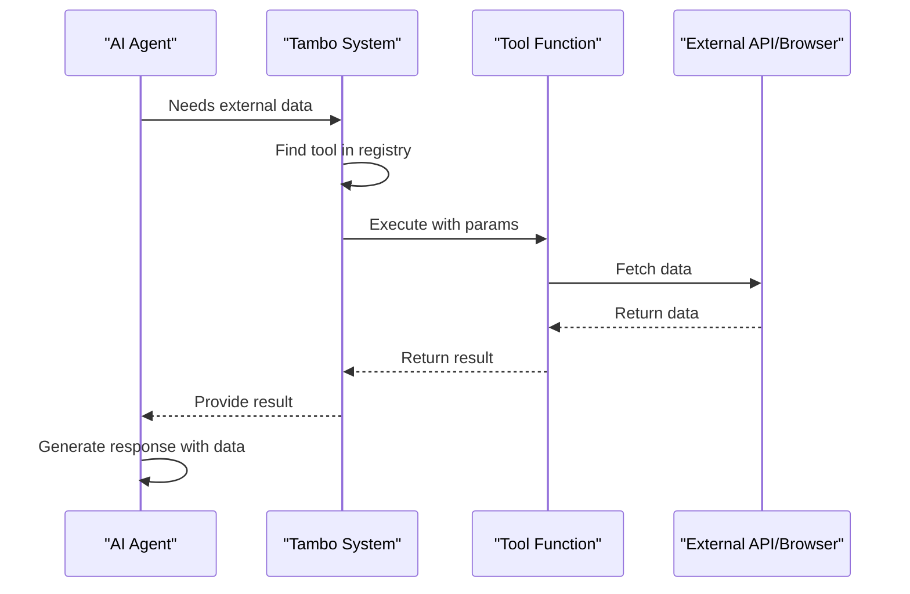
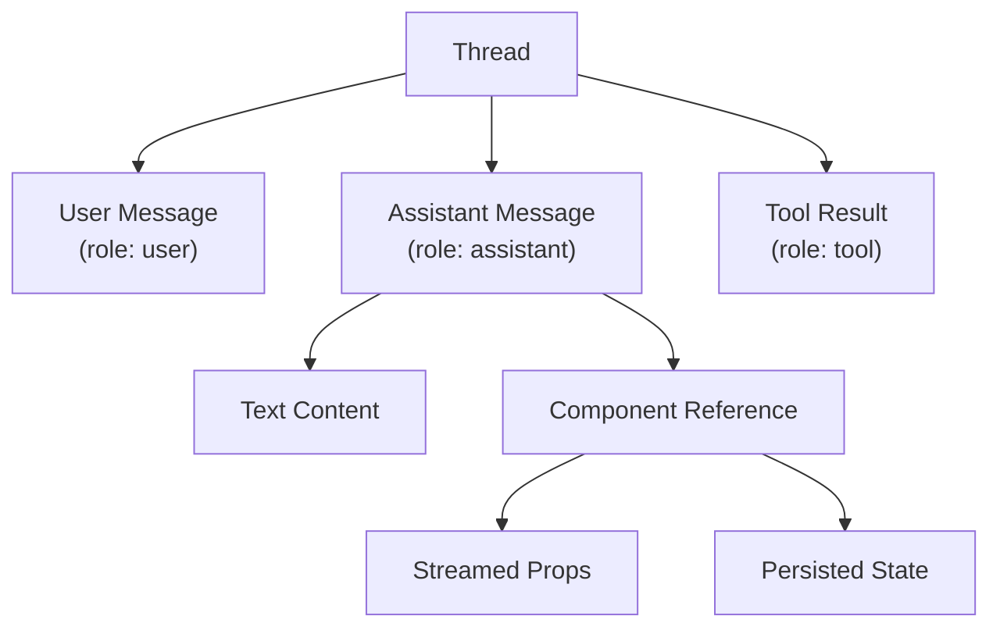
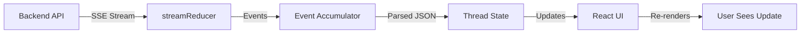
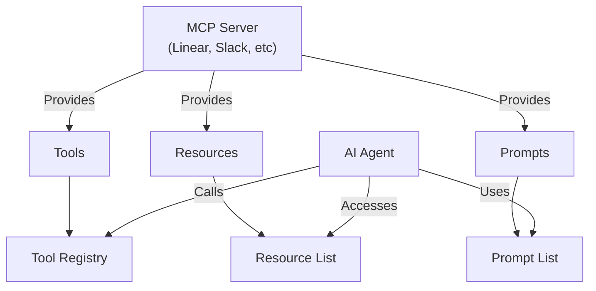
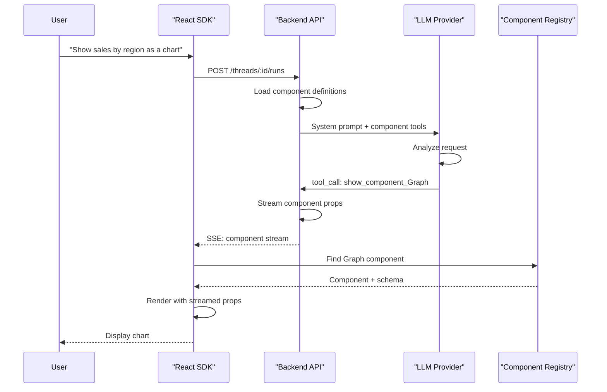
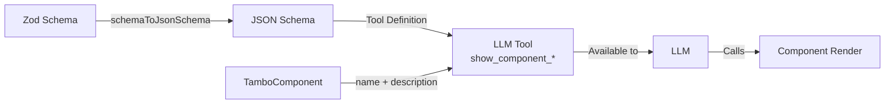
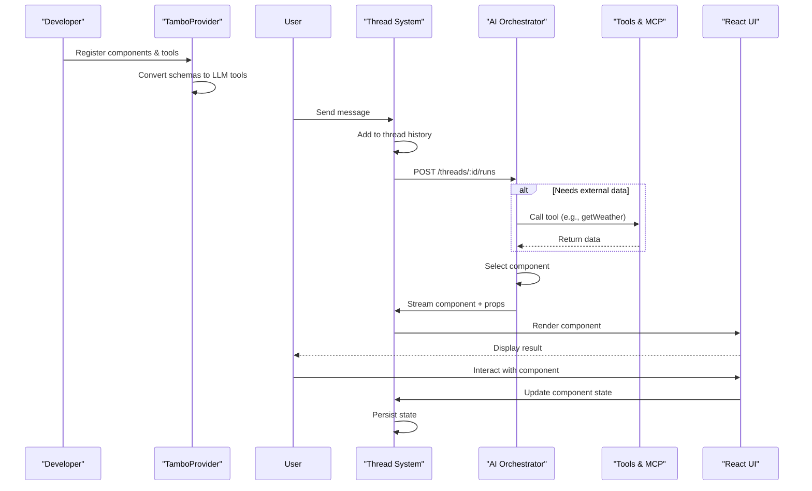

<!-- source: DeepWiki mcp.deepwiki.com · repo tambo-ai/tambo · page 1.1 Key Concepts · fetched 2026-10-29 -->

# Key Concepts

<details>
<summary>Relevant source files</summary>

The following files were used as context for generating this wiki page:

- [README.md](README.md)
- [cli/README.md](cli/README.md)
- [cli/src/templates/tambo-template.ts](cli/src/templates/tambo-template.ts)
- [create-tambo-app/README.md](create-tambo-app/README.md)
- [react-sdk/AGENTS.md](react-sdk/AGENTS.md)
- [react-sdk/README.md](react-sdk/README.md)
- [react-sdk/src/hooks/react-query-hooks.ts](react-sdk/src/hooks/react-query-hooks.ts)
- [react-sdk/src/index.ts](react-sdk/src/index.ts)
- [react-sdk/src/model/component-metadata.ts](react-sdk/src/model/component-metadata.ts)
- [react-sdk/src/providers/tambo-registry-provider.tsx](react-sdk/src/providers/tambo-registry-provider.tsx)
- [react-sdk/src/util/registry.ts](react-sdk/src/util/registry.ts)
- [react-sdk/src/util/tool-caller.ts](react-sdk/src/util/tool-caller.ts)
- [showcase/README.md](showcase/README.md)

</details>


This page explains the core concepts and terminology used throughout Tambo AI. Understanding these concepts is essential for building AI-powered generative UI applications with Tambo.

## Generative UI

Generative UI is the core concept behind Tambo AI. Unlike traditional UIs where developers manually code which components to show in which conditions, generative UI allows the AI to dynamically decide which components to render and with what data, based on the user's natural language input.

**Generative UI Flow**



Sources: [README.md:38-58](), [README.md:82-124]()

In Tambo, the AI acts as an orchestrator that:
1. Receives natural language requests from users
2. Selects appropriate components from a registry
3. Generates component props based on context and data
4. Streams the rendered components to the user interface

This approach enables UIs that adapt to user intent rather than following predefined navigation paths.

## Components

Components are React UI elements that the AI can render as part of its responses. Tambo supports two types of components, each serving different use cases.

### Generative Components

Generative components render once in response to a message. They are suitable for displaying information like charts, summaries, or data visualizations.

```typescript
const components: TamboComponent[] = [
  {
    name: "Graph",
    description: "Displays data as charts using Recharts library",
    component: Graph,
    propsSchema: z.object({
      data: z.array(z.object({ name: z.string(), value: z.number() })),
      type: z.enum(["line", "bar", "pie"]),
    }),
  },
];
```

Sources: [README.md:86-104]()

When a user asks "Show me sales by region", the AI:
1. Identifies that `Graph` is suitable for this request
2. Fetches or generates the sales data
3. Calls the component with appropriate props (data array, chart type)
4. Renders the component in the message thread

### Interactable Components

Interactable components persist across messages and can be updated as users refine their requests. These are ideal for shopping carts, task boards, spreadsheets, or any stateful UI.

```typescript
const InteractableNote = withInteractable(Note, {
  componentName: "Note",
  description: "A note supporting title, content, and color modifications",
  propsSchema: z.object({
    title: z.string(),
    content: z.string(),
    color: z.enum(["white", "yellow", "blue", "green"]).optional(),
  }),
});
```

Sources: [README.md:106-122]()

Interactable components:
- Persist their state across conversation turns
- Can be modified by subsequent AI interactions
- Use `withInteractable` HOC for AI update capabilities
- Maintain a unique ID for state tracking

**Component Registration System**



Sources: [react-sdk/src/providers/tambo-registry-provider.tsx:145-289](), [react-sdk/src/model/component-metadata.ts:274-337]()

Each registered component includes:
- **name**: Unique identifier for the component
- **description**: Explains to the AI when and how to use it
- **component**: The React component reference
- **propsSchema**: Zod schema defining valid props (converted to JSON Schema for the AI)

## Tools

Tools are functions that the AI can call to perform actions or fetch data that's outside its knowledge. Tools execute in the browser and can access local state, make authenticated API calls, or interact with the DOM.

**Tool Definition**

```typescript
const tools: TamboTool[] = [
  {
    name: "getWeather",
    description: "Fetches weather for a location",
    tool: async (params: { location: string }) =>
      fetch(`/api/weather?q=${encodeURIComponent(params.location)}`).then((r) =>
        r.json(),
      ),
    inputSchema: z.object({
      location: z.string(),
    }),
    outputSchema: z.object({
      temperature: z.number(),
      condition: z.string(),
      location: z.string(),
    }),
  },
];
```

Sources: [README.md:182-208]()

**Tool Execution Flow**



Sources: [react-sdk/src/util/tool-caller.ts:15-59](), [react-sdk/src/providers/tambo-registry-provider.tsx:189-220]()

Tools enable the AI to:
- Fetch real-time data from APIs
- Access browser-specific functionality (localStorage, geolocation)
- Interact with authenticated endpoints using user credentials
- Perform actions that require React state or context

Tools are registered via the `tools` prop on `TamboProvider` and stored in the tool registry. The AI decides when to call tools based on their descriptions and the current conversation context.

## Threads

A thread represents a conversation between a user and the AI. Threads maintain message history, component state, and conversation context.

**Thread Structure**

| Property | Type | Description |
|----------|------|-------------|
| `id` | string | Unique thread identifier |
| `messages` | Message[] | Ordered list of messages |
| `createdAt` | timestamp | Thread creation time |
| `status` | enum | Current generation status (idle, streaming, waiting) |
| `componentState` | object | Persisted component state across messages |

Sources: [react-sdk/src/providers/tambo-thread-provider.tsx:29-82]()

**Message Types in Threads**



Sources: [react-sdk/src/providers/tambo-thread-provider.tsx:365-478]()

Threads support:
- **Message History**: Full conversation context for the AI
- **Component Persistence**: Interactable components maintain state across messages
- **Multi-turn Conversations**: Context carries over between user interactions
- **Thread Switching**: Users can navigate between different conversations

Threads are managed through hooks like `useTamboThread()` and `useTamboThreadInput()`, which handle message submission and state updates.

## Streaming

Streaming is a core feature of Tambo that enables real-time UI updates as the AI generates responses. Rather than waiting for the complete response, users see progressive updates as content is generated.

**What Gets Streamed**

| Stream Type | Description | Example |
|-------------|-------------|---------|
| Text Content | Characters stream as AI generates | "Analyzing sales data..." appears word by word |
| Component Props | Props update incrementally | Chart data points populate one by one |
| Tool Results | Tool execution results stream | Weather data appears as fetched |
| Status Updates | Generation state changes | "Fetching data..." → "Rendering chart..." |

Sources: [README.md:50-56](), [react-sdk/src/v1/utils/eventaccumulator.ts:1-200]()

**Streaming Architecture**



Sources: [react-sdk/src/v1/utils/eventaccumulator.ts:1-200]()

The streaming system uses:
- **Server-Sent Events (SSE)**: Backend streams events to the client
- **streamReducer**: Accumulates events and manages state immutably
- **Incremental JSON Parsing**: Parses partial component props as they arrive
- **Optimistic Updates**: Shows user messages immediately before server confirms

Streaming enables progressive loading experiences where users see activity happening in real-time, improving perceived responsiveness and allowing them to start interacting with partial results.

## Model Context Protocol (MCP)

MCP is an open protocol that enables AI applications to securely connect to external data sources and tools. Tambo has built-in MCP support, allowing connections to services like Linear, Slack, databases, or custom MCP servers.

**MCP Integration**

```typescript
import { MCPTransport } from "@tambo-ai/react/mcp";

const mcpServers = [
  {
    name: "filesystem",
    url: "http://localhost:8261/mcp",
    transport: MCPTransport.HTTP,
  },
];

<TamboProvider components={components} mcpServers={mcpServers}>
  <App />
</TamboProvider>;
```

Sources: [README.md:157-175]()

**MCP Capabilities**



Sources: [react-sdk/src/mcp/tambomcpprovider.tsx:1-200]()

MCP servers expose:
- **Tools**: Functions the AI can call (e.g., create Linear issue, send Slack message)
- **Resources**: Data the AI can read (e.g., file contents, database records)
- **Prompts**: Pre-defined prompt templates for common tasks

Tambo's MCP support includes:
- Automatic tool registration from connected servers
- Resource browsing via `useTamboMcpResourceList()`
- Prompt discovery via `useTamboMcpPromptList()`
- Client-side and server-side MCP connections
- Support for HTTP, SSE, and WebSocket transports

MCP enables the AI to interact with external systems without custom integration code, making it easy to extend AI capabilities.

## How the AI Orchestrates UI Rendering

Understanding how the AI decides what to render is key to building effective generative UI applications.

**AI Orchestration Flow**



Sources: [apps/api/src/threads/threads.service.ts:1-800](), [apps/api/src/v1/v1.service.ts:1-400]()

**Component Selection Process**

The AI selects components through a multi-step process:

1. **Component Registration**: All registered components are converted to LLM "tools" with their schemas
2. **System Prompt**: The backend sends component definitions to the LLM as available functions
3. **Intent Analysis**: The LLM analyzes user intent and available components
4. **Tool Call**: The LLM generates a `tool_call` for the appropriate component (e.g., `show_component_Graph`)
5. **Prop Generation**: The LLM streams the component props based on its schema
6. **Rendering**: The React SDK receives the component name and props, then renders it

Sources: [react-sdk/src/providers/tambo-registry-provider.tsx:253-289](), [react-sdk/src/util/registry.ts:24-51]()

**Schema-to-Tool Conversion**



Sources: [react-sdk/src/schema/index.ts:1-100](), [react-sdk/src/util/registry.ts:70-88]()

The AI orchestration process enables:
- **Dynamic Component Selection**: AI picks the right component for each request
- **Data-Driven Rendering**: Props are generated from conversation context and tool results
- **Multi-Component Responses**: AI can render multiple components in a single response
- **Context-Aware Updates**: Interactable components update based on follow-up messages

This orchestration model allows developers to focus on building components while the AI handles when and how to use them.

## Putting It All Together

Here's how all the key concepts work together in a typical Tambo application:

**Complete System Flow**



Sources: [README.md:82-154](), [react-sdk/src/providers/tambo-thread-provider.tsx:365-597]()

**The Development Model**

1. **Define**: Developers define components with Zod schemas
2. **Register**: Components and tools are registered with `TamboProvider`
3. **Convert**: Schemas are converted to JSON Schema for the LLM
4. **Interact**: Users send natural language messages
5. **Orchestrate**: AI selects components and generates props
6. **Stream**: Props stream incrementally to the UI
7. **Render**: React renders components with streamed props
8. **Persist**: Interactable components maintain state across messages

Sources: [react-sdk/src/providers/tambo-registry-provider.tsx:145-382](), [README.md:38-124]()

This unified model allows developers to build AI-powered UIs by:
- Focusing on component design rather than navigation logic
- Letting the AI handle component selection and orchestration
- Leveraging tools for external data access
- Using MCP for standardized integrations
- Streaming updates for responsive user experiences

## Summary

Tambo AI provides a comprehensive framework for building AI-powered React applications with these key concepts:

- **Provider Architecture**: Hierarchical structure of specialized providers
- **Thread Management**: Conversation context and message handling
- **Component Registry**: Dynamic UI generation through registered components
- **Tool Integration**: External data access and actions 
- **State Management**: Persistent state for AI-generated components
- **Hooks API**: Specialized React hooks for all functionality
- **UI Components**: Ready-to-use interface components
- **CLI Tooling**: Command-line utilities for project management

Understanding these concepts provides the foundation needed to build sophisticated AI assistants and agents in React.

---

