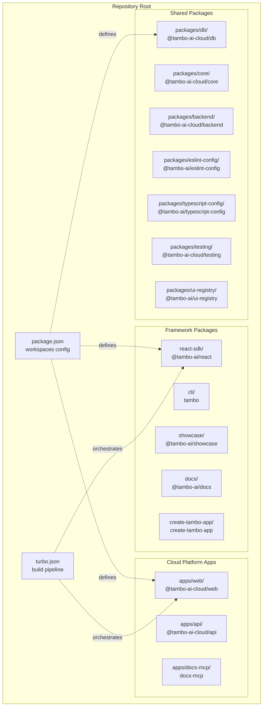
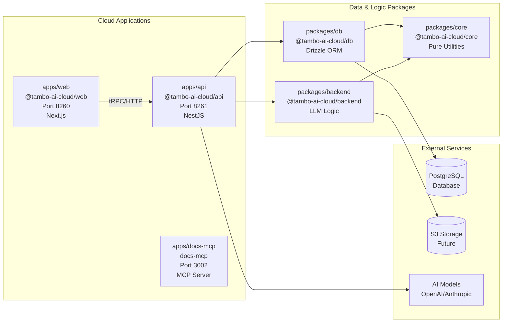
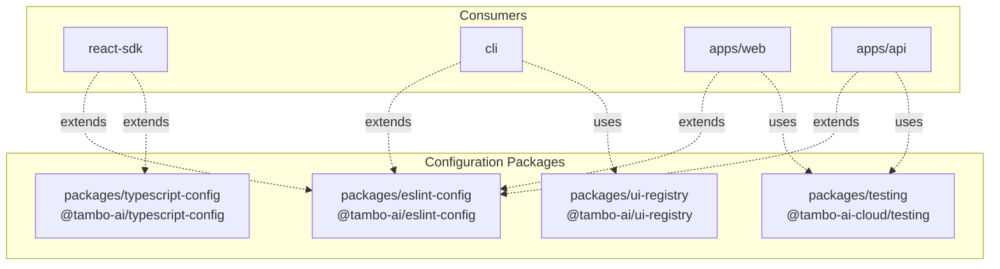
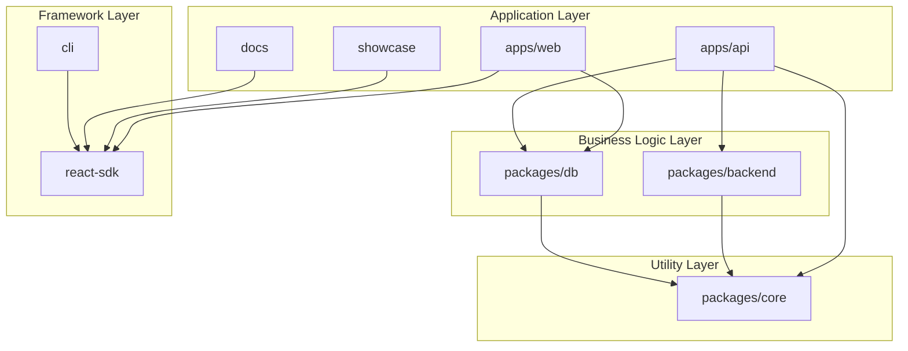

<!-- source: DeepWiki mcp.deepwiki.com · repo tambo-ai/tambo · page 1.2 Repository Structure · fetched 2026-10-29 -->

# Repository Structure

Relevant source files

The following files were used as context for generating this wiki page:

- [.config/release-please/.release-please-manifest.json](.config/release-please/.release-please-manifest.json)
- [apps/api/CHANGELOG.md](apps/api/CHANGELOG.md)
- [apps/api/package.json](apps/api/package.json)
- [apps/docs-mcp/package.json](apps/docs-mcp/package.json)
- [apps/test-mcp-server/package.json](apps/test-mcp-server/package.json)
- [apps/web/CHANGELOG.md](apps/web/CHANGELOG.md)
- [apps/web/package.json](apps/web/package.json)
- [cli/CHANGELOG.md](cli/CHANGELOG.md)
- [cli/package.json](cli/package.json)
- [create-tambo-app/CHANGELOG.md](create-tambo-app/CHANGELOG.md)
- [create-tambo-app/package.json](create-tambo-app/package.json)
- [docs/CHANGELOG.md](docs/CHANGELOG.md)
- [docs/package.json](docs/package.json)
- [package-lock.json](package-lock.json)
- [package.json](package.json)
- [packages/backend/package.json](packages/backend/package.json)
- [packages/core/package.json](packages/core/package.json)
- [packages/eslint-config/package.json](packages/eslint-config/package.json)
- [packages/react-ui-base/CHANGELOG.md](packages/react-ui-base/CHANGELOG.md)
- [packages/react-ui-base/package.json](packages/react-ui-base/package.json)
- [packages/testing/package.json](packages/testing/package.json)
- [packages/ui-registry/package.json](packages/ui-registry/package.json)
- [react-sdk/CHANGELOG.md](react-sdk/CHANGELOG.md)
- [react-sdk/package.json](react-sdk/package.json)
- [showcase/CHANGELOG.md](showcase/CHANGELOG.md)
- [showcase/package.json](showcase/package.json)

This document describes the organization of the Tambo AI monorepo, explaining how framework packages, cloud platform components, and shared utilities are structured across the codebase. For information about key concepts like generative UI and threads, see [Key Concepts](#1.1). For development setup instructions, see [Getting Started](#2).

## Monorepo Organization

The Tambo repository is a Turborepo-based monorepo that contains two distinct product tiers: the **Tambo AI Framework** (publicly distributed npm packages) and the **Tambo Cloud Platform** (hosted SaaS infrastructure). This separation allows the framework to be used independently while also powering the cloud platform.

The repository uses npm workspaces with the following workspace configuration:

| Workspace Pattern | Purpose | Examples |
|------------------|---------|----------|
| `react-sdk` | React SDK package | `@tambo-ai/react` |
| `cli` | Command-line tool | `tambo` |
| `showcase` | Demo application | `@tambo-ai/showcase` |
| `docs` | Documentation site | `@tambo-ai/docs` |
| `create-tambo-app` | Project bootstrapper | `create-tambo-app` |
| `packages/*` | Shared utilities | `@tambo-ai-cloud/db`, `@tambo-ai-cloud/core` |
| `apps/*` | Cloud platform apps | `@tambo-ai-cloud/web`, `@tambo-ai-cloud/api` |

**Sources:** [package.json:1-66](), [package-lock.json:1-31](), [AGENTS.md:1-50]()

## Framework Packages

The framework tier consists of publicly distributed npm packages that developers install to build AI applications. These packages are independent of the cloud platform and can be self-hosted.

### React SDK (`@tambo-ai/react`)

Located in `react-sdk/`, this is the core package providing React hooks, providers, and utilities for building AI-powered applications.

**Build Outputs:**
- CommonJS: `dist/` directory
- ESM: `esm/` directory
- TypeScript declarations: `dist/index.d.ts` and `esm/index.d.ts`

**Package Exports:**
- Main entry: `@tambo-ai/react`
- MCP subpath: `@tambo-ai/react/mcp`

The dual build system ensures compatibility with both modern ESM-based projects and legacy CommonJS environments.

**Sources:** [react-sdk/package.json:1-120](), [package-lock.json:1-31]()

### CLI (`tambo`)

Located in `cli/`, this package provides command-line tools for project scaffolding, component management, and development workflows.

**Key Features:**
- Component registry in `cli/src/registry/` that auto-syncs to `showcase/src/components/tambo/`
- Built as ESM module with executable at `dist/cli.js`
- Commands: `init`, `create-app`, `add`, `update`, `upgrade`

**Build Configuration:**
- TypeScript compilation to `dist/`
- Registry copying via `scripts/copy-registry.ts`

**Sources:** [cli/package.json:1-101](), [AGENTS.md:14-26]()

### Showcase Application (`@tambo-ai/showcase`)

Located in `showcase/`, this Next.js application demonstrates all Tambo components and patterns. It runs on port 8262.

**Component Synchronization:**
Components in `showcase/src/components/tambo/` are auto-synced from `cli/src/registry/`. Edits should be made in the CLI registry, not directly in showcase.

**Build System:**
- Next.js 15+ with App Router
- Tailwind CSS v4
- PostCSS via `@tailwindcss/postcss`

**Sources:** [showcase/package.json:1-94](), [AGENTS.md:23-27]()

### Documentation Site (`@tambo-ai/docs`)

Located in `docs/`, this is a Fumadocs-based documentation site running on port 8263.

**Technology Stack:**
- Fumadocs UI and MDX
- Next.js 15+
- Mermaid diagram support via `@theguild/remark-mermaid`

**Important Note:** This package contains UI components that originated from `cli/`. Any changes to these components should be made in `cli/` first, then duplicated to `docs/`.

**Sources:** [docs/package.json:1-55](), [AGENTS.md:28-36]()

### Project Bootstrapper (`create-tambo-app`)

Located in `create-tambo-app/`, this package initializes new Tambo projects from templates.

**Functionality:**
- Git repository setup
- Dependency installation
- Initial configuration

**Sources:** [create-tambo-app/package.json:1-49]()

## Cloud Platform Packages

The Tambo Cloud Platform provides hosted services for managing threads, authentication, and AI model orchestration. It consists of two main applications and supporting packages.

**Sources:** [AGENTS.md:45-52](), [apps/web/package.json:1-140](), [apps/api/package.json:1-95]()

### Web Application (`@tambo-ai-cloud/web`)

Located in `apps/web/`, this is the primary user-facing dashboard built with Next.js.

**Port:** 8260

**Key Dependencies:**
- `@tambo-ai/react` - Uses the React SDK internally
- `@tambo-ai-cloud/db` - Database access
- `@trpc/client` and `@trpc/react-query` - Type-safe API communication
- NextAuth - Authentication
- Sentry - Error tracking
- PostHog - Analytics

**Build Configuration:**
- Next.js 15+ with App Router
- Environment validation via `@t3-oss/env-nextjs`
- Tailwind CSS

**Sources:** [apps/web/package.json:1-140](), [AGENTS.md:47]()

### API Server (`@tambo-ai-cloud/api`)

Located in `apps/api/`, this NestJS application provides RESTful and tRPC endpoints for thread management, AI model orchestration, and authentication.

**Port:** 8261

**Architecture:**
- NestJS framework with OpenAPI/Swagger documentation
- OpenTelemetry instrumentation
- Sentry error tracking
- Helmet security middleware
- JWT-based authentication via `jose`

**Key Dependencies:**
- `@tambo-ai-cloud/backend` - LLM orchestration logic
- `@tambo-ai-cloud/core` - Shared utilities
- `@tambo-ai-cloud/db` - Database operations
- `@ag-ui/client` - AG-UI protocol support
- `openai` - AI model client

**Build System:**
- NestJS CLI with TypeScript compilation
- Node.js with `--experimental-require-module` flag

**Sources:** [apps/api/package.json:1-95](), [apps/api/README.md:1-100](), [AGENTS.md:48]()

### Documentation MCP Server (`docs-mcp`)

Located in `apps/docs-mcp/`, this provides MCP (Model Context Protocol) server capabilities for documentation access.

**Port:** 3002

**Sources:** [apps/docs-mcp/package.json:1-32]()

## Shared Packages

These packages provide common functionality used across the monorepo, following a layered architecture where higher layers depend on lower layers.

### Database Package (`@tambo-ai-cloud/db`)

Located in `packages/db/`, this package contains the complete database layer using Drizzle ORM.

**Contents:**
- Schema definitions in `src/schema/`
- Database operations in `src/operations/`
- Migration files managed by Drizzle Kit
- Type-safe query builders

**Key Operations Module:**
- Thread operations: [packages/db/src/operations/thread.ts:1-700]()
- Message CRUD and streaming
- User and project management

**CLI Commands:**
- `npm run db:generate -w packages/db` - Generate migrations
- `npm run db:migrate -w packages/db` - Run migrations
- `npm run db:studio -w packages/db` - Open Drizzle Studio

**Sources:** [packages/db/package.json:1-43](), [packages/db/src/operations/thread.ts:1-50]()

### Backend Package (`@tambo-ai-cloud/backend`)

Located in `packages/backend/`, this package contains AI model orchestration, tool execution, and LLM-related logic.

**Key Responsibilities:**
- AI SDK client management (multi-provider support)
- Tool execution pipeline
- MCP server integration
- Component streaming logic
- System tools: [apps/api/src/common/systemTools.ts:1-400]()

**Dependencies:**
- `@ai-sdk/anthropic`, `@ai-sdk/google`, `@ai-sdk/openai` - AI model providers
- `@ag-ui/client` - AG-UI protocol
- `@tambo-ai-cloud/core` - Pure utilities
- `zod` and `zod-to-json-schema` - Schema validation

**Sources:** [packages/backend/package.json:1-70](), [apps/api/src/common/systemTools.ts:1-50]()

### Core Package (`@tambo-ai-cloud/core`)

Located in `packages/core/`, this contains pure TypeScript utilities with no database dependencies.

**Purpose:**
- Shared type definitions
- Validation functions
- Pure utility functions
- Constants and enums

**Key Exports:**
- `ComponentDecisionV2` type
- `GenerationStage` enum
- `MessageRole` enum
- `UnsavedThreadMessage` validation

**Sources:** [packages/core/package.json:1-43](), [packages/db/src/operations/thread.ts:1-10]()

### Configuration Packages

#### ESLint Configuration (`@tambo-ai/eslint-config`)

Located in `packages/eslint-config/`, provides shared ESLint configurations.

**Exports:**
- `base.mjs` - Base TypeScript configuration
- `next.mjs` - Next.js-specific rules
- `react-internal.mjs` - React library rules

**Sources:** [packages/eslint-config/package.json:1-25]()

#### TypeScript Configuration (`@tambo-ai/typescript-config`)

Located in `packages/typescript-config/`, provides shared TypeScript compiler configurations.

**Sources:** [package.json:1-66]()

#### Testing Package (`@tambo-ai-cloud/testing`)

Located in `packages/testing/`, provides shared testing utilities for Jest and test environment setup.

**Sources:** [packages/testing/package.json:1-25]()

#### UI Registry Package (`@tambo-ai/ui-registry`)

Located in `packages/ui-registry/`, provides centralized component registry for CLI and showcase synchronization.

**Sources:** [cli/CHANGELOG.md:1-20]()

## Dependency Architecture

The following diagram illustrates how packages depend on each other, from highest (applications) to lowest (core utilities) layers:

**Dependency Rules:**
1. Applications depend on framework and business logic packages
2. Business logic packages (`backend`, `db`) depend only on `core`
3. `core` has no internal dependencies (pure utilities)
4. Framework packages (`react-sdk`, `cli`) are independent of cloud packages

**Sources:** [package.json:40-48](), [apps/web/package.json:18-115](), [apps/api/package.json:27-71](), [packages/backend/package.json:26-56](), [packages/db/package.json:34-42]()

## Build and Runtime Configuration

### Turbo Pipeline

The repository uses Turborepo to orchestrate builds and development tasks. Key pipeline tasks are defined in `turbo.json`:

- `build` - Compiles all packages
- `dev` - Runs development servers
- `check-types` - TypeScript validation
- `lint` - Code linting
- `test` - Test execution
- `clean` - Remove build artifacts

### Development Servers

| Server | Port | Command | Purpose |
|--------|------|---------|---------|
| Showcase | 8262 | `npm run dev` (from showcase) | Framework demos |
| Docs | 8263 | `npm run dev` (from docs) | Documentation |
| Web | 8260 | `npm run dev:web` | Cloud dashboard |
| API | 8261 | `npm run dev:api` | Cloud backend |
| Docs MCP | 3002 | `npm run dev` (from docs-mcp) | MCP server |

**Combined Commands:**
- `npm run dev` - Starts showcase + docs (framework development)
- `npm run dev:cloud` - Starts web + api (cloud platform development)
- `npm run dev:cloud:full` - Starts all four main applications

**Sources:** [package.json:6-24](), [AGENTS.md:23-27](), [showcase/package.json:7](), [docs/package.json:8](), [apps/web/package.json:7](), [apps/api/package.json:12]()

### Version Management

Package versions are managed independently using release-please:

- Framework packages: `@tambo-ai/react`, `tambo`, `create-tambo-app`
- Cloud applications: `@tambo-ai-cloud/web`, `@tambo-ai-cloud/api`
- Documentation: `@tambo-ai/docs`, `@tambo-ai/showcase`

Version manifest is maintained in `.release-please-manifest.json`.

**Sources:** [.release-please-manifest.json:1](), [react-sdk/CHANGELOG.md:1-10](), [cli/CHANGELOG.md:1-10]()

---

