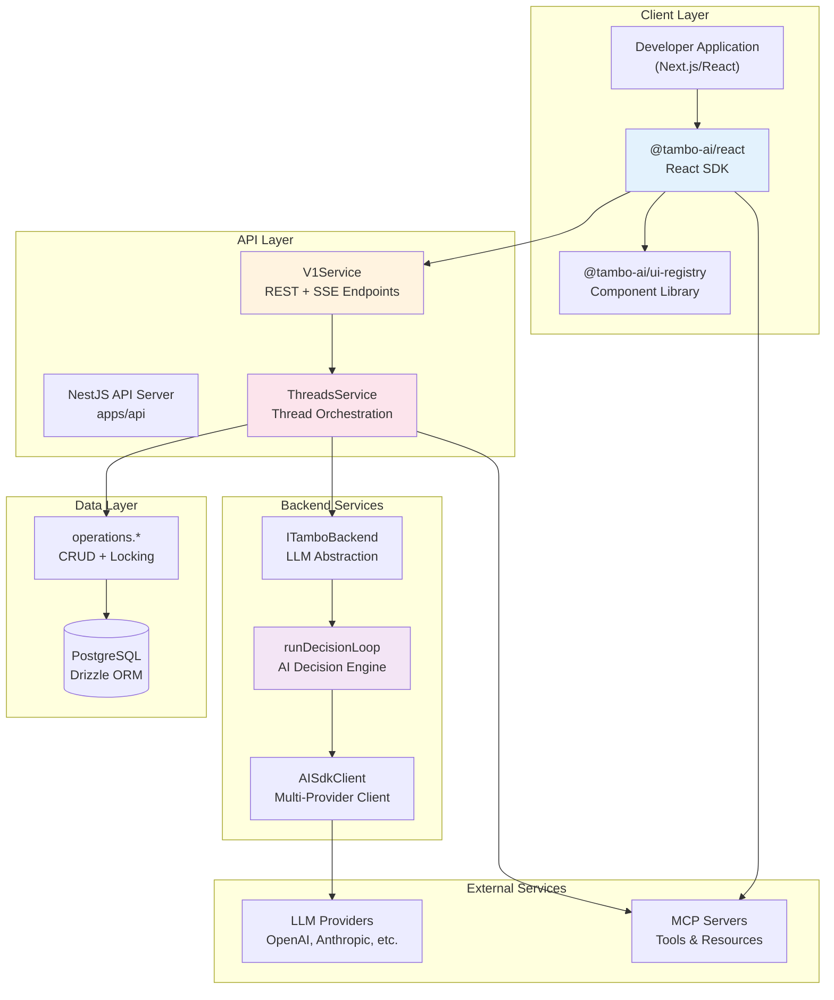
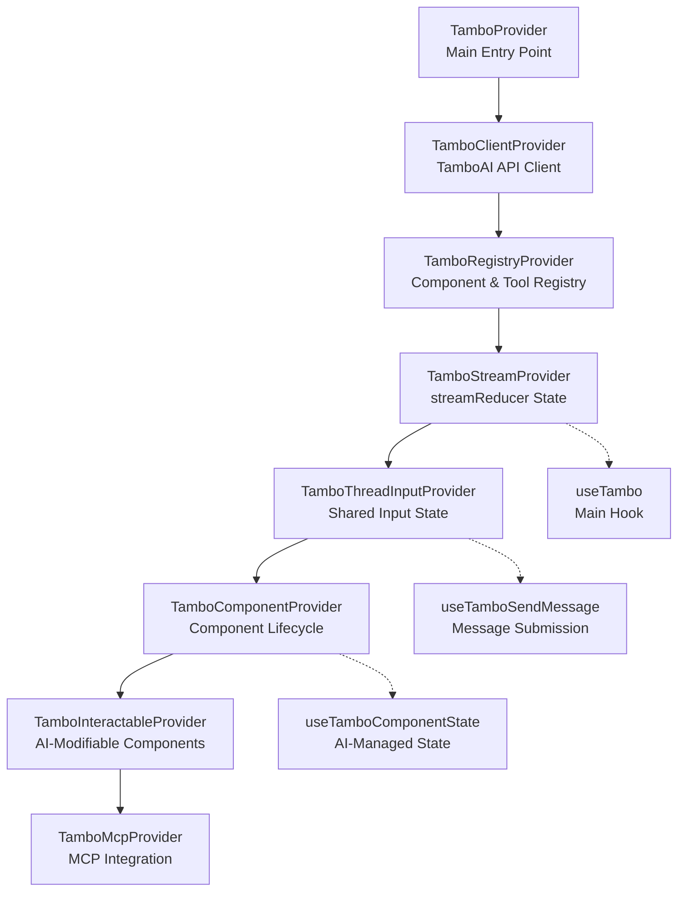
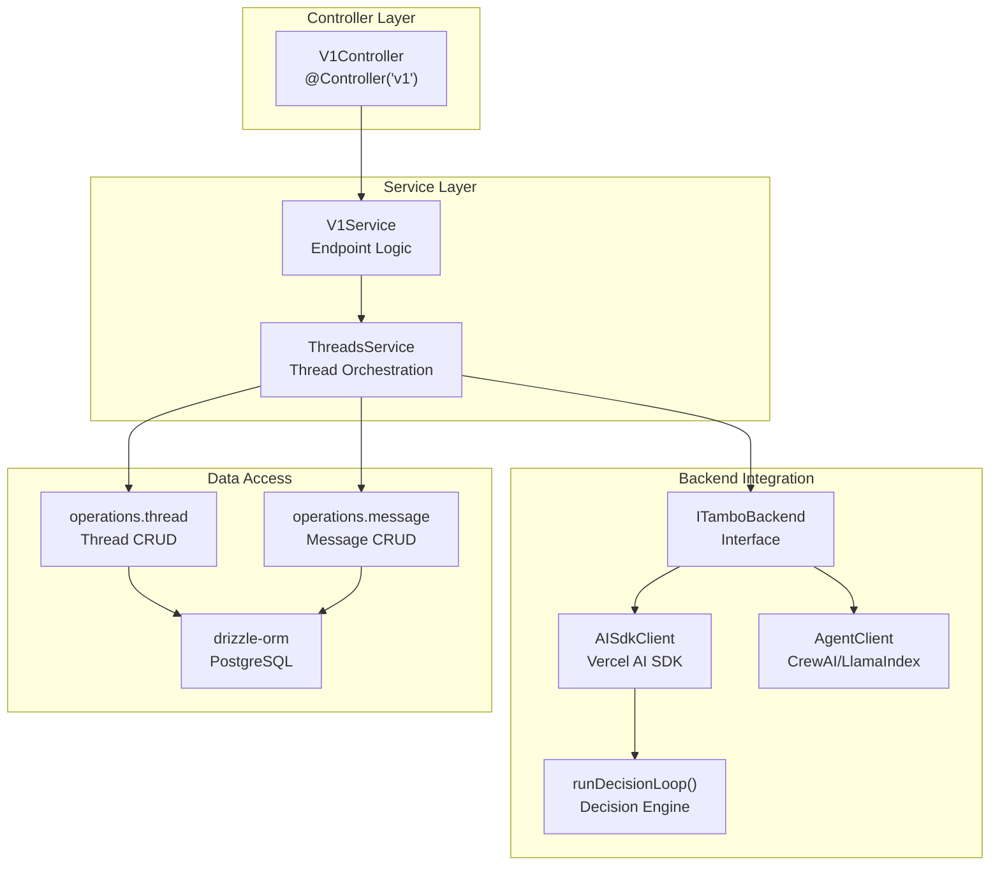
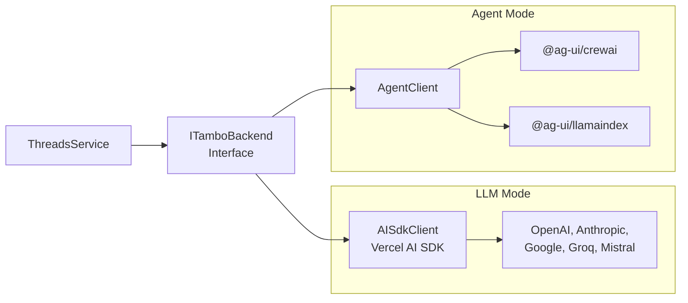
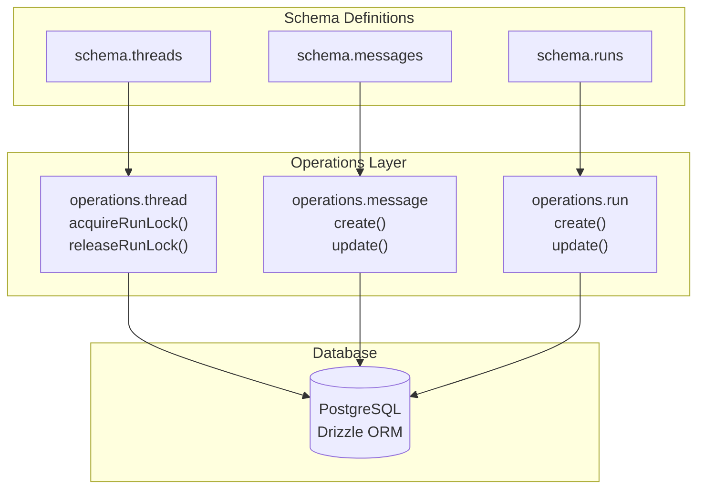
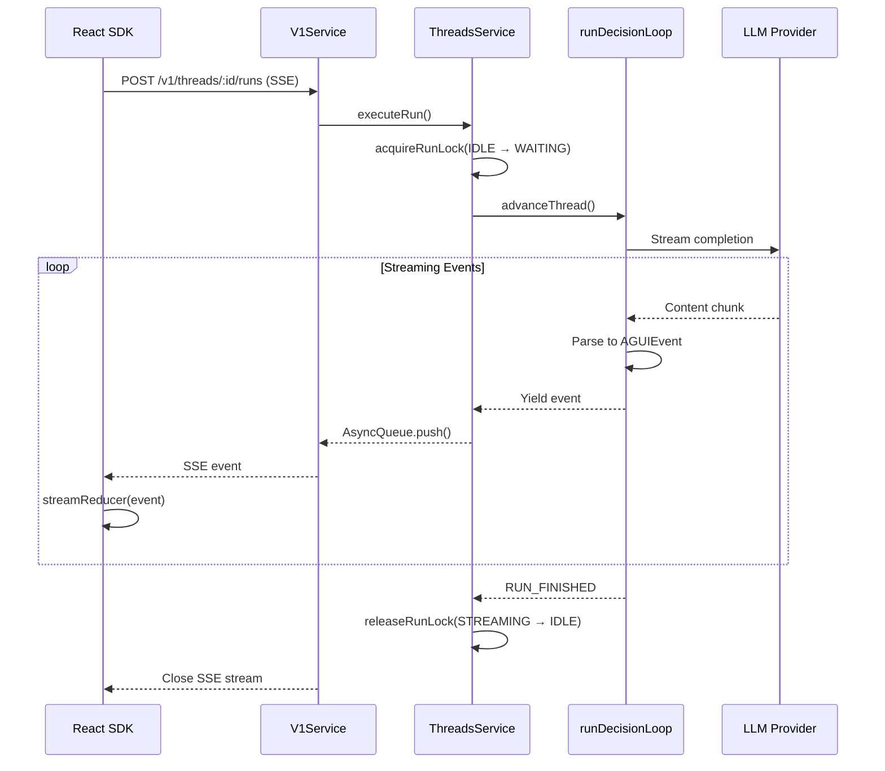
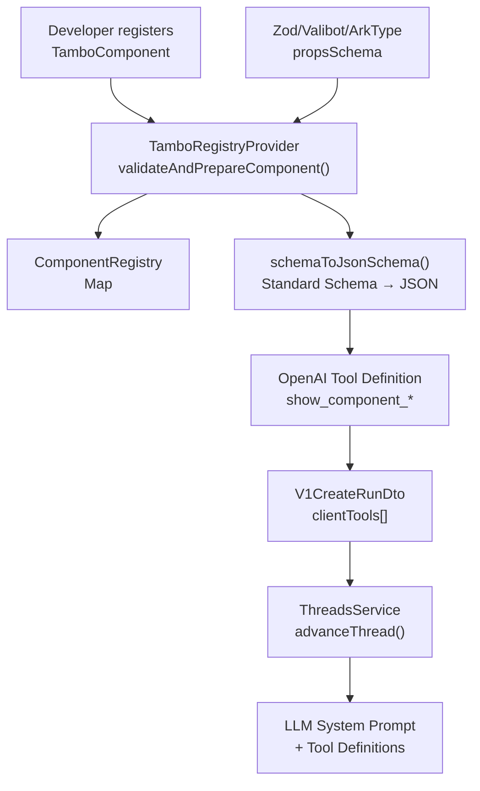
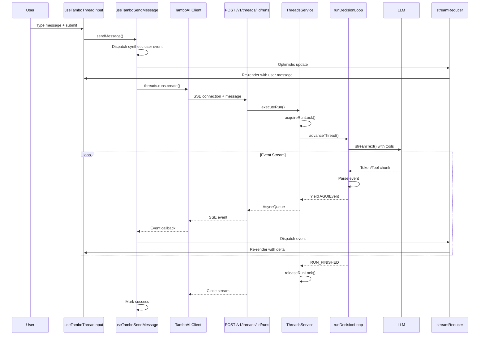

<!-- source: DeepWiki mcp.deepwiki.com · repo tambo-ai/tambo · page 1.3 Architecture Overview · fetched 2026-10-29 -->

# Architecture Overview

Relevant source files

The following files were used as context for generating this wiki page:

- [.config/release-please/.release-please-manifest.json](.config/release-please/.release-please-manifest.json)
- [apps/api/CHANGELOG.md](apps/api/CHANGELOG.md)
- [apps/api/package.json](apps/api/package.json)
- [apps/api/src/threads/guards/thread-in-project-guard.ts](apps/api/src/threads/guards/thread-in-project-guard.ts)
- [apps/api/src/v1/__tests__/v1-conversions.test.ts](apps/api/src/v1/__tests__/v1-conversions.test.ts)
- [apps/api/src/v1/__tests__/v1-thread-in-project-guard.test.ts](apps/api/src/v1/__tests__/v1-thread-in-project-guard.test.ts)
- [apps/api/src/v1/__tests__/v1.controller.test.ts](apps/api/src/v1/__tests__/v1.controller.test.ts)
- [apps/api/src/v1/__tests__/v1.service.test.ts](apps/api/src/v1/__tests__/v1.service.test.ts)
- [apps/api/src/v1/dto/component-state.dto.ts](apps/api/src/v1/dto/component-state.dto.ts)
- [apps/api/src/v1/dto/message.dto.ts](apps/api/src/v1/dto/message.dto.ts)
- [apps/api/src/v1/dto/thread.dto.ts](apps/api/src/v1/dto/thread.dto.ts)
- [apps/api/src/v1/guards/v1-thread-in-project-guard.ts](apps/api/src/v1/guards/v1-thread-in-project-guard.ts)
- [apps/api/src/v1/utils/get-v1-context-info.ts](apps/api/src/v1/utils/get-v1-context-info.ts)
- [apps/api/src/v1/v1-conversions.ts](apps/api/src/v1/v1-conversions.ts)
- [apps/api/src/v1/v1.controller.ts](apps/api/src/v1/v1.controller.ts)
- [apps/api/src/v1/v1.service.ts](apps/api/src/v1/v1.service.ts)
- [apps/docs-mcp/package.json](apps/docs-mcp/package.json)
- [apps/test-mcp-server/package.json](apps/test-mcp-server/package.json)
- [apps/web/CHANGELOG.md](apps/web/CHANGELOG.md)
- [apps/web/package.json](apps/web/package.json)
- [cli/CHANGELOG.md](cli/CHANGELOG.md)
- [cli/package.json](cli/package.json)
- [create-tambo-app/CHANGELOG.md](create-tambo-app/CHANGELOG.md)
- [create-tambo-app/package.json](create-tambo-app/package.json)
- [docs/CHANGELOG.md](docs/CHANGELOG.md)
- [docs/package.json](docs/package.json)
- [package-lock.json](package-lock.json)
- [package.json](package.json)
- [packages/backend/package.json](packages/backend/package.json)
- [packages/core/package.json](packages/core/package.json)
- [packages/db/src/index.ts](packages/db/src/index.ts)
- [packages/db/src/operations/thread.ts](packages/db/src/operations/thread.ts)
- [packages/eslint-config/package.json](packages/eslint-config/package.json)
- [packages/react-ui-base/CHANGELOG.md](packages/react-ui-base/CHANGELOG.md)
- [packages/react-ui-base/package.json](packages/react-ui-base/package.json)
- [packages/testing/package.json](packages/testing/package.json)
- [packages/ui-registry/package.json](packages/ui-registry/package.json)
- [react-sdk/CHANGELOG.md](react-sdk/CHANGELOG.md)
- [react-sdk/package.json](react-sdk/package.json)
- [react-sdk/src/v1/hooks/use-tambo-v1-messages.test.tsx](react-sdk/src/v1/hooks/use-tambo-v1-messages.test.tsx)
- [react-sdk/src/v1/hooks/use-tambo-v1-send-message.test.tsx](react-sdk/src/v1/hooks/use-tambo-v1-send-message.test.tsx)
- [react-sdk/src/v1/hooks/use-tambo-v1-send-message.ts](react-sdk/src/v1/hooks/use-tambo-v1-send-message.ts)
- [react-sdk/src/v1/hooks/use-tambo-v1-suggestions.test.tsx](react-sdk/src/v1/hooks/use-tambo-v1-suggestions.test.tsx)
- [react-sdk/src/v1/hooks/use-tambo-v1-suggestions.ts](react-sdk/src/v1/hooks/use-tambo-v1-suggestions.ts)
- [react-sdk/src/v1/hooks/use-tambo-v1-thread-input.test.tsx](react-sdk/src/v1/hooks/use-tambo-v1-thread-input.test.tsx)
- [react-sdk/src/v1/hooks/use-tambo-v1-thread-input.ts](react-sdk/src/v1/hooks/use-tambo-v1-thread-input.ts)
- [react-sdk/src/v1/hooks/use-tambo-v1-thread-list.test.tsx](react-sdk/src/v1/hooks/use-tambo-v1-thread-list.test.tsx)
- [react-sdk/src/v1/hooks/use-tambo-v1-thread-list.ts](react-sdk/src/v1/hooks/use-tambo-v1-thread-list.ts)
- [react-sdk/src/v1/hooks/use-tambo-v1-thread.test.tsx](react-sdk/src/v1/hooks/use-tambo-v1-thread.test.tsx)
- [react-sdk/src/v1/hooks/use-tambo-v1-thread.ts](react-sdk/src/v1/hooks/use-tambo-v1-thread.ts)
- [react-sdk/src/v1/hooks/use-tambo-v1.test.tsx](react-sdk/src/v1/hooks/use-tambo-v1.test.tsx)
- [react-sdk/src/v1/hooks/use-tambo-v1.ts](react-sdk/src/v1/hooks/use-tambo-v1.ts)
- [react-sdk/src/v1/index.ts](react-sdk/src/v1/index.ts)
- [react-sdk/src/v1/providers/tambo-v1-provider.test.tsx](react-sdk/src/v1/providers/tambo-v1-provider.test.tsx)
- [react-sdk/src/v1/providers/tambo-v1-provider.tsx](react-sdk/src/v1/providers/tambo-v1-provider.tsx)
- [react-sdk/src/v1/providers/tambo-v1-stream-context.test.tsx](react-sdk/src/v1/providers/tambo-v1-stream-context.test.tsx)
- [react-sdk/src/v1/providers/tambo-v1-stream-context.tsx](react-sdk/src/v1/providers/tambo-v1-stream-context.tsx)
- [react-sdk/src/v1/providers/tambo-v1-stub-provider.test.tsx](react-sdk/src/v1/providers/tambo-v1-stub-provider.test.tsx)
- [react-sdk/src/v1/providers/tambo-v1-stub-provider.tsx](react-sdk/src/v1/providers/tambo-v1-stub-provider.tsx)
- [react-sdk/src/v1/providers/tambo-v1-thread-input-provider.tsx](react-sdk/src/v1/providers/tambo-v1-thread-input-provider.tsx)
- [react-sdk/src/v1/types/message.ts](react-sdk/src/v1/types/message.ts)
- [react-sdk/src/v1/types/thread.ts](react-sdk/src/v1/types/thread.ts)
- [react-sdk/src/v1/types/tool-choice.ts](react-sdk/src/v1/types/tool-choice.ts)
- [react-sdk/src/v1/utils/__snapshots__/event-accumulator.test.ts.snap](react-sdk/src/v1/utils/__snapshots__/event-accumulator.test.ts.snap)
- [react-sdk/src/v1/utils/event-accumulator.test.ts](react-sdk/src/v1/utils/event-accumulator.test.ts)
- [react-sdk/src/v1/utils/event-accumulator.ts](react-sdk/src/v1/utils/event-accumulator.ts)
- [showcase/CHANGELOG.md](showcase/CHANGELOG.md)
- [showcase/package.json](showcase/package.json)
- [showcase/src/app/components/(message-primitives)/thread-content/page.tsx](showcase/src/app/components/(message-primitives)/thread-content/page.tsx)
- [showcase/src/app/components/(message-primitives)/thread-history/page.tsx](showcase/src/app/components/(message-primitives)/thread-history/page.tsx)

## Purpose and Scope

This document provides a high-level overview of the Tambo AI system architecture, describing how the major components interact to enable generative UI capabilities. It covers the React SDK, Backend API, LLM integration layer, and supporting infrastructure. For details on the monorepo organization, see [Repository Structure](#1.2). For conceptual background on generative UI, components, and tools, see [Key Concepts](#1.1).

## System Overview

Tambo AI is architected as a distributed system with clear separation between client-side SDK, backend services, and external integrations. The system enables developers to build AI-powered applications where language models can dynamically generate and manipulate React components.

**Sources:** [react-sdk/package.json](), [apps/api/package.json](), [packages/backend/package.json](), [apps/api/src/v1/v1.service.ts](), [apps/api/src/threads/threads.service.ts]()

## Core Architectural Layers

### Frontend Layer - React SDK

The React SDK (`@tambo-ai/react`) provides the client-side interface for integrating generative UI capabilities. It is structured as a nested provider architecture where each provider adds specific functionality.

**Key Provider Responsibilities:**

| Provider | File | Purpose |
|----------|------|---------|
| `TamboProvider` | [react-sdk/src/v1/providers/tambo-v1-provider.tsx]() | Composes all sub-providers |
| `TamboClientProvider` | [react-sdk/src/providers/tambo-client-provider.tsx]() | Manages `TamboAI` client instance and authentication |
| `TamboRegistryProvider` | [react-sdk/src/providers/tambo-registry-provider.tsx]() | Maintains `ComponentRegistry` and `ToolRegistry` maps |
| `TamboStreamProvider` | [react-sdk/src/v1/providers/tambo-v1-stream-provider.tsx]() | Runs `streamReducer` to accumulate SSE events into `ThreadState` |
| `TamboMcpProvider` | [react-sdk/src/mcp/tambo-mcp-provider.tsx]() | Manages MCP client connections and tool registration |

**Sources:** [react-sdk/src/v1/providers/tambo-v1-provider.tsx](), [react-sdk/src/providers/tambo-client-provider.tsx](), [react-sdk/src/providers/tambo-registry-provider.tsx](), [react-sdk/src/v1/providers/tambo-v1-stream-provider.tsx]()

### Backend Layer - API and Services

The backend is built with NestJS and follows a layered service architecture. The `V1Service` handles HTTP/SSE endpoints, while `ThreadsService` orchestrates the core conversation logic.

**Key Service Methods:**

| Service | Method | Purpose |
|---------|--------|---------|
| `V1Service` | `createRun()` | [apps/api/src/v1/v1.service.ts:145-250]() | Validates request and initiates streaming |
| `V1Service` | `updateComponentState()` | [apps/api/src/v1/v1.service.ts:252-350]() | Applies JSON Patch to component state |
| `ThreadsService` | `advanceThread()` | [apps/api/src/threads/threads.service.ts:200-400]() | Orchestrates LLM interaction and tool execution |
| `ThreadsService` | `executeRun()` | [apps/api/src/threads/threads.service.ts:450-650]() | Main run loop with concurrency control |

**Sources:** [apps/api/src/v1/v1.service.ts](), [apps/api/src/threads/threads.service.ts](), [packages/backend/package.json]()

### LLM Integration Layer

The backend abstracts LLM providers through the `ITamboBackend` interface, supporting both direct LLM streaming and agent frameworks.

The `runDecisionLoop()` function in `@tambo-ai-cloud/backend` orchestrates the AI decision-making process:

1. Formats messages and tools for the LLM
2. Streams responses incrementally
3. Parses tool calls and component rendering instructions
4. Yields events to the API for client streaming

**Sources:** [packages/backend/package.json:27-31](), [apps/api/src/threads/threads.service.ts]()

### Data Layer

The data layer uses Drizzle ORM with PostgreSQL, providing type-safe database operations with optimistic locking for concurrency control.

**Concurrency Control Pattern:**

The system uses optimistic locking to prevent concurrent runs on the same thread:

1. `acquireRunLock()` attempts atomic transition: `IDLE → WAITING`
2. If successful, run proceeds; if failed (conflict), error is returned
3. `releaseRunLock()` transitions: `STREAMING → IDLE`

This pattern is implemented in [packages/db/operations/thread.ts]().

**Sources:** [packages/db/package.json](), [packages/db/operations/thread.ts](), [packages/db/operations/message.ts]()

## Key Architectural Patterns

### Event Streaming Architecture

The system uses Server-Sent Events (SSE) to stream AI responses incrementally from the backend to the client. This enables real-time UI updates as the AI generates content.

**Event Accumulation:**

The client uses `streamReducer` [react-sdk/src/v1/utils/event-accumulator.ts:75-950]() to accumulate events into thread state:

- `RunStartedEvent` → Initialize message
- `TextMessageContentEvent` → Append text chunks
- `ToolCallStartEvent` → Create tool call skeleton
- `ToolCallArgsEvent` → Accumulate partial JSON arguments
- `ComponentPropsDeltaEvent` → Apply JSON Patch to component props
- `RunFinishedEvent` → Finalize message

**Sources:** [apps/api/src/v1/v1.service.ts:145-250](), [apps/api/src/threads/threads.service.ts:450-650](), [react-sdk/src/v1/utils/event-accumulator.ts]()

### Component Registration and Tool Conversion

Components registered via `TamboRegistryProvider` are automatically converted to "UI tools" that the LLM can invoke to render UI elements.

**Tool Naming Convention:**

- UI Component tools: `show_component_{componentName}`
- Interactable component update tools: `update_component_{componentId}`
- Local tools: Custom names provided by developer
- MCP tools: Prefixed with server name (e.g., `linear__create_issue`)

**Sources:** [react-sdk/src/providers/tambo-registry-provider.tsx](), [react-sdk/src/utils/schema-to-json-schema.ts](), [apps/api/src/v1/v1-tool-conversions.ts]()

### Provider Composition Pattern

The SDK uses a deeply nested provider pattern where each provider adds a layer of functionality. This enables:

1. **Dependency Injection**: Child components access context via hooks
2. **Separation of Concerns**: Each provider has a single responsibility
3. **Composability**: Providers can be used independently in tests

**Provider Initialization Order:**

1. `TamboClientProvider` → Creates `TamboAI` API client
2. `TamboRegistryProvider` → Validates and stores component/tool definitions
3. `TamboStreamProvider` → Initializes `streamReducer` with `ThreadState`
4. `TamboThreadInputProvider` → Manages shared input state across threads
5. `TamboComponentProvider` → Tracks component lifecycle
6. `TamboInteractableProvider` → Enables AI-modifiable components
7. `TamboMcpProvider` → Connects to MCP servers

**Sources:** [react-sdk/src/v1/providers/tambo-v1-provider.tsx](), [react-sdk/src/providers/tambo-client-provider.tsx](), [react-sdk/src/v1/providers/tambo-v1-stream-provider.tsx]()

## Data Flow Patterns

### User Message to AI Response Flow

This diagram traces a complete message roundtrip, showing how user input flows through the system and back to the UI.

**Sources:** [react-sdk/src/v1/hooks/use-tambo-v1-send-message.ts](), [apps/api/src/v1/v1.service.ts:145-250](), [apps/api/src/threads/threads.service.ts:450-650](), [react-sdk/src/v1/utils/event-accumulator.ts]()

### Component Rendering Flow

When the LLM decides to render a component, the following flow occurs:

1. **LLM Decision**: Model generates `tool_use` with `show_component_*` tool
2. **Backend Processing**: `runDecisionLoop` parses tool call and generates `ComponentStartEvent`, `ComponentPropsDeltaEvent` (streaming), `ComponentEndEvent`
3. **Client Accumulation**: `streamReducer` accumulates component props, parsing partial JSON
4. **UI Rendering**: React renders the component from `ComponentRegistry` with accumulated props

**Interactable Components:**

Components wrapped with `withTamboInteractable()` can be modified by the AI:

1. Component registers with `TamboInteractableProvider` on mount
2. LLM can call `update_component_{id}` with JSON Patch operations
3. Backend applies patch and returns updated state
4. Component receives updated props via `useTamboComponentState()`

**Sources:** [react-sdk/src/providers/tambo-interactable-provider.tsx](), [apps/api/src/v1/v1.service.ts:252-350](), [react-sdk/src/v1/utils/event-accumulator.ts:400-600]()

## Technology Stack

### Frontend Technologies

| Layer | Technology | Purpose |
|-------|-----------|---------|
| Framework | React 18+ | UI framework |
| State Management | React Context + useReducer | Provider state |
| API Client | `@tambo-ai/typescript-sdk` | Type-safe API client |
| Data Fetching | TanStack React Query | Server state management |
| Schema Validation | Zod, Valibot, ArkType | Runtime type checking |
| Streaming | EventSource (SSE) | Real-time event stream |

### Backend Technologies

| Layer | Technology | Purpose |
|-------|-----------|---------|
| Framework | NestJS 11 | API framework |
| Database | PostgreSQL + Drizzle ORM | Persistent storage |
| LLM Integration | Vercel AI SDK | Multi-provider streaming |
| Agent Frameworks | CrewAI, LlamaIndex | Advanced AI workflows |
| Validation | class-validator, Ajv | DTO validation |
| Observability | Langfuse, Sentry | LLM tracing, error tracking |

### Infrastructure

| Component | Technology | Purpose |
|-----------|-----------|---------|
| Monorepo | Turborepo + npm workspaces | Multi-package management |
| CI/CD | GitHub Actions | Automated testing and deployment |
| Release Management | Release Please | Conventional commit automation |
| Package Registry | NPM | SDK distribution |
| Container Registry | GitHub Container Registry | Docker image hosting |

**Sources:** [package.json](), [react-sdk/package.json](), [apps/api/package.json](), [packages/backend/package.json](), [.config/release-please/.release-please-manifest.json]()

## Deployment Architecture

The system supports multiple deployment models:

1. **Tambo Cloud**: Managed SaaS platform at `app.tambo.co`
   - API: `apps/api` deployed as containerized service
   - Web Dashboard: `apps/web` deployed on Vercel/similar
   - Database: Managed PostgreSQL

2. **Self-Hosted**: Docker-based local deployment
   - Single Docker Compose configuration
   - Local PostgreSQL instance
   - Environment-based configuration

3. **SDK-Only**: Frontend-only usage
   - Connect to Tambo Cloud API
   - Or connect to self-hosted API
   - Bring your own LLM provider

**Sources:** [apps/api/package.json](), [apps/web/package.json](), [package.json:5-8]()

---

