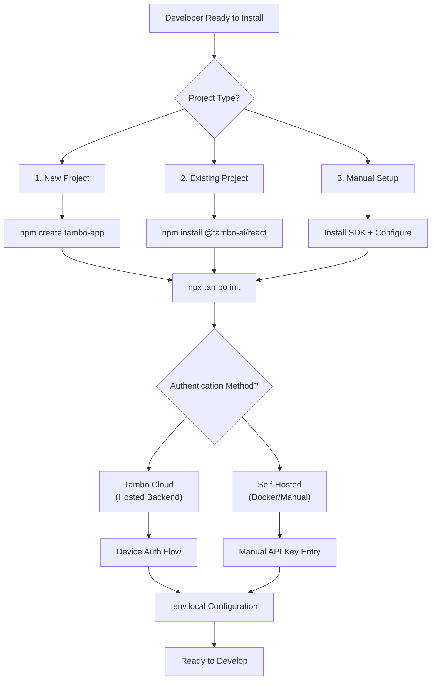
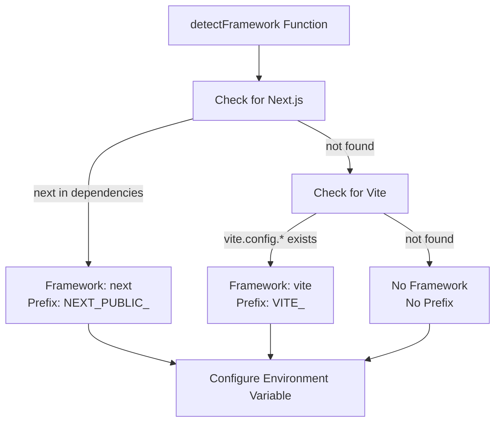
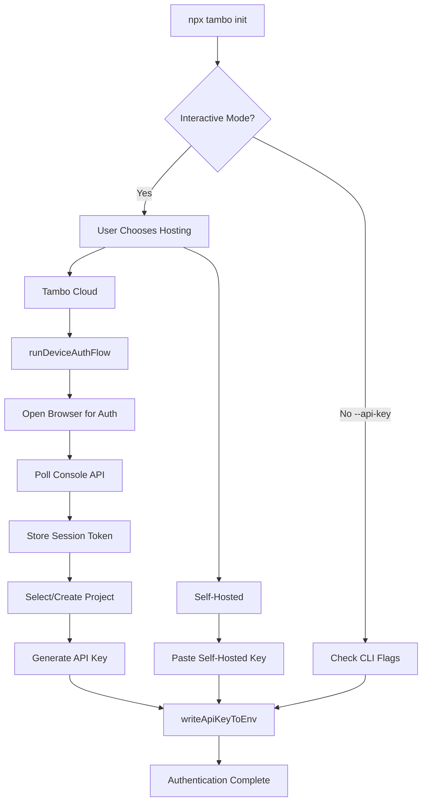
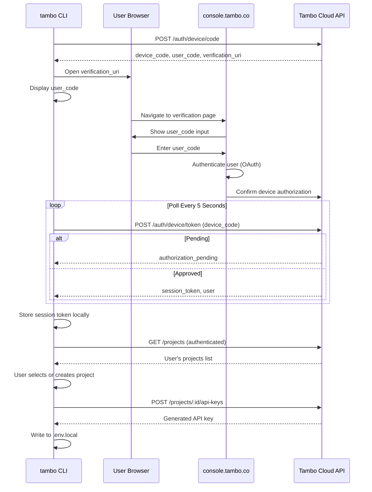
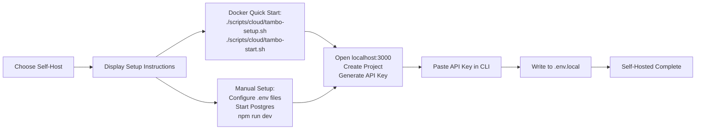
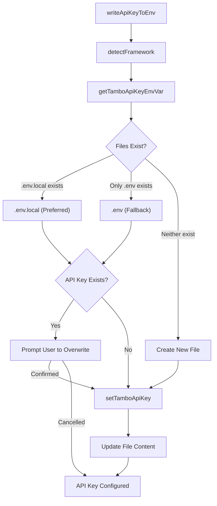
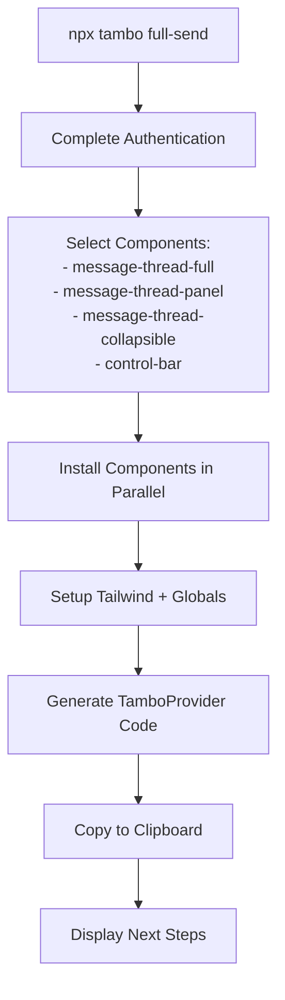

<!-- source: DeepWiki mcp.deepwiki.com · repo tambo-ai/tambo · page 2 Getting Started · fetched 2026-10-29 -->

# Getting Started

<details>
<summary>Relevant source files</summary>

The following files were used as context for generating this wiki page:

- [README.md](README.md)
- [cli/README.md](cli/README.md)
- [cli/src/__tests__/non-interactive-safety.test.ts](cli/src/__tests__/non-interactive-safety.test.ts)
- [cli/src/cli.ts](cli/src/cli.ts)
- [cli/src/commands/add/component.ts](cli/src/commands/add/component.ts)
- [cli/src/commands/add/index.test.ts](cli/src/commands/add/index.test.ts)
- [cli/src/commands/add/index.ts](cli/src/commands/add/index.ts)
- [cli/src/commands/add/tailwind-setup.ts](cli/src/commands/add/tailwind-setup.ts)
- [cli/src/commands/add/tailwind/v4/toolchain-setup.test.ts](cli/src/commands/add/tailwind/v4/toolchain-setup.test.ts)
- [cli/src/commands/add/tailwind/v4/toolchain-setup.ts](cli/src/commands/add/tailwind/v4/toolchain-setup.ts)
- [cli/src/commands/add/types.ts](cli/src/commands/add/types.ts)
- [cli/src/commands/add/utils.ts](cli/src/commands/add/utils.ts)
- [cli/src/commands/create-app.ts](cli/src/commands/create-app.ts)
- [cli/src/commands/init.test.ts](cli/src/commands/init.test.ts)
- [cli/src/commands/init.ts](cli/src/commands/init.ts)
- [cli/src/commands/list/index.test.ts](cli/src/commands/list/index.test.ts)
- [cli/src/commands/list/index.ts](cli/src/commands/list/index.ts)
- [cli/src/commands/update.test.ts](cli/src/commands/update.test.ts)
- [cli/src/commands/update.ts](cli/src/commands/update.ts)
- [cli/src/commands/upgrade/components.ts](cli/src/commands/upgrade/components.ts)
- [cli/src/commands/upgrade/index.ts](cli/src/commands/upgrade/index.ts)
- [cli/src/commands/upgrade/llm-rules.ts](cli/src/commands/upgrade/llm-rules.ts)
- [cli/src/commands/upgrade/npm-packages.ts](cli/src/commands/upgrade/npm-packages.ts)
- [cli/src/commands/upgrade/utils.ts](cli/src/commands/upgrade/utils.ts)
- [cli/src/templates/tambo-template.ts](cli/src/templates/tambo-template.ts)
- [cli/src/utils/framework-detection.test.ts](cli/src/utils/framework-detection.test.ts)
- [cli/src/utils/framework-detection.ts](cli/src/utils/framework-detection.ts)
- [cli/src/utils/interactive.test.ts](cli/src/utils/interactive.test.ts)
- [cli/src/utils/interactive.ts](cli/src/utils/interactive.ts)
- [cli/src/utils/package-manager.test.ts](cli/src/utils/package-manager.test.ts)
- [cli/src/utils/package-manager.ts](cli/src/utils/package-manager.ts)
- [create-tambo-app/README.md](create-tambo-app/README.md)
- [react-sdk/AGENTS.md](react-sdk/AGENTS.md)
- [react-sdk/README.md](react-sdk/README.md)
- [showcase/README.md](showcase/README.md)

</details>


This page guides you through installing Tambo AI, creating your first project, and configuring authentication. By the end, you'll have a working Tambo application ready for development.

For detailed CLI command reference, see [CLI Tools](#5). For React SDK integration patterns, see [React SDK](#3). For component installation and management, see [Installation](#2.1).

---

## System Requirements

Before starting, ensure your development environment meets these requirements:

| Requirement | Minimum Version | Recommended |
|-------------|----------------|-------------|
| Node.js | 18.x | 20.x or later |
| npm | 9.x | 10.x or later |
| Package Manager | npm, pnpm, yarn, or rush | Any supported |

**Supported Frameworks:**
- Next.js 13+ (App Router or Pages Router)
- Vite + React
- Any React 18+ application

Sources: [README.md:60-67](), [create-tambo-app/README.md:9-11](), [cli/src/utils/package-manager.ts:10]()

---

## Installation Paths Overview

Tambo provides three installation methods depending on your project setup:



**Installation Flow Diagram**

The diagram shows three entry points converging on `npx tambo init`, which handles authentication setup. All paths lead to a configured `.env.local` file with your API key.

Sources: [README.md:60-69](), [cli/src/commands/init.ts:998-1102](), [cli/src/commands/create-app.ts:105-373]()

---

## Method 1: Create New Project

The fastest way to start is using `create-tambo-app`, which scaffolds a complete project with templates.

### Available Templates

| Template | Description | Use Case |
|----------|-------------|----------|
| `standard` | Next.js + Tools + MCP (recommended) | Full-featured chat applications |
| `vite` | Vite + TanStack Router | SPA with client-side routing |
| `analytics` | Generative UI analytics dashboard | Data visualization apps |

### Create Command

```bash
# Interactive (prompts for template choice)
npm create tambo-app my-tambo-app

# Non-interactive with specific template
npm create tambo-app my-app -- --template=standard

# Create in current directory
npm create tambo-app . -- --template=vite

# With git initialization
npm create tambo-app my-app -- --template=standard --init-git
```

### Template Repository Cloning Process

```mermaid
graph LR
    CLI["tambo create-app CLI"]
    
    TemplateSelection["Template Selection"]
    
    GitClone["git clone --depth 1"]
    
    Repos["GitHub Template Repos"]
    
    LocalDir["Local Project Directory"]
    
    RemoveGit["Remove .git folder"]
    
    UpdatePkg["Update package.json"]
    
    NpmInstall["npm install"]
    
    Ready["Project Ready"]
    
    CLI --> TemplateSelection
    TemplateSelection --> GitClone
    GitClone --> Repos
    Repos --> LocalDir
    LocalDir --> RemoveGit
    RemoveGit --> UpdatePkg
    UpdatePkg --> NpmInstall
    NpmInstall --> Ready
```



**Template Cloning Architecture**

The `handleCreateApp` function clones from GitHub repositories defined in `templates` object, then removes git history and initializes dependencies.

Sources: [cli/src/commands/create-app.ts:19-48](), [cli/src/commands/create-app.ts:225-246](), [README.md:76-80]()

---

## Method 2: Add to Existing Project

Install Tambo into an existing React application:

```bash
# Install the React SDK
npm install @tambo-ai/react

# Initialize Tambo configuration
npx tambo init
```

### Framework Detection

The CLI automatically detects your framework and configures environment variables accordingly:



**Framework Detection Logic**

The `detectFramework` function checks `package.json` dependencies and config files to determine the appropriate environment variable prefix.

Sources: [cli/src/utils/framework-detection.ts:46-81](), [cli/src/commands/init.ts:95-101]()

---

## Method 3: Manual Installation

For advanced use cases or custom build setups:

```bash
# Install dependencies
npm install @tambo-ai/react

# Optional: Install Zod for schema validation (recommended v4)
npm install zod@^4 zod-to-json-schema@^3.25.1

# Manual environment setup
echo "NEXT_PUBLIC_TAMBO_API_KEY=your_api_key_here" > .env.local
```

Create a basic provider setup:

```typescript
// app/layout.tsx or similar
import { TamboProvider } from "@tambo-ai/react";

export default function Layout({ children }) {
  return (
    <TamboProvider
      apiKey={process.env.NEXT_PUBLIC_TAMBO_API_KEY ?? ""}
      components={[]}
    >
      {children}
    </TamboProvider>
  );
}
```

Sources: [react-sdk/README.md:28-43](), [react-sdk/README.md:99-114]()

---

## Authentication Setup

After installation, run `npx tambo init` to configure authentication. The command supports both Cloud and self-hosted backends.

### Cloud vs Self-Hosted Decision



**Authentication Flow Architecture**

The `handleInit` function orchestrates authentication through `handleHostingChoiceAndAuth`, which branches into Cloud (device auth) or self-hosted (manual key) paths.

Sources: [cli/src/commands/init.ts:634-730](), [cli/src/commands/init.ts:312-360]()

---

## Cloud Authentication (Device Auth Flow)

Tambo Cloud uses OAuth 2.0 Device Authorization Flow for secure, browser-based authentication.

### Device Auth Implementation



**Cloud Device Auth Sequence**

The `runDeviceAuthFlow` function (referenced in [cli/src/lib/device-auth.ts]()) implements the polling mechanism. Session tokens are stored for reuse.

Sources: [cli/src/commands/init.ts:312-360](), [cli/src/commands/init.ts:476-630]()

---

## Self-Hosted Authentication

For self-hosted deployments, provide an API key manually.

### Self-Hosted Setup Instructions

The CLI displays these instructions when self-hosted mode is selected:



**Self-Hosted Setup Flow**

The `displaySelfHostInstructions` function provides setup commands and optionally opens the repository README in a browser.

Sources: [cli/src/commands/init.ts:176-212](), [cli/src/commands/init.ts:660-729]()

---

## Environment Variable Configuration

All authentication methods result in writing an API key to `.env.local` or `.env`.

### Environment File Management



**Environment Variable Writing Process**

The `writeApiKeyToEnv` function handles file selection, key detection, and atomic updates. The `setTamboApiKey` utility in `dotenv-utils.ts` manages key replacement.

Sources: [cli/src/commands/init.ts:84-172](), [cli/src/utils/dotenv-utils.ts]() (referenced in imports)

---

## Non-Interactive Mode (CI/CD)

The CLI supports non-interactive environments for automation:

```bash
# Direct API key (simplest for CI/CD)
npx tambo init --api-key="sk_..."

# Create new project via device auth (prints URL)
npx tambo init --project-name=myapp --no-browser

# Use existing project via device auth
npx tambo init --project-id=abc123 --no-browser
```

### Exit Codes

| Code | Meaning | Use Case |
|------|---------|----------|
| 0 | Success | Command completed |
| 1 | Error | Check output for details |
| 2 | Guidance Required | Missing required flags |

### Non-Interactive Detection

The `isInteractive` function checks multiple conditions:

- `process.stdin.isTTY` - Can read user input
- `process.stdout.isTTY` - Can display prompts
- `process.env.CI` - CI environment detection
- `process.env.GITHUB_ACTIONS` - GitHub Actions detection

When non-interactive mode is detected without required flags, commands throw `GuidanceError` with actionable instructions.

Sources: [cli/src/commands/init.ts:1008-1102](), [cli/src/utils/interactive.ts:18-46](), [cli/README.md:120-153]()

---

## Full-Send Mode

For maximum convenience, `npx tambo full-send` combines initialization with component installation:

```bash
npx tambo full-send
```

This command executes:

1. **Authentication**: Cloud or self-hosted setup via `handleAuthentication`
2. **Component Selection**: Interactive checkbox for starter components
3. **Installation**: Parallel installation of selected components via `handleAddComponent`
4. **Configuration**: Tailwind and globals.css setup via `setupTailwindAndGlobals`
5. **Code Generation**: TamboProvider snippet copied to clipboard

### Available Starter Components



**Full-Send Installation Pipeline**

The `handleFullSendInit` function orchestrates the entire setup process, including component resolution via `resolveComponentDependencies`.

Sources: [cli/src/commands/init.ts:736-848](), [cli/src/commands/init.ts:854-992]()

---

## First Example: Running the Application

After setup, create your first Tambo interface:

### Step 1: Provider Configuration

The CLI generates this code structure (adapt to your framework):

```typescript
// Next.js App Router: app/layout.tsx
"use client";

import { TamboProvider } from "@tambo-ai/react";
import { components } from "../lib/tambo";

export default function RootLayout({ children }) {
  return (
    <html>
      <body>
        <TamboProvider
          apiKey={process.env.NEXT_PUBLIC_TAMBO_API_KEY ?? ""}
          components={components}
        >
          {children}
        </TamboProvider>
      </body>
    </html>
  );
}
```

### Step 2: Component Registration

Edit the generated `lib/tambo.ts` file:

```typescript
import type { TamboComponent } from "@tambo-ai/react";
import { z } from "zod/v4";

export const components: TamboComponent[] = [
  // Register your components here
];
```

### Step 3: Add Your First Component

```bash
# Install a pre-built component
npx tambo add message-thread-full

# Or create a custom component
```

### Step 4: Start Development Server

```bash
npm run dev
# Navigate to http://localhost:3000
```

Sources: [README.md:126-153](), [cli/src/templates/tambo-template.ts:6-52](), [cli/src/commands/init.ts:919-939]()

---

## Troubleshooting Common Issues

### API Key Not Found

**Symptom**: Error about missing `NEXT_PUBLIC_TAMBO_API_KEY`

**Solution**: Verify `.env.local` exists and restart dev server
```bash
cat .env.local
npm run dev
```

### Framework Not Detected

**Symptom**: Warning about env var exposure

**Solution**: Manually configure for your build tool
```bash
# For Vite, use VITE_ prefix
# For Create React App, use REACT_APP_ prefix
```

### Component Import Errors

**Symptom**: Cannot find module errors after `tambo add`

**Solution**: Check component location matches imports
```bash
npx tambo list  # See installed components
npx tambo migrate  # Consolidate to new location if needed
```

Sources: [cli/src/commands/init.ts:954-973](), [cli/src/utils/framework-detection.ts:46-81]()

---

## Next Steps

After completing setup:

1. **Component Installation**: See [Creating a New Project](#2.2) for adding UI components
2. **Authentication Configuration**: See [Authentication Setup](#2.3) for advanced auth options
3. **Provider Options**: See [TamboProvider Setup](#3.1) for configuration details
4. **Component Registration**: See [Component Registration](#3.4) for creating custom components

Sources: [README.md:60-67](), [cli/src/commands/init.ts:998-1102]()

---

