<!-- source: DeepWiki mcp.deepwiki.com · repo tambo-ai/tambo · page 2.1 Installation · fetched 2026-10-29 -->

# Installation

<details>
<summary>Relevant source files</summary>

The following files were used as context for generating this wiki page:

- [README.md](README.md)
- [cli/README.md](cli/README.md)
- [cli/src/__tests__/non-interactive-safety.test.ts](cli/src/__tests__/non-interactive-safety.test.ts)
- [cli/src/cli.ts](cli/src/cli.ts)
- [cli/src/commands/add/component.ts](cli/src/commands/add/component.ts)
- [cli/src/commands/add/index.test.ts](cli/src/commands/add/index.test.ts)
- [cli/src/commands/add/index.ts](cli/src/commands/add/index.ts)
- [cli/src/commands/add/tailwind-setup.ts](cli/src/commands/add/tailwind-setup.ts)
- [cli/src/commands/add/tailwind/v4/toolchain-setup.test.ts](cli/src/commands/add/tailwind/v4/toolchain-setup.test.ts)
- [cli/src/commands/add/tailwind/v4/toolchain-setup.ts](cli/src/commands/add/tailwind/v4/toolchain-setup.ts)
- [cli/src/commands/add/types.ts](cli/src/commands/add/types.ts)
- [cli/src/commands/add/utils.ts](cli/src/commands/add/utils.ts)
- [cli/src/commands/create-app.ts](cli/src/commands/create-app.ts)
- [cli/src/commands/init.test.ts](cli/src/commands/init.test.ts)
- [cli/src/commands/init.ts](cli/src/commands/init.ts)
- [cli/src/commands/list/index.test.ts](cli/src/commands/list/index.test.ts)
- [cli/src/commands/list/index.ts](cli/src/commands/list/index.ts)
- [cli/src/commands/update.test.ts](cli/src/commands/update.test.ts)
- [cli/src/commands/update.ts](cli/src/commands/update.ts)
- [cli/src/commands/upgrade/components.ts](cli/src/commands/upgrade/components.ts)
- [cli/src/commands/upgrade/index.ts](cli/src/commands/upgrade/index.ts)
- [cli/src/commands/upgrade/llm-rules.ts](cli/src/commands/upgrade/llm-rules.ts)
- [cli/src/commands/upgrade/npm-packages.ts](cli/src/commands/upgrade/npm-packages.ts)
- [cli/src/commands/upgrade/utils.ts](cli/src/commands/upgrade/utils.ts)
- [cli/src/templates/tambo-template.ts](cli/src/templates/tambo-template.ts)
- [cli/src/utils/framework-detection.test.ts](cli/src/utils/framework-detection.test.ts)
- [cli/src/utils/framework-detection.ts](cli/src/utils/framework-detection.ts)
- [cli/src/utils/interactive.test.ts](cli/src/utils/interactive.test.ts)
- [cli/src/utils/interactive.ts](cli/src/utils/interactive.ts)
- [cli/src/utils/package-manager.test.ts](cli/src/utils/package-manager.test.ts)
- [cli/src/utils/package-manager.ts](cli/src/utils/package-manager.ts)
- [create-tambo-app/README.md](create-tambo-app/README.md)
- [react-sdk/AGENTS.md](react-sdk/AGENTS.md)
- [react-sdk/README.md](react-sdk/README.md)
- [showcase/README.md](showcase/README.md)

</details>


This page covers the system requirements and installation methods for Tambo AI. It documents the three primary ways to install Tambo: using `create-tambo-app` for new projects, using `npx tambo init` for existing projects, and manual installation. For guidance on creating and configuring a new project after installation, see [Creating a New Project](#2.2). For authentication and API key setup, see [Authentication Setup](#2.3).

---

## System Requirements

Tambo requires the following minimum versions:

| Requirement | Minimum Version | Notes |
|-------------|----------------|-------|
| Node.js | 18.0.0 | Global `fetch` API required for CLI operations |
| npm | 10.0.0 | Used by default; pnpm and yarn also supported |
| React | 18.0.0 | Required by `@tambo-ai/react` SDK |

### Supported Frameworks

Tambo automatically detects and configures environment variables for these frameworks:

- **Next.js** - Uses `NEXT_PUBLIC_` prefix for client-side environment variables
- **Vite** - Uses no prefix; environment variables accessed via `import.meta.env`

The CLI includes framework detection logic in [cli/src/utils/framework-detection.ts:26-45]() which checks for framework-specific files and dependencies.

**Sources:** [create-tambo-app/README.md:9-12](), [cli/src/utils/framework-detection.ts:4-24]()

---

## Installation Methods Comparison

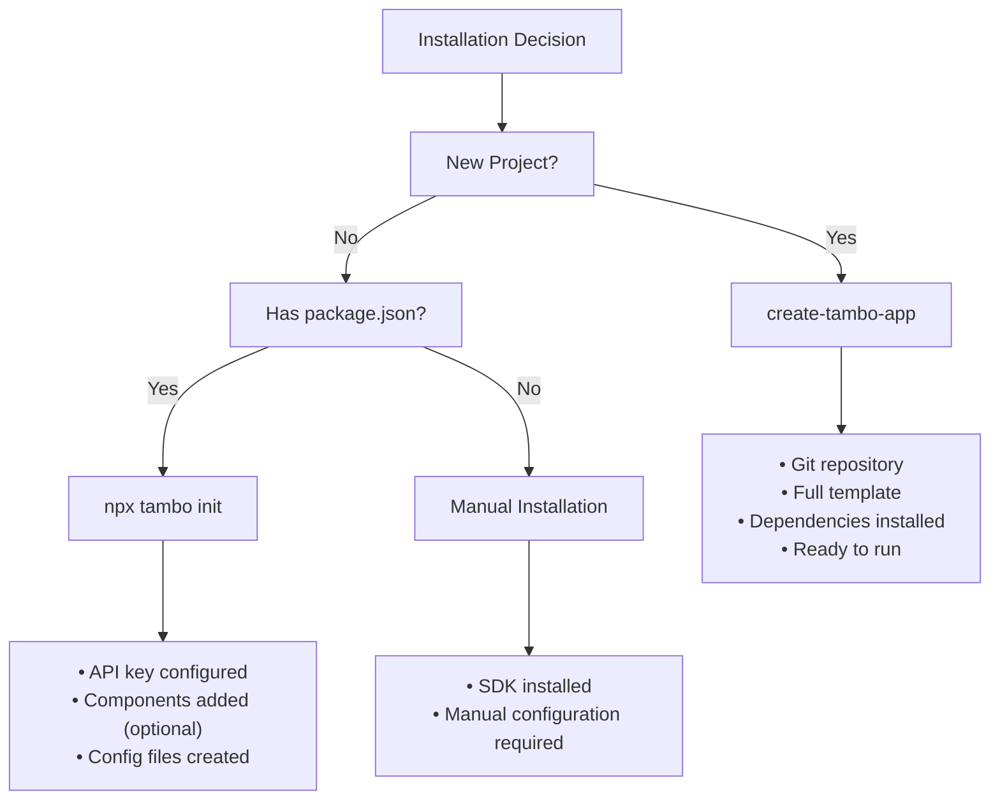

**Installation Method Characteristics**

| Method | Use Case | Time | Creates Git Repo | Installs Components | Configures Auth |
|--------|----------|------|------------------|---------------------|-----------------|
| `create-tambo-app` | New project from scratch | 2-3 min | Optional | Yes (template-specific) | Via `npx tambo init` |
| `npx tambo init` | Add Tambo to existing project | 1-2 min | No | Optional (full-send mode) | Yes |
| Manual | Custom setup or CI/CD | <1 min | No | No | Manual |

**Sources:** [README.md:60-67](), [cli/README.md:7-18](), [react-sdk/README.md:28-42]()

---

## Method 1: Create New Project (create-tambo-app)

The `create-tambo-app` command scaffolds a complete Tambo application from a template repository.

### Command Syntax

```bash
# Interactive mode (prompts for options)
npm create tambo-app

# Specify directory name
npm create tambo-app my-tambo-app

# Create in current directory
npm create tambo-app .

# Non-interactive with template
npm create tambo-app my-app --template=standard --init-git
```

### Available Templates

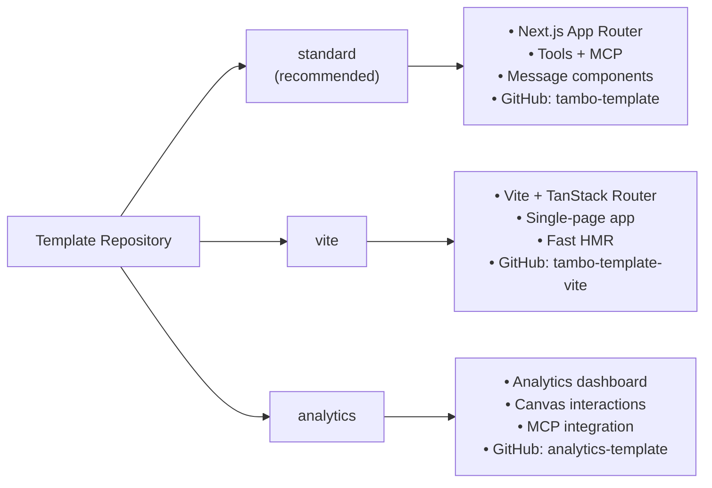

The template definitions are stored in [cli/src/commands/create-app.ts:25-41]() as a mapping of template names to GitHub repository URLs.

### Execution Flow

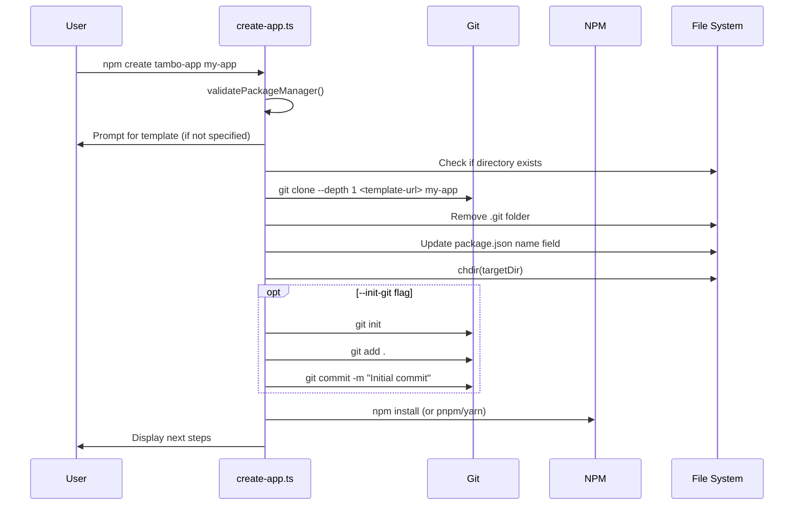

The implementation clones the template repository at [cli/src/commands/create-app.ts:231-246](), removes the `.git` folder at [cli/src/commands/create-app.ts:249-260](), updates `package.json` at [cli/src/commands/create-app.ts:87-103](), and optionally initializes git at [cli/src/commands/create-app.ts:274-298]().

### Template Directory Structure

After running `create-tambo-app`, the following structure is created:

```
my-tambo-app/
├── package.json          # Updated with project name
├── .env.example          # Template environment variables
├── src/
│   ├── app/              # Next.js app directory (standard template)
│   │   ├── layout.tsx    # Root layout
│   │   └── page.tsx      # Home page
│   ├── components/       # Component directory
│   │   └── tambo/        # Tambo-specific components
│   └── lib/
│       └── tambo.ts      # Component/tool registry (empty)
├── public/               # Static assets
├── tailwind.config.ts    # Tailwind configuration
└── tsconfig.json         # TypeScript configuration
```

**Sources:** [cli/src/commands/create-app.ts:105-373](), [README.md:75-81](), [create-tambo-app/README.md:1-26]()

---

## Method 2: Initialize Existing Project (tambo init)

The `npx tambo init` command adds Tambo to an existing project by configuring authentication, creating config files, and optionally installing components.

### Command Modes

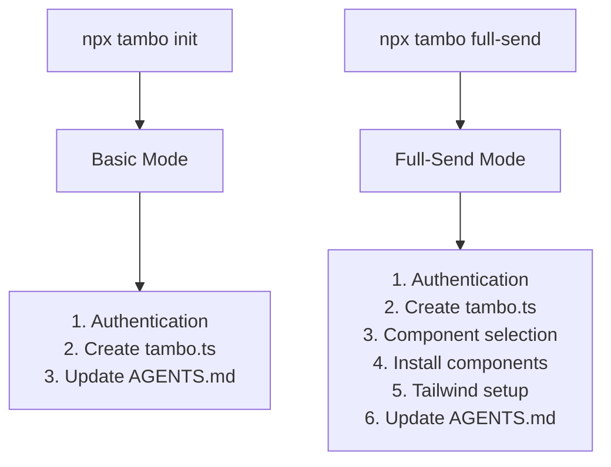

### Command Variants

| Command | Flag | Description | Use Case |
|---------|------|-------------|----------|
| `npx tambo init` | None | Basic authentication setup | Minimal setup, add components later |
| `npx tambo full-send` | `--full-send` | Complete setup with components | Quick start, recommended for new users |
| `npx tambo init --api-key=<key>` | `--api-key` | Direct API key input | CI/CD, non-interactive environments |
| `npx tambo init --project-name=<name>` | `--project-name` | Create new project during init | Device auth with new project |
| `npx tambo init --project-id=<id>` | `--project-id` | Use existing project | Device auth with existing project |

### Non-Interactive Mode

The CLI detects non-interactive environments (CI/CD, Docker, piped input) using [cli/src/utils/interactive.ts:24-46](). In non-interactive mode:

```bash
# Direct API key (simplest for CI/CD)
npx tambo init --api-key="$TAMBO_API_KEY"

# Create new project (requires device auth URL)
npx tambo init --project-name=myapp --no-browser

# Use existing project
npx tambo init --project-id=abc123 --no-browser
```

The `--no-browser` flag prevents automatic browser opening and prints the authentication URL for manual use at [cli/src/commands/init.ts:1006-1007]().

### Authentication Flow Diagram

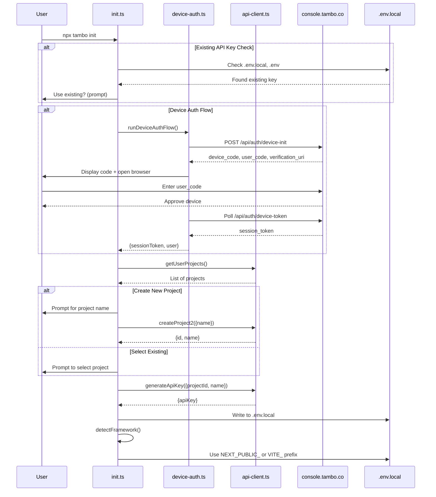

The device authentication implementation is in [cli/src/lib/device-auth.ts](). The flow starts at [cli/src/commands/init.ts:312-360]() for the `handleAuthentication()` function.

### File System Changes

The `init` command creates or modifies these files:

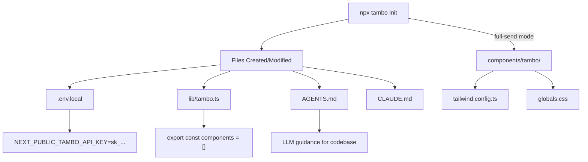

**File Creation Logic:**
- `.env.local` creation: [cli/src/commands/init.ts:84-172]() in `writeApiKeyToEnv()`
- `tambo.ts` creation: [cli/src/commands/init.ts:41-59]() in `createTamboTsFile()`
- Component installation: [cli/src/commands/add/component.ts:31-267]() in `installComponents()`
- AGENTS.md creation: [cli/src/commands/shared/agent-docs.ts]()

### Installation Path Resolution

The CLI determines where to install components using [cli/src/commands/init.ts:258-305]() in `getInstallationPath()`:

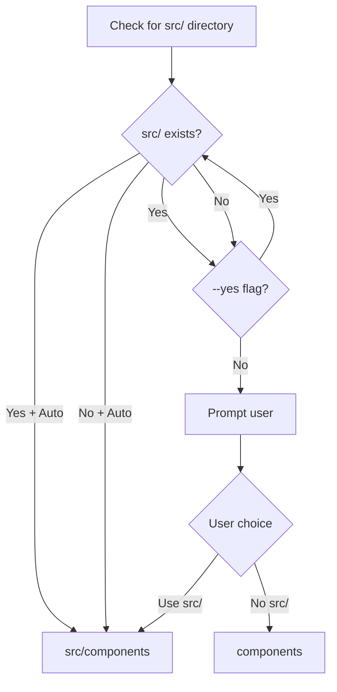

**Sources:** [cli/src/commands/init.ts:998-1114](), [cli/src/commands/init.ts:736-848](), [cli/README.md:19-46]()

---

## Method 3: Manual Installation

Manual installation provides maximum control but requires manual configuration of all components.

### Package Installation

```bash
# Install React SDK
npm install @tambo-ai/react

# Install CLI globally (optional)
npm install -g tambo

# Or use via npx
npx tambo <command>
```

### Package Structure

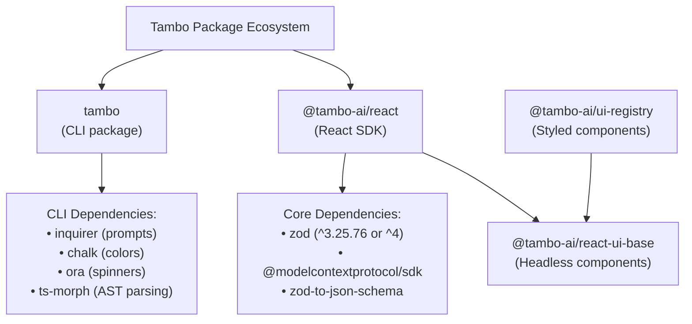

### Required Manual Configuration

When installing manually, you must:

1. **Create environment variables file** (`.env.local`):
   ```
   NEXT_PUBLIC_TAMBO_API_KEY=sk_your_api_key_here
   ```

2. **Create component registry** (`lib/tambo.ts`):
   ```typescript
   import type { TamboComponent } from "@tambo-ai/react";
   export const components: TamboComponent[] = [];
   ```

3. **Add TamboProvider** to your app layout:
   ```typescript
   import { TamboProvider } from "@tambo-ai/react";
   import { components } from "@/lib/tambo";
   
   <TamboProvider
     apiKey={process.env.NEXT_PUBLIC_TAMBO_API_KEY!}
     components={components}
   >
     {children}
   </TamboProvider>
   ```

4. **Configure Tailwind CSS** (if using UI components):
   - Add Tambo colors to `tailwind.config.ts`
   - Import required CSS variables in `globals.css`

The template for `tambo.ts` is defined in [cli/src/templates/tambo-template.ts:6-52]().

### Dependency Installation

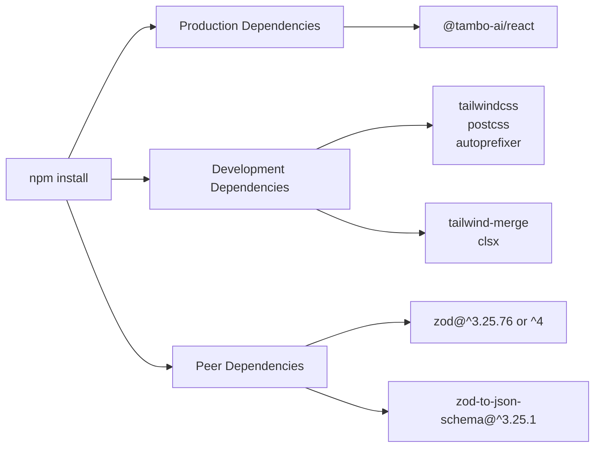

The CLI automatically detects and installs missing dependencies during component installation at [cli/src/commands/add/component.ts:86-163]().

**Sources:** [react-sdk/README.md:28-42](), [react-sdk/README.md:99-114](), [cli/src/templates/tambo-template.ts:1-52]()

---

## CLI Package Manager Detection

The CLI supports multiple package managers and automatically detects which one to use:

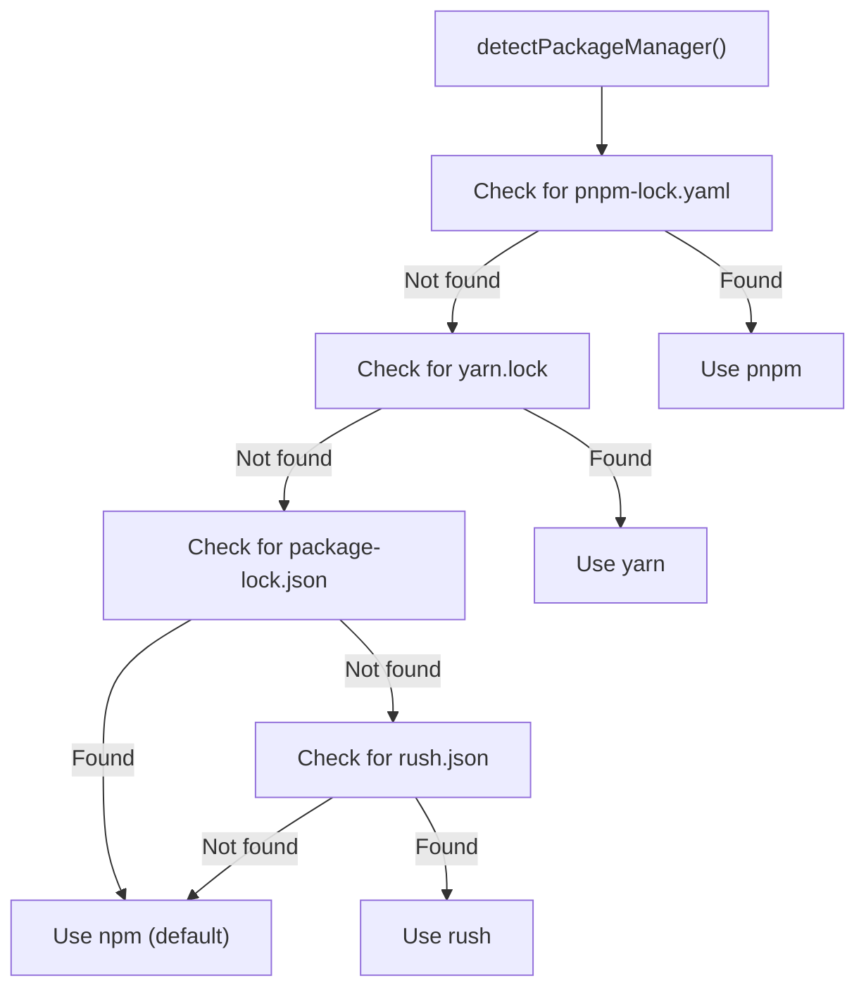

The detection logic is implemented in [cli/src/utils/package-manager.ts:38-86]() and uses `findFileInAncestors()` to search for lockfiles in the current directory and parent directories.

### Package Manager Command Mapping

| Package Manager | Install Command | Add Package | Add Dev Package |
|----------------|-----------------|-------------|-----------------|
| npm | `npm install` | `npm install <pkg>` | `npm install --save-dev <pkg>` |
| pnpm | `pnpm install` | `pnpm add <pkg>` | `pnpm add -D <pkg>` |
| yarn | `yarn install` | `yarn add <pkg>` | `yarn add -D <pkg>` |
| rush | `rush update` | Manual | Manual |

Command generation is handled by [cli/src/utils/package-manager.ts:103-144]() in `getInstallCommand()` and [cli/src/utils/package-manager.ts:146-169]() in `formatPackageArgs()`.

**Sources:** [cli/src/utils/package-manager.ts:1-232](), [cli/src/commands/add/component.ts:119-163]()

---

## Registry Architecture

The Tambo CLI includes a bundled registry of pre-built components that gets installed with the CLI package.

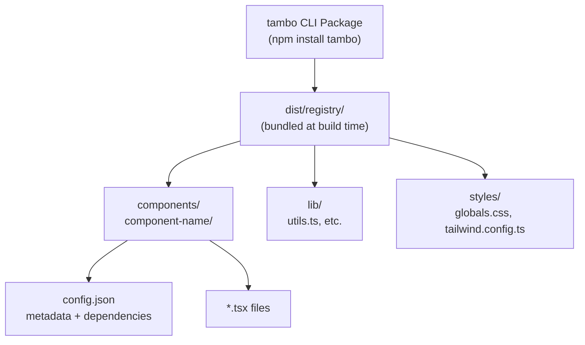

### Registry Resolution

The CLI resolves the registry path using [cli/src/commands/add/utils.ts:24-66]() in `getRegistryBasePath()`:

1. Check `TAMBO_REGISTRY_PATH` environment variable (for local development)
2. Check `dist/registry/` (when running compiled CLI)
3. Check `../packages/ui-registry/src/` (monorepo development)
4. Throw error if registry not found

### Component Configuration Schema

Each component has a `config.json` file with the following structure:

```typescript
interface ComponentConfig {
  name: string;                 // Component identifier
  dependencies: string[];       // npm production dependencies
  devDependencies: string[];    // npm dev dependencies
  requires?: string[];          // Other Tambo components required
  files: {
    name: string;              // Relative file path
    content: string;           // Path to source file or literal content
  }[];
}
```

The schema is defined in [cli/src/commands/add/types.ts:1-10](). Component installation reads this config at [cli/src/commands/add/component.ts:105-111]().

**Sources:** [cli/src/commands/add/utils.ts:24-66](), [cli/src/commands/add/component.ts:31-267](), [cli/src/commands/add/types.ts:1-24]()

---

