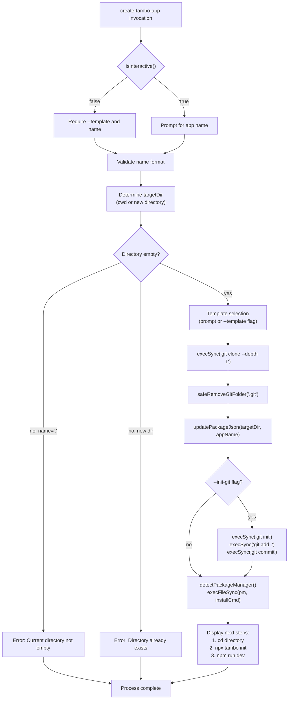
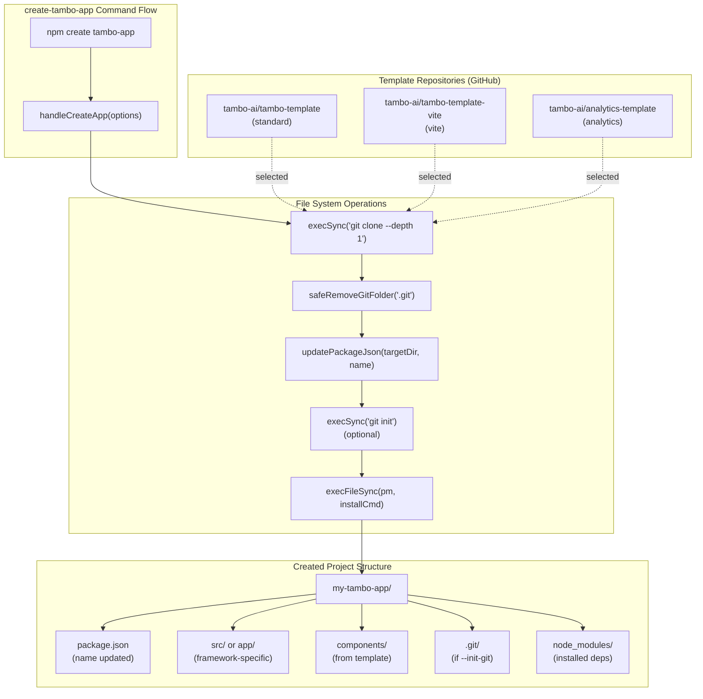

<!-- source: DeepWiki mcp.deepwiki.com · repo tambo-ai/tambo · page 2.2 Creating a New Project · fetched 2026-10-29 -->

# Creating a New Project

<details>
<summary>Relevant source files</summary>

The following files were used as context for generating this wiki page:

- [README.md](README.md)
- [cli/README.md](cli/README.md)
- [cli/src/__tests__/non-interactive-safety.test.ts](cli/src/__tests__/non-interactive-safety.test.ts)
- [cli/src/cli.ts](cli/src/cli.ts)
- [cli/src/commands/add/component.ts](cli/src/commands/add/component.ts)
- [cli/src/commands/add/index.test.ts](cli/src/commands/add/index.test.ts)
- [cli/src/commands/add/index.ts](cli/src/commands/add/index.ts)
- [cli/src/commands/add/tailwind-setup.ts](cli/src/commands/add/tailwind-setup.ts)
- [cli/src/commands/add/tailwind/v4/toolchain-setup.test.ts](cli/src/commands/add/tailwind/v4/toolchain-setup.test.ts)
- [cli/src/commands/add/tailwind/v4/toolchain-setup.ts](cli/src/commands/add/tailwind/v4/toolchain-setup.ts)
- [cli/src/commands/add/types.ts](cli/src/commands/add/types.ts)
- [cli/src/commands/add/utils.ts](cli/src/commands/add/utils.ts)
- [cli/src/commands/create-app.ts](cli/src/commands/create-app.ts)
- [cli/src/commands/init.test.ts](cli/src/commands/init.test.ts)
- [cli/src/commands/init.ts](cli/src/commands/init.ts)
- [cli/src/commands/list/index.test.ts](cli/src/commands/list/index.test.ts)
- [cli/src/commands/list/index.ts](cli/src/commands/list/index.ts)
- [cli/src/commands/update.test.ts](cli/src/commands/update.test.ts)
- [cli/src/commands/update.ts](cli/src/commands/update.ts)
- [cli/src/commands/upgrade/components.ts](cli/src/commands/upgrade/components.ts)
- [cli/src/commands/upgrade/index.ts](cli/src/commands/upgrade/index.ts)
- [cli/src/commands/upgrade/llm-rules.ts](cli/src/commands/upgrade/llm-rules.ts)
- [cli/src/commands/upgrade/npm-packages.ts](cli/src/commands/upgrade/npm-packages.ts)
- [cli/src/commands/upgrade/utils.ts](cli/src/commands/upgrade/utils.ts)
- [cli/src/templates/tambo-template.ts](cli/src/templates/tambo-template.ts)
- [cli/src/utils/framework-detection.test.ts](cli/src/utils/framework-detection.test.ts)
- [cli/src/utils/framework-detection.ts](cli/src/utils/framework-detection.ts)
- [cli/src/utils/interactive.test.ts](cli/src/utils/interactive.test.ts)
- [cli/src/utils/interactive.ts](cli/src/utils/interactive.ts)
- [cli/src/utils/package-manager.test.ts](cli/src/utils/package-manager.test.ts)
- [cli/src/utils/package-manager.ts](cli/src/utils/package-manager.ts)
- [create-tambo-app/README.md](create-tambo-app/README.md)
- [react-sdk/AGENTS.md](react-sdk/AGENTS.md)
- [react-sdk/README.md](react-sdk/README.md)
- [showcase/README.md](showcase/README.md)

</details>


**Purpose**: This page covers scaffolding a new Tambo project using `create-tambo-app`, including template selection, directory setup, and initial configuration. For adding Tambo to an existing project, see [Installation](#2.1). For API key setup after project creation, see [Authentication Setup](#2.3).

---

## Overview

The `create-tambo-app` command scaffolds a complete Tambo project by cloning a template repository, installing dependencies, and preparing the project structure. Three official templates are available, each optimized for different use cases.

**Sources**: [README.md:60-81](), [create-tambo-app/README.md:1-23]()

---

## Command Invocation Methods

### Interactive Mode

```bash
# Simplest invocation - prompts for all options
npm create tambo-app

# With directory name specified
npm create tambo-app my-tambo-app

# Create in current directory
npm create tambo-app .
```

### Non-Interactive Mode

```bash
# Specify template and directory
npm create tambo-app my-app -- --template=standard

# With git initialization
npm create tambo-app my-app -- --template=vite --init-git

# With legacy peer dependencies flag
npm create tambo-app my-app -- --template=analytics --legacy-peer-deps
```

**Command Alias**: The `tambo` CLI also provides `tambo create-app` as an alternative invocation method.

**Sources**: [README.md:62-67](), [cli/src/cli.ts:189-210](), [cli/src/commands/create-app.ts:105-119]()

---

## Available Templates

### Template Comparison

| Template | Description | Repository | Best For |
|----------|-------------|------------|----------|
| `standard` | Tambo + Tools + MCP (recommended) | `tambo-ai/tambo-template` | Full-featured chat applications with tool integration |
| `vite` | Tambo + TanStack Router + Vite | `tambo-ai/tambo-template-vite` | Single-page applications with client-side routing |
| `analytics` | Generative UI Analytics Template | `tambo-ai/analytics-template` | Data visualization and analytics dashboards |

**Template Selection Dialog** (interactive mode):
```
Select a template for your new app:
❯ standard - Tambo + Tools + MCP (recommended)
  vite - Tambo + TanStack Router + Vite
  analytics - Generative UI Analytics Template
```

**Sources**: [cli/src/commands/create-app.ts:25-41](), [README.md:75-81]()

---

## Project Creation Process

### Creation Flow Diagram



**Sources**: [cli/src/commands/create-app.ts:105-373]()

### Step-by-Step Execution

#### 1. Name and Directory Resolution

The command validates the app name and determines the target directory:

- **Valid formats**: Letters, numbers, dashes, underscores, or `.` (current directory)
- **Target directory**: `process.cwd()` if name is `.`, otherwise `path.join(process.cwd(), appName)`
- **Conflict checking**: Errors if directory exists and is not empty

**Implementation**: [cli/src/commands/create-app.ts:125-223]()

#### 2. Template Cloning

Templates are cloned from GitHub using shallow clone to minimize download size:

```typescript
execSync(
  `git clone --depth 1 ${selectedTemplate.repository} ${appName === "." ? "." : appName}`,
  { stdio: "ignore", allowNonInteractive: true }
);
```

**Repository URLs**:
- Standard: `https://github.com/tambo-ai/tambo-template.git`
- Vite: `https://github.com/tambo-ai/tambo-template-vite.git`
- Analytics: `https://github.com/tambo-ai/analytics-template.git`

**Sources**: [cli/src/commands/create-app.ts:225-260]()

#### 3. Git Cleanup and Reinitialization

The cloned `.git` directory is removed to start with a clean repository state:

**Platform-specific cleanup** via `safeRemoveGitFolder()`:
- **Windows**: `attrib -r` to remove read-only flags, then `rmdir /s /q`
- **Unix-like**: `rm -rf` with fallback to Node.js `fs.rmSync()`

**Optional reinitialization** (if `--init-git` flag is set):
```bash
git init
git add .
git commit -m "Initial commit from Tambo {template} template"
```

**Sources**: [cli/src/commands/create-app.ts:50-103](), [cli/src/commands/create-app.ts:274-298]()

#### 4. Package Configuration

The `package.json` name field is updated to match the app name via `updatePackageJson()`:

```typescript
const packageJson = JSON.parse(fs.readFileSync(packageJsonPath, "utf-8"));
packageJson.name = appName === "." ? path.basename(process.cwd()) : appName;
fs.writeFileSync(packageJsonPath, JSON.stringify(packageJson, null, 2));
```

**Sources**: [cli/src/commands/create-app.ts:87-103]()

#### 5. Dependency Installation

Dependencies are installed using the detected package manager:

**Package manager detection**: Via `detectPackageManager()` which checks for lock files:
- `pnpm-lock.yaml` → pnpm
- `yarn.lock` → yarn
- `package-lock.json` → npm
- Default → npm

**Installation command**:
```typescript
const pm = detectPackageManager(targetDir);
const installCmd = getInstallCommand(pm);
const legacyPeerDepsFlag = options.legacyPeerDeps && pm === "npm" 
  ? ["--legacy-peer-deps"] 
  : [];
const args = [...installCmd, ...legacyPeerDepsFlag];
execFileSync(pm, args, { stdio: "ignore" });
```

**Sources**: [cli/src/commands/create-app.ts:300-323](), [cli/src/utils/package-manager.ts:24-60]()

---

## Configuration Options

### Command-Line Flags

| Flag | Type | Description | Example |
|------|------|-------------|---------|
| `--template`, `-t` | string | Template name: `standard`, `vite`, or `analytics` | `--template=vite` |
| `--init-git` | boolean | Initialize git repository after creation | `--init-git` |
| `--legacy-peer-deps` | boolean | Pass `--legacy-peer-deps` to npm install | `--legacy-peer-deps` |

**Flag definitions**: [cli/src/cli.ts:384-390]()

### Environment Requirements

**Minimum versions**:
- Node.js ≥ 20
- npm ≥ 10

**Required system commands**:
- `git` (for template cloning)

**Sources**: [create-tambo-app/README.md:10-13]()

---

## Non-Interactive Mode (CI/CD)

### Detection Logic

Non-interactive mode is automatically activated when:

```typescript
function isInteractive(): boolean {
  const term = process.env.TERM;
  const isCI = Boolean(
    (typeof process.env.CI === "string" && process.env.CI.trim() !== "" && process.env.CI !== "0") ||
    process.env.GITHUB_ACTIONS === "true"
  );
  const stdinIsTTY = process.stdin.isTTY;
  const streamIsTTY = process.stdout.isTTY;
  
  return Boolean(stdinIsTTY && streamIsTTY && term !== "dumb" && !isCI);
}
```

**Triggers**:
- `process.env.CI` is set
- `process.env.GITHUB_ACTIONS === "true"`
- stdin or stdout is not a TTY
- `TERM === "dumb"`

**Sources**: [cli/src/utils/interactive.ts:24-46]()

### Required Flags

In non-interactive mode, all prompts must be answered via flags:

```bash
# ❌ Error - missing template
npm create tambo-app my-app

# ✅ Valid
npm create tambo-app my-app -- --template=standard
```

**Error output** (from `GuidanceError`):
```
Error: App name and template required in non-interactive mode

Required: Run one of these commands:

→ npx tambo create-app my-app --template=standard
  npx tambo create-app my-app --template=vite
  npx tambo create-app my-app --template=analytics
  npx tambo create-app . --template=standard
```

**Sources**: [cli/src/commands/create-app.ts:108-119](), [cli/src/utils/interactive.ts:50-64]()

### CI/CD Example

```yaml
# .github/workflows/create-project.yml
name: Create Tambo Project
on: workflow_dispatch

jobs:
  create:
    runs-on: ubuntu-latest
    steps:
      - name: Create project
        run: |
          npm create tambo-app new-project -- --template=standard --init-git
      
      - name: Initialize Tambo
        working-directory: new-project
        run: |
          npx tambo init --api-key="${{ secrets.TAMBO_API_KEY }}"
```

**Sources**: [cli/README.md:145-153]()

---

## Post-Creation Steps

### Output Message

After successful creation, the command displays next steps:

```
Successfully created a new Tambo app
Template: standard - Tambo + Tools + MCP (recommended)

Next steps:
  1. cd my-app
  2. npx tambo init to complete setup
  3. npm run dev

Learn More:
  • Each component in your template comes with built-in documentation and examples
  • Visit our UI showcase at https://ui.tambo.co to explore and learn about 
    the components included in your template
```

**Step numbering logic**: Adapts based on whether `--init-git` was used and whether creating in current directory.

**Sources**: [cli/src/commands/create-app.ts:325-353]()

### Next Commands

#### 1. Navigate to Project

```bash
cd my-tambo-app
```

*Skip if created with `.` (current directory)*

#### 2. Initialize Tambo Configuration

```bash
npx tambo init
```

This command:
- Prompts for hosting choice (Cloud vs Self-hosted)
- Handles authentication via device auth flow
- Creates/updates `.env.local` with API key
- Creates `lib/tambo.ts` component registry file

**Details**: See [Authentication Setup](#2.3)

**Sources**: [cli/src/commands/init.ts:998-1006]()

#### 3. Start Development Server

```bash
npm run dev
```

The specific command depends on the template's framework configuration.

**Sources**: [cli/src/commands/create-app.ts:345]()

---

## Project Structure Diagram



**Sources**: [cli/src/commands/create-app.ts:105-373](), [cli/src/commands/create-app.ts:25-41]()

---

## Error Handling

### Common Errors and Solutions

| Error | Cause | Solution |
|-------|-------|----------|
| `Directory already exists` | Target directory name conflicts with existing directory | Choose a different name or use `.` if current directory is empty |
| `Current directory is not empty` | Using `.` but directory contains files | Clear the directory or create in a new subdirectory |
| `Failed to clone template repository` | Network issue or git not installed | Check internet connection and ensure `git` command is available |
| `Failed to install dependencies` | npm/yarn/pnpm error | Try adding `--legacy-peer-deps` flag |
| `Template not found` | Invalid `--template` value | Use `standard`, `vite`, or `analytics` |

### Cleanup on Failure

If creation fails after creating the directory, the command attempts automatic cleanup:

```typescript
if (appName !== "." && fs.existsSync(targetDir)) {
  try {
    fs.rmSync(targetDir, { recursive: true, force: true });
  } catch (_e) {
    console.error(
      chalk.yellow(`Failed to clean up directory "${targetDir}". 
                    You may want to remove it manually.`)
    );
  }
}
```

**Sources**: [cli/src/commands/create-app.ts:354-372]()

---

## Code Entity Reference

### Key Functions and Their Roles

| Function | File | Purpose |
|----------|------|---------|
| `handleCreateApp()` | [cli/src/commands/create-app.ts:105-373]() | Main orchestration function for project creation |
| `safeRemoveGitFolder()` | [cli/src/commands/create-app.ts:50-85]() | Platform-safe removal of `.git` directory |
| `updatePackageJson()` | [cli/src/commands/create-app.ts:87-103]() | Updates `package.json` name field |
| `detectPackageManager()` | [cli/src/utils/package-manager.ts:24-60]() | Detects which package manager to use |
| `getInstallCommand()` | [cli/src/utils/package-manager.ts:62-78]() | Returns correct install command for package manager |
| `isInteractive()` | [cli/src/utils/interactive.ts:24-46]() | Determines if environment supports prompts |
| `interactivePrompt()` | [cli/src/utils/interactive.ts:85-116]() | Wrapper for inquirer with non-interactive fallback |

**Sources**: [cli/src/commands/create-app.ts:1-374](), [cli/src/utils/package-manager.ts:1-107](), [cli/src/utils/interactive.ts:1-250]()

---

