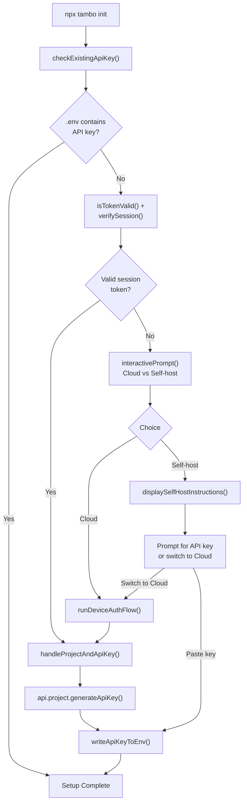
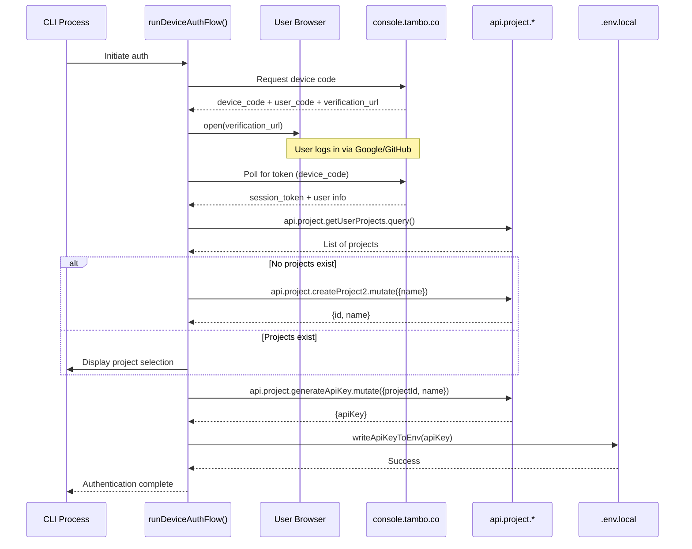
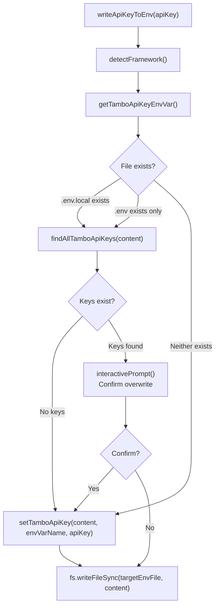
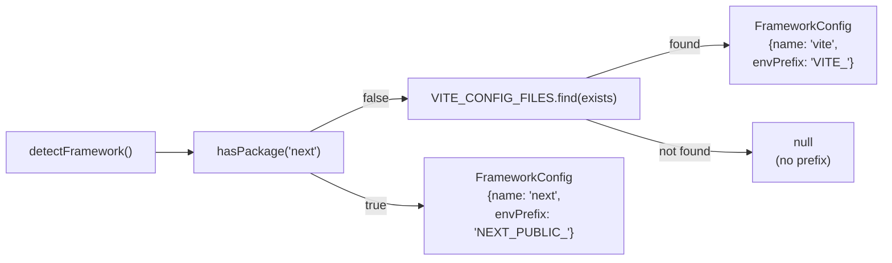
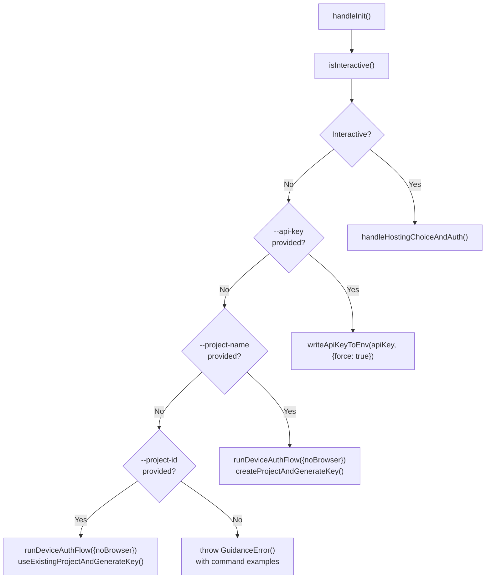

<!-- source: DeepWiki mcp.deepwiki.com · repo tambo-ai/tambo · page 2.3 Authentication Setup · fetched 2026-10-29 -->

# Authentication Setup

<details>
<summary>Relevant source files</summary>

The following files were used as context for generating this wiki page:

- [CONTRIBUTING.md](CONTRIBUTING.md)
- [README.md](README.md)
- [cli/README.md](cli/README.md)
- [cli/src/__tests__/non-interactive-safety.test.ts](cli/src/__tests__/non-interactive-safety.test.ts)
- [cli/src/cli.ts](cli/src/cli.ts)
- [cli/src/commands/add/component.ts](cli/src/commands/add/component.ts)
- [cli/src/commands/add/index.test.ts](cli/src/commands/add/index.test.ts)
- [cli/src/commands/add/index.ts](cli/src/commands/add/index.ts)
- [cli/src/commands/add/tailwind-setup.ts](cli/src/commands/add/tailwind-setup.ts)
- [cli/src/commands/add/tailwind/v4/toolchain-setup.test.ts](cli/src/commands/add/tailwind/v4/toolchain-setup.test.ts)
- [cli/src/commands/add/tailwind/v4/toolchain-setup.ts](cli/src/commands/add/tailwind/v4/toolchain-setup.ts)
- [cli/src/commands/add/types.ts](cli/src/commands/add/types.ts)
- [cli/src/commands/add/utils.ts](cli/src/commands/add/utils.ts)
- [cli/src/commands/create-app.ts](cli/src/commands/create-app.ts)
- [cli/src/commands/init.test.ts](cli/src/commands/init.test.ts)
- [cli/src/commands/init.ts](cli/src/commands/init.ts)
- [cli/src/commands/list/index.test.ts](cli/src/commands/list/index.test.ts)
- [cli/src/commands/list/index.ts](cli/src/commands/list/index.ts)
- [cli/src/commands/update.test.ts](cli/src/commands/update.test.ts)
- [cli/src/commands/update.ts](cli/src/commands/update.ts)
- [cli/src/commands/upgrade/components.ts](cli/src/commands/upgrade/components.ts)
- [cli/src/commands/upgrade/index.ts](cli/src/commands/upgrade/index.ts)
- [cli/src/commands/upgrade/llm-rules.ts](cli/src/commands/upgrade/llm-rules.ts)
- [cli/src/commands/upgrade/npm-packages.ts](cli/src/commands/upgrade/npm-packages.ts)
- [cli/src/commands/upgrade/utils.ts](cli/src/commands/upgrade/utils.ts)
- [cli/src/templates/tambo-template.ts](cli/src/templates/tambo-template.ts)
- [cli/src/utils/framework-detection.test.ts](cli/src/utils/framework-detection.test.ts)
- [cli/src/utils/framework-detection.ts](cli/src/utils/framework-detection.ts)
- [cli/src/utils/interactive.test.ts](cli/src/utils/interactive.test.ts)
- [cli/src/utils/interactive.ts](cli/src/utils/interactive.ts)
- [cli/src/utils/package-manager.test.ts](cli/src/utils/package-manager.test.ts)
- [cli/src/utils/package-manager.ts](cli/src/utils/package-manager.ts)
- [create-tambo-app/README.md](create-tambo-app/README.md)
- [react-sdk/AGENTS.md](react-sdk/AGENTS.md)
- [react-sdk/README.md](react-sdk/README.md)
- [showcase/README.md](showcase/README.md)

</details>


This page documents the authentication and API key setup process for Tambo projects. Authentication is required before using Tambo's generative UI features, whether connecting to Tambo Cloud or self-hosting the backend.

For information about user authentication within your application (end-user tokens passed to `TamboProvider`), see [User Authentication](#7.7). This page covers **project-level authentication** needed during initial setup.

---

## Overview

Authentication setup occurs during project initialization via `npx tambo init` and involves:

1. **Choosing a hosting mode**: Tambo Cloud (hosted backend) or self-hosted (Docker deployment)
2. **Obtaining an API key**: Through device auth flow (Cloud) or manual generation (self-hosted)
3. **Storing credentials**: Writing API keys to environment files with framework-specific prefixes
4. **Verification**: Ensuring the API key is accessible to the React SDK

The CLI supports both interactive and non-interactive modes, making it suitable for local development and CI/CD pipelines.

---

## Authentication Modes

### Diagram: Authentication Mode Selection



**Sources**: [cli/src/commands/init.ts:635-730]()

---

## Cloud Authentication (Device Auth Flow)

Tambo Cloud uses a device authorization flow similar to OAuth device flow, allowing authentication without embedding client secrets in the CLI.

### Diagram: Device Auth Flow Sequence



**Sources**: [cli/src/commands/init.ts:312-359](), [cli/src/commands/init.ts:478-630]()

### Device Auth Implementation Details

| Function | File | Purpose |
|----------|------|---------|
| `runDeviceAuthFlow()` | `cli/src/lib/device-auth.js` | Main device auth orchestration |
| `isTokenValid()` | `cli/src/lib/device-auth.js` | Check for existing session token |
| `verifySession()` | `cli/src/lib/device-auth.js` | Validate session with server |
| `handleProjectAndApiKey()` | [cli/src/commands/init.ts:478-630]() | Project selection/creation + key generation |
| `api.project.getUserProjects.query()` | `cli/src/lib/api-client.js` | Fetch user's projects |
| `api.project.createProject2.mutate()` | `cli/src/lib/api-client.js` | Create new project |
| `api.project.generateApiKey.mutate()` | `cli/src/lib/api-client.js` | Generate API key for project |

The device auth flow stores the session token locally and uses it for subsequent CLI operations. The `--no-browser` flag prints the verification URL instead of opening a browser, useful for headless environments.

**Sources**: [cli/src/commands/init.ts:14](), [cli/src/lib/device-auth.js:1]() (mocked in tests)

---

## API Key Management

### Key Generation

API keys are generated server-side and include a timestamp in their name for tracking:

```typescript
const timestamp = new Date().toLocaleString("en-US", {
  month: "short",
  day: "numeric",
  hour: "2-digit",
  minute: "2-digit",
});
const result = await api.project.generateApiKey.mutate({
  projectId,
  name: `CLI Key (${timestamp})`,
});
```

**Sources**: [cli/src/commands/init.ts:447-456]()

### Key Storage

API keys are written to environment files with framework-specific prefixes:

| Framework | Env Var Name | File Location |
|-----------|--------------|---------------|
| Next.js | `NEXT_PUBLIC_TAMBO_API_KEY` | `.env.local` or `.env` |
| Vite | `VITE_TAMBO_API_KEY` | `.env.local` or `.env` |
| Other | `TAMBO_API_KEY` | `.env.local` or `.env` |

### Diagram: API Key Storage Flow



**Sources**: [cli/src/commands/init.ts:84-172]()

### Environment File Selection Logic

The CLI prefers `.env.local` over `.env` to avoid committing secrets:

```typescript
// Use `.env.local` by default or fall back to .env if it exists and .env.local does not
let targetEnvFile = ".env.local";
if (fs.existsSync(".env") && !fs.existsSync(".env.local")) {
  targetEnvFile = ".env";
}
```

**Sources**: [cli/src/commands/init.ts:90-93]()

### Key Overwrite Protection

The `writeApiKeyToEnv()` function detects existing API keys and prompts for confirmation:

```typescript
const existingKeyNames = findAllTamboApiKeys(existingContent);

if (existingKeyNames.length > 0 && !force) {
  const warningMessage =
    existingKeyNames.length === 1
      ? `⚠️  This will overwrite the existing value of ${existingKeyNames[0]} in ${targetEnvFile}, are you sure?`
      : `⚠️  Found multiple Tambo API key variants in ${targetEnvFile}:\n   ${existingKeyNames.join(", ")}\n   This will remove all of them and replace with ${envVarName}. Continue?`;

  const { confirmReplace } = await interactivePrompt<{
    confirmReplace: boolean;
  }>(/* ... */);

  if (!confirmReplace) {
    console.log(chalk.gray("\nKeeping existing API key."));
    return true;
  }
}
```

**Sources**: [cli/src/commands/init.ts:118-142]()

---

## Framework Detection

The CLI automatically detects the project's framework to use the correct environment variable prefix.

### Diagram: Framework Detection Process



**Sources**: [cli/src/utils/framework-detection.ts:37-75]()

### Framework-Specific Behavior

| Framework | Detection Method | Env Prefix | Import Style |
|-----------|------------------|------------|--------------|
| Next.js | `next` in package.json | `NEXT_PUBLIC_` | `process.env.NEXT_PUBLIC_TAMBO_API_KEY` |
| Vite | `vite.config.*` exists | `VITE_` | `import.meta.env.VITE_TAMBO_API_KEY` |
| Other | None | None | `process.env.TAMBO_API_KEY` (may require bundler config) |

When no framework is detected, the CLI warns users that they may need to configure their bundler:

```typescript
if (!framework) {
  console.log(
    chalk.yellow(
      "\n   ⚠️  No supported framework detected. The environment variable",
    ),
  );
  console.log(
    chalk.yellow(
      `      ${envVarName} will not be automatically exposed to the browser.`,
    ),
  );
  // ... additional guidance
}
```

**Sources**: [cli/src/commands/init.ts:954-973]()

---

## Non-Interactive Mode

The CLI supports non-interactive environments (CI/CD, Docker, AI coding assistants) through command-line flags.

### Non-Interactive Detection

```typescript
export function isInteractive({
  stream = process.stdout,
}: { stream?: NodeJS.WriteStream } = {}): boolean {
  const term = process.env.TERM;
  const isCI = Boolean(
    (typeof process.env.CI === "string" &&
      process.env.CI.trim() !== "" &&
      process.env.CI !== "0") ||
    process.env.GITHUB_ACTIONS === "true",
  );
  const forceInteractive = process.env.FORCE_INTERACTIVE === "1";

  // Check both stdin and stdout TTY status
  return (
    !isCI &&
    !forceInteractive &&
    stream.isTTY &&
    process.stdin.isTTY &&
    term !== "dumb"
  );
}
```

**Sources**: [cli/src/utils/interactive.ts:24-43]()

### Non-Interactive Authentication Flags

| Flag | Purpose | Example |
|------|---------|---------|
| `--api-key` | Direct API key input (no auth flow) | `tambo init --api-key=sk_xxx` |
| `--project-name` | Create new project via device auth | `tambo init --project-name=myapp` |
| `--project-id` | Use existing project via device auth | `tambo init --project-id=abc123` |
| `--no-browser` | Print auth URL instead of opening browser | `tambo init --project-name=myapp --no-browser` |

### Diagram: Non-Interactive Mode Decision Flow



**Sources**: [cli/src/commands/init.ts:1009-1102]()

### CI/CD Example

```bash
# GitHub Actions workflow
- name: Initialize Tambo
  run: npx tambo init --api-key="${{ secrets.TAMBO_API_KEY }}"

# Or with project creation
- name: Initialize Tambo with new project
  run: npx tambo init --project-name=ci-build --no-browser
  env:
    # Device auth flow will print URL to logs
```

**Sources**: [cli/README.md:145-153]()

---

## Self-Hosted Authentication

When choosing self-hosted mode, users must manually set up the backend and generate API keys.

### Self-Host Setup Instructions

The CLI displays setup instructions when self-host is selected:

```typescript
function displaySelfHostInstructions(): void {
  console.log(chalk.cyan("\nStep 1: Self-host setup (time: 5-10 minutes)\n"));
  console.log(
    chalk.gray(
      "You can run the open-source Tambo Cloud API locally or self-host it.",
    ),
  );
  console.log(
    chalk.gray("Repo:"),
    chalk.cyan("https://github.com/tambo-ai/tambo"),
  );

  console.log(chalk.bold("\nQuick start with Docker:"));
  console.log(chalk.gray("  1. Clone the repo"));
  console.log(chalk.gray("  2. Run:"));
  console.log(chalk.gray("     ./scripts/cloud/tambo-setup.sh"));
  console.log(chalk.gray("     ./scripts/cloud/tambo-start.sh"));
  console.log(chalk.gray("     ./scripts/cloud/init-database.sh"));
  console.log(
    chalk.gray(
      "  3. Open http://localhost:3000, create a project, then generate an API key",
    ),
  );
  // ...
}
```

**Sources**: [cli/src/commands/init.ts:177-212]()

### Manual API Key Input

After setting up the backend, users can either paste an API key or switch to Cloud:

```typescript
const { apiKeyOrCloud } = await interactivePrompt<{ apiKeyOrCloud: string }>(
  {
    type: "select",
    name: "apiKeyOrCloud",
    message: "How would you like to proceed?",
    choices: [
      { name: "Paste API key (default)", value: "paste" },
      { name: "Use Cloud instead (takes < 1 minute)", value: "cloud" },
    ],
    default: "paste",
  },
  /* ... */
);

if (apiKeyOrCloud === "cloud") {
  console.log(chalk.blue("\nSwitching to Cloud setup..."));
  return await handleAuthentication();
}

const { apiKey } = await interactivePrompt<{ apiKey: string }>(
  {
    type: "password",
    name: "apiKey",
    mask: "*",
    message: "Paste your self-hosted Tambo API key:",
    validate: (input: string) => {
      if (!input?.trim()) return "API key is required";
      return true;
    },
  },
  /* ... */
);

return await writeApiKeyToEnv(apiKey);
```

**Sources**: [cli/src/commands/init.ts:692-729]()

---

## Environment Variable Utilities

### Finding Existing API Keys

The `findTamboApiKey()` function searches for any variant of the API key:

```typescript
export function findTamboApiKey(envContent: string): {
  keyName: string;
  value: string;
} | null {
  const lines = envContent.split("\n");
  
  for (const keyName of TAMBO_API_KEY_NAMES) {
    for (const line of lines) {
      const trimmed = line.trim();
      if (trimmed.startsWith(keyName + "=")) {
        const value = trimmed.substring(keyName.length + 1);
        return { keyName, value };
      }
    }
  }
  
  return null;
}
```

**Sources**: [cli/src/utils/dotenv-utils.ts:1]() (referenced in imports)

### Supported API Key Names

```typescript
export type TamboApiKeyName =
  | "NEXT_PUBLIC_TAMBO_API_KEY"
  | "VITE_TAMBO_API_KEY"
  | "TAMBO_API_KEY";

const TAMBO_API_KEY_NAMES: TamboApiKeyName[] = [
  "NEXT_PUBLIC_TAMBO_API_KEY",
  "VITE_TAMBO_API_KEY",
  "TAMBO_API_KEY",
];
```

**Sources**: [cli/src/utils/dotenv-utils.ts:23-27]()

### Setting API Keys

The `setTamboApiKey()` function removes old key variants and adds the new one:

```typescript
export function setTamboApiKey(
  envContent: string,
  keyName: TamboApiKeyName,
  value: string,
): string {
  // Remove all Tambo API key variants
  const lines = envContent.split("\n");
  const filteredLines = lines.filter((line) => {
    const trimmed = line.trim();
    return !TAMBO_API_KEY_NAMES.some((name) => trimmed.startsWith(name + "="));
  });

  // Add the new key
  filteredLines.push(`${keyName}=${value}`);
  
  return filteredLines.join("\n");
}
```

**Sources**: [cli/src/commands/init.ts:145-149]()

---

## Authentication Verification

After setup, the API key should be accessible in the React SDK:

### Next.js Verification

```typescript
<TamboProvider
  apiKey={process.env.NEXT_PUBLIC_TAMBO_API_KEY ?? ""}
  components={components}
>
  <App />
</TamboProvider>
```

### Vite Verification

```typescript
<TamboProvider
  apiKey={import.meta.env.VITE_TAMBO_API_KEY ?? ""}
  components={components}
>
  <App />
</TamboProvider>
```

### Testing API Key

For Tambo Cloud users, the web dashboard provides a smoke test endpoint:

```
http://localhost:8260/internal/smoketest
```

**Sources**: [CONTRIBUTING.md:114](), [cli/src/commands/init.ts:909-939]()

---

## Error Handling

### DeviceAuthError

Device auth failures throw a custom error with error codes:

```typescript
class DeviceAuthError extends Error {
  code?: string;
  constructor(message: string, code?: string) {
    super(message);
    this.name = "DeviceAuthError";
    this.code = code;
  }
}
```

**Sources**: [cli/src/commands/init.test.ts:154-161]()

### GuidanceError

Non-interactive mode throws `GuidanceError` with actionable commands:

```typescript
if (!isInteractive() && !apiKey && !projectName && !projectId) {
  throw new GuidanceError("API key required in non-interactive mode", [
    "npx tambo init --api-key=sk_...  # Get key from https://console.tambo.co",
    "npx tambo init --project-name=myapp   # Create new project (requires browser auth)",
    "npx tambo init --project-id=abc123    # Use existing project (requires browser auth)",
  ]);
}
```

**Sources**: [cli/src/commands/init.ts:1097-1101](), [cli/src/cli.ts:738-749]()

---

## Summary

| Aspect | Implementation | Key Files |
|--------|----------------|-----------|
| **Cloud Auth** | Device auth flow with OAuth-like token exchange | [cli/src/commands/init.ts:312-359]() |
| **API Key Storage** | Framework-aware env file writing | [cli/src/commands/init.ts:84-172]() |
| **Framework Detection** | Package.json and config file scanning | [cli/src/utils/framework-detection.ts:37-75]() |
| **Non-Interactive** | Flag-based authentication for CI/CD | [cli/src/commands/init.ts:1009-1102]() |
| **Self-Hosted** | Manual key input with Docker setup guide | [cli/src/commands/init.ts:177-212]() |
| **Session Management** | Local token storage with server validation | `cli/src/lib/device-auth.js` |

**Sources**: [cli/src/commands/init.ts:1-1280](), [cli/src/utils/framework-detection.ts:1-135](), [cli/src/utils/interactive.ts:1-300]()

---

