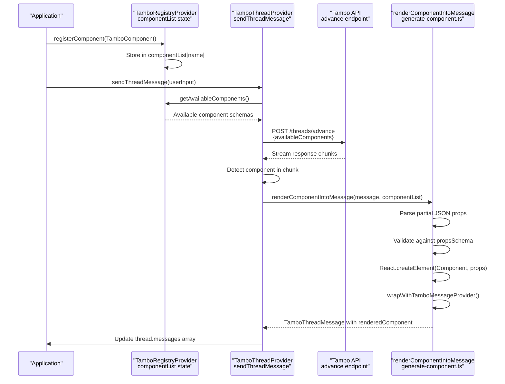
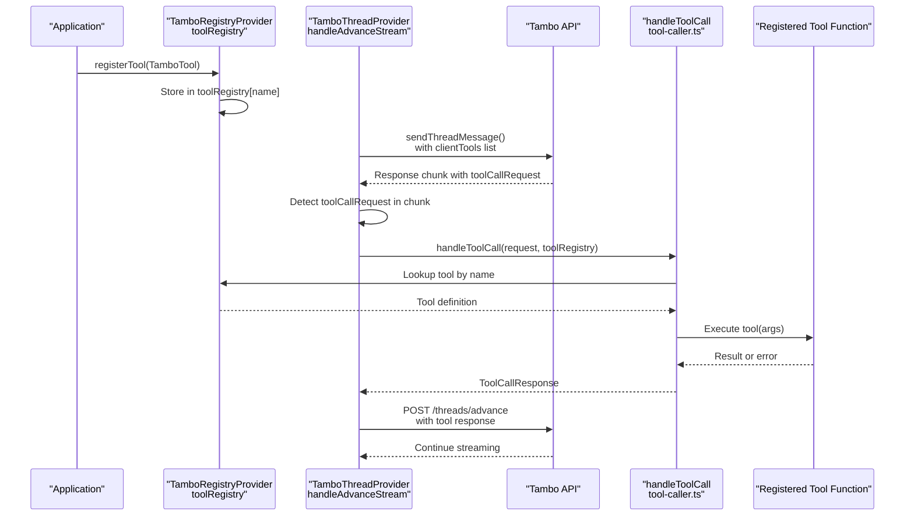
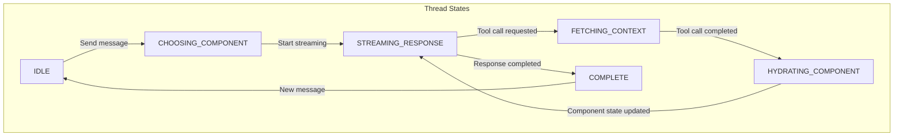
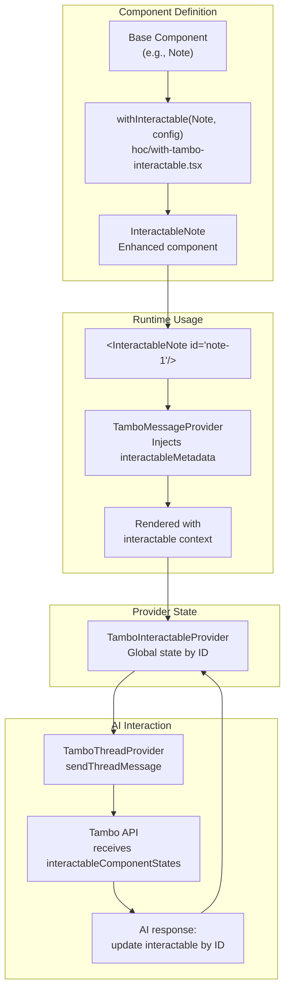
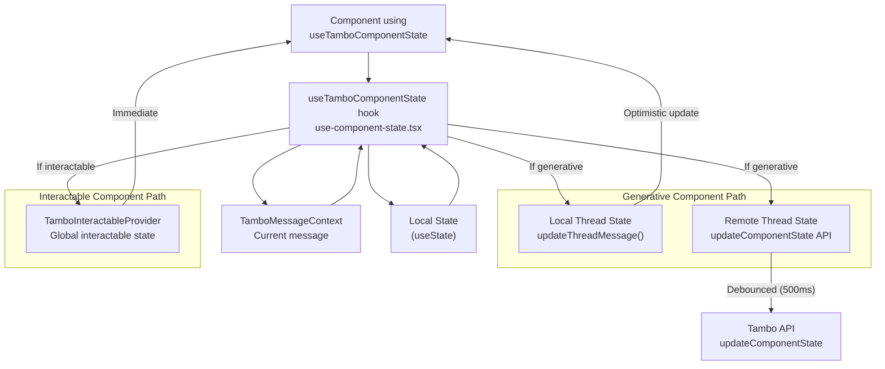

<!-- source: DeepWiki mcp.deepwiki.com · repo tambo-ai/tambo · page 3 React SDK · fetched 2026-10-29 -->

# React SDK

<details>
<summary>Relevant source files</summary>

The following files were used as context for generating this wiki page:

- [README.md](README.md)
- [cli/README.md](cli/README.md)
- [cli/src/templates/tambo-template.ts](cli/src/templates/tambo-template.ts)
- [create-tambo-app/README.md](create-tambo-app/README.md)
- [react-sdk/AGENTS.md](react-sdk/AGENTS.md)
- [react-sdk/README.md](react-sdk/README.md)
- [react-sdk/src/hooks/react-query-hooks.ts](react-sdk/src/hooks/react-query-hooks.ts)
- [react-sdk/src/index.ts](react-sdk/src/index.ts)
- [react-sdk/src/model/component-metadata.ts](react-sdk/src/model/component-metadata.ts)
- [react-sdk/src/providers/tambo-registry-provider.tsx](react-sdk/src/providers/tambo-registry-provider.tsx)
- [react-sdk/src/util/registry.ts](react-sdk/src/util/registry.ts)
- [react-sdk/src/util/tool-caller.ts](react-sdk/src/util/tool-caller.ts)
- [showcase/README.md](showcase/README.md)

</details>


The `@tambo-ai/react` package is the core SDK for building generative UI applications with React. It provides a provider-based architecture that enables AI to dynamically select and render React components, execute client-side functions, and manage conversation state.

## Purpose

The React SDK abstracts the complexity of building AI-powered UIs by handling:
- **Component orchestration** - AI selects which React components to render based on conversation context
- **Streaming infrastructure** - Props stream to components in real-time as the LLM generates them
- **State management** - Bidirectional sync between UI state and conversation history
- **Tool execution** - Client-side functions (tools) that AI can invoke to fetch data or perform actions
- **Thread management** - Conversation history, message storage, and multi-thread support

## Installation

```bash
npm install @tambo-ai/react
```

For new projects, use `create-tambo-app`:

```bash
npm create tambo-app my-app
cd my-app
npx tambo init
npm run dev
```

See [Installation](#2.1) for detailed setup instructions.

## Core Abstractions

The SDK is built around four primary abstractions:

**TamboProvider**

Root React context provider that configures the SDK. Wrap your application with `TamboProvider` and pass configuration including API key, registered components, and tools.

```typescript
<TamboProvider
  apiKey={process.env.NEXT_PUBLIC_TAMBO_API_KEY}
  components={components}
  tools={tools}
>
  <YourApp />
</TamboProvider>
```

See [TamboProvider Setup](#3.1) for configuration options.

**Components**

React components registered with the SDK using Zod schemas to define props. The AI uses component names and descriptions to decide which component to render. When selected, the AI generates props that stream to the component in real-time.

```typescript
const components: TamboComponent[] = [
  {
    name: "WeatherCard",
    description: "Displays weather information for a location",
    component: WeatherCard,
    propsSchema: z.object({
      temperature: z.number(),
      condition: z.string(),
      location: z.string(),
    }),
  }
];
```

See [Component Registration](#3.4) for detailed registration patterns.

**Tools**

Client-side JavaScript functions that AI can invoke. Tools use Zod schemas for input/output validation and can return data to the AI or modify application state.

```typescript
const tools: TamboTool[] = [
  {
    name: "getCurrentWeather",
    description: "Fetches current weather data for a location",
    tool: async ({ location }) => fetchWeather(location),
    inputSchema: z.object({ location: z.string() }),
    outputSchema: z.object({
      temperature: z.number(),
      condition: z.string(),
    }),
  }
];
```

See [Tool Registration](#3.5) for tool definition patterns.

**Hooks**

React hooks that provide access to SDK functionality. The primary hook is `useTambo()`, which combines all SDK features. Specialized hooks like `useTamboThreadInput()`, `useTamboComponentState()`, and `useTamboStreamStatus()` provide granular control.

```typescript
const { thread, sendMessage } = useTambo();
const { value, setValue, submit, isPending } = useTamboThreadInput();
```

See [Hooks API Reference](#3.7) for complete hook documentation.

## Package Architecture

The SDK is organized into providers, hooks, models, and utilities. All public exports are available from the main package entry point at [react-sdk/src/index.ts:1-8]().

**React SDK Package Structure**

```mermaid
graph TB
    Entry["react-sdk/src/index.ts<br/>Public API Entry Point"]
    
    subgraph Providers["providers/"]
        TamboProvider["TamboProvider<br/>tambo-provider.tsx"]
        ClientProvider["TamboClientProvider<br/>tambo-client-provider.tsx"]
        RegistryProvider["TamboRegistryProvider<br/>tambo-registry-provider.tsx"]
        ThreadProvider["TamboThreadProvider<br/>tambo-thread-provider.tsx"]
        InteractableProvider["TamboInteractableProvider<br/>tambo-interactable-provider.tsx"]
        MCPProvider["TamboMcpProvider<br/>mcp/tambo-mcp-provider.tsx"]
    end
    
    subgraph Hooks["hooks/"]
        UseTambo["useTambo()<br/>Composite hook"]
        UseThreadInput["useTamboThreadInput()<br/>Input management"]
        UseComponentState["useTamboComponentState()<br/>Component state sync"]
        UseStreamStatus["useTamboStreamStatus()<br/>Streaming progress"]
        UseSuggestions["useTamboSuggestions()<br/>AI suggestions"]
    end
    
    subgraph Model["model/"]
        TamboComponent["TamboComponent<br/>component-metadata.ts"]
        TamboTool["TamboTool<br/>component-metadata.ts"]
        ComponentRegistry["ComponentRegistry<br/>component-metadata.ts"]
        TamboToolRegistry["TamboToolRegistry<br/>component-metadata.ts"]
    end
    
    subgraph Util["util/"]
        DefineTool["defineTool()<br/>registry.ts"]
        HandleToolCall["handleToolCall()<br/>tool-caller.ts"]
        RenderComponent["renderComponentIntoMessage()<br/>generate-component.ts"]
    end
    
    Entry --> TamboProvider
    Entry --> UseTambo
    Entry --> TamboComponent
    Entry --> DefineTool
    
    TamboProvider --> ClientProvider
    TamboProvider --> RegistryProvider
    TamboProvider --> ThreadProvider
    TamboProvider --> InteractableProvider
    TamboProvider --> MCPProvider
    
    UseTambo --> ThreadProvider
    UseThreadInput --> ThreadProvider
    UseComponentState --> ThreadProvider
    UseComponentState --> InteractableProvider
    UseStreamStatus --> ThreadProvider
    UseSuggestions --> ClientProvider
    
    RegistryProvider --> ComponentRegistry
    RegistryProvider --> TamboToolRegistry
    RegistryProvider --> DefineTool
    
    ThreadProvider --> HandleToolCall
    ThreadProvider --> RenderComponent
    HandleToolCall --> TamboToolRegistry
    RenderComponent --> ComponentRegistry
```



Sources: [react-sdk/src/index.ts:1-8](), [react-sdk/src/providers/tambo-provider.tsx:1-203](), [react-sdk/src/model/component-metadata.ts:1-466]()

The architecture follows a nested provider pattern. `TamboProvider` is the root that orchestrates sub-providers:
- `TamboClientProvider` manages the API client and authentication
- `TamboRegistryProvider` stores registered components and tools
- `TamboThreadProvider` handles conversation state and streaming
- `TamboInteractableProvider` manages persistent component state
- `TamboMcpProvider` connects to MCP servers

Hooks consume these contexts to provide functionality. See [Provider Architecture](#3.2) for detailed provider composition.

## Quick Start

This example shows basic integration of the React SDK into a Next.js application.

**1. Install Dependencies**

```bash
npm install @tambo-ai/react zod
```

**2. Define Components**

```typescript
// lib/tambo.ts
import { TamboComponent } from "@tambo-ai/react";
import { z } from "zod/v4";
import { WeatherCard } from "@/components/WeatherCard";

export const components: TamboComponent[] = [
  {
    name: "WeatherCard",
    description: "Displays current weather for a location",
    component: WeatherCard,
    propsSchema: z.object({
      location: z.string(),
      temperature: z.number(),
      condition: z.enum(["sunny", "cloudy", "rainy", "snowy"]),
    }),
  }
];
```

**3. Wrap Application with Provider**

```typescript
// app/layout.tsx
"use client";
import { TamboProvider } from "@tambo-ai/react";
import { components } from "@/lib/tambo";

export default function RootLayout({ children }) {
  return (
    <html lang="en">
      <body>
        <TamboProvider
          apiKey={process.env.NEXT_PUBLIC_TAMBO_API_KEY!}
          components={components}
        >
          {children}
        </TamboProvider>
      </body>
    </html>
  );
}
```

**4. Build Chat Interface**

```typescript
// components/Chat.tsx
import { useTamboThread, useTamboThreadInput } from "@tambo-ai/react";

export function Chat() {
  const { thread } = useTamboThread();
  const { value, setValue, submit, isPending } = useTamboThreadInput();
  
  return (
    <div>
      {thread?.messages.map((msg) => (
        <div key={msg.id}>
          <p>{msg.content}</p>
          {msg.renderedComponent}
        </div>
      ))}
      
      <input
        value={value}
        onChange={(e) => setValue(e.target.value)}
        disabled={isPending}
      />
      <button onClick={submit} disabled={isPending}>
        Send
      </button>
    </div>
  );
}
```

Sources: [react-sdk/README.md:46-78](), [README.md:92-138](), [cli/README.md:156-209]()

When a user types "Show me the weather in San Francisco", the AI:
1. Selects the `WeatherCard` component
2. Generates props: `{ location: "San Francisco", temperature: 18, condition: "sunny" }`
3. Props stream to the component in real-time
4. Component renders with the generated props

## Message Flow

The following diagram shows how a user message flows through the SDK to produce an AI response with rendered components.

**User Message to AI-Generated Component Flow**

```mermaid
sequenceDiagram
    participant User
    participant UI["Chat UI"]
    participant ThreadInput["useTamboThreadInput()"]
    participant ThreadProvider["TamboThreadProvider<br/>sendThreadMessage()"]
    participant Registry["TamboRegistryProvider<br/>componentList, toolRegistry"]
    participant ClientProvider["TamboClientProvider<br/>TamboAI client"]
    participant API["Tambo API<br/>/threads/:id/runs"]
    participant StreamHandler["handleAdvanceStream()<br/>tambo-thread-provider.tsx"]
    participant ToolCaller["handleToolCall()<br/>tool-caller.ts"]
    participant Renderer["renderComponentIntoMessage()<br/>generate-component.ts"]
    
    User->>UI: "Show weather in SF"
    UI->>ThreadInput: submit()
    ThreadInput->>ThreadProvider: sendThreadMessage(content)
    
    ThreadProvider->>Registry: getAvailableComponents()
    Registry-->>ThreadProvider: [WeatherCard schema]
    
    ThreadProvider->>ClientProvider: advance thread
    ClientProvider->>API: POST with components/tools
    
    API-->>StreamHandler: SSE stream chunks
    
    alt Tool Call Required
        StreamHandler->>ToolCaller: toolCallRequest detected
        ToolCaller->>Registry: lookup tool in toolRegistry
        ToolCaller->>ToolCaller: execute tool function
        ToolCaller-->>StreamHandler: tool result
        StreamHandler->>API: send tool result, continue
        API-->>StreamHandler: continue streaming
    end
    
    StreamHandler->>Renderer: component detected in stream
    Renderer->>Registry: getComponentFromRegistry()
    Registry-->>Renderer: WeatherCard component
    Renderer->>Renderer: validate props against propsSchema
    Renderer->>Renderer: React.createElement(WeatherCard, props)
    Renderer-->>StreamHandler: message with renderedComponent
    
    StreamHandler->>ThreadProvider: update threadMap
    ThreadProvider->>UI: re-render with updated thread
    UI->>User: Display WeatherCard
```

Sources: [react-sdk/src/providers/tambo-thread-provider.tsx:481-598](), [react-sdk/src/providers/tambo-thread-provider.tsx:795-883](), [react-sdk/src/util/tool-caller.ts:15-59](), [react-sdk/src/util/generate-component.ts:18-77]()

The flow demonstrates several key SDK features:
- **Optimistic updates**: UI updates before API response via local state
- **Streaming**: Props stream incrementally as AI generates them
- **Tool execution**: Client-side tools execute during streaming, results fed back to AI
- **Component rendering**: AI-selected components render with validated props
- **Thread persistence**: All messages and component state stored in thread

See [Streaming and Event Handling](#3.8) for detailed streaming architecture.

## Key Features

### Component Registration

Register React components with Zod schemas. AI uses component descriptions to select which component to render. Component props stream in real-time as AI generates them.

```typescript
const components: TamboComponent[] = [
  {
    name: "Chart",
    description: "Displays data as line, bar, or pie charts",
    component: Chart,
    propsSchema: z.object({
      data: z.array(z.object({
        name: z.string(),
        value: z.number()
      })),
      type: z.enum(["line", "bar", "pie"])
    })
  }
];
```

See [Component Registration](#3.4) for validation, loading states, and advanced patterns.

### Tool Execution

Define client-side functions that AI can invoke. Tools fetch data, manipulate DOM, access React state, or perform authenticated requests.

```typescript
const tools: TamboTool[] = [
  {
    name: "searchDatabase",
    description: "Search product database by query",
    tool: async ({ query }) => {
      const response = await fetch(`/api/search?q=${query}`);
      return response.json();
    },
    inputSchema: z.object({ query: z.string() }),
    outputSchema: z.array(z.object({
      id: z.string(),
      name: z.string(),
      price: z.number()
    }))
  }
];
```

See [Tool Registration](#3.5) for tool definition, execution flow, and error handling.

### Streaming Infrastructure

Props stream incrementally as LLM generates them. Components render progressively, showing partial data before completion. Streaming can be monitored using `useTamboStreamStatus()`.

```typescript
function Chart({ data }) {
  const { propStatus } = useTamboStreamStatus();
  
  if (!propStatus["data"]?.isSuccess) {
    return <Skeleton />;
  }
  
  return <LineChart data={data} />;
}
```

See [Streaming and Event Handling](#3.8) for streaming architecture and event handling.

### Thread Management

Conversations are organized into threads with persistent message history. Support for multiple concurrent threads, thread switching, and automatic thread naming.

```typescript
const { thread, switchCurrentThread, startNewThread } = useTambo();

// Switch to existing thread
switchCurrentThread("thread-123");

// Create new thread
startNewThread();

// Access messages
thread.messages.forEach((msg) => {
  console.log(msg.content, msg.renderedComponent);
});
```

See [Thread Management](#3.3) for thread lifecycle, context isolation, and message persistence.

### Interactable Components

Pre-placed components that persist across conversations and can be updated by ID via natural language. Useful for dashboards, forms, and stateful UI elements.

```typescript
const InteractableNote = withInteractable(Note, {
  componentName: "Note",
  description: "A note with title and content",
  propsSchema: z.object({
    title: z.string(),
    content: z.string(),
    color: z.enum(["white", "yellow", "blue"])
  })
});

// Usage
<InteractableNote id="note-1" title="My Note" content="Initial text" />
```

User can say "Change note-1's color to yellow" and the component updates.

See [Interactable Components](#3.9) for implementation patterns and state management.

### Component State

Component props can have persistent state that syncs bidirectionally between UI and conversation history. State updates debounced to reduce API calls.

```typescript
function EditableNote({ initialTitle }) {
  const [title, setTitle] = useTamboComponentState("title", initialTitle);
  
  return (
    <input
      value={title}
      onChange={(e) => setTitle(e.target.value)}
    />
  );
}
```

See [Component State Management](#3.6) for state persistence patterns and sync behavior.

### MCP Integration

Connect to Model Context Protocol servers to extend AI capabilities with external tools, resources, and prompts.

```typescript
<TamboProvider
  apiKey={apiKey}
  components={components}
  mcpServers={[
    {
      name: "filesystem",
      url: "http://localhost:8261/mcp",
      transport: MCPTransport.HTTP
    }
  ]}
>
  <App />
</TamboProvider>
```

See [MCP Integration](#6) for server configuration, tool/resource access, and protocol details.

## Component Registration

Components are React components that can be dynamically rendered by the AI in message responses. Registration makes components available to the AI's decision-making process.

**Component Registration and Rendering Flow**



Sources: [react-sdk/src/providers/tambo-registry-provider.tsx:247-284](), [react-sdk/src/providers/tambo-thread-provider.tsx:995-1113](), [react-sdk/src/util/generate-component.ts:1-78]()

### TamboComponent Interface

**Component Definition:**

| Field | Type | Required | Description |
|-------|------|----------|-------------|
| `name` | `string` | Yes | Unique component identifier |
| `description` | `string` | Yes | Natural language description for AI |
| `component` | `React.ComponentType` | Yes | React component to render |
| `propsSchema` | `ZodSchema \| StandardSchema` | Yes | Zod or Standard Schema for props validation |
| `loadingComponent` | `React.ComponentType?` | No | Placeholder while props stream |
| `associatedTools` | `TamboTool[]?` | No | Tools that provide data for this component |

Sources: [react-sdk/src/model/component-metadata.ts:49-90]()

### Registering Components

**Method 1: Via TamboProvider Props**

```typescript
import { TamboProvider } from "@tambo-ai/react";
import { z } from "zod/v4";
import { WeatherCard } from "./components/WeatherCard";

const components = [
  {
    name: "WeatherCard",
    description: "Displays current weather conditions for a location",
    component: WeatherCard,
    propsSchema: z.object({
      location: z.string().describe("City name"),
      temperature: z.number().describe("Temperature in Celsius"),
      condition: z.enum(["sunny", "cloudy", "rainy", "snowy"]),
      humidity: z.number().optional(),
    }),
  }
];

function App() {
  return (
    <TamboProvider apiKey={apiKey} components={components}>
      {children}
    </TamboProvider>
  );
}
```

**Method 2: Programmatic Registration**

```typescript
import { useTamboRegistry } from "@tambo-ai/react";

function MyComponent() {
  const { registerComponent } = useTamboRegistry();
  
  useEffect(() => {
    registerComponent({
      name: "DynamicChart",
      description: "Dynamically loaded chart component",
      component: ChartComponent,
      propsSchema: chartPropsSchema,
    });
  }, []);
}
```

Sources: [react-sdk/src/providers/tambo-registry-provider.tsx:247-284](), [react-sdk/README.md:86-98]()

### Component Validation and Rendering

When the AI selects a component, `renderComponentIntoMessage()` performs validation and rendering:

1. **Parse Props:** Uses `partial-json` to handle streaming props (incomplete JSON)
2. **Validate Schema:** Runs props through `propsSchema` validator
3. **Create Element:** Calls `React.createElement(component, validatedProps)`
4. **Wrap Context:** Wraps with `TamboMessageProvider` so component can access `useTamboCurrentMessage()`
5. **Store Result:** Adds `renderedComponent` to message object

Sources: [react-sdk/src/util/generate-component.ts:18-77]()

## Tool Registration

Tools are JavaScript functions executed client-side (in the React app) that the AI can invoke to fetch data, manipulate state, or perform actions. Tools use Zod schemas to define inputs and outputs.

**Tool Execution Flow**



Sources: [react-sdk/src/providers/tambo-thread-provider.tsx:795-883](), [react-sdk/src/util/tool-caller.ts:1-89]()

### TamboTool Interface

Tools are defined using the `defineTool()` helper function:

**Tool Definition:**

| Field | Type | Required | Description |
|-------|------|----------|-------------|
| `name` | `string` | Yes | Unique tool identifier |
| `description` | `string` | Yes | Natural language description for AI |
| `tool` | `(...args) => Promise<T>` | Yes | Async function to execute |
| `inputSchema` | `ZodSchema` | Yes | Zod schema for input parameters |
| `outputSchema` | `ZodSchema` | Yes | Zod schema for return value |
| `annotations` | `ToolAnnotations?` | No | Metadata (e.g., `tamboStreamableHint`) |
| `transformToContent` | `(result) => ContentPart[]?` | No | Convert result to AI message content |

Sources: [react-sdk/src/model/component-metadata.ts:16-42](), [react-sdk/src/util/registry.ts:1-89]()

### Defining Tools

**Method 1: Using defineTool() Helper**

```typescript
import { defineTool } from "@tambo-ai/react";
import { z } from "zod/v4";

const getWeatherTool = defineTool({
  name: "getWeather",
  description: "Fetches current weather for a location",
  tool: async ({ location }) => {
    const response = await fetch(`/api/weather?location=${location}`);
    return await response.json();
  },
  inputSchema: z.object({
    location: z.string().describe("City name or coordinates"),
  }),
  outputSchema: z.object({
    temperature: z.number(),
    condition: z.string(),
    humidity: z.number(),
  }),
});

const tools = [getWeatherTool];
```

**Method 2: Direct TamboTool Object (Legacy)**

```typescript
const tools = [
  {
    name: "getWeather",
    description: "Fetches current weather for a location",
    tool: async (location) => {
      // Implementation
    },
    toolSchema: z.function()
      .args(z.tuple([z.string()]))
      .returns(z.object({
        temperature: z.number(),
        condition: z.string(),
      })),
  }
];
```

Sources: [react-sdk/src/util/registry.ts:1-89](), [react-sdk/README.md:275-301]()

### Tool-Component Associations

Tools can be associated with specific components via `associatedTools`. When the AI decides to render the component, it knows which tools can provide data for it:

```typescript
const components = [
  {
    name: "WeatherCard",
    description: "Displays weather information",
    component: WeatherCard,
    propsSchema: z.object({
      temperature: z.number(),
      condition: z.string(),
      location: z.string(),
    }),
    associatedTools: [getWeatherTool],
  }
];
```

During streaming, if the AI selects `WeatherCard`, it can call `getWeather` tool to populate the props. The tool result flows back to the AI, which then continues generating the component.

Sources: [react-sdk/src/providers/tambo-registry-provider.tsx:275-280](), [react-sdk/src/util/registry.ts:11-68]()

### Handling Tool Errors

When a tool throws an error or returns an error object, `handleToolCall()` catches it and returns a `ToolCallResponse` with `error` field set. This error is included in the message sent to the AI:

```typescript
interface ToolCallResponse {
  result?: any;
  error?: string;
  contentParts?: ContentPart[];
}
```

Sources: [react-sdk/src/util/tool-caller.ts:13-89]()

## Thread Management

The `TamboThreadProvider` manages conversation threads, including message history, input state, and generation stages.



Sources: [react-sdk/src/providers/tambo-thread-provider.tsx:491-536](), [react-sdk/src/providers/tambo-thread-provider.tsx:347-363]()

### Thread Context Interface

The `TamboThreadContext` provides the following interface:

```typescript
interface TamboThreadContextProps {
  thread: TamboThread;                            // Current thread
  switchCurrentThread: (threadId: string) => void; // Switch to a different thread
  startNewThread: () => void;                     // Start a new thread
  addThreadMessage: (message, sendToServer) => Promise<...>; // Add a message
  updateThreadMessage: (id, message, sendToServer) => Promise<void>; // Update a message
  inputValue: string;                            // Current input value
  setInputValue: (value: string) => void;         // Set input value
  sendThreadMessage: (message, options) => Promise<...>; // Send a message
  generationStage: GenerationStage;              // Current generation stage
  generationStatusMessage: string;               // Status message
  isIdle: boolean;                               // Whether the AI is idle
}
```

Sources: [react-sdk/src/providers/tambo-thread-provider.tsx:29-66]()

### Managing Input with useTamboThreadInput

The `useTamboThreadInput` hook provides a simple interface for managing input state:

```typescript
const { value, setValue, submit, isSubmitting } = useTamboThreadInput();
```

This can be used in input components to handle user input:

```typescript
<input
  value={value}
  onChange={(e) => setValue(e.target.value)}
  disabled={isSubmitting}
/>
<button onClick={submit} disabled={isSubmitting}>
  Send
</button>
```

Sources: [README.md:98-126]()

## Interactable Components

Interactable components are pre-placed in the UI (or dynamically generated) and persist across conversations. They can be updated by ID via natural language. Implemented using the `withInteractable()` HOC.

**Interactable Component Architecture**



Sources: [react-sdk/src/hoc/with-tambo-interactable.tsx:1-169](), [react-sdk/src/providers/tambo-interactable-provider.tsx:1-207]()

### Creating Interactable Components

**Using withInteractable HOC:**

```typescript
import { withInteractable } from "@tambo-ai/react";
import { z } from "zod/v4";
import { Note } from "./components/Note";

const InteractableNote = withInteractable(Note, {
  componentName: "Note",
  description: "A note supporting title, content, and color modifications",
  propsSchema: z.object({
    title: z.string(),
    content: z.string(),
    color: z.enum(["white", "yellow", "blue", "green"]).optional(),
  }),
});

// Pre-place in UI
function Dashboard() {
  return (
    <TamboProvider apiKey={apiKey} components={[]}>
      <InteractableNote 
        id="note-1" 
        title="My Note" 
        content="Initial content" 
      />
      <InteractableNote 
        id="note-2" 
        title="Another Note" 
        content="More content" 
      />
      <ChatInterface />
    </TamboProvider>
  );
}
```

**User Interaction:**
- User: "Change note-1's title to 'Updated Title'"
- AI updates `note-1` props via interactable component state

Sources: [react-sdk/src/hoc/with-tambo-interactable.tsx:1-169](), [react-sdk/README.md:217-237]()

### Interactable State Flow

1. **Registration:** `withInteractable()` wraps component and registers it with `TamboRegistryProvider`
2. **Placement:** Component rendered with unique `id` prop
3. **State Init:** `useCurrentInteractablesSnapshot()` captures initial props and stores in `TamboInteractableProvider`
4. **AI Request:** When user sends message, all interactable states sent to API
5. **AI Update:** API response includes updates to specific interactable IDs
6. **State Update:** Provider updates global state, triggering re-render

Sources: [react-sdk/src/hoc/with-tambo-interactable.tsx:76-164](), [react-sdk/src/providers/tambo-interactable-provider.tsx:71-207]()

### Dynamic Interactable Generation

AI can also generate new interactable components dynamically:

```typescript
// User: "Create a new note"
// AI generates:
// - componentName: "Note"
// - interactableMetadata: { id: "note-3", componentName: "Note" }
// - props: { title: "New Note", content: "" }
```

The generated component automatically registers with `TamboInteractableProvider` and can be updated by ID in subsequent messages.

Sources: [react-sdk/src/model/generate-component-response.ts:1-106]()

## Component State Management

The `useTamboComponentState()` hook provides persistent state for component props that syncs to thread messages or interactable component state.

**State Persistence Architecture**



Sources: [react-sdk/src/hooks/use-component-state.tsx:1-211]()

### Usage Patterns

**Basic State Management:**

```typescript
function MyComponent({ initialTitle }) {
  const [title, setTitle] = useTamboComponentState(
    "title",
    initialTitle
  );
  
  return (
    <input 
      value={title} 
      onChange={(e) => setTitle(e.target.value)} 
    />
  );
}
```

**With Streaming Props:**

```typescript
function ChartComponent({ data }) {
  // During streaming, state updates as data arrives
  // After streaming completes, user edits take precedence
  const [chartData, setChartData] = useTamboComponentState(
    "chartData",
    [],
    data // Seed from prop during streaming
  );
  
  const { streamStatus } = useTamboStreamStatus();
  
  return (
    <div>
      <Chart data={chartData} />
      <button 
        disabled={!streamStatus.isSuccess}
        onClick={() => setChartData([...chartData, newPoint])}
      >
        Add Data Point
      </button>
    </div>
  );
}
```

Sources: [react-sdk/src/hooks/use-component-state.tsx:36-210]()

### State Behavior Differences

**Generative Components:**
- State stored in `message.componentState[keyName]`
- Updates debounced and sent to API via `updateComponentState`
- State persists when thread is reloaded

**Interactable Components:**
- State stored in `TamboInteractableProvider` global map by component ID
- Updates immediate, no API calls
- State passed to AI on every request via `interactableComponentStates`

Sources: [react-sdk/src/hooks/use-component-state.tsx:48-210]()

### Custom Debounce Time

Default debounce is 500ms. For frequently updated state (e.g., slider positions), increase the debounce:

```typescript
const [value, setValue] = useTamboComponentState(
  "sliderValue",
  50,
  undefined,
  1000 // Debounce 1 second
);
```

Sources: [react-sdk/src/hooks/use-component-state.tsx:52-53]()

## Summary

The Tambo AI React SDK provides a comprehensive framework for integrating AI capabilities into React applications. Its provider-based architecture, hook-based API, and component/tool registration system make it easy to build AI-powered experiences. Key features include thread management, component rendering, tool integration, and state persistence.

For information about getting started with the SDK, including installation and project setup, see [Getting Started](#2).

---

