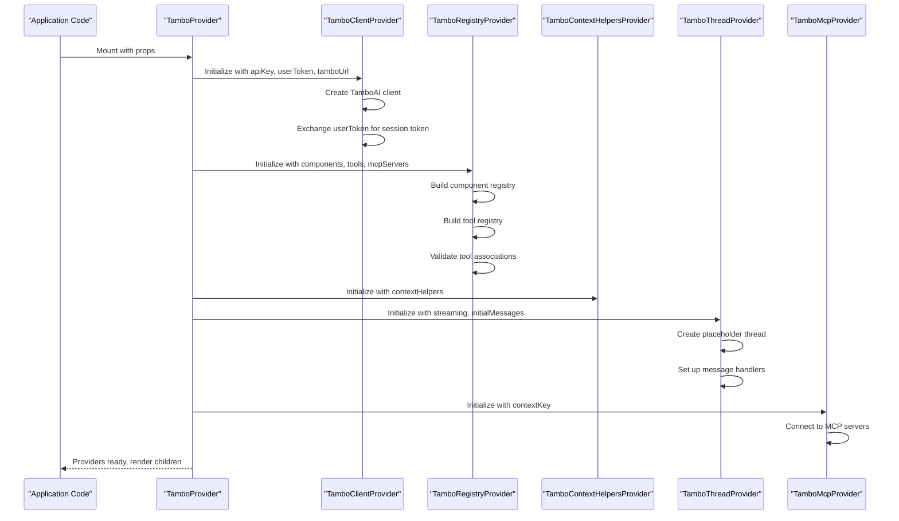

<!-- source: DeepWiki mcp.deepwiki.com · repo tambo-ai/tambo · page 3.1 TamboProvider Setup · fetched 2026-10-29 -->

# TamboProvider Setup

<details>
<summary>Relevant source files</summary>

The following files were used as context for generating this wiki page:

- [README.md](README.md)
- [cli/README.md](cli/README.md)
- [cli/src/templates/tambo-template.ts](cli/src/templates/tambo-template.ts)
- [create-tambo-app/README.md](create-tambo-app/README.md)
- [react-sdk/AGENTS.md](react-sdk/AGENTS.md)
- [react-sdk/README.md](react-sdk/README.md)
- [react-sdk/src/hooks/react-query-hooks.ts](react-sdk/src/hooks/react-query-hooks.ts)
- [react-sdk/src/index.ts](react-sdk/src/index.ts)
- [react-sdk/src/model/component-metadata.ts](react-sdk/src/model/component-metadata.ts)
- [react-sdk/src/providers/tambo-registry-provider.tsx](react-sdk/src/providers/tambo-registry-provider.tsx)
- [react-sdk/src/util/registry.ts](react-sdk/src/util/registry.ts)
- [react-sdk/src/util/tool-caller.ts](react-sdk/src/util/tool-caller.ts)
- [showcase/README.md](showcase/README.md)

</details>


## Purpose and Scope

This document describes how to configure `TamboProvider`, the root component required to use the Tambo React SDK. It covers all configuration props, their purposes, and common setup patterns.

For information about the internal provider architecture and how nested providers work, see [Provider Architecture](#3.2). For details on registering components and tools, see [Component Registration](#3.4) and [Tool Registration](#3.5).

**Sources:** [react-sdk/src/providers/tambo-provider.tsx:45-64]()

---

## Overview

`TamboProvider` wraps your React application and provides access to all Tambo functionality including AI conversations, component rendering, tool execution, and MCP integrations. It accepts configuration props that control authentication, component registration, thread behavior, and advanced features.

**Sources:** [react-sdk/src/providers/tambo-provider.tsx:66-137](), [react-sdk/README.md:98-107]()

---

## Prop Categories and Data Flow

The following diagram shows how `TamboProvider` props map to internal provider components:

```mermaid
graph TB
    TamboProvider["TamboProvider<br/>(entry point)"]
    
    subgraph "Authentication Props"
        apiKey["apiKey: string<br/>(required)"]
        userToken["userToken?: string"]
        tamboUrl["tamboUrl?: string"]
        environment["environment?: 'production' | 'staging'"]
    end
    
    subgraph "Registration Props"
        components["components?: TamboComponent[]"]
        tools["tools?: TamboTool[]"]
        mcpServers["mcpServers?: McpServerInfo[]"]
        resources["resources?: ListResourceItem[]"]
        listResources["listResources?: function"]
        getResource["getResource?: function"]
    end
    
    subgraph "Thread Behavior Props"
        streaming["streaming?: boolean"]
        initialMessages["initialMessages?: InitialTamboThreadMessage[]"]
        autoGenerateThreadName["autoGenerateThreadName?: boolean"]
        autoGenerateNameThreshold["autoGenerateNameThreshold?: number"]
        contextKey["contextKey?: string"]
    end
    
    subgraph "Context Props"
        contextHelpers["contextHelpers?: ContextHelpers"]
    end
    
    subgraph "Advanced Props"
        onCallUnregisteredTool["onCallUnregisteredTool?: function"]
        additionalHeaders["additionalHeaders?: Record<string, string>"]
    end
    
    TamboProvider --> TamboClientProvider
    TamboProvider --> TamboRegistryProvider
    TamboProvider --> TamboThreadProvider
    TamboProvider --> TamboContextHelpersProvider
    
    apiKey --> TamboClientProvider
    userToken --> TamboClientProvider
    tamboUrl --> TamboClientProvider
    environment --> TamboClientProvider
    additionalHeaders --> TamboClientProvider
    
    components --> TamboRegistryProvider
    tools --> TamboRegistryProvider
    mcpServers --> TamboRegistryProvider
    resources --> TamboRegistryProvider
    listResources --> TamboRegistryProvider
    getResource --> TamboRegistryProvider
    onCallUnregisteredTool --> TamboRegistryProvider
    
    streaming --> TamboThreadProvider
    initialMessages --> TamboThreadProvider
    autoGenerateThreadName --> TamboThreadProvider
    autoGenerateNameThreshold --> TamboThreadProvider
    contextKey --> TamboThreadProvider
    
    contextHelpers --> TamboContextHelpersProvider
    
    TamboClientProvider["TamboClientProvider<br/>(authentication & API client)"]
    TamboRegistryProvider["TamboRegistryProvider<br/>(component & tool registry)"]
    TamboThreadProvider["TamboThreadProvider<br/>(conversation state)"]
    TamboContextHelpersProvider["TamboContextHelpersProvider<br/>(additional context)"]
```



**Sources:** [react-sdk/src/providers/tambo-provider.tsx:66-137](), [react-sdk/src/providers/tambo-client-provider.tsx:8-36](), [react-sdk/src/providers/tambo-registry-provider.tsx:110-144](), [react-sdk/src/providers/tambo-thread-provider.tsx:231-242]()

---

## Authentication & Connection Props

### `apiKey` (required)

The API key for authenticating with the Tambo API. Typically loaded from environment variables.

```tsx
<TamboProvider apiKey={process.env.NEXT_PUBLIC_TAMBO_API_KEY!}>
```

**Type:** `string`  
**Required:** Yes  
**Sources:** [react-sdk/src/providers/tambo-client-provider.tsx:16-18]()

### `userToken`

An OAuth access token or ID token from your authentication provider (e.g., Google, GitHub, Auth0). Tambo exchanges this token for a session token to identify individual users in multi-user applications. This enables per-user conversation history and permissions.

```tsx
<TamboProvider 
  apiKey={process.env.NEXT_PUBLIC_TAMBO_API_KEY!}
  userToken={session?.accessToken}
>
```

**Type:** `string | undefined`  
**Default:** `undefined`  
**Sources:** [react-sdk/src/providers/tambo-client-provider.tsx:23-29](), [react-sdk/src/providers/hooks/use-tambo-session-token.tsx:1-58]()

### `tamboUrl`

Custom base URL for the Tambo API. Used for local development or self-hosted deployments. Omit this prop to use Tambo Cloud.

```tsx
<TamboProvider 
  apiKey={process.env.NEXT_PUBLIC_TAMBO_API_KEY!}
  tamboUrl="http://localhost:8260"
>
```

**Type:** `string | undefined`  
**Default:** `undefined` (uses Tambo Cloud)  
**Sources:** [react-sdk/src/providers/tambo-client-provider.tsx:10-12]()

### `environment`

Specifies the Tambo Cloud environment to use. Only relevant when using Tambo Cloud (not self-hosted).

```tsx
<TamboProvider 
  apiKey={process.env.NEXT_PUBLIC_TAMBO_API_KEY!}
  environment="staging"
>
```

**Type:** `"production" | "staging" | undefined`  
**Default:** `"production"`  
**Sources:** [react-sdk/src/providers/tambo-client-provider.tsx:19-22]()

### `additionalHeaders`

Custom HTTP headers to include in all Tambo API requests.

```tsx
<TamboProvider 
  apiKey={process.env.NEXT_PUBLIC_TAMBO_API_KEY!}
  additionalHeaders={{ "X-Custom-Header": "value" }}
>
```

**Type:** `Record<string, string> | undefined`  
**Default:** `undefined`  
**Sources:** [react-sdk/src/providers/tambo-client-provider.tsx:32-36]()

---

## Component & Tool Registration Props

### `components`

Array of React components that the AI can render. Each component must include a name, description, component reference, and Zod schema defining its props.

```tsx
import { z } from "zod/v4";

const components: TamboComponent[] = [
  {
    name: "WeatherCard",
    description: "Displays weather information with temperature and conditions",
    component: WeatherCard,
    propsSchema: z.object({
      location: z.string(),
      temperature: z.number(),
      condition: z.string(),
    }),
  },
];

<TamboProvider components={components} apiKey={apiKey}>
```

**Type:** `TamboComponent[] | undefined`  
**Default:** `[]`  
**See also:** [Component Registration](#3.4)  
**Sources:** [react-sdk/src/providers/tambo-registry-provider.tsx:111-112](), [react-sdk/README.md:143-160]()

### `tools`

Array of client-side JavaScript functions that the AI can execute. Tools run in the browser and have access to local state, DOM APIs, and authenticated fetch requests.

```tsx
import { defineTool } from "@tambo-ai/react";
import { z } from "zod/v4";

const tools = [
  defineTool({
    name: "getWeather",
    description: "Fetches weather data for a location",
    tool: async ({ location }) => 
      fetch(`/api/weather?q=${location}`).then(r => r.json()),
    inputSchema: z.object({
      location: z.string(),
    }),
    outputSchema: z.object({
      temperature: z.number(),
      condition: z.string(),
    }),
  }),
];

<TamboProvider tools={tools} components={components} apiKey={apiKey}>
```

**Type:** `TamboTool[] | undefined`  
**Default:** `[]`  
**See also:** [Tool Registration](#3.5)  
**Sources:** [react-sdk/src/providers/tambo-registry-provider.tsx:113-114](), [react-sdk/README.md:276-299]()

---

## MCP Integration Props

### `mcpServers`

Array of Model Context Protocol server configurations. MCP servers provide external tools, resources, and prompts that the AI can access. Each server configuration specifies connection details.

```tsx
import { MCPTransport } from "@tambo-ai/react/mcp";

const mcpServers = [
  {
    name: "filesystem",
    url: "http://localhost:8261/mcp",
    transport: MCPTransport.HTTP,
  },
  "http://localhost:8262/linear-mcp", // Shorthand: URL string
];

<TamboProvider mcpServers={mcpServers} components={components} apiKey={apiKey}>
```

**Type:** `(McpServerInfo | string)[] | undefined`  
**Default:** `[]`  
**Note:** This prop only registers server metadata. The actual MCP connections are managed by `TamboMcpProvider` (child of `TamboProvider`).  
**See also:** [MCP Integration](#6)  
**Sources:** [react-sdk/src/providers/tambo-registry-provider.tsx:115-116](), [react-sdk/README.md:244-257]()

---

## Resource Registration Props

Resources provide contextual data to the AI without requiring a full MCP server. You can register static resources, dynamic resource functions, or both.

### `resources`

Static array of resource metadata. Each resource includes a URI, name, description, and MIME type.

```tsx
import { type ListResourceItem } from "@tambo-ai/react";

const resources: ListResourceItem[] = [
  {
    uri: "file:///config/app-settings.json",
    name: "App Settings",
    description: "Current application configuration",
    mimeType: "application/json",
  },
  {
    uri: "file:///docs/user-guide.md",
    name: "User Guide",
    description: "Getting started documentation",
    mimeType: "text/markdown",
  },
];

<TamboProvider resources={resources} apiKey={apiKey}>
```

**Type:** `ListResourceItem[] | undefined`  
**Default:** `[]`  
**Sources:** [react-sdk/src/providers/tambo-registry-provider.tsx:117-118](), [react-sdk/README.md:336-359]()

### `listResources` and `getResource`

Functions for dynamic resource discovery and fetching. These must be provided together as a pair.

```tsx
import { type ResourceSource, type ReadResourceResult } from "@tambo-ai/react";

const listResources = async (search?: string) => {
  const allDocs = await fetchUserDocuments();
  return allDocs
    .filter(doc => !search || doc.name.includes(search))
    .map(doc => ({
      uri: `file:///docs/${doc.id}`,
      name: doc.name,
      description: doc.summary,
      mimeType: "text/markdown",
    }));
};

const getResource = async (uri: string): Promise<ReadResourceResult> => {
  const docId = uri.split("/").pop();
  const content = await fetchDocumentContent(docId);
  return {
    contents: [
      {
        uri,
        mimeType: "text/markdown",
        text: content,
      },
    ],
  };
};

<TamboProvider 
  listResources={listResources} 
  getResource={getResource}
  apiKey={apiKey}
>
```

**Type:** `listResources?: (search?: string) => Promise<ListResourceItem[]>`  
**Type:** `getResource?: (uri: string) => Promise<ReadResourceResult>`  
**Default:** Both `undefined`  
**Important:** Both functions must be provided together. Providing only one will throw a validation error.  
**Sources:** [react-sdk/src/providers/tambo-registry-provider.tsx:120-130](), [react-sdk/README.md:362-397]()

---

## Thread Configuration Props

### `streaming`

Enables streaming responses from the AI. When `true`, content streams progressively as it's generated. When `false`, the entire response arrives at once.

```tsx
<TamboProvider streaming={true} components={components} apiKey={apiKey}>
```

**Type:** `boolean | undefined`  
**Default:** `true`  
**Sources:** [react-sdk/src/providers/tambo-thread-provider.tsx:232-233](), [react-sdk/src/providers/tambo-thread-provider.tsx:260]()

### `initialMessages`

Messages to pre-populate new conversation threads. Useful for system prompts or context that should appear in every conversation.

```tsx
const initialMessages = [
  {
    role: "system" as const,
    content: [{ type: "text" as const, text: "You are a helpful assistant." }],
  },
];

<TamboProvider initialMessages={initialMessages} components={components} apiKey={apiKey}>
```

**Type:** `InitialTamboThreadMessage[] | undefined`  
**Default:** `[]`  
**Sources:** [react-sdk/src/providers/tambo-thread-provider.tsx:234-235](), [react-sdk/src/providers/tambo-thread-provider.tsx:217-229]()

### `autoGenerateThreadName`

Automatically generates descriptive names for conversation threads based on message content.

```tsx
<TamboProvider autoGenerateThreadName={true} components={components} apiKey={apiKey}>
```

**Type:** `boolean | undefined`  
**Default:** `true`  
**Sources:** [react-sdk/src/providers/tambo-thread-provider.tsx:236-237](), [react-sdk/src/providers/tambo-thread-provider.tsx:596-632]()

### `autoGenerateNameThreshold`

Minimum number of messages required before automatically generating a thread name. Only relevant when `autoGenerateThreadName` is `true`.

```tsx
<TamboProvider 
  autoGenerateThreadName={true}
  autoGenerateNameThreshold={5}
  components={components}
  apiKey={apiKey}
>
```

**Type:** `number | undefined`  
**Default:** `3`  
**Sources:** [react-sdk/src/providers/tambo-thread-provider.tsx:238-239](), [react-sdk/src/providers/tambo-thread-provider.tsx:596-632]()

### `contextKey`

Isolates threads within a specific context or namespace. Threads with different context keys are kept separate, enabling multi-workspace or multi-project scenarios.

```tsx
<TamboProvider 
  contextKey="project-123"
  components={components}
  apiKey={apiKey}
>
```

**Type:** `string | undefined`  
**Default:** `undefined`  
**Sources:** [react-sdk/src/providers/tambo-thread-provider.tsx:240-241](), [react-sdk/src/providers/tambo-thread-provider.tsx:264]()

---

## Context Helpers Props

### `contextHelpers`

Configuration object defining functions that provide additional context to the AI. Each helper function returns key-value pairs that are sent with every message. Common use cases include current page location, selected items, user preferences, or application state.

```tsx
<TamboProvider
  contextHelpers={{
    selectedItems: () => ({
      key: "selectedItems",
      value: selectedItems.map(i => i.name).join(", "),
    }),
    currentPage: () => ({ 
      key: "page", 
      value: window.location.pathname 
    }),
  }}
  components={components}
  apiKey={apiKey}
/>
```

**Type:** `ContextHelpers | undefined`  
**Default:** `undefined`  
**See also:** [Additional Context documentation](https://docs.tambo.co/concepts/additional-context)  
**Sources:** [react-sdk/src/providers/tambo-context-helpers-provider.tsx:1-109](), [react-sdk/README.md:460-470]()

---

## Advanced Props

### `onCallUnregisteredTool`

Callback invoked when the AI attempts to call a tool that isn't registered in the `tools` array. Useful for handling dynamic tool routing or providing fallback behavior.

```tsx
const handleUnregisteredTool = async (
  toolName: string, 
  args: TamboAI.ToolCallParameter[]
) => {
  console.warn(`Unknown tool called: ${toolName}`);
  return JSON.stringify({ error: "Tool not found" });
};

<TamboProvider
  onCallUnregisteredTool={handleUnregisteredTool}
  components={components}
  apiKey={apiKey}
>
```

**Type:** `((toolName: string, args: TamboAI.ToolCallParameter[]) => Promise<string>) | undefined`  
**Default:** `undefined` (throws error on unregistered tool calls)  
**Sources:** [react-sdk/src/providers/tambo-registry-provider.tsx:133-143]()

---

## Common Setup Patterns

### Basic Cloud Setup

Minimal configuration for Tambo Cloud with component registration:

```tsx
import { TamboProvider } from "@tambo-ai/react";
import { components } from "./lib/tambo";

export default function RootLayout({ children }) {
  return (
    <TamboProvider
      apiKey={process.env.NEXT_PUBLIC_TAMBO_API_KEY!}
      components={components}
    >
      {children}
    </TamboProvider>
  );
}
```

**Sources:** [cli/README.md:152-173](), [react-sdk/README.md:98-107]()

### Multi-User Application

Configuration with user authentication for per-user conversation isolation:

```tsx
import { TamboProvider } from "@tambo-ai/react";
import { useSession } from "next-auth/react";

export default function AuthenticatedLayout({ children }) {
  const { data: session } = useSession();
  
  return (
    <TamboProvider
      apiKey={process.env.NEXT_PUBLIC_TAMBO_API_KEY!}
      userToken={session?.accessToken}
      components={components}
      tools={tools}
    >
      {children}
    </TamboProvider>
  );
}
```

**Sources:** [react-sdk/src/providers/tambo-client-provider.tsx:23-29](), [README.md:128-129]()

### Self-Hosted Deployment

Configuration for connecting to a self-hosted Tambo backend:

```tsx
import { TamboProvider } from "@tambo-ai/react";

export default function RootLayout({ children }) {
  return (
    <TamboProvider
      apiKey={process.env.NEXT_PUBLIC_TAMBO_API_KEY!}
      tamboUrl={process.env.NEXT_PUBLIC_TAMBO_URL!}
      components={components}
    >
      {children}
    </TamboProvider>
  );
}
```

**Sources:** [react-sdk/src/providers/tambo-client-provider.tsx:10-12](), [README.md:296-300]()

### Full-Featured Configuration

Example combining multiple features:

```tsx
import { TamboProvider } from "@tambo-ai/react";
import { MCPTransport } from "@tambo-ai/react/mcp";

const mcpServers = [
  {
    name: "filesystem",
    url: "http://localhost:8261/mcp",
    transport: MCPTransport.HTTP,
  },
];

const resources = [
  {
    uri: "file:///config/settings.json",
    name: "App Settings",
    mimeType: "application/json",
  },
];

export default function RootLayout({ children }) {
  return (
    <TamboProvider
      apiKey={process.env.NEXT_PUBLIC_TAMBO_API_KEY!}
      userToken={session?.accessToken}
      components={components}
      tools={tools}
      mcpServers={mcpServers}
      resources={resources}
      streaming={true}
      autoGenerateThreadName={true}
      contextHelpers={{
        currentPage: () => ({ key: "page", value: location.pathname }),
      }}
    >
      {children}
    </TamboProvider>
  );
}
```

**Sources:** [react-sdk/src/providers/tambo-provider.tsx:93-136](), [README.md:185-199]()

---

## Provider Initialization Sequence

The following diagram shows the order in which nested providers initialize when `TamboProvider` mounts:



**Sources:** [react-sdk/src/providers/tambo-provider.tsx:93-136](), [react-sdk/src/providers/tambo-client-provider.tsx:65-111](), [react-sdk/src/providers/tambo-registry-provider.tsx:160-377](), [react-sdk/src/providers/tambo-thread-provider.tsx:256-643]()

---

## Configuration Reference Table

| Prop | Type | Required | Default | Category |
|------|------|----------|---------|----------|
| `apiKey` | `string` | Yes | - | Authentication |
| `userToken` | `string` | No | `undefined` | Authentication |
| `tamboUrl` | `string` | No | `undefined` | Authentication |
| `environment` | `"production" \| "staging"` | No | `"production"` | Authentication |
| `additionalHeaders` | `Record<string, string>` | No | `undefined` | Authentication |
| `components` | `TamboComponent[]` | No | `[]` | Registration |
| `tools` | `TamboTool[]` | No | `[]` | Registration |
| `mcpServers` | `(McpServerInfo \| string)[]` | No | `[]` | MCP |
| `resources` | `ListResourceItem[]` | No | `[]` | Resources |
| `listResources` | `function` | No | `undefined` | Resources |
| `getResource` | `function` | No | `undefined` | Resources |
| `streaming` | `boolean` | No | `true` | Thread Config |
| `initialMessages` | `InitialTamboThreadMessage[]` | No | `[]` | Thread Config |
| `autoGenerateThreadName` | `boolean` | No | `true` | Thread Config |
| `autoGenerateNameThreshold` | `number` | No | `3` | Thread Config |
| `contextKey` | `string` | No | `undefined` | Thread Config |
| `contextHelpers` | `ContextHelpers` | No | `undefined` | Context |
| `onCallUnregisteredTool` | `function` | No | `undefined` | Advanced |

**Sources:** [react-sdk/src/providers/tambo-provider.tsx:66-92](), [react-sdk/src/providers/tambo-client-provider.tsx:8-36](), [react-sdk/src/providers/tambo-registry-provider.tsx:110-144](), [react-sdk/src/providers/tambo-thread-provider.tsx:231-242]()

---

