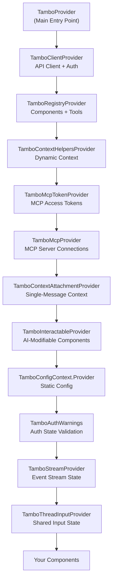
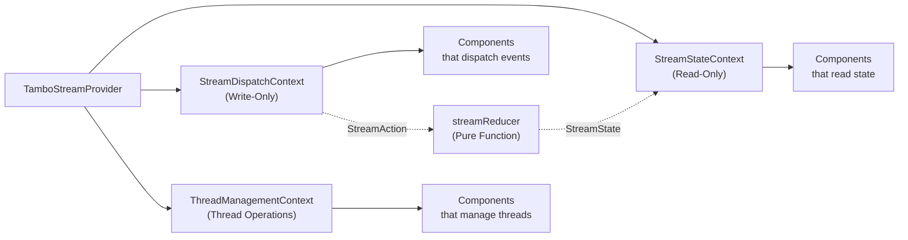
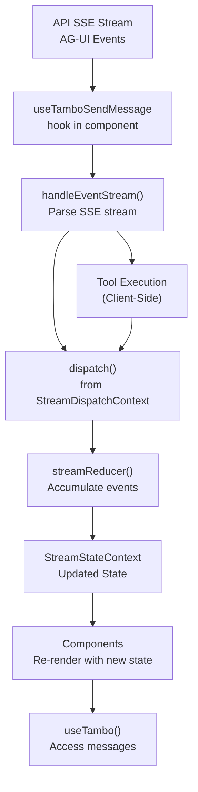
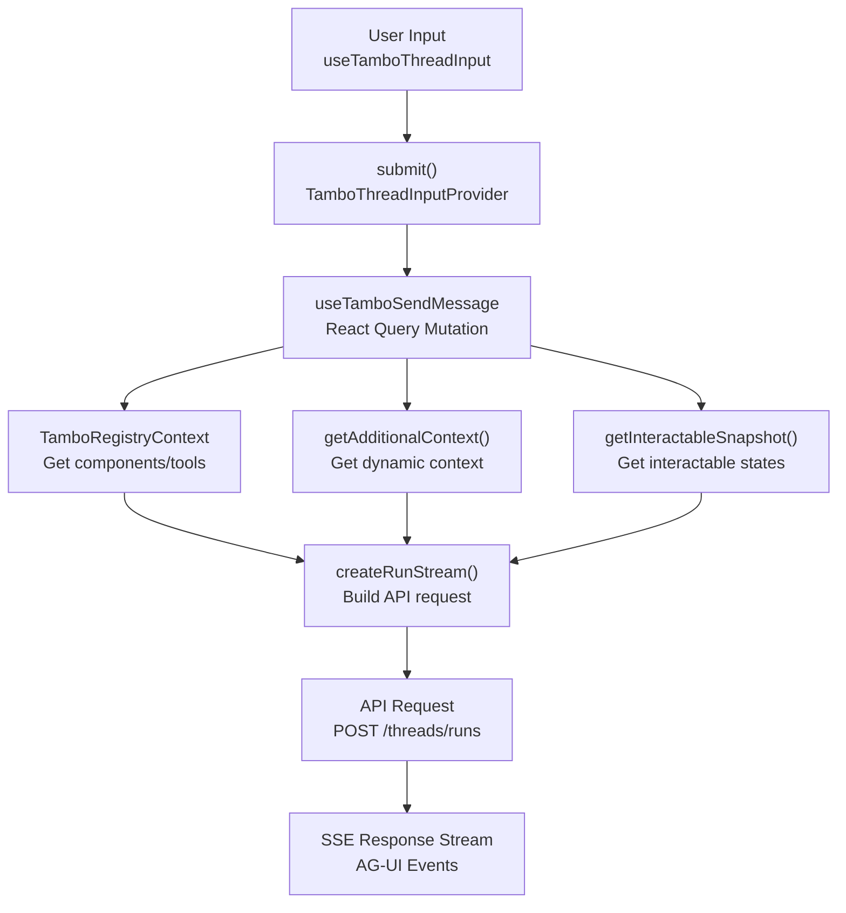
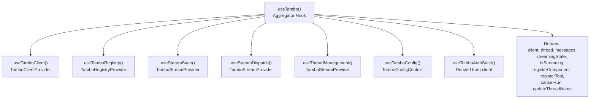

<!-- source: DeepWiki mcp.deepwiki.com · repo tambo-ai/tambo · page 3.2 Provider Architecture · fetched 2026-10-29 -->

# Provider Architecture

<details>
<summary>Relevant source files</summary>

The following files were used as context for generating this wiki page:

- [react-sdk/src/hooks/react-query-hooks.ts](react-sdk/src/hooks/react-query-hooks.ts)
- [react-sdk/src/index.ts](react-sdk/src/index.ts)
- [react-sdk/src/model/component-metadata.ts](react-sdk/src/model/component-metadata.ts)
- [react-sdk/src/providers/tambo-registry-provider.tsx](react-sdk/src/providers/tambo-registry-provider.tsx)
- [react-sdk/src/util/registry.ts](react-sdk/src/util/registry.ts)
- [react-sdk/src/util/tool-caller.ts](react-sdk/src/util/tool-caller.ts)
- [react-sdk/src/v1/hooks/use-tambo-v1-messages.test.tsx](react-sdk/src/v1/hooks/use-tambo-v1-messages.test.tsx)
- [react-sdk/src/v1/hooks/use-tambo-v1-send-message.test.tsx](react-sdk/src/v1/hooks/use-tambo-v1-send-message.test.tsx)
- [react-sdk/src/v1/hooks/use-tambo-v1-send-message.ts](react-sdk/src/v1/hooks/use-tambo-v1-send-message.ts)
- [react-sdk/src/v1/hooks/use-tambo-v1-suggestions.test.tsx](react-sdk/src/v1/hooks/use-tambo-v1-suggestions.test.tsx)
- [react-sdk/src/v1/hooks/use-tambo-v1-suggestions.ts](react-sdk/src/v1/hooks/use-tambo-v1-suggestions.ts)
- [react-sdk/src/v1/hooks/use-tambo-v1-thread-input.test.tsx](react-sdk/src/v1/hooks/use-tambo-v1-thread-input.test.tsx)
- [react-sdk/src/v1/hooks/use-tambo-v1-thread-input.ts](react-sdk/src/v1/hooks/use-tambo-v1-thread-input.ts)
- [react-sdk/src/v1/hooks/use-tambo-v1-thread-list.test.tsx](react-sdk/src/v1/hooks/use-tambo-v1-thread-list.test.tsx)
- [react-sdk/src/v1/hooks/use-tambo-v1-thread-list.ts](react-sdk/src/v1/hooks/use-tambo-v1-thread-list.ts)
- [react-sdk/src/v1/hooks/use-tambo-v1-thread.test.tsx](react-sdk/src/v1/hooks/use-tambo-v1-thread.test.tsx)
- [react-sdk/src/v1/hooks/use-tambo-v1-thread.ts](react-sdk/src/v1/hooks/use-tambo-v1-thread.ts)
- [react-sdk/src/v1/hooks/use-tambo-v1.test.tsx](react-sdk/src/v1/hooks/use-tambo-v1.test.tsx)
- [react-sdk/src/v1/hooks/use-tambo-v1.ts](react-sdk/src/v1/hooks/use-tambo-v1.ts)
- [react-sdk/src/v1/index.ts](react-sdk/src/v1/index.ts)
- [react-sdk/src/v1/providers/tambo-v1-provider.test.tsx](react-sdk/src/v1/providers/tambo-v1-provider.test.tsx)
- [react-sdk/src/v1/providers/tambo-v1-provider.tsx](react-sdk/src/v1/providers/tambo-v1-provider.tsx)
- [react-sdk/src/v1/providers/tambo-v1-stream-context.test.tsx](react-sdk/src/v1/providers/tambo-v1-stream-context.test.tsx)
- [react-sdk/src/v1/providers/tambo-v1-stream-context.tsx](react-sdk/src/v1/providers/tambo-v1-stream-context.tsx)
- [react-sdk/src/v1/providers/tambo-v1-stub-provider.test.tsx](react-sdk/src/v1/providers/tambo-v1-stub-provider.test.tsx)
- [react-sdk/src/v1/providers/tambo-v1-stub-provider.tsx](react-sdk/src/v1/providers/tambo-v1-stub-provider.tsx)
- [react-sdk/src/v1/providers/tambo-v1-thread-input-provider.tsx](react-sdk/src/v1/providers/tambo-v1-thread-input-provider.tsx)
- [react-sdk/src/v1/types/thread.ts](react-sdk/src/v1/types/thread.ts)
- [react-sdk/src/v1/types/tool-choice.ts](react-sdk/src/v1/types/tool-choice.ts)
- [react-sdk/src/v1/utils/__snapshots__/event-accumulator.test.ts.snap](react-sdk/src/v1/utils/__snapshots__/event-accumulator.test.ts.snap)
- [react-sdk/src/v1/utils/event-accumulator.test.ts](react-sdk/src/v1/utils/event-accumulator.test.ts)
- [react-sdk/src/v1/utils/event-accumulator.ts](react-sdk/src/v1/utils/event-accumulator.ts)
- [showcase/src/app/components/(message-primitives)/thread-content/page.tsx](showcase/src/app/components/(message-primitives)/thread-content/page.tsx)
- [showcase/src/app/components/(message-primitives)/thread-history/page.tsx](showcase/src/app/components/(message-primitives)/thread-history/page.tsx)

</details>


## Purpose and Scope

This document explains the React SDK's provider architecture, including the nested hierarchy of context providers, their individual responsibilities, and how they interact to enable the SDK's functionality. For information about setting up `TamboProvider` and its props, see [TamboProvider Setup](#3.1). For details about thread management operations, see [Thread Management](#3.3).

## Overview

The React SDK uses a **deeply nested provider composition pattern** where each provider adds a specific layer of functionality. This architecture follows React best practices for context organization:

- **Single Responsibility**: Each provider has one clear purpose
- **Context Splitting**: State and dispatch are separated to minimize re-renders
- **Composability**: Providers can be used independently for testing or advanced use cases
- **Type Safety**: Full TypeScript support with proper context types

The main entry point is `TamboProvider`, which composes all nested providers in the correct order. Internally, it wraps children with 9 distinct provider layers.

**Sources**: [react-sdk/src/v1/providers/tambo-v1-provider.tsx:1-324]()

## Provider Hierarchy

### Nesting Structure

The providers are nested in a specific order to ensure dependencies are satisfied. The diagram below shows the exact composition:



This nesting is defined in [react-sdk/src/v1/providers/tambo-v1-provider.tsx:286-323]():

```typescript
<TamboClientProvider ...>
  <TamboRegistryProvider ...>
    <TamboContextHelpersProvider ...>
      <TamboMcpTokenProvider>
        <TamboMcpProvider>
          <TamboContextAttachmentProvider>
            <TamboInteractableProvider>
              <TamboConfigContext.Provider ...>
                <TamboAuthWarnings />
                <TamboStreamProvider ...>
                  <TamboThreadInputProvider>
                    {children}
                  </TamboThreadInputProvider>
                </TamboStreamProvider>
              </TamboConfigContext.Provider>
            </TamboInteractableProvider>
          </TamboContextAttachmentProvider>
        </TamboMcpProvider>
      </TamboMcpTokenProvider>
    </TamboContextHelpersProvider>
  </TamboRegistryProvider>
</TamboClientProvider>
```

**Sources**: [react-sdk/src/v1/providers/tambo-v1-provider.tsx:258-323]()

## Core Providers

### TamboClientProvider

**Purpose**: API client instantiation and authentication state management.

**Context Provided**:
- `TamboClient`: The Tambo TypeScript SDK client instance
- `QueryClient`: React Query client for caching

**Hooks**:
- `useTamboClient()`: Access the API client
- `useTamboQueryClient()`: Access the React Query client

**Authentication**: Handles both `userKey` (direct) and `userToken` (OAuth) authentication methods. When `userToken` is provided, it exchanges the token for a `userKey` via the API.

**Sources**: [react-sdk/src/providers/tambo-client-provider.tsx](), [react-sdk/src/v1/providers/tambo-v1-provider.tsx:286-292]()

### TamboRegistryProvider

**Purpose**: Component and tool registration and discovery.

**Context Provided**:
| Field | Type | Description |
|-------|------|-------------|
| `componentList` | `ComponentRegistry` | Map of registered components |
| `toolRegistry` | `TamboToolRegistry` | Map of registered tools |
| `componentToolAssociations` | `Record<string, string[]>` | Component-to-tool mappings |
| `mcpServerInfos` | `NormalizedMcpServerInfo[]` | MCP server metadata |
| `resources` | `ListResourceItem[]` | Static resources |
| `resourceSource` | `ResourceSource \| null` | Dynamic resource functions |

**Hooks**:
- `useTamboRegistry()`: Access the full registry context
- `useTamboMcpServerInfos()`: Access MCP server metadata only

**Registration Methods**:
- `registerComponent(component)`: Register a React component
- `registerTool(tool)`: Register a single tool
- `registerTools(tools)`: Register multiple tools
- `registerMcpServer(info)`: Register an MCP server
- `registerResource(resource)`: Register a static resource

**Sources**: [react-sdk/src/providers/tambo-registry-provider.tsx:1-425]()

### TamboStreamProvider

**Purpose**: Streaming state management using the reducer pattern.

**Architecture**: This provider uses **context splitting** for optimal performance:



**State Management**: Uses `useReducer` with `streamReducer` to accumulate AG-UI events into thread state. The reducer is defined in [react-sdk/src/v1/utils/event-accumulator.ts:382-662]().

**Hooks**:
- `useStreamState()`: Access current stream state (read-only)
- `useStreamDispatch()`: Dispatch events to the reducer
- `useThreadManagement()`: Thread lifecycle operations

**Thread Management Functions**:
- `initThread(threadId)`: Initialize a new thread in state
- `switchThread(threadId)`: Change the active thread
- `startNewThread()`: Create a new thread with placeholder ID

**Context Splitting Benefits**:
1. Components that only read state don't re-render on dispatch
2. Components that only dispatch don't re-render on state changes
3. Thread management functions are stable (no re-renders)

**Sources**: [react-sdk/src/v1/providers/tambo-v1-stream-context.tsx:1-346](), [react-sdk/src/v1/utils/event-accumulator.ts:382-662]()

### TamboThreadInputProvider

**Purpose**: Shared input state across components for features like suggestions.

**Context Provided**:
| Field | Type | Description |
|-------|------|-------------|
| `value` | `string` | Current input text |
| `setValue` | `(value: string) => void` | Update input text |
| `images` | `StagedImage[]` | Attached images |
| `addImage` | `(file: File) => Promise<void>` | Attach an image |
| `removeImage` | `(id: string) => void` | Remove an image |
| `clearImages` | `() => void` | Remove all images |
| `submit` | `(options?) => Promise<Result>` | Submit message |
| `isPending` | `boolean` | Submission in progress |
| `error` | `Error \| null` | Submission error |

**Hooks**:
- `useTamboThreadInput()`: Access the full input context

**Sources**: [react-sdk/src/v1/providers/tambo-v1-thread-input-provider.tsx:1-234]()

### TamboContextHelpersProvider

**Purpose**: Manage functions that provide additional context to the AI.

**Context Provided**:
- `getAdditionalContext()`: Aggregates context from all registered helpers

**Context Helpers**: Dictionary of functions that return `AdditionalContext` objects:

```typescript
type ContextHelperFn = () => Promise<AdditionalContext> | AdditionalContext;
type AdditionalContext = { name: string; context: unknown };
```

**Built-in Helpers**:
- `currentTimeContextHelper`: Provides current timestamp
- `currentPageContextHelper`: Provides window location

**Hooks**:
- `useTamboContextHelpers()`: Access the context helpers API

**Sources**: [react-sdk/src/providers/tambo-context-helpers-provider.tsx](), [react-sdk/src/context-helpers.ts]()

### TamboMcpProvider

**Purpose**: Manage connections to Model Context Protocol (MCP) servers.

**Context Provided**:
- `mcpServers`: Map of server key to `MCPClientWrapper`
- MCP tool registrations (dynamic)

**Functionality**:
- Establishes WebSocket/SSE/HTTP connections to MCP servers
- Automatically registers tools from connected servers
- Provides hooks for MCP resources and prompts

**Hooks**:
- `useTamboMcpServers()`: Access connected MCP server instances
- `useTamboMcpResourceList()`: List available resources
- `useTamboMcpPromptList()`: List available prompts

**Sources**: [react-sdk/src/mcp/tambo-mcp-provider.tsx]()

### TamboInteractableProvider

**Purpose**: Track AI-modifiable components for state synchronization.

**Context Provided**:
- `registerInteractable()`: Register a component as interactable
- `unregisterInteractable()`: Unregister a component
- `getInteractableSnapshot()`: Get current interactable states

**Interactable Components**: Components wrapped with `withTamboInteractable` HOC that can be modified by the AI in real-time.

**Hooks**:
- `useTamboInteractable()`: Access interactable registration API
- `useCurrentInteractablesSnapshot()`: Get snapshot of all interactable states

**Sources**: [react-sdk/src/providers/tambo-interactable-provider.tsx](), [react-sdk/src/hoc/with-tambo-interactable.tsx]()

### Additional Providers

#### TamboMcpTokenProvider
Manages MCP access token exchange for authenticated MCP connections.

**Sources**: [react-sdk/src/providers/tambo-mcp-token-provider.tsx]()

#### TamboContextAttachmentProvider
Manages single-message context attachments (context that only applies to the next message).

**Sources**: [react-sdk/src/providers/tambo-context-attachment-provider.tsx]()

#### TamboConfigContext
Stores static configuration values (userKey, autoGenerateThreadName settings, initialMessages).

**Sources**: [react-sdk/src/v1/providers/tambo-v1-provider.tsx:72-85]()

## Data Flow Patterns

### Event Flow: API → UI

The diagram below shows how AG-UI events flow from the API through the provider architecture:



**Flow Description**:

1. **API Stream**: Server sends AG-UI events via SSE in [react-sdk/src/v1/hooks/use-tambo-v1-send-message.ts:621-674]()
2. **Event Parsing**: `handleEventStream` processes the stream
3. **Dispatch**: Events are dispatched to `streamReducer` via `StreamDispatchContext`
4. **State Accumulation**: `streamReducer` immutably updates thread state
5. **State Update**: `StreamStateContext` provides updated state to consumers
6. **Component Re-render**: Components using `useTambo()` re-render with new data

**Sources**: [react-sdk/src/v1/hooks/use-tambo-v1-send-message.ts:621-674](), [react-sdk/src/v1/utils/event-accumulator.ts:382-662](), [react-sdk/src/v1/utils/stream-handler.ts]()

### Message Submission Flow

The diagram below shows how user messages flow from input to API:



**Flow Description**:

1. **Input**: User enters text in `useTamboThreadInput()`
2. **Submit**: `submit()` triggers `useTamboSendMessage` mutation
3. **Context Gathering**: Collects components, tools, context, and interactable states
4. **API Request**: `createRunStream()` sends message with all context in [react-sdk/src/v1/hooks/use-tambo-v1-send-message.ts:397-459]()
5. **SSE Stream**: API responds with streaming events

**Sources**: [react-sdk/src/v1/providers/tambo-v1-thread-input-provider.tsx:124-177](), [react-sdk/src/v1/hooks/use-tambo-v1-send-message.ts:397-459](), [react-sdk/src/v1/hooks/use-tambo-v1-send-message.ts:505-760]()

## Performance Optimization

### Context Splitting Pattern

The SDK uses context splitting to minimize unnecessary re-renders. This pattern separates **state** and **dispatch** into different contexts:

**Example from TamboStreamProvider**:

```typescript
// Three separate contexts for optimal performance
const StreamStateContext = createContext<StreamState | null>(null);
const StreamDispatchContext = createContext<React.Dispatch<StreamAction> | null>(null);
const ThreadManagementContext = createContext<ThreadManagement | null>(null);

// Components only subscribe to contexts they need
export function useStreamState() {
  // Only re-renders when state changes
  return useContext(StreamStateContext);
}

export function useStreamDispatch() {
  // Never re-renders (dispatch is stable)
  return useContext(StreamDispatchContext);
}

export function useThreadManagement() {
  // Never re-renders (functions are stable)
  return useContext(ThreadManagementContext);
}
```

**Benefits**:

| Pattern | Components Re-render When |
|---------|---------------------------|
| Combined context | Either state OR dispatch changes |
| Split contexts | Only the specific context they use changes |

**Example Impact**:
- A button that only dispatches events never re-renders on state changes
- A display component that only reads state never re-renders on dispatch calls
- Thread management functions are stable references (no re-renders)

**Sources**: [react-sdk/src/v1/providers/tambo-v1-stream-context.tsx:66-80](), [react-sdk/src/v1/providers/tambo-v1-stream-context.tsx:130-240]()

## Provider Access Patterns

### High-Level Hook: useTambo()

The `useTambo()` hook aggregates data from multiple providers into a single convenient API:



**Returned Fields**:

| Field | Source Provider | Description |
|-------|----------------|-------------|
| `client` | TamboClientProvider | API client instance |
| `thread` | TamboStreamProvider | Current thread state |
| `messages` | TamboStreamProvider | Thread messages (with rendered components) |
| `streamingState` | TamboStreamProvider | Current streaming status |
| `isStreaming` | TamboStreamProvider | Boolean status flag |
| `registerComponent` | TamboRegistryProvider | Component registration function |
| `registerTool` | TamboRegistryProvider | Tool registration function |
| `componentList` | TamboRegistryProvider | Registered components map |
| `toolRegistry` | TamboRegistryProvider | Registered tools map |
| `cancelRun` | Derived | Cancel active run function |
| `updateThreadName` | Derived | Update thread name function |
| `authState` | Derived | Current authentication state |

**Sources**: [react-sdk/src/v1/hooks/use-tambo-v1.ts:210-411]()

### Direct Provider Access

For advanced use cases, you can access individual provider contexts directly:

| Hook | Context | Use Case |
|------|---------|----------|
| `useTamboClient()` | TamboClientProvider | Direct API calls |
| `useTamboRegistry()` | TamboRegistryProvider | Component/tool registration |
| `useStreamState()` | TamboStreamProvider | Read stream state |
| `useStreamDispatch()` | TamboStreamProvider | Dispatch custom events |
| `useThreadManagement()` | TamboStreamProvider | Thread lifecycle operations |
| `useTamboThreadInput()` | TamboThreadInputProvider | Shared input state |
| `useTamboContextHelpers()` | TamboContextHelpersProvider | Register context helpers |
| `useTamboInteractable()` | TamboInteractableProvider | Register interactable components |

**Sources**: [react-sdk/src/v1/index.ts:1-297]()

## Testing Patterns

### Provider Composition for Tests

For unit tests, you can compose only the providers you need:

```typescript
// Minimal wrapper for testing useTamboRegistry
function TestWrapper({ children }) {
  return (
    <TamboRegistryProvider components={[]} tools={[]}>
      {children}
    </TamboRegistryProvider>
  );
}

// Full wrapper for testing useTambo
function TestWrapper({ children }) {
  return (
    <TamboProvider apiKey="test" userKey="user123">
      {children}
    </TamboProvider>
  );
}
```

**Sources**: [react-sdk/src/v1/providers/tambo-v1-provider.test.tsx:96-106](), [react-sdk/src/v1/hooks/use-tambo-v1.test.tsx:77-85]()

### TamboStubProvider

For testing components that use Tambo without a real API connection:

```typescript
import { TamboStubProvider } from '@tambo-ai/react';

<TamboStubProvider
  mockThreads={[mockThread]}
  mockMessages={[mockMessage]}
>
  <YourComponent />
</TamboStubProvider>
```

The stub provider provides mock implementations of all hooks and contexts.

**Sources**: [react-sdk/src/v1/providers/tambo-v1-stub-provider.tsx:1-335]()

## Provider Initialization Order

The nesting order is critical because providers depend on their ancestors:

1. **TamboClientProvider** - Must be first (API client needed by all)
2. **TamboRegistryProvider** - Early (components/tools needed for API calls)
3. **TamboContextHelpersProvider** - Before MCP (MCP might use context)
4. **TamboMcpTokenProvider** - Before MCP provider (token exchange)
5. **TamboMcpProvider** - After token provider (needs auth token)
6. **TamboContextAttachmentProvider** - Before stream (attachments in messages)
7. **TamboInteractableProvider** - Before stream (state in messages)
8. **TamboConfigContext** - Before auth warnings (config needed)
9. **TamboAuthWarnings** - Before stream (validates auth state)
10. **TamboStreamProvider** - Core state (needed by input)
11. **TamboThreadInputProvider** - Last provider (depends on stream)

**Sources**: [react-sdk/src/v1/providers/tambo-v1-provider.tsx:286-323]()

---

