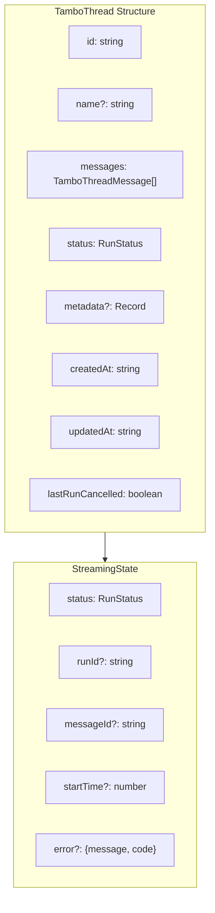
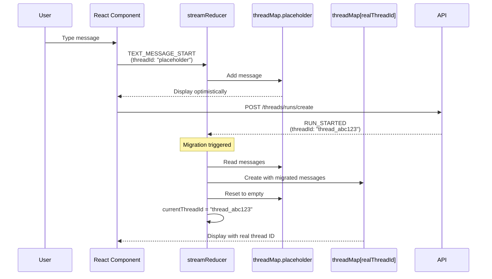
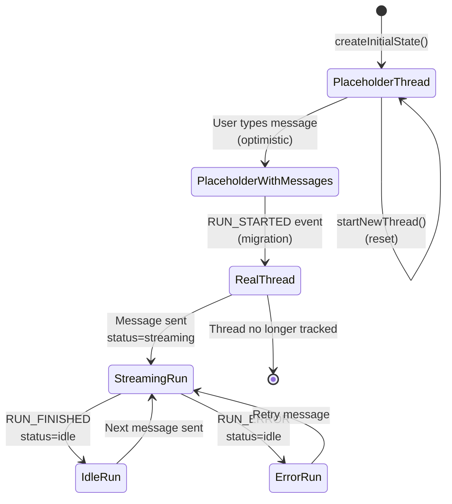
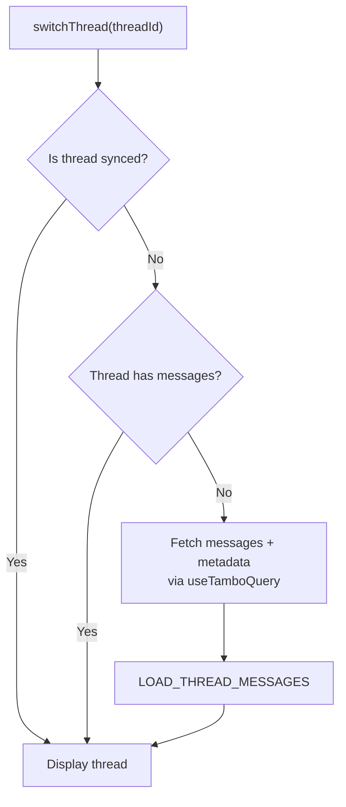
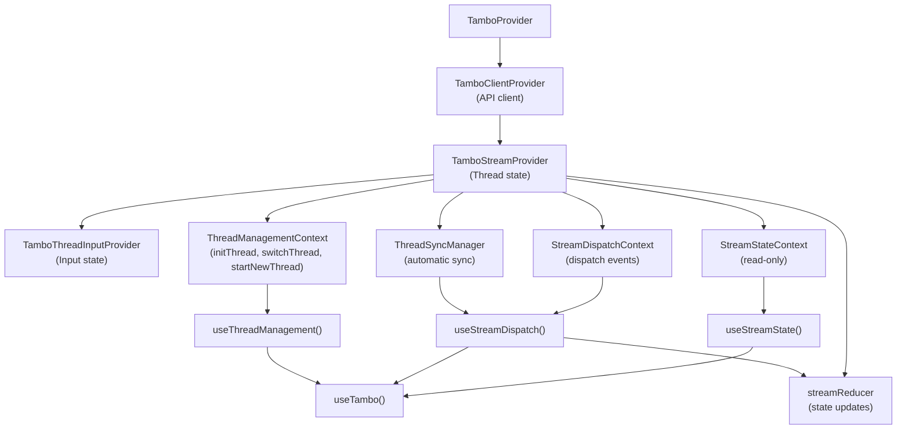
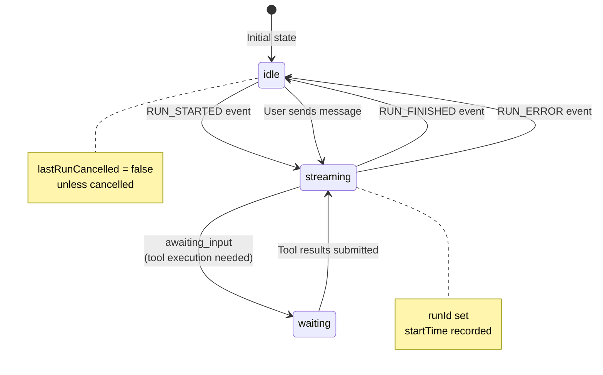

<!-- source: DeepWiki mcp.deepwiki.com · repo tambo-ai/tambo · page 3.3 Thread Management · fetched 2026-10-29 -->

# Thread Management

<details>
<summary>Relevant source files</summary>

The following files were used as context for generating this wiki page:

- [react-sdk/src/hooks/react-query-hooks.ts](react-sdk/src/hooks/react-query-hooks.ts)
- [react-sdk/src/index.ts](react-sdk/src/index.ts)
- [react-sdk/src/model/component-metadata.ts](react-sdk/src/model/component-metadata.ts)
- [react-sdk/src/providers/tambo-registry-provider.tsx](react-sdk/src/providers/tambo-registry-provider.tsx)
- [react-sdk/src/util/registry.ts](react-sdk/src/util/registry.ts)
- [react-sdk/src/util/tool-caller.ts](react-sdk/src/util/tool-caller.ts)
- [react-sdk/src/v1/hooks/use-tambo-v1-messages.test.tsx](react-sdk/src/v1/hooks/use-tambo-v1-messages.test.tsx)
- [react-sdk/src/v1/hooks/use-tambo-v1-send-message.test.tsx](react-sdk/src/v1/hooks/use-tambo-v1-send-message.test.tsx)
- [react-sdk/src/v1/hooks/use-tambo-v1-send-message.ts](react-sdk/src/v1/hooks/use-tambo-v1-send-message.ts)
- [react-sdk/src/v1/hooks/use-tambo-v1-suggestions.test.tsx](react-sdk/src/v1/hooks/use-tambo-v1-suggestions.test.tsx)
- [react-sdk/src/v1/hooks/use-tambo-v1-suggestions.ts](react-sdk/src/v1/hooks/use-tambo-v1-suggestions.ts)
- [react-sdk/src/v1/hooks/use-tambo-v1-thread-input.test.tsx](react-sdk/src/v1/hooks/use-tambo-v1-thread-input.test.tsx)
- [react-sdk/src/v1/hooks/use-tambo-v1-thread-input.ts](react-sdk/src/v1/hooks/use-tambo-v1-thread-input.ts)
- [react-sdk/src/v1/hooks/use-tambo-v1-thread-list.test.tsx](react-sdk/src/v1/hooks/use-tambo-v1-thread-list.test.tsx)
- [react-sdk/src/v1/hooks/use-tambo-v1-thread-list.ts](react-sdk/src/v1/hooks/use-tambo-v1-thread-list.ts)
- [react-sdk/src/v1/hooks/use-tambo-v1-thread.test.tsx](react-sdk/src/v1/hooks/use-tambo-v1-thread.test.tsx)
- [react-sdk/src/v1/hooks/use-tambo-v1-thread.ts](react-sdk/src/v1/hooks/use-tambo-v1-thread.ts)
- [react-sdk/src/v1/hooks/use-tambo-v1.test.tsx](react-sdk/src/v1/hooks/use-tambo-v1.test.tsx)
- [react-sdk/src/v1/hooks/use-tambo-v1.ts](react-sdk/src/v1/hooks/use-tambo-v1.ts)
- [react-sdk/src/v1/index.ts](react-sdk/src/v1/index.ts)
- [react-sdk/src/v1/providers/tambo-v1-provider.test.tsx](react-sdk/src/v1/providers/tambo-v1-provider.test.tsx)
- [react-sdk/src/v1/providers/tambo-v1-provider.tsx](react-sdk/src/v1/providers/tambo-v1-provider.tsx)
- [react-sdk/src/v1/providers/tambo-v1-stream-context.test.tsx](react-sdk/src/v1/providers/tambo-v1-stream-context.test.tsx)
- [react-sdk/src/v1/providers/tambo-v1-stream-context.tsx](react-sdk/src/v1/providers/tambo-v1-stream-context.tsx)
- [react-sdk/src/v1/providers/tambo-v1-stub-provider.test.tsx](react-sdk/src/v1/providers/tambo-v1-stub-provider.test.tsx)
- [react-sdk/src/v1/providers/tambo-v1-stub-provider.tsx](react-sdk/src/v1/providers/tambo-v1-stub-provider.tsx)
- [react-sdk/src/v1/providers/tambo-v1-thread-input-provider.tsx](react-sdk/src/v1/providers/tambo-v1-thread-input-provider.tsx)
- [react-sdk/src/v1/types/thread.ts](react-sdk/src/v1/types/thread.ts)
- [react-sdk/src/v1/types/tool-choice.ts](react-sdk/src/v1/types/tool-choice.ts)
- [react-sdk/src/v1/utils/__snapshots__/event-accumulator.test.ts.snap](react-sdk/src/v1/utils/__snapshots__/event-accumulator.test.ts.snap)
- [react-sdk/src/v1/utils/event-accumulator.test.ts](react-sdk/src/v1/utils/event-accumulator.test.ts)
- [react-sdk/src/v1/utils/event-accumulator.ts](react-sdk/src/v1/utils/event-accumulator.ts)
- [showcase/src/app/components/(message-primitives)/thread-content/page.tsx](showcase/src/app/components/(message-primitives)/thread-content/page.tsx)
- [showcase/src/app/components/(message-primitives)/thread-history/page.tsx](showcase/src/app/components/(message-primitives)/thread-history/page.tsx)

</details>


This page documents how the React SDK manages thread state and lifecycle. Threads represent conversations with the AI and are the primary organizational unit for messages and runs.

**Scope**: This page covers thread lifecycle management (creation, switching, initialization), thread state structure, the placeholder thread pattern for optimistic UI, and automatic message synchronization. For sending messages to threads, see [3.8](#3.8). For fetching thread metadata and messages, see the thread query hooks API.

---

## Overview

Thread management in the SDK is handled through the `TamboStreamProvider` and `TamboStreamContext`, which maintain a map of all active threads and track the current thread. The system uses a reducer pattern (`streamReducer`) to process events and update thread state immutably.

**Key features:**
- **Placeholder thread pattern**: Enables optimistic UI updates before thread IDs are assigned
- **Automatic message syncing**: Fetches thread messages when switching to existing threads
- **Thread state isolation**: Each thread maintains independent state for messages, streaming status, and tool execution
- **Atomic thread creation**: The `START_NEW_THREAD` action atomically creates and switches to prevent race conditions

**Sources:** [react-sdk/src/v1/providers/tambo-v1-stream-context.tsx:1-330](), [react-sdk/src/v1/utils/event-accumulator.ts:1-100]()

---

## Thread State Structure

### ThreadState Interface

Each thread in the `threadMap` is tracked with the following structure:

```typescript
interface ThreadState {
  thread: TamboThread;
  streaming: StreamingState;
  accumulatingToolArgs: Map<string, string>;
  lastCompletedRunId?: string;
}
```

| Field | Type | Description |
|-------|------|-------------|
| `thread` | `TamboThread` | Thread metadata and messages |
| `streaming` | `StreamingState` | Current streaming status and active run info |
| `accumulatingToolArgs` | `Map<string, string>` | Accumulates JSON strings for streaming tool calls |
| `lastCompletedRunId` | `string?` | ID of last completed run (persists across sessions) |

**Sources:** [react-sdk/src/v1/utils/event-accumulator.ts:56-74]()

### StreamState Interface

The top-level state managed by `TamboStreamProvider`:

```typescript
interface StreamState {
  threadMap: Record<string, ThreadState>;
  currentThreadId: string;
}
```

- **`threadMap`**: Maps thread IDs to their state. Includes the special `"placeholder"` thread.
- **`currentThreadId`**: The active thread ID (defaults to `"placeholder"` for optimistic UI)

**Sources:** [react-sdk/src/v1/utils/event-accumulator.ts:80-90]()

### TamboThread Structure



**Diagram: Thread state structure showing TamboThread and StreamingState fields**

**Sources:** [react-sdk/src/v1/types/thread.ts:28-52](), [react-sdk/src/v1/types/thread.ts:58-79]()

---

## Placeholder Thread Pattern

The placeholder thread enables optimistic UI updates before the real thread ID is assigned by the API. This pattern allows the UI to immediately display user messages without waiting for network round-trips.

### Placeholder Thread ID

```typescript
export const PLACEHOLDER_THREAD_ID = "placeholder";

export function isPlaceholderThreadId(
  threadId: string | null | undefined
): boolean {
  return threadId === PLACEHOLDER_THREAD_ID;
}
```

**When used:**
- New conversations before the first message is sent
- Immediate message display in the UI
- Optimistic state updates

**Sources:** [react-sdk/src/v1/utils/event-accumulator.ts:206-221]()

### Initial State Creation

The SDK initializes with a placeholder thread ready for new messages:

```typescript
export function createInitialState(): StreamState {
  return {
    threadMap: {
      [PLACEHOLDER_THREAD_ID]: createInitialThreadState(PLACEHOLDER_THREAD_ID),
    },
    currentThreadId: PLACEHOLDER_THREAD_ID,
  };
}
```

Optionally, the placeholder thread can be seeded with `initialMessages`:

```typescript
export function createInitialStateWithMessages(
  initialMessages: InitialInputMessage[]
): StreamState {
  // Converts InitialInputMessage[] to TamboThreadMessage[]
  // and seeds the placeholder thread
}
```

**Sources:** [react-sdk/src/v1/utils/event-accumulator.ts:227-270]()

---

## Placeholder Thread Migration

When a new thread is created via the API, the first event (`RUN_STARTED`) contains the real thread ID. At this point, any messages accumulated in the placeholder thread are migrated to the real thread.



**Diagram: Placeholder thread migration flow when RUN_STARTED arrives with real thread ID**

**Migration logic in `streamReducer`:**

```typescript
// When RUN_STARTED arrives with a real threadId
if (
  event.type === EventType.RUN_STARTED &&
  effectiveThreadId !== PLACEHOLDER_THREAD_ID
) {
  const placeholderState = updatedState.threadMap[PLACEHOLDER_THREAD_ID];
  if (placeholderState?.thread.messages.length) {
    // Prepend placeholder messages to real thread
    threadState = {
      ...threadState,
      thread: {
        ...threadState.thread,
        messages: [
          ...placeholderState.thread.messages,
          ...threadState.thread.messages,
        ],
      },
    };
    
    // Reset placeholder and switch to real thread
    // (only if currentThreadId is still placeholder)
  }
}
```

**Sources:** [react-sdk/src/v1/utils/event-accumulator.ts:521-557](), [react-sdk/src/v1/utils/event-accumulator.test.ts:279-371]()

---

## Thread Management API

### ThreadManagement Interface

The provider exposes three core functions for thread management:

```typescript
export interface ThreadManagement {
  initThread: (threadId: string, initialThread?: Partial<TamboThread>) => void;
  switchThread: (threadId: string) => void;
  startNewThread: () => string;
}
```

**Sources:** [react-sdk/src/v1/providers/tambo-v1-stream-context.tsx:39-61]()

### initThread

Initializes a new thread entry in `threadMap` without switching to it.

```typescript
const { initThread } = useThreadManagement();

initThread("thread_123", {
  name: "My Conversation",
  status: "idle",
});
```

**Dispatches:** `INIT_THREAD` action
**Use case:** Pre-initializing threads before they receive events

**Sources:** [react-sdk/src/v1/providers/tambo-v1-stream-context.tsx:176-181](), [react-sdk/src/v1/utils/event-accumulator.ts:388-411]()

### switchThread

Changes the `currentThreadId` to an existing thread.

```typescript
const { switchThread } = useThreadManagement();

switchThread("thread_123");
```

**Dispatches:** `SET_CURRENT_THREAD` action
**Note:** Does not fetch thread data. Use `useTamboThread` hook for fetching.

**Sources:** [react-sdk/src/v1/providers/tambo-v1-stream-context.tsx:183-188](), [react-sdk/src/v1/utils/event-accumulator.ts:414-419]()

### startNewThread

Atomically creates a new placeholder thread and switches to it. Returns the thread ID.

```typescript
const { startNewThread } = useThreadManagement();

const newThreadId = startNewThread(); // Returns "placeholder"
```

**Dispatches:** `START_NEW_THREAD` action (atomic)
**Behavior:** Resets the placeholder thread to empty and switches `currentThreadId` to it
**Atomic guarantee:** Prevents race conditions when called multiple times concurrently

If `initialMessages` were provided to `TamboProvider`, the placeholder thread is re-seeded with them.

**Sources:** [react-sdk/src/v1/providers/tambo-v1-stream-context.tsx:190-218](), [react-sdk/src/v1/utils/event-accumulator.ts:421-451]()

---

## Thread Lifecycle



**Diagram: Thread state machine showing transitions from placeholder to real thread and run status changes**

**Sources:** [react-sdk/src/v1/utils/event-accumulator.ts:664-751]()

---

## Stream Reducer Actions

The `streamReducer` processes actions to update thread state. Here are the thread-specific actions:

| Action | Purpose | Reducer Handler |
|--------|---------|----------------|
| `INIT_THREAD` | Create new thread entry | [event-accumulator.ts:388-411]() |
| `SET_CURRENT_THREAD` | Switch active thread | [event-accumulator.ts:414-419]() |
| `START_NEW_THREAD` | Atomic create+switch | [event-accumulator.ts:421-451]() |
| `LOAD_THREAD_MESSAGES` | Load messages from API | [event-accumulator.ts:453-455]() |
| `SET_LAST_COMPLETED_RUN_ID` | Store run metadata | [event-accumulator.ts:457-471]() |
| `UPDATE_THREAD_NAME` | Update thread name | [event-accumulator.ts:473-491]() |
| `EVENT` | Process streaming events | [event-accumulator.ts:493-662]() |

### INIT_THREAD Action

```typescript
interface InitThreadAction {
  type: "INIT_THREAD";
  threadId: string;
  initialThread?: Partial<TamboThread>;
}
```

Creates a new entry in `threadMap` if it doesn't exist. Does not overwrite existing threads.

**Sources:** [react-sdk/src/v1/utils/event-accumulator.ts:106-110](), [react-sdk/src/v1/utils/event-accumulator.ts:388-411]()

### SET_CURRENT_THREAD Action

```typescript
interface SetCurrentThreadAction {
  type: "SET_CURRENT_THREAD";
  threadId: string;
}
```

Changes `currentThreadId` to the specified thread.

**Sources:** [react-sdk/src/v1/utils/event-accumulator.ts:113-118](), [react-sdk/src/v1/utils/event-accumulator.ts:414-419]()

### START_NEW_THREAD Action

```typescript
interface StartNewThreadAction {
  type: "START_NEW_THREAD";
  threadId: string;
  initialThread?: Partial<TamboThread>;
}
```

Atomically creates a thread entry and switches to it in a single reducer pass. This prevents race conditions when multiple calls happen concurrently.

**Sources:** [react-sdk/src/v1/utils/event-accumulator.ts:121-128](), [react-sdk/src/v1/utils/event-accumulator.ts:421-451]()

### LOAD_THREAD_MESSAGES Action

```typescript
interface LoadThreadMessagesAction {
  type: "LOAD_THREAD_MESSAGES";
  threadId: string;
  messages: TamboThreadMessage[];
  skipIfStreaming?: boolean;
}
```

Loads messages from the API into the thread state. Used by `ThreadSyncManager` when switching threads.

**Option `skipIfStreaming`**: Prevents overwriting in-flight streaming messages

**Sources:** [react-sdk/src/v1/utils/event-accumulator.ts:134-143]()

### UPDATE_THREAD_NAME Action

```typescript
interface UpdateThreadNameAction {
  type: "UPDATE_THREAD_NAME";
  threadId: string;
  name: string;
}
```

Updates the thread's name field. Used after auto-generating thread names or manual renaming.

**Sources:** [react-sdk/src/v1/utils/event-accumulator.ts:159-163](), [react-sdk/src/v1/utils/event-accumulator.ts:473-491]()

---

## Automatic Thread Syncing

The SDK automatically fetches thread messages when switching to a non-placeholder thread that hasn't been synced yet.

### ThreadSyncManager Component

This internal component within `TamboStreamProvider` handles automatic syncing:



**Diagram: Automatic thread syncing flow when switching threads**

**Syncing conditions:**
1. Thread ID is not placeholder
2. Thread has not been synced before (tracked via `lastSyncedThreadRef`)
3. Thread has no messages in local state

**Parallel fetching:** Messages and thread metadata are fetched in parallel for performance.

**Sources:** [react-sdk/src/v1/providers/tambo-v1-stream-context.tsx:249-329]()

### Implementation

```typescript
function ThreadSyncManager(): null {
  const client = useTamboClient();
  const { userKey } = useTamboConfig();
  const state = useContext(StreamStateContext);
  const dispatch = useContext(StreamDispatchContext);

  const lastSyncedThreadRef = useRef<string | null>(null);
  const currentThreadId = state?.currentThreadId ?? PLACEHOLDER_THREAD_ID;
  const threadState = state?.threadMap[currentThreadId];

  // Determine if fetch is needed
  const shouldFetch = 
    !isPlaceholderThreadId(currentThreadId) &&
    currentThreadId !== lastSyncedThreadRef.current &&
    (!threadState || threadState.thread.messages.length === 0);

  // Fetch messages
  const { data: messagesData } = useTamboQuery({
    queryKey: ["v1-threads", currentThreadId, "messages"],
    queryFn: () => client.threads.messages.list(currentThreadId, { userKey }),
    enabled: shouldFetch,
  });

  // Fetch thread metadata
  const { data: threadData } = useTamboQuery({
    queryKey: ["v1-threads", currentThreadId],
    queryFn: () => client.threads.retrieve(currentThreadId, { userKey }),
    enabled: shouldFetch,
  });

  // Dispatch loaded messages
  useEffect(() => {
    if (messagesData?.messages && threadData) {
      dispatch({
        type: "LOAD_THREAD_MESSAGES",
        threadId: currentThreadId,
        messages: messagesData.messages,
        skipIfStreaming: true,
      });
      dispatch({
        type: "SET_LAST_COMPLETED_RUN_ID",
        threadId: currentThreadId,
        lastCompletedRunId: threadData.lastRunId,
      });
      lastSyncedThreadRef.current = currentThreadId;
    }
  }, [messagesData, threadData]);

  return null;
}
```

**Sources:** [react-sdk/src/v1/providers/tambo-v1-stream-context.tsx:249-329]()

---

## Provider Architecture



**Diagram: Provider hierarchy showing thread management contexts and hooks**

**Context separation rationale:**
- `StreamStateContext` and `StreamDispatchContext` are separated to prevent unnecessary re-renders
- Components reading state don't re-render when dispatch is used
- Thread management functions are memoized separately for stable references

**Sources:** [react-sdk/src/v1/providers/tambo-v1-stream-context.tsx:66-240](), [react-sdk/src/v1/hooks/use-tambo-v1.ts:210-300]()

---

## Access Patterns

### Direct Thread Management

```typescript
import { useThreadManagement } from '@tambo-ai/react';

function ThreadSwitcher({ threads }: { threads: string[] }) {
  const { initThread, switchThread, startNewThread } = useThreadManagement();
  
  return (
    <div>
      <button onClick={() => startNewThread()}>
        New Conversation
      </button>
      {threads.map(id => (
        <button key={id} onClick={() => switchThread(id)}>
          Switch to {id}
        </button>
      ))}
    </div>
  );
}
```

### Via useTambo Hook

```typescript
import { useTambo } from '@tambo-ai/react';

function ChatInterface() {
  const {
    currentThreadId,
    thread,
    messages,
    switchThread,
    startNewThread,
  } = useTambo();
  
  return (
    <div>
      <p>Current: {currentThreadId}</p>
      <p>Messages: {messages.length}</p>
      <button onClick={() => startNewThread()}>New</button>
    </div>
  );
}
```

**Sources:** [react-sdk/src/v1/hooks/use-tambo-v1.ts:210-370]()

---

## Thread State Transitions

### Run Status Flow



**Diagram: Run status state machine within a thread**

**Status values:**
- `idle`: No active run, ready for new message
- `streaming`: AI is generating a response
- `waiting`: Paused for tool execution (not a top-level status in StreamingState)

**Sources:** [react-sdk/src/v1/types/thread.ts:22-22](), [react-sdk/src/v1/utils/event-accumulator.ts:670-717]()

---

## Thread Cancellation

Threads can be cancelled via `useTambo().cancelRun()`:

```typescript
const { cancelRun } = useTambo();

// Cancel the current run
await cancelRun();
```

**Behavior:**
1. Dispatches `RUN_ERROR` event with code `"CANCELLED"` (optimistic update)
2. Sets `thread.lastRunCancelled = true`
3. Calls `client.threads.runs.delete()` to cancel on server
4. No-op if no active run or thread is placeholder

**Reset:** `lastRunCancelled` is reset to `false` when a new run starts.

**Sources:** [react-sdk/src/v1/hooks/use-tambo-v1.ts:232-267](), [react-sdk/src/v1/utils/event-accumulator.ts:720-751]()

---

## Thread Name Management

### Auto-generated Names

The SDK can automatically generate thread names after a threshold of messages:

```typescript
<TamboProvider
  autoGenerateThreadName={true}      // default: true
  autoGenerateNameThreshold={3}      // default: 3
  // ...
/>
```

**Trigger conditions:**
1. Thread doesn't already have a name
2. Thread is not placeholder
3. Message count (including new message) >= threshold

**Implementation:** After successful message send, `useTamboSendMessage` calls `client.beta.threads.generateName()` if conditions are met.

**Sources:** [react-sdk/src/v1/hooks/use-tambo-v1-send-message.ts:210-234]()

### Manual Name Updates

```typescript
const { updateThreadName } = useTambo();

await updateThreadName("thread_123", "My Research Notes");
```

**Actions:**
1. Calls `client.threads.update()` API
2. Dispatches `UPDATE_THREAD_NAME` action
3. Invalidates thread list and detail queries

**Sources:** [react-sdk/src/v1/hooks/use-tambo-v1.ts:270-299]()

---

## Common Patterns

### Creating and Sending to New Thread

```typescript
const { startNewThread } = useTambo();
const { submit } = useTamboThreadInput();

// Start new thread
const threadId = startNewThread(); // Returns "placeholder"

// Send first message (creates real thread)
const result = await submit({
  threadId, // Optional - uses current if omitted
});

// result.threadId contains the real thread ID
console.log(result.threadId); // "thread_abc123"
```

### Switching Between Existing Threads

```typescript
const { switchThread } = useTambo();
const { data: threads } = useTamboThreadList();

// Switch to thread (triggers auto-sync if needed)
switchThread(threads[0].id);

// Messages load automatically via ThreadSyncManager
```

### Pre-initializing Threads

```typescript
const { initThread } = useTambo();

// Initialize without switching
threads.forEach(t => {
  initThread(t.id, { name: t.name, status: "idle" });
});

// Later, switch to any initialized thread
switchThread(threads[0].id);
```

**Sources:** [react-sdk/src/v1/providers/tambo-v1-stream-context.tsx:176-218](), [react-sdk/src/v1/hooks/use-tambo-v1-send-message.ts:505-760]()

---

## Testing Utilities

### TamboStreamProvider Overrides

For testing, you can provide custom state and dispatch:

```typescript
import { TamboStreamProvider } from '@tambo-ai/react';

const mockState: StreamState = {
  threadMap: { "test_thread": createInitialThreadState("test_thread") },
  currentThreadId: "test_thread",
};

const mockDispatch = jest.fn();

<TamboStreamProvider state={mockState} dispatch={mockDispatch}>
  <YourComponent />
</TamboStreamProvider>
```

### TamboStubProvider

For complete mock provider with all contexts:

```typescript
import { TamboStubProvider } from '@tambo-ai/react';

<TamboStubProvider
  threads={mockThreads}
  currentThreadId="thread_1"
>
  <YourComponent />
</TamboStubProvider>
```

**Sources:** [react-sdk/src/v1/providers/tambo-v1-stream-context.tsx:85-110](), [react-sdk/src/v1/providers/tambo-v1-stub-provider.tsx:1-300]()

---

## Related Pages

- **[3.2 Provider Architecture](#3.2)**: Full nested provider hierarchy including thread management
- **[3.8 Streaming and Event Handling](#3.8)**: How events update thread state via `streamReducer`
- **Thread query hooks**: For fetching thread metadata and message history from the API

---

