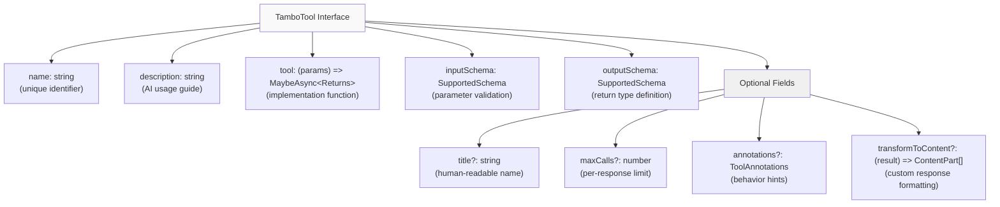
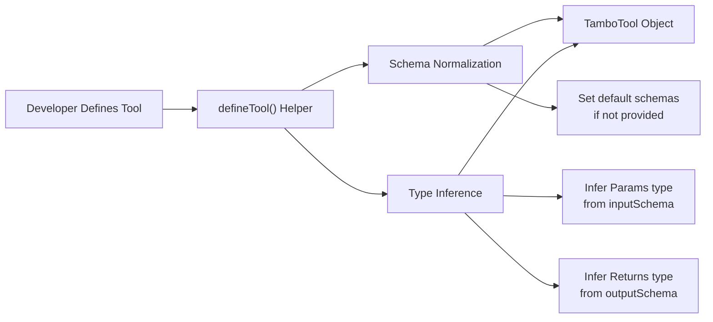
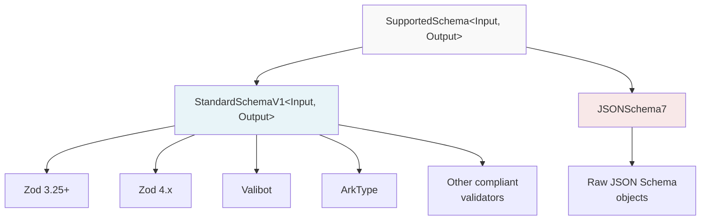
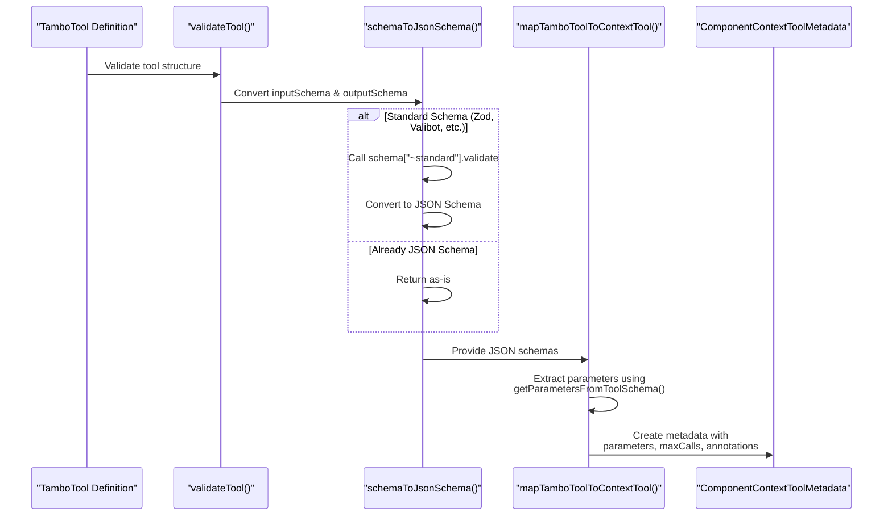
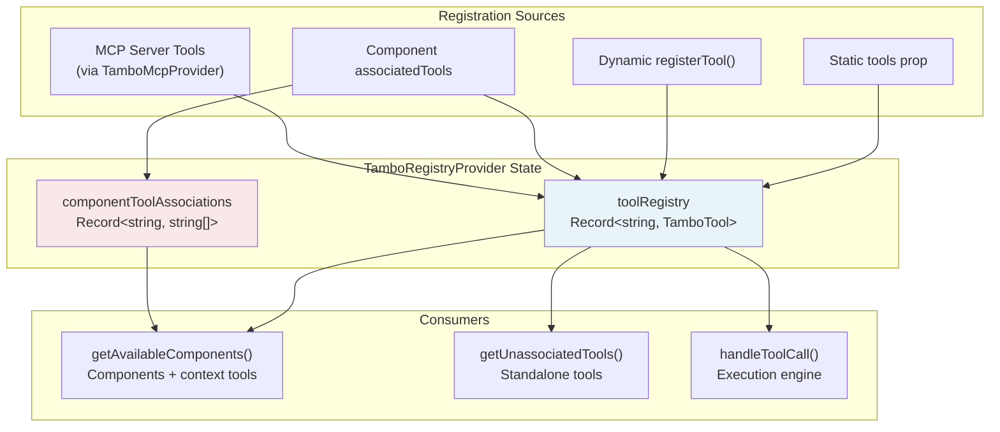
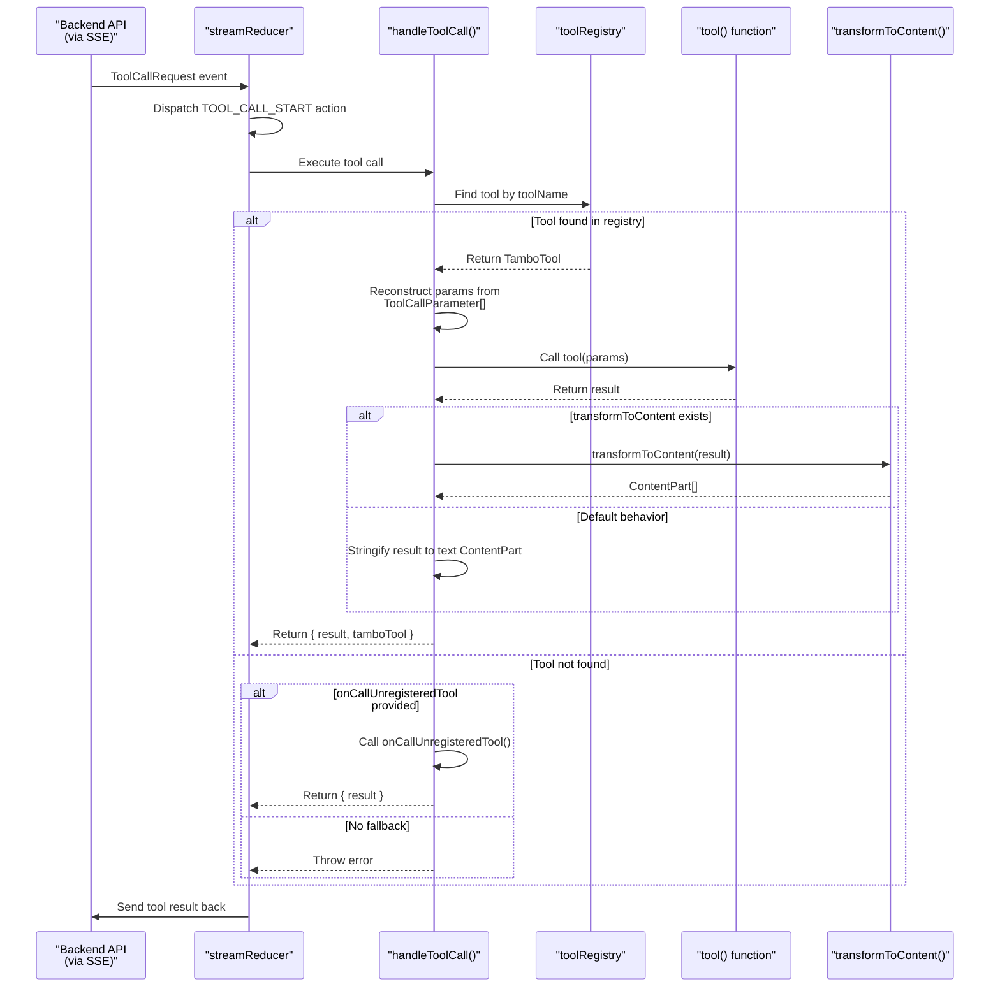
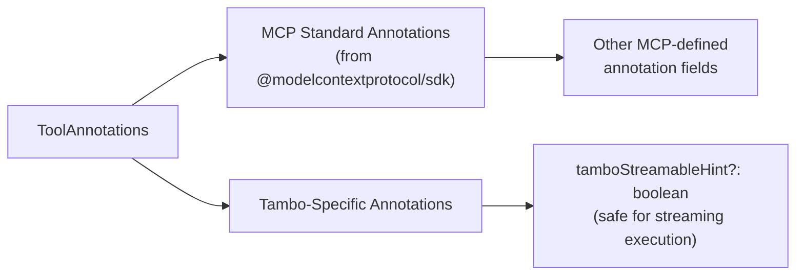
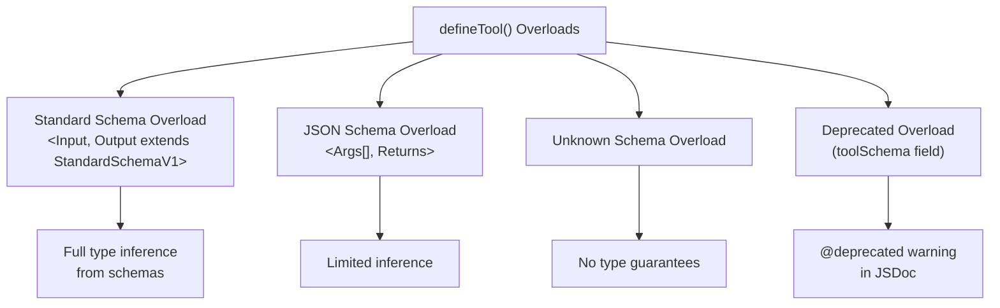
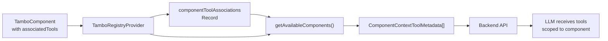

<!-- source: DeepWiki mcp.deepwiki.com · repo tambo-ai/tambo · page 3.5 Tool Registration · fetched 2026-10-29 -->

# Tool Registration

<details>
<summary>Relevant source files</summary>

The following files were used as context for generating this wiki page:

- [README.md](README.md)
- [cli/README.md](cli/README.md)
- [cli/src/templates/tambo-template.ts](cli/src/templates/tambo-template.ts)
- [create-tambo-app/README.md](create-tambo-app/README.md)
- [react-sdk/AGENTS.md](react-sdk/AGENTS.md)
- [react-sdk/README.md](react-sdk/README.md)
- [react-sdk/src/hooks/react-query-hooks.ts](react-sdk/src/hooks/react-query-hooks.ts)
- [react-sdk/src/index.ts](react-sdk/src/index.ts)
- [react-sdk/src/model/component-metadata.ts](react-sdk/src/model/component-metadata.ts)
- [react-sdk/src/providers/tambo-registry-provider.tsx](react-sdk/src/providers/tambo-registry-provider.tsx)
- [react-sdk/src/util/registry.ts](react-sdk/src/util/registry.ts)
- [react-sdk/src/util/tool-caller.ts](react-sdk/src/util/tool-caller.ts)
- [showcase/README.md](showcase/README.md)

</details>


This document covers how to register and configure tools in the Tambo React SDK. Tools are JavaScript functions that the AI can invoke to perform actions in the browser, such as fetching data, manipulating the DOM, accessing React state, or integrating with external APIs.

For information about registering React components that the AI can render, see [Component Registration](#3.4). For server-side MCP tools, see [MCP Tools](#6.4).

---

## Purpose and Scope

Tools enable the AI to execute client-side logic beyond rendering components. When registered with the `TamboRegistryProvider`, tools become available for the AI to call during conversation threads. This page covers:

- The `TamboTool` interface structure
- Defining tools with type safety using `defineTool`
- Supported schema types for input/output validation
- Registration methods (static via props, dynamic via hooks)
- Tool execution lifecycle
- Advanced features (annotations, call limits, content transformation)

---

## The TamboTool Interface

### Core Structure

Tools are defined using the `TamboTool` interface, which specifies the tool's metadata, execution function, and input/output schemas.



**Sources:** [react-sdk/src/model/component-metadata.ts:112-197]()

### Interface Definition

| Property | Type | Required | Description |
|----------|------|----------|-------------|
| `name` | `string` | Yes | Unique identifier for the tool, used by the AI to reference it |
| `description` | `string` | Yes | Clear explanation of what the tool does and when to use it |
| `tool` | `(params: Params) => MaybeAsync<Returns>` | Yes | The function that implements the tool's logic |
| `inputSchema` | `SupportedSchema<Params>` | Yes | Schema defining and validating input parameters |
| `outputSchema` | `SupportedSchema<Returns>` | Yes | Schema describing the tool's return value structure |
| `title` | `string` | No | Human-readable display name for UI presentation |
| `maxCalls` | `number` | No | Override global tool call limit for this specific tool |
| `annotations` | `ToolAnnotations` | No | Behavioral hints aligned with MCP specification |
| `transformToContent` | `(result: any) => Promise<ContentPart[]>` | No | Convert tool result to custom content parts (text, images, etc.) |

**Sources:** [react-sdk/src/model/component-metadata.ts:112-197]()

---

## Defining Tools

### Using the defineTool Helper

The `defineTool` helper provides full type inference and safety when creating tools. It ensures the `tool` function's parameters and return type match the declared schemas.

#### Basic Tool Definition

```typescript
import { defineTool } from "@tambo-ai/react";
import { z } from "zod/v4";

const getWeatherTool = defineTool({
  name: "getWeather",
  description: "Fetches current weather for a location",
  tool: async ({ location }) => {
    const response = await fetch(`/api/weather?q=${encodeURIComponent(location)}`);
    return response.json();
  },
  inputSchema: z.object({
    location: z.string().describe("City name or zip code"),
  }),
  outputSchema: z.object({
    temperature: z.number(),
    condition: z.string(),
    location: z.string(),
  }),
});
```

**Sources:** [README.md:186-203](), [react-sdk/src/model/component-metadata.ts:398-465]()

### Tool Definition Flow



**Sources:** [react-sdk/src/util/registry.ts:151-158](), [react-sdk/src/model/component-metadata.ts:398-465]()

---

## Schema Types

### Supported Schema Systems

Tambo supports two schema approaches through the `SupportedSchema` type:

1. **Standard Schema** - Any validator implementing the [Standard Schema specification](https://standardschema.dev) (Zod 3.25+, Zod 4.x, Valibot, ArkType)
2. **JSON Schema** - Raw JSON Schema v7 objects



**Sources:** [react-sdk/src/model/component-metadata.ts:7-18]()

### Schema Conversion Pipeline

When tools are registered, their schemas are converted to JSON Schema for transmission to the API backend:



**Sources:** [react-sdk/src/util/registry-validators.ts:1-80](), [react-sdk/src/schema/index.ts:1-100](), [react-sdk/src/util/registry.ts:116-132]()

### Parameter Extraction

The `getParametersFromToolSchema` function converts schemas into the parameter format expected by the backend:

| Input Schema Type | Processing |
|-------------------|------------|
| Standard Schema with JSON Schema | Converts to `ParameterSpec[]` with `schema` field |
| JSON Schema object | Extracts properties and marks required fields |
| Other types | Returns empty parameters array |

**Sources:** [react-sdk/src/schema/index.ts:1-100]()

---

## Registration Methods

### Static Registration via Props

Tools can be registered by passing them to the `tools` prop of `TamboRegistryProvider` (or `TamboProvider`):

```typescript
import { TamboProvider } from "@tambo-ai/react";
import { defineTool } from "@tambo-ai/react";

const tools = [
  defineTool({
    name: "getCurrentUser",
    description: "Gets the currently logged in user's information",
    tool: async () => {
      const response = await fetch("/api/user");
      return response.json();
    },
    inputSchema: z.object({}),
    outputSchema: z.object({
      id: z.string(),
      email: z.string(),
      name: z.string(),
    }),
  }),
  // ... more tools
];

<TamboProvider tools={tools} components={components}>
  <App />
</TamboProvider>
```

**Sources:** [README.md:186-209](), [react-sdk/src/providers/tambo-registry-provider.tsx:109-143]()

### Dynamic Registration with Hooks

Tools can be registered dynamically using the `registerTool` or `registerTools` functions from `useTamboRegistry`:

```typescript
import { useTamboRegistry, defineTool } from "@tambo-ai/react";

function MyComponent() {
  const { registerTool, registerTools } = useTamboRegistry();
  
  useEffect(() => {
    // Register a single tool
    registerTool(defineTool({
      name: "dynamicTool",
      description: "A dynamically registered tool",
      tool: async (params) => { /* ... */ },
      inputSchema: z.object({ /* ... */ }),
      outputSchema: z.any(),
    }));
    
    // Or register multiple tools at once
    registerTools([tool1, tool2, tool3]);
  }, []);
}
```

**Sources:** [react-sdk/src/providers/tambo-registry-provider.tsx:204-220]()

### Component-Associated Tools

Tools can be associated with specific components using the `associatedTools` property on a `TamboComponent` definition:

```typescript
const components: TamboComponent[] = [
  {
    name: "DataTable",
    description: "Displays tabular data",
    component: DataTable,
    propsSchema: z.object({
      data: z.array(z.any()),
      columns: z.array(z.string()),
    }),
    associatedTools: [
      defineTool({
        name: "exportTableData",
        description: "Export table data to CSV",
        tool: async ({ tableId }) => {
          // Export logic
        },
        inputSchema: z.object({ tableId: z.string() }),
        outputSchema: z.string(),
      }),
    ],
  },
];
```

When a component is registered with associated tools, the tools are automatically registered in the tool registry and linked to the component in the `componentToolAssociations` record.

**Sources:** [react-sdk/src/providers/tambo-registry-provider.tsx:280-286](), [react-sdk/src/model/component-metadata.ts:277-337]()

---

## Tool Registry Architecture



**Sources:** [react-sdk/src/providers/tambo-registry-provider.tsx:39-62](), [react-sdk/src/util/registry.ts:24-67]()

### Tool Registry Data Flow

| Function | Purpose | Location |
|----------|---------|----------|
| `registerTool()` | Add single tool to registry, optionally warn on overwrite | [react-sdk/src/providers/tambo-registry-provider.tsx:204-211]() |
| `registerTools()` | Add multiple tools via array reduce | [react-sdk/src/providers/tambo-registry-provider.tsx:213-220]() |
| `getAvailableComponents()` | Extract components with their associated tools for API | [react-sdk/src/util/registry.ts:24-51]() |
| `getUnassociatedTools()` | Filter tools not linked to any component | [react-sdk/src/util/registry.ts:59-67]() |
| `mapTamboToolToContextTool()` | Convert `TamboTool` to `ComponentContextToolMetadata` | [react-sdk/src/util/registry.ts:116-132]() |

**Sources:** [react-sdk/src/providers/tambo-registry-provider.tsx:189-220](), [react-sdk/src/util/registry.ts:24-132]()

---

## Tool Execution Flow

### Discovery and Invocation



**Sources:** [react-sdk/src/util/tool-caller.ts:15-98](), [react-sdk/src/v1/utils/eventaccumulator.ts:1-500]()

### Parameter Reconstruction

Tool calls from the API include parameters as an array of `ToolCallParameter` objects with `parameterName` and `parameterValue` fields. The execution engine reconstructs these into a single object:

```typescript
// API sends: [{ parameterName: "location", parameterValue: "Seattle" }]
// Reconstructed as: { location: "Seattle" }

const inputObject = Object.fromEntries(
  parameters.map((param) => [param.parameterName, param.parameterValue])
);
return await tool.getComponentContext(inputObject);
```

**Sources:** [react-sdk/src/util/tool-caller.ts:86-97]()

### Error Handling

If a tool throws an error during execution, the error is caught and returned as a string result with an `error` field:

```typescript
return {
  result: `When attempting to call tool ${toolCallRequest.toolName} the following error occurred: ${error}. Explain to the user that the tool call failed and try again if needed.`,
  error: error instanceof Error ? error.message : "Unknown error",
};
```

**Sources:** [react-sdk/src/util/tool-caller.ts:52-58]()

---

## Tool Annotations

### ToolAnnotations Interface

Annotations provide behavioral hints aligned with the Model Context Protocol specification. The primary annotation is `tamboStreamableHint`, which indicates whether a tool is safe to call repeatedly during streaming.



**Sources:** [react-sdk/src/model/component-metadata.ts:20-33]()

### Streamable Tools

Tools marked with `tamboStreamableHint: true` can be invoked multiple times as partial data streams in, enabling progressive updates:

```typescript
const setTextTool = defineTool({
  name: "set_text",
  description: "Set the displayed text progressively",
  annotations: {
    tamboStreamableHint: true, // Safe for streaming
  },
  tool: ({ text }) => {
    setText(text); // Idempotent operation
  },
  inputSchema: z.object({ text: z.string() }),
  outputSchema: z.void(),
});
```

**Sources:** [react-sdk/src/model/component-metadata.ts:140-153]()

---

## Advanced Features

### Custom Content Transformation

By default, tool results are stringified and wrapped in a text content part. The `transformToContent` function allows tools to return rich content including images, audio, or mixed media:

```typescript
const imageGeneratorTool = defineTool({
  name: "generateImage",
  description: "Generate an image from a text prompt",
  tool: async ({ prompt }) => {
    const imageUrl = await callImageAPI(prompt);
    return { url: imageUrl, prompt };
  },
  inputSchema: z.object({ prompt: z.string() }),
  outputSchema: z.object({
    url: z.string(),
    prompt: z.string(),
  }),
  transformToContent: (result) => [
    { type: "text", text: `Generated image for: ${result.prompt}` },
    { type: "image_url", image_url: { url: result.url } },
  ],
});
```

**Sources:** [react-sdk/src/model/component-metadata.ts:186-196](), [react-sdk/AGENTS.md:50-74]()

### Tool Call Limits

The `maxCalls` property overrides the project's global tool call limit for a specific tool. This is useful for tools that should only be invoked once or twice per response:

```typescript
const expensiveAnalysisTool = defineTool({
  name: "runAnalysis",
  description: "Run expensive data analysis",
  maxCalls: 1, // Only call once per response
  tool: async ({ dataset }) => {
    return await runExpensiveComputation(dataset);
  },
  inputSchema: z.object({ dataset: z.array(z.any()) }),
  outputSchema: z.object({ result: z.any() }),
});
```

**Sources:** [react-sdk/src/model/component-metadata.ts:130-135](), [react-sdk/src/model/component-metadata.ts:48-54]()

### Unregistered Tool Fallback

The `onCallUnregisteredTool` callback on `TamboRegistryProvider` allows handling tool calls for tools not in the registry. This is primarily used in agent frameworks where the agent may request tools dynamically:

```typescript
<TamboProvider
  tools={tools}
  onCallUnregisteredTool={async (toolName, args) => {
    // Forward to agent framework or external system
    return await agentFramework.executeTool(toolName, args);
  }}
>
  <App />
</TamboProvider>
```

**Sources:** [react-sdk/src/providers/tambo-registry-provider.tsx:138-142](), [react-sdk/src/util/tool-caller.ts:37-45]()

---

## Type Safety Considerations

### Tool Type Variants

The SDK defines multiple tool type variants for different schema combinations:

| Type | Schemas | Type Safety | Use Case |
|------|---------|-------------|----------|
| `TamboToolStandardSchema<Input, Output>` | Both Standard Schema | Full inference | Recommended for new code |
| `TamboToolJSONSchema<Args[], Returns>` | Both JSON Schema | Limited inference | Raw JSON Schema usage |
| `TamboToolUnknown` | Mixed or unknown | No guarantees | Fallback for unknown types |
| `UnsupportedSchemaTamboTool` | Old `toolSchema` field | Deprecated | Migration needed |

**Sources:** [react-sdk/src/model/component-metadata.ts:199-270]()

### DefineToolFn Overloads

The `defineTool` function has multiple overloads to handle each type variant, providing the best possible type inference for each scenario:



**Sources:** [react-sdk/src/model/component-metadata.ts:398-465]()

---

## Integration with Component Context

Tools associated with components become "context tools" in the `AvailableComponent` metadata sent to the backend:



This enables the AI to understand which tools are relevant when working with specific components, improving tool selection accuracy.

**Sources:** [react-sdk/src/util/registry.ts:24-51](), [react-sdk/src/providers/tambo-registry-provider.tsx:280-286]()

---

## Summary

Tool registration in Tambo enables browser-side function execution controlled by AI. Key points:

- **Define tools** using the `TamboTool` interface with `defineTool` for type safety
- **Schemas** support Standard Schema (Zod, Valibot, ArkType) or JSON Schema v7
- **Register tools** via static props, dynamic hooks, or component associations
- **Tool execution** uses `handleToolCall()` to find, invoke, and transform results
- **Annotations** provide behavioral hints like `tamboStreamableHint`
- **Advanced features** include `transformToContent`, `maxCalls`, and unregistered tool fallback

**Sources:** All sections above

---

