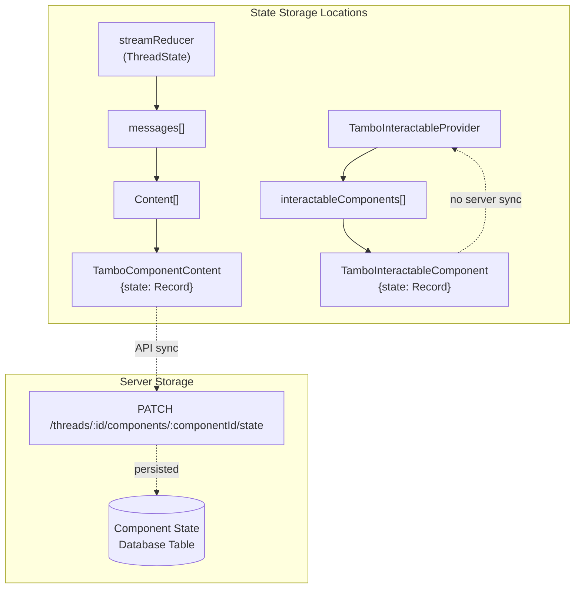
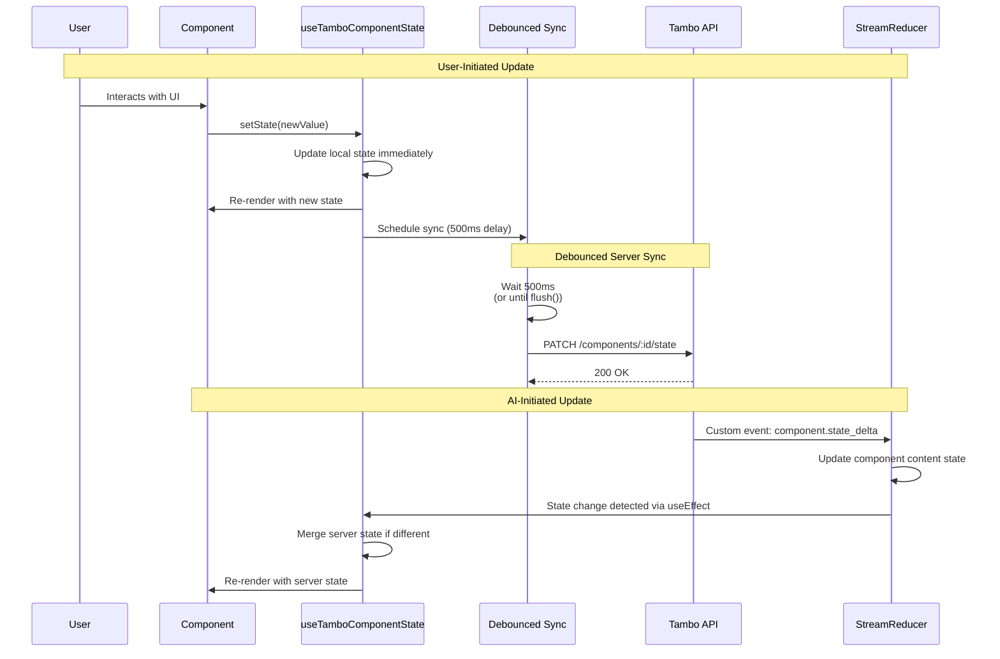
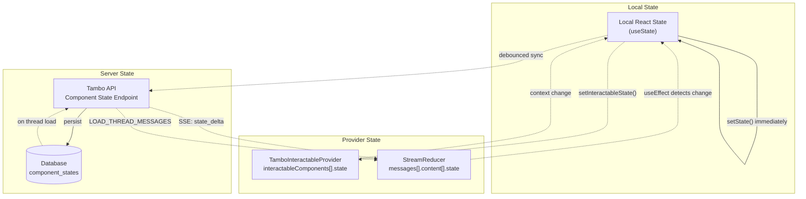

<!-- source: DeepWiki mcp.deepwiki.com · repo tambo-ai/tambo · page 3.6 Component State Management · fetched 2026-10-29 -->

# Component State Management

<details>
<summary>Relevant source files</summary>

The following files were used as context for generating this wiki page:

- [plans/implement-react-sdk-v1-api-support.md](plans/implement-react-sdk-v1-api-support.md)
- [react-sdk/src/context-helpers/current-interactables-context-helper.ts](react-sdk/src/context-helpers/current-interactables-context-helper.ts)
- [react-sdk/src/hoc/with-tambo-interactable.test.tsx](react-sdk/src/hoc/with-tambo-interactable.test.tsx)
- [react-sdk/src/hoc/with-tambo-interactable.tsx](react-sdk/src/hoc/with-tambo-interactable.tsx)
- [react-sdk/src/model/tambo-interactable.ts](react-sdk/src/model/tambo-interactable.ts)
- [react-sdk/src/providers/tambo-interactable-provider-partial-updates.test.tsx](react-sdk/src/providers/tambo-interactable-provider-partial-updates.test.tsx)
- [react-sdk/src/providers/tambo-interactable-provider.test.tsx](react-sdk/src/providers/tambo-interactable-provider.test.tsx)
- [react-sdk/src/providers/tambo-interactable-provider.tsx](react-sdk/src/providers/tambo-interactable-provider.tsx)
- [react-sdk/src/schema/index.ts](react-sdk/src/schema/index.ts)
- [react-sdk/src/schema/json-schema.test.ts](react-sdk/src/schema/json-schema.test.ts)
- [react-sdk/src/util/validate-component-name.ts](react-sdk/src/util/validate-component-name.ts)
- [react-sdk/src/v1/__tests__/v1-interactables.test.tsx](react-sdk/src/v1/__tests__/v1-interactables.test.tsx)
- [react-sdk/src/v1/hooks/use-tambo-v1-component-state.test.tsx](react-sdk/src/v1/hooks/use-tambo-v1-component-state.test.tsx)
- [react-sdk/src/v1/hooks/use-tambo-v1-component-state.ts](react-sdk/src/v1/hooks/use-tambo-v1-component-state.ts)
- [react-sdk/src/v1/hooks/use-tambo-v1-messages.test.tsx](react-sdk/src/v1/hooks/use-tambo-v1-messages.test.tsx)
- [react-sdk/src/v1/hooks/use-tambo-v1-send-message.test.tsx](react-sdk/src/v1/hooks/use-tambo-v1-send-message.test.tsx)
- [react-sdk/src/v1/hooks/use-tambo-v1-send-message.ts](react-sdk/src/v1/hooks/use-tambo-v1-send-message.ts)
- [react-sdk/src/v1/hooks/use-tambo-v1-suggestions.test.tsx](react-sdk/src/v1/hooks/use-tambo-v1-suggestions.test.tsx)
- [react-sdk/src/v1/hooks/use-tambo-v1-suggestions.ts](react-sdk/src/v1/hooks/use-tambo-v1-suggestions.ts)
- [react-sdk/src/v1/hooks/use-tambo-v1-thread-input.test.tsx](react-sdk/src/v1/hooks/use-tambo-v1-thread-input.test.tsx)
- [react-sdk/src/v1/hooks/use-tambo-v1-thread-input.ts](react-sdk/src/v1/hooks/use-tambo-v1-thread-input.ts)
- [react-sdk/src/v1/hooks/use-tambo-v1-thread-list.test.tsx](react-sdk/src/v1/hooks/use-tambo-v1-thread-list.test.tsx)
- [react-sdk/src/v1/hooks/use-tambo-v1-thread-list.ts](react-sdk/src/v1/hooks/use-tambo-v1-thread-list.ts)
- [react-sdk/src/v1/hooks/use-tambo-v1-thread.test.tsx](react-sdk/src/v1/hooks/use-tambo-v1-thread.test.tsx)
- [react-sdk/src/v1/hooks/use-tambo-v1-thread.ts](react-sdk/src/v1/hooks/use-tambo-v1-thread.ts)
- [react-sdk/src/v1/hooks/use-tambo-v1.test.tsx](react-sdk/src/v1/hooks/use-tambo-v1.test.tsx)
- [react-sdk/src/v1/hooks/use-tambo-v1.ts](react-sdk/src/v1/hooks/use-tambo-v1.ts)
- [react-sdk/src/v1/index.ts](react-sdk/src/v1/index.ts)
- [react-sdk/src/v1/providers/tambo-v1-provider.test.tsx](react-sdk/src/v1/providers/tambo-v1-provider.test.tsx)
- [react-sdk/src/v1/providers/tambo-v1-provider.tsx](react-sdk/src/v1/providers/tambo-v1-provider.tsx)
- [react-sdk/src/v1/providers/tambo-v1-stream-context.test.tsx](react-sdk/src/v1/providers/tambo-v1-stream-context.test.tsx)
- [react-sdk/src/v1/providers/tambo-v1-stream-context.tsx](react-sdk/src/v1/providers/tambo-v1-stream-context.tsx)
- [react-sdk/src/v1/providers/tambo-v1-stub-provider.test.tsx](react-sdk/src/v1/providers/tambo-v1-stub-provider.test.tsx)
- [react-sdk/src/v1/providers/tambo-v1-stub-provider.tsx](react-sdk/src/v1/providers/tambo-v1-stub-provider.tsx)
- [react-sdk/src/v1/providers/tambo-v1-thread-input-provider.tsx](react-sdk/src/v1/providers/tambo-v1-thread-input-provider.tsx)
- [react-sdk/src/v1/types/thread.ts](react-sdk/src/v1/types/thread.ts)
- [react-sdk/src/v1/types/tool-choice.ts](react-sdk/src/v1/types/tool-choice.ts)
- [react-sdk/src/v1/utils/__snapshots__/event-accumulator.test.ts.snap](react-sdk/src/v1/utils/__snapshots__/event-accumulator.test.ts.snap)
- [react-sdk/src/v1/utils/component-renderer.test.tsx](react-sdk/src/v1/utils/component-renderer.test.tsx)
- [react-sdk/src/v1/utils/component-renderer.tsx](react-sdk/src/v1/utils/component-renderer.tsx)
- [react-sdk/src/v1/utils/event-accumulator.test.ts](react-sdk/src/v1/utils/event-accumulator.test.ts)
- [react-sdk/src/v1/utils/event-accumulator.ts](react-sdk/src/v1/utils/event-accumulator.ts)
- [showcase/src/app/components/(message-primitives)/thread-content/page.tsx](showcase/src/app/components/(message-primitives)/thread-content/page.tsx)
- [showcase/src/app/components/(message-primitives)/thread-history/page.tsx](showcase/src/app/components/(message-primitives)/thread-history/page.tsx)

</details>


## Purpose and Scope

This page documents component state management in the Tambo React SDK, focusing on the `useTamboComponentState` hook and its bidirectional synchronization between React components and the Tambo backend. 

Component state refers to AI-managed data that persists across render cycles and can be updated by both the user (via UI interactions) and the AI (via tool calls). This differs from component **props**, which are immutable once rendered. For information about component registration and props schemas, see [Component Registration](#3.4). For details about AI-modifiable components (interactable components), see [Interactable Components](#3.9).

**Sources**: [react-sdk/src/v1/hooks/use-tambo-v1-component-state.ts:1-15]()

---

## Component State Overview

Component state in Tambo operates in three distinct modes depending on the component's context:

| Mode | Context | State Storage | Sync Behavior |
|------|---------|---------------|---------------|
| **Rendered Components** | Component rendered by AI in message stream | `ThreadState.thread.messages[].content[].state` | Bidirectional sync with server via API |
| **Interactable Components** | Component wrapped with `withTamboInteractable` | `TamboInteractableProvider.interactableComponents[].state` | Local state + AI tool registration |
| **No Context** | Component awaiting provider context | Local React state only | Plain `useState` behavior |

The hook automatically detects which mode to operate in based on the `ComponentContentContext` provided by the SDK's internal providers.

**Sources**: [react-sdk/src/v1/hooks/use-tambo-v1-component-state.ts:16-50](), [react-sdk/src/providers/tambo-interactable-provider.tsx:1-50]()

---

## State Storage Architecture



**Rendered Component State Path**:
- State stored in `StreamState.threadMap[threadId].thread.messages[].content[].state`
- Managed by `streamReducer` in [react-sdk/src/v1/utils/event-accumulator.ts:382-662]()
- State updates tracked via custom events: `tambo.component.state_delta`
- Persisted to server via `PATCH /threads/{threadId}/components/{componentId}/state` endpoint

**Interactable Component State Path**:
- State stored in `TamboInteractableProvider`'s `interactableComponents` array
- Managed in-memory only (no server persistence)
- AI can update via registered tools: `update_component_state_<componentId>`
- State changes trigger re-renders via React context

**Sources**: [react-sdk/src/v1/utils/event-accumulator.ts:56-90](), [react-sdk/src/providers/tambo-interactable-provider.tsx:47-108](), [react-sdk/src/v1/hooks/use-tambo-v1-component-state.ts:85-116]()

---

## The useTamboComponentState Hook

### API Signature

```typescript
function useTamboComponentState<S>(
  keyName: string,
  initialValue: S,
  debounceTime?: number
): [
  currentState: S,
  setState: (newState: S | ((prev: S) => S)) => void,
  meta: {
    isPending: boolean;
    error: Error | null;
    flush: () => void;
  }
]
```

### Parameters

| Parameter | Type | Description |
|-----------|------|-------------|
| `keyName` | `string` | Unique key to identify this state value within the component's state object |
| `initialValue` | `S` | Initial value (used if no server/interactable state exists) |
| `debounceTime` | `number` | Debounce delay in milliseconds for server sync (default: 500ms) |

### Return Value

The hook returns a tuple similar to `useState`, plus metadata:
- **currentState**: Current state value (merged from server/interactable/local)
- **setState**: State setter function (supports functional updates)
- **meta.isPending**: Whether a debounced update is pending or in-flight
- **meta.error**: Last error from server sync (if any)
- **meta.flush**: Immediately flush pending debounced updates

### Usage Example

```typescript
function Counter() {
  const [count, setCount, { isPending, flush }] = useTamboComponentState(
    'count', 
    0,
    500  // 500ms debounce
  );

  return (
    <div>
      <span>{count}</span>
      <button 
        onClick={() => setCount(c => c + 1)} 
        disabled={isPending}
      >
        Increment
      </button>
      <button onClick={flush}>Save Now</button>
    </div>
  );
}
```

**Sources**: [react-sdk/src/v1/hooks/use-tambo-v1-component-state.ts:28-84]()

---

## State Synchronization Flow

### Bidirectional Sync Architecture



### Debouncing and Optimization

The hook uses `useDebouncedCallback` to batch rapid state changes:

1. **Immediate Local Update**: `setState()` updates local state synchronously for instant UI feedback
2. **Debounced Server Sync**: Server updates wait 500ms (configurable) to batch rapid changes
3. **Deep Equality Check**: Uses `fast-equals` to skip no-op updates
4. **Manual Flush**: Call `flush()` to force immediate sync (e.g., on form submit)

**Example of Batching**:
```typescript
// User rapidly clicks "Increment" 5 times
setCount(c => c + 1);  // Local: 1, Server: (pending)
setCount(c => c + 1);  // Local: 2, Server: (pending)
setCount(c => c + 1);  // Local: 3, Server: (pending)
setCount(c => c + 1);  // Local: 4, Server: (pending)
setCount(c => c + 1);  // Local: 5, Server: (pending)
// ... 500ms passes ...
// Single API call: PATCH with {count: 5}
```

**Sources**: [react-sdk/src/v1/hooks/use-tambo-v1-component-state.ts:140-180](), [react-sdk/src/v1/hooks/use-tambo-v1-component-state.ts:207-229]()

---

## Rendered Components: Server-Synced State

### Context Detection

Rendered components receive context from the `ComponentContentProvider`, which is automatically set up by the `ComponentRenderer` when the AI renders a component in a message:

```typescript
// Rendered by AI in message stream
<ComponentContentProvider 
  threadId="thread_123"
  messageId="msg_456"
  componentId="comp_789"
>
  <WeatherCard city="Seattle" />
</ComponentContentProvider>
```

The hook detects this context via `useComponentContentOptional()` and operates in "rendered mode" when `threadId` is non-empty.

**Sources**: [react-sdk/src/v1/utils/component-renderer.tsx:1-80](), [react-sdk/src/v1/hooks/use-tambo-v1-component-state.ts:86-110]()

### State Retrieval and Merging

For rendered components, the hook retrieves state from the stream reducer:

```typescript
// Find component content in thread messages
const renderedContent = findComponentContent(
  streamState, 
  threadId, 
  componentId
);
const serverState = renderedContent?.state as Record<string, unknown> | undefined;
const serverValue = serverState?.[keyName] as S | undefined;

// Initialize local state with priority:
// 1. Server state (highest priority)
// 2. Initial value (fallback)
const [localState, setLocalState] = useState<S>(
  () => serverValue ?? (initialValue as S)
);
```

The `findComponentContent` utility searches through thread messages to locate the component content block by ID.

**Sources**: [react-sdk/src/v1/hooks/use-tambo-v1-component-state.ts:104-122](), [react-sdk/src/v1/utils/thread-utils.ts:1-50]()

### Server Update Flow

When state changes, the hook sends a PATCH request to persist the new state:

```typescript
const updateServerState = async (key: string, value: unknown) => {
  await client.threads.components.updateState(
    threadId,
    componentId,
    {
      [key]: value,
    },
    { userKey }
  );
};
```

The backend then broadcasts a `tambo.component.state_delta` event to all connected clients, which the `streamReducer` handles to update the component content's state field:

```typescript
// In streamReducer
case "tambo.component.state_delta":
  return handleComponentDelta(threadState, customEvent, "state");
```

This enables real-time state synchronization across multiple clients viewing the same thread.

**Sources**: [react-sdk/src/v1/hooks/use-tambo-v1-component-state.ts:159-193](), [react-sdk/src/v1/utils/event-accumulator.ts:1239-1256]()

### Stream Reducer State Updates

The `handleComponentDelta` function in the stream reducer applies incremental state updates using JSON patches:

```typescript
function handleComponentDelta(
  threadState: ThreadState,
  event: ComponentStateDeltaEvent,
  deltaType: "props" | "state"
): ThreadState {
  const { messageId, componentId, patches } = event.value;
  
  // Find the component content block
  const { messageIndex, contentIndex } = findContentById(
    messages,
    "component",
    componentId,
    event.name
  );
  
  // Apply JSON patches to the state/props object
  const updatedState = applyJsonPatch(
    componentContent.state ?? {},
    patches
  );
  
  // Update the component content immutably
  const updatedContent: Content = {
    ...componentContent,
    state: updatedState,
  };
  
  // Return updated thread state
  return updateThreadMessages(threadState, updatedMessages);
}
```

**Sources**: [react-sdk/src/v1/utils/event-accumulator.ts:1381-1463]()

---

## Interactable Components: Local State with AI Tools

### HOC-Based Registration

Interactable components are created using the `withTamboInteractable` HOC, which registers the component with the `TamboInteractableProvider` and provides a special context marker:

```typescript
const InteractableCounter = withTamboInteractable(Counter, {
  componentName: "Counter",
  description: "A counter that the AI can increment or decrement",
  stateSchema: z.object({
    count: z.number().describe("Current count value"),
  }),
});
```

The HOC sets `threadId=""` in the component content context to signal "interactable mode" to the hook:

```typescript
<ComponentContentProvider 
  threadId=""  // Empty = interactable mode
  messageId=""
  componentId={generatedId}
  interactableId={generatedId}
>
  <WrappedComponent {...props} />
</ComponentContentProvider>
```

**Sources**: [react-sdk/src/hoc/with-tambo-interactable.tsx:1-100](), [react-sdk/src/v1/hooks/use-tambo-v1-component-state.ts:99-102]()

### State Storage in Provider

For interactable components, state is stored in the `TamboInteractableProvider`'s internal array:

```typescript
interface TamboInteractableComponent<P = any, S = any> {
  id: string;
  name: string;
  props: P;
  state?: S;  // State storage
  propsSchema?: SupportedSchema<P>;
  stateSchema?: SupportedSchema<S>;
  annotations?: ToolAnnotations;
}

// In provider
const [interactableComponents, setInteractableComponents] = useState<
  TamboInteractableComponent[]
>([]);
```

The hook reads and writes state via the provider's context methods:

```typescript
// Read state
const interactableState = getInteractableComponentState(componentId)?.[keyName];

// Write state
setInteractableState(componentId, keyName, newValue);
```

**Sources**: [react-sdk/src/providers/tambo-interactable-provider.tsx:47-53](), [react-sdk/src/model/tambo-interactable.ts:1-80](), [react-sdk/src/v1/hooks/use-tambo-v1-component-state.ts:113-116]()

### AI State Update Tools

When an interactable component is registered, the provider automatically creates a tool that allows the AI to update its state:

```typescript
registerTool({
  name: `update_component_state_${componentId}`,
  description: `Update the state of interactable component ${componentId} (${componentName}). You may provide partial state (only keys to change).`,
  tool: ({ componentId, newState }) => {
    return updateInteractableComponentState(componentId, newState);
  },
  inputSchema: {
    type: "object",
    properties: {
      componentId: {
        type: "string",
        description: "The ID of the interactable component to update",
      },
      newState: {
        // Partial state schema derived from stateSchema
        ...makeJsonSchemaPartial(stateSchema),
        description: "The state values to update. Provide only the keys you want to change.",
      },
    },
    required: ["componentId", "newState"],
  },
  outputSchema: z.string(),
  annotations: {
    tamboStreamableHint: true,  // Enable streaming updates
  },
});
```

The AI can invoke this tool during streaming to update component state in real-time. The `tamboStreamableHint` annotation enables partial JSON parsing for immediate UI updates.

**Sources**: [react-sdk/src/providers/tambo-interactable-provider.tsx:314-367]()

### Partial State Updates

Both the hook and the AI tool support partial state updates:

```typescript
// User updates only one field
setCount(42);  // Updates only 'count' key

// AI tool call updates only changed fields
{
  "tool_use": {
    "name": "update_component_state_counter-abc",
    "input": {
      "componentId": "counter-abc",
      "newState": { "count": 42 }  // Partial update
    }
  }
}
```

The provider merges partial updates with existing state:

```typescript
const updateInteractableComponentState = (
  componentId: string,
  newState: Record<string, unknown>
): string => {
  setInteractableComponents((components) => {
    const component = components.find((c) => c.id === componentId);
    if (!component) return components;

    const prevState = component.state ?? {};
    const updatedState = { ...prevState, ...newState };  // Merge
    
    if (deepEqual(prevState, updatedState)) return components;  // Skip no-ops

    return components.map((c) =>
      c.id === componentId ? { ...c, state: updatedState } : c
    );
  });

  return "Updated successfully";
};
```

**Sources**: [react-sdk/src/providers/tambo-interactable-provider.tsx:230-257]()

---

## State Persistence and Loading

### Rendered Component Persistence

For rendered components, state persists across sessions via the database:

1. **Write Path**: `useTamboComponentState` → debounced update → `client.threads.components.updateState()` → API persists to DB
2. **Read Path**: Thread fetch → API returns messages with component state → `streamReducer` populates `content[].state` → hook reads from reducer

When switching to an existing thread, the `ThreadSyncManager` automatically fetches messages:

```typescript
// In TamboStreamProvider
function ThreadSyncManager(): null {
  const shouldFetch = isNotPlaceholder && isNotSynced && hasNoMessages;
  
  const { data: messagesData } = useTamboQuery({
    queryKey: ["v1-thread-messages", currentThreadId],
    queryFn: async () => await client.threads.messages.list(currentThreadId),
    enabled: shouldFetch,
  });
  
  useEffect(() => {
    if (messagesSuccess && messagesData) {
      dispatch({
        type: "LOAD_THREAD_MESSAGES",
        threadId: currentThreadId,
        messages: messagesData.messages,
        skipIfStreaming: true,
      });
    }
  }, [messagesSuccess, messagesData, currentThreadId]);
  
  return null;
}
```

The `LOAD_THREAD_MESSAGES` action populates the reducer with full message content including state fields.

**Sources**: [react-sdk/src/v1/providers/tambo-v1-stream-context.tsx:249-311](), [react-sdk/src/v1/utils/event-accumulator.ts:134-143]()

### Interactable Component Ephemeral State

Interactable components do **not** persist state to the server. State exists only in the `TamboInteractableProvider`'s memory and is lost on page reload. This is by design, as interactable components represent UI elements on the current page rather than conversation artifacts.

If persistence is needed for interactable components, the application must implement its own storage mechanism (e.g., localStorage, custom API endpoints).

**Sources**: [react-sdk/src/providers/tambo-interactable-provider.tsx:369-402]()

### Optimistic Updates

The hook provides instant feedback by updating local state before server confirmation:

```typescript
const setState = useCallback((newValue: S | ((prev: S) => S)) => {
  // 1. Update local state immediately (optimistic)
  setLocalState(newValue);
  
  // 2. Schedule debounced server sync
  if (isRenderedComponent) {
    debouncedUpdateServerState(keyName, resolvedValue);
  } else if (isInteractable) {
    setInteractableState(componentId, keyName, resolvedValue);
  }
}, [...]);
```

If the server update fails, the error is exposed via the `meta.error` field, but the local state remains unchanged. Applications can handle errors by showing retry UI or reverting state:

```typescript
const [count, setCount, { error, flush }] = useTamboComponentState('count', 0);

if (error) {
  return (
    <div>
      <span>Failed to save: {error.message}</span>
      <button onClick={flush}>Retry</button>
    </div>
  );
}
```

**Sources**: [react-sdk/src/v1/hooks/use-tambo-v1-component-state.ts:231-254]()

---

## Implementation Details

### Key Code Locations

| Functionality | File | Lines |
|---------------|------|-------|
| `useTamboComponentState` hook | `react-sdk/src/v1/hooks/use-tambo-v1-component-state.ts` | 70-254 |
| Interactable state management | `react-sdk/src/providers/tambo-interactable-provider.tsx` | 189-367 |
| `withTamboInteractable` HOC | `react-sdk/src/hoc/with-tambo-interactable.tsx` | 10-210 |
| Component state events in reducer | `react-sdk/src/v1/utils/event-accumulator.ts` | 1231-1463 |
| Component content context | `react-sdk/src/v1/utils/component-renderer.tsx` | 1-80 |
| Thread state utilities | `react-sdk/src/v1/utils/thread-utils.ts` | 1-50 |

### State Tracking in Event Accumulator

The `streamReducer` handles component state updates via custom events:

```typescript
case "tambo.component.state_delta":
  return handleComponentDelta(threadState, customEvent, "state");

function handleComponentDelta(
  threadState: ThreadState,
  event: ComponentStateDeltaEvent,
  deltaType: "props" | "state"
): ThreadState {
  // 1. Find component content by ID
  const { messageIndex, contentIndex } = findContentById(
    messages,
    "component",
    componentId,
    event.name
  );
  
  // 2. Apply JSON patches to state/props
  const currentValue = deltaType === "state" 
    ? componentContent.state 
    : componentContent.props;
  const updatedValue = applyJsonPatch(currentValue ?? {}, patches);
  
  // 3. Update component content immutably
  const updatedContent: Content = {
    ...componentContent,
    [deltaType]: updatedValue,
  };
  
  // 4. Rebuild message and thread state
  return updateThreadMessages(threadState, updatedMessages);
}
```

The `applyJsonPatch` utility applies RFC 6902 JSON Patch operations to enable efficient incremental updates.

**Sources**: [react-sdk/src/v1/utils/event-accumulator.ts:1217-1256](), [react-sdk/src/v1/utils/event-accumulator.ts:1381-1463](), [react-sdk/src/v1/utils/json-patch.ts:1-100]()

### Component Content Context

The `ComponentContentProvider` wraps rendered components to provide metadata:

```typescript
export interface ComponentContentContext {
  threadId: string;
  messageId: string;
  componentId: string;
  interactableId?: string;
}

export function ComponentContentProvider({
  threadId,
  messageId,
  componentId,
  interactableId,
  children,
}: PropsWithChildren<ComponentContentContext>) {
  const value = useMemo(
    () => ({ threadId, messageId, componentId, interactableId }),
    [threadId, messageId, componentId, interactableId]
  );
  
  return (
    <ComponentContentContext.Provider value={value}>
      {children}
    </ComponentContentContext.Provider>
  );
}
```

The `useComponentContentOptional()` hook returns `null` if called outside a provider (e.g., during first render of an interactable component before the HOC wraps it). This enables the "no context" fallback mode where the hook acts as plain `useState`.

**Sources**: [react-sdk/src/v1/utils/component-renderer.tsx:18-80](), [react-sdk/src/v1/hooks/use-tambo-v1-component-state.ts:87-95]()

---

## State Update Coordination

### Three-Way State Synchronization



The hook coordinates state across three layers:

1. **Local State**: Immediate UI feedback via `useState`
2. **Provider State**: Shared state for interactable components (via context) or rendered components (via reducer)
3. **Server State**: Persistent storage for rendered components only

State flows are optimized to prevent loops:
- Local updates don't immediately sync back from provider/reducer
- Server updates only merge if they differ from local state
- Deep equality checks (`fast-equals`) skip redundant updates

**Sources**: [react-sdk/src/v1/hooks/use-tambo-v1-component-state.ts:194-254]()

---

## Error Handling and Edge Cases

### Error States

The hook exposes errors via the `meta.error` field:

```typescript
const [value, setValue, { error, isPending }] = useTamboComponentState('key', 0);

if (error) {
  // Handle error (show retry UI, log, etc.)
  console.error("Failed to sync state:", error);
}
```

Errors can occur during:
- Server API calls (network failures, 4xx/5xx responses)
- JSON patch application (malformed patches)
- Schema validation (if stateSchema is provided)

Errors do **not** revert local state. Applications must decide whether to retry, revert, or show error UI.

**Sources**: [react-sdk/src/v1/hooks/use-tambo-v1-component-state.ts:124-137]()

### Concurrent Updates

If multiple clients update the same component state concurrently:

1. **Rendered Components**: Last write wins (no conflict resolution). The server broadcasts `state_delta` events to all clients, and the hook merges server state on receipt.
2. **Interactable Components**: No server sync, so no conflict. Each client maintains its own local state.

For applications requiring stronger consistency, implement custom conflict resolution logic by comparing timestamps or using CRDTs.

**Sources**: [react-sdk/src/v1/hooks/use-tambo-v1-component-state.ts:194-229]()

### Missing Context Fallback

If `useTamboComponentState` is called before context is available (e.g., first render before `withTamboInteractable` wraps the component), the hook operates in "no context" mode:

```typescript
const isContextAvailable = componentContent !== null;

if (!isContextAvailable) {
  // Act as plain useState with no side effects
  return [localState, setLocalState, { isPending: false, error: null, flush: () => {} }];
}
```

This prevents crashes and allows components to render normally until context is established. Once context becomes available, the hook switches to the appropriate mode (rendered or interactable) and initializes state from the provider.

**Sources**: [react-sdk/src/v1/hooks/use-tambo-v1-component-state.ts:86-102]()

---

