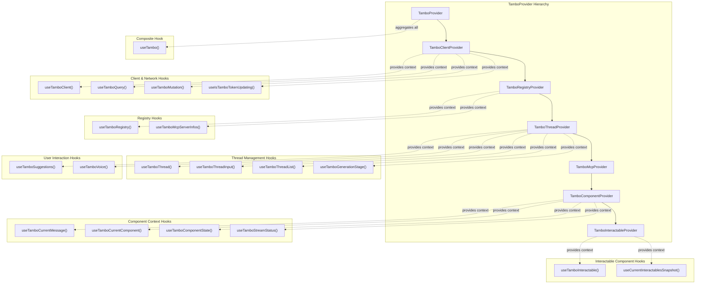
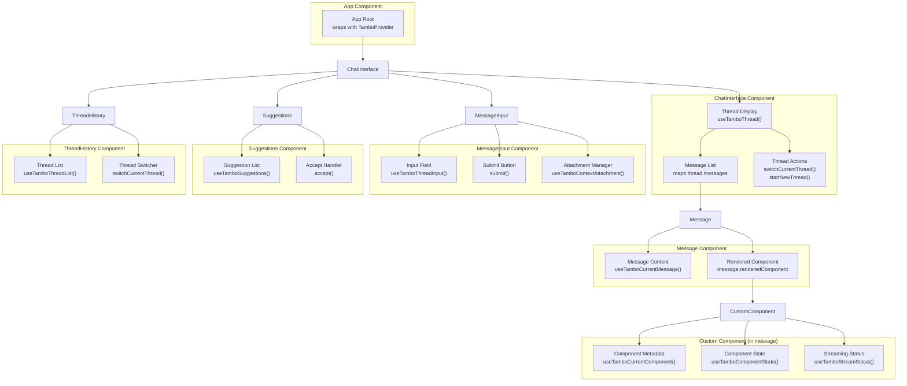

<!-- source: DeepWiki mcp.deepwiki.com · repo tambo-ai/tambo · page 3.7 Hooks API Reference · fetched 2026-10-29 -->

# Hooks API Reference

<details>
<summary>Relevant source files</summary>

The following files were used as context for generating this wiki page:

- [react-sdk/src/hooks/react-query-hooks.ts](react-sdk/src/hooks/react-query-hooks.ts)
- [react-sdk/src/index.ts](react-sdk/src/index.ts)
- [react-sdk/src/model/component-metadata.ts](react-sdk/src/model/component-metadata.ts)
- [react-sdk/src/providers/tambo-registry-provider.tsx](react-sdk/src/providers/tambo-registry-provider.tsx)
- [react-sdk/src/util/registry.ts](react-sdk/src/util/registry.ts)
- [react-sdk/src/util/tool-caller.ts](react-sdk/src/util/tool-caller.ts)
- [react-sdk/src/v1/hooks/use-tambo-v1-messages.test.tsx](react-sdk/src/v1/hooks/use-tambo-v1-messages.test.tsx)
- [react-sdk/src/v1/hooks/use-tambo-v1-send-message.test.tsx](react-sdk/src/v1/hooks/use-tambo-v1-send-message.test.tsx)
- [react-sdk/src/v1/hooks/use-tambo-v1-send-message.ts](react-sdk/src/v1/hooks/use-tambo-v1-send-message.ts)
- [react-sdk/src/v1/hooks/use-tambo-v1-suggestions.test.tsx](react-sdk/src/v1/hooks/use-tambo-v1-suggestions.test.tsx)
- [react-sdk/src/v1/hooks/use-tambo-v1-suggestions.ts](react-sdk/src/v1/hooks/use-tambo-v1-suggestions.ts)
- [react-sdk/src/v1/hooks/use-tambo-v1-thread-input.test.tsx](react-sdk/src/v1/hooks/use-tambo-v1-thread-input.test.tsx)
- [react-sdk/src/v1/hooks/use-tambo-v1-thread-input.ts](react-sdk/src/v1/hooks/use-tambo-v1-thread-input.ts)
- [react-sdk/src/v1/hooks/use-tambo-v1-thread-list.test.tsx](react-sdk/src/v1/hooks/use-tambo-v1-thread-list.test.tsx)
- [react-sdk/src/v1/hooks/use-tambo-v1-thread-list.ts](react-sdk/src/v1/hooks/use-tambo-v1-thread-list.ts)
- [react-sdk/src/v1/hooks/use-tambo-v1-thread.test.tsx](react-sdk/src/v1/hooks/use-tambo-v1-thread.test.tsx)
- [react-sdk/src/v1/hooks/use-tambo-v1-thread.ts](react-sdk/src/v1/hooks/use-tambo-v1-thread.ts)
- [react-sdk/src/v1/hooks/use-tambo-v1.test.tsx](react-sdk/src/v1/hooks/use-tambo-v1.test.tsx)
- [react-sdk/src/v1/hooks/use-tambo-v1.ts](react-sdk/src/v1/hooks/use-tambo-v1.ts)
- [react-sdk/src/v1/index.ts](react-sdk/src/v1/index.ts)
- [react-sdk/src/v1/providers/tambo-v1-provider.test.tsx](react-sdk/src/v1/providers/tambo-v1-provider.test.tsx)
- [react-sdk/src/v1/providers/tambo-v1-provider.tsx](react-sdk/src/v1/providers/tambo-v1-provider.tsx)
- [react-sdk/src/v1/providers/tambo-v1-stream-context.test.tsx](react-sdk/src/v1/providers/tambo-v1-stream-context.test.tsx)
- [react-sdk/src/v1/providers/tambo-v1-stream-context.tsx](react-sdk/src/v1/providers/tambo-v1-stream-context.tsx)
- [react-sdk/src/v1/providers/tambo-v1-stub-provider.test.tsx](react-sdk/src/v1/providers/tambo-v1-stub-provider.test.tsx)
- [react-sdk/src/v1/providers/tambo-v1-stub-provider.tsx](react-sdk/src/v1/providers/tambo-v1-stub-provider.tsx)
- [react-sdk/src/v1/providers/tambo-v1-thread-input-provider.tsx](react-sdk/src/v1/providers/tambo-v1-thread-input-provider.tsx)
- [react-sdk/src/v1/types/thread.ts](react-sdk/src/v1/types/thread.ts)
- [react-sdk/src/v1/types/tool-choice.ts](react-sdk/src/v1/types/tool-choice.ts)
- [react-sdk/src/v1/utils/__snapshots__/event-accumulator.test.ts.snap](react-sdk/src/v1/utils/__snapshots__/event-accumulator.test.ts.snap)
- [react-sdk/src/v1/utils/event-accumulator.test.ts](react-sdk/src/v1/utils/event-accumulator.test.ts)
- [react-sdk/src/v1/utils/event-accumulator.ts](react-sdk/src/v1/utils/event-accumulator.ts)
- [showcase/src/app/components/(message-primitives)/thread-content/page.tsx](showcase/src/app/components/(message-primitives)/thread-content/page.tsx)
- [showcase/src/app/components/(message-primitives)/thread-history/page.tsx](showcase/src/app/components/(message-primitives)/thread-history/page.tsx)

</details>


This page provides a complete reference for all React hooks available in the Tambo SDK. These hooks enable thread management, component state persistence, AI suggestions, streaming status monitoring, and integration with the Model Context Protocol (MCP).

For information about MCP-specific hooks (`useTamboMcpPromptList`, `useTamboMcpResourceList`, etc.), see [MCP Hooks Reference](#6.5). For detailed thread management patterns, see [Thread Management](#3.3). For component state patterns, see [Component State Management](#3.6). For streaming patterns, see [Streaming and Loading States](#3.8).

---

## Hook Categories and Provider Dependencies

The following diagram illustrates how hooks are organized by category and their dependencies on the provider hierarchy:



**Sources:** [react-sdk/src/providers/tambo-provider.tsx:1-203](), [react-sdk/src/providers/index.ts:1-61](), [react-sdk/src/index.ts:1-132]()

---

## Hook Import Paths

All hooks are exported from the main package entry point:

```typescript
import {
  useTambo,
  useTamboThread,
  useTamboThreadInput,
  useTamboComponentState,
  useTamboSuggestions,
  // ... other hooks
} from "@tambo-ai/react";
```

MCP-specific hooks require the MCP subpath import (see [MCP Hooks Reference](#6.5) for details):

```typescript
import {
  useTamboMcpPromptList,
  useTamboMcpResourceList,
} from "@tambo-ai/react/mcp";
```

**Sources:** [react-sdk/src/index.ts:1-132]()

---

## Thread Management Hooks

These hooks provide access to thread state, message history, and thread operations.

### useTamboThread()

Returns the current thread context including messages, thread metadata, and operations.

**Return Type:**

```typescript
interface TamboThreadContextProps {
  thread: TamboThread;
  currentThreadId: string | null;
  currentThread: TamboThread | null;
  threadMap: Record<string, TamboThread>;
  setThreadMap: React.Dispatch<React.SetStateAction<Record<string, TamboThread>>>;
  switchCurrentThread: (threadId: string, fetch?: boolean) => void;
  startNewThread: () => void;
  updateThreadName: (name: string, threadId?: string) => void;
  generateThreadName: (threadId?: string) => Promise<Thread>;
  addThreadMessage: (message: TamboThreadMessage, sendToServer: boolean) => Promise<ThreadMessage[]>;
  updateThreadMessage: (id: string, message: Partial<TamboThreadMessage>, sendToServer: boolean) => Promise<void>;
  cancel: (threadId?: string) => Promise<void>;
  streaming: boolean;
  sendThreadMessage: (message: string, options?: SendThreadMessageOptions) => Promise<TamboThreadMessage>;
  contextKey?: string;
}
```

**Key Properties:**

| Property | Type | Description |
|----------|------|-------------|
| `thread` | `TamboThread` | Current thread with messages array |
| `currentThreadId` | `string \| null` | ID of the currently active thread |
| `threadMap` | `Record<string, TamboThread>` | Map of all loaded threads by ID |
| `streaming` | `boolean` | Whether the thread is currently streaming a response |
| `sendThreadMessage` | `function` | Sends a user message and triggers AI response |
| `switchCurrentThread` | `function` | Switches to a different thread by ID |
| `startNewThread` | `function` | Creates a new thread with placeholder ID |
| `updateThreadName` | `function` | Updates the thread name |
| `generateThreadName` | `function` | Generates an AI-suggested thread name |
| `cancel` | `function` | Cancels the current streaming operation |

**Example Usage:**

```typescript
function ChatInterface() {
  const { thread, sendThreadMessage, streaming } = useTamboThread();
  
  return (
    <div>
      {thread.messages.map((message) => (
        <div key={message.id}>
          {message.content}
          {message.renderedComponent}
        </div>
      ))}
    </div>
  );
}
```

**Sources:** [react-sdk/src/providers/tambo-thread-provider.tsx:86-136](), [react-sdk/src/providers/tambo-thread-provider.tsx:256-1278]()

---

### useTamboThreadInput()

Returns the message input state and submission handler.

**Return Type:**

```typescript
interface TamboThreadInputContextProps {
  value: string;
  setValue: (value: string) => void;
  submit: (options?: SubmitOptions) => Promise<void>;
  isPending: boolean;
  attachments: ContextAttachment[];
  addAttachment: (attachment: ContextAttachment) => void;
  removeAttachment: (id: string) => void;
  clearAttachments: () => void;
}
```

**Key Properties:**

| Property | Type | Description |
|----------|------|-------------|
| `value` | `string` | Current input field value |
| `setValue` | `function` | Updates the input value |
| `submit` | `function` | Submits the current message |
| `isPending` | `boolean` | True while message is being sent |
| `attachments` | `ContextAttachment[]` | Array of attached resources/files |
| `addAttachment` | `function` | Adds a resource/file attachment |
| `removeAttachment` | `function` | Removes an attachment by ID |
| `clearAttachments` | `function` | Clears all attachments |

**Example Usage:**

```typescript
function MessageInput() {
  const { value, setValue, submit, isPending } = useTamboThreadInput();
  
  return (
    <div>
      <input 
        value={value} 
        onChange={(e) => setValue(e.target.value)}
        disabled={isPending}
      />
      <button onClick={() => submit()} disabled={isPending}>
        Send
      </button>
    </div>
  );
}
```

**Sources:** [react-sdk/src/providers/tambo-thread-input-provider.tsx:1-213]()

---

### useTamboThreadList()

Fetches and returns the list of threads for the current project, optionally filtered by context key.

**Parameters:**

```typescript
interface UseTamboThreadListConfig {
  projectId?: string;
}

function useTamboThreadList(
  config?: UseTamboThreadListConfig,
  options?: Partial<UseQueryOptions>
)
```

**Return Type:**

```typescript
UseTamboQueryResult<TamboAI.Beta.Threads.ThreadsOffsetAndLimit | null>
```

**Key Properties:**

| Property | Type | Description |
|----------|------|-------------|
| `data` | `ThreadsOffsetAndLimit \| null` | Paginated list of threads |
| `data.items` | `Thread[]` | Array of thread objects |
| `data.total` | `number` | Total number of threads |
| `isLoading` | `boolean` | True while fetching threads |
| `error` | `Error \| null` | Error if fetch failed |

**Example Usage:**

```typescript
function ThreadList() {
  const { data: threadsData, isLoading } = useTamboThreadList();
  
  if (isLoading) return <Spinner />;
  
  return (
    <ul>
      {threadsData?.items.map((thread) => (
        <li key={thread.id}>{thread.name || 'Untitled'}</li>
      ))}
    </ul>
  );
}
```

**Context Key Filtering:**

The hook automatically uses the `contextKey` from `useTamboThread()` if provided via `TamboThreadProvider`. This allows scoping threads to specific contexts (e.g., different workspaces or projects).

**Sources:** [react-sdk/src/hooks/use-tambo-threads.ts:1-60]()

---

### useTamboGenerationStage()

Returns the current generation stage and status message for the active thread.

**Return Type:**

```typescript
interface TamboGenerationStageContextProps {
  generationStage: GenerationStage;
  generationStatusMessage: string;
  isIdle: boolean;
}
```

**Generation Stages:**

| Stage | Description |
|-------|-------------|
| `GenerationStage.IDLE` | No active generation |
| `GenerationStage.FETCHING_CONTEXT` | Executing tools or fetching data |
| `GenerationStage.STREAMING_RESPONSE` | Streaming AI response |
| `GenerationStage.COMPLETE` | Generation finished successfully |
| `GenerationStage.ERROR` | Generation failed |
| `GenerationStage.CANCELLED` | Generation was cancelled by user |

**Example Usage:**

```typescript
function StreamingIndicator() {
  const { generationStage, generationStatusMessage, isIdle } = useTamboGenerationStage();
  
  if (isIdle) return null;
  
  return (
    <div>
      <Spinner />
      {generationStatusMessage && <span>{generationStatusMessage}</span>}
    </div>
  );
}
```

**Sources:** [react-sdk/src/providers/tambo-thread-provider.tsx:37-79](), [react-sdk/src/model/generate-component-response.ts:1-100]()

---

## Component & Message Context Hooks

These hooks provide access to the current message and component context, enabling components to access their own metadata and state.

### useTamboCurrentMessage()

Returns the current message object that contains the component. Must be called within a component wrapped by `TamboMessageProvider`.

**Return Type:**

```typescript
TamboThreadMessage
```

**Key Properties:**

| Property | Type | Description |
|----------|------|-------------|
| `id` | `string` | Unique message ID |
| `threadId` | `string` | Parent thread ID |
| `role` | `"user" \| "assistant" \| "tool"` | Message role |
| `content` | `ChatCompletionContentPart[]` | Message content parts |
| `component` | `ComponentMetadata` | Component data if message contains a component |
| `componentState` | `Record<string, any>` | Component state data |
| `renderedComponent` | `React.ReactNode` | Rendered React component |
| `interactableMetadata` | `InteractableMetadata` | Metadata for interactable components |

**Example Usage:**

```typescript
function CustomComponent() {
  const message = useTamboCurrentMessage();
  
  return (
    <div>
      <p>Message ID: {message.id}</p>
      <p>Thread ID: {message.threadId}</p>
    </div>
  );
}
```

**Sources:** [react-sdk/src/hooks/use-current-message.tsx:71-84]()

---

### useTamboCurrentComponent()

Returns metadata about the current component, including name, props, and interactable ID if applicable. Returns `null` if called outside a component context.

**Return Type:**

```typescript
interface TamboCurrentComponent {
  componentName?: string;
  props?: Record<string, any>;
  interactableId?: string;
  description?: string;
  threadId?: string;
}
```

**Example Usage:**

```typescript
function ComponentInspector() {
  const component = useTamboCurrentComponent();
  
  if (!component) return <p>Not inside a Tambo component</p>;
  
  return (
    <div>
      <h3>{component.componentName}</h3>
      {component.interactableId && (
        <span>Interactable ID: {component.interactableId}</span>
      )}
    </div>
  );
}
```

**Sources:** [react-sdk/src/hooks/use-current-message.tsx:86-143]()

---

### useTamboComponentState()

Provides persistent state management for component props, automatically syncing with the backend. Works for both generative and interactable components.

**Signature:**

```typescript
function useTamboComponentState<S>(
  keyName: string,
  initialValue: S,
  setFromProp?: S,
  debounceTime?: number
): [S, (newState: S) => void]
```

**Parameters:**

| Parameter | Type | Description |
|-----------|------|-------------|
| `keyName` | `string` | Unique key for this state value within componentState |
| `initialValue` | `S` | Initial value if no state exists |
| `setFromProp` | `S` | Optional prop value to sync during streaming |
| `debounceTime` | `number` | Debounce delay in ms (default: 500) |

**Return Value:**

Returns a tuple `[currentState, setState]` similar to React's `useState`.

**Behavior:**

- **Generative components**: Updates both local and remote thread message state
- **Interactable components**: Updates the interactable provider's global state
- **Streaming**: When `setFromProp` is provided, state updates as props stream in
- **Persistence**: State persists across thread reloads and component re-renders
- **Debouncing**: Remote updates are debounced to reduce API calls

**Example Usage:**

```typescript
function EditableNote({ title: titleProp, content: contentProp }) {
  const { streamStatus } = useTamboStreamStatus();
  const [title, setTitle] = useTamboComponentState("title", "", titleProp);
  const [content, setContent] = useTamboComponentState("content", "", contentProp);
  
  return (
    <div>
      <input
        value={title}
        onChange={(e) => setTitle(e.target.value)}
        disabled={!streamStatus.isSuccess}
      />
      <textarea
        value={content}
        onChange={(e) => setContent(e.target.value)}
        disabled={!streamStatus.isSuccess}
      />
    </div>
  );
}
```

**Sources:** [react-sdk/src/hooks/use-component-state.tsx:1-211]()

---

### useTamboStreamStatus()

Returns the streaming status for the current component's props, enabling progressive UI updates.

**Return Type:**

```typescript
interface StreamStatusResult {
  streamStatus: StreamStatus;
  propStatus: Record<string, PropStatus>;
}

interface StreamStatus {
  isPending: boolean;
  isSuccess: boolean;
}

interface PropStatus {
  isPending: boolean;
  isSuccess: boolean;
}
```

**Example Usage:**

```typescript
function ProgressiveChart({ data, title, type }) {
  const { streamStatus, propStatus } = useTamboStreamStatus();
  
  if (!streamStatus.isSuccess) {
    return <Skeleton />;
  }
  
  return (
    <div>
      {propStatus["title"]?.isSuccess && <h3>{title}</h3>}
      {propStatus["data"]?.isSuccess && <Chart data={data} type={type} />}
    </div>
  );
}
```

**Sources:** [react-sdk/src/hooks/use-tambo-stream-status.tsx:1-100]()

---

### useTamboStreamingProps()

Returns the current props object being streamed to the component, along with streaming status.

**Return Type:**

```typescript
interface StreamingPropsResult {
  props: Record<string, any>;
  isStreaming: boolean;
}
```

**Sources:** [react-sdk/src/hooks/use-streaming-props.ts:1-50]()

---

## Registry & Configuration Hooks

These hooks provide access to registered components, tools, MCP servers, and resources.

### useTamboRegistry()

Returns the component and tool registry, along with registration functions.

**Return Type:**

```typescript
interface TamboRegistryContext {
  componentList: ComponentRegistry;
  toolRegistry: TamboToolRegistry;
  componentToolAssociations: Record<string, string[]>;
  mcpServerInfos: NormalizedMcpServerInfo[];
  resources: ListResourceItem[];
  resourceSource: ResourceSource | null;
  registerComponent: (options: TamboComponent) => void;
  registerTool: (tool: TamboTool, warnOnOverwrite?: boolean) => void;
  registerTools: (tools: TamboTool[], warnOnOverwrite?: boolean) => void;
  addToolAssociation: (componentName: string, tool: TamboTool) => void;
  registerMcpServer: (info: McpServerInfo) => void;
  registerMcpServers: (infos: McpServerInfo[]) => void;
  registerResource: (resource: ListResourceItem) => void;
  registerResources: (resources: ListResourceItem[]) => void;
  registerResourceSource: (source: ResourceSource) => void;
  onCallUnregisteredTool?: (toolName: string, args: ToolCallParameter[]) => Promise<string>;
}
```

**Key Properties:**

| Property | Type | Description |
|----------|------|-------------|
| `componentList` | `ComponentRegistry` | Map of registered components by name |
| `toolRegistry` | `TamboToolRegistry` | Map of registered tools by name |
| `componentToolAssociations` | `Record<string, string[]>` | Maps component names to their associated tool names |
| `mcpServerInfos` | `NormalizedMcpServerInfo[]` | Array of registered MCP server metadata |
| `resources` | `ListResourceItem[]` | Array of static resources |
| `resourceSource` | `ResourceSource \| null` | Dynamic resource provider (listResources/getResource) |

**Example Usage:**

```typescript
function ToolInspector() {
  const { toolRegistry, componentList } = useTamboRegistry();
  
  return (
    <div>
      <h3>Registered Tools: {Object.keys(toolRegistry).length}</h3>
      <h3>Registered Components: {Object.keys(componentList).length}</h3>
    </div>
  );
}
```

**Dynamic Registration:**

```typescript
function DynamicRegistration() {
  const { registerComponent, registerTool } = useTamboRegistry();
  
  useEffect(() => {
    registerComponent({
      name: "DynamicChart",
      description: "A dynamically registered chart",
      component: ChartComponent,
      propsSchema: z.object({ data: z.array(z.number()) })
    });
    
    registerTool(defineTool({
      name: "getDynamicData",
      description: "Fetches dynamic data",
      tool: async () => fetchData(),
      inputSchema: z.object({}),
      outputSchema: z.array(z.number())
    }));
  }, [registerComponent, registerTool]);
  
  return <div>Dynamic components registered</div>;
}
```

**Sources:** [react-sdk/src/providers/tambo-registry-provider.tsx:40-420]()

---

### useTamboMcpServerInfos()

Returns the array of registered MCP server metadata without establishing connections.

**Return Type:**

```typescript
NormalizedMcpServerInfo[]

interface NormalizedMcpServerInfo {
  url: string;
  name?: string;
  serverKey: string;
  transport: MCPTransport;
}
```

**Example Usage:**

```typescript
function McpServerList() {
  const mcpServers = useTamboMcpServerInfos();
  
  return (
    <div>
      <h3>Configured MCP Servers:</h3>
      <ul>
        {mcpServers.map((server) => (
          <li key={server.serverKey}>
            {server.name || server.url} ({server.transport})
          </li>
        ))}
      </ul>
    </div>
  );
}
```

**Sources:** [react-sdk/src/providers/tambo-registry-provider.tsx:388-420]()

---

## Interactable Component Hooks

These hooks manage state for interactable components that persist across messages.

### useTamboInteractable()

Returns interactable component state management functions and the current state map.

**Return Type:**

```typescript
interface TamboInteractableContext {
  interactableState: Record<string, Record<string, any>>;
  setInteractableState: (id: string, key: string, value: any) => void;
  getInteractableComponentState: (id: string) => Record<string, any> | undefined;
  updateInteractableComponent: (id: string, updates: Record<string, any>) => void;
  removeInteractableComponent: (id: string) => void;
}
```

**Sources:** [react-sdk/src/providers/tambo-interactable-provider.tsx:1-200]()

---

### useCurrentInteractablesSnapshot()

Returns a snapshot of all current interactable component IDs and their state, structured for sending to the AI.

**Return Type:**

```typescript
interface InteractableSnapshot {
  id: string;
  componentName: string;
  description?: string;
  state: Record<string, any>;
}[]
```

**Example Usage:**

```typescript
function InteractableStateDebugger() {
  const snapshot = useCurrentInteractablesSnapshot();
  
  return (
    <pre>
      {JSON.stringify(snapshot, null, 2)}
    </pre>
  );
}
```

**Sources:** [react-sdk/src/providers/tambo-interactable-provider.tsx:1-200]()

---

## User Interaction Hooks

These hooks enable AI-powered suggestions and voice input.

### useTamboSuggestions()

Generates and manages AI-powered suggestions based on conversation context.

**Signature:**

```typescript
interface useTamboSuggestionsOptions {
  maxSuggestions?: number; // 1-10, default: 3
}

function useTamboSuggestions(
  options?: useTamboSuggestionsOptions
): useTamboSuggestionsResult
```

**Return Type:**

```typescript
interface useTamboSuggestionsResult {
  suggestions: Suggestion[];
  selectedSuggestionId: string | null;
  accept: (options: {
    suggestion: Suggestion;
    shouldSubmit?: boolean;
  }) => Promise<void>;
  acceptResult: UseTamboMutationResult<void, Error>;
  generateResult: UseTamboMutationResult<SuggestionGenerateResponse | undefined, Error>;
  suggestionsResult: UseTamboQueryResult<SuggestionGenerateResponse | undefined>;
  isPending: boolean;
  isSuccess: boolean;
  isError: boolean;
  error: Error | null;
}

interface Suggestion {
  id: string;
  title: string;
  detailedSuggestion: string;
}
```

**Behavior:**

- Automatically generates suggestions after each assistant message
- Uses React Query for caching and network state management
- Combines mutation and query results for unified loading states
- Only generates suggestions when thread is idle (not streaming)

**Example Usage:**

```typescript
function SuggestionBar() {
  const { suggestions, accept, isPending } = useTamboSuggestions({ 
    maxSuggestions: 5 
  });
  
  if (isPending) return <Spinner />;
  
  return (
    <div>
      {suggestions.map((suggestion) => (
        <button
          key={suggestion.id}
          onClick={() => accept({ 
            suggestion, 
            shouldSubmit: true 
          })}
        >
          {suggestion.title}
        </button>
      ))}
    </div>
  );
}
```

**Accept Options:**

- `shouldSubmit: false` - Fills input field without sending
- `shouldSubmit: true` - Automatically sends message after filling

**Sources:** [react-sdk/src/hooks/use-suggestions.ts:1-217]()

---

### useTamboVoice()

Provides voice recording capabilities for sending audio messages.

**Return Type:**

```typescript
interface VoiceRecordingState {
  status: "idle" | "recording" | "stopped";
  startRecording: () => void;
  stopRecording: () => void;
  mediaBlobUrl: string | null;
  error: string | null;
}
```

**Sources:** [react-sdk/src/hooks/use-tambo-voice.ts:1-100]()

---

## Context & State Hooks

These hooks provide access to additional context and attachments.

### useTamboContextHelpers()

Returns context helper functions and their enabled/disabled state.

**Return Type:**

```typescript
interface TamboContextHelpersContextProps {
  contextHelpers: ContextHelpers;
  getAdditionalContext: () => Promise<AdditionalContext[]>;
}

interface AdditionalContext {
  name: string;
  context: any;
}
```

**Example Usage:**

```typescript
function ContextDisplay() {
  const { getAdditionalContext } = useTamboContextHelpers();
  
  const [contexts, setContexts] = useState<AdditionalContext[]>([]);
  
  useEffect(() => {
    getAdditionalContext().then(setContexts);
  }, [getAdditionalContext]);
  
  return (
    <div>
      {contexts.map((ctx) => (
        <div key={ctx.name}>
          {ctx.name}: {JSON.stringify(ctx.context)}
        </div>
      ))}
    </div>
  );
}
```

**Sources:** [react-sdk/src/providers/tambo-context-helpers-provider.tsx:1-200]()

---

### useTamboContextAttachment()

Manages file and resource attachments for messages.

**Return Type:**

```typescript
interface ContextAttachmentState {
  attachments: ContextAttachment[];
  addAttachment: (attachment: ContextAttachment) => void;
  removeAttachment: (id: string) => void;
  clearAttachments: () => void;
}

interface ContextAttachment {
  id: string;
  type: "file" | "resource";
  uri: string;
  name: string;
  mimeType?: string;
}
```

**Sources:** [react-sdk/src/providers/tambo-context-attachment-provider.tsx:1-150]()

---

## Client & Network Hooks

These hooks provide access to the Tambo client and React Query utilities.

### useTamboClient()

Returns the configured `TamboAI` client instance for making API calls.

**Return Type:**

```typescript
TamboAI
```

**Example Usage:**

```typescript
function CustomAPICall() {
  const client = useTamboClient();
  
  const handleFetch = async () => {
    const project = await client.beta.projects.getCurrent();
    console.log("Current project:", project.id);
  };
  
  return <button onClick={handleFetch}>Fetch Project</button>;
}
```

**Sources:** [react-sdk/src/providers/tambo-client-provider.tsx:113-124]()

---

### useTamboQuery()

Wrapper around React Query's `useQuery` that uses the internal Tambo query client.

**Signature:**

```typescript
function useTamboQuery<
  TQueryFnData = unknown,
  TError = Error,
  TData = TQueryFnData,
  TQueryKey extends QueryKey = QueryKey
>(
  options: UseQueryOptions<TQueryFnData, TError, TData, TQueryKey>
): UseQueryResult<TData, TError>
```

**Example Usage:**

```typescript
function ProjectInfo() {
  const client = useTamboClient();
  
  const { data, isLoading } = useTamboQuery({
    queryKey: ["project"],
    queryFn: async () => {
      return await client.beta.projects.getCurrent();
    }
  });
  
  if (isLoading) return <Spinner />;
  
  return <div>Project: {data?.name}</div>;
}
```

**Sources:** [react-sdk/src/hooks/react-query-hooks.ts:16-31]()

---

### useTamboMutation()

Wrapper around React Query's `useMutation` that uses the internal Tambo query client.

**Signature:**

```typescript
function useTamboMutation<
  TData = unknown,
  TError = Error,
  TVariables = void,
  TContext = unknown
>(
  options: UseMutationOptions<TData, TError, TVariables, TContext>
): UseMutationResult<TData, TError, TVariables, TContext>
```

**Example Usage:**

```typescript
function ThreadRenamer() {
  const client = useTamboClient();
  const { thread } = useTamboThread();
  
  const { mutateAsync: rename, isPending } = useTamboMutation({
    mutationFn: async (newName: string) => {
      return await client.beta.threads.update(thread.id, { name: newName });
    }
  });
  
  return (
    <button 
      onClick={() => rename("New Name")} 
      disabled={isPending}
    >
      Rename Thread
    </button>
  );
}
```

**Sources:** [react-sdk/src/hooks/react-query-hooks.ts:33-48]()

---

### useTamboQueries()

Wrapper around React Query's `useQueries` for running multiple queries in parallel.

**Signature:**

```typescript
function useTamboQueries<T extends any[], TCombinedResult = QueriesResults<T>>({
  queries,
  combine,
  subscribed
}: {
  queries: readonly [...QueriesOptions<T>];
  combine?: (result: QueriesResults<T>) => TCombinedResult;
  subscribed?: boolean;
})
```

**Sources:** [react-sdk/src/hooks/react-query-hooks.ts:68-90]()

---

### useIsTamboTokenUpdating()

Returns whether the session token is currently being refreshed.

**Return Type:**

```typescript
boolean
```

**Example Usage:**

```typescript
function AuthStatus() {
  const isUpdating = useIsTamboTokenUpdating();
  
  if (isUpdating) {
    return <span>Refreshing session...</span>;
  }
  
  return <span>Ready</span>;
}
```

**Sources:** [react-sdk/src/providers/tambo-client-provider.tsx:142-155]()

---

## Composite Hook

### useTambo()

The primary entrypoint hook that aggregates all Tambo contexts into a single interface. Provides access to client, thread, registry, component, and interactable contexts.

**Return Type:**

```typescript
interface TamboContextProps {
  // From TamboClientProvider
  client: TamboAI;
  queryClient: QueryClient;
  isUpdatingToken: boolean;
  
  // From TamboThreadProvider
  thread: TamboThread;
  currentThreadId: string | null;
  currentThread: TamboThread | null;
  threadMap: Record<string, TamboThread>;
  switchCurrentThread: (threadId: string, fetch?: boolean) => void;
  startNewThread: () => void;
  updateThreadName: (name: string, threadId?: string) => void;
  generateThreadName: (threadId?: string) => Promise<Thread>;
  sendThreadMessage: (message: string, options?: SendOptions) => Promise<TamboThreadMessage>;
  streaming: boolean;
  cancel: (threadId?: string) => Promise<void>;
  
  // From TamboGenerationStageProvider
  generationStage: GenerationStage;
  generationStatusMessage: string;
  isIdle: boolean;
  
  // From TamboRegistryProvider (via TamboComponentProvider)
  registerComponent: (options: TamboComponent) => void;
  registerTool: (tool: TamboTool) => void;
  registerTools: (tools: TamboTool[]) => void;
  addToolAssociation: (componentName: string, tool: TamboTool) => void;
  
  // From TamboInteractableProvider
  interactableState: Record<string, Record<string, any>>;
  setInteractableState: (id: string, key: string, value: any) => void;
  getInteractableComponentState: (id: string) => Record<string, any> | undefined;
  
  // From TamboContextHelpersProvider
  contextHelpers: ContextHelpers;
  getAdditionalContext: () => Promise<AdditionalContext[]>;
  
  // From TamboContextAttachmentProvider
  attachments: ContextAttachment[];
  addAttachment: (attachment: ContextAttachment) => void;
  removeAttachment: (id: string) => void;
  clearAttachments: () => void;
}
```

**Example Usage:**

```typescript
function AllInOne() {
  const { 
    thread, 
    sendThreadMessage, 
    client,
    registerComponent,
    generationStage 
  } = useTambo();
  
  // Access everything from one hook
  return (
    <div>
      <p>Thread: {thread.id}</p>
      <p>Stage: {generationStage}</p>
      <button onClick={() => sendThreadMessage("Hello")}>
        Send
      </button>
    </div>
  );
}
```

**When to Use:**

Use `useTambo()` when you need access to multiple contexts in a single component. For focused use cases, prefer specific hooks (e.g., `useTamboThread()` for thread operations only) to minimize re-renders.

**Sources:** [react-sdk/src/providers/tambo-provider.tsx:139-203]()

---

## Hook Usage Patterns

The following diagram illustrates common hook usage patterns in a typical chat interface:



**Sources:** [react-sdk/src/providers/tambo-provider.tsx:1-203](), [react-sdk/src/hooks/use-component-state.tsx:1-211](), [react-sdk/src/hooks/use-suggestions.ts:1-217]()

---

## Hook Dependency Resolution

The following table shows which provider each hook depends on and where it's defined:

| Hook | Provider Dependency | Source File |
|------|-------------------|-------------|
| `useTambo` | `TamboCompositeProvider` | [react-sdk/src/providers/tambo-provider.tsx:192-202]() |
| `useTamboClient` | `TamboClientProvider` | [react-sdk/src/providers/tambo-client-provider.tsx:113-124]() |
| `useIsTamboTokenUpdating` | `TamboClientProvider` | [react-sdk/src/providers/tambo-client-provider.tsx:142-155]() |
| `useTamboRegistry` | `TamboRegistryProvider` | [react-sdk/src/providers/tambo-registry-provider.tsx:379-386]() |
| `useTamboMcpServerInfos` | `TamboRegistryProvider` | [react-sdk/src/providers/tambo-registry-provider.tsx:388-420]() |
| `useTamboThread` | `TamboThreadProvider` | [react-sdk/src/providers/tambo-thread-provider.tsx:1-1278]() |
| `useTamboThreadInput` | `TamboThreadInputProvider` | [react-sdk/src/providers/tambo-thread-input-provider.tsx:1-213]() |
| `useTamboThreadList` | `TamboClientProvider` + `TamboThreadProvider` | [react-sdk/src/hooks/use-tambo-threads.ts:1-60]() |
| `useTamboGenerationStage` | `TamboGenerationStageProvider` | [react-sdk/src/providers/tambo-thread-provider.tsx:37-79]() |
| `useTamboCurrentMessage` | `TamboMessageProvider` | [react-sdk/src/hooks/use-current-message.tsx:71-84]() |
| `useTamboCurrentComponent` | `TamboMessageProvider` | [react-sdk/src/hooks/use-current-message.tsx:86-143]() |
| `useTamboComponentState` | `TamboMessageProvider` + `TamboInteractableProvider` | [react-sdk/src/hooks/use-component-state.tsx:1-211]() |
| `useTamboStreamStatus` | `TamboPropStreamProvider` | [react-sdk/src/hooks/use-tambo-stream-status.tsx:1-100]() |
| `useTamboStreamingProps` | `TamboPropStreamProvider` | [react-sdk/src/hooks/use-streaming-props.ts:1-50]() |
| `useTamboInteractable` | `TamboInteractableProvider` | [react-sdk/src/providers/tambo-interactable-provider.tsx:1-200]() |
| `useCurrentInteractablesSnapshot` | `TamboInteractableProvider` | [react-sdk/src/providers/tambo-interactable-provider.tsx:1-200]() |
| `useTamboSuggestions` | `TamboThreadProvider` + `TamboRegistryProvider` | [react-sdk/src/hooks/use-suggestions.ts:1-217]() |
| `useTamboVoice` | `TamboThreadProvider` | [react-sdk/src/hooks/use-tambo-voice.ts:1-100]() |
| `useTamboContextHelpers` | `TamboContextHelpersProvider` | [react-sdk/src/providers/tambo-context-helpers-provider.tsx:1-200]() |
| `useTamboContextAttachment` | `TamboContextAttachmentProvider` | [react-sdk/src/providers/tambo-context-attachment-provider.tsx:1-150]() |
| `useTamboQuery` | `TamboClientProvider` (for QueryClient) | [react-sdk/src/hooks/react-query-hooks.ts:16-31]() |
| `useTamboMutation` | `TamboClientProvider` (for QueryClient) | [react-sdk/src/hooks/react-query-hooks.ts:33-48]() |
| `useTamboQueries` | `TamboClientProvider` (for QueryClient) | [react-sdk/src/hooks/react-query-hooks.ts:68-90]() |

**Sources:** [react-sdk/src/index.ts:1-132](), [react-sdk/src/providers/index.ts:1-61](), [react-sdk/src/hooks/index.ts:1-18]()

---

## Best Practices

### 1. Use Specific Hooks When Possible

Instead of using `useTambo()` for everything, prefer specific hooks to minimize re-renders:

```typescript
// ❌ Causes re-renders on any context change
function Component() {
  const { thread } = useTambo();
  return <div>{thread.id}</div>;
}

// ✅ Only re-renders on thread changes
function Component() {
  const { thread } = useTamboThread();
  return <div>{thread.id}</div>;
}
```

### 2. Combine useTamboComponentState with useTamboStreamStatus

For editable components that stream props:

```typescript
function EditableComponent({ title: titleProp, content: contentProp }) {
  const { streamStatus, propStatus } = useTamboStreamStatus();
  const [title, setTitle] = useTamboComponentState("title", "", titleProp);
  const [content, setContent] = useTamboComponentState("content", "", contentProp);
  
  // Disable editing during streaming
  const isEditable = streamStatus.isSuccess;
  
  return (
    <div>
      <input 
        value={title} 
        onChange={(e) => setTitle(e.target.value)}
        disabled={!isEditable}
      />
      <textarea 
        value={content} 
        onChange={(e) => setContent(e.target.value)}
        disabled={!isEditable}
      />
    </div>
  );
}
```

### 3. Handle Loading States

Always handle loading states for query hooks:

```typescript
function ThreadList() {
  const { data, isLoading, error } = useTamboThreadList();
  
  if (isLoading) return <Spinner />;
  if (error) return <ErrorMessage error={error} />;
  if (!data?.items.length) return <EmptyState />;
  
  return <List items={data.items} />;
}
```

### 4. Use React Query Patterns

The `useTamboQuery` and `useTamboMutation` hooks follow React Query patterns:

```typescript
function CustomDataFetcher() {
  const client = useTamboClient();
  
  // Query with automatic caching and refetch
  const { data, refetch } = useTamboQuery({
    queryKey: ["custom-data", threadId],
    queryFn: async () => fetchCustomData(client, threadId),
    staleTime: 5 * 60 * 1000, // Cache for 5 minutes
  });
  
  // Mutation with optimistic updates
  const { mutateAsync } = useTamboMutation({
    mutationFn: async (newData) => updateData(client, newData),
    onSuccess: () => {
      refetch(); // Refetch after mutation
    }
  });
  
  return <DataDisplay data={data} onUpdate={mutateAsync} />;
}
```

**Sources:** [react-sdk/src/hooks/react-query-hooks.ts:1-90](), [react-sdk/src/hooks/use-component-state.tsx:1-211](), [react-sdk/src/hooks/use-tambo-stream-status.tsx:1-100]()

---

