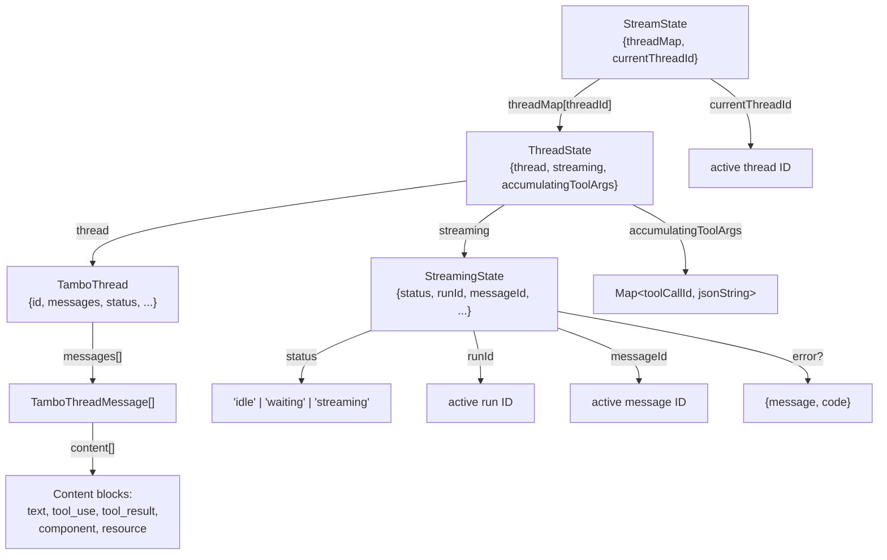
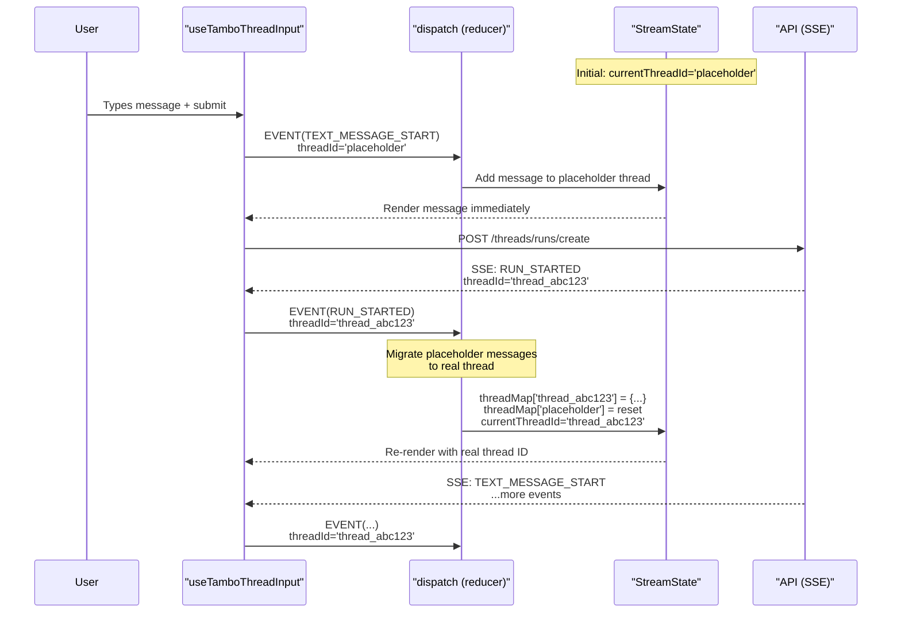
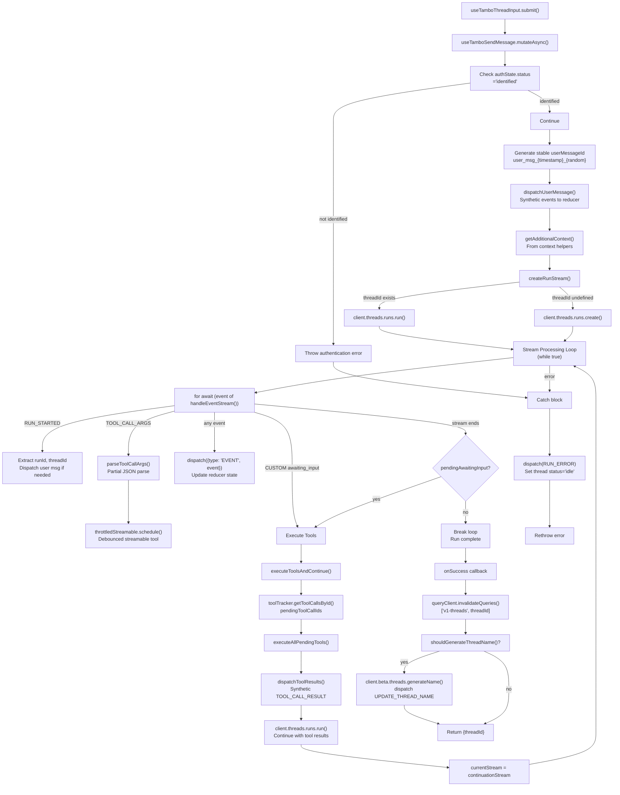
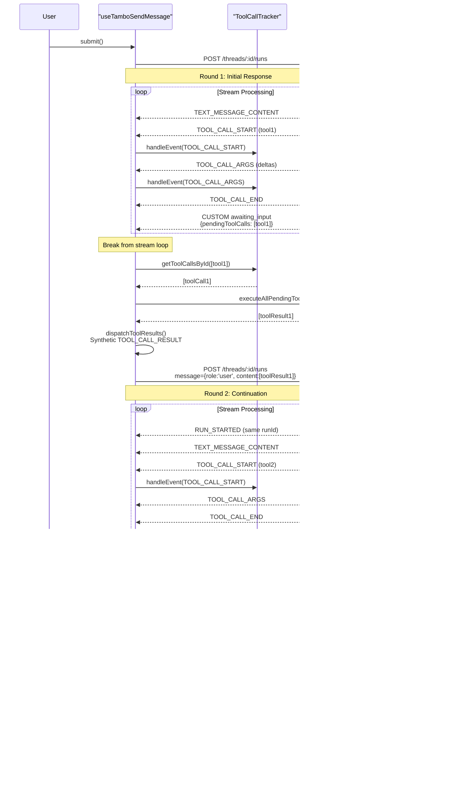
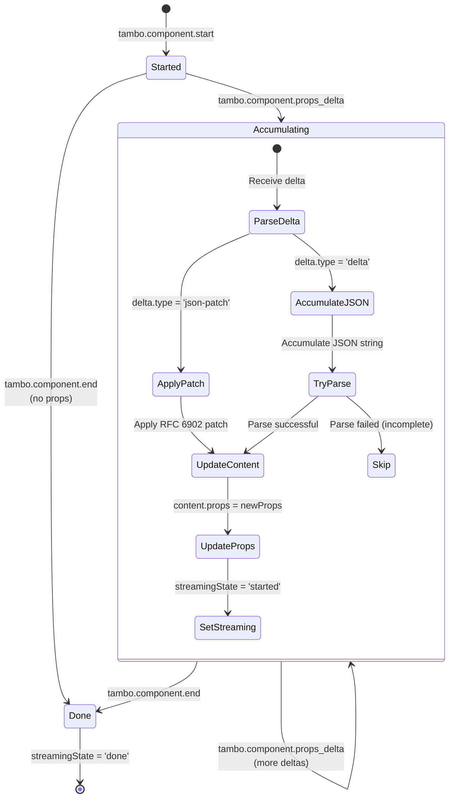
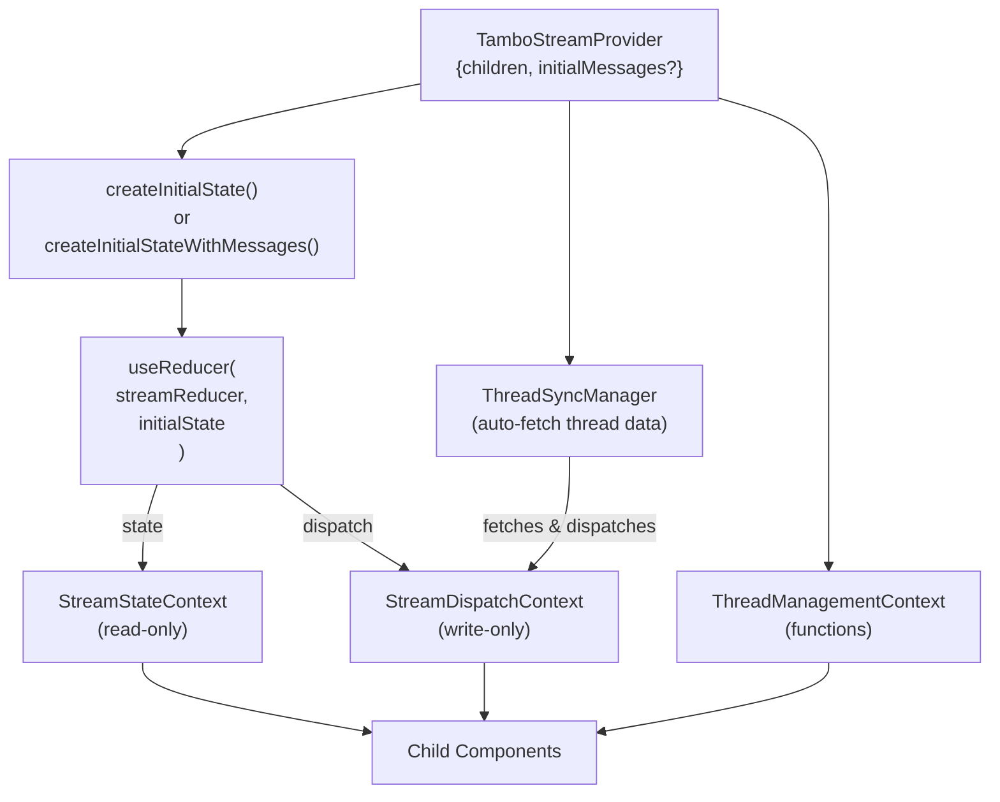

<!-- source: DeepWiki mcp.deepwiki.com · repo tambo-ai/tambo · page 3.8 Streaming and Event Handling · fetched 2026-10-29 -->

# Streaming and Event Handling

<details>
<summary>Relevant source files</summary>

The following files were used as context for generating this wiki page:

- [react-sdk/src/v1/hooks/use-tambo-v1-messages.test.tsx](react-sdk/src/v1/hooks/use-tambo-v1-messages.test.tsx)
- [react-sdk/src/v1/hooks/use-tambo-v1-send-message.test.tsx](react-sdk/src/v1/hooks/use-tambo-v1-send-message.test.tsx)
- [react-sdk/src/v1/hooks/use-tambo-v1-send-message.ts](react-sdk/src/v1/hooks/use-tambo-v1-send-message.ts)
- [react-sdk/src/v1/hooks/use-tambo-v1-suggestions.test.tsx](react-sdk/src/v1/hooks/use-tambo-v1-suggestions.test.tsx)
- [react-sdk/src/v1/hooks/use-tambo-v1-suggestions.ts](react-sdk/src/v1/hooks/use-tambo-v1-suggestions.ts)
- [react-sdk/src/v1/hooks/use-tambo-v1-thread-input.test.tsx](react-sdk/src/v1/hooks/use-tambo-v1-thread-input.test.tsx)
- [react-sdk/src/v1/hooks/use-tambo-v1-thread-input.ts](react-sdk/src/v1/hooks/use-tambo-v1-thread-input.ts)
- [react-sdk/src/v1/hooks/use-tambo-v1-thread-list.test.tsx](react-sdk/src/v1/hooks/use-tambo-v1-thread-list.test.tsx)
- [react-sdk/src/v1/hooks/use-tambo-v1-thread-list.ts](react-sdk/src/v1/hooks/use-tambo-v1-thread-list.ts)
- [react-sdk/src/v1/hooks/use-tambo-v1-thread.test.tsx](react-sdk/src/v1/hooks/use-tambo-v1-thread.test.tsx)
- [react-sdk/src/v1/hooks/use-tambo-v1-thread.ts](react-sdk/src/v1/hooks/use-tambo-v1-thread.ts)
- [react-sdk/src/v1/hooks/use-tambo-v1.test.tsx](react-sdk/src/v1/hooks/use-tambo-v1.test.tsx)
- [react-sdk/src/v1/hooks/use-tambo-v1.ts](react-sdk/src/v1/hooks/use-tambo-v1.ts)
- [react-sdk/src/v1/index.ts](react-sdk/src/v1/index.ts)
- [react-sdk/src/v1/providers/tambo-v1-provider.test.tsx](react-sdk/src/v1/providers/tambo-v1-provider.test.tsx)
- [react-sdk/src/v1/providers/tambo-v1-provider.tsx](react-sdk/src/v1/providers/tambo-v1-provider.tsx)
- [react-sdk/src/v1/providers/tambo-v1-stream-context.test.tsx](react-sdk/src/v1/providers/tambo-v1-stream-context.test.tsx)
- [react-sdk/src/v1/providers/tambo-v1-stream-context.tsx](react-sdk/src/v1/providers/tambo-v1-stream-context.tsx)
- [react-sdk/src/v1/providers/tambo-v1-stub-provider.test.tsx](react-sdk/src/v1/providers/tambo-v1-stub-provider.test.tsx)
- [react-sdk/src/v1/providers/tambo-v1-stub-provider.tsx](react-sdk/src/v1/providers/tambo-v1-stub-provider.tsx)
- [react-sdk/src/v1/providers/tambo-v1-thread-input-provider.tsx](react-sdk/src/v1/providers/tambo-v1-thread-input-provider.tsx)
- [react-sdk/src/v1/types/thread.ts](react-sdk/src/v1/types/thread.ts)
- [react-sdk/src/v1/types/tool-choice.ts](react-sdk/src/v1/types/tool-choice.ts)
- [react-sdk/src/v1/utils/__snapshots__/event-accumulator.test.ts.snap](react-sdk/src/v1/utils/__snapshots__/event-accumulator.test.ts.snap)
- [react-sdk/src/v1/utils/event-accumulator.test.ts](react-sdk/src/v1/utils/event-accumulator.test.ts)
- [react-sdk/src/v1/utils/event-accumulator.ts](react-sdk/src/v1/utils/event-accumulator.ts)
- [showcase/src/app/components/(message-primitives)/thread-content/page.tsx](showcase/src/app/components/(message-primitives)/thread-content/page.tsx)
- [showcase/src/app/components/(message-primitives)/thread-history/page.tsx](showcase/src/app/components/(message-primitives)/thread-history/page.tsx)

</details>


## Purpose and Scope

This page documents the streaming architecture in the Tambo React SDK, which transforms Server-Sent Events (SSE) from the API into React state updates. It covers:

- The `streamReducer` that accumulates AG-UI events into thread state
- The `TamboStreamProvider` context that manages streaming state
- Event types and their handling (text, tool calls, components, reasoning)
- Optimistic UI updates using placeholder threads
- Multi-round tool execution during streaming
- Real-time component prop updates and JSON patch streaming

For information about sending messages and initiating streams, see [Hooks API Reference](#3.7). For component state management during streaming, see [Component State Management](#3.6). For tool registration and execution, see [Tool Registration](#3.5).

---

## Streaming Architecture Overview

The SDK uses a **reducer pattern** to accumulate streaming events into immutable thread state. Events arrive as Server-Sent Events (SSE) from the API and are processed by `streamReducer`, which updates a per-thread state object containing messages, content blocks, and streaming metadata.

The architecture supports:
- **Real-time UI updates**: Messages appear as they stream, character by character
- **Optimistic rendering**: User messages appear immediately before API confirmation
- **Multi-round tool execution**: Tools can trigger AI responses which trigger more tools
- **Incremental JSON parsing**: Component props stream and render progressively
- **Concurrent thread management**: Multiple threads can exist simultaneously

**Key Components:**
- `streamReducer` - Pure reducer function that processes events ([react-sdk/src/v1/utils/event-accumulator.ts:382-662]())
- `TamboStreamProvider` - React context provider wrapping the reducer ([react-sdk/src/v1/providers/tambo-v1-stream-context.tsx:130-240]())
- `useTamboSendMessage` - Hook that creates streams and dispatches events ([react-sdk/src/v1/hooks/use-tambo-v1-send-message.ts:505-760]())

**Sources:** react-sdk/src/v1/utils/event-accumulator.ts, react-sdk/src/v1/providers/tambo-v1-stream-context.tsx, react-sdk/src/v1/hooks/use-tambo-v1-send-message.ts

---

## Event Types and Protocol

The SDK processes two categories of events:

### AG-UI Standard Events

These events conform to the AG-UI protocol from `@ag-ui/core`:

| Event Type | Purpose | Key Fields |
|------------|---------|------------|
| `RUN_STARTED` | Run begins | `runId`, `threadId`, `timestamp` |
| `RUN_FINISHED` | Run completes | `runId` |
| `RUN_ERROR` | Run fails or cancelled | `message`, `code` |
| `TEXT_MESSAGE_START` | New message begins | `messageId`, `role` |
| `TEXT_MESSAGE_CONTENT` | Text chunk received | `messageId`, `delta` |
| `TEXT_MESSAGE_END` | Message complete | `messageId` |
| `TOOL_CALL_START` | Tool invocation begins | `toolCallId`, `toolCallName`, `parentMessageId` |
| `TOOL_CALL_ARGS` | Tool argument chunks | `toolCallId`, `delta` |
| `TOOL_CALL_END` | Tool arguments complete | `toolCallId` |
| `TOOL_CALL_RESULT` | Tool execution result | `toolCallId`, `messageId`, `content` |
| `THINKING_TEXT_MESSAGE_START` | Reasoning begins | `messageId` |
| `THINKING_TEXT_MESSAGE_CONTENT` | Reasoning text chunk | `messageId`, `delta` |
| `THINKING_TEXT_MESSAGE_END` | Reasoning complete | `messageId` |

### Tambo Custom Events

Custom events are namespaced under `EventType.CUSTOM` with specific `name` fields:

| Event Name | Purpose | Value Schema |
|------------|---------|--------------|
| `tambo.component.start` | Component rendering begins | `{ messageId, componentId, componentName }` |
| `tambo.component.props_delta` | Component props chunk | `{ componentId, delta }` (JSON patch or delta) |
| `tambo.component.state_delta` | Component state update | `{ componentId, delta }` |
| `tambo.component.end` | Component complete | `{ componentId }` |
| `tambo.run.awaiting_input` | Waiting for tool results | `{ pendingToolCalls: [...] }` |
| `tambo.message.parent` | Pre-create message placeholder | `{ messageId, role, reasoningId? }` |

Event type discriminators are defined in [react-sdk/src/v1/types/event.ts:1-150](). The `asTamboCustomEvent` helper casts generic custom events to typed Tambo events.

**Sources:** react-sdk/src/v1/utils/event-accumulator.ts, react-sdk/src/v1/types/event.ts

---

## Stream State Structure



### `StreamState`

Top-level state managed by `streamReducer` ([react-sdk/src/v1/utils/event-accumulator.ts:80-90]()):

```typescript
interface StreamState {
  threadMap: Record<string, ThreadState>;
  currentThreadId: string;
}
```

- `threadMap` - Map of thread ID to thread state. All threads exist simultaneously.
- `currentThreadId` - Currently active thread for UI focus. Starts as `"placeholder"`.

### `ThreadState`

Per-thread state ([react-sdk/src/v1/utils/event-accumulator.ts:59-74]()):

```typescript
interface ThreadState {
  thread: TamboThread;               // Thread data with messages
  streaming: StreamingState;          // Current streaming status
  accumulatingToolArgs: Map<string, string>;  // Partial tool args JSON
  lastCompletedRunId?: string;       // Previous run for continuations
}
```

- `thread` - Contains messages, status, metadata ([react-sdk/src/v1/types/thread.ts:28-52]())
- `streaming` - Tracks active streaming operation ([react-sdk/src/v1/types/thread.ts:58-79]())
- `accumulatingToolArgs` - Accumulates JSON deltas for tool arguments during `TOOL_CALL_ARGS` events
- `lastCompletedRunId` - Persists after run completes for follow-up message continuations

### `TamboThread`

Thread entity with messages ([react-sdk/src/v1/types/thread.ts:28-52]()):

| Field | Type | Description |
|-------|------|-------------|
| `id` | `string` | Unique thread identifier |
| `name?` | `string` | Optional thread name |
| `messages` | `TamboThreadMessage[]` | Conversation history |
| `status` | `RunStatus` | `'idle' \| 'waiting' \| 'streaming'` |
| `metadata?` | `Record<string, unknown>` | Custom metadata |
| `createdAt` | `string` | ISO timestamp |
| `updatedAt` | `string` | ISO timestamp |
| `lastRunCancelled` | `boolean` | If last run was cancelled |

### `StreamingState`

Tracks active streaming operations ([react-sdk/src/v1/types/thread.ts:58-79]()):

| Field | Type | Description |
|-------|------|-------------|
| `status` | `RunStatus` | Current streaming status |
| `runId?` | `string` | Active run ID |
| `messageId?` | `string` | Message being streamed |
| `startTime?` | `number` | Run start timestamp (ms) |
| `reasoningStartTime?` | `number` | Reasoning start timestamp |
| `error?` | `{message, code?}` | Error details if failed |

**Sources:** react-sdk/src/v1/utils/event-accumulator.ts, react-sdk/src/v1/types/thread.ts, react-sdk/src/v1/types/message.ts

---

## Stream Reducer Event Processing

The `streamReducer` is a pure function that processes `StreamAction` actions to produce new `StreamState` ([react-sdk/src/v1/utils/event-accumulator.ts:382-662]()).

```mermaid
flowchart TD
    Action["StreamAction<br/>(dispatch input)"]
    Reducer["streamReducer(state, action)"]
    
    Action -->|"type: EVENT"| EventHandler["Event Handler<br/>Switch on event.type"]
    Action -->|"type: INIT_THREAD"| InitThread["Create ThreadState<br/>in threadMap"]
    Action -->|"type: SET_CURRENT_THREAD"| SetCurrent["Update currentThreadId"]
    Action -->|"type: START_NEW_THREAD"| StartNew["Atomic init + switch"]
    Action -->|"type: LOAD_THREAD_MESSAGES"| LoadMsgs["Populate messages[]"]
    Action -->|"type: SET_LAST_COMPLETED_RUN_ID"| SetRun["Update lastCompletedRunId"]
    Action -->|"type: UPDATE_THREAD_NAME"| UpdateName["Update thread.name"]
    
    EventHandler -->|RUN_STARTED| HandleRun["handleRunStarted()<br/>Set status='streaming'"]
    EventHandler -->|RUN_FINISHED| HandleFinish["handleRunFinished()<br/>Set status='idle'"]
    EventHandler -->|RUN_ERROR| HandleError["handleRunError()<br/>Set error state"]
    EventHandler -->|TEXT_MESSAGE_START| HandleMsgStart["handleTextMessageStart()<br/>Create/reuse message"]
    EventHandler -->|TEXT_MESSAGE_CONTENT| HandleMsgContent["handleTextMessageContent()<br/>Append text delta"]
    EventHandler -->|TEXT_MESSAGE_END| HandleMsgEnd["handleTextMessageEnd()<br/>Clear messageId"]
    EventHandler -->|TOOL_CALL_START| HandleToolStart["handleToolCallStart()<br/>Add tool_use content"]
    EventHandler -->|TOOL_CALL_ARGS| HandleToolArgs["handleToolCallArgs()<br/>Accumulate + parse JSON"]
    EventHandler -->|TOOL_CALL_END| HandleToolEnd["handleToolCallEnd()<br/>Finalize tool args"]
    EventHandler -->|TOOL_CALL_RESULT| HandleToolResult["handleToolCallResult()<br/>Add tool_result"]
    EventHandler -->|CUSTOM| HandleCustom["handleCustomEvent()<br/>Component/run events"]
    
    HandleRun --> NewState["New StreamState<br/>(immutable)"]
    HandleFinish --> NewState
    HandleError --> NewState
    HandleMsgStart --> NewState
    HandleMsgContent --> NewState
    HandleMsgEnd --> NewState
    HandleToolStart --> NewState
    HandleToolArgs --> NewState
    HandleToolEnd --> NewState
    HandleToolResult --> NewState
    HandleCustom --> NewState
    
    InitThread --> NewState
    SetCurrent --> NewState
    StartNew --> NewState
    LoadMsgs --> NewState
    SetRun --> NewState
    UpdateName --> NewState
```



### Action Types

The reducer accepts seven action types ([react-sdk/src/v1/utils/event-accumulator.ts:168-175]()):

1. **`EVENT`** - Dispatches an AG-UI event to update thread state
   - `event: AGUIEvent` - The event to process
   - `threadId: string` - Target thread
   - `parsedToolArgs?: Record<string, unknown>` - Pre-parsed tool args to avoid double-parsing

2. **`INIT_THREAD`** - Creates a new thread entry
   - `threadId: string`
   - `initialThread?: Partial<TamboThread>` - Optional initial data

3. **`SET_CURRENT_THREAD`** - Switches active thread
   - `threadId: string`

4. **`START_NEW_THREAD`** - Atomic init + switch (prevents race conditions)
   - `threadId: string`
   - `initialThread?: Partial<TamboThread>`

5. **`LOAD_THREAD_MESSAGES`** - Loads messages from API
   - `threadId: string`
   - `messages: TamboThreadMessage[]`
   - `skipIfStreaming?: boolean` - Prevents overwriting in-flight messages

6. **`SET_LAST_COMPLETED_RUN_ID`** - Stores run ID for continuations
   - `threadId: string`
   - `lastCompletedRunId: string`

7. **`UPDATE_THREAD_NAME`** - Updates thread name
   - `threadId: string`
   - `name: string`

### Immutable Updates

All state updates are immutable using spread operators. Helper functions ensure referential equality is preserved when possible ([react-sdk/src/v1/utils/event-accumulator.ts:276-371]()):

- `updateMessageAtIndex()` - Replaces a message immutably
- `updateContentAtIndex()` - Replaces a content block immutably
- `findContentById()` - Locates content blocks by ID (O(n*m) search)
- `updateThreadMessages()` - Creates new thread state with updated messages

**Sources:** react-sdk/src/v1/utils/event-accumulator.ts

---

## Optimistic Updates and Placeholder Threads

### Placeholder Thread Pattern

The SDK uses a **placeholder thread** (`"placeholder"`) to enable optimistic UI before the API returns a real thread ID ([react-sdk/src/v1/utils/event-accumulator.ts:206-234]()).



**Message Migration Logic** ([react-sdk/src/v1/utils/event-accumulator.ts:521-557]()):

1. When `RUN_STARTED` arrives with a real thread ID, check if placeholder thread has messages
2. If yes, prepend placeholder messages to the new thread
3. Reset placeholder thread to empty state
4. Switch `currentThreadId` to the real thread (if user is still on placeholder)

This pattern ensures:
- **Instant feedback**: User messages appear immediately
- **No loading state**: UI is never blank while waiting for thread creation
- **Smooth migration**: Messages seamlessly transfer to the real thread

### Synthetic Event Dispatching

`useTamboSendMessage` dispatches synthetic events for optimistic updates ([react-sdk/src/v1/hooks/use-tambo-v1-send-message.ts:57-91]()):

```typescript
function dispatchUserMessage(
  dispatch: React.Dispatch<StreamAction>,
  targetThreadId: string,
  messageId: string,
  messageText: string,
): void {
  // Synthetic TEXT_MESSAGE_START
  dispatch({
    type: "EVENT",
    threadId: targetThreadId,
    event: {
      type: EventType.TEXT_MESSAGE_START,
      messageId,
      role: "user" as const,
    },
  });

  // Synthetic TEXT_MESSAGE_CONTENT
  dispatch({
    type: "EVENT",
    threadId: targetThreadId,
    event: {
      type: EventType.TEXT_MESSAGE_CONTENT,
      messageId,
      delta: messageText,
    },
  });

  // Synthetic TEXT_MESSAGE_END
  dispatch({
    type: "EVENT",
    threadId: targetThreadId,
    event: {
      type: EventType.TEXT_MESSAGE_END,
      messageId,
    },
  });
}
```

Tool results are also dispatched synthetically after client-side execution ([react-sdk/src/v1/hooks/use-tambo-v1-send-message.ts:100-144]()).

**Sources:** react-sdk/src/v1/utils/event-accumulator.ts, react-sdk/src/v1/hooks/use-tambo-v1-send-message.ts, react-sdk/src/v1/providers/tambo-v1-stream-context.tsx

---

## Message Sending and Stream Processing

The `useTamboSendMessage` hook orchestrates the complete message send → stream → tool execution → continuation cycle ([react-sdk/src/v1/hooks/use-tambo-v1-send-message.ts:505-760]()).



### Stream Creation

The `createRunStream` function determines which API endpoint to call ([react-sdk/src/v1/hooks/use-tambo-v1-send-message.ts:397-459]()):

**Existing Thread** (threadId provided):
```typescript
const stream = await client.threads.runs.run(threadId, {
  message: messageWithContext,
  availableComponents,
  tools: availableTools,
  userKey,
  previousRunId,
  toolChoice,
});
```

**New Thread** (no threadId):
```typescript
const stream = await client.threads.runs.create({
  message: messageWithContext,
  availableComponents,
  tools: availableTools,
  thread: {
    userKey,
    initialMessages, // Optional pre-seed messages
  },
  toolChoice,
});
```

### Event Stream Handler

The `handleEventStream` utility wraps the raw SSE stream to provide structured event objects ([react-sdk/src/v1/utils/stream-handler.ts:1-100]()):

```typescript
export async function* handleEventStream(
  stream: RunStream | CreateStream,
  options?: { debug?: boolean }
): AsyncGenerator<AGUIEvent, void, undefined> {
  for await (const chunk of stream) {
    if (options?.debug) {
      console.log('[Stream Event]', chunk);
    }
    
    // Parse SSE chunk into AGUIEvent
    const event = parseSSEChunk(chunk);
    yield event;
  }
}
```

### Tool Call Tracking

The `ToolCallTracker` class accumulates tool call state during streaming ([react-sdk/src/v1/utils/tool-call-tracker.ts:1-200]()):

- Tracks pending tool calls by ID
- Accumulates JSON argument chunks
- Provides helpers for partial parsing
- Clears completed tool calls

**Sources:** react-sdk/src/v1/hooks/use-tambo-v1-send-message.ts, react-sdk/src/v1/utils/stream-handler.ts, react-sdk/src/v1/utils/tool-call-tracker.ts

---

## Multi-Round Tool Execution

The SDK supports **multi-round tool execution** where the AI can call tools, receive results, generate more output, and call more tools iteratively ([react-sdk/src/v1/hooks/use-tambo-v1-send-message.ts:614-708]()).



### Flat Loop Pattern

The implementation uses a **flat outer loop** that replaces the stream on each continuation ([react-sdk/src/v1/hooks/use-tambo-v1-send-message.ts:614-708]()):

```typescript
let currentStream: CreateRunStreamResult["stream"] = stream;

// Outer loop: handles stream replacement for multi-round execution
while (true) {
  let pendingAwaitingInput: RunAwaitingInputEvent | undefined;
  
  // Inner loop: process current stream
  for await (const event of handleEventStream(currentStream, { debug })) {
    // Dispatch all events to reducer
    dispatch({ type: "EVENT", event, threadId: actualThreadId });
    
    // Check for awaiting_input
    if (event.type === EventType.CUSTOM) {
      const customEvent = asTamboCustomEvent(event);
      if (customEvent?.name === "tambo.run.awaiting_input") {
        pendingAwaitingInput = customEvent;
        break; // Exit inner loop to execute tools
      }
    }
  }
  
  // Stream finished without awaiting_input - we're done
  if (!pendingAwaitingInput) {
    break;
  }
  
  // Execute tools and get continuation stream
  const { stream: continuationStream, toolResults } =
    await executeToolsAndContinue({
      event: pendingAwaitingInput,
      toolTracker,
      registry,
      client,
      threadId: actualThreadId,
      runId,
      userKey,
      additionalContext,
      toolChoice,
    });
  
  dispatchToolResults(dispatch, actualThreadId, toolResults);
  
  // Replace current stream and continue outer loop
  currentStream = continuationStream;
}
```

This pattern correctly handles AI→Tool→AI→Tool→AI chains without nesting.

### Throttled Streamable Execution

For streamable tools (tools that can execute during streaming), the SDK uses a **debounced executor** ([react-sdk/src/v1/utils/tool-executor.ts:1-150]()):

```typescript
const throttledStreamable = createThrottledStreamableExecutor(
  toolTracker,
  registry.toolRegistry,
);

// Schedule execution on each TOOL_CALL_ARGS event
if (parsedToolArgs && event.type === EventType.TOOL_CALL_ARGS) {
  throttledStreamable.schedule(event.toolCallId, parsedToolArgs);
}

// Flush pending calls before continuing
throttledStreamable.flush();
```

This allows tools marked as `streamable: true` to execute as soon as their arguments are parseable, before `TOOL_CALL_END` arrives.

**Sources:** react-sdk/src/v1/hooks/use-tambo-v1-send-message.ts, react-sdk/src/v1/utils/tool-executor.ts, react-sdk/src/v1/utils/tool-call-tracker.ts

---

## Component Streaming Lifecycle

Components stream their props incrementally using JSON patch or delta events ([react-sdk/src/v1/utils/event-accumulator.ts:1259-1427]()).



### Component Start Event

When `tambo.component.start` arrives, a new component content block is added to the message ([react-sdk/src/v1/utils/event-accumulator.ts:1266-1324]()):

```typescript
function handleComponentStart(
  threadState: ThreadState,
  event: ComponentStartEvent,
): ThreadState {
  const messageId = event.value.messageId;
  let messages = threadState.thread.messages;
  
  // Find or create the message
  let messageIndex = messages.findIndex((m) => m.id === messageId);
  if (messageIndex === -1) {
    // Create synthetic message if needed
    const newMessage: TamboThreadMessage = {
      id: messageId,
      role: "assistant",
      content: [],
      createdAt: new Date().toISOString(),
    };
    messages = [...messages, newMessage];
    messageIndex = messages.length - 1;
  }
  
  const message = messages[messageIndex];
  
  // Add component content block
  const newContent: TamboComponentContent = {
    type: "component",
    id: event.value.componentId,
    name: event.value.componentName,
    props: {},
    streamingState: "started",
  };
  
  const updatedMessage: TamboThreadMessage = {
    ...message,
    content: [...message.content, newContent],
  };
  
  return updateThreadMessages(
    threadState,
    updateMessageAtIndex(messages, messageIndex, updatedMessage),
  );
}
```

### Props Delta Event

Props can stream using two formats:

**JSON Patch Format** (RFC 6902):
```json
{
  "type": "json-patch",
  "operations": [
    {"op": "add", "path": "/city", "value": "New York"},
    {"op": "replace", "path": "/temperature", "value": 72}
  ]
}
```

**Delta Format** (JSON string chunks):
```json
{
  "type": "delta",
  "delta": "{\"city\": \"New"
}
```

The reducer handles both ([react-sdk/src/v1/utils/event-accumulator.ts:1326-1427]()):

```typescript
function handleComponentDelta(
  threadState: ThreadState,
  event: ComponentPropsDeltaEvent | ComponentStateDeltaEvent,
  deltaType: "props" | "state",
): ThreadState {
  const componentId = event.value.componentId;
  const delta = event.value.delta;
  const messages = threadState.thread.messages;
  
  // Find component content block
  const { messageIndex, contentIndex } = findContentById(
    messages,
    "component",
    componentId,
    "component delta event",
  );
  
  const message = messages[messageIndex];
  const componentContent = message.content[contentIndex] as TamboComponentContent;
  
  if (delta.type === "json-patch") {
    // Apply JSON patch operations
    const currentValue = deltaType === "props" 
      ? componentContent.props 
      : componentContent.state;
    const newValue = applyJsonPatch(currentValue ?? {}, delta.operations);
    
    const updatedContent: TamboComponentContent = {
      ...componentContent,
      [deltaType]: newValue,
    };
    
    // Update message with new content
    // ...immutable update logic
  } else if (delta.type === "delta") {
    // Accumulate JSON string delta
    const accMap = deltaType === "props"
      ? threadState.accumulatingComponentProps
      : threadState.accumulatingComponentState;
    
    const existingJson = accMap.get(componentId) ?? "";
    const newJson = existingJson + delta.delta;
    
    // Try parsing partial JSON
    try {
      const parsed = parsePartialJson(newJson);
      if (typeof parsed === "object" && parsed !== null) {
        const updatedContent: TamboComponentContent = {
          ...componentContent,
          [deltaType]: parsed,
        };
        // Update message
      }
    } catch {
      // Not parseable yet, keep accumulating
    }
  }
  
  return updatedThreadState;
}
```

### Component End Event

When `tambo.component.end` arrives, the `streamingState` is set to `"done"` ([react-sdk/src/v1/utils/event-accumulator.ts:1429-1465]()):

```typescript
function handleComponentEnd(
  threadState: ThreadState,
  event: ComponentEndEvent,
): ThreadState {
  // Find component and set streamingState = "done"
  const updatedContent: TamboComponentContent = {
    ...componentContent,
    streamingState: "done",
  };
  // ...update message
}
```

Components with `streamingState: "started"` can show loading indicators. Once `"done"`, the component has received all props.

**Sources:** react-sdk/src/v1/utils/event-accumulator.ts, react-sdk/src/v1/utils/json-patch.ts

---

## Stream Provider and Context Management

The `TamboStreamProvider` wraps the `streamReducer` in React Context and provides state/dispatch via separate contexts ([react-sdk/src/v1/providers/tambo-v1-stream-context.tsx:130-240]()).



### Provider Setup

The provider initializes the reducer with placeholder thread or initial messages ([react-sdk/src/v1/providers/tambo-v1-stream-context.tsx:160-174]()):

```typescript
const [state, dispatch] = useReducer(
  streamReducer,
  initialMessages,
  (msgs) =>
    msgs?.length
      ? createInitialStateWithMessages(msgs)
      : createInitialState(),
);
```

### Split Context Pattern

Three separate contexts prevent unnecessary re-renders:

1. **`StreamStateContext`** - Provides `StreamState` for reading ([react-sdk/src/v1/providers/tambo-v1-stream-context.tsx:67]())
2. **`StreamDispatchContext`** - Provides `dispatch` function ([react-sdk/src/v1/providers/tambo-v1-stream-context.tsx:73-74]())
3. **`ThreadManagementContext`** - Provides thread management functions ([react-sdk/src/v1/providers/tambo-v1-stream-context.tsx:80]())

Components that only dispatch events don't re-render when state changes.

### Thread Management Functions

The provider exposes three thread management functions ([react-sdk/src/v1/providers/tambo-v1-stream-context.tsx:176-228]()):

**`initThread(threadId, initialThread?)`**
- Creates a new thread entry in `threadMap`
- Optionally seeds with initial data

**`switchThread(threadId)`**
- Changes `currentThreadId` to switch UI focus
- Does not fetch thread data (use `useTamboThread` for that)

**`startNewThread()`**
- Atomically creates and switches to a new thread
- Uses `PLACEHOLDER_THREAD_ID` for optimistic UI
- Re-seeds with `initialMessages` if provided
- Returns the thread ID

### Automatic Thread Syncing

The `ThreadSyncManager` component auto-fetches thread data when switching threads ([react-sdk/src/v1/providers/tambo-v1-stream-context.tsx:249-311]()):

```typescript
function ThreadSyncManager(): null {
  const client = useTamboClient();
  const { userKey } = useTamboConfig();
  const state = useContext(StreamStateContext);
  const dispatch = useContext(StreamDispatchContext);
  
  const currentThreadId = state?.currentThreadId ?? PLACEHOLDER_THREAD_ID;
  const threadState = state?.threadMap[currentThreadId];
  
  // Determine if we need to fetch
  const shouldFetch = 
    !isPlaceholderThreadId(currentThreadId) &&
    currentThreadId !== lastSyncedThreadRef.current &&
    (!threadState || threadState.thread.messages.length === 0);
  
  // Fetch messages
  const { data: messagesData, isSuccess } = useTamboQuery({
    queryKey: ["v1-thread-messages", currentThreadId],
    queryFn: async () => await client.threads.messages.list(currentThreadId),
    enabled: shouldFetch,
  });
  
  // Fetch metadata (for lastCompletedRunId)
  useTamboQuery({
    queryKey: ["v1-thread-metadata", currentThreadId],
    queryFn: async () => {
      const data = await client.threads.retrieve(currentThreadId, { userKey });
      if (data.lastCompletedRunId && dispatch) {
        dispatch({
          type: "SET_LAST_COMPLETED_RUN_ID",
          threadId: currentThreadId,
          lastCompletedRunId: data.lastCompletedRunId,
        });
      }
      return data;
    },
    enabled: shouldFetch,
  });
  
  // Dispatch LOAD_THREAD_MESSAGES when data arrives
  useEffect(() => {
    if (isSuccess && messagesData && dispatch) {
      dispatch({
        type: "LOAD_THREAD_MESSAGES",
        threadId: currentThreadId,
        messages: messagesData.messages,
        skipIfStreaming: true,
      });
      lastSyncedThreadRef.current = currentThreadId;
    }
  }, [isSuccess, messagesData, currentThreadId, dispatch]);
  
  return null;
}
```

This ensures threads have their messages loaded when switched to, without requiring manual fetching.

**Sources:** react-sdk/src/v1/providers/tambo-v1-stream-context.tsx

---

## Error Handling and Cancellation

### Run Errors

When a run fails, the API emits a `RUN_ERROR` event ([react-sdk/src/v1/utils/event-accumulator.ts:726-751]()):

```typescript
function handleRunError(
  threadState: ThreadState,
  event: RunErrorEvent,
): ThreadState {
  const isCancelled = event.code === "CANCELLED";
  
  return {
    ...threadState,
    thread: {
      ...threadState.thread,
      status: "idle",
      updatedAt: new Date().toISOString(),
      lastRunCancelled: isCancelled,
    },
    streaming: {
      ...threadState.streaming,
      status: "idle",
      error: isCancelled
        ? undefined  // Don't store error for cancellations
        : {
            message: event.message,
            code: event.code,
          },
    },
  };
}
```

**Cancelled runs** (`code: "CANCELLED"`):
- Set `lastRunCancelled: true` on the thread
- Clear `streaming.error` (cancellation is not an error)
- Reset to `status: "idle"`

**Failed runs** (other error codes):
- Store error details in `streaming.error`
- Reset to `status: "idle"`

### Stream Exception Handling

`useTamboSendMessage` catches streaming exceptions and dispatches synthetic `RUN_ERROR` events ([react-sdk/src/v1/hooks/use-tambo-v1-send-message.ts:715-732]()):

```typescript
try {
  // Stream processing loop
  while (true) {
    for await (const event of handleEventStream(currentStream)) {
      // ...process events
    }
    // ...tool execution
  }
  
  return { threadId: actualThreadId };
} catch (error) {
  // Dispatch synthetic RUN_ERROR to clean up state
  if (actualThreadId) {
    const errorMessage = error instanceof Error 
      ? error.message 
      : "Unknown streaming error";
    const errorEvent: RunErrorEvent = {
      type: EventType.RUN_ERROR,
      message: errorMessage,
    };
    dispatch({
      type: "EVENT",
      event: errorEvent,
      threadId: actualThreadId,
    });
  }
  throw error;
}
```

This ensures the thread doesn't stay stuck in `"streaming"` status if an exception occurs.

### Run Cancellation

The `useTambo` hook provides a `cancelRun` function ([react-sdk/src/v1/hooks/use-tambo-v1.ts:233-267]()):

```typescript
const cancelRun = useCallback(async () => {
  const runId = threadState?.streaming.runId;
  const threadId = streamState.currentThreadId;
  
  // No-op if no active run or placeholder thread
  if (!runId || isPlaceholderThreadId(threadId)) {
    return;
  }
  
  // Optimistic update: dispatch RUN_ERROR immediately
  dispatch({
    type: "EVENT",
    threadId,
    event: {
      type: EventType.RUN_ERROR,
      message: "Run cancelled",
      code: "CANCELLED",
      timestamp: Date.now(),
    },
  });
  
  // Call API to cancel server-side
  try {
    await client.threads.runs.delete(runId, { threadId, userKey });
  } catch (error) {
    // Log but don't rethrow - local state already updated
    console.warn("Failed to cancel run on server:", error);
  }
}, [client, userKey, streamState.currentThreadId, threadState?.streaming.runId, dispatch]);
```

**Optimistic cancellation**:
1. Immediately dispatch `RUN_ERROR` with `code: "CANCELLED"` to update local UI
2. Call API to cancel server-side (best-effort)
3. If API call fails, local state is still updated

**Sources:** react-sdk/src/v1/utils/event-accumulator.ts, react-sdk/src/v1/hooks/use-tambo-v1-send-message.ts, react-sdk/src/v1/hooks/use-tambo-v1.ts

---

## Integration with React Hooks

### `useTambo()`

The main hook aggregates streaming state and provides utilities ([react-sdk/src/v1/hooks/use-tambo-v1.ts:210-439]()):

```typescript
export function useTambo(): UseTamboReturn {
  const streamState = useStreamState();
  const dispatch = useStreamDispatch();
  const threadManagement = useThreadManagement();
  
  const threadState = streamState.threadMap[streamState.currentThreadId];
  
  return {
    thread: threadState,
    messages: transformedMessages,  // With renderedComponent added
    streamingState: threadState?.streaming ?? { status: "idle" },
    isStreaming: streamingState.status === "streaming",
    isWaiting: streamingState.status === "waiting",
    isIdle: streamingState.status === "idle",
    currentThreadId: streamState.currentThreadId,
    initThread: threadManagement.initThread,
    switchThread: threadManagement.switchThread,
    startNewThread: threadManagement.startNewThread,
    cancelRun,
    // ...registry functions, client
  };
}
```

**Key Features:**
- Adds `renderedComponent` to component content blocks ([react-sdk/src/v1/hooks/use-tambo-v1.ts:365-397]())
- Computes `hasCompleted` and `statusMessage` for tool_use content ([react-sdk/src/v1/hooks/use-tambo-v1.ts:324-362]())
- Caches rendered component wrappers for stable references

### `useTamboThreadInput()`

The shared input hook ([react-sdk/src/v1/providers/tambo-v1-thread-input-provider.tsx:1-250]()):

```typescript
export function useTamboThreadInput(): TamboThreadInputContextProps {
  const [value, setValue] = useState("");
  const { images, addImages, removeImage, clearImages } = useMessageImages();
  const sendMessage = useTamboSendMessage();
  
  const submit = useCallback(async (options?: SubmitOptions) => {
    if (!value.trim() && images.length === 0) {
      throw new Error(INPUT_ERROR_MESSAGES.EMPTY);
    }
    
    // Build InputMessage with text + resource content
    const message: InputMessage = {
      role: "user",
      content: [
        ...(value.trim() ? [{ type: "text" as const, text: value }] : []),
        ...images.map(stagedImageToResourceContent),
      ],
    };
    
    const result = await sendMessage.mutateAsync({
      message,
      userMessageText: value,
      debug: options?.debug,
      toolChoice: options?.toolChoice,
    });
    
    // Clear input on success
    setValue("");
    clearImages();
    
    return result;
  }, [value, images, sendMessage]);
  
  return {
    value,
    setValue,
    submit,
    images,
    addImages,
    removeImage,
    // ...mutation state
  };
}
```

Uses `useTamboSendMessage` internally and manages input/image state.

**Sources:** react-sdk/src/v1/hooks/use-tambo-v1.ts, react-sdk/src/v1/providers/tambo-v1-thread-input-provider.tsx, react-sdk/src/v1/hooks/use-tambo-v1-send-message.ts

---

## Testing Infrastructure

### Test Utilities

The SDK provides test-specific utilities:

**`TamboStubProvider`** - Mock provider for testing ([react-sdk/src/v1/providers/tambo-v1-stub-provider.tsx:1-300]()):

```typescript
<TamboStubProvider
  thread={mockThread}
  messages={mockMessages}
  streamingState={{ status: "idle" }}
>
  <ComponentUnderTest />
</TamboStubProvider>
```

**Custom State Wrappers** - Tests can inject custom state ([react-sdk/src/v1/hooks/use-tambo-v1.test.tsx:89-107]()):

```typescript
function createWrapperWithState(state: StreamState) {
  const noopDispatch: React.Dispatch<StreamAction> = () => {};
  return function WrapperWithState({ children }) {
    return (
      <TamboStreamProvider state={state} dispatch={noopDispatch}>
        {children}
      </TamboStreamProvider>
    );
  };
}
```

### Reducer Test Patterns

The reducer has extensive snapshot tests ([react-sdk/src/v1/utils/event-accumulator.test.ts:1-2000]()):

```typescript
it("matches snapshot for full message flow", () => {
  let state = createTestStreamState("thread_1");
  
  // Dispatch sequence of events
  state = streamReducer(state, {
    type: "EVENT",
    event: runStartedEvent,
    threadId: "thread_1",
  });
  
  state = streamReducer(state, {
    type: "EVENT",
    event: textMessageStartEvent,
    threadId: "thread_1",
  });
  
  // ...more events
  
  expect(sanitizeTimestamps(state)).toMatchSnapshot();
});
```

Timestamps are sanitized to `"[TIMESTAMP]"` for stable snapshots.

**Sources:** react-sdk/src/v1/utils/event-accumulator.test.ts, react-sdk/src/v1/providers/tambo-v1-stub-provider.tsx, react-sdk/src/v1/hooks/use-tambo-v1.test.tsx

---

