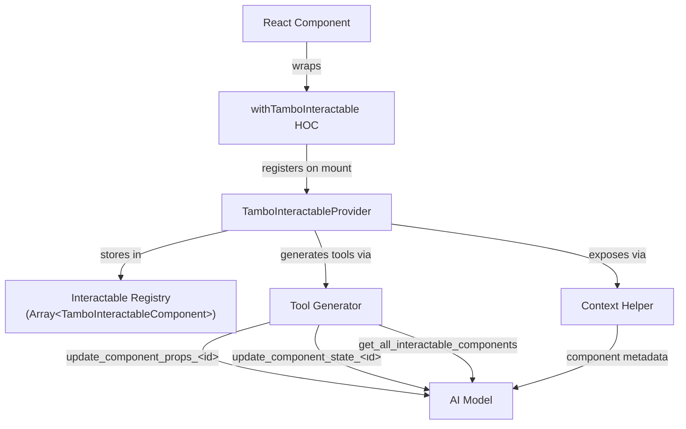
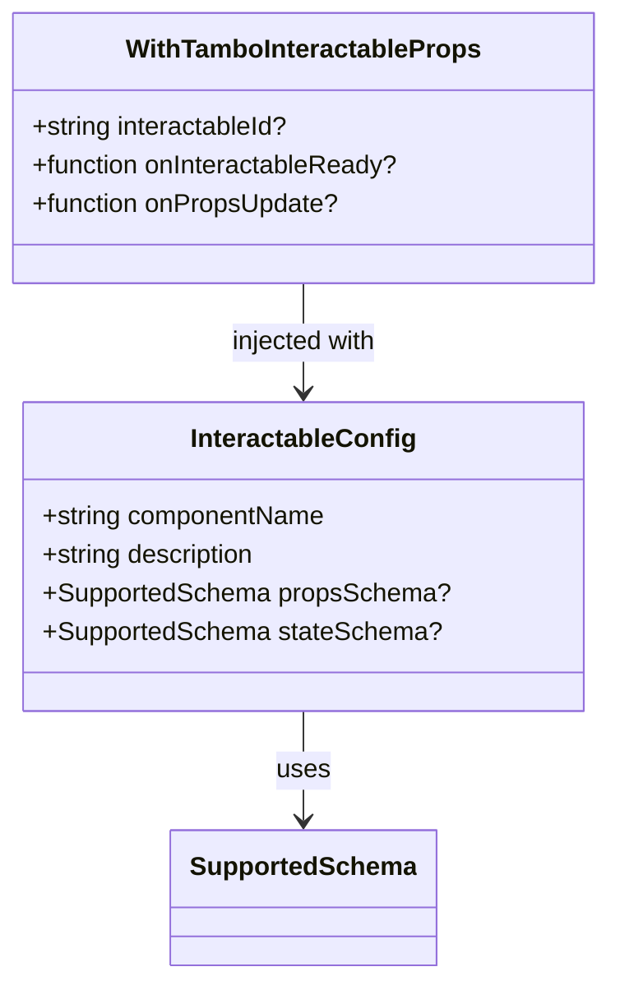
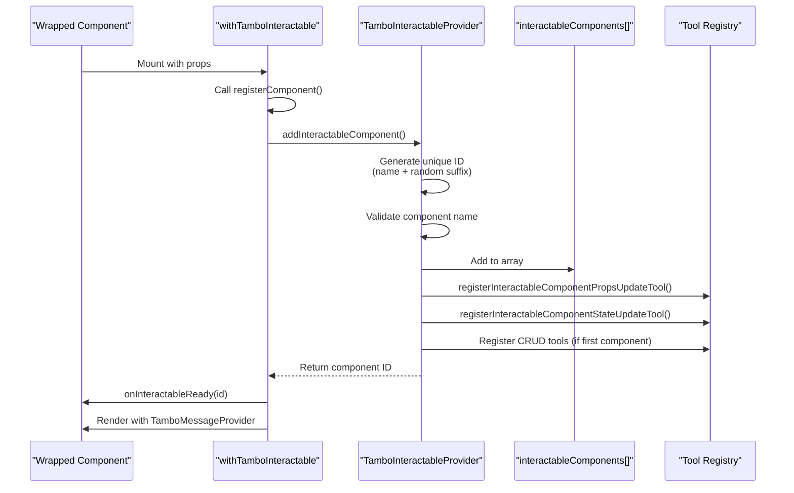
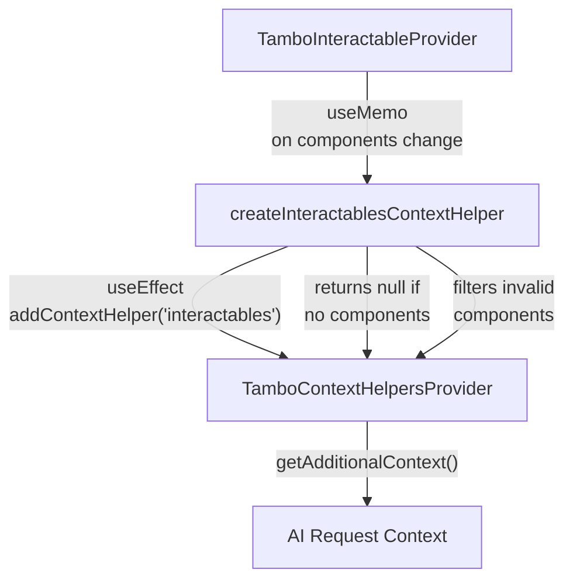
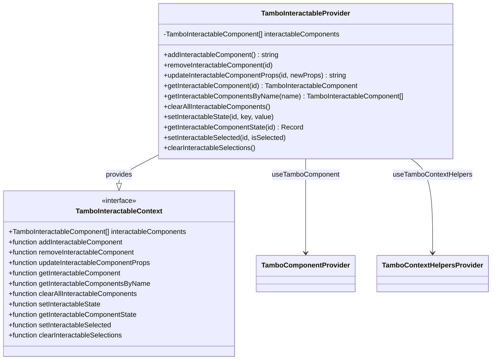

<!-- source: DeepWiki mcp.deepwiki.com · repo tambo-ai/tambo · page 3.9 Interactable Components · fetched 2026-10-29 -->

# Interactable Components

<details>
<summary>Relevant source files</summary>

The following files were used as context for generating this wiki page:

- [plans/implement-react-sdk-v1-api-support.md](plans/implement-react-sdk-v1-api-support.md)
- [react-sdk/src/context-helpers/current-interactables-context-helper.ts](react-sdk/src/context-helpers/current-interactables-context-helper.ts)
- [react-sdk/src/hoc/with-tambo-interactable.test.tsx](react-sdk/src/hoc/with-tambo-interactable.test.tsx)
- [react-sdk/src/hoc/with-tambo-interactable.tsx](react-sdk/src/hoc/with-tambo-interactable.tsx)
- [react-sdk/src/model/tambo-interactable.ts](react-sdk/src/model/tambo-interactable.ts)
- [react-sdk/src/providers/tambo-interactable-provider-partial-updates.test.tsx](react-sdk/src/providers/tambo-interactable-provider-partial-updates.test.tsx)
- [react-sdk/src/providers/tambo-interactable-provider.test.tsx](react-sdk/src/providers/tambo-interactable-provider.test.tsx)
- [react-sdk/src/providers/tambo-interactable-provider.tsx](react-sdk/src/providers/tambo-interactable-provider.tsx)
- [react-sdk/src/schema/index.ts](react-sdk/src/schema/index.ts)
- [react-sdk/src/schema/json-schema.test.ts](react-sdk/src/schema/json-schema.test.ts)
- [react-sdk/src/util/validate-component-name.ts](react-sdk/src/util/validate-component-name.ts)
- [react-sdk/src/v1/__tests__/v1-interactables.test.tsx](react-sdk/src/v1/__tests__/v1-interactables.test.tsx)
- [react-sdk/src/v1/hooks/use-tambo-v1-component-state.test.tsx](react-sdk/src/v1/hooks/use-tambo-v1-component-state.test.tsx)
- [react-sdk/src/v1/hooks/use-tambo-v1-component-state.ts](react-sdk/src/v1/hooks/use-tambo-v1-component-state.ts)
- [react-sdk/src/v1/utils/component-renderer.test.tsx](react-sdk/src/v1/utils/component-renderer.test.tsx)
- [react-sdk/src/v1/utils/component-renderer.tsx](react-sdk/src/v1/utils/component-renderer.tsx)

</details>


## Purpose and Scope

This document explains the interactable component system in the Tambo React SDK. Interactable components are React components that can be updated by the AI after their initial rendering through dynamically registered tools. This enables the AI to manipulate UI elements on behalf of the user, such as updating chart parameters, modifying form inputs, or adjusting component state.

For information about registering standard components that the AI can render but not update, see [Component Registration](#3.4). For details on component state management hooks, see [Component State Management](#3.6).

---

## Overview

### What Are Interactable Components?

Interactable components are React components wrapped with the `withTamboInteractable` HOC that:

1. **Register themselves** with `TamboInteractableProvider` when mounted
2. **Generate tools** automatically for the AI to update their props and state
3. **Receive unique identifiers** to enable per-instance manipulation
4. **Synchronize state** between the AI, local updates, and parent prop changes

The system creates a bidirectional communication channel where the AI can:
- Query all interactable components on the page
- Update specific component props through `update_component_props_<id>` tools
- Update component state through `update_component_state_<id>` tools
- Remove components through `remove_interactable_component` tools

### Architecture Overview



**Sources:** [react-sdk/src/providers/tambo-interactable-provider.tsx:1-528](), [react-sdk/src/hoc/with-tambo-interactable.tsx:1-210]()

---

## Creating Interactable Components

### Using withTamboInteractable

The `withTamboInteractable` HOC transforms any React component into an interactable component. It requires a configuration object specifying the component name, description, and optional schemas.

**Basic Usage:**

```typescript
import { withTamboInteractable } from '@tambo-ai/react';
import { z } from 'zod';

const Note: React.FC<{ title: string; content: string }> = ({ title, content }) => {
  return (
    <div>
      <h2>{title}</h2>
      <p>{content}</p>
    </div>
  );
};

const InteractableNote = withTamboInteractable(Note, {
  componentName: "Note",
  description: "A simple note component that displays a title and content",
  propsSchema: z.object({
    title: z.string(),
    content: z.string(),
  }),
});

// Usage in your app
<InteractableNote title="Meeting Notes" content="Discussed Q4 roadmap" />
```

### InteractableConfig Interface



**Configuration Properties:**
- `componentName`: Unique identifier for the component type (validated against `/^[a-zA-Z0-9_-]+$/`)
- `description`: Natural language description for the AI to understand the component's purpose
- `propsSchema`: Optional Zod/JSONSchema schema for prop validation
- `stateSchema`: Optional schema for state validation

**Sources:** [react-sdk/src/hoc/with-tambo-interactable.tsx:8-31](), [react-sdk/src/util/validate-component-name.ts:1-13]()

---

## Component Registration and Lifecycle

### Registration Flow



**ID Generation:**
Each interactable component receives a unique ID formed as `{componentName}-{randomSuffix}` where the random suffix is generated using `Math.random().toString(36).slice(2, 5)`. This allows multiple instances of the same component type.

**Tool Registration:**
For each registered component, the provider creates:
- `update_component_props_<id>`: Updates component props (partial update supported)
- `update_component_state_<id>`: Updates component state (partial update supported)

For the first registered component, it also creates:
- `get_all_interactable_components`: Returns all interactable components with metadata
- `get_interactable_component_by_id`: Gets a specific component by ID
- `remove_interactable_component`: Removes a component from the registry

**Sources:** [react-sdk/src/providers/tambo-interactable-provider.tsx:361-390](), [react-sdk/src/hoc/with-tambo-interactable.tsx:126-147](), [react-sdk/src/providers/tambo-interactable-provider.tsx:71-189]()

---

## Props Management

### Partial Updates

The interactable system supports **partial prop updates**, meaning the AI can update specific props without providing all props. The system performs a shallow merge of the new props with existing props.

**Update Flow:**

```mermaid
graph LR
    AI["AI Tool Call"]
    UpdateFn["updateInteractableComponentProps"]
    Validation["Validation"]
    ShallowMerge["Shallow Merge"]
    StateUpdate["setInteractableComponents"]
    Rerender["Component Re-render"]
    
    AI -->|"componentId, newProps"| UpdateFn
    UpdateFn --> Validation
    Validation -->|"Check if empty"| ShallowMerge
    ShallowMerge -->|"...component.props, ...newProps"| StateUpdate
    StateUpdate --> Rerender
```



**Example from Tests:**

```typescript
// Original props: { title: "Original", count: 0, active: true, metadata: {...} }
updateInteractableComponentProps(componentId, { count: 5 });
// Result: { title: "Original", count: 5, active: true, metadata: {...} }
// Only 'count' was changed
```

**Shallow Merge Behavior:**
- **Top-level props:** Partial updates work as expected
- **Nested objects:** The entire nested object is replaced (shallow merge only)
- **Arrays:** The entire array is replaced

**Validation:**
- Returns warning if `newProps` is empty, null, or undefined
- Props are validated against `propsSchema` if provided (converted to JSON Schema)
- Component name must match pattern `/^[a-zA-Z0-9_-]+$/`

**Sources:** [react-sdk/src/providers/tambo-interactable-provider.tsx:191-228](), [react-sdk/src/providers/tambo-interactable-provider.tsx:259-308](), [react-sdk/src/providers/tambo-interactable-provider-partial-updates.test.tsx:47-315]()

### Schema Conversion

Props and state schemas are converted to JSON Schema format using `makeJsonSchemaPartial()` which removes the `required` array, allowing partial updates:

```typescript
// Original schema
const propsSchema = z.object({
  title: z.string(),
  count: z.number(),
});

// After conversion for update tool
{
  type: "object",
  properties: {
    title: { type: "string" },
    count: { type: "number" }
  }
  // 'required' is removed
}
```

**Sources:** [react-sdk/src/providers/tambo-interactable-provider.tsx:269-278](), [react-sdk/src/schema/json-schema.test.ts:169-240]()

---

## State Management

### Component State vs Props

Interactable components can manage both:
- **Props:** Passed from parent, updated via `update_component_props_<id>` tool
- **State:** Internal component state, updated via `update_component_state_<id>` tool or `useTamboComponentState` hook

**State Storage:**
State is stored in the `TamboInteractableComponent` object in the registry:

```typescript
interface TamboInteractableComponent {
  id: string;
  name: string;
  props: Record<string, unknown>;
  propsSchema?: SupportedSchema;
  state?: Record<string, unknown>;
  stateSchema?: SupportedSchema;
  isSelected?: boolean;
}
```

### Using State in Components

Components use the `useTamboComponentState` hook to access and update state:

```typescript
const MyNote: React.FC<{ title: string }> = ({ title }) => {
  const [isPinned, setIsPinned] = useTamboComponentState("isPinned", false);
  
  return (
    <div style={{ border: isPinned ? "2px solid gold" : "1px solid gray" }}>
      <h2>{title}</h2>
      <button onClick={() => setIsPinned(!isPinned)}>
        {isPinned ? "Unpin" : "Pin"}
      </button>
    </div>
  );
};

const InteractableNote = withTamboInteractable(MyNote, {
  componentName: "Note",
  description: "A note that can be pinned",
  propsSchema: z.object({ title: z.string() }),
  stateSchema: z.object({ isPinned: z.boolean() }),
});
```

### State Update Tools

The `update_component_state_<id>` tool is automatically registered for each interactable component:

**Input Schema:**
```json
{
  "type": "object",
  "properties": {
    "componentId": {
      "type": "string",
      "description": "The ID of the interactable component to update"
    },
    "newState": {
      "type": "object",
      "additionalProperties": true,
      "description": "The state values to update. Provide only the keys you want to change."
    }
  },
  "required": ["componentId", "newState"]
}
```

**Behavior:**
- Performs shallow merge of `newState` with existing state
- Returns "Updated successfully" or warning message
- State changes trigger component re-render
- If `stateSchema` is provided, it's converted to partial JSON Schema

**Sources:** [react-sdk/src/model/tambo-interactable.ts:1-61](), [react-sdk/src/providers/tambo-interactable-provider.tsx:230-257](), [react-sdk/src/providers/tambo-interactable-provider.tsx:310-359]()

---

## AI Integration

### Context Helper Registration

The `TamboInteractableProvider` automatically registers a context helper that exposes all interactable components to the AI. This information is included in every AI request.

**Context Helper Flow:**



**Context Payload Format:**

```typescript
{
  components: [
    {
      id: "Note-xyz",
      componentName: "Note",
      description: "A simple note component",
      props: { title: "My Note", content: "..." },
      propsSchema: "Available - use component-specific update tools",
      state: { isPinned: false },
      stateSchema: "Available - use component-specific update tools",
      isSelectedForInteraction: false
    }
  ]
}
```

**Automatic Filtering:**
- Returns `null` if no interactable components exist (excluded from context)
- Handles invalid component entries gracefully
- Can be disabled by overriding the helper: `addContextHelper("interactables", () => null)`

**Sources:** [react-sdk/src/providers/tambo-interactable-provider.tsx:56-69](), [react-sdk/src/context-helpers/current-interactables-context-helper.ts:27-76]()

### CRUD Tools

When the first interactable component is registered, the provider creates general CRUD tools:

**get_all_interactable_components:**
```typescript
{
  name: "get_all_interactable_components",
  description: "Get all currently interactable components with their details including their current props",
  inputSchema: z.object({}),
  outputSchema: z.object({
    components: z.array(
      z.object({
        id: z.string(),
        name: z.string(),
        props: z.record(z.string(), z.any()),
        propsSchema: z.record(z.string(), z.any()).optional(),
      })
    )
  })
}
```

**get_interactable_component_by_id:**
Returns a specific component by its ID or an error if not found.

**remove_interactable_component:**
Removes a component from the interactable registry. This does not unmount the component from React, but prevents the AI from interacting with it.

**Sources:** [react-sdk/src/providers/tambo-interactable-provider.tsx:71-189]()

---

## Provider Architecture

### TamboInteractableProvider Structure



**Key Dependencies:**
- `useTamboComponent()`: For registering tools via `registerTool()`
- `useTamboContextHelpers()`: For registering context helper via `addContextHelper()`

### Hook API

**useTamboInteractable:**
Returns the full interactable context for programmatic component management.

**useCurrentInteractablesSnapshot:**
Returns a cloned snapshot of current interactables. Useful for safely inspecting state without risk of mutation.

```typescript
const snapshot = useCurrentInteractablesSnapshot();
// Returns shallow copies of array and each component's props
// Safe to mutate without affecting internal state
```

**Sources:** [react-sdk/src/providers/tambo-interactable-provider.tsx:508-527](), [react-sdk/src/providers/tambo-interactable-provider.tsx:482-500]()

---

## Advanced Features

### Component Selection

Interactable components can be "selected" to indicate the AI should interact with them in the next response:

```typescript
const { setInteractableSelected, clearInteractableSelections } = useTamboInteractable();

// Mark a component for interaction
setInteractableSelected("Note-xyz", true);

// Clear all selections
clearInteractableSelections();
```

The `isSelected` flag is included in the component metadata sent to the AI through the context helper.

**Sources:** [react-sdk/src/providers/tambo-interactable-provider.tsx:458-480]()

### Multiple Component Instances

The system handles multiple instances of the same component type through unique ID generation:

```typescript
<InteractableNote title="Note 1" />  // ID: Note-abc
<InteractableNote title="Note 2" />  // ID: Note-def
<InteractableNote title="Note 3" />  // ID: Note-ghi
```

Each instance:
- Has its own `update_component_props_<id>` tool
- Has its own `update_component_state_<id>` tool
- Maintains independent state
- Can be queried via `getInteractableComponentsByName("Note")`

**Sources:** [react-sdk/src/providers/tambo-interactable-provider.tsx:368-370]()

### TamboMessageProvider Integration

The `withTamboInteractable` HOC wraps rendered components with `TamboMessageProvider` to enable hooks like `useTamboCurrentMessage()` and `useTamboComponentState()` to function correctly:

```typescript
// Creates minimal message with interactable metadata
const minimalMessage: TamboThreadMessage = {
  id: interactableId,
  role: "assistant",
  content: [],
  threadId: "",
  createdAt: new Date().toISOString(),
  component: {
    componentName: config.componentName,
    componentState: {},
    message: "",
    props: effectiveProps,
  },
  componentState: {},
};

// Wraps component
<TamboMessageProvider
  message={minimalMessage}
  interactableMetadata={{
    id: interactableId,
    componentName: config.componentName,
    description: config.description,
  }}
>
  <WrappedComponent {...effectiveProps} />
</TamboMessageProvider>
```

**Sources:** [react-sdk/src/hoc/with-tambo-interactable.tsx:175-204]()

---

## Complete Example

```typescript
import { withTamboInteractable, useTamboComponentState } from '@tambo-ai/react';
import { z } from 'zod';

// 1. Define component with state hook
const TaskCard: React.FC<{ 
  title: string; 
  description: string;
  priority?: "low" | "medium" | "high";
}> = ({ title, description, priority = "medium" }) => {
  const [isCompleted, setIsCompleted] = useTamboComponentState("isCompleted", false);
  const [notes, setNotes] = useTamboComponentState("notes", "");
  
  return (
    <div style={{ 
      opacity: isCompleted ? 0.6 : 1,
      border: `2px solid ${priority === "high" ? "red" : "gray"}`
    }}>
      <h3>{title}</h3>
      <p>{description}</p>
      <p>Priority: {priority}</p>
      <label>
        <input 
          type="checkbox" 
          checked={isCompleted} 
          onChange={(e) => setIsCompleted(e.target.checked)} 
        />
        Completed
      </label>
      <textarea 
        value={notes} 
        onChange={(e) => setNotes(e.target.value)}
        placeholder="Add notes..."
      />
    </div>
  );
};

// 2. Wrap with interactable HOC
const InteractableTaskCard = withTamboInteractable(TaskCard, {
  componentName: "TaskCard",
  description: "A task card that can be marked complete and annotated with notes. You can update the priority, title, and description as needed.",
  propsSchema: z.object({
    title: z.string().describe("The task title"),
    description: z.string().describe("The task description"),
    priority: z.enum(["low", "medium", "high"]).optional().describe("Task priority level"),
  }),
  stateSchema: z.object({
    isCompleted: z.boolean().describe("Whether the task is completed"),
    notes: z.string().describe("User notes about the task"),
  }),
});

// 3. Use in your application
function App() {
  return (
    <TamboProvider apiKey="...">
      <InteractableTaskCard
        title="Review PR #123"
        description="Review and approve the authentication refactor PR"
        priority="high"
      />
      <InteractableTaskCard
        title="Write documentation"
        description="Document the new API endpoints"
        priority="medium"
      />
    </TamboProvider>
  );
}

// The AI can now:
// - Update props: update_component_props_TaskCard-abc({ priority: "low" })
// - Update state: update_component_state_TaskCard-abc({ isCompleted: true })
// - Query components: get_all_interactable_components()
// - Remove components: remove_interactable_component({ componentId: "TaskCard-abc" })
```

**Sources:** [react-sdk/src/hoc/with-tambo-interactable.tsx:61-88](), [react-sdk/src/providers/tambo-interactable-provider.tsx:1-528]()

---

