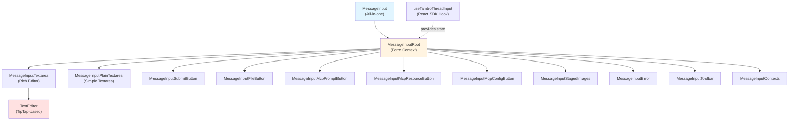
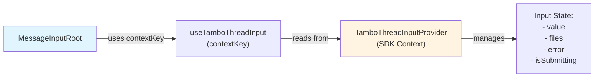
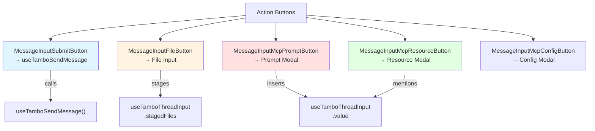
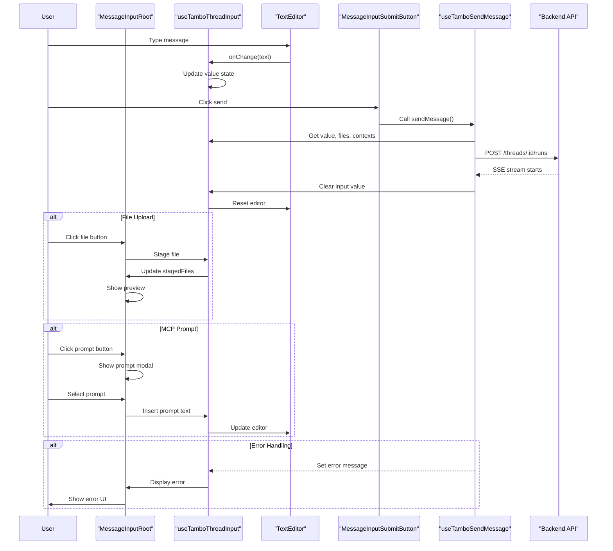

<!-- source: DeepWiki mcp.deepwiki.com · repo tambo-ai/tambo · page 4.2 MessageInput Components · fetched 2026-10-29 -->

# MessageInput Components

<details>
<summary>Relevant source files</summary>

The following files were used as context for generating this wiki page:

- [cli/src/types/components.d.ts](cli/src/types/components.d.ts)
- [cli/src/types/utils.d.ts](cli/src/types/utils.d.ts)

</details>


This document covers the **MessageInput** component family in `@tambo-ai/ui-registry`, which provides pre-built UI components for user input in Tambo conversations. These components handle text input, file uploads, MCP resource/prompt selection, and submission flow. The MessageInput family integrates with the `useTamboThreadInput` hook from the React SDK to manage input state, file staging, and message submission.

For information about displaying messages and thread content, see [Message Components](#4.1). For thread navigation and history, see [Thread Display Components](#4.3).

## Purpose and Scope

The MessageInput components provide a composable, variant-based input system with the following capabilities:
- Rich text editing with mentions and autocomplete via TipTap editor
- Plain textarea fallback for simpler use cases
- File upload with image preview and staging
- MCP prompt and resource selection buttons
- Error display and submission state management
- Multi-variant styling (default, solid, bordered)
- Context key support for managing multiple input instances

---

## Component Architecture

The MessageInput family follows a composable architecture with both an all-in-one component and individual sub-components for custom layouts.



**Sources:** [cli/src/types/components.d.ts:118-228]()

---

## MessageInput (All-in-One Component)

The `MessageInput` component is a pre-composed, ready-to-use input interface that includes all common features: textarea, submit button, file upload, and MCP integration.

### Props

| Prop | Type | Description |
|------|------|-------------|
| `variant` | `"default" \| "solid" \| "bordered" \| null` | Visual variant of the input |
| `contextKey` | `string` | Optional key to manage multiple input instances |
| `className` | `string` | Additional CSS classes |
| Standard form attributes | - | Extends `React.HTMLAttributes<HTMLFormElement>` |

### Usage Pattern

```typescript
import { MessageInput } from "@/components/tambo/message-input";

// Basic usage with default styling
<MessageInput variant="default" />

// With custom context key for multiple inputs
<MessageInput 
  variant="solid" 
  contextKey="secondary-chat"
/>
```

**Sources:** [cli/src/types/components.d.ts:118-122](), [cli/src/types/components.d.ts:171-173]()

---

## MessageInputRoot

The root component that provides form context and manages submission flow. Use this when building custom input layouts with individual sub-components.

### Props

| Prop | Type | Description |
|------|------|-------------|
| `contextKey` | `string` | Optional key for managing multiple input instances |
| `variant` | `ComponentVariant` | Visual variant |
| `children` | `React.ReactNode` | Child components to compose |
| Standard form attributes | - | Extends `React.HTMLAttributes<HTMLFormElement>` |

### Context Management

The `contextKey` prop allows multiple input components to coexist independently on the same page. Each context key maintains separate state for:
- Text input value
- Staged files/images
- Error messages
- Submission state

### Integration with React SDK



**Sources:** [cli/src/types/components.d.ts:130-134](), [cli/src/types/components.d.ts:176-177]()

---

## MessageInputTextarea

Rich text editor component with mention support, autocomplete, and formatting capabilities. Built on TipTap editor.

### Props

| Prop | Type | Description |
|------|------|-------------|
| `placeholder` | `string` | Placeholder text for empty editor |
| `staticMentionItems` | `MessageInputMentionItem[]` | Static list of mentionable items |
| `mentionItemFetcher` | `(query: string) => Promise<MessageInputMentionItem[]>` | Async function to fetch mention items |
| Standard div attributes | - | Extends `React.HTMLAttributes<HTMLDivElement>` |

### MessageInputMentionItem Interface

```typescript
interface MessageInputMentionItem {
  id: string;
  name: string;
  icon?: React.ReactNode;
  componentData?: unknown;
}
```

### Mention System

The textarea supports two mention modes:

1. **Static Mentions**: Provide a fixed list via `staticMentionItems`
2. **Dynamic Mentions**: Provide an async fetcher via `mentionItemFetcher`

Mentions are typically triggered by typing `@` or other configured trigger characters.

**Sources:** [cli/src/types/components.d.ts:136-140](), [cli/src/types/components.d.ts:123-128](), [cli/src/types/components.d.ts:179-181]()

---

## MessageInputPlainTextarea

A simpler textarea fallback without rich text editing features. Useful for mobile devices or when TipTap dependencies are not desired.

### Props

| Prop | Type | Description |
|------|------|-------------|
| Standard textarea attributes | - | Extends `React.TextareaHTMLAttributes<HTMLTextAreaElement>` |

### Usage

```typescript
import { 
  MessageInputRoot, 
  MessageInputPlainTextarea,
  MessageInputSubmitButton 
} from "@/components/tambo/message-input";

<MessageInputRoot>
  <MessageInputPlainTextarea placeholder="Type a message..." />
  <MessageInputSubmitButton>Send</MessageInputSubmitButton>
</MessageInputRoot>
```

**Sources:** [cli/src/types/components.d.ts:168-169](), [cli/src/types/components.d.ts:183-185]()

---

## Submit and Action Buttons

### MessageInputSubmitButton

Button component that triggers message submission. Automatically disabled during submission.

**Props:**
| Prop | Type | Description |
|------|------|-------------|
| `children` | `React.ReactNode` | Button content (text/icon) |
| Standard button attributes | - | Extends `React.ButtonHTMLAttributes<HTMLButtonElement>` |

### MessageInputFileButton

Button that opens file picker for uploading files/images to the conversation.

**Props:** Extends `React.ButtonHTMLAttributes<HTMLButtonElement>`

### MessageInputMcpPromptButton

Button that opens a modal to select MCP prompts. When a prompt is selected, its text is inserted into the input.

**Props:** Extends `React.ButtonHTMLAttributes<HTMLButtonElement>`

### MessageInputMcpResourceButton

Button that opens a modal to select MCP resources. Selected resources are mentioned/referenced in the input.

**Props:** Extends `React.ButtonHTMLAttributes<HTMLButtonElement>`

### MessageInputMcpConfigButton

Button that opens the MCP server configuration modal for managing connected MCP servers.

**Props:** Extends `React.HTMLAttributes<HTMLButtonElement>`



**Sources:** [cli/src/types/components.d.ts:142-164](), [cli/src/types/components.d.ts:191-219]()

---

## Additional Display Components

### MessageInputStagedImages

Displays preview thumbnails of images/files that have been staged for upload but not yet sent.

**Props:** Extends `React.HTMLAttributes<HTMLDivElement>`

### MessageInputError

Displays error messages related to input validation or submission failures.

**Props:** Extends `React.HTMLAttributes<HTMLParagraphElement>`

### MessageInputToolbar

Container component for grouping action buttons (file, MCP, etc.) in a toolbar layout.

**Props:** Extends `React.HTMLAttributes<HTMLDivElement>`

### MessageInputContexts

Displays active context items (e.g., selected resources, conversation context) that will be included with the message.

**Props:** Extends `React.HTMLAttributes<HTMLDivElement>`

**Sources:** [cli/src/types/components.d.ts:155-167](), [cli/src/types/components.d.ts:199-227]()

---

## TextEditor (Rich Text Component)

The underlying TipTap-based rich text editor used by `MessageInputTextarea`. Can be used directly for custom editor implementations.

### Props

| Prop | Type | Description |
|------|------|-------------|
| `value` | `string` | Current editor content |
| `onChange` | `(text: string) => void` | Callback when content changes |
| `onKeyDown` | `(event: React.KeyboardEvent, editor: Editor) => void` | Keyboard event handler |
| `placeholder` | `string` | Placeholder text |
| `disabled` | `boolean` | Disable editing |
| `className` | `string` | Additional CSS classes |
| `editorRef` | `React.MutableRefObject<Editor \| null>` | Ref to access editor instance |
| `commands` | `CommandConfig[]` | Custom command configurations |
| `onSubmit` | `(e: React.FormEvent) => Promise<void>` | Form submission handler |
| `staticMentionItems` | `ResourceItem[]` | Static mention items |
| `mentionItemFetcher` | `(query: string) => Promise<ResourceItem[]>` | Async mention fetcher |

### CommandConfig Interface

```typescript
interface CommandConfig {
  triggerChar: string;                    // Character that triggers command (e.g., "@")
  items: ResourceItem[] | 
         ((query: string) => Promise<ResourceItem[]>) | 
         {
           staticItems?: ResourceItem[];
           fetchItems?: (query: string) => Promise<ResourceItem[]>;
         };
  onSelect?: (item: ResourceItem) => void; // Callback when item selected
  renderLabel: (props: {
    options: unknown;
    node: { attrs: Record<string, unknown> };
    suggestion: unknown;
  }) => string;
  HTMLAttributes?: Record<string, string>; // Attributes for rendered elements
  isMenuOpenRef?: React.MutableRefObject<boolean>; // Track menu state
}
```

### ResourceItem Interface

```typescript
interface ResourceItem {
  id: string;
  name: string;
  icon?: React.ReactNode;
  componentData?: unknown;
}
```

### Helper Function: hasExistingMention

Utility function to check if a mention already exists in the editor content.

```typescript
function hasExistingMention(editor: Editor, label: string): boolean
```

**Sources:** [cli/src/types/components.d.ts:230-278]()

---

## Variant System

The MessageInput components support multiple visual variants controlled by the `messageInputVariants` function.

### Available Variants

| Variant | Description |
|---------|-------------|
| `default` | Standard input styling |
| `solid` | Solid background styling |
| `bordered` | Border-emphasized styling |

### Variant Function

```typescript
const messageInputVariants: {
  (props?: { variant?: "default" | "solid" | "bordered" }): string;
  variants: Record<string, Record<string, string>>;
  defaultVariants: Record<string, string>;
}
```

The variant system is implemented using a variant composition utility (likely class-variance-authority or similar) that generates appropriate CSS classes.

**Sources:** [cli/src/types/components.d.ts:203-207]()

---

## Integration Flow

The following diagram shows how MessageInput components integrate with the React SDK and backend API.



**Sources:** [cli/src/types/components.d.ts:118-228]()

---

## Usage Examples

### Basic All-in-One Input

```typescript
import { MessageInput } from "@/components/tambo/message-input";

function ChatInterface() {
  return (
    <div className="chat-container">
      <MessageInput variant="default" />
    </div>
  );
}
```

### Custom Composition with Plain Textarea

```typescript
import {
  MessageInputRoot,
  MessageInputPlainTextarea,
  MessageInputSubmitButton,
  MessageInputError,
} from "@/components/tambo/message-input";

function SimpleInput() {
  return (
    <MessageInputRoot variant="bordered">
      <MessageInputPlainTextarea 
        placeholder="Type your message..."
      />
      <MessageInputError />
      <MessageInputSubmitButton>Send</MessageInputSubmitButton>
    </MessageInputRoot>
  );
}
```

### Rich Input with MCP Integration

```typescript
import {
  MessageInputRoot,
  MessageInputTextarea,
  MessageInputToolbar,
  MessageInputFileButton,
  MessageInputMcpPromptButton,
  MessageInputMcpResourceButton,
  MessageInputSubmitButton,
  MessageInputStagedImages,
} from "@/components/tambo/message-input";

function RichInput() {
  return (
    <MessageInputRoot variant="solid">
      <MessageInputTextarea 
        placeholder="Ask me anything..."
        staticMentionItems={[
          { id: "1", name: "User", icon: <UserIcon /> },
          { id: "2", name: "Assistant", icon: <BotIcon /> },
        ]}
      />
      <MessageInputStagedImages />
      <MessageInputToolbar>
        <MessageInputFileButton />
        <MessageInputMcpPromptButton />
        <MessageInputMcpResourceButton />
        <MessageInputSubmitButton>
          <SendIcon />
        </MessageInputSubmitButton>
      </MessageInputToolbar>
    </MessageInputRoot>
  );
}
```

### Multiple Inputs with Context Keys

```typescript
import { MessageInput } from "@/components/tambo/message-input";

function MultiChatInterface() {
  return (
    <>
      <div className="chat-1">
        <MessageInput 
          variant="default" 
          contextKey="chat-1"
        />
      </div>
      <div className="chat-2">
        <MessageInput 
          variant="default" 
          contextKey="chat-2"
        />
      </div>
    </>
  );
}
```

**Sources:** [cli/src/types/components.d.ts:118-228]()

---

## Component Export Reference

All MessageInput components are exported from the `@/components/tambo/message-input` module:

| Export | Type | Description |
|--------|------|-------------|
| `MessageInput` | `ForwardRefExoticComponent` | All-in-one input component |
| `MessageInputRoot` | `ForwardRefExoticComponent` | Root form with context |
| `MessageInputTextarea` | `ForwardRefExoticComponent` | Rich text editor |
| `MessageInputPlainTextarea` | `ForwardRefExoticComponent` | Simple textarea |
| `MessageInputSubmitButton` | `ForwardRefExoticComponent` | Submit button |
| `MessageInputFileButton` | `ForwardRefExoticComponent` | File upload button |
| `MessageInputMcpPromptButton` | `ForwardRefExoticComponent` | MCP prompt selector |
| `MessageInputMcpResourceButton` | `ForwardRefExoticComponent` | MCP resource selector |
| `MessageInputMcpConfigButton` | `ForwardRefExoticComponent` | MCP config button |
| `MessageInputToolbar` | `ForwardRefExoticComponent` | Toolbar container |
| `MessageInputError` | `ForwardRefExoticComponent` | Error display |
| `MessageInputStagedImages` | `ForwardRefExoticComponent` | Staged image preview |
| `MessageInputContexts` | `ForwardRefExoticComponent` | Context display |
| `messageInputVariants` | `Function` | Variant utility |

The `TextEditor` component is exported separately from `@/components/tambo/message-input/text-editor`:

| Export | Type | Description |
|--------|------|-------------|
| `TextEditor` | `ForwardRefExoticComponent` | TipTap editor |
| `hasExistingMention` | `Function` | Mention check utility |

**Sources:** [cli/src/types/components.d.ts:118-228](), [cli/src/types/components.d.ts:230-278]()

---

