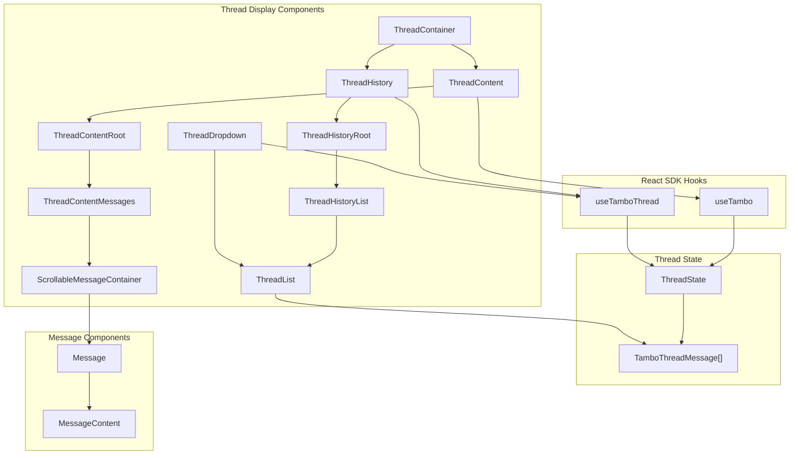
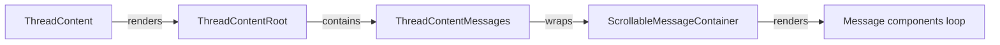
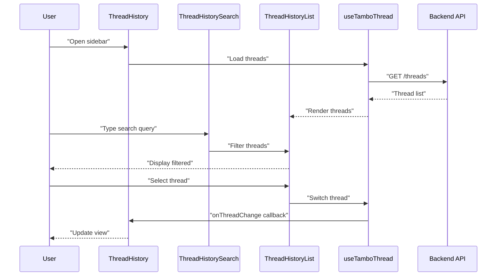
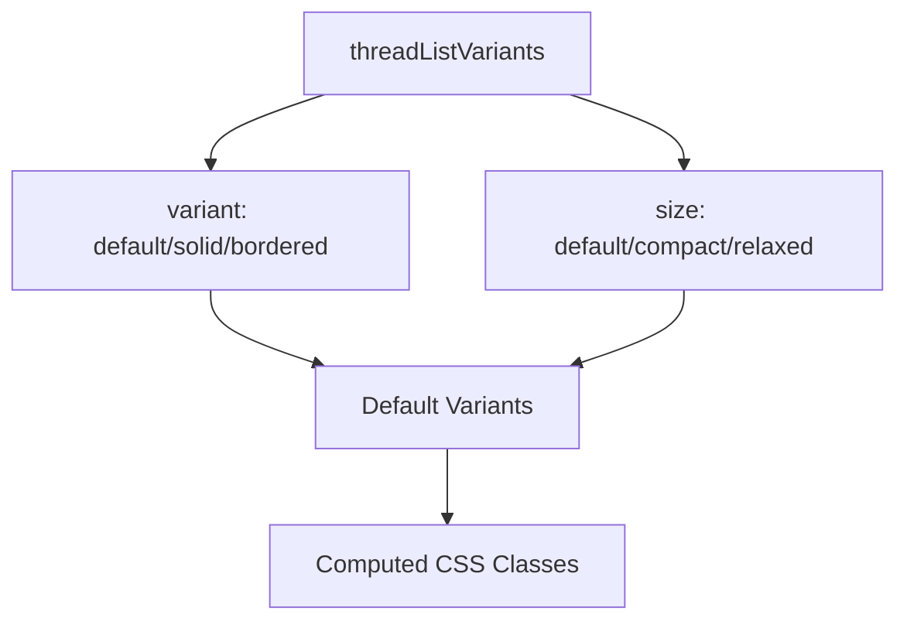
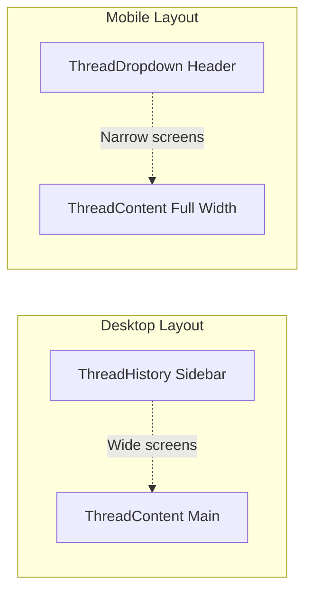
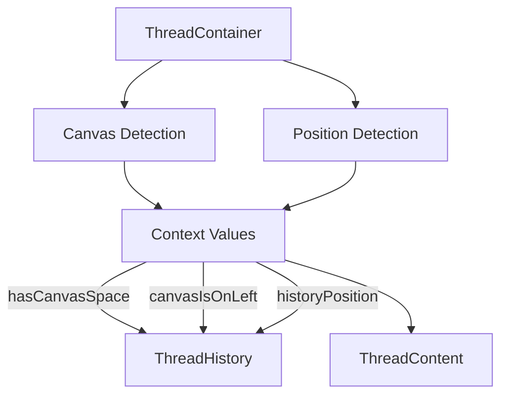
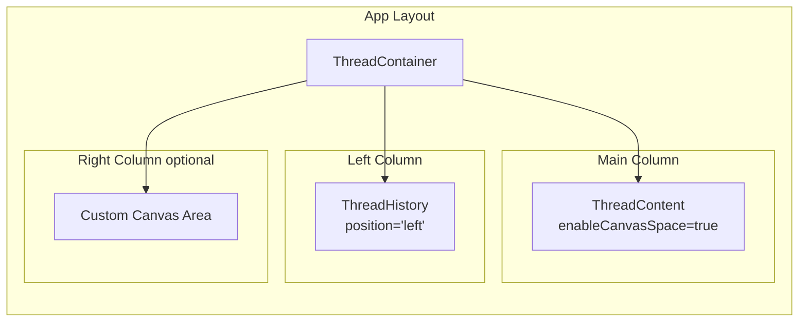
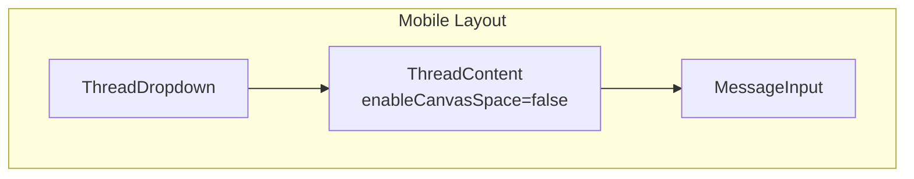
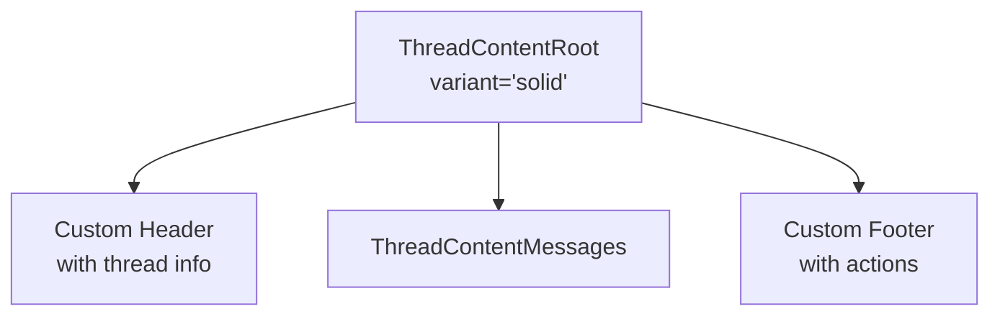

<!-- source: DeepWiki mcp.deepwiki.com · repo tambo-ai/tambo · page 4.3 Thread Display Components · fetched 2026-10-29 -->

# Thread Display Components

<details>
<summary>Relevant source files</summary>

The following files were used as context for generating this wiki page:

- [cli/src/types/components.d.ts](cli/src/types/components.d.ts)
- [cli/src/types/utils.d.ts](cli/src/types/utils.d.ts)

</details>


## Overview

This page documents the thread display components that provide UI for viewing, navigating, and managing conversation threads in Tambo AI applications. These components handle thread selection, message history display, and thread list presentation.

For information about individual message rendering, see [Message Components](#4.1). For thread input functionality, see [MessageInput Components](#4.2). For thread management at the SDK level, see [Thread Management](#3.3).

**Sources:** [cli/src/types/components.d.ts:91-543]()

---

## Component Architecture

The thread display system consists of several interconnected components that work with the React SDK's thread state management:



**Sources:** [cli/src/types/components.d.ts:91-116](), [cli/src/types/components.d.ts:327-372](), [cli/src/types/components.d.ts:374-394](), [cli/src/types/components.d.ts:434-443](), [cli/src/types/components.d.ts:522-538]()

---

## ThreadContent Component

The `ThreadContent` component renders the conversation messages for the currently active thread. It provides both a monolithic component and composable parts for customization.

### Component Interface

| Component | Purpose | Props |
|-----------|---------|-------|
| `ThreadContent` | All-in-one thread display | `variant`, `enableCanvasSpace`, `className` |
| `ThreadContentRoot` | Container wrapper | `variant`, `enableCanvasSpace`, `children` |
| `ThreadContentMessages` | Message list renderer | Standard HTML div attributes |

### Props

**ThreadContentProps**
- `variant?: ComponentVariant` - Visual style: `"default"`, `"solid"`, `"bordered"`, or `null`
- `enableCanvasSpace?: boolean` - Reserves space for canvas/sidebar layout
- `className?: string` - Additional CSS classes

**ThreadContentRootProps**
- `variant?: ComponentVariant` - Visual style
- `enableCanvasSpace?: boolean` - Layout spacing control
- `children?: React.ReactNode` - Custom content

**ThreadContentMessagesProps**
- Extends `React.HTMLAttributes<HTMLDivElement>`

### Component Structure



The monolithic `ThreadContent` component internally uses `ThreadContentRoot` and `ThreadContentMessages`, providing a simplified interface for common use cases. For advanced customization, use the composable parts directly.

**Sources:** [cli/src/types/components.d.ts:91-116]()

---

## ThreadHistory Component

The `ThreadHistory` component provides a sidebar interface for browsing and managing conversation threads. It includes search functionality, thread creation, and list display.

### Component Interface

| Component | Purpose | Props |
|-----------|---------|-------|
| `ThreadHistory` | Complete thread sidebar | `contextKey`, `onThreadChange`, `defaultCollapsed`, `position` |
| `ThreadHistoryRoot` | Container wrapper | `children` |
| `ThreadHistoryHeader` | Header section | Standard HTML div attributes |
| `ThreadHistoryNewButton` | New thread button | Standard button attributes |
| `ThreadHistorySearch` | Search input field | Standard input attributes |
| `ThreadHistoryList` | Thread list renderer | Standard div attributes |

### Props

**ThreadHistoryProps**
- `contextKey?: string` - Context identifier for multi-instance scenarios
- `onThreadChange?: () => void` - Callback when thread selection changes
- `defaultCollapsed?: boolean` - Initial collapsed state
- `position?: "left" | "right"` - Sidebar position relative to content
- Extends `React.HTMLAttributes<HTMLDivElement>`

### Data Flow



The `ThreadHistory` component manages its own collapsed/expanded state and communicates thread selection changes through the `onThreadChange` callback. The `position` prop allows placement on either side of the content area.

**Sources:** [cli/src/types/components.d.ts:327-372]()

---

## ThreadList Component

The `ThreadList` component renders a list of threads with selection state and loading indicators. It is used internally by `ThreadHistory` and can be used standalone for custom layouts.

### Props

**ThreadListProps**
- `variant?: ComponentVariant` - Visual style: `"default"`, `"solid"`, `"bordered"`
- `threads: TamboThread[]` - Array of thread objects to display
- `selectedThreadId?: string | null` - Currently selected thread ID
- `onThreadSelect?: (threadId: string) => void` - Selection callback
- `isLoading?: boolean` - Loading state indicator
- `size?: "default" | "compact" | "relaxed"` - List item sizing
- Extends `React.HTMLAttributes<HTMLDivElement>`

### Styling Variants

The component uses `threadListVariants` for consistent styling across different visual styles and sizes:



### Usage Pattern

| Prop | Purpose | Example Values |
|------|---------|---------------|
| `threads` | Data source | Array from `useTamboThread().threads` |
| `selectedThreadId` | Highlight active | Current thread ID from SDK |
| `onThreadSelect` | Handle clicks | Switch thread via SDK method |
| `isLoading` | Show skeleton | Loading state from SDK |
| `size` | Adjust density | `"compact"` for sidebars, `"relaxed"` for main view |

**Sources:** [cli/src/types/components.d.ts:374-394]()

---

## ThreadDropdown Component

The `ThreadDropdown` component provides a compact dropdown selector for thread switching, suitable for mobile layouts or space-constrained interfaces.

### Props

**ThreadDropdownProps**
- `variant?: ComponentVariant` - Visual style: `"default"`, `"solid"`, `"bordered"`
- `contextKey?: string | undefined` - Context identifier for multi-instance scenarios
- `onThreadChange?: () => void` - Callback when thread selection changes
- Extends `React.HTMLAttributes<HTMLDivElement>`

### Component Comparison

| Feature | ThreadHistory | ThreadDropdown |
|---------|--------------|----------------|
| Layout | Sidebar panel | Dropdown menu |
| Search | Built-in | Not included |
| New Thread | Built-in button | External action needed |
| Best For | Desktop, full-screen | Mobile, compact layouts |
| Thread Preview | Full list with scrolling | Dropdown with selected item |



Both components use the same underlying thread management hooks and provide `onThreadChange` callbacks for custom behavior.

**Sources:** [cli/src/types/components.d.ts:434-443]()

---

## Supporting Components

### ScrollableMessageContainer

The `ScrollableMessageContainer` component provides auto-scrolling behavior for message lists, automatically scrolling to the bottom when new messages arrive.

**Props:**
- Extends `React.HTMLAttributes<HTMLDivElement>`

This component is used internally by `ThreadContentMessages` but can be used independently for custom message layouts. It handles scroll position management during streaming updates.

**Sources:** [cli/src/types/components.d.ts:445-449]()

### ThreadContainer

The `ThreadContainer` component provides layout context and canvas space detection for components that need to adapt their positioning based on surrounding UI elements.

**ThreadContainerProps:**
- `disableSidebarSpacing?: boolean` - Disable automatic spacing for sidebars
- Extends `React.HTMLAttributes<HTMLDivElement>`

**Context Hook: useThreadContainerContext()**

Returns:
```typescript
{
  containerRef: React.RefObject<HTMLDivElement>
  hasCanvasSpace: boolean
  canvasIsOnLeft: boolean
  isLeftPanel: boolean
  historyPosition: "left" | "right"
}
```

This context enables child components to adapt their layout based on canvas placement and available space:



**Sources:** [cli/src/types/components.d.ts:522-538]()

---

## Integration Patterns

### Full-Screen Chat Layout

The typical desktop layout combines multiple thread display components:



### Mobile-Optimized Layout

For mobile devices, use `ThreadDropdown` instead:



### Composable Thread Display

For advanced customization, use composable parts:



**Sources:** [cli/src/types/components.d.ts:91-116](), [cli/src/types/components.d.ts:327-372](), [cli/src/types/components.d.ts:522-538]()

---

## Thread Utility Hooks

The thread display system includes utility hooks defined in `@/lib/thread-hooks`:

| Hook | Purpose | Returns |
|------|---------|---------|
| `useMergeRefs` | Combine multiple refs | Merged ref callback |
| `useCanvasDetection` | Detect canvas layout | `{ hasCanvasSpace, canvasIsOnLeft }` |
| `usePositioning` | Calculate component position | `{ isLeftPanel, historyPosition }` |
| `getSafeContent` | Normalize message content | Safe React content |
| `checkHasContent` | Check if message has content | Boolean |
| `getMessageImages` | Extract image URLs | String array |

These utilities support the thread display components but can also be used in custom implementations for consistent behavior.

**Sources:** [cli/src/types/components.d.ts:488-520]()

---

## Variant System

All thread display components support a consistent variant system for visual styling:

| Variant | Description | Use Case |
|---------|-------------|----------|
| `"default"` | Standard appearance | General use |
| `"solid"` | Filled background | Emphasis, containers |
| `"bordered"` | Border outline | Separation, cards |
| `null/undefined` | Minimal styling | Custom styling |

The variant system is implemented through CVA (class-variance-authority) functions like `threadListVariants` and `messageInputVariants`, ensuring consistent styling patterns across all components.

**Sources:** [cli/src/types/components.d.ts:24](), [cli/src/types/components.d.ts:386-393]()

---

