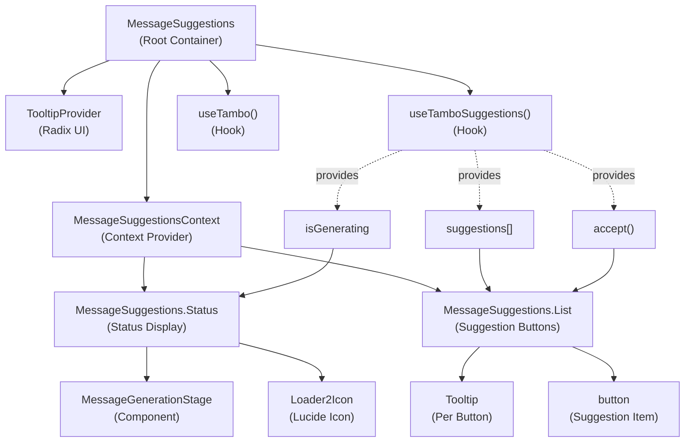
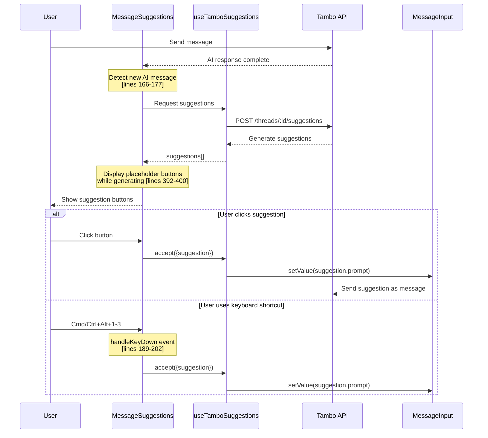
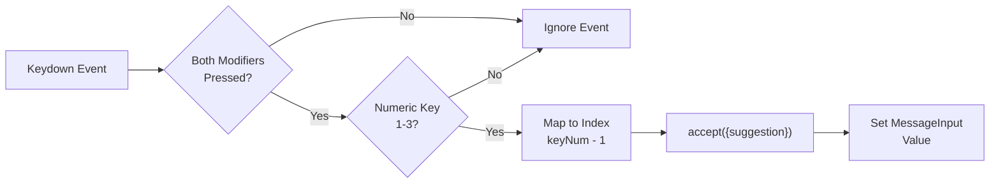

<!-- source: DeepWiki mcp.deepwiki.com · repo tambo-ai/tambo · page 4.4 Message Suggestions · fetched 2026-10-29 -->

# MessageSuggestions Component

<details>
<summary>Relevant source files</summary>

The following files were used as context for generating this wiki page:

- [cli/src/types/components.d.ts](cli/src/types/components.d.ts)
- [cli/src/types/utils.d.ts](cli/src/types/utils.d.ts)

</details>


## Purpose and Scope

The MessageSuggestions component displays AI-generated follow-up suggestions to guide users in continuing conversations. It automatically generates contextually relevant suggestions after each AI response, providing clickable buttons that users can select to send pre-written prompts. The component includes keyboard shortcuts, loading states, and support for pre-seeded suggestions in empty threads.

For information about the message input system where suggestions are sent, see [MessageInput Component](#4.2). For details on the underlying suggestion generation API, see [Hooks API Reference](#3.7).

**Sources:** [showcase/src/components/tambo/message-suggestions.tsx:1-426]()

## Component Architecture

The MessageSuggestions component follows a composable architecture with three main sub-components:

| Sub-Component | Purpose | File Location |
|--------------|---------|---------------|
| `MessageSuggestions` | Root container that manages state and context | [showcase/src/components/tambo/message-suggestions.tsx:96-232]() |
| `MessageSuggestions.Status` | Displays generation stage, loading, and error states | [showcase/src/components/tambo/message-suggestions.tsx:253-292]() |
| `MessageSuggestions.List` | Renders suggestion buttons with keyboard shortcuts | [showcase/src/components/tambo/message-suggestions.tsx:336-404]() |

### Component Hierarchy



**Sources:** [showcase/src/components/tambo/message-suggestions.tsx:38-69](), [showcase/src/components/tambo/message-suggestions.tsx:96-232]()

## Props and Configuration

### MessageSuggestions (Root)

| Prop | Type | Default | Description |
|------|------|---------|-------------|
| `maxSuggestions` | `number` | `3` | Maximum number of suggestions to display |
| `initialSuggestions` | `Suggestion[]` | `[]` | Pre-seeded suggestions for empty threads |
| `className` | `string` | - | Additional CSS classes for the container |
| `children` | `ReactNode` | - | Child components (Status, List) |

### MessageSuggestions.Status

Standard `HTMLDivElement` props plus:

| Prop | Type | Description |
|------|------|-------------|
| `className` | `string` | Additional CSS classes for the status container |

### MessageSuggestions.List

Standard `HTMLDivElement` props plus:

| Prop | Type | Description |
|------|------|-------------|
| `className` | `string` | Additional CSS classes for the list container |

**Sources:** [showcase/src/components/tambo/message-suggestions.tsx:75-82](), [cli/src/types/components.d.ts:280-316]()

## Context Structure

The component uses a React Context to share state between sub-components:

```typescript
interface MessageSuggestionsContextValue {
  suggestions: Suggestion[];           // Array of suggestion objects
  selectedSuggestionId: string | null; // Currently selected suggestion
  accept: (options: { suggestion: Suggestion }) => Promise<void>;
  isGenerating: boolean;               // Whether suggestions are generating
  error: Error | null;                 // Generation errors
  thread: TamboThread;                 // Current thread state
  isMac: boolean;                      // Platform detection for shortcuts
}
```

The context is established by `MessageSuggestionsContext.Provider` at [showcase/src/components/tambo/message-suggestions.tsx:52-53]() and consumed via `useMessageSuggestionsContext()` hook at [showcase/src/components/tambo/message-suggestions.tsx:61-69]().

**Sources:** [showcase/src/components/tambo/message-suggestions.tsx:38-69](), [showcase/src/components/tambo/message-suggestions.tsx:140-159]()

## Suggestion Lifecycle



**Sources:** [showcase/src/components/tambo/message-suggestions.tsx:166-183](), [showcase/src/components/tambo/message-suggestions.tsx:186-209](), [showcase/src/components/tambo/message-suggestions.tsx:336-404]()

## State Management Details

### Suggestion Selection Logic

The component implements logic to determine which suggestions to display:

1. **Empty Thread with Initial Suggestions**: Uses `initialSuggestions` prop sliced to `maxSuggestions` [showcase/src/components/tambo/message-suggestions.tsx:120-125]()
2. **Thread with Messages**: Uses AI-generated suggestions from `useTamboSuggestions` [showcase/src/components/tambo/message-suggestions.tsx:126-127]()

```typescript
const suggestions = React.useMemo(() => {
  // Only use pre-seeded suggestions if thread is empty
  if (!thread?.messages?.length && initialSuggestions.length > 0) {
    return initialSuggestions.slice(0, maxSuggestions);
  }
  // Otherwise use generated suggestions
  return generatedSuggestions;
}, [thread?.messages?.length, generatedSuggestions, initialSuggestions, maxSuggestions]);
```

### Visibility Control

The component returns `null` and does not render when:
- Thread has no messages AND no initial suggestions are provided [showcase/src/components/tambo/message-suggestions.tsx:212-214]()

**Sources:** [showcase/src/components/tambo/message-suggestions.tsx:119-131](), [showcase/src/components/tambo/message-suggestions.tsx:212-214]()

## Keyboard Shortcuts System

The component implements platform-aware keyboard shortcuts for quick suggestion selection:

| Platform | Shortcut Pattern | Example |
|----------|-----------------|---------|
| macOS | `⌘` + `⌥` + `1-3` | Command + Option + 1 |
| Windows/Linux | `Ctrl` + `Alt` + `1-3` | Ctrl + Alt + 1 |

### Implementation Details

1. **Platform Detection**: Uses `navigator.platform` to detect macOS [showcase/src/components/tambo/message-suggestions.tsx:133-134]()
2. **Event Listener**: Adds global `keydown` listener when suggestions are available [showcase/src/components/tambo/message-suggestions.tsx:186-209]()
3. **Modifier Check**: Validates both modifiers are pressed before triggering [showcase/src/components/tambo/message-suggestions.tsx:190-193]()
4. **Numeric Key Mapping**: Maps keys 1-3 to suggestion indices [showcase/src/components/tambo/message-suggestions.tsx:195-200]()



**Sources:** [showcase/src/components/tambo/message-suggestions.tsx:186-209](), [showcase/src/components/tambo/message-suggestions.tsx:343-344]()

## UI States and Visual Feedback

### Loading State

When `isGenerating` is true, the component:
- Displays placeholder buttons with pulse animation [showcase/src/components/tambo/message-suggestions.tsx:392-400]()
- Reduces opacity of the list container to 70% [showcase/src/components/tambo/message-suggestions.tsx:354]()
- Shows "Generating suggestions..." text with spinner icon [showcase/src/components/tambo/message-suggestions.tsx:308-315]()

### Error State

When `error` is present, displays error message in red background [showcase/src/components/tambo/message-suggestions.tsx:276-280]().

### Generation Stage Integration

The Status component displays the thread's `GenerationStage` when:
- Thread has an active generation stage
- Generation stage is not COMPLETE [showcase/src/components/tambo/message-suggestions.tsx:304-306]()

This integrates with the `MessageGenerationStage` component at [showcase/src/components/tambo/message-generation-stage.tsx:1-403]().

### Button States

Suggestion buttons have three visual states:

| State | Condition | Classes |
|-------|-----------|---------|
| Default | Not generating, not selected | `bg-background hover:bg-accent` |
| Selected | `selectedSuggestionId === suggestion.id` | `bg-accent text-accent-foreground` |
| Disabled | `isGenerating` is true | `bg-muted/50 text-muted-foreground` |

**Sources:** [showcase/src/components/tambo/message-suggestions.tsx:276-315](), [showcase/src/components/tambo/message-suggestions.tsx:361-400](), [showcase/src/components/tambo/message-suggestions.tsx:409-423]()

## Integration with Tambo Thread System

```mermaid
graph TB
    TamboProvider["TamboProvider<br/>(Root Context)"]
    TamboThread["TamboThreadProvider<br/>(Thread State)"]
    TamboThreadInput["TamboThreadInputProvider<br/>(Input State)"]
    
    useTambo["useTambo()"]
    useTamboSuggestions["useTamboSuggestions()"]
    
    MessageSuggestions["MessageSuggestions<br/>(Component)"]
    MessageInput["MessageInput<br/>(Component)"]
    
    TamboProvider --> TamboThread
    TamboThread --> TamboThreadInput
    
    TamboThread -.->|thread state| useTambo
    TamboThread -.->|suggestions API| useTamboSuggestions
    TamboThreadInput -.->|setValue()| MessageInput
    
    MessageSuggestions --> useTambo
    MessageSuggestions --> useTamboSuggestions
    
    useTamboSuggestions -->|accept()| TamboThreadInput
    
    MessageSuggestions -.->|on accept| MessageInput
```

The component accesses thread state through two hooks:
1. **`useTambo()`**: Provides `thread` object for message detection [showcase/src/components/tambo/message-suggestions.tsx:110]()
2. **`useTamboSuggestions()`**: Provides suggestion generation and acceptance [showcase/src/components/tambo/message-suggestions.tsx:111-116]()

When a suggestion is accepted via `accept({ suggestion })`, it:
1. Sets the message input value to the suggestion's prompt
2. Optionally auto-submits the message (configurable in hook)

**Sources:** [showcase/src/components/tambo/message-suggestions.tsx:110-116]()

## Usage Examples

### Basic Usage

```tsx
<MessageSuggestions maxSuggestions={3}>
  <MessageSuggestions.Status />
  <MessageSuggestions.List />
</MessageSuggestions>
```

### With Initial Suggestions

```tsx
const initialSuggestions = [
  { id: '1', title: 'Tell me more', prompt: 'Can you explain that in more detail?' },
  { id: '2', title: 'Show example', prompt: 'Can you show me an example?' },
  { id: '3', title: 'Next steps', prompt: 'What should I do next?' }
];

<MessageSuggestions 
  maxSuggestions={3}
  initialSuggestions={initialSuggestions}
>
  <MessageSuggestions.Status />
  <MessageSuggestions.List />
</MessageSuggestions>
```

### Custom Styling

```tsx
<MessageSuggestions 
  className="bg-muted/20 rounded-lg p-4"
  maxSuggestions={4}
>
  <MessageSuggestions.Status className="mb-2" />
  <MessageSuggestions.List className="gap-3" />
</MessageSuggestions>
```

**Sources:** [showcase/src/components/tambo/message-suggestions.tsx:88-94](), [showcase/src/components/tambo/message-suggestions.tsx:245-251](), [showcase/src/components/tambo/message-suggestions.tsx:328-334]()

## Tooltip System

Each suggestion button is wrapped in a `Tooltip` component that displays the keyboard shortcut:

- Uses the `TooltipProvider` from [showcase/src/components/tambo/suggestions-tooltip.tsx]()
- Displays platform-specific shortcut format (`⌘⌥1` on Mac, `Ctrl+Alt+1` on Windows/Linux)
- Positioned on top (`side="top"`) of the button [showcase/src/components/tambo/message-suggestions.tsx:362-370]()

The tooltip content uses `suppressHydrationWarning` to handle platform-specific rendering differences [showcase/src/components/tambo/message-suggestions.tsx:365-367]().

**Sources:** [showcase/src/components/tambo/message-suggestions.tsx:218](), [showcase/src/components/tambo/message-suggestions.tsx:361-390](), [cli/src/types/components.d.ts:405-432]()

## Type Definitions

The component's TypeScript types are exported from the CLI package for use in end-user projects:

```typescript
// From cli/src/types/components.d.ts
declare module "@/components/tambo/message-suggestions" {
  export interface MessageSuggestionsProps extends React.HTMLAttributes<HTMLDivElement> {
    variant?: ComponentVariant;
    maxSuggestions?: number;
    initialSuggestions?: Suggestion[];
  }

  export interface MessageSuggestionsRootProps extends React.HTMLAttributes<HTMLDivElement> {
    maxSuggestions?: number;
    initialSuggestions?: Suggestion[];
    children?: React.ReactNode;
  }

  export type MessageSuggestionsStatusProps = React.HTMLAttributes<HTMLDivElement>;
  export type MessageSuggestionsListProps = React.HTMLAttributes<HTMLDivElement>;

  export const MessageSuggestions: React.ForwardRefExoticComponent<...>;
  export const MessageSuggestionsRoot: React.ForwardRefExoticComponent<...>;
  export const MessageSuggestionsStatus: React.ForwardRefExoticComponent<...>;
  export const MessageSuggestionsList: React.ForwardRefExoticComponent<...>;
}
```

**Sources:** [cli/src/types/components.d.ts:280-316]()

## Suggestion Object Structure

Suggestions returned from `useTamboSuggestions` have the following structure:

```typescript
interface Suggestion {
  id: string;           // Unique identifier
  title: string;        // Display text on button
  prompt: string;       // Full prompt text to send
  // Additional fields may exist from the API
}
```

The `title` is displayed on the button, while the `prompt` is sent to the message input when accepted.

**Sources:** [showcase/src/components/tambo/message-suggestions.tsx:19](), [showcase/src/components/tambo/message-suggestions.tsx:39-45]()

## Accessibility Considerations

The component implements several accessibility features:

1. **Keyboard Shortcuts**: Provides keyboard navigation alternative to mouse clicks [showcase/src/components/tambo/message-suggestions.tsx:186-209]()
2. **Disabled State**: Properly disables buttons during generation [showcase/src/components/tambo/message-suggestions.tsx:383]()
3. **Loading Indicators**: Visual feedback with spinner and animation [showcase/src/components/tambo/message-suggestions.tsx:308-315]()
4. **Tooltip Hints**: Shows keyboard shortcuts on hover [showcase/src/components/tambo/message-suggestions.tsx:362-370]()
5. **Data Attributes**: Adds `data-suggestion-id` and `data-suggestion-index` for testing [showcase/src/components/tambo/message-suggestions.tsx:384-385]()

**Sources:** [showcase/src/components/tambo/message-suggestions.tsx:186-209](), [showcase/src/components/tambo/message-suggestions.tsx:361-390]()

---

