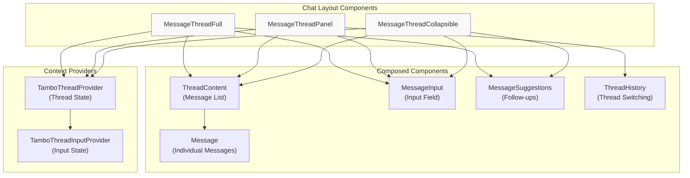
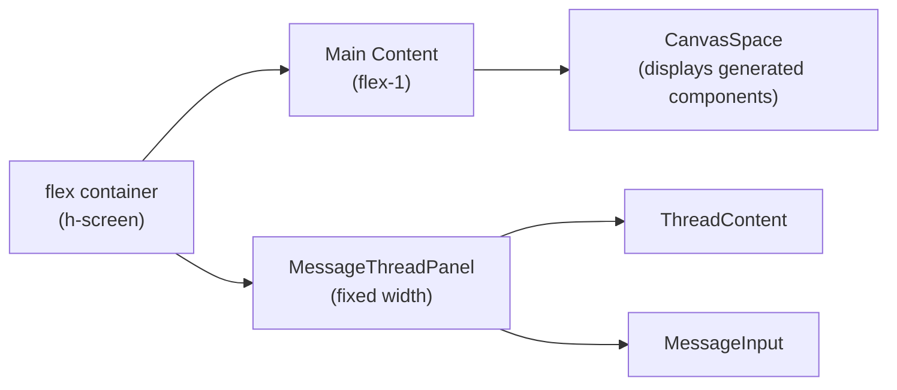
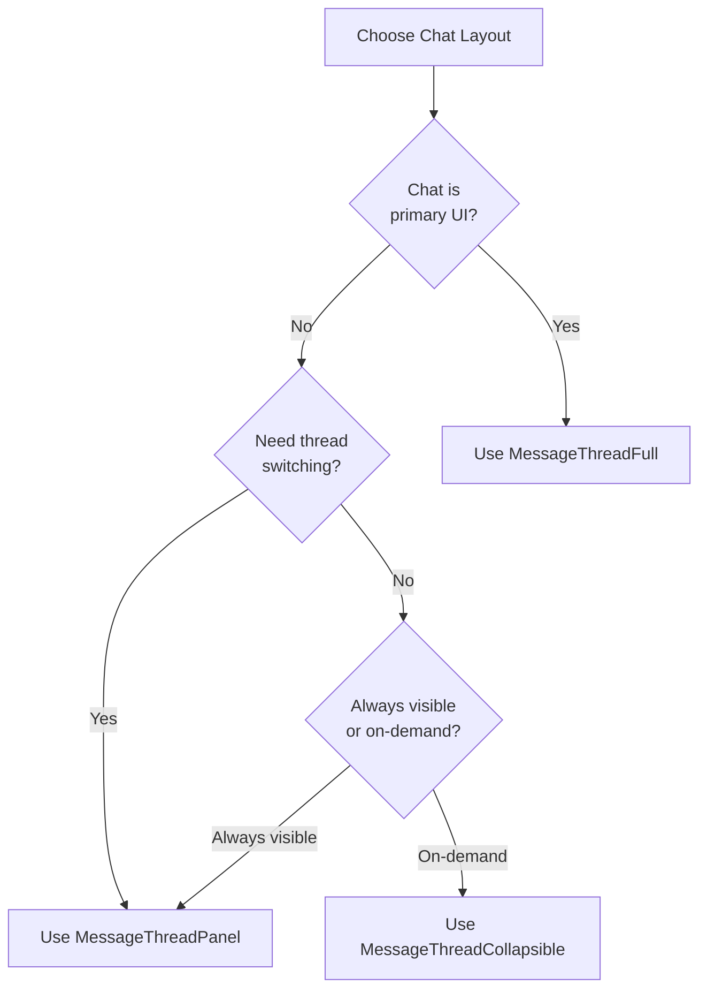
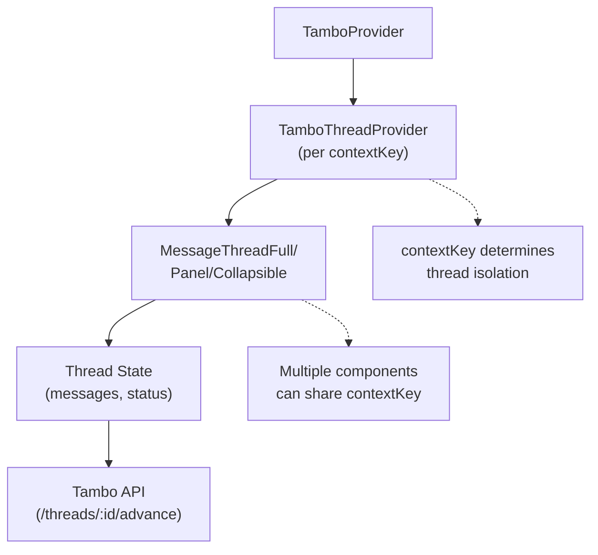

<!-- source: DeepWiki mcp.deepwiki.com · repo tambo-ai/tambo · page 4.5 Layout and Styling · fetched 2026-10-29 -->

# Chat Layout Components

<details>
<summary>Relevant source files</summary>

The following files were used as context for generating this wiki page:

- [cli/src/__tests__/non-interactive-safety.test.ts](cli/src/__tests__/non-interactive-safety.test.ts)
- [cli/src/cli.ts](cli/src/cli.ts)
- [cli/src/commands/add/component.ts](cli/src/commands/add/component.ts)
- [cli/src/commands/add/index.test.ts](cli/src/commands/add/index.test.ts)
- [cli/src/commands/add/index.ts](cli/src/commands/add/index.ts)
- [cli/src/commands/add/tailwind-setup.ts](cli/src/commands/add/tailwind-setup.ts)
- [cli/src/commands/add/tailwind/v4/toolchain-setup.test.ts](cli/src/commands/add/tailwind/v4/toolchain-setup.test.ts)
- [cli/src/commands/add/tailwind/v4/toolchain-setup.ts](cli/src/commands/add/tailwind/v4/toolchain-setup.ts)
- [cli/src/commands/add/types.ts](cli/src/commands/add/types.ts)
- [cli/src/commands/add/utils.ts](cli/src/commands/add/utils.ts)
- [cli/src/commands/create-app.ts](cli/src/commands/create-app.ts)
- [cli/src/commands/init.test.ts](cli/src/commands/init.test.ts)
- [cli/src/commands/init.ts](cli/src/commands/init.ts)
- [cli/src/commands/list/index.test.ts](cli/src/commands/list/index.test.ts)
- [cli/src/commands/list/index.ts](cli/src/commands/list/index.ts)
- [cli/src/commands/update.test.ts](cli/src/commands/update.test.ts)
- [cli/src/commands/update.ts](cli/src/commands/update.ts)
- [cli/src/commands/upgrade/components.ts](cli/src/commands/upgrade/components.ts)
- [cli/src/commands/upgrade/index.ts](cli/src/commands/upgrade/index.ts)
- [cli/src/commands/upgrade/llm-rules.ts](cli/src/commands/upgrade/llm-rules.ts)
- [cli/src/commands/upgrade/npm-packages.ts](cli/src/commands/upgrade/npm-packages.ts)
- [cli/src/commands/upgrade/utils.ts](cli/src/commands/upgrade/utils.ts)
- [cli/src/types/components.d.ts](cli/src/types/components.d.ts)
- [cli/src/types/utils.d.ts](cli/src/types/utils.d.ts)
- [cli/src/utils/framework-detection.test.ts](cli/src/utils/framework-detection.test.ts)
- [cli/src/utils/framework-detection.ts](cli/src/utils/framework-detection.ts)
- [cli/src/utils/interactive.test.ts](cli/src/utils/interactive.test.ts)
- [cli/src/utils/interactive.ts](cli/src/utils/interactive.ts)
- [cli/src/utils/package-manager.test.ts](cli/src/utils/package-manager.test.ts)
- [cli/src/utils/package-manager.ts](cli/src/utils/package-manager.ts)

</details>


This document covers the pre-built chat layout components that provide complete, ready-to-use chat interfaces for Tambo applications. These are high-level composition components that combine Message, MessageInput, ThreadContent, and other UI components into fully functional chat experiences.

For information about individual chat UI components (Message, MessageInput, etc.), see [Message Component](#4.1), [MessageInput Component](#4.2), [ThreadContent Component](#4.4), and [MessageSuggestions Component](#4.5). For information about registering components that the AI can generate, see [Component Registration](#3.4).

**Scope:** This page documents the three main chat layout components: `MessageThreadFull` (full-screen), `MessageThreadPanel` (sidebar), and `MessageThreadCollapsible` (floating/collapsible). These components provide complete chat experiences without requiring manual composition of individual UI components.

---

## Overview

Tambo provides three pre-built chat layout components that handle different UI patterns:

| Component | Use Case | Positioning | Typical Width |
|-----------|----------|-------------|---------------|
| `MessageThreadFull` | Full-page chat applications | Takes full viewport | 100% |
| `MessageThreadPanel` | Split-screen layouts | Fixed sidebar (left/right) | 300-500px |
| `MessageThreadCollapsible` | Contextual assistance | Absolute positioned | 400px (when expanded) |

All three components:
- Automatically manage thread state through `TamboThreadProvider`
- Support `contextKey` prop for thread isolation
- Include message history, input field, and streaming response handling
- Provide proper scrolling behavior and loading states

**Sources:** [showcase/src/app/components/(blocks)/message-thread-full/page.tsx:1-93](), [showcase/src/app/components/(blocks)/message-thread-panel/page.tsx:1-125](), [showcase/src/app/components/(blocks)/message-thread-collapsible/page.tsx:1-133]()

---

## Component Architecture

The chat layout components compose several smaller UI components into complete interfaces:



**Diagram:** Chat layout component composition hierarchy

**Sources:** [showcase/src/app/components/(blocks)/message-thread-full/page.tsx:30-43](), [showcase/src/app/components/(blocks)/message-thread-panel/page.tsx:41-44](), [showcase/src/app/components/(blocks)/message-thread-collapsible/page.tsx:45-48]()

---

## MessageThreadFull

The `MessageThreadFull` component provides a full-screen chat interface designed to occupy the entire viewport. It is the primary choice for applications where chat is the main interaction method.

### Component API

| Prop | Type | Default | Description |
|------|------|---------|-------------|
| `contextKey` | `string` | - | Unique identifier for the conversation thread |
| `className` | `string` | - | Additional CSS classes for customization |

### Usage Example

```typescript
import { MessageThreadFull } from "@/components/tambo/message-thread-full";

export function ChatPage() {
  return (
    <div className="h-screen">
      <MessageThreadFull contextKey="main-chat" />
    </div>
  );
}
```

### Layout Characteristics

- Takes full width and height of its container
- Vertical flex layout with message history above and input below
- Automatic scroll-to-bottom on new messages
- Optimized for desktop and mobile viewports

### Implementation Pattern

The component is typically used in dedicated chat pages or full-screen chat applications. The parent container should define the height constraint (usually `h-screen` or a specific pixel value).

**Sources:** [showcase/src/app/components/(blocks)/message-thread-full/page.tsx:7-92](), [showcase/src/app/page.tsx:45-48](), [showcase/src/components/generative/GraphChatInterface.tsx:46-49]()

---

## MessageThreadPanel

The `MessageThreadPanel` component provides a sidebar-style chat interface suitable for split-screen layouts where the main content area is displayed alongside the chat.

### Component API

| Prop | Type | Default | Description |
|------|------|---------|-------------|
| `contextKey` | `string` | - | Unique identifier for the conversation thread |
| `className` | `string` | - | Additional CSS classes, typically includes position (left/right) |
| `style` | `CSSProperties` | - | Inline styles for customizing width, height, etc. |

### Usage Example

```typescript
import { MessageThreadPanel } from "@/components/tambo/message-thread-panel";

export function DashboardWithChat() {
  return (
    <div className="flex h-screen">
      {/* Main content area */}
      <div className="flex-1 p-6">
        <h1>Dashboard</h1>
        <p>Your main content goes here...</p>
      </div>

      {/* Chat panel on the right */}
      <MessageThreadPanel
        contextKey="dashboard-assistant"
        className="right"
        style={{ width: "400px" }}
      />
    </div>
  );
}
```

### Layout Characteristics

- Fixed width (typically 300-500px)
- Full height of parent container
- Can be positioned on left or right via `className` prop
- Includes thread history navigation via `ThreadHistory` component
- Border styling separates it from main content area

### Position Classes

The `className` prop should include position indicators:
- `"left"` - Panel on left side with right border
- `"right"` - Panel on right side with left border

**Sources:** [showcase/src/app/components/(blocks)/message-thread-panel/page.tsx:7-124](), [showcase/src/components/generative/CanvasChatInterface.tsx:64]()

---

## MessageThreadCollapsible

The `MessageThreadCollapsible` component provides a collapsible, floating chat interface that can be positioned anywhere on the page. It expands into a chat panel when opened and collapses to a compact button when closed.

### Component API

| Prop | Type | Default | Description |
|------|------|---------|-------------|
| `contextKey` | `string` | - | Unique identifier for the conversation thread |
| `defaultOpen` | `boolean` | `false` | Whether the thread starts expanded or collapsed |
| `className` | `string` | - | Additional CSS classes for positioning and styling |
| `height` | `string` | `"80vh"` | Height of the thread content when expanded |

### Usage Example

```typescript
import { MessageThreadCollapsible } from "@/components/tambo/message-thread-collapsible";

export function PageWithChat() {
  return (
    <div className="relative min-h-screen p-6">
      {/* Your page content */}
      <h1>Your Dashboard</h1>
      <p>Main content goes here...</p>

      {/* Collapsible chat positioned in bottom-right */}
      <MessageThreadCollapsible
        contextKey="help-chat"
        defaultOpen={false}
        className="absolute bottom-6 right-4"
      />
    </div>
  );
}
```

### Layout Characteristics

- Absolute positioning controlled by `className`
- Collapses to a floating button when closed
- Expands to a chat panel with configurable height
- Typically positioned in bottom-right corner
- Includes close/minimize controls
- Does not interfere with page scroll

### State Management

The component maintains its own open/closed state internally. The `defaultOpen` prop sets the initial state, but users can toggle it via UI controls.

**Sources:** [showcase/src/app/components/(blocks)/message-thread-collapsible/page.tsx:7-132]()

---

## Common Implementation Patterns

### With MCP Integration

Chat layout components work seamlessly with MCP servers configured in the `TamboProvider`:

```typescript
import { TamboProvider } from "@tambo-ai/react";
import { MessageThreadPanel } from "@/components/tambo/message-thread-panel";

export function App() {
  return (
    <TamboProvider
      apiKey={process.env.TAMBO_API_KEY}
      mcpServers={[
        {
          serverKey: "slack",
          url: "https://example.com/mcp/slack",
          transport: "http",
        },
      ]}
    >
      <MessageThreadPanel contextKey="main" />
    </TamboProvider>
  );
}
```

MCP resources and prompts become available in the MessageInput component via @ mentions and / commands.

**Sources:** [showcase/src/app/components/(blocks)/message-thread-panel/page.tsx:5]()

---

### With Canvas/Content Split

A common pattern combines `MessageThreadPanel` with a content area (like `CanvasSpace`) for displaying AI-generated components:



**Diagram:** Split-screen layout pattern with canvas and chat panel

```typescript
export function CanvasChatInterface() {
  return (
    <div className="flex h-screen">
      <CanvasSpace className="flex-1" />
      <MessageThreadPanel 
        className="right" 
        style={{ width: "400px" }}
      />
    </div>
  );
}
```

**Sources:** [showcase/src/components/generative/CanvasChatInterface.tsx:61-66]()

---

### With Generative Components

Chat layouts are often used alongside registered components that the AI can generate:

```typescript
import { MessageThreadFull } from "@/components/tambo/message-thread-full";
import { Graph, graphSchema } from "@/components/tambo/graph";
import { useTambo } from "@tambo-ai/react";
import { useEffect } from "react";

export function GraphChatInterface() {
  const { registerComponent, thread } = useTambo();

  useEffect(() => {
    registerComponent({
      name: "Graph",
      description: "A versatile data visualization component...",
      component: Graph,
      propsSchema: graphSchema,
    });
  }, [registerComponent, thread.id]);

  return (
    <div style={{ height: "700px" }}>
      <MessageThreadFull className="rounded-lg" />
    </div>
  );
}
```

The AI can then generate Graph components in response to user requests, which appear as messages in the thread.

**Sources:** [showcase/src/components/generative/GraphChatInterface.tsx:6-51](), [showcase/src/components/generative/FormChatInterface.tsx:6-41]()

---

## Installation

Each chat layout component can be installed via the Tambo CLI:

```bash
# MessageThreadFull
npx tambo add message-thread-full

# MessageThreadPanel
npx tambo add message-thread-panel

# MessageThreadCollapsible
npx tambo add message-thread-collapsible
```

The CLI will copy the component files to your project's component directory (typically `components/tambo/` or `ui/`) and install any required dependencies.

**Sources:** [showcase/src/app/components/(blocks)/message-thread-full/page.tsx:55](), [showcase/src/app/components/(blocks)/message-thread-panel/page.tsx:78](), [showcase/src/app/components/(blocks)/message-thread-collapsible/page.tsx:80]()

---

## Component Selection Guide



**Diagram:** Decision tree for selecting the appropriate chat layout component

### Selection Criteria

**Use MessageThreadFull when:**
- Chat is the primary application interface
- Building a standalone chat application
- Need maximum message visibility
- Mobile-first design

**Use MessageThreadPanel when:**
- Chat complements main content (dashboard, editor, etc.)
- Need thread history navigation
- Split-screen layouts
- Desktop-focused design

**Use MessageThreadCollapsible when:**
- Chat is contextual help or assistance
- Want to minimize screen real estate usage
- Optional feature that users invoke as needed
- Need non-intrusive AI assistance

**Sources:** [showcase/src/app/components/(blocks)/message-thread-full/page.tsx:15-19](), [showcase/src/app/components/(blocks)/message-thread-panel/page.tsx:15-20](), [showcase/src/app/components/(blocks)/message-thread-collapsible/page.tsx:15-20]()

---

## Thread Context Integration

All chat layout components integrate with the thread management system via the `contextKey` prop:



**Diagram:** Thread context flow in chat layout components

### Context Key Behavior

- **Unique per conversation:** Each `contextKey` creates a separate thread
- **Shared state:** Multiple components with the same `contextKey` share message history
- **Persistence:** Threads persist across page reloads when using cloud backend
- **Optional:** If not provided, a default thread is created

**Sources:** [showcase/src/app/components/(blocks)/message-thread-full/page.tsx:78](), [showcase/src/app/components/(blocks)/message-thread-panel/page.tsx:98-101](), [showcase/src/app/components/(blocks)/message-thread-collapsible/page.tsx:100-103]()

---

