<!-- source: DeepWiki mcp.deepwiki.com · repo tambo-ai/tambo · page 5 CLI Tools · fetched 2026-10-29 -->

# CLI Tools

<details>
<summary>Relevant source files</summary>

The following files were used as context for generating this wiki page:

- [cli/src/__tests__/non-interactive-safety.test.ts](cli/src/__tests__/non-interactive-safety.test.ts)
- [cli/src/cli.ts](cli/src/cli.ts)
- [cli/src/commands/add/component.ts](cli/src/commands/add/component.ts)
- [cli/src/commands/add/index.test.ts](cli/src/commands/add/index.test.ts)
- [cli/src/commands/add/index.ts](cli/src/commands/add/index.ts)
- [cli/src/commands/add/tailwind-setup.ts](cli/src/commands/add/tailwind-setup.ts)
- [cli/src/commands/add/tailwind/v4/toolchain-setup.test.ts](cli/src/commands/add/tailwind/v4/toolchain-setup.test.ts)
- [cli/src/commands/add/tailwind/v4/toolchain-setup.ts](cli/src/commands/add/tailwind/v4/toolchain-setup.ts)
- [cli/src/commands/add/types.ts](cli/src/commands/add/types.ts)
- [cli/src/commands/add/utils.ts](cli/src/commands/add/utils.ts)
- [cli/src/commands/create-app.ts](cli/src/commands/create-app.ts)
- [cli/src/commands/init.test.ts](cli/src/commands/init.test.ts)
- [cli/src/commands/init.ts](cli/src/commands/init.ts)
- [cli/src/commands/list/index.test.ts](cli/src/commands/list/index.test.ts)
- [cli/src/commands/list/index.ts](cli/src/commands/list/index.ts)
- [cli/src/commands/update.test.ts](cli/src/commands/update.test.ts)
- [cli/src/commands/update.ts](cli/src/commands/update.ts)
- [cli/src/commands/upgrade/components.ts](cli/src/commands/upgrade/components.ts)
- [cli/src/commands/upgrade/index.ts](cli/src/commands/upgrade/index.ts)
- [cli/src/commands/upgrade/llm-rules.ts](cli/src/commands/upgrade/llm-rules.ts)
- [cli/src/commands/upgrade/npm-packages.ts](cli/src/commands/upgrade/npm-packages.ts)
- [cli/src/commands/upgrade/utils.ts](cli/src/commands/upgrade/utils.ts)
- [cli/src/utils/framework-detection.test.ts](cli/src/utils/framework-detection.test.ts)
- [cli/src/utils/framework-detection.ts](cli/src/utils/framework-detection.ts)
- [cli/src/utils/interactive.test.ts](cli/src/utils/interactive.test.ts)
- [cli/src/utils/interactive.ts](cli/src/utils/interactive.ts)
- [cli/src/utils/package-manager.test.ts](cli/src/utils/package-manager.test.ts)
- [cli/src/utils/package-manager.ts](cli/src/utils/package-manager.ts)

</details>


The Tambo CLI (`tambo`) is the primary command-line interface for initializing Tambo projects, managing UI components from the registry, and upgrading dependencies. It provides commands for authentication, project scaffolding, component installation/updates, and migration between directory structures. The CLI automatically detects the project's framework (Next.js, Vite) and package manager (npm, pnpm, yarn, rush) to provide appropriate defaults.

For information about the component registry structure and available components, see [UI Components](#4). For project creation workflows using templates, see [Getting Started](#2).

---

## Command Dispatch Architecture

The CLI entry point processes commands through a centralized dispatch system that validates flags, checks for updates, and routes to appropriate handlers.

### CLI Command Flow

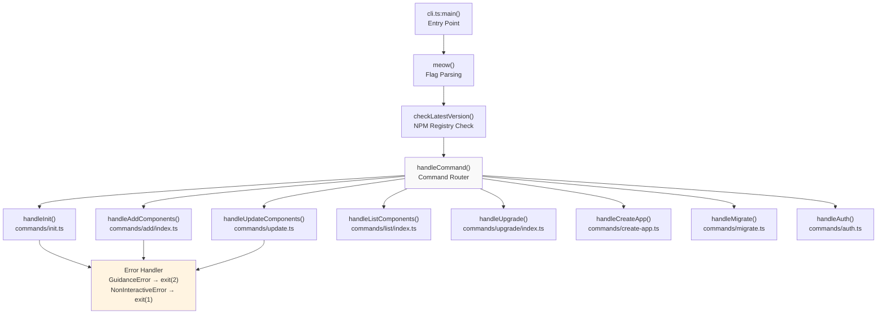

**Sources**: [cli/src/cli.ts:1-764](), [cli/src/cli.ts:729-763](), [cli/src/cli.ts:465-623]()

The `handleCommand()` function at [cli/src/cli.ts:465-623]() routes each command to its handler based on the first input argument. Error handling distinguishes between `GuidanceError` (exit code 2 for missing required flags) and `NonInteractiveError` (exit code 1 for environment issues).

---

## Command Reference

### `init` Command

Initializes Tambo in an existing project by setting up authentication, creating configuration files, and optionally installing components.

**Handler**: `handleInit()` at [cli/src/commands/init.ts:998-1148]()

**Options**:
- `--api-key <key>` - Direct API key input, skips authentication flow
- `--project-name <name>` - Create new project via device auth
- `--project-id <id>` - Use existing project by ID
- `--no-browser` - Print auth URL instead of opening browser
- `--yes, -y` - Auto-answer yes to prompts
- `--skip-agent-docs` - Skip creating AGENTS.md/CLAUDE.md
- `--legacy-peer-deps` - Pass `--legacy-peer-deps` to npm

**Flow**:

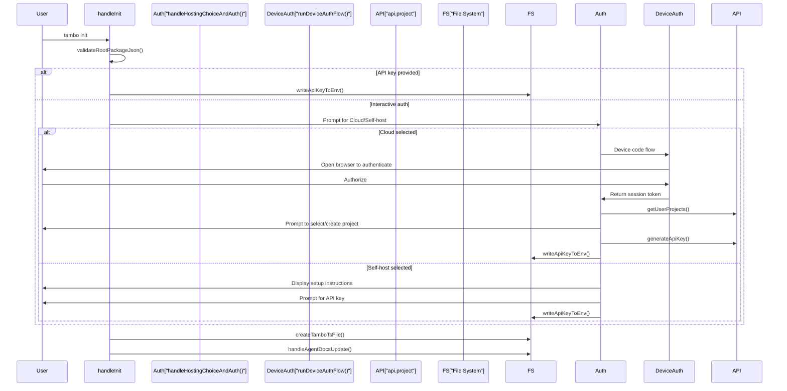

**Sources**: [cli/src/commands/init.ts:998-1148](), [cli/src/commands/init.ts:635-730](), [cli/src/commands/init.ts:312-360]()

The init command at [cli/src/commands/init.ts:998-1148]() supports three authentication modes:
1. Direct API key via `--api-key` flag (non-interactive)
2. Device authentication with project creation via `--project-name`
3. Device authentication with project selection via `--project-id`

### `full-send` Command

Complete initialization with authentication and interactive component selection. This is an extended version of `init` that includes component installation.

**Handler**: `handleFullSendInit()` at [cli/src/commands/init.ts:736-848]()

**Flow**:
1. Get installation path preference (`src/components` vs `components`)
2. Complete authentication via `handleHostingChoiceAndAuth()`
3. Create `tambo.ts` configuration file
4. Prompt for component selection from available templates
5. Install selected components via `handleAddComponent()`
6. Setup Tailwind CSS via `setupTailwindAndGlobals()`
7. Display usage instructions with clipboard copy

**Sources**: [cli/src/commands/init.ts:736-848](), [cli/src/commands/init.ts:854-992]()

### `add` Command

Installs components from the registry into the project with automatic dependency resolution.

**Handler**: `handleAddComponents()` at [cli/src/commands/add/index.ts:33-294]()

**Options**:
- `--prefix <path>` - Custom installation directory
- `--yes, -y` - Skip confirmation prompts
- `--dry-run` - Preview changes without applying
- `--skip-agent-docs` - Skip updating agent documentation
- `--legacy-peer-deps` - Use npm's `--legacy-peer-deps` flag

**Component Resolution Flow**:

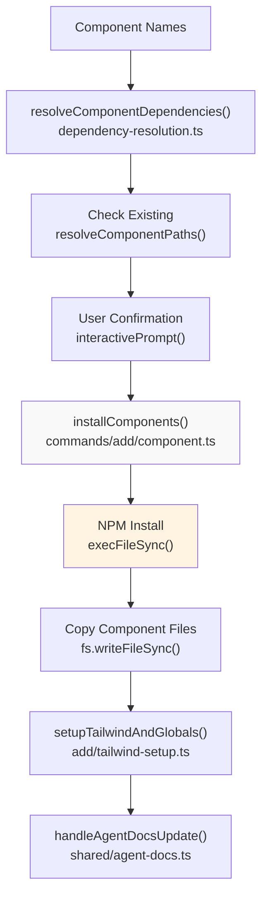

**Sources**: [cli/src/commands/add/index.ts:33-294](), [cli/src/commands/add/component.ts:31-267]()

The `handleAddComponents()` function at [cli/src/commands/add/index.ts:33-294]() performs dependency resolution via `resolveComponentDependencies()` to ensure all required components are installed together. Legacy component detection at [cli/src/commands/add/index.ts:64-152]() checks for existing components in `ui/` directory and maintains compatibility.

### `update` Command

Updates installed components to their latest registry versions.

**Handler**: `handleUpdateComponents()` at [cli/src/commands/update.ts:40-386]()

**Special Keyword**: `tambo update installed` - Updates all installed components

**Options**:
- `--prefix <path>` - Component directory location
- `--yes, -y` - Skip confirmation prompts
- `--legacy-peer-deps` - Use npm's legacy peer deps flag

**Update Process**:
1. Resolve components to update (specific names or `installed` keyword)
2. Verify components exist via `findComponentLocation()` at [cli/src/commands/shared/component-utils.ts]()
3. Resolve dependencies with `resolveDependenciesForComponents()`
4. Detect cross-location dependencies between `ui/` and `tambo/` directories
5. Prompt for migration if inconsistencies found
6. Install components with `forceUpdate: true` flag

**Sources**: [cli/src/commands/update.ts:40-386](), [cli/src/commands/update.ts:153-181]()

### `list` Command

Lists all installed Tambo components categorized by location and type.

**Handler**: `handleListComponents()` at [cli/src/commands/list/index.ts:23-205]()

**Output Categories**:
- **Tambo components**: Main components from registry
- **Tambo support components**: Helper components (e.g., `markdown-components`)
- **Custom components**: User-created components in Tambo directories

The handler at [cli/src/commands/list/index.ts:23-205]() uses `getTamboComponentInfo()` to distinguish between main components, support components, and custom components based on the registry metadata.

**Sources**: [cli/src/commands/list/index.ts:23-205](), [cli/src/commands/add/utils.ts:147-217]()

### `upgrade` Command

Comprehensive upgrade workflow for packages, components, and LLM configuration files.

**Handler**: `handleUpgrade()` at [cli/src/commands/upgrade/index.ts:21-123]()

**Upgrade Phases**:

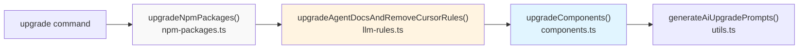

**Sources**: [cli/src/commands/upgrade/index.ts:21-123](), [cli/src/commands/upgrade/npm-packages.ts:16-102](), [cli/src/commands/upgrade/components.ts:101-378]()

Phase 1 (`upgradeNpmPackages()` at [cli/src/commands/upgrade/npm-packages.ts:16-102]()) uses `npm-check-updates` via the detected package manager runner to update packages from `KNOWN_SAFE_PACKAGES` constant.

Phase 2 (`upgradeAgentDocsAndRemoveCursorRules()` at [cli/src/commands/upgrade/llm-rules.ts:25-101]()) removes legacy `.cursor/rules/tambo-ai.mdc` files and updates `AGENTS.md`/`CLAUDE.md`.

Phase 3 (`upgradeComponents()` at [cli/src/commands/upgrade/components.ts:101-378]()) handles component migration from `ui/` to `tambo/` directory structure with import path updates.

### `create-app` Command

Creates a new Tambo application from a template repository.

**Handler**: `handleCreateApp()` at [cli/src/commands/create-app.ts:105-373]()

**Templates** (defined at [cli/src/commands/create-app.ts:25-41]()):
- `standard` - Tambo + Tools + MCP (recommended)
- `vite` - Tambo + TanStack Router + Vite
- `analytics` - Generative UI Analytics Template

**Options**:
- `--template, -t <name>` - Template selection
- `--init-git` - Initialize git repository
- `--legacy-peer-deps` - Use legacy peer deps for npm

**Process**:
1. Validate app name and target directory
2. Clone template repository via `git clone --depth 1`
3. Remove `.git` folder with `safeRemoveGitFolder()` at [cli/src/commands/create-app.ts:50-85]()
4. Update `package.json` name field
5. Optionally initialize new git repository
6. Install dependencies using detected package manager

**Sources**: [cli/src/commands/create-app.ts:105-373](), [cli/src/commands/create-app.ts:25-41]()

### `migrate` Command

Migrates components from legacy `ui/` directory to new `tambo/` structure with automatic import path updates.

**Handler**: `handleMigrate()` at [cli/src/commands/migrate.ts]()

**Migration Process**:
1. Detect components in `src/components/ui/` or `components/ui/`
2. Display migration plan
3. Move component files to `tambo/` subdirectory
4. Update import paths via `updateImportPaths()` function
5. Update component registry references

**Sources**: [cli/src/commands/migrate.ts]()

### `auth` Command

Manages authentication sessions and credentials.

**Handler**: `handleAuth()` at [cli/src/commands/auth.ts]()

**Subcommands**:
- `auth status` - Show authentication status (with `--quiet` flag for exit code checks)
- `auth login` - Authenticate via device flow (with `--no-browser` for manual URL)
- `auth logout` - Clear stored credentials (with `--force` to skip confirmation)
- `auth sessions` - List active CLI sessions
- `auth revoke-session` - Revoke specific sessions (with `--all` flag)

**Device Authentication Flow**:

```mermaid
sequenceDiagram
    participant CLI
    participant DeviceAuth["runDeviceAuthFlow()<br/>lib/device-auth.ts"]
    participant Console["Console API<br/>https://console.tambo.co"]
    participant User
    
    CLI->>DeviceAuth: runDeviceAuthFlow()
    DeviceAuth->>Console: POST /device-auth/request
    Console->>DeviceAuth: device_code, user_code, verification_uri
    
    alt --no-browser flag
        DeviceAuth->>CLI: Print URL
        CLI->>User: Display URL and code
    else Browser mode
        DeviceAuth->>User: Open browser to verification_uri
    end
    
    User->>Console: Enter user_code and authorize
    
    loop Poll for completion
        DeviceAuth->>Console: POST /device-auth/poll
        alt Still pending
            Console->>DeviceAuth: pending status
        else Authorized
            Console->>DeviceAuth: session_token, user info
        end
    end
    
    DeviceAuth->>DeviceAuth: Store session in config
    DeviceAuth->>CLI: Return session token
```

**Sources**: [cli/src/lib/device-auth.ts](), [cli/src/commands/auth.ts]()

Device authentication at [cli/src/lib/device-auth.ts]() implements the OAuth device flow pattern with polling. Session tokens are stored in the user's config directory and validated via `verifySession()` before API calls.

---

## Component Installation Workflow

The component installation process resolves dependencies, manages file placement, and configures the build toolchain.

### Installation Path Resolution

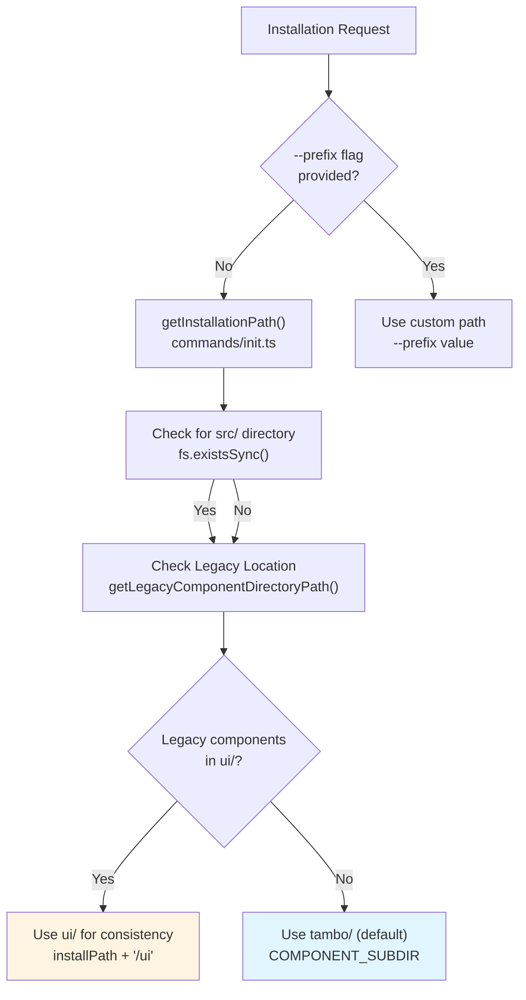

**Sources**: [cli/src/commands/init.ts:258-305](), [cli/src/commands/add/index.ts:64-152](), [cli/src/commands/shared/path-utils.ts]()

Path resolution at [cli/src/commands/add/index.ts:64-152]() checks for existing Tambo components in the legacy `ui/` location using `getKnownComponentNames()` to filter non-Tambo files. If found, new components install to `ui/` for consistency unless migration is performed.

### Component File Operations

The `installComponents()` function at [cli/src/commands/add/component.ts:31-267]() performs these operations:

**Directory Structure**:
```
project-root/
├── src/components/tambo/          # Default component location
│   └── message.tsx
├── src/lib/                       # Shared utilities
│   └── utils.ts                   # cn() helper function
└── package.json
```

**File Processing** at [cli/src/commands/add/component.ts:165-251]():
1. Read component `config.json` from registry
2. Determine target directory (component files vs lib files)
3. Resolve file content from registry paths
4. Update import paths via `updateImportPaths()` for target location
5. Write files with `fs.writeFileSync()`

**Import Path Translation** via [cli/src/commands/migrate.ts]():
- `@/components/ui/` → `@/components/tambo/` when targeting new location
- Preserves custom imports and relative paths

**Sources**: [cli/src/commands/add/component.ts:31-267](), [cli/src/commands/add/component.ts:165-251](), [cli/src/commands/migrate.ts]()

### Registry Resolution

Registry lookup follows this hierarchy:

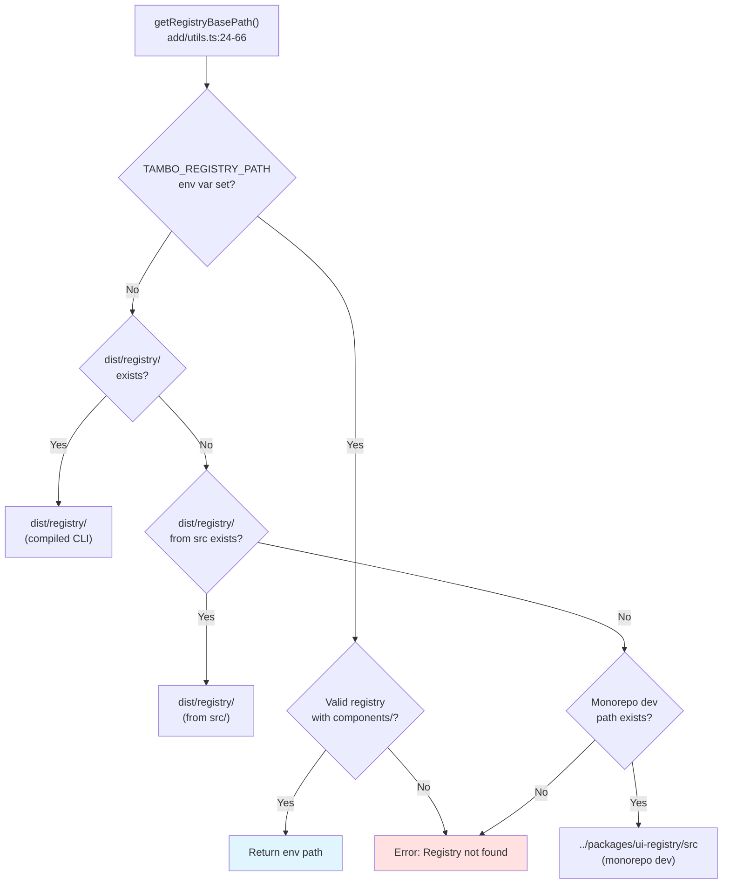

**Sources**: [cli/src/commands/add/utils.ts:24-66](), [cli/src/commands/add/utils.ts:73-84]()

The registry base path resolution at [cli/src/commands/add/utils.ts:24-66]() supports three modes:
1. **Override**: `TAMBO_REGISTRY_PATH` environment variable (development)
2. **Compiled**: `dist/registry/` directory (published CLI)
3. **Monorepo**: `../packages/ui-registry/src` (local development)

Component paths are constructed via `getRegistryPath()` at [cli/src/commands/add/utils.ts:73-75]() as `{registryBase}/components/{componentName}`.

---

## Dependency Management

### NPM Dependency Installation

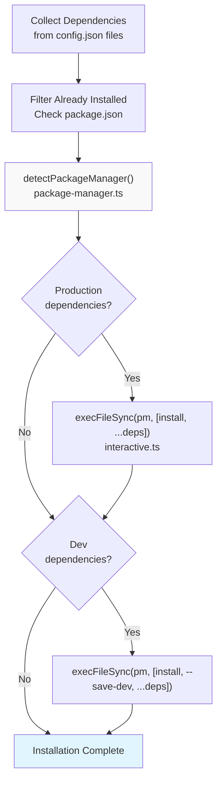

**Sources**: [cli/src/commands/add/component.ts:86-163](), [cli/src/utils/package-manager.ts:53-71]()

Dependency installation at [cli/src/commands/add/component.ts:86-163]() aggregates all dependencies across components before installing to minimize npm invocations. The `detectPackageManager()` function at [cli/src/utils/package-manager.ts:53-71]() detects the package manager by checking for lockfiles in priority order: `rush.json` → `pnpm-lock.yaml` → `yarn.lock` → `package-lock.json`.

### Component Dependency Resolution

The `resolveComponentDependencies()` function recursively resolves component dependencies:

| Function | Purpose | Location |
|----------|---------|----------|
| `resolveComponentDependencies()` | Recursively resolve single component | [cli/src/utils/dependency-resolution.ts]() |
| `resolveDependenciesForComponents()` | Batch resolve multiple components | [cli/src/utils/dependency-resolution.ts]() |
| `expandComponentsWithDependencies()` | Expand with location info | [cli/src/utils/dependency-resolution.ts]() |
| `detectCrossLocationDependencies()` | Find ui/tambo inconsistencies | [cli/src/commands/shared/component-utils.ts]() |

**Cross-Location Dependency Detection**:

When components exist in both `ui/` and `tambo/` directories, the CLI detects inconsistencies where:
- Component in `ui/` depends on component in `tambo/`
- Component in `tambo/` depends on component in `ui/`

This creates import path conflicts. The handler at [cli/src/commands/shared/component-utils.ts]() prompts for migration to resolve.

**Sources**: [cli/src/utils/dependency-resolution.ts](), [cli/src/commands/shared/component-utils.ts]()

---

## Interactive Mode Detection

The CLI behavior adapts based on the execution environment.

### Environment Detection

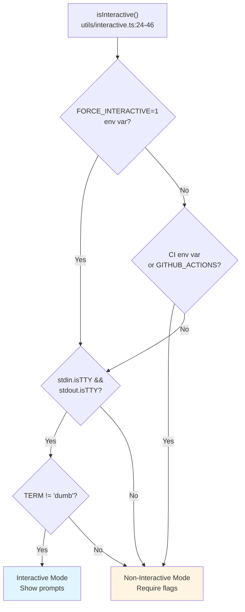

**Sources**: [cli/src/utils/interactive.ts:24-46]()

The `isInteractive()` function at [cli/src/utils/interactive.ts:24-46]() checks both `stdin` and `stdout` TTY status since prompts require both input and display streams. Detection logic:

1. **Force mode**: `FORCE_INTERACTIVE=1` enables interactive if TTYs present
2. **CI detection**: Disables interactive if `CI` env var or `GITHUB_ACTIONS` set
3. **TTY check**: Both stdin and stdout must be TTYs
4. **Terminal type**: `TERM` must not be `dumb`

### Prompt Wrapper

The `interactivePrompt()` function at [cli/src/utils/interactive.ts:87-113]() wraps `inquirer.prompt()` with environment checks:

```typescript
export async function interactivePrompt<T>(
  questions: InquirerPromptQuestions,
  helpMessage?: string,
): Promise<T> {
  if (!isInteractive()) {
    throw new NonInteractiveError(helpMessage || defaultHelp);
  }
  return await inquirer.prompt(questions) as T;
}
```

**Error Handling**:
- `NonInteractiveError` - Thrown when prompt attempted in non-interactive environment
- `GuidanceError` - Thrown with specific flag examples for missing required inputs

**Sources**: [cli/src/utils/interactive.ts:51-75](), [cli/src/utils/interactive.ts:87-113]()

### Safe Execution Wrappers

The `execFileSync()` wrapper at [cli/src/utils/interactive.ts:206-373]() adds special handling for package managers on Windows:

**Windows Package Manager Detection** at [cli/src/utils/interactive.ts:130-154]():
- Commands in `WINDOWS_CMD_BINARIES` set (`npm`, `pnpm`, `yarn`, `rush`, etc.)
- Use `spawn.sync()` via `cross-spawn` instead of native `execFileSync()`
- Handles `.cmd`, `.exe`, `.bat` extensions automatically

**Non-Interactive Allowance** at [cli/src/utils/interactive.ts:115-127]():
- `allowNonInteractive: true` option bypasses interactive check
- Used when user passes `--yes` flag to auto-accept prompts
- Enables CI/CD usage with explicit flags

**Sources**: [cli/src/utils/interactive.ts:206-373](), [cli/src/utils/interactive.ts:130-154]()

---

## Framework Detection

The CLI detects the project's framework to provide appropriate defaults for environment variables and file paths.

### Detection Logic

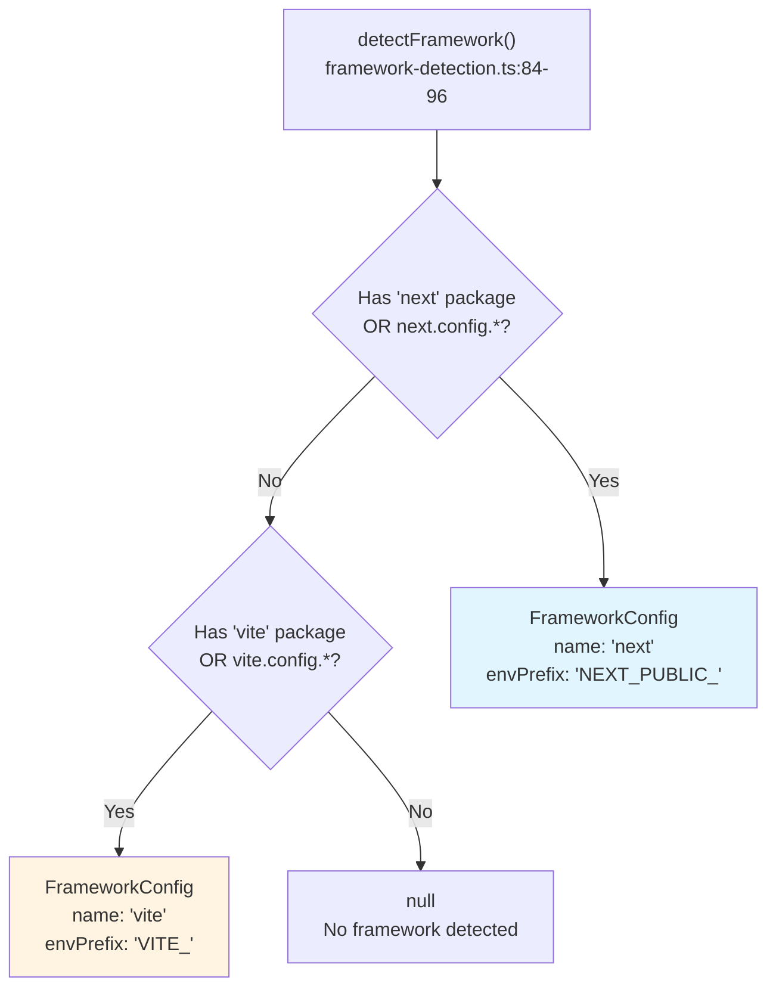

**Sources**: [cli/src/utils/framework-detection.ts:84-96](), [cli/src/utils/framework-detection.ts:61-77]()

**Framework Definitions** at [cli/src/utils/framework-detection.ts:61-77]():

| Framework | Detection Method | Env Prefix | Display Name |
|-----------|-----------------|------------|--------------|
| Next.js | `next` in dependencies OR `next.config.*` file exists | `NEXT_PUBLIC_` | Next.js |
| Vite | `vite` in dependencies OR `vite.config.*` file exists | `VITE_` | Vite |

### Environment Variable Naming

The `getTamboApiKeyEnvVar()` function at [cli/src/utils/framework-detection.ts:116-118]() returns the framework-appropriate variable name:

- **Next.js**: `NEXT_PUBLIC_TAMBO_API_KEY`
- **Vite**: `VITE_TAMBO_API_KEY`
- **No framework**: `TAMBO_API_KEY`

This ensures environment variables are exposed to the client-side bundle correctly per framework conventions.

**Sources**: [cli/src/utils/framework-detection.ts:104-118]()

### Default CSS Path Resolution

The `getDefaultCssPath()` function at [cli/src/utils/framework-detection.ts:126-139]() determines where to create `globals.css`:

**Next.js**:
- With `src/`: `src/app/globals.css`
- Without `src/`: `app/globals.css`

**Vite**:
- With `src/`: `src/index.css`
- Without `src/`: `index.css`

**Sources**: [cli/src/utils/framework-detection.ts:126-139]()

---

## Tailwind CSS Configuration

The CLI manages Tailwind CSS setup for both v3 and v4, detecting the version and applying appropriate configuration.

### Version Detection and Setup

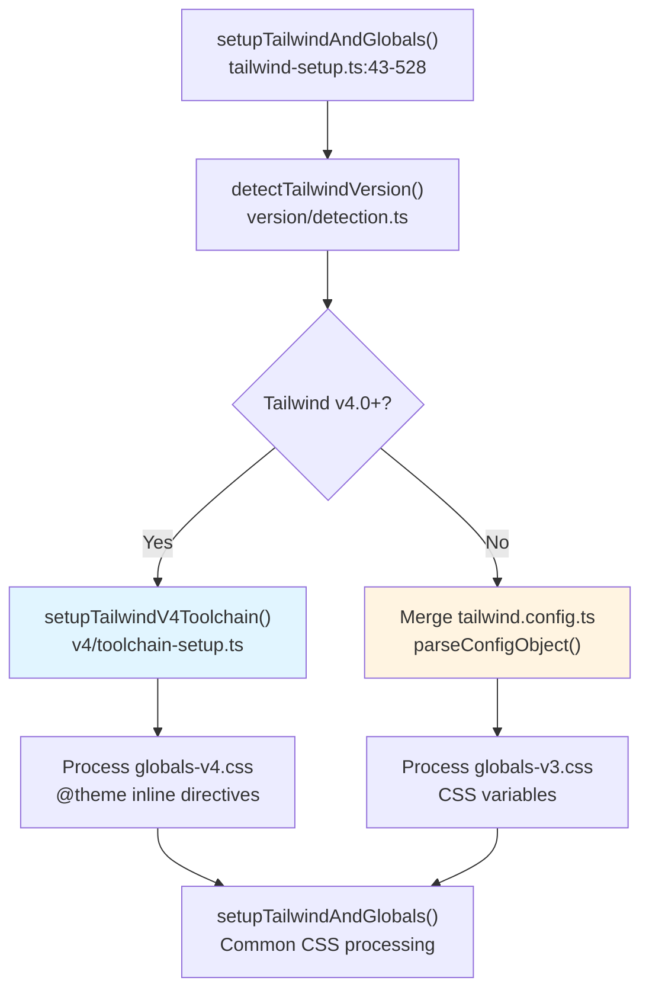

**Sources**: [cli/src/commands/add/tailwind-setup.ts:43-528](), [cli/src/commands/add/tailwind/version/detection.ts]()

### Tailwind v4 Toolchain Setup

For Tailwind v4, the CLI installs and configures the appropriate build plugin:

**Vite Projects** at [cli/src/commands/add/tailwind/v4/toolchain-setup.ts:47-149]():
1. Install `@tailwindcss/vite` package
2. Detect Vite config file (`vite.config.ts`, `.js`, `.mjs`)
3. Parse config with `ts-morph` AST manipulation
4. Add `tailwindcss()` plugin to `plugins` array
5. Add `import tailwindcss from '@tailwindcss/vite'` if missing

**Next.js/Other Projects** at [cli/src/commands/add/tailwind/v4/toolchain-setup.ts:156-198]():
1. Install `@tailwindcss/postcss` package
2. Create or update `postcss.config.mjs`
3. Configure with `tailwindcss` plugin

**Sources**: [cli/src/commands/add/tailwind/v4/toolchain-setup.ts:32-42](), [cli/src/commands/add/tailwind/v4/toolchain-setup.ts:47-198]()

### CSS Variable Management

The CSS setup at [cli/src/commands/add/tailwind-setup.ts:217-528]() preserves user content while adding required Tambo variables:

**Tailwind v3** at [cli/src/commands/add/tailwind/css/modification.ts]():
- Add CSS variables to `:root` and `.dark` selectors
- Use `addVariablesToLayer()` to insert missing variables
- Preserve existing custom properties

**Tailwind v4** at [cli/src/commands/add/tailwind/v4/handlers.ts]():
- Extract `@theme inline` configuration
- Add custom variants via `@custom-variant`
- Preserve user directives with `preserveConfigDirectives()`

**Sources**: [cli/src/commands/add/tailwind-setup.ts:217-528](), [cli/src/commands/add/tailwind/css/modification.ts](), [cli/src/commands/add/tailwind/v4/handlers.ts]()

---

## Package Manager Support

The CLI supports multiple package managers with automatic detection and appropriate command generation.

### Detection Priority

```mermaid
graph TB
    Start["detectPackageManager()<br/>package-manager.ts:53-71"]
    
    RushCheck["findFileInAncestors('rush.json')"]
    RushFound{"rush.json<br/>found?"}
    PnpmCheck["pnpm-lock.yaml exists?"]
    YarnCheck["yarn.lock exists?"]
    
    Rush["return 'rush'"]
    Pnpm["return 'pnpm'"]
    Yarn["return 'yarn'"]
    NPM["return 'npm'<br/>(default)"]
    
    Start --> RushCheck
    RushCheck --> RushFound
    RushFound -->|Yes| Rush
    RushFound -->|No| PnpmCheck
    
    PnpmCheck -->|Yes| Pnpm
    PnpmCheck -->|No| YarnCheck
    
    YarnCheck -->|Yes| Yarn
    YarnCheck -->|No| NPM
    
    style Rush fill:#f9f9f9
    style Pnpm fill:#e1f5ff
    style Yarn fill:#fff4e1
```

**Sources**: [cli/src/utils/package-manager.ts:53-71](), [cli/src/utils/package-manager.ts:19-38]()

Rush detection uses `findFileInAncestors()` at [cli/src/utils/package-manager.ts:19-38]() to search parent directories since `rush.json` exists at monorepo root but CLI runs in project subdirectories.

### Command Generation

Package manager commands are generated with framework-appropriate syntax:

| Package Manager | Install Command | Dev Flag | Package Runner |
|----------------|-----------------|----------|----------------|
| npm | `["install"]` | `"--save-dev"` | `npx` |
| pnpm | `["add"]` | `"--save-dev"` | `pnpm dlx` |
| yarn | `["add"]` | `"--dev"` | `yarn dlx` |
| rush | `["update"]` | `"--make-fetch-happen"` | `rushx` |

**Implementation Functions**:
- `getInstallCommand()` at [cli/src/utils/package-manager.ts:99-111]()
- `getDevFlag()` at [cli/src/utils/package-manager.ts:118-130]()
- `getPackageRunnerArgs()` at [cli/src/utils/package-manager.ts:136-151]()

**Package Argument Formatting** at [cli/src/utils/package-manager.ts:157-175]():
- **npm/yarn/rush**: One argument per package (`["pkg1", "pkg2"]`)
- **pnpm**: Flatten array (`["pkg1", "pkg2"]` → no change)

**Sources**: [cli/src/utils/package-manager.ts:99-175]()

### Validation

The `validatePackageManager()` function at [cli/src/utils/package-manager.ts:85-96]() checks that the detected package manager is installed:

```typescript
export function validatePackageManager(pm: PackageManager): void {
  try {
    if (process.platform === "win32") {
      spawn.sync(pm, ["--version"], { stdio: "pipe" });
    } else {
      execFileSync(pm, ["--version"], { stdio: "pipe" });
    }
  } catch (error) {
    throw new Error(
      `Package manager "${pm}" is not installed. Please install it first.`
    );
  }
}
```

**Sources**: [cli/src/utils/package-manager.ts:85-96]()

---

## Agent Documentation Management

The CLI manages AI assistant documentation files to help LLMs understand the codebase.

### Documentation Files

| File | Purpose | Location |
|------|---------|----------|
| `AGENTS.md` | General LLM guidance for all AI assistants | Project root |
| `CLAUDE.md` | Claude-specific guidance and MCP config | Project root |
| `{component}/AGENTS.md` | Component-specific usage documentation | Component directory |

**Handler**: `handleAgentDocsUpdate()` at [cli/src/commands/shared/agent-docs.ts]()

### Update Workflow

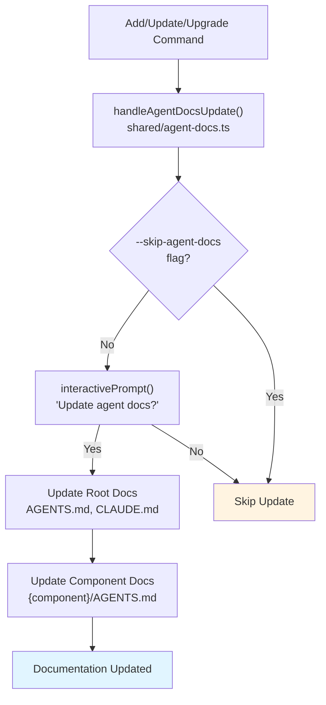

**Sources**: [cli/src/commands/shared/agent-docs.ts]()

The agent documentation system is automatically triggered after component operations unless `--skip-agent-docs` flag is passed. The update process:

1. Checks for existing documentation files
2. Prompts user for confirmation (unless `--yes` or `skipPrompt` option)
3. Copies latest docs from registry
4. Preserves user customizations in separate sections

**Legacy Cursor Rules**: The upgrade command at [cli/src/commands/upgrade/llm-rules.ts:25-101]() removes deprecated `.cursor/rules/tambo-ai.mdc` files and replaces them with the new documentation structure.

**Sources**: [cli/src/commands/shared/agent-docs.ts](), [cli/src/commands/upgrade/llm-rules.ts:25-101]()

---

## Error Handling and Exit Codes

The CLI uses specific exit codes to indicate different error conditions for automation and scripting.

### Exit Code Strategy

| Exit Code | Meaning | Error Class | Usage |
|-----------|---------|-------------|-------|
| 0 | Success | - | Normal completion |
| 1 | General error | `Error`, `NonInteractiveError` | Execution failure |
| 2 | User action required | `GuidanceError` | Missing required flags in non-interactive mode |

**Implementation** at [cli/src/cli.ts:729-763]():

```typescript
async function main() {
  try {
    await handleCommand(command, flags);
  } catch (error) {
    if (error instanceof GuidanceError) {
      console.error(chalk.red(`Error: ${error.message}`));
      console.error(chalk.yellow("\nRequired: Run one of these commands:\n"));
      error.guidance.forEach((g, i) => {
        const prefix = i === 0 ? chalk.green("→") : " ";
        console.error(`${prefix} ${g}`);
      });
      process.exit(2); // User action required
    }
    
    if (error instanceof NonInteractiveError) {
      console.error(error.message);
      process.exit(1); // General error
    }
    
    console.error(chalk.red("Error executing command:"), error.message);
    process.exit(1);
  }
}
```

**Sources**: [cli/src/cli.ts:729-763]()

### GuidanceError Examples

The `GuidanceError` class at [cli/src/utils/interactive.ts:63-75]() provides specific command examples:

**Create App Without Name**:
```typescript
throw new GuidanceError(
  "App name and template required in non-interactive mode",
  [
    "npx tambo create-app my-app --template=standard  # Recommended",
    "npx tambo create-app my-app --template=vite      # Vite + TanStack Router",
    "npx tambo create-app my-app --template=analytics # Analytics template",
  ]
);
```

**Init Without Credentials**:
```typescript
throw new GuidanceError(
  "API key required in non-interactive mode",
  [
    "npx tambo init --api-key=sk_...  # Get key from https://console.tambo.co",
    "npx tambo init --project-name=myapp   # Create new project",
    "npx tambo init --project-id=abc123    # Use existing project",
  ]
);
```

**Sources**: [cli/src/commands/create-app.ts:110-118](), [cli/src/commands/init.ts:1097-1101]()

### NonInteractiveError

The `NonInteractiveError` at [cli/src/utils/interactive.ts:51-56]() is thrown when prompts are required but environment is non-interactive. Each prompt wrapper at [cli/src/utils/interactive.ts:87-113]() accepts a custom help message explaining required flags.

**Sources**: [cli/src/utils/interactive.ts:51-113]()

---

## Testing Infrastructure

The CLI has comprehensive test coverage using Jest and memfs for filesystem mocking.

### Test Utilities

**Filesystem Mocking** via memfs at [cli/src/__fixtures__/mock-fs-setup.ts]():

| Helper Function | Purpose |
|----------------|---------|
| `createBasicProject()` | Minimal project with package.json |
| `createNextProject()` | Next.js project structure |
| `createProjectWithTamboSDK()` | Project with @tambo-ai/react installed |
| `createProjectWithEnv()` | Project with .env files |
| `createRegistryFiles()` | Mock component registry |

**Mock Modules**:
- `fs` → memfs for in-memory filesystem
- `child_process` → Track exec calls
- `inquirer` → Configurable prompt responses
- Registry utilities → Use memfs paths

**Sources**: [cli/src/__fixtures__/mock-fs-setup.ts](), [cli/src/commands/init.test.ts:22-293]()

### Test Patterns

**Command Tests** at [cli/src/commands/init.test.ts](), [cli/src/commands/add/index.test.ts]():

1. Setup memfs with project structure
2. Configure mock responses (inquirer, API calls)
3. Execute command handler
4. Assert filesystem state with `toTreeSync()`
5. Assert console output and exec calls

**Interactive Mode Tests** at [cli/src/utils/interactive.test.ts]():

```typescript
describe("isInteractive", () => {
  it("returns false in CI environment", () => {
    process.env.CI = "true";
    expect(isInteractive()).toBe(false);
  });
  
  it("returns true with TTY and no CI", () => {
    process.stdin.isTTY = true;
    process.stdout.isTTY = true;
    delete process.env.CI;
    expect(isInteractive()).toBe(true);
  });
});
```

**Sources**: [cli/src/utils/interactive.test.ts:38-261]()

### Snapshot Testing

Component installation tests use snapshot assertions for filesystem state:

```typescript
expect(toTreeSync(vol, { dir: "/mock-project/src" }))
  .toMatchInlineSnapshot(`
    "src/
    ├─ components/
    │  └─ tambo/
    │     ├─ AGENTS.md
    │     └─ message.tsx
    └─ lib/
       └─ utils.ts"
  `);
```

**Sources**: [cli/src/commands/add/index.test.ts:213-248]()

---

