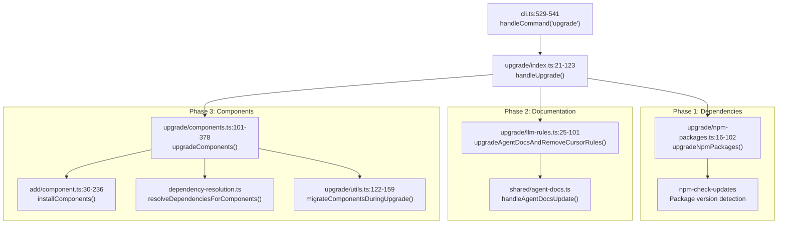
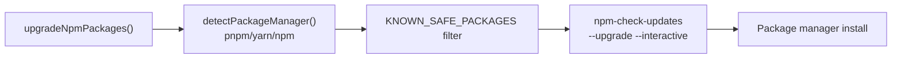
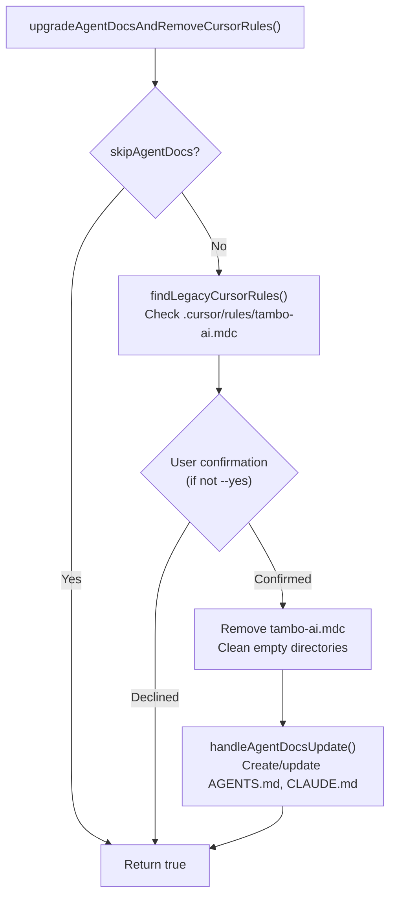
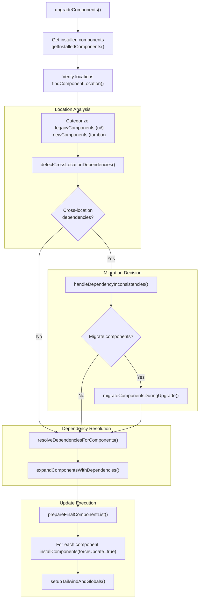
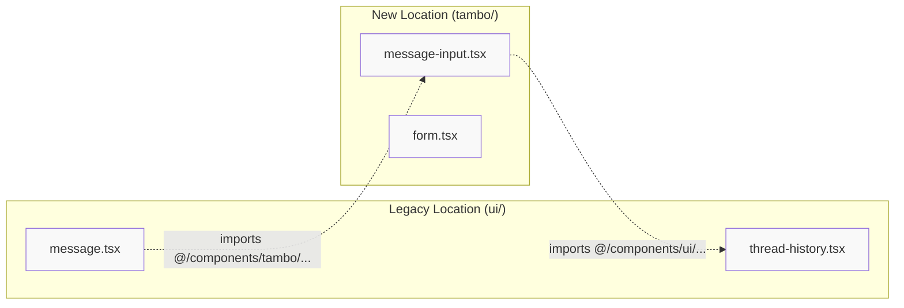
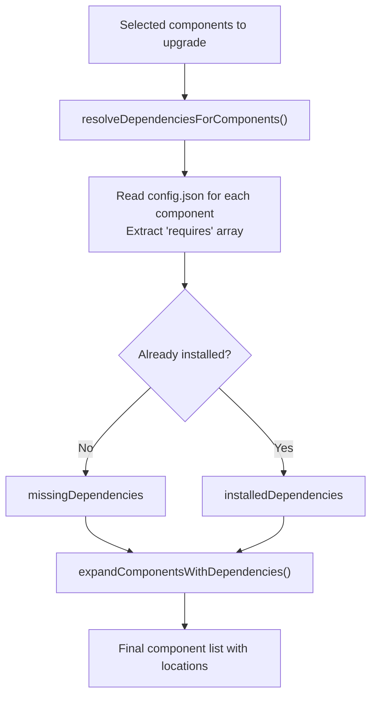

<!-- source: DeepWiki mcp.deepwiki.com · repo tambo-ai/tambo · page 5.3 Project Upgrade · fetched 2026-10-29 -->

# Project Upgrade

<details>
<summary>Relevant source files</summary>

The following files were used as context for generating this wiki page:

- [cli/src/__tests__/non-interactive-safety.test.ts](cli/src/__tests__/non-interactive-safety.test.ts)
- [cli/src/cli.ts](cli/src/cli.ts)
- [cli/src/commands/add/component.ts](cli/src/commands/add/component.ts)
- [cli/src/commands/add/index.test.ts](cli/src/commands/add/index.test.ts)
- [cli/src/commands/add/index.ts](cli/src/commands/add/index.ts)
- [cli/src/commands/add/tailwind-setup.ts](cli/src/commands/add/tailwind-setup.ts)
- [cli/src/commands/add/tailwind/v4/toolchain-setup.test.ts](cli/src/commands/add/tailwind/v4/toolchain-setup.test.ts)
- [cli/src/commands/add/tailwind/v4/toolchain-setup.ts](cli/src/commands/add/tailwind/v4/toolchain-setup.ts)
- [cli/src/commands/add/types.ts](cli/src/commands/add/types.ts)
- [cli/src/commands/add/utils.ts](cli/src/commands/add/utils.ts)
- [cli/src/commands/create-app.ts](cli/src/commands/create-app.ts)
- [cli/src/commands/init.test.ts](cli/src/commands/init.test.ts)
- [cli/src/commands/init.ts](cli/src/commands/init.ts)
- [cli/src/commands/list/index.test.ts](cli/src/commands/list/index.test.ts)
- [cli/src/commands/list/index.ts](cli/src/commands/list/index.ts)
- [cli/src/commands/update.test.ts](cli/src/commands/update.test.ts)
- [cli/src/commands/update.ts](cli/src/commands/update.ts)
- [cli/src/commands/upgrade/components.ts](cli/src/commands/upgrade/components.ts)
- [cli/src/commands/upgrade/index.ts](cli/src/commands/upgrade/index.ts)
- [cli/src/commands/upgrade/llm-rules.ts](cli/src/commands/upgrade/llm-rules.ts)
- [cli/src/commands/upgrade/npm-packages.ts](cli/src/commands/upgrade/npm-packages.ts)
- [cli/src/commands/upgrade/utils.ts](cli/src/commands/upgrade/utils.ts)
- [cli/src/utils/framework-detection.test.ts](cli/src/utils/framework-detection.test.ts)
- [cli/src/utils/framework-detection.ts](cli/src/utils/framework-detection.ts)
- [cli/src/utils/interactive.test.ts](cli/src/utils/interactive.test.ts)
- [cli/src/utils/interactive.ts](cli/src/utils/interactive.ts)
- [cli/src/utils/package-manager.test.ts](cli/src/utils/package-manager.test.ts)
- [cli/src/utils/package-manager.ts](cli/src/utils/package-manager.ts)

</details>


## Purpose and Scope

This document describes the `tambo upgrade` command, which orchestrates a comprehensive upgrade workflow for Tambo projects. The command performs three main operations: upgrading npm dependencies, updating LLM guidance documentation, and upgrading Tambo UI components from the registry. It also handles migration from legacy component directory structures (`ui/`) to the new standard (`tambo/`) and resolves cross-location dependency conflicts.

For initial project setup, see [Project Setup Commands](#5.1). For component-specific updates without full project upgrade, see [Component Management](#5.2).

## Command Architecture

The upgrade system is organized into distinct phases, each handled by a specialized module:



**Sources:** [cli/src/cli.ts:529-541](), [cli/src/commands/upgrade/index.ts:21-123](), [cli/src/commands/upgrade/npm-packages.ts:16-102](), [cli/src/commands/upgrade/llm-rules.ts:25-101](), [cli/src/commands/upgrade/components.ts:101-378]()

## Command Entry Point

The upgrade command is invoked through the CLI router and validates the execution environment before proceeding:

| Validation Check | Purpose | Error Condition |
|-----------------|---------|-----------------|
| `isInteractive()` check | Ensures terminal supports prompts | Non-interactive without `--yes` flag |
| `package.json` existence | Confirms project root | Missing package.json |
| `@tambo-ai/react` dependency | Validates Tambo project | Warning if not found (non-fatal) |

The handler detects the project template by reading `README.md` content [upgrade/utils.ts:17-47]() and generates template-specific AI upgrade prompts [upgrade/utils.ts:52-75]().

**Sources:** [cli/src/commands/upgrade/index.ts:21-123]()

## Phase 1: NPM Package Upgrades

The npm package upgrade phase uses `npm-check-updates` to identify and update known safe dependencies:



The upgrade targets only packages defined in `KNOWN_SAFE_PACKAGES` [constants/packages.ts]() that are present in the project's `package.json`. The interactive mode (when `--yes` is not provided) allows selective package upgrades [upgrade/npm-packages.ts:64-75]().

**Implementation details:**

- Package manager detection via lockfile presence: `pnpm-lock.yaml` > `yarn.lock` > `package-lock.json` [utils/package-manager.ts:18-31]()
- Package runner resolution: `pnpm dlx`, `yarn dlx`, or `npx` [utils/package-manager.ts:76-85]()
- Legacy peer deps flag applied only for npm [upgrade/npm-packages.ts:86-88]()

**Sources:** [cli/src/commands/upgrade/npm-packages.ts:16-102](), [cli/src/constants/packages.ts](), [cli/src/utils/package-manager.ts:18-31]()

## Phase 2: Agent Documentation Updates

This phase manages LLM guidance files and removes deprecated Cursor IDE rules:



The legacy file path is: `.cursor/rules/tambo-ai.mdc` [upgrade/llm-rules.ts:10](). If this file exists, it is removed and the directory structure is cleaned up [upgrade/llm-rules.ts:54-79]().

The agent documentation update delegates to `handleAgentDocsUpdate()` which creates or updates:
- `AGENTS.md` - Comprehensive LLM guidance for all AI assistants
- `CLAUDE.md` - Claude-specific instructions (if not present)

**Sources:** [cli/src/commands/upgrade/llm-rules.ts:25-101](), [cli/src/commands/shared/agent-docs.ts]()

## Phase 3: Component Upgrades

The component upgrade phase is the most complex, handling component discovery, dependency resolution, location migration, and registry updates:



**Sources:** [cli/src/commands/upgrade/components.ts:101-378]()

## Component Location Detection and Migration

The upgrade system detects components in both legacy and new locations, then handles migration automatically:

### Location Detection

The `findComponentLocation()` function [shared/component-utils.ts]() checks for components in this order:

1. **New location:** `<installPath>/tambo/<component>.tsx`
2. **Legacy location:** `<installPath>/ui/<component>.tsx`

The function returns a location object indicating:
- `installPath` - Resolved installation path
- `needsCreation` - `true` if component is in legacy location only

### Cross-Location Dependency Detection

The system identifies problematic scenarios where components in different locations depend on each other:



**Detection logic:** [shared/component-utils.ts]() - `detectCrossLocationDependencies()` parses import statements to find cross-location references.

### Migration Process

When cross-location dependencies are detected, the system offers migration:

1. **Interactive prompt** (unless `--yes` flag): User chooses to migrate or continue with mixed locations
2. **Component file migration**: [upgrade/utils.ts:122-159]()
   - Read component source from legacy location
   - Update import paths via `updateImportPaths(content, "tambo")` [migrate.ts]()
   - Write to new location
   - Delete legacy file
3. **Import path transformation**:
   - `@/components/ui/` → `@/components/tambo/`
   - Relative paths adjusted for new directory structure

**Sources:** [cli/src/commands/shared/component-utils.ts](), [cli/src/commands/upgrade/utils.ts:122-159](), [cli/src/commands/migrate.ts]()

## Dependency Resolution for Upgrades

Component upgrades resolve dependencies recursively to ensure all required components are updated:



The resolution distinguishes between:
- **Installed dependencies**: Already present, will be updated in place
- **Missing dependencies**: Need to be installed before upgrade proceeds

Dependency information is displayed to the user via `displayDependencyInfo()` [utils/dependency-resolution.ts]().

**Sources:** [cli/src/utils/dependency-resolution.ts](), [cli/src/commands/upgrade/components.ts:253-273]()

## Component Update Execution

After migration decisions and dependency resolution, components are upgraded by:

1. **Preparing final component list** [upgrade/components.ts:54-86]():
   - Legacy components: Use `getLegacyComponentDirectoryPath()` with `isLegacy=true` flag
   - New components: Use standard path with `baseInstallPath` for lib directory calculation
   
2. **Installing with force update** [upgrade/components.ts:314-337]():
   - `forceUpdate: true` - Overwrites existing component files
   - `silent: true` - Suppresses per-component output
   - Legacy components set `isExplicitPrefix=true` and `baseInstallPath` for proper lib directory resolution

3. **CSS configuration validation** [add/tailwind-setup.ts]():
   - Ensures `tailwind.config.js` has correct content paths
   - Verifies `globals.css` has necessary imports

**Sources:** [cli/src/commands/upgrade/components.ts:54-86](), [cli/src/commands/upgrade/components.ts:314-337](), [cli/src/commands/add/tailwind-setup.ts]()

## Command Options Reference

| Option | Type | Default | Description |
|--------|------|---------|-------------|
| `--yes`, `-y` | boolean | false | Auto-accept all prompts and proceed with defaults |
| `--prefix <path>` | string | `src/components` | Custom component installation directory |
| `--skip-agent-docs` | boolean | false | Skip agent documentation updates |
| `--legacy-peer-deps` | boolean | false | Pass `--legacy-peer-deps` to npm install commands |

**Non-interactive mode requirements:**
- Must use `--yes` flag when running in CI/CD or non-TTY environments
- Without `--yes`, the command throws an error with detailed usage instructions [upgrade/index.ts:28-46]()

**Sources:** [cli/src/commands/upgrade/index.ts:10-16](), [cli/src/commands/upgrade/index.ts:28-46]()

## Usage Patterns

### Interactive Upgrade (Recommended)

```bash
npx tambo upgrade
```

User is prompted to:
1. Select which packages to update (via npm-check-updates interactive mode)
2. Confirm agent documentation updates
3. Select specific components to upgrade
4. Confirm migration if cross-location dependencies detected

### Automated Upgrade (CI/CD)

```bash
npx tambo upgrade --yes
```

All prompts auto-accepted, proceeds with:
- All available package updates
- Agent documentation updates (unless `--skip-agent-docs`)
- All installed component updates
- No migration (keeps components in current locations)

### Custom Component Directory

```bash
npx tambo upgrade --prefix src/components/ui
```

Explicitly specifies component location, useful when:
- Using non-standard project structure
- Components are in custom directory
- Multiple component directories exist

### Minimal Upgrade (Skip Documentation)

```bash
npx tambo upgrade --yes --skip-agent-docs
```

Useful when:
- Running frequent upgrades in development
- Agent documentation manually managed
- Reducing upgrade time in automated workflows

**Sources:** [cli/src/cli.ts:529-541](), [cli/src/commands/upgrade/index.ts:21-123]()

## Post-Upgrade Guidance

After successful upgrade, the system provides:

1. **Component location summary** [upgrade/components.ts:351-371]():
   - Count of components in legacy location
   - Import path instructions for legacy components
   - Migration command recommendation

2. **AI upgrade prompts** [upgrade/index.ts:104-115]():
   - Template-specific optimization suggestions
   - Generated via `generateAiUpgradePrompts()` [upgrade/utils.ts:52-75]()
   - Based on detected template type (standard, analytics, or generic)

**Sources:** [cli/src/commands/upgrade/components.ts:351-371](), [cli/src/commands/upgrade/index.ts:104-115](), [cli/src/commands/upgrade/utils.ts:52-75]()

---

