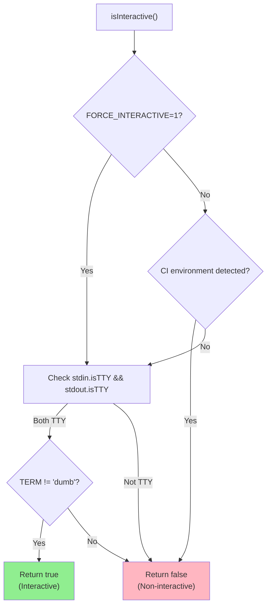
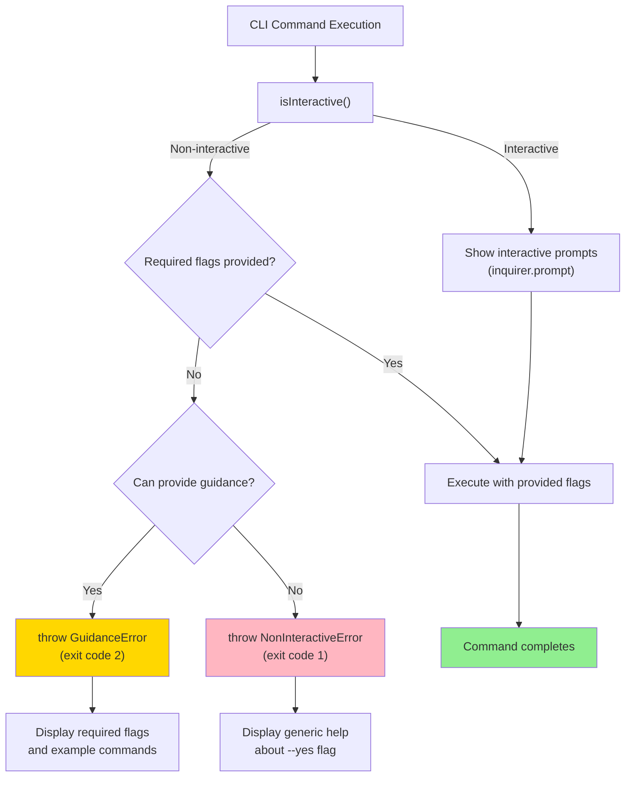
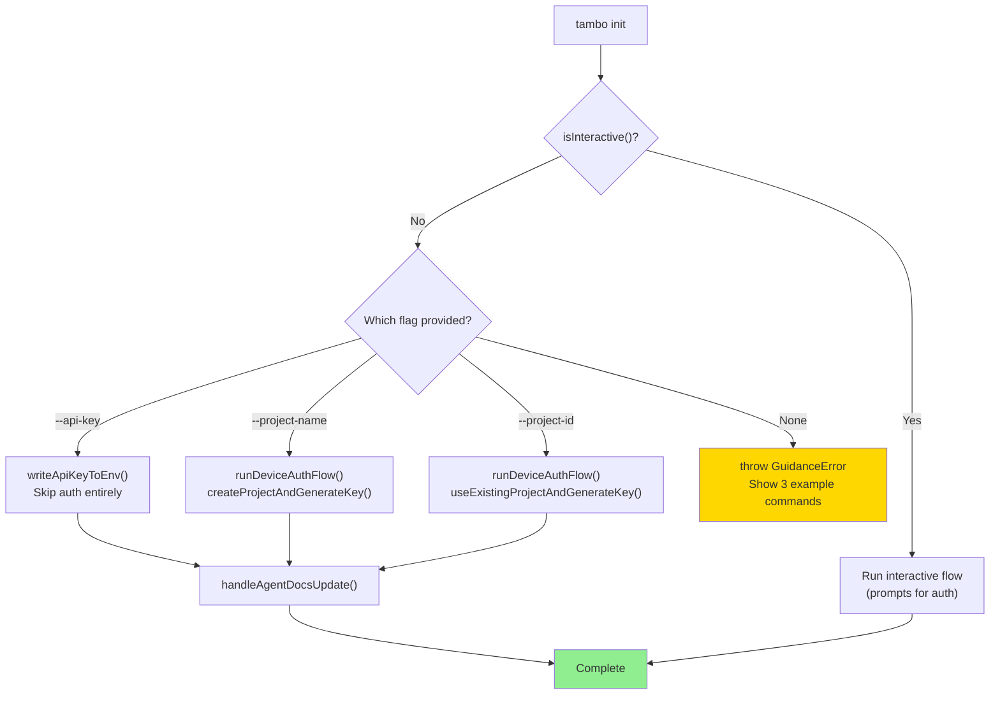
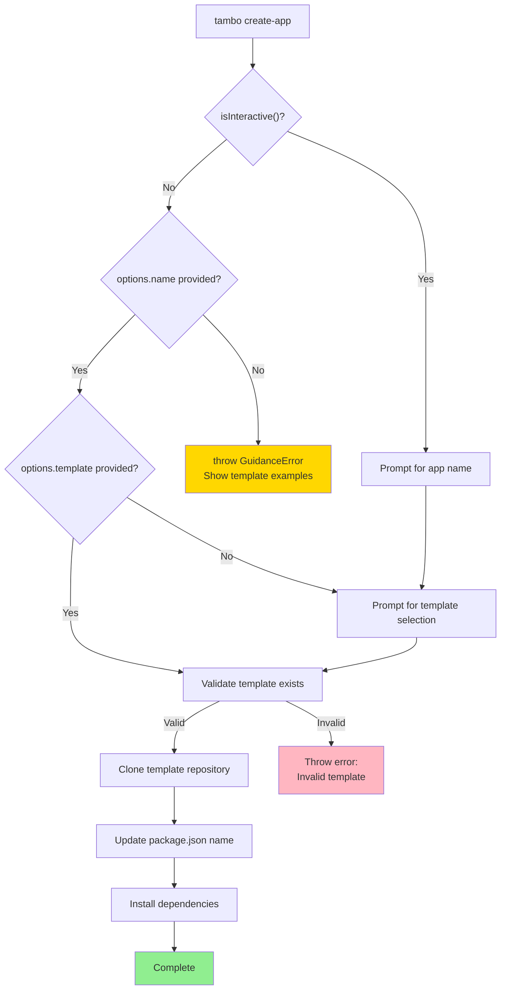
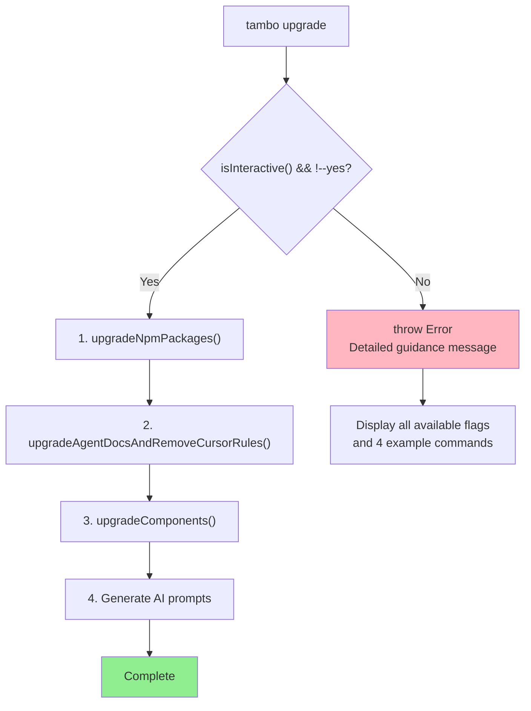
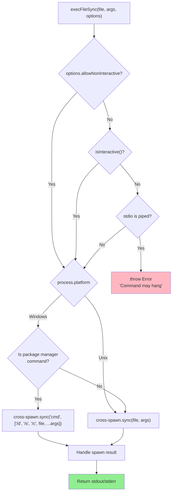
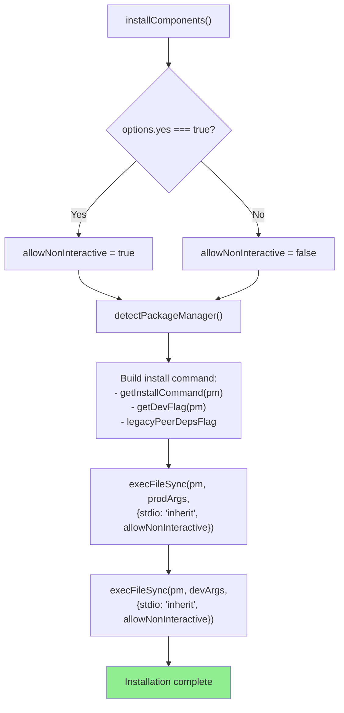
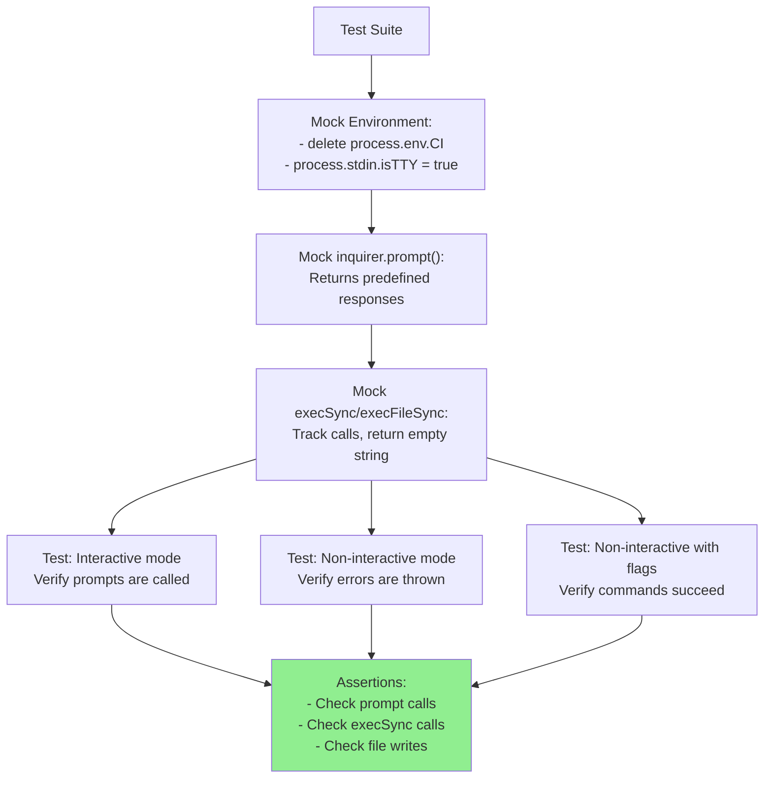

<!-- source: DeepWiki mcp.deepwiki.com · repo tambo-ai/tambo · page 5.4 Non-Interactive Mode · fetched 2026-10-29 -->

# Non-Interactive Mode

<details>
<summary>Relevant source files</summary>

The following files were used as context for generating this wiki page:

- [cli/src/__tests__/non-interactive-safety.test.ts](cli/src/__tests__/non-interactive-safety.test.ts)
- [cli/src/cli.ts](cli/src/cli.ts)
- [cli/src/commands/add/component.ts](cli/src/commands/add/component.ts)
- [cli/src/commands/add/index.test.ts](cli/src/commands/add/index.test.ts)
- [cli/src/commands/add/index.ts](cli/src/commands/add/index.ts)
- [cli/src/commands/add/tailwind-setup.ts](cli/src/commands/add/tailwind-setup.ts)
- [cli/src/commands/add/tailwind/v4/toolchain-setup.test.ts](cli/src/commands/add/tailwind/v4/toolchain-setup.test.ts)
- [cli/src/commands/add/tailwind/v4/toolchain-setup.ts](cli/src/commands/add/tailwind/v4/toolchain-setup.ts)
- [cli/src/commands/add/types.ts](cli/src/commands/add/types.ts)
- [cli/src/commands/add/utils.ts](cli/src/commands/add/utils.ts)
- [cli/src/commands/create-app.ts](cli/src/commands/create-app.ts)
- [cli/src/commands/init.test.ts](cli/src/commands/init.test.ts)
- [cli/src/commands/init.ts](cli/src/commands/init.ts)
- [cli/src/commands/list/index.test.ts](cli/src/commands/list/index.test.ts)
- [cli/src/commands/list/index.ts](cli/src/commands/list/index.ts)
- [cli/src/commands/update.test.ts](cli/src/commands/update.test.ts)
- [cli/src/commands/update.ts](cli/src/commands/update.ts)
- [cli/src/commands/upgrade/components.ts](cli/src/commands/upgrade/components.ts)
- [cli/src/commands/upgrade/index.ts](cli/src/commands/upgrade/index.ts)
- [cli/src/commands/upgrade/llm-rules.ts](cli/src/commands/upgrade/llm-rules.ts)
- [cli/src/commands/upgrade/npm-packages.ts](cli/src/commands/upgrade/npm-packages.ts)
- [cli/src/commands/upgrade/utils.ts](cli/src/commands/upgrade/utils.ts)
- [cli/src/utils/framework-detection.test.ts](cli/src/utils/framework-detection.test.ts)
- [cli/src/utils/framework-detection.ts](cli/src/utils/framework-detection.ts)
- [cli/src/utils/interactive.test.ts](cli/src/utils/interactive.test.ts)
- [cli/src/utils/interactive.ts](cli/src/utils/interactive.ts)
- [cli/src/utils/package-manager.test.ts](cli/src/utils/package-manager.test.ts)
- [cli/src/utils/package-manager.ts](cli/src/utils/package-manager.ts)

</details>


This page documents how the Tambo CLI handles non-interactive environments such as CI/CD pipelines, Docker containers, and automated scripts. Non-interactive mode detection, required flags, error handling, and command-specific behavior are covered here.

For information about interactive CLI commands and prompts, see [CLI Commands Reference](#5.1). For automation workflows and CI/CD integration, see [CI/CD Pipeline](#8.2).

---

## Purpose and Detection

The Tambo CLI automatically detects whether it is running in an interactive environment where user prompts are possible. When non-interactive mode is detected, commands that normally prompt for user input will either require specific flags or exit with helpful error messages.

### Detection Mechanism

The CLI uses the `isInteractive()` function to determine if the environment supports user interaction:



**Detection Logic:**

| Condition | Result |
|-----------|--------|
| `process.env.CI` is set (non-empty, not "0") | Non-interactive |
| `process.env.GITHUB_ACTIONS === "true"` | Non-interactive |
| `process.stdin.isTTY === false` | Non-interactive |
| `process.stdout.isTTY === false` | Non-interactive |
| `process.env.TERM === "dumb"` | Non-interactive |
| `FORCE_INTERACTIVE=1` env var set | Force interactive (overrides above) |
| All checks pass | Interactive |

**Sources:** [cli/src/utils/interactive.ts:18-46]()

---

## Command Behavior in Non-Interactive Mode

Each CLI command has specific requirements when running in non-interactive environments. Commands either require additional flags or provide clear guidance on what flags are needed.



**Sources:** [cli/src/utils/interactive.ts:48-113](), [cli/src/cli.ts:728-763]()

---

## Error Types

The CLI uses two distinct error types for non-interactive scenarios:

### NonInteractiveError

Thrown when a prompt is attempted in a non-interactive environment. This is a generic error with standard guidance.

```typescript
// Example from code
class NonInteractiveError extends Error {
  constructor(message: string) {
    super(message);
    this.name = "NonInteractiveError";
  }
}
```

**When thrown:** When `interactivePrompt()` is called but `isInteractive()` returns false.

**Exit code:** 1 (general error)

**Sources:** [cli/src/utils/interactive.ts:48-56]()

### GuidanceError

Thrown when a command can provide specific guidance about what flags are needed. This error includes an array of example commands.

```typescript
// Example from code
class GuidanceError extends Error {
  constructor(
    message: string,
    public readonly guidance: string[],
  ) {
    super(message);
    this.name = "GuidanceError";
  }
}
```

**When thrown:** When a command knows exactly what flags are missing and can provide examples.

**Exit code:** 2 (user action required)

**Display format:**
```
Error: <message>

Required: Run one of these commands:

→ <first example command>
  <second example command>
  <third example command>

(Exit code 2 = command needs flags)
```

**Sources:** [cli/src/utils/interactive.ts:58-75](), [cli/src/cli.ts:738-749]()

---

## Command-Specific Requirements

### tambo init

The `init` command has three paths for non-interactive execution:



**Required Flags (choose one):**

| Flag | Description | Example |
|------|-------------|---------|
| `--api-key=<key>` | Provide API key directly, skips auth | `tambo init --api-key=sk_123...` |
| `--project-name=<name>` | Create new project via device auth | `tambo init --project-name=myapp` |
| `--project-id=<id>` | Use existing project via device auth | `tambo init --project-id=abc123` |

**Optional Flags:**

| Flag | Description | Default |
|------|-------------|---------|
| `--no-browser` | Print auth URL instead of opening browser | Opens browser |
| `--skip-agent-docs` | Skip creating AGENTS.md/CLAUDE.md | Creates docs |

**Guidance Example:**
```
Error: API key required in non-interactive mode

Required: Run one of these commands:

→ npx tambo init --api-key=sk_...  # Get key from https://console.tambo.co
  npx tambo init --project-name=myapp   # Create new project (requires browser auth)
  npx tambo init --project-id=abc123    # Use existing project (requires browser auth)
```

**Sources:** [cli/src/commands/init.ts:1008-1102](), [cli/src/cli.ts:476-491]()

---

### tambo full-send

The `full-send` command requires component selection and is not designed for non-interactive use. Use separate commands instead:

**Non-interactive alternative:**
```bash
# Instead of: tambo full-send
# Use:
tambo init --api-key=sk_...
tambo add message-thread-full --yes
```

**Sources:** [cli/src/commands/init.ts:736-848]()

---

### tambo create-app

The `create-app` command requires app name and template in non-interactive mode:



**Required Arguments:**

| Argument/Flag | Description | Example |
|---------------|-------------|---------|
| `<directory>` | Directory name (or `.` for current) | `my-app` or `.` |
| `--template=<name>` | Template to use | `--template=standard` |

**Available Templates:**

| Template | Description |
|----------|-------------|
| `standard` | Tambo + Tools + MCP (recommended) |
| `vite` | Tambo + TanStack Router + Vite |
| `analytics` | Generative UI Analytics Template |

**Optional Flags:**

| Flag | Description | Default |
|------|-------------|---------|
| `--init-git` | Initialize git repository | Not initialized |
| `--legacy-peer-deps` | Pass to npm install | Not used |

**Examples:**
```bash
# Create in new directory with standard template
tambo create-app my-app --template=standard

# Create in current directory with Vite template
tambo create-app . --template=vite

# Create with git initialization
tambo create-app my-app --template=analytics --init-git
```

**Sources:** [cli/src/commands/create-app.ts:108-119](), [cli/src/cli.ts:565-576]()

---

### tambo add

The `add` command requires the `--yes` flag to skip confirmation prompts in non-interactive mode:

**Required Flags:**

| Flag | Description |
|------|-------------|
| `--yes` or `-y` | Auto-answer yes to all prompts (installation confirmation, directory selection) |

**Optional Flags:**

| Flag | Description |
|------|-------------|
| `--prefix=<path>` | Custom component directory |
| `--dry-run` | Preview changes without applying |
| `--skip-agent-docs` | Skip updating AGENTS.md |
| `--legacy-peer-deps` | Pass to npm install |

**Behavior:**
- With `--yes`: Uses default directory (`src/components` if exists, creates it if not)
- Without `--yes`: Throws `NonInteractiveError` with guidance

**Examples:**
```bash
# Add single component, auto-accept defaults
tambo add message --yes

# Add multiple components with custom directory
tambo add message form graph --yes --prefix=src/ui

# Preview what would be installed
tambo add message --dry-run --yes
```

**Sources:** [cli/src/commands/add/index.ts:33-294](), [cli/src/cli.ts:494-521]()

---

### tambo update

The `update` command requires the `--yes` flag to skip overwrite confirmation:

**Required Flags:**

| Flag | Description |
|------|-------------|
| `--yes` or `-y` | Auto-confirm component overwrite |

**Optional Flags:**

| Flag | Description |
|------|-------------|
| `--prefix=<path>` | Custom component directory |
| `--legacy-peer-deps` | Pass to npm install |

**Special Keyword:**

| Keyword | Description |
|---------|-------------|
| `installed` | Update all currently installed components |

**Examples:**
```bash
# Update specific components
tambo update message form --yes

# Update all installed components
tambo update installed --yes

# Update with custom directory
tambo update message --yes --prefix=src/ui
```

**Sources:** [cli/src/commands/update.ts:40-386](), [cli/src/cli.ts:535-563]()

---

### tambo upgrade

The `upgrade` command performs multiple operations and requires the `--yes` flag in non-interactive mode:



**Required Flags:**

| Flag | Description |
|------|-------------|
| `--yes` or `-y` | Auto-accept all upgrades, skip all prompts |

**Optional Flags:**

| Flag | Description |
|------|-------------|
| `--prefix=<path>` | Custom component directory |
| `--skip-agent-docs` | Skip updating AGENTS.md/CLAUDE.md |
| `--legacy-peer-deps` | Pass to npm install |

**Error Message in Non-Interactive Mode:**
```
Error: Cannot run 'tambo upgrade' in non-interactive mode without flags.

What happened: This command needs to prompt you for choices, but your environment
doesn't support prompts (likely CI/CD, Docker, or piped output).

Required flag:
  --yes  Auto-accepts all upgrades and skips prompts

Other available flags:
  --prefix <path>      Component directory (default: src/components/tambo)
  --skip-agent-docs    Skip updating AGENTS.md/CLAUDE.md files
  --legacy-peer-deps   Pass --legacy-peer-deps to npm (fixes some conflicts)

Examples:
  tambo upgrade --yes                                  # Standard components path
  tambo upgrade --yes --prefix src/components/ui       # Custom components path
  tambo upgrade --yes --skip-agent-docs                # Skip docs updates
  tambo upgrade --yes --legacy-peer-deps               # Fix peer dep conflicts

Or run this command in an interactive terminal (not in CI/CD).
```

**Sources:** [cli/src/commands/upgrade/index.ts:21-47](), [cli/src/cli.ts:579-590]()

---

### tambo migrate

The `migrate` command requires either `--yes` or `--dry-run` in non-interactive mode:

**Required Flags (choose one):**

| Flag | Description |
|------|-------------|
| `--yes` or `-y` | Confirm migration without prompt |
| `--dry-run` | Preview migration without applying |

**Examples:**
```bash
# Perform migration with confirmation
tambo migrate --yes

# Preview migration changes
tambo migrate --dry-run
```

**Sources:** [cli/src/commands/migrate.ts](), [cli/src/cli.ts:594-602]()

---

## Execution Wrappers

The CLI provides wrapped versions of `execSync` and `execFileSync` that handle non-interactive scenarios more gracefully:

### execFileSync Wrapper



**Key Features:**

1. **Non-Interactive Protection:** Prevents commands from hanging when stdin is piped
2. **Windows Compatibility:** Wraps package manager commands with `cmd /c` on Windows
3. **Allowlist:** `allowNonInteractive: true` bypasses checks (used when `--yes` is provided)

**Windows Command Detection:**

The wrapper detects Windows package manager commands that need special handling:

```typescript
// Package managers that are batch files on Windows
const WINDOWS_CMD_BINARIES = ["npm", "npx", "pnpm", "yarn", "rush", "rushx"]
```

These are wrapped with `cmd /d /s /c` to execute properly.

**Sources:** [cli/src/utils/interactive.ts:130-272]()

---

## Integration with Package Installation

When installing dependencies, the CLI passes the `allowNonInteractive` flag based on user-provided flags:



**Relationship Table:**

| User Flag | allowNonInteractive | Behavior |
|-----------|-------------------|----------|
| `--yes` | `true` | Package installation proceeds in non-interactive mode |
| Not provided | `false` | Package installation requires interactive terminal |

**Sources:** [cli/src/commands/add/component.ts:117-163]()

---

## CI/CD Integration Examples

### GitHub Actions

```yaml
name: Setup Tambo
on: [push]

jobs:
  setup:
    runs-on: ubuntu-latest
    steps:
      - uses: actions/checkout@v4
      
      # Initialize Tambo with API key
      - name: Init Tambo
        run: |
          npx tambo init --api-key=${{ secrets.TAMBO_API_KEY }}
        env:
          CI: true
      
      # Add components
      - name: Add Components
        run: |
          npx tambo add message form --yes
      
      # Upgrade if needed
      - name: Upgrade Tambo
        run: |
          npx tambo upgrade --yes --skip-agent-docs
```

### Docker

```dockerfile
FROM node:20-alpine

WORKDIR /app
COPY package*.json ./
RUN npm install

# Initialize Tambo in non-interactive mode
RUN npx tambo init --api-key=${TAMBO_API_KEY}

# Add components with auto-confirmation
RUN npx tambo add message-thread-full --yes --prefix=src/components

COPY . .
RUN npm run build

CMD ["npm", "start"]
```

### Automated Scripts

```bash
#!/bin/bash
set -e

# Check if running in CI
if [ -n "$CI" ]; then
  echo "Detected CI environment - using non-interactive mode"
  
  # Initialize with provided API key
  if [ -z "$TAMBO_API_KEY" ]; then
    echo "Error: TAMBO_API_KEY not set"
    exit 1
  fi
  
  npx tambo init --api-key="$TAMBO_API_KEY"
  
  # Install components
  npx tambo add message form graph --yes --legacy-peer-deps
  
  # Run upgrade
  npx tambo upgrade --yes --prefix=src/components/ui
else
  echo "Interactive mode - running normal flow"
  npx tambo init
  npx tambo add message form graph
  npx tambo upgrade
fi
```

**Sources:** [cli/src/utils/interactive.ts:18-46](), [cli/src/commands/init.ts:1008-1102]()

---

## Testing Non-Interactive Behavior

The CLI includes comprehensive tests for non-interactive mode behavior:

### Test Infrastructure



**Key Test Patterns:**

1. **Force Non-Interactive Mode:**
```typescript
// Set environment to simulate CI
process.env.CI = "true";
process.stdin.isTTY = false;
```

2. **Mock isInteractive:**
```typescript
jest.unstable_mockModule("../utils/interactive.js", () => ({
  isInteractive: () => false,
  // ...
}));
```

3. **Verify GuidanceError:**
```typescript
await expect(handleInit({})).rejects.toThrow(GuidanceError);
```

**Sources:** [cli/src/commands/init.test.ts:1-1167](), [cli/src/utils/interactive.test.ts:1-376]()

---

## Summary Table

| Command | Non-Interactive Requirement | Alternative Options |
|---------|---------------------------|---------------------|
| `init` | `--api-key=<key>` OR `--project-name=<name>` OR `--project-id=<id>` | Use device auth with `--no-browser` |
| `full-send` | Not supported | Use `init` + `add` separately |
| `create-app` | App name + `--template=<name>` | None |
| `add` | `--yes` | `--dry-run` for preview |
| `update` | `--yes` | None |
| `upgrade` | `--yes` | None |
| `migrate` | `--yes` OR `--dry-run` | None |

**Exit Codes:**

| Exit Code | Meaning | Example |
|-----------|---------|---------|
| 0 | Success | Command completed successfully |
| 1 | General error | `NonInteractiveError`, file not found, etc. |
| 2 | User action required | `GuidanceError` - specific flags needed |

**Sources:** [cli/src/cli.ts:728-763](), [cli/src/utils/interactive.ts:1-272]()

---

