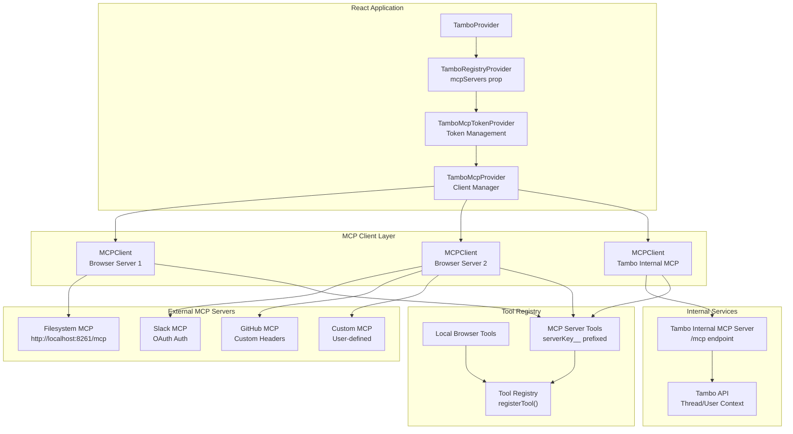
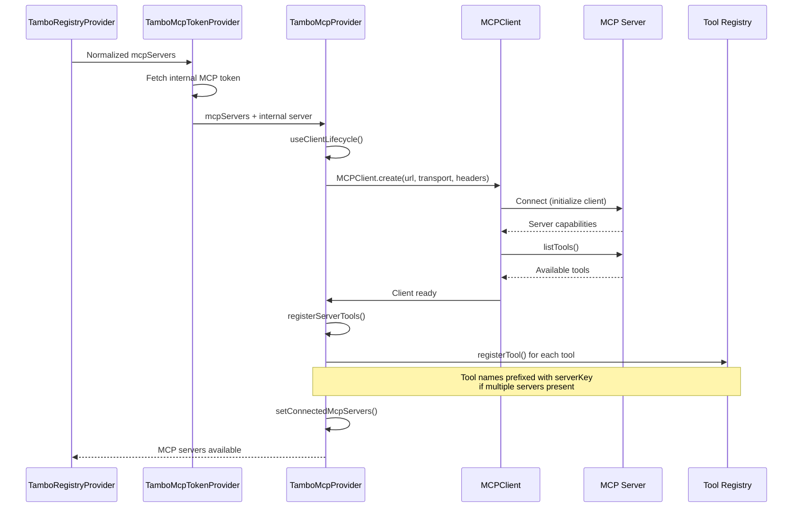
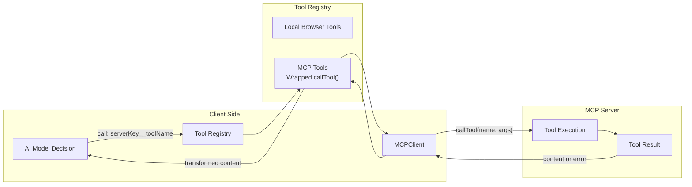
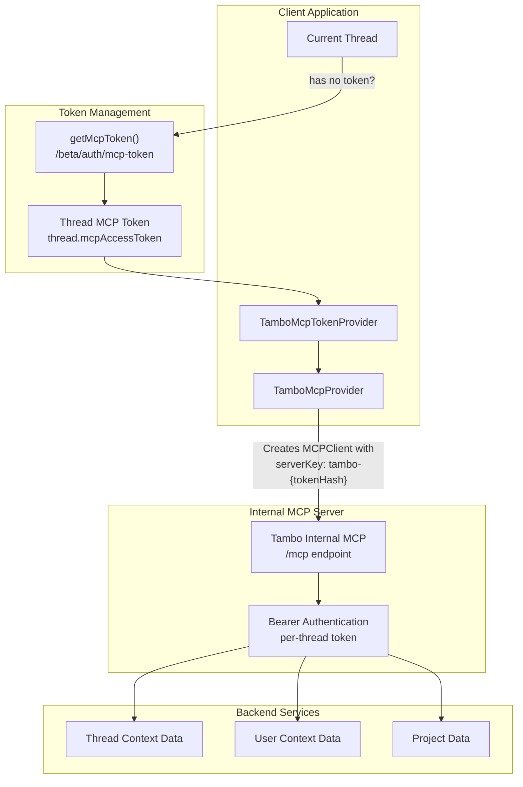

<!-- source: DeepWiki mcp.deepwiki.com · repo tambo-ai/tambo · page 6 MCP Integration · fetched 2026-10-29 -->

# MCP Integration

<details>
<summary>Relevant source files</summary>

The following files were used as context for generating this wiki page:

- [.config/release-please/.release-please-manifest.json](.config/release-please/.release-please-manifest.json)
- [apps/api/CHANGELOG.md](apps/api/CHANGELOG.md)
- [apps/api/package.json](apps/api/package.json)
- [apps/docs-mcp/package.json](apps/docs-mcp/package.json)
- [apps/test-mcp-server/package.json](apps/test-mcp-server/package.json)
- [apps/web/CHANGELOG.md](apps/web/CHANGELOG.md)
- [apps/web/package.json](apps/web/package.json)
- [cli/CHANGELOG.md](cli/CHANGELOG.md)
- [cli/package.json](cli/package.json)
- [create-tambo-app/CHANGELOG.md](create-tambo-app/CHANGELOG.md)
- [create-tambo-app/package.json](create-tambo-app/package.json)
- [docs/CHANGELOG.md](docs/CHANGELOG.md)
- [docs/package.json](docs/package.json)
- [package-lock.json](package-lock.json)
- [package.json](package.json)
- [packages/backend/package.json](packages/backend/package.json)
- [packages/core/package.json](packages/core/package.json)
- [packages/eslint-config/package.json](packages/eslint-config/package.json)
- [packages/react-ui-base/CHANGELOG.md](packages/react-ui-base/CHANGELOG.md)
- [packages/react-ui-base/package.json](packages/react-ui-base/package.json)
- [packages/testing/package.json](packages/testing/package.json)
- [packages/ui-registry/package.json](packages/ui-registry/package.json)
- [react-sdk/CHANGELOG.md](react-sdk/CHANGELOG.md)
- [react-sdk/package.json](react-sdk/package.json)
- [react-sdk/src/mcp/index.ts](react-sdk/src/mcp/index.ts)
- [react-sdk/src/mcp/mcp-client.ts](react-sdk/src/mcp/mcp-client.ts)
- [react-sdk/src/mcp/mcp-hooks.ts](react-sdk/src/mcp/mcp-hooks.ts)
- [react-sdk/src/mcp/tambo-mcp-provider.tsx](react-sdk/src/mcp/tambo-mcp-provider.tsx)
- [react-sdk/src/providers/tambo-mcp-token-provider.tsx](react-sdk/src/providers/tambo-mcp-token-provider.tsx)
- [showcase/CHANGELOG.md](showcase/CHANGELOG.md)
- [showcase/package.json](showcase/package.json)

</details>


This document describes Tambo's integration with the Model Context Protocol (MCP), a standardized protocol for connecting AI models to external systems such as databases, APIs, file systems, and custom services. MCP integration enables AI agents to access contextual data, execute operations, and interact with external services through a unified interface.

For information about registering local tools and components, see [Tool Registration](#3.5) and [Component Registration](#3.4). For details on the broader provider architecture, see [Provider Architecture](#3.2).

---

## Overview of MCP

The Model Context Protocol (MCP) is an open standard that defines how AI applications communicate with external data sources and services. MCP servers expose three primary capabilities:

- **Tools** - Functions that the AI can call to perform actions or retrieve data
- **Resources** - Contextual data that can be referenced in conversations (files, documents, database records)
- **Prompts** - Pre-defined prompt templates that users can insert into conversations

Tambo provides native MCP support through both client-side (browser) and server-side integration, allowing AI agents to seamlessly interact with MCP-compatible services.

**Sources:** [README.md:180-205](), [react-sdk/README.md:239-259](), [docs/content/docs/index.mdx:13-14]()

---

## System Architecture



**Architecture Overview**

The MCP integration is implemented through a layered provider system:

1. **TamboRegistryProvider** - Accepts `mcpServers` configuration array and normalizes server metadata
2. **TamboMcpTokenProvider** - Manages authentication tokens for the internal Tambo MCP server
3. **TamboMcpProvider** - Creates and manages `MCPClient` instances for each configured server
4. **MCPClient** - Handles communication with individual MCP servers using HTTP or SSE transport

MCP tools are automatically registered in the tool registry with prefixes (`serverKey__toolName`) to prevent naming collisions when multiple servers expose tools with the same name.

**Sources:** [react-sdk/src/mcp/tambo-mcp-provider.tsx:363-448](), [react-sdk/src/mcp/mcp-client.ts:84-166](), Diagram 4 from high-level systems

---

## Client-Side MCP Configuration

### Basic Setup

MCP servers are configured by passing the `mcpServers` prop to `TamboProvider`:

```tsx
import { TamboProvider } from "@tambo-ai/react";
import { MCPTransport } from "@tambo-ai/react/mcp";

const mcpServers = [
  {
    name: "filesystem",
    url: "http://localhost:8261/mcp",
    transport: MCPTransport.HTTP,
  },
  {
    name: "slack",
    url: "https://api.slack.com/mcp",
    transport: MCPTransport.SSE,
    customHeaders: {
      Authorization: "Bearer slack-token-here"
    }
  }
];

<TamboProvider
  apiKey={process.env.NEXT_PUBLIC_TAMBO_API_KEY}
  components={components}
  mcpServers={mcpServers}
>
  <App />
</TamboProvider>
```

**Sources:** [README.md:186-199](), [react-sdk/README.md:243-257]()

### Server Configuration Properties

| Property | Type | Required | Description |
|----------|------|----------|-------------|
| `name` | `string` | No | Human-readable server name |
| `url` | `string` | Yes | MCP server endpoint URL |
| `transport` | `MCPTransport` | Yes | Transport type: `HTTP` or `SSE` |
| `serverKey` | `string` | No | Unique identifier for prefixing tools/resources (auto-generated if not provided) |
| `customHeaders` | `Record<string, string>` | No | Custom HTTP headers for authentication |
| `handlers` | `Partial<MCPHandlers>` | No | Per-server elicitation/sampling handlers |

**Sources:** [react-sdk/src/model/mcp-server-info.ts:1-50](), [react-sdk/src/mcp/tambo-mcp-provider.tsx:70-86]()

### Transport Types

The `MCPTransport` enum defines two transport mechanisms:

```typescript
enum MCPTransport {
  HTTP = "http",    // Request/response model with StreamableHTTPClientTransport
  SSE = "sse"       // Server-Sent Events with SSEClientTransport
}
```

- **HTTP**: Suitable for most MCP servers, uses request/response pattern
- **SSE**: For servers requiring continuous connection and real-time updates

**Sources:** [react-sdk/src/mcp/mcp-client.ts:17-21](), [react-sdk/src/mcp/mcp-client.ts:168-180]()

---

## MCP Client Lifecycle



**Client Lifecycle Phases**

1. **Configuration** - Registry provider normalizes server metadata and generates unique keys
2. **Token Fetch** - Token provider obtains authentication token for internal MCP server (if applicable)
3. **Client Creation** - `MCPClient.create()` establishes connection with transport layer
4. **Capability Exchange** - Client queries server capabilities and lists available tools
5. **Tool Registration** - Tools are registered with prefixes to prevent name collisions
6. **Availability** - Connected servers are exposed via `useTamboMcpServers()` hook

**Sources:** [react-sdk/src/mcp/tambo-mcp-provider.tsx:453-561](), [react-sdk/src/mcp/mcp-client.ts:145-166]()

### Tool Name Prefixing

When multiple MCP servers are configured, tool names are automatically prefixed with `serverKey`:

```typescript
// Single server: no prefix
toolName = "search_files"

// Multiple servers: prefixed
toolName = "filesystem__search_files"
toolName = "slack__search_messages"
```

This prefixing prevents conflicts when multiple servers expose tools with identical names. The `shouldPrefix` flag is determined by checking if more than one server is configured.

**Sources:** [react-sdk/src/mcp/tambo-mcp-provider.tsx:271-343]()

---

## MCP Resources and Prompts

### Resources Overview

MCP resources are contextual data items that can be referenced in conversations. Resources have the following structure:

```typescript
interface ListResourceItem {
  uri: string;              // Unique identifier (e.g., "file:///path/to/doc")
  name: string;             // Human-readable name
  description?: string;     // Optional description
  mimeType?: string;        // Content type
}
```

Resources can come from two sources:
1. **MCP Servers** - External servers expose resources through the MCP protocol
2. **Local Registry** - Static or dynamic resources registered in `TamboProvider`

**Sources:** [react-sdk/src/mcp/mcp-hooks.ts:25-48]()

### Using Resource Hooks

#### Listing Resources

```tsx
import { useTamboMcpResourceList } from "@tambo-ai/react/mcp";

function ResourcePicker() {
  const { data: resources, isLoading } = useTamboMcpResourceList();
  
  // Resources are prefixed:
  // - MCP resources: "serverKey:original-uri"
  // - Registry resources: "registry:original-uri"
  
  return (
    <ul>
      {resources?.map(entry => (
        <li key={entry.resource.uri}>
          {entry.resource.name}
          {entry.server ? ` (from ${entry.server.serverKey})` : ' (local)'}
        </li>
      ))}
    </ul>
  );
}
```

**Sources:** [react-sdk/src/mcp/mcp-hooks.ts:256-381](), [showcase/src/components/tambo/mcp-components.tsx:331-433]()

#### Reading Resource Content

```tsx
import { useTamboMcpResource } from "@tambo-ai/react/mcp";

function ResourceViewer({ resourceUri }: { resourceUri: string }) {
  const { data: resource } = useTamboMcpResource(resourceUri);
  
  if (!resource) return <div>Loading...</div>;
  
  return (
    <div>
      {resource.contents.map((content, i) => (
        <pre key={i}>{content.text || content.blob}</pre>
      ))}
    </div>
  );
}
```

**Sources:** [react-sdk/src/mcp/mcp-hooks.ts:390-458]()

### Prompts Overview

MCP prompts are pre-defined prompt templates that can be inserted into conversations. They are particularly useful for common queries or structured instructions.

```typescript
interface ListPromptItem {
  name: string;
  description?: string;
  arguments?: Array<{
    name: string;
    description?: string;
    required?: boolean;
  }>;
}
```

**Sources:** [react-sdk/src/mcp/mcp-hooks.ts:18-23]()

### Using Prompt Hooks

#### Listing Prompts

```tsx
import { useTamboMcpPromptList } from "@tambo-ai/react/mcp";

function PromptMenu() {
  const { data: prompts } = useTamboMcpPromptList();
  
  // Prompts are always prefixed with serverKey
  // e.g., "linear:create-issue"
  
  return (
    <select>
      {prompts?.map(entry => (
        <option key={entry.prompt.name} value={entry.prompt.name}>
          {entry.prompt.name}: {entry.prompt.description}
        </option>
      ))}
    </select>
  );
}
```

**Sources:** [react-sdk/src/mcp/mcp-hooks.ts:82-138](), [showcase/src/components/tambo/mcp-components.tsx:30-193]()

#### Getting Prompt Content

```tsx
import { useTamboMcpPrompt } from "@tambo-ai/react/mcp";

function PromptInserter({ promptName }: { promptName: string }) {
  const { data: prompt } = useTamboMcpPrompt(promptName, {
    arg1: "value1"  // Prompt arguments
  });
  
  if (!prompt) return null;
  
  const promptText = prompt.messages
    .filter(msg => msg.content.type === "text")
    .map(msg => msg.content.text)
    .join("\n");
  
  return <div>{promptText}</div>;
}
```

**Sources:** [react-sdk/src/mcp/mcp-hooks.ts:205-249](), [showcase/src/components/tambo/mcp-components.tsx:50-82]()

### Resource URI Prefixing

All resources returned by `useTamboMcpResourceList()` have prefixed URIs for disambiguation:

| Source | Prefix | Example |
|--------|--------|---------|
| Local Registry | `registry:` | `registry:file:///config/settings.json` |
| MCP Server | `serverKey:` | `slack:file:///channel/general` |

This ensures that resources from different sources can coexist without URI conflicts. When fetching a resource with `useTamboMcpResource()`, the hook automatically strips the prefix before querying the appropriate source.

**Sources:** [react-sdk/src/mcp/mcp-hooks.ts:323-344](), [react-sdk/src/mcp/mcp-constants.ts:1-10]()

---

## MCP Tool Execution



**Tool Execution Flow**

1. **AI Decision** - LLM decides to call a tool (e.g., `filesystem__search_files`)
2. **Registry Lookup** - Tool registry finds the wrapped MCP tool function
3. **Client Routing** - Tool function locates the correct `MCPClient` instance
4. **MCP Call** - `MCPClient.callTool()` sends request to MCP server
5. **Result Processing** - Result is transformed and returned to AI
6. **Error Handling** - Errors are extracted and thrown as exceptions

**Sources:** [react-sdk/src/mcp/tambo-mcp-provider.tsx:307-336]()

### Tool Registration Implementation

The `registerServerTools` function handles tool registration for a connected MCP server:

```typescript
async function registerServerTools(
  client: MCPClient,
  serverInfo: McpServerConfig,
  key: string,
  shouldPrefix: boolean,
  clientMap: Map<string, McpServer>,
  ownershipRefs: ToolOwnershipRefs,
  registerTool: (tool: TamboTool) => void
): Promise<void>
```

Key features:
- **Deduplication** - Tracks tool ownership to prevent duplicate registrations
- **Prefixing** - Applies `serverKey__` prefix when multiple servers are present
- **Error Handling** - Wraps MCP errors in JavaScript exceptions
- **Content Transformation** - Converts MCP results to Tambo content format

**Sources:** [react-sdk/src/mcp/tambo-mcp-provider.tsx:271-343]()

### Tool Result Transformation

MCP tool results are transformed using the `transformToContent` function:

```typescript
transformToContent: (content: unknown) => {
  if (isContentPartArray(content)) {
    return content;  // Already in correct format
  }
  return [{ type: "text", text: toText(content) }];
}
```

This ensures that all tool results conform to the `CoreAssistantMessage` content format expected by the AI SDK.

**Sources:** [react-sdk/src/mcp/tambo-mcp-provider.tsx:326-331]()

### Error Handling

MCP errors are extracted from the result and thrown as exceptions:

```typescript
const result = await server.client.callTool(tool.name, args);
if (result.isError) {
  const errorMessage = extractErrorMessage(result.content);
  throw new Error(errorMessage);
}
return result.content;
```

The `extractErrorMessage()` function handles various content formats (arrays, objects, strings) to produce a consistent error message string.

**Sources:** [react-sdk/src/mcp/tambo-mcp-provider.tsx:311-322](), [react-sdk/src/mcp/tambo-mcp-provider.tsx:36-56]()

---

## MCP Handlers: Elicitation and Sampling

### Elicitation Overview

Elicitation is the MCP protocol's mechanism for servers to request user input during tool execution. When a server needs additional information, it sends an elicitation request that pauses execution until the user responds.

```typescript
interface ElicitRequest {
  message: string;        // Message to show the user
  schema?: JSONSchema;    // Optional schema for structured input
}

interface ElicitResult {
  action: "accept" | "reject";
  content?: Record<string, unknown>;  // User's response
}
```

**Sources:** [react-sdk/src/mcp/elicitation.ts:1-100](), [react-sdk/src/mcp/mcp-client.ts:44-47]()

### Using Elicitation

#### Provider-Level Handler

```tsx
import { TamboMcpProvider, ProviderMCPHandlers } from "@tambo-ai/react/mcp";

const handlers: ProviderMCPHandlers = {
  elicitation: async (request, extra, serverInfo) => {
    // Show UI to collect user input
    const response = await showUserPrompt(request.message);
    
    return {
      action: response ? "accept" : "reject",
      content: response
    };
  }
};

<TamboMcpProvider handlers={handlers}>
  {children}
</TamboMcpProvider>
```

**Sources:** [react-sdk/src/mcp/tambo-mcp-provider.tsx:117-128]()

#### Default Elicitation Handler

`TamboMcpProvider` includes a built-in elicitation handler that manages state via `useElicitation()`:

```tsx
import { useTamboMcpElicitation } from "@tambo-ai/react/mcp";

function ElicitationUI() {
  const { elicitation, resolveElicitation } = useTamboMcpElicitation();
  
  if (!elicitation) return null;
  
  return (
    <div>
      <p>{elicitation.message}</p>
      <button onClick={() => resolveElicitation?.({ 
        action: "accept", 
        content: { userInput: "value" } 
      })}>
        Accept
      </button>
      <button onClick={() => resolveElicitation?.({ 
        action: "reject" 
      })}>
        Reject
      </button>
    </div>
  );
}
```

**Sources:** [react-sdk/src/mcp/tambo-mcp-provider.tsx:687-693](), [react-sdk/src/mcp/elicitation.ts:60-100]()

### Sampling Overview

Sampling enables MCP servers to request AI completions (e.g., for agent-to-agent communication or sub-task delegation). When a server needs an AI response, it sends a sampling request with messages and receives a completion.

```typescript
interface CreateMessageRequest {
  messages: Array<{
    role: "user" | "assistant";
    content: string | Array<ContentPart>;
  }>;
  maxTokens?: number;
  temperature?: number;
  // ... other generation parameters
}

interface CreateMessageResult {
  role: "assistant";
  content: string | Array<ContentPart>;
  // ... other response fields
}
```

**Sources:** [react-sdk/src/mcp/mcp-client.ts:56-59]()

### Handler Configuration

Handlers can be configured at two levels:

1. **Provider Level** - Applied to all MCP servers unless overridden
2. **Per-Server Level** - Specified in individual server configuration

```tsx
const mcpServers = [
  {
    name: "custom-server",
    url: "http://localhost:8080/mcp",
    transport: MCPTransport.HTTP,
    handlers: {
      elicitation: async (request, extra) => {
        // Server-specific handler
        return { action: "accept", content: {} };
      }
    }
  }
];
```

Per-server handlers take precedence over provider-level handlers.

**Sources:** [react-sdk/src/mcp/tambo-mcp-provider.tsx:192-218]()

---

## Internal Tambo MCP Server

### Purpose and Architecture

The internal Tambo MCP server (`__tambo_internal_mcp_server__`) provides per-thread and per-user authenticated access to Tambo's backend services. This server is automatically added to the MCP configuration when a valid access token is available.



**Internal Server Configuration**

The internal server is constructed automatically:

```typescript
const internalServer: NormalizedMcpServerInfo = {
  name: "__tambo_internal_mcp_server__",
  url: `${tamboBaseUrl}/mcp`,
  transport: MCPTransport.HTTP,
  serverKey: `tambo-${hashString(mcpAccessToken)}`,
  customHeaders: {
    Authorization: `Bearer ${mcpAccessToken}`
  }
};
```

**Sources:** [react-sdk/src/mcp/tambo-mcp-provider.tsx:240-259]()

### Token Management

#### Thread-Specific Tokens

When switching to a thread that doesn't have an MCP token, the provider automatically fetches one:

```typescript
useEffect(() => {
  const shouldFetchThreadToken =
    hasThreadChanged &&
    currentThreadId &&
    !isPlaceholderThread &&
    currentThread &&
    !currentThread.mcpAccessToken;

  if (shouldFetchThreadToken) {
    const response = await client.beta.auth.getMcpToken({
      threadId: currentThreadId
    });
    // Update thread with token
  }
}, [currentThreadId, currentThread]);
```

**Sources:** [react-sdk/src/providers/tambo-mcp-token-provider.tsx:82-128]()

#### Threadless Tokens

For contexts without a thread, hooks can request a threadless token using a `contextKey`:

```tsx
const { mcpAccessToken } = useTamboMcpToken("my-context-key");
```

Threadless tokens are fetched once and cached until the user switches to a real thread.

**Sources:** [react-sdk/src/providers/tambo-mcp-token-provider.tsx:152-219]()

### Token Stability and Hashing

The internal server's `serverKey` includes a hash of the token to ensure that client instances are recreated when tokens change:

```typescript
function hashString(input: string): string {
  let hash = 0;
  for (let i = 0; i < input.length; i++) {
    hash = (Math.imul(31, hash) + input.charCodeAt(i)) | 0;
  }
  return (hash >>> 0).toString(36);
}
```

This deterministic hash ensures stable cache keys while detecting token changes.

**Sources:** [react-sdk/src/mcp/tambo-mcp-provider.tsx:157-163]()

---

## MCP Hooks Reference

### Server Management

#### `useTamboMcpServers()`

Returns the list of connected MCP servers with their client instances.

```typescript
function useTamboMcpServers(): McpServer[]

type McpServer = ConnectedMcpServer | FailedMcpServer;

interface ConnectedMcpServer {
  client: MCPClient;
  url: string;
  serverKey: string;
  name?: string;
  // ... other metadata
}

interface FailedMcpServer {
  connectionError: Error;
  url: string;
  // ... other metadata
}
```

**Example:**
```tsx
const servers = useTamboMcpServers();
servers.forEach(server => {
  if ('client' in server) {
    console.log(`Connected to ${server.url}`);
  } else {
    console.error(`Failed to connect: ${server.connectionError}`);
  }
});
```

**Sources:** [react-sdk/src/mcp/tambo-mcp-provider.tsx:658-660](), [react-sdk/src/mcp/tambo-mcp-provider.tsx:91-106]()

### Resource Hooks

#### `useTamboMcpResourceList(search?: string)`

Fetches all resources from MCP servers and local registry.

```typescript
function useTamboMcpResourceList(search?: string): {
  data: ListResourceEntry[];
  isLoading: boolean;
  error: Error | null;
  refetch: () => Promise<void>;
}

type ListResourceEntry = McpResourceEntry | RegistryResourceEntry;

interface McpResourceEntry {
  server: ConnectedMcpServer;
  resource: {
    uri: string;           // Prefixed with serverKey
    name: string;
    description?: string;
    mimeType?: string;
  };
}

interface RegistryResourceEntry {
  server: null;
  resource: {
    uri: string;           // Prefixed with "registry:"
    name: string;
    // ... other fields
  };
}
```

**Features:**
- Search parameter is passed to dynamic registry sources
- MCP resources are filtered locally after fetching
- All URIs are prefixed for disambiguation

**Sources:** [react-sdk/src/mcp/mcp-hooks.ts:256-381]()

#### `useTamboMcpResource(resourceUri: string | undefined)`

Fetches the content of a specific resource.

```typescript
function useTamboMcpResource(resourceUri: string | undefined): {
  data: ReadResourceResult | null;
  isLoading: boolean;
  error: Error | null;
}

interface ReadResourceResult {
  contents: Array<{
    uri: string;
    mimeType?: string;
    text?: string;
    blob?: string;
  }>;
}
```

**Usage:**
```tsx
const { data } = useTamboMcpResource("slack:file:///channel/general");
const textContent = data?.contents[0]?.text;
```

**Sources:** [react-sdk/src/mcp/mcp-hooks.ts:390-458]()

### Prompt Hooks

#### `useTamboMcpPromptList(search?: string)`

Fetches all prompts from connected MCP servers.

```typescript
function useTamboMcpPromptList(search?: string): {
  data: ListPromptEntry[];
  isLoading: boolean;
  error: Error | null;
  refetch: () => Promise<void>;
}

interface ListPromptEntry {
  server: ConnectedMcpServer;
  prompt: {
    name: string;          // Always prefixed with serverKey
    description?: string;
    arguments?: Array<{
      name: string;
      required?: boolean;
    }>;
  };
}
```

**Notes:**
- Prompt names are **always** prefixed with `serverKey:`, regardless of server count
- Search filtering is performed locally after fetching

**Sources:** [react-sdk/src/mcp/mcp-hooks.ts:82-138]()

#### `useTamboMcpPrompt(promptName: string | undefined, args?: Record<string, string>)`

Fetches the content of a specific prompt with optional arguments.

```typescript
function useTamboMcpPrompt(
  promptName: string | undefined,
  args?: Record<string, string>
): {
  data: GetPromptResult | null;
  isLoading: boolean;
  error: Error | null;
}

interface GetPromptResult {
  messages: Array<{
    role: "user" | "assistant";
    content: {
      type: "text";
      text: string;
    };
  }>;
}
```

**Usage:**
```tsx
const { data } = useTamboMcpPrompt("linear:create-issue", {
  projectId: "PROJ-123"
});
```

**Sources:** [react-sdk/src/mcp/mcp-hooks.ts:205-249]()

### Elicitation Hook

#### `useTamboMcpElicitation()`

Accesses the current elicitation state and response handler.

```typescript
function useTamboMcpElicitation(): {
  elicitation: TamboElicitationRequest | null;
  resolveElicitation: ((response: TamboElicitationResponse) => void) | null;
}

interface TamboElicitationRequest {
  message: string;
  schema?: PrimitiveSchemaDefinition;
}

interface TamboElicitationResponse {
  action: "accept" | "reject";
  content?: Record<string, unknown>;
}
```

**Sources:** [react-sdk/src/mcp/tambo-mcp-provider.tsx:687-693](), [react-sdk/src/mcp/index.ts:17-21]()

---

## Server-Side MCP Integration

While this page focuses on client-side MCP integration, Tambo also supports server-side MCP tool execution through the backend API. Server-side MCP tools are:

- Configured at the project level in Tambo Cloud
- Executed by the backend during thread message processing
- Not visible to the client-side provider
- Useful for tools requiring server-side authentication or compute

For information about server-side tool execution, see the backend API documentation and [Tool Execution Pipeline](#7.3).

**Sources:** [packages/backend/src/services/llm/ai-sdk-client.ts:1-50](), Diagram 8 from high-level systems

---

## Summary Table: MCP Integration Components

| Component | Purpose | Key Methods/Properties |
|-----------|---------|------------------------|
| `TamboMcpProvider` | Manages MCP client connections | `handlers`, `contextKey` prop |
| `MCPClient` | Handles communication with individual servers | `listTools()`, `callTool()`, `close()` |
| `MCPTransport` | Transport type enum | `HTTP`, `SSE` |
| `useTamboMcpServers()` | Access connected servers | Returns `McpServer[]` |
| `useTamboMcpResourceList()` | List all resources | Search parameter, prefixed URIs |
| `useTamboMcpResource()` | Get resource content | URI parameter |
| `useTamboMcpPromptList()` | List all prompts | Always prefixed names |
| `useTamboMcpPrompt()` | Get prompt content | Name and args parameters |
| `useTamboMcpElicitation()` | Handle user input requests | `elicitation`, `resolveElicitation` |
| `useTamboMcpToken()` | Access MCP auth token | `mcpAccessToken`, `tamboBaseUrl` |

**Sources:** [react-sdk/src/mcp/index.ts:1-51]()

---

