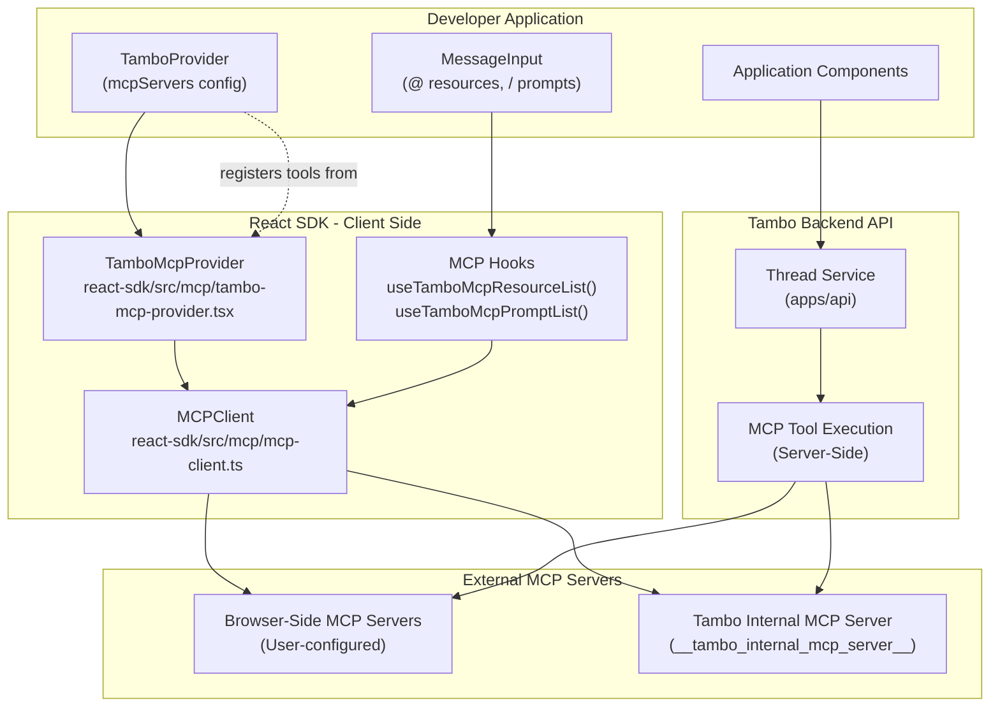
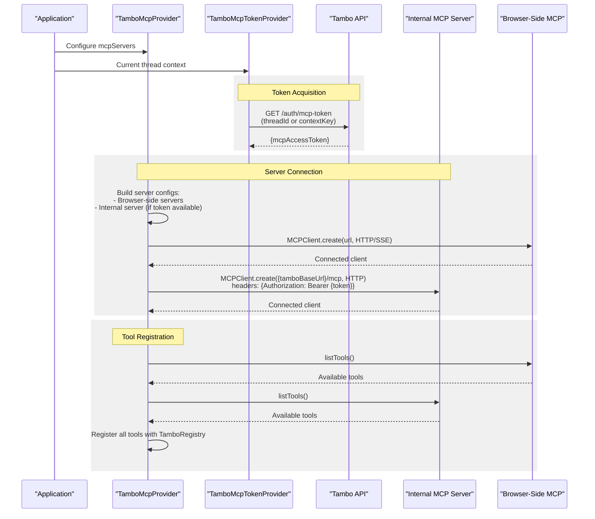
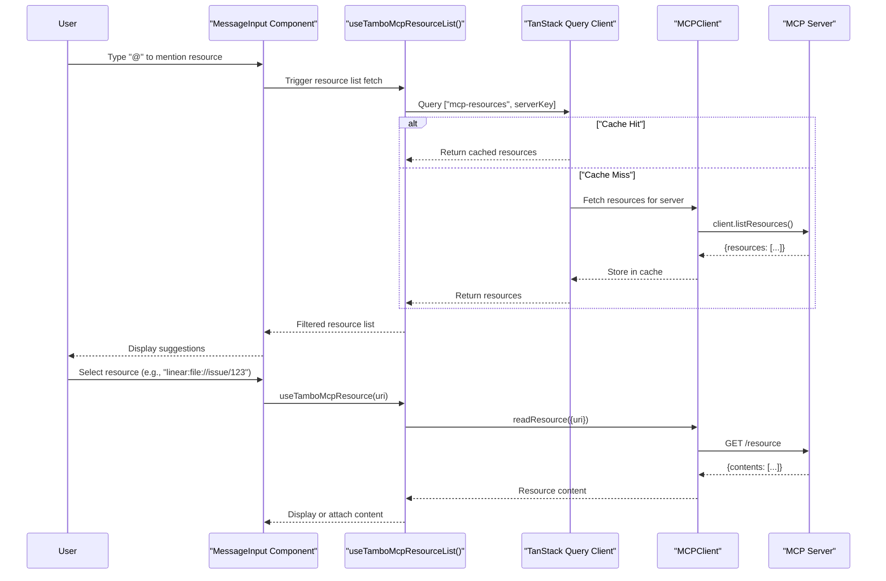
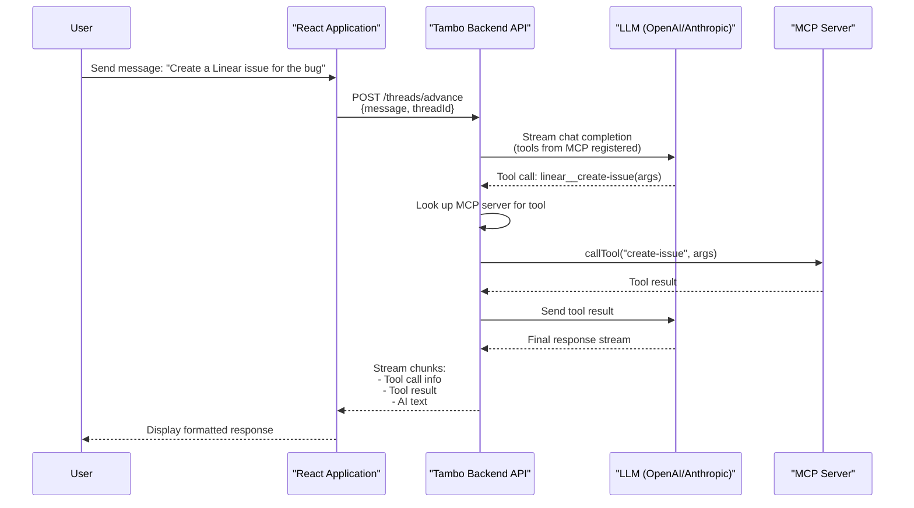

<!-- source: DeepWiki mcp.deepwiki.com · repo tambo-ai/tambo · page 6.1 MCP Overview · fetched 2026-10-29 -->

# MCP Overview

<details>
<summary>Relevant source files</summary>

The following files were used as context for generating this wiki page:

- [.config/release-please/.release-please-manifest.json](.config/release-please/.release-please-manifest.json)
- [apps/api/CHANGELOG.md](apps/api/CHANGELOG.md)
- [apps/api/package.json](apps/api/package.json)
- [apps/docs-mcp/package.json](apps/docs-mcp/package.json)
- [apps/test-mcp-server/package.json](apps/test-mcp-server/package.json)
- [apps/web/CHANGELOG.md](apps/web/CHANGELOG.md)
- [apps/web/package.json](apps/web/package.json)
- [cli/CHANGELOG.md](cli/CHANGELOG.md)
- [cli/package.json](cli/package.json)
- [create-tambo-app/CHANGELOG.md](create-tambo-app/CHANGELOG.md)
- [create-tambo-app/package.json](create-tambo-app/package.json)
- [docs/CHANGELOG.md](docs/CHANGELOG.md)
- [docs/package.json](docs/package.json)
- [package-lock.json](package-lock.json)
- [package.json](package.json)
- [packages/backend/package.json](packages/backend/package.json)
- [packages/core/package.json](packages/core/package.json)
- [packages/eslint-config/package.json](packages/eslint-config/package.json)
- [packages/react-ui-base/CHANGELOG.md](packages/react-ui-base/CHANGELOG.md)
- [packages/react-ui-base/package.json](packages/react-ui-base/package.json)
- [packages/testing/package.json](packages/testing/package.json)
- [packages/ui-registry/package.json](packages/ui-registry/package.json)
- [react-sdk/CHANGELOG.md](react-sdk/CHANGELOG.md)
- [react-sdk/package.json](react-sdk/package.json)
- [react-sdk/src/mcp/index.ts](react-sdk/src/mcp/index.ts)
- [react-sdk/src/mcp/mcp-client.ts](react-sdk/src/mcp/mcp-client.ts)
- [react-sdk/src/mcp/mcp-hooks.ts](react-sdk/src/mcp/mcp-hooks.ts)
- [react-sdk/src/mcp/tambo-mcp-provider.tsx](react-sdk/src/mcp/tambo-mcp-provider.tsx)
- [react-sdk/src/providers/tambo-mcp-token-provider.tsx](react-sdk/src/providers/tambo-mcp-token-provider.tsx)
- [showcase/CHANGELOG.md](showcase/CHANGELOG.md)
- [showcase/package.json](showcase/package.json)

</details>


## Purpose and Scope

This page introduces the Model Context Protocol (MCP) integration in Tambo, explaining what MCP is, why it's valuable, and how Tambo's architecture supports MCP connections. For detailed implementation of specific MCP features, see:
- Client-side MCP setup and configuration: [6.2](#6.2)
- Using MCP resources and prompts in user interfaces: [6.3](#6.3)
- Server-side MCP tool execution: [6.4](#6.4)
- MCP-specific React hooks API: [6.5](#6.5)
- Advanced MCP features (elicitation, sampling): [6.6](#6.6)

---

## What is Model Context Protocol (MCP)?

Model Context Protocol (MCP) is a standardized protocol that enables AI models to connect to external systems such as databases, APIs, file systems, and third-party services. MCP defines a client-server architecture where:

- **MCP Servers** expose capabilities (tools, resources, prompts) that AI models can use
- **MCP Clients** connect to servers and invoke their capabilities
- The protocol supports bidirectional communication, including requests from servers back to clients (elicitation, sampling)

MCP standardizes how AI applications interact with external data sources and functionality, making integrations reusable across different AI frameworks.

**Sources:** [README.md:182-205](), [react-sdk/README.md:239-259](), [docs/content/docs/index.mdx:59-60]()

---

## Why MCP in Tambo?

Tambo's MCP integration provides:

| Benefit | Description |
|---------|-------------|
| **Plug-and-play integrations** | Connect to pre-built MCP servers for Linear, Slack, databases, file systems |
| **Unified protocol** | One consistent API for all external integrations |
| **Client and server execution** | Resources/prompts fetch client-side for speed; tools execute server-side for security |
| **Bidirectional communication** | Support for elicitation (server requests user input) and sampling (AI explores options) |
| **Custom MCP servers** | Build your own MCP servers for proprietary systems |

The MCP integration is "MCP-native" - built into the core architecture rather than bolted on, making external integrations a first-class citizen in Tambo applications.

**Sources:** [README.md:182-205](), [docs/content/docs/index.mdx:13-14,59-60]()

---

## MCP Architecture in Tambo

Tambo's MCP implementation spans both client-side (React SDK) and server-side (NestJS API) components:



**Key architectural components:**

- **`TamboProvider`**: Root configuration point where `mcpServers` are specified ([react-sdk/src/providers/tambo-provider.tsx:60-92]())
- **`TamboMcpProvider`**: Manages MCP client lifecycle, auto-registers tools from connected servers ([react-sdk/src/mcp/tambo-mcp-provider.tsx:375-448]())
- **`MCPClient`**: Wrapper around `@modelcontextprotocol/sdk` Client, handles HTTP/SSE transports ([react-sdk/src/mcp/mcp-client.ts:94-343]())
- **MCP Hooks**: React hooks for querying resources and prompts (`useTamboMcpResourceList`, `useTamboMcpPromptList`) ([react-sdk/src/mcp/mcp-hooks.ts:82-137,257-381]())

**Sources:** [react-sdk/src/mcp/tambo-mcp-provider.tsx:1-729](), [react-sdk/src/mcp/mcp-client.ts:1-366](), [react-sdk/src/mcp/index.ts:1-51]()

---

## MCP Server Types

Tambo supports two categories of MCP servers, distinguished by their execution context:

### Browser-Side MCP Servers

**Definition:** MCP servers explicitly configured by developers in the `mcpServers` prop of `TamboProvider`.

**Characteristics:**
- Resources and prompts are fetched directly from browser (client-side)
- Tools are registered locally and can execute in either client or server context
- Fast autocomplete for resources and prompts (no round-trip to Tambo API)
- Identified by `ServerType.BROWSER_SIDE` internally

**Example Configuration:**
```typescript
const mcpServers = [
  {
    name: "filesystem",
    url: "http://localhost:8261/mcp",
    transport: MCPTransport.HTTP,
  },
];

<TamboProvider mcpServers={mcpServers}>
  <App />
</TamboProvider>
```

### Tambo Internal MCP Server

**Definition:** An automatically-configured MCP server managed by Tambo that provides access to Tambo Cloud features.

**Characteristics:**
- Created automatically when `mcpAccessToken` is available ([react-sdk/src/mcp/tambo-mcp-provider.tsx:240-259]())
- Named `__tambo_internal_mcp_server__` ([react-sdk/src/mcp/tambo-mcp-provider.tsx:144]())
- Endpoint: `{tamboBaseUrl}/mcp` with `Authorization: Bearer {mcpAccessToken}` header
- Identified by `ServerType.TAMBO_INTERNAL`
- Token is fetched per-thread or threadless context ([react-sdk/src/providers/tambo-mcp-token-provider.tsx:36-139]())

**Connection Flow:**



**Sources:** [react-sdk/src/mcp/tambo-mcp-provider.tsx:225-263,454-561](), [react-sdk/src/providers/tambo-mcp-token-provider.tsx:53-140](), [react-sdk/src/mcp/mcp-client.ts:145-166]()

---

## MCP Protocol Entities

MCP defines three primary entity types that servers can expose:

### Tools

**Purpose:** Functions that the AI can call to perform actions or fetch data.

**Execution:** 
- Registered in `TamboRegistry` by `TamboMcpProvider` ([react-sdk/src/mcp/tambo-mcp-provider.tsx:273-343]())
- Can execute client-side (browser) or server-side (Tambo API) depending on tool configuration
- Results are streamed back to the UI as part of AI responses

**Schema:** Tools define `inputSchema` (JSON Schema) for arguments and return structured data.

**Example Tool Registration:**
```typescript
// Automatic registration by TamboMcpProvider
registerTool({
  name: shouldPrefix ? `${serverKey}__${tool.name}` : tool.name,
  description: tool.description,
  tool: async (args: Record<string, unknown>) => {
    const result = await mcpServer.client.callTool(tool.name, args);
    if (result.isError) {
      throw new Error(extractErrorMessage(result.content));
    }
    return result.content;
  },
  inputSchema: tool.inputSchema,
  outputSchema: {},
  transformToContent: (content) => { /* ... */ }
});
```

### Resources

**Purpose:** Static or dynamic content that can be referenced in user messages using `@mentions`.

**Characteristics:**
- Listed via `useTamboMcpResourceList(search?)` hook ([react-sdk/src/mcp/mcp-hooks.ts:257-381]())
- Fetched via `useTamboMcpResource(resourceUri)` hook ([react-sdk/src/mcp/mcp-hooks.ts:390-458]())
- Prefixed with `{serverKey}:` to avoid naming conflicts (e.g., `linear:file://issue/123`)
- Support optional search filtering (server-side or client-side depending on source)

**Resource URI Format:**
- MCP resources: `{serverKey}:{originalUri}` (e.g., `filesystem:file:///docs/readme.md`)
- Registry resources: `registry:{originalUri}` (e.g., `registry:file:///config.json`)

### Prompts

**Purpose:** Pre-defined prompt templates with arguments that users can invoke using `/commands`.

**Characteristics:**
- Listed via `useTamboMcpPromptList(search?)` hook ([react-sdk/src/mcp/mcp-hooks.ts:82-138]())
- Fetched via `useTamboMcpPrompt(promptName, args)` hook ([react-sdk/src/mcp/mcp-hooks.ts:205-249]())
- Always prefixed with `{serverKey}:` (e.g., `linear:create-issue`)
- Return messages with content that can be inserted into conversation

**Prompt Name Format:**
- Always: `{serverKey}:{originalPromptName}`
- Example: `linear:create-issue`, `slack:send-message`

**Sources:** [react-sdk/src/mcp/mcp-hooks.ts:1-459](), [react-sdk/src/mcp/tambo-mcp-provider.tsx:273-343]()

---

## Transport Mechanisms

MCP clients connect to servers using one of two transport protocols:

| Transport | Enum Value | Use Case | Implementation |
|-----------|------------|----------|----------------|
| **HTTP** | `MCPTransport.HTTP` | Streamable HTTP for most MCP servers | `StreamableHTTPClientTransport` from `@modelcontextprotocol/sdk` |
| **SSE** | `MCPTransport.SSE` | Server-Sent Events for streaming connections | `SSEClientTransport` from `@modelcontextprotocol/sdk` |

**Transport Selection:**

The transport is configured per-server in the `mcpServers` array:

```typescript
import { MCPTransport } from "@tambo-ai/react/mcp";

const mcpServers = [
  {
    name: "database",
    url: "http://localhost:8080/mcp",
    transport: MCPTransport.HTTP,  // Default, supports most features
  },
  {
    name: "realtime-server",
    url: "http://localhost:9000/sse",
    transport: MCPTransport.SSE,   // For streaming-heavy servers
  },
];
```

**Client Initialization:**

The `MCPClient` class wraps the `@modelcontextprotocol/sdk` Client and handles transport setup ([react-sdk/src/mcp/mcp-client.ts:168-181]()):

```typescript
// Simplified from mcp-client.ts
private initializeTransport(sessionId: string | undefined) {
  if (this.transportType === MCPTransport.SSE) {
    return new SSEClientTransport(new URL(this.endpoint), {
      authProvider: this.authProvider,
      requestInit: { headers: this.headers },
    });
  } else {
    return new StreamableHTTPClientTransport(new URL(this.endpoint), {
      authProvider: this.authProvider,
      requestInit: { headers: this.headers },
      sessionId,
    });
  }
}
```

**Sources:** [react-sdk/src/mcp/mcp-client.ts:17-20,168-181](), [react-sdk/src/model/mcp-server-info.ts]()

---

## MCP Server Configuration

### Basic Configuration

MCP servers are configured in the `TamboProvider`:

```typescript
import { TamboProvider } from "@tambo-ai/react";
import { MCPTransport } from "@tambo-ai/react/mcp";

const mcpServers = [
  {
    name: "filesystem",               // Human-readable name
    url: "http://localhost:8261/mcp", // MCP server endpoint
    transport: MCPTransport.HTTP,     // HTTP or SSE
  },
];

<TamboProvider
  apiKey={process.env.NEXT_PUBLIC_TAMBO_API_KEY}
  components={components}
  mcpServers={mcpServers}
>
  <App />
</TamboProvider>
```

### Server Configuration Fields

| Field | Type | Required | Description |
|-------|------|----------|-------------|
| `name` | `string` | Yes | Human-readable server identifier |
| `url` | `string` | Yes | MCP server endpoint URL |
| `transport` | `MCPTransport` | No | `HTTP` (default) or `SSE` |
| `serverKey` | `string` | No | Custom prefix for tools/resources/prompts (defaults to `name`) |
| `customHeaders` | `Record<string, string>` | No | HTTP headers to include in requests |
| `handlers` | `Partial<MCPHandlers>` | No | Custom elicitation/sampling handlers (overrides provider-level) |

### Server Key and Prefixing

The `serverKey` (or `name` if not specified) is used to namespace MCP entities:

- **Tools:** Prefixed when multiple servers are configured (e.g., `linear__create-issue`)
- **Resources:** Always prefixed (e.g., `linear:file://issue/123`)
- **Prompts:** Always prefixed (e.g., `linear:create-issue`)

The stable server identity key is computed from URL, transport, and headers ([react-sdk/src/model/mcp-server-info.ts](), [react-sdk/src/mcp/tambo-mcp-provider.tsx:711-728]()):

```typescript
// From getMcpServerUniqueKey
const key = getMcpServerUniqueKey(server);  
// Includes URL, transport, and headers hash for cache invalidation
```

**Sources:** [README.md:185-199](), [react-sdk/README.md:242-256](), [react-sdk/src/mcp/tambo-mcp-provider.tsx:225-263,711-728]()

---

## MCP Request Flow Patterns

### Client-Side Resource Fetch



**Key Implementation Details:**

- Resources are cached per-server using query keys like `["mcp-resources", serverKey]` ([react-sdk/src/mcp/mcp-hooks.ts:265]())
- Prefixes are applied in the `combine` function after fetching ([react-sdk/src/mcp/mcp-hooks.ts:320-344]())
- Search filtering happens client-side for MCP resources, unless they're from a dynamic registry source ([react-sdk/src/mcp/mcp-hooks.ts:357-370]())

### Server-Side Tool Execution



**Key Implementation Details:**

- Tools are auto-registered by `TamboMcpProvider` on connection ([react-sdk/src/mcp/tambo-mcp-provider.tsx:273-343]())
- Tool names are prefixed when multiple servers exist to avoid conflicts
- The Tambo API handles server-side tool execution for security/access to protected resources
- Tool results support `transformToContent` for rich media (images, audio) ([react-sdk/src/mcp/tambo-mcp-provider.tsx:326-331]())

**Sources:** [react-sdk/src/mcp/mcp-hooks.ts:257-458](), [react-sdk/src/mcp/tambo-mcp-provider.tsx:273-343,454-561]()

---

## Next Steps

This overview covers the fundamentals of MCP in Tambo. For implementation details:

- **Setting up MCP clients:** [6.2](#6.2) - Client-Side MCP Integration
- **Using resources and prompts:** [6.3](#6.3) - MCP Resources and Prompts
- **Tool execution patterns:** [6.4](#6.4) - MCP Tools and Server-Side Execution
- **React hooks reference:** [6.5](#6.5) - MCP Hooks Reference
- **Advanced features:** [6.6](#6.6) - Elicitation and Sampling

**Sources:** [react-sdk/src/mcp/index.ts:1-51](), [README.md:182-205](), [docs/content/docs/index.mdx:198-231]()

---

