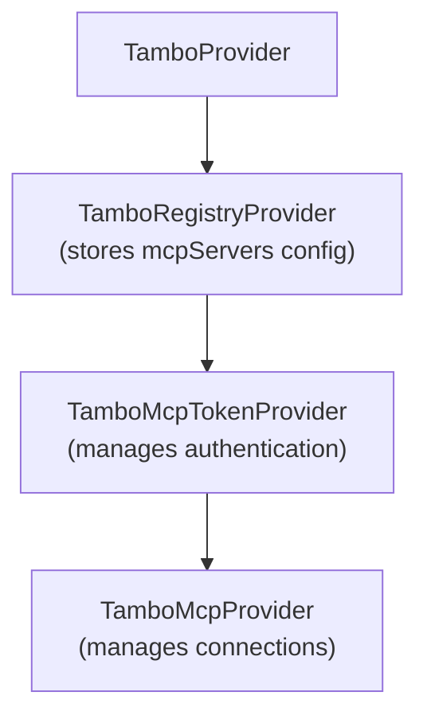
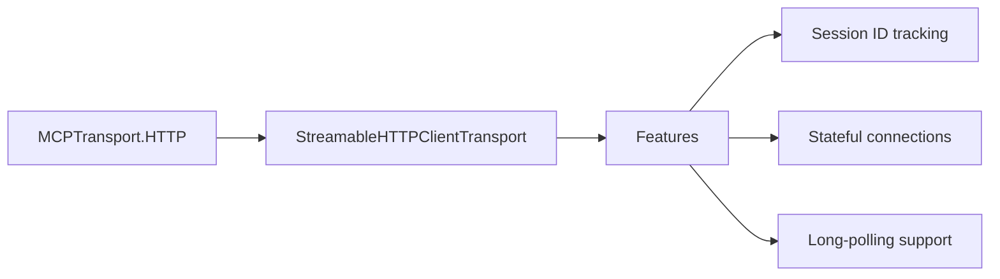
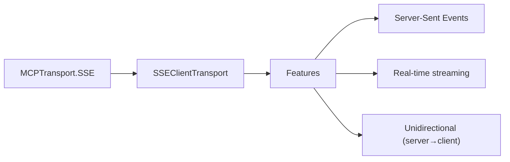
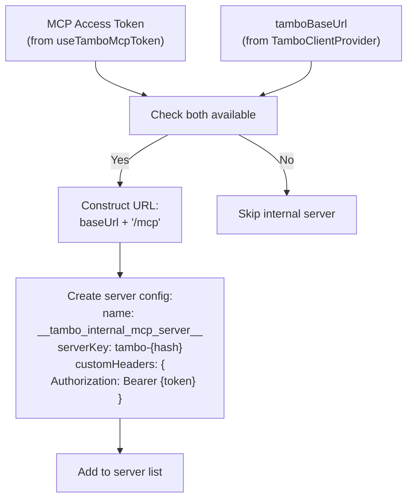
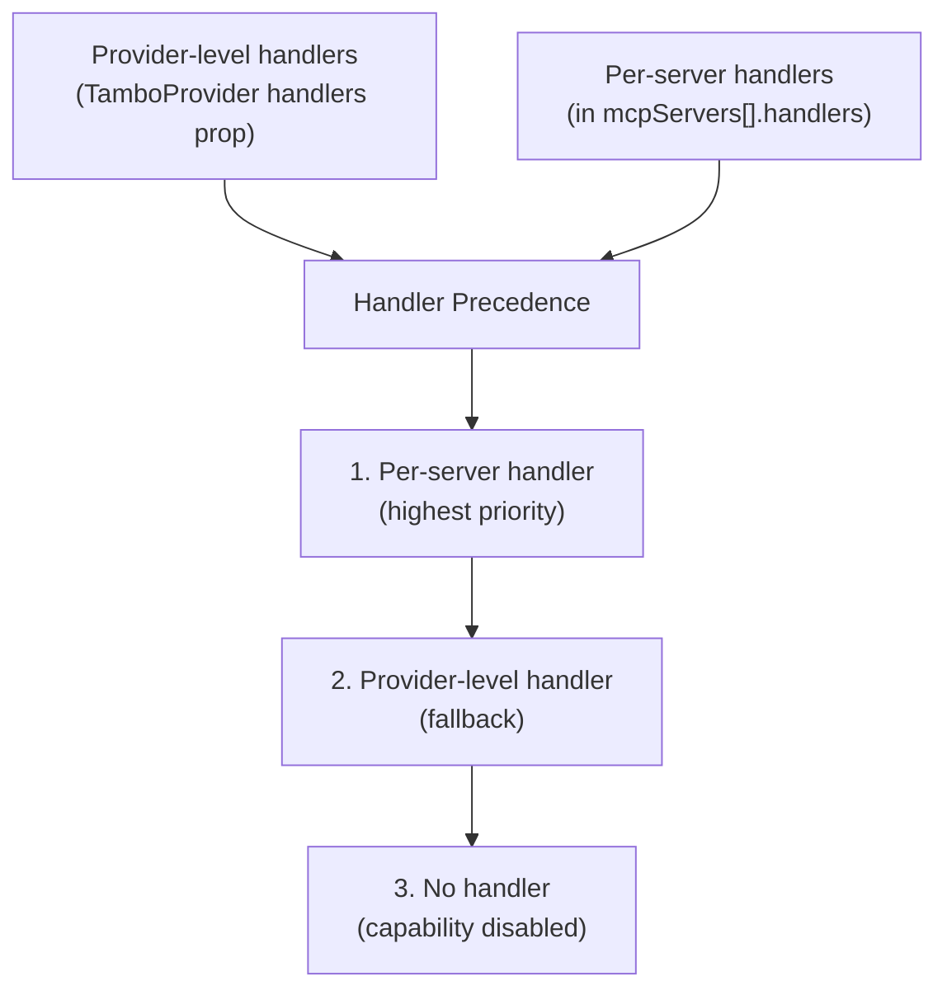
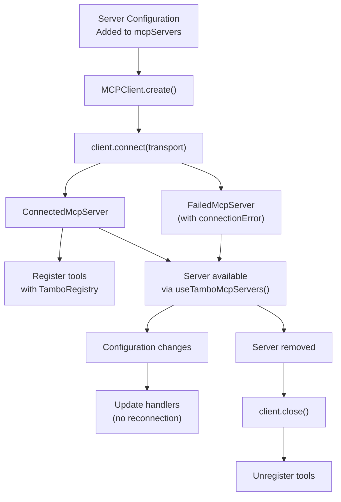
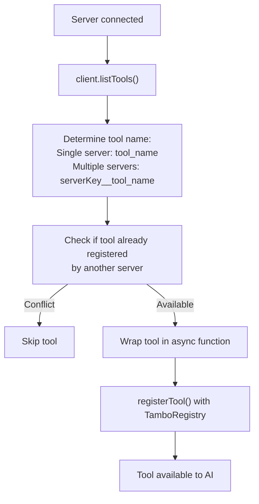
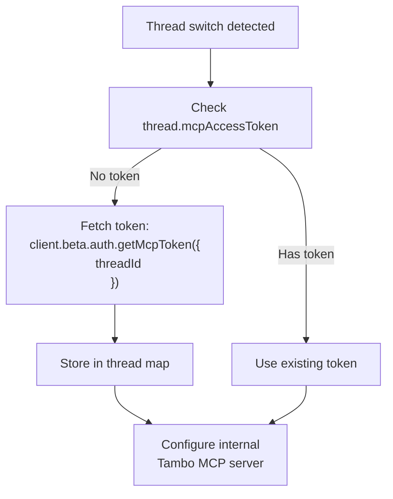
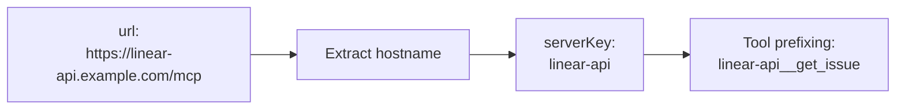

<!-- source: DeepWiki mcp.deepwiki.com · repo tambo-ai/tambo · page 6.2 Configuring MCP Servers · fetched 2026-10-29 -->

# Configuring MCP Servers

<details>
<summary>Relevant source files</summary>

The following files were used as context for generating this wiki page:

- [react-sdk/src/mcp/index.ts](react-sdk/src/mcp/index.ts)
- [react-sdk/src/mcp/mcp-client.ts](react-sdk/src/mcp/mcp-client.ts)
- [react-sdk/src/mcp/mcp-hooks.ts](react-sdk/src/mcp/mcp-hooks.ts)
- [react-sdk/src/mcp/tambo-mcp-provider.tsx](react-sdk/src/mcp/tambo-mcp-provider.tsx)
- [react-sdk/src/providers/tambo-mcp-token-provider.tsx](react-sdk/src/providers/tambo-mcp-token-provider.tsx)

</details>


## Overview

This page explains how to configure MCP (Model Context Protocol) servers in your Tambo application. MCP servers extend your application's capabilities by providing tools, resources, and prompts from external services. Configuration is done through the `TamboProvider` or `TamboMcpProvider` components.

For an overview of MCP concepts, see page 6.1 (MCP Overview). For information about using MCP resources and prompts in your UI, see page 6.3 (MCP Resources and Prompts). For details on MCP tools, see page 6.4 (MCP Tools).

**Sources:** [react-sdk/src/mcp/index.ts:1-51](), [react-sdk/src/mcp/tambo-mcp-provider.tsx:1-729]()
</thinking>

## Basic Configuration

MCP servers are configured by passing the `mcpServers` prop to `TamboProvider`:

```typescript
import { TamboProvider } from "@tambo-ai/react";
import { MCPTransport } from "@tambo-ai/react/mcp";

function App() {
  return (
    <TamboProvider
      apiKey={process.env.NEXT_PUBLIC_TAMBO_API_KEY}
      mcpServers={[
        {
          url: "https://linear-mcp.example.com/mcp",
          transport: MCPTransport.HTTP,
          customHeaders: {
            "X-API-Key": "your-api-key"
          }
        }
      ]}
    >
      <YourApp />
    </TamboProvider>
  );
}
```

The `mcpServers` prop accepts an array of server configurations. Each server is automatically connected when the provider mounts, and its tools, resources, and prompts become available to your application.

**Sources:** [react-sdk/src/providers/tambo-provider.tsx](), [react-sdk/src/mcp/tambo-mcp-provider.tsx:375-448]()


## Server Configuration Structure

### McpServerInfo Interface

Each MCP server is configured using the `McpServerInfo` interface:

| Property | Type | Required | Description |
|----------|------|----------|-------------|
| `url` | `string` | Yes | The endpoint URL of the MCP server |
| `transport` | `MCPTransport` | No | Transport protocol (defaults to `HTTP`) |
| `customHeaders` | `Record<string, string>` | No | Custom headers for authentication or other purposes |

**Example:**
```typescript
{
  url: "https://api.example.com/mcp",
  transport: MCPTransport.HTTP,
  customHeaders: {
    "Authorization": "Bearer token",
    "X-API-Key": "key"
  }
}
```

The provider automatically normalizes server configurations, deriving a `serverKey` from the URL hostname for tool/resource prefixing.

**Sources:** [react-sdk/src/model/mcp-server-info.ts](), [react-sdk/src/mcp/tambo-mcp-provider.tsx:70-86]()

### Provider Hierarchy

The MCP integration fits into Tambo's provider hierarchy:



Configuration flows from `TamboProvider` down to `TamboMcpProvider`, which handles client lifecycle and tool registration.

**Sources:** [react-sdk/src/providers/tambo-provider.tsx](), [react-sdk/src/mcp/tambo-mcp-provider.tsx:375-448]()


## Transport Types

Tambo supports two MCP transport protocols via the `@modelcontextprotocol/sdk`:

### HTTP Transport

**Title:** HTTP Transport Configuration Flow



The HTTP transport uses `StreamableHTTPClientTransport` from the MCP SDK. It maintains session state through a `sessionId` and is suitable for most use cases.

**Configuration:**
```typescript
{
  url: "https://api.example.com/mcp",
  transport: MCPTransport.HTTP,  // Default if not specified
  customHeaders: {
    "Authorization": "Bearer token"
  }
}
```

**Sources:** [react-sdk/src/mcp/mcp-client.ts:168-181](), [react-sdk/src/model/mcp-server-info.ts]()

### SSE Transport

**Title:** SSE Transport Configuration Flow



The SSE transport uses `SSEClientTransport` for server-sent event streaming. This provides real-time updates from the server but only supports server-to-client communication.

**Configuration:**
```typescript
{
  url: "https://api.example.com/sse",
  transport: MCPTransport.SSE,
  customHeaders: {
    "X-API-Key": "key"
  }
}
```

**Sources:** [react-sdk/src/mcp/mcp-client.ts:168-181](), [react-sdk/src/model/mcp-server-info.ts]()

### Transport Comparison

| Feature | HTTP | SSE |
|---------|------|-----|
| SDK Class | `StreamableHTTPClientTransport` | `SSEClientTransport` |
| Session State | Yes (via `sessionId`) | No |
| Long-polling | Yes | N/A |
| Real-time Updates | Via polling | Native streaming |
| Direction | Bidirectional | Server→Client |
| Use Case | General purpose | Real-time notifications |

Both transports support authentication via `customHeaders` and optional `authProvider` for OAuth flows.

**Sources:** [react-sdk/src/mcp/mcp-client.ts:168-181]()


## Authentication

### Custom Headers

The most common authentication method is passing API keys or tokens via `customHeaders`:

```typescript
{
  url: "https://api.example.com/mcp",
  customHeaders: {
    "Authorization": "Bearer your-api-token",
    "X-API-Key": "your-api-key"
  }
}
```

Headers are included in all requests to the MCP server.

**Sources:** [react-sdk/src/mcp/mcp-client.ts:115-130]()

### OAuth Provider

For OAuth-based authentication, you can provide an `OAuthClientProvider` from the MCP SDK:

```typescript
import { OAuthClientProvider } from "@modelcontextprotocol/sdk/client/auth.js";

const authProvider: OAuthClientProvider = {
  // OAuth configuration
};

// Note: OAuth providers must be configured at the MCPClient level,
// not through TamboProvider. This is an advanced use case.
```

OAuth providers are passed to the underlying transport during client creation. See the MCP SDK documentation for details on implementing OAuth providers.

**Sources:** [react-sdk/src/mcp/mcp-client.ts:115-130](), [react-sdk/src/mcp/mcp-client.ts:168-181]()

### Internal Tambo Server Authentication

When using Tambo Cloud, the provider automatically configures an internal MCP server with authentication:

**Title:** Internal Tambo MCP Server Configuration



This internal server provides access to Tambo-specific MCP features and is automatically included when:
1. An MCP access token is available (either from thread or `contextKey`)
2. The Tambo base URL is configured

**Sources:** [react-sdk/src/mcp/tambo-mcp-provider.tsx:224-263](), [react-sdk/src/providers/tambo-mcp-token-provider.tsx]()


## Advanced Configuration

### TamboMcpProvider Props

While most configuration happens via `TamboProvider`, you can access advanced features through `TamboMcpProvider`:

| Prop | Type | Description |
|------|------|-------------|
| `handlers` | `ProviderMCPHandlers` | Optional handlers for elicitation and sampling requests |
| `contextKey` | `string` | Optional context key for fetching threadless MCP tokens |
| `children` | `ReactNode` | Child components |

**Note:** The `mcpServers` prop is no longer passed to `TamboMcpProvider` directly. Configuration must be done through `TamboProvider`.

**Sources:** [react-sdk/src/mcp/tambo-mcp-provider.tsx:375-378]()

### MCP Protocol Handlers

MCP servers can request user input (elicitation) or AI responses (sampling). You can provide handlers for these requests:

**Title:** Handler Configuration and Precedence



**Example:**
```typescript
<TamboProvider
  mcpServers={[
    {
      url: "https://api.example.com/mcp",
      // Server-specific handler (highest priority)
      handlers: {
        elicitation: async (request, extra, serverInfo) => {
          // Handle elicitation for this server only
          return { action: "accept", content: {} };
        }
      }
    }
  ]}
  // Provider-level handler (fallback for all servers)
  handlers={{
    elicitation: async (request, extra, serverInfo) => {
      // Default elicitation handler
      return { action: "accept", content: {} };
    },
    sampling: async (request, extra, serverInfo) => {
      // Handle AI sampling requests
      return { content: [] };
    }
  }}
/>
```

Handler signatures:
- `elicitation`: `(ElicitRequest, RequestHandlerExtra, McpServerConfig) => Promise<ElicitResult>`
- `sampling`: `(CreateMessageRequest, RequestHandlerExtra, McpServerConfig) => Promise<CreateMessageResult>`

The `serverInfo` parameter allows handlers to customize behavior based on which server sent the request.

**Sources:** [react-sdk/src/mcp/tambo-mcp-provider.tsx:117-128](), [react-sdk/src/mcp/tambo-mcp-provider.tsx:192-218]()

### Connection Lifecycle

The provider automatically manages MCP client connections:

1. **Creation**: When a server is added to `mcpServers`, a client is created and connected
2. **Updates**: When handler configurations change, existing clients are updated without reconnection
3. **Removal**: When a server is removed, the client is closed and its tools are unregistered
4. **Cleanup**: All clients are closed when the provider unmounts

**Title:** Client Connection Lifecycle



Failed connections are tracked and exposed via `useTamboMcpServers()` with a `connectionError` property.

**Sources:** [react-sdk/src/mcp/tambo-mcp-provider.tsx:454-561](), [react-sdk/src/mcp/tambo-mcp-provider.tsx:91-106]()


## Server Types and Tool Registration

### Browser-Side vs Internal Servers

The provider distinguishes between two server types:

| Type | Description | Configuration | Tool Execution |
|------|-------------|---------------|----------------|
| `BROWSER_SIDE` | User-configured external servers | Via `mcpServers` prop | Client-side in browser |
| `TAMBO_INTERNAL` | Automatic internal Tambo server | Automatic when token available | Server-side via Tambo API |

Browser-side servers connect directly from the browser, while the internal server routes through Tambo's API for server-side execution.

**Sources:** [react-sdk/src/mcp/mcp-constants.ts](), [react-sdk/src/mcp/tambo-mcp-provider.tsx:70-86]()

### Automatic Tool Registration

When an MCP server connects, its tools are automatically registered with the Tambo registry:

**Title:** Tool Registration Flow



### Tool Naming Convention

Tool names are automatically prefixed based on the number of configured servers:

| Server Count | Tool Name | Example |
|--------------|-----------|---------|
| 1 server | `{toolName}` | `get_issue` |
| 2+ servers | `{serverKey}__{toolName}` | `linear__get_issue` |

The double underscore (`__`) separator ensures tools from different servers don't collide. When only one server is configured, prefixes are omitted for simpler tool names.

**Sources:** [react-sdk/src/mcp/tambo-mcp-provider.tsx:273-343](), [react-sdk/src/mcp/tambo-mcp-provider.tsx:287-290]()


## Token Management

### Context-Based Tokens

For applications without threads (e.g., chatbots), you can fetch MCP tokens using a context key:

```typescript
<TamboMcpProvider contextKey="my-app-context">
  <YourApp />
</TamboMcpProvider>
```

When `contextKey` is provided, the provider automatically fetches an MCP token using `client.beta.auth.getMcpToken({ contextKey })`. This enables the internal Tambo MCP server without requiring a thread.

**Sources:** [react-sdk/src/providers/tambo-mcp-token-provider.tsx:73-122]()

### Thread-Specific Tokens

When using threads, MCP tokens are automatically managed per-thread:

**Title:** Thread-Based Token Management



Tokens are fetched lazily when switching to a thread that doesn't have one. The token is then stored and reused for subsequent accesses to that thread.

**Sources:** [react-sdk/src/providers/tambo-mcp-token-provider.tsx:73-122]()

### Token Priority

The system uses this priority order for token selection:

1. **Thread-specific token** (highest priority) - If current thread has `mcpAccessToken`
2. **Context-based token** - If `contextKey` provided and no thread active
3. **No token** - Internal Tambo server is not configured

**Sources:** [react-sdk/src/providers/tambo-mcp-token-provider.tsx:73-122]()


## Server Key Derivation

### Automatic Server Keys

When you configure an MCP server, the provider automatically derives a `serverKey` from the URL hostname:

**Title:** Server Key Derivation



The `serverKey` is used for:
- Prefixing tool names (when multiple servers configured)
- Prefixing resource URIs
- Identifying the server in logs and debugging

**Sources:** [react-sdk/src/model/mcp-server-info.ts]()

### Custom Server Keys

You can override the automatic key by providing a `serverKey` in your configuration:

```typescript
{
  url: "https://very-long-domain-name.example.com/mcp",
  serverKey: "myserver",  // Custom short name
  transport: MCPTransport.HTTP
}
```

This is useful when:
- The hostname is very long or complex
- You want consistent keys across environments
- Multiple servers share the same hostname (different paths)

**Sources:** [react-sdk/src/model/mcp-server-info.ts]()

### Unique Connection Keys

Internally, the provider generates a unique key for connection management that includes all connection properties:

```
{url}|{transport}|{JSON.stringify(customHeaders)}
```

This ensures that changing any connection property (URL, transport, or headers) triggers client recreation.

**Sources:** [react-sdk/src/mcp/tambo-mcp-provider.tsx:711-728]()

---

## Context Value and Hooks

The `TamboMcpProvider` exposes context via multiple hooks:

### useTamboMcpServers()

Defined at lines 658-660, returns the connected and failed servers:

```typescript
// From react-sdk/src/mcp/tambo-mcp-provider.tsx:658-660
export const useTamboMcpServers = () => {
  return useContext(McpProviderContext).servers;
};
```

Returns: `McpServer[]` where each `McpServer` is a discriminated union:

```typescript
// From lines 91-106
export interface ConnectedMcpServer extends McpServerConfig {
  client: MCPClient;  // Has connected client
}

export interface FailedMcpServer extends McpServerConfig {
  client?: never;  // No client
  connectionError: Error;  // Connection failure reason
}

export type McpServer = ConnectedMcpServer | FailedMcpServer;
```

Common properties (from `McpServerConfig`, lines 70-86):
- `key`: Unique connection identifier (`url|transport|headers`)
- `url`: MCP server endpoint
- `serverKey`: Short name for prefixing (e.g., `"linear"`, `"tambo-{hash}"`)
- `serverType`: `ServerType.BROWSER_SIDE` or `ServerType.TAMBO_INTERNAL`
- `transport`: `MCPTransport.HTTP` or `MCPTransport.SSE`
- `customHeaders`: Optional headers
- `handlers`: Optional per-server MCP handlers

### useTamboMcpElicitation()

Defined at lines 687-693, returns elicitation state for handling user input requests from MCP servers:

```typescript
// From react-sdk/src/mcp/tambo-mcp-provider.tsx:687-693
export const useTamboMcpElicitation = (): ElicitationContextState => {
  const context = useContext(McpProviderContext);
  return {
    elicitation: context.elicitation,
    resolveElicitation: context.resolveElicitation,
  };
};
```

Returns: `ElicitationContextState` with:
- `elicitation`: Current elicitation request or `null`
- `resolveElicitation`: Function to respond to the request or `null`

**Sources:** [react-sdk/src/mcp/tambo-mcp-provider.tsx:70-106](), [react-sdk/src/mcp/tambo-mcp-provider.tsx:658-693]()

---

## Usage Example

```typescript
import { TamboProvider } from "@tambo-ai/react";
import { MCPTransport } from "@tambo-ai/react/mcp";

function App() {
  return (
    <TamboProvider
      apiKey={process.env.NEXT_PUBLIC_TAMBO_API_KEY}
      mcpServers={[
        {
          url: "https://linear-mcp.example.com/mcp",
          transport: MCPTransport.HTTP,
          customHeaders: {
            "X-API-Key": "linear-key"
          }
        },
        {
          url: "https://slack-mcp.example.com/sse",
          transport: MCPTransport.SSE
        }
      ]}
      handlers={{
        // Optional: handle elicitation requests from any server
        elicitation: async (request, extra, serverInfo) => {
          // Display UI to user and return response
          return { action: "accept", content: {} };
        }
      }}
    >
      <YourApp />
    </TamboProvider>
  );
}
```

**Sources:** [react-sdk/src/providers/tambo-provider.tsx:60-92](), [react-sdk/src/mcp/tambo-mcp-provider.tsx:375-378]()

---

